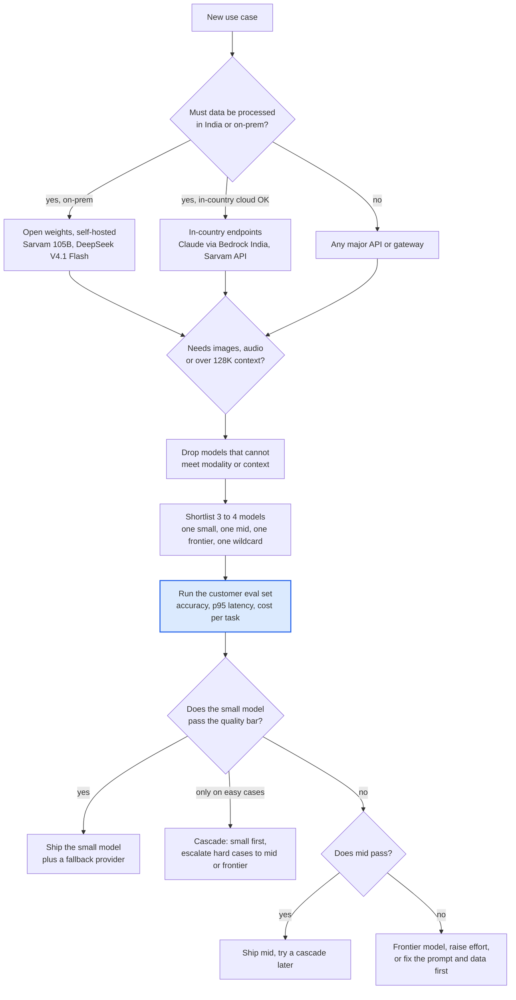
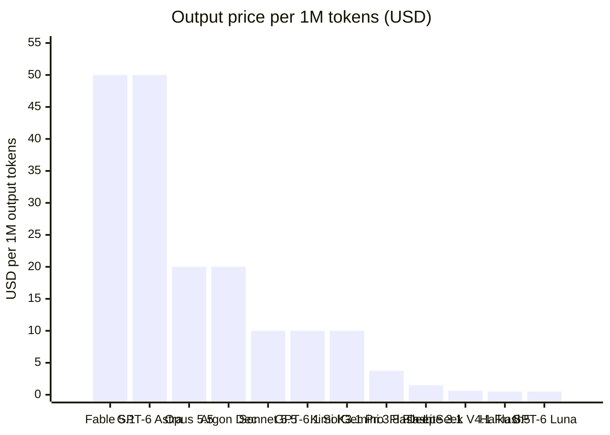
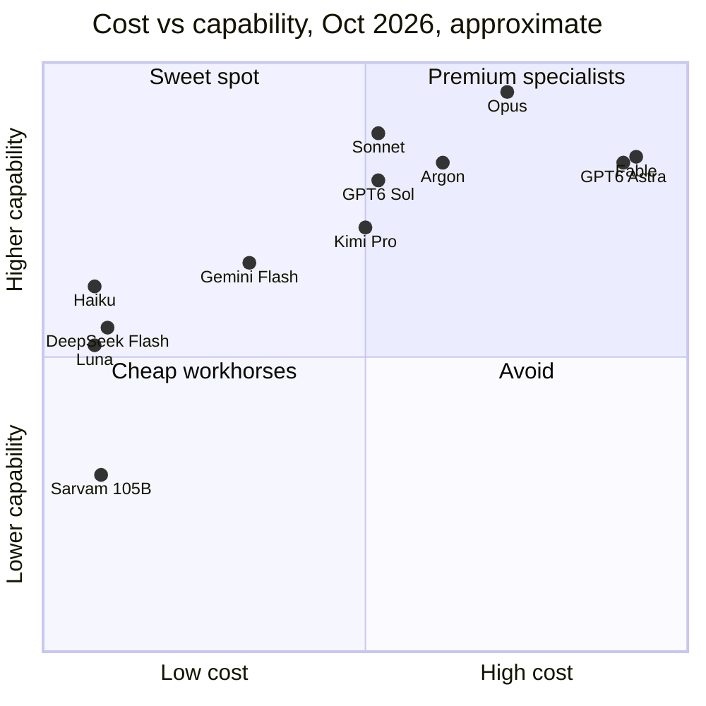
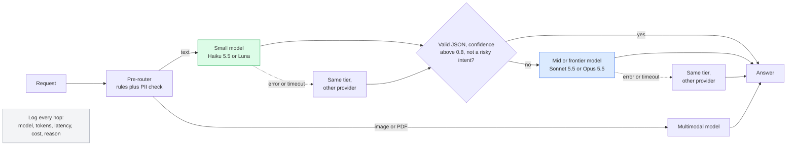
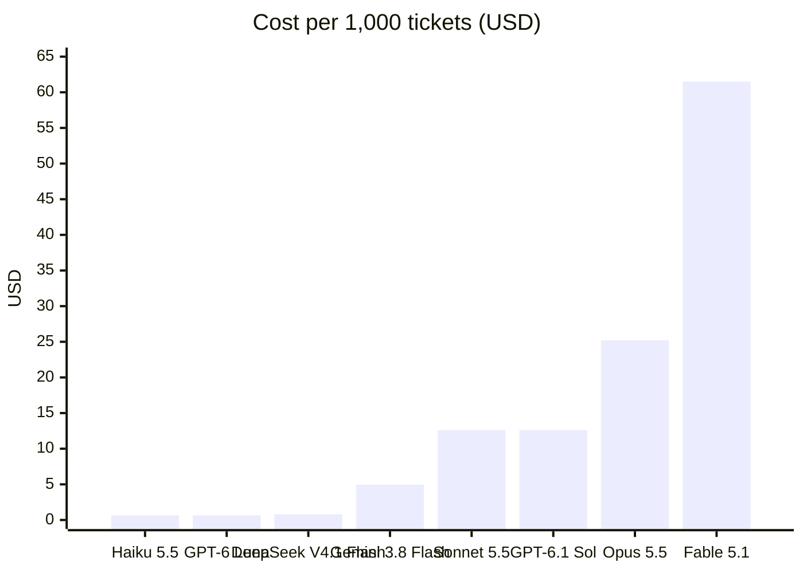
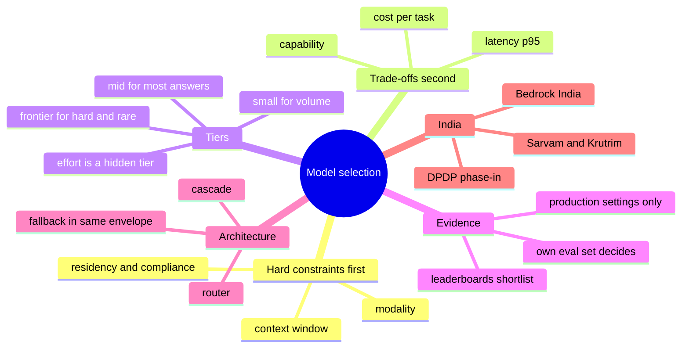



*Utkrishta Sinha · 30 Oct 2026 · about 40 minutes*

## 1. Key takeaways

Model selection is not "which model is best?" but "which is the cheapest, fastest model that passes *this customer's* tests, inside *this customer's* rules?". Reading time: about 40 minutes.

- **Pick on six axes, not one.** Capability, cost, latency, context window, modality and compliance (where the data is processed). A model that wins on a leaderboard can still lose on three of these for a given customer.
- **Prices span 100x inside one vendor.** As of 30 Oct 2026, Claude Haiku 5.5 and GPT-6 Luna cost $0.10 / $0.50 per million input / output tokens, while Claude Fable 5.1 and GPT-6 Astra cost $10 / $50. The same support workload costs about $0.66 or $61.50 per 1,000 tickets depending on that one choice.
- **Leaderboards shortlist, your eval set decides.** Artificial Analysis and LMArena tell you who is in the top ten (Claude Opus 5.5, Gemini 4 Argon, GPT-6 Astra, Meta Muse Wonder and friends). Only 50 to 200 of the customer's own labelled examples tell you which one to ship.
- **Cascades beat single models.** Send everything to a small model first and escalate only the hard or risky 10 to 20%. Mendral used exactly this to *upgrade* to Opus and still lower its bill.
- **In India, residency is now a real option, not an excuse.** Claude runs in-country via Amazon Bedrock (Mumbai and Hyderabad) since 5 Oct 2026, Sarvam's Apache-2.0 models can be self-hosted, and the DPDP Rules phase in through 2027. Ask "where is inference processed?", not just "where is data stored?".

## 2. Why this matters for an FDE

Yesterday you learned what a frontier model is. Today you learn the question every customer asks in week one: "Which one should we use?"

- **It is the first technical decision.** Prompt style, cost, latency budget, cloud contract and security review all depend on it.
- **It is where money is won or lost.** A wrong tier at 20,000 tickets a day is the difference between a $400 and a $37,000 monthly bill.
- **It is where trust is built.** "Claude, obviously" sounds like a salesperson. "Let's run your 100 examples on four models tomorrow" sounds like an engineer.
- **It never ends.** Prices change (Gemini 4 Argon doubles on 1 Dec 2026) and models retire. Swapping a model should be a config change plus an eval run.
- **Compliance can veto everything.** In banks and insurers, legal may rule out a model before you test it. Knowing the residency options keeps the project alive.

> Joke break: choosing an LLM by leaderboard rank is like hiring a cricketer by their Instagram followers. Great reach, but can they bowl on *your* pitch? 🏏

## 3. Core concepts, from simple to deep

We go in six steps: an everyday analogy, the vocabulary, the six axes, tiers and effort, benchmarks and their limits, and finally routing and multi-provider design.

### 3.1 The everyday analogy: choosing a vehicle

Imagine you run a logistics company and need to move things around Bengaluru.

- To deliver a letter, you send a **scooter**: cheap, fast, nimble.
- To move a sofa, you need a **tempo**.
- To move a factory machine, you hire a **truck with a crane**, which is slow and expensive.

Nobody buys only trucks "because trucks can carry everything". You buy a fleet, and a **dispatcher** decides which vehicle each job gets. If a scooter rider says "this parcel is too heavy", the dispatcher re-sends it by tempo.

LLMs work the same way:

| Vehicle world | LLM world |
| --- | --- |
| Scooter | Small-fast model (Claude Haiku 5.5, GPT-6 Luna, DeepSeek V4.1 Flash) |
| Tempo | Mid model (Claude Sonnet 5.5, GPT-6.1 Sol, Gemini 3.8 Flash) |
| Truck with crane | Frontier model (Claude Fable 5.1, Claude Opus 5.5, GPT-6 Astra, Gemini 4 Argon) |
| Petrol cost, load capacity | Price per million tokens, context window |
| Is the truck allowed on this road? | Compliance: can data leave India? |
| Owning vs renting | Self-hosting open weights vs calling an API |
| Dispatcher, "too heavy, send the tempo", spare vehicle | **Router**, **cascade**, **fallback** |
| Test drive on your actual routes | Your own **eval set** |

### 3.2 Glossary: every term in plain words

| Term | Plain meaning | Everyday example |
| --- | --- | --- |
| Model selection | Choosing which LLM (or mix) runs each part of a product | Picking scooter vs truck per delivery |
| Capability | How well a model does the task: accuracy, reasoning, following instructions | Can the driver handle hill roads? |
| Token | A chunk of text, roughly 3/4 of an English word; Hindi often uses more tokens per word | "namaste" might be 2 to 3 tokens |
| Input / output tokens | Tokens you send (prompt, history, documents) / tokens the model writes, including thinking | The parcel you hand over / the reply letter |
| Per-million-token price | Price for 1,000,000 tokens, quoted separately for input and output | "$2 / $10" means $2 per 1M in, $10 per 1M out |
| Cached input | Repeated prompt prefix the provider stores, charged at a big discount | Regular customer card: same order, cheaper |
| Cache write | One-time fee to store a prefix in the cache, slightly above normal input | Membership sign-up fee |
| Batch API | Send many requests to be done within hours, usually 50% off | Bulk courier rates for non-urgent parcels |
| Latency | Time until you get an answer | Delivery time |
| p50 / p95 latency | The median and the "slow 5%" response time | Typical vs bad-day delivery |
| Context window | Max tokens the model can see at once (prompt plus answer) | Load capacity of the vehicle |
| Modality | Kinds of input and output: text, image, audio, video | Can it carry liquids? |
| Data residency | Where data is stored and, more importantly, where it is processed | Is the truck allowed to leave the state? |
| In-country inference | The model runs on servers inside the country | Claude on Bedrock India endpoint |
| Open-weight model | Weights you can download and run yourself | Buying the vehicle instead of renting |
| Self-hosting | Running an open-weight model on your own GPUs or cloud account | Owning a fleet, hiring your own mechanics |
| Fine-tuning | Further training a model on your own examples | Training a driver on your city's lanes |
| Tier | Size class inside a vendor's family: frontier, mid, small-fast | Truck, tempo, scooter |
| Reasoning / effort setting | A dial for how much the model thinks before answering | `effort: low` vs `max` |
| Thinking tokens | Hidden reasoning tokens; billed as output | Rough work in the margin, which you pay for |
| Benchmark | A standard public test used to compare models | A driving-licence exam |
| Leaderboard | A ranked table of benchmark or vote results | Cricket rankings |
| LMArena | A site where people vote between two anonymous answers; gives an Elo-style score | A blind taste test |
| Elo score | A rating from head-to-head wins, as in chess | A player's chess rating |
| Artificial Analysis | An independent site that runs many benchmarks and measures price and speed | A consumer magazine testing cars |
| Intelligence Index | Artificial Analysis's combined score from 10 evaluations | Overall car rating |
| Contamination | Benchmark questions leaked into training data, inflating scores | Student saw the exam paper beforehand |
| Eval set (golden set) | Your own labelled examples with known correct answers | Test drive on your own routes |
| Grader | Code or a model that scores each answer | The examiner |
| LLM-as-judge | Using an LLM to grade another LLM's answers | One teacher marking another's paper |
| Router | Code that picks a model per request based on rules or a classifier | The dispatcher |
| Cascade | Try a cheap model first, escalate to a stronger one if needed | Scooter first, tempo if too heavy |
| Escalation signal | The reason to escalate: low confidence, failed validation, risky intent | "Parcel too heavy" |
| Fallback | Switch to another model or provider when one errors or times out | Spare vehicle |
| Multi-provider | Being able to run on more than one vendor | Two courier contracts |
| Gateway | A proxy that gives one API over many models and handles keys, logging, fallbacks | A dispatch office |
| OpenRouter | A hosted gateway with one OpenAI-compatible API to hundreds of models | An aggregator app for couriers |
| Bedrock / Vertex AI / Azure Foundry | AWS, Google Cloud and Microsoft clouds' managed model services | Renting vehicles from your existing landlord |
| Rate limit | Max requests or tokens per minute your account may send | Toll booth capacity |
| DPDP Act | India's Digital Personal Data Protection Act, 2023; Rules notified 14 Nov 2025 | India's GDPR-like privacy law |
| SDF (Significant Data Fiduciary) | A large or sensitive data handler the government designates, with extra duties | A big bank under extra scrutiny |
| Indic model | A model built for Indian languages, e.g. Sarvam 105B, Krutrim-2 | A driver who knows every gali in Lucknow |
| Code-mixed text | Sentences mixing languages, e.g. Hinglish | "Mera claim status kya hai?" |

### 3.3 The six axes of model selection

Every model choice is a trade-off across six axes. Write them on the whiteboard in the first customer meeting.

| Axis | Question to ask | Typical range today |
| --- | --- | --- |
| 1. Capability | Does it pass our tests? | Index scores from about 18 (Sarvam 105B) to 58 (Claude Opus 5.5 at max) on Artificial Analysis |
| 2. Cost | What does one task cost at our volume? | $0.10 to $10 per 1M input tokens |
| 3. Latency | Is it fast enough for the user experience? | Voice needs a first token in a few hundred ms; a nightly report can take minutes |
| 4. Context window | Can it see everything it needs? | 65K (Sarvam 30B) to about 1M (most frontier and Flash models) |
| 5. Modality | Does it read images, audio, PDFs? Does it speak? | All current Claude models: text and image in, text out |
| 6. Compliance and control | Where is it processed? Can we self-host? Contract terms? | Global API, regional endpoint, in-country cloud, or your own GPUs |

Three of these are **hard constraints** (pass or fail): compliance, context window, modality. Filter on them first. The other three (capability, cost, latency) are **trade-offs** you balance with numbers.


*Filter on hard constraints first, then let the eval set decide. The blue box is where most of the real work happens.*

### 3.4 Tiers: frontier, mid, small-fast

Every big vendor now sells a family in three or four sizes. Within a family, the prompts and tools are the same, so moving up or down a tier is cheap to try.

| Tier | Claude (Anthropic) | OpenAI | Google | Open weights | Use for |
| --- | --- | --- | --- | --- | --- |
| Frontier | Fable 5.1 ($10 / $50), Opus 5.5 ($4 / $20) | GPT-6 Astra ($10 / $50) | Gemini 4 Argon ($2 / $10 intro, $4 / $20 from 1 Dec) | Kimi K3.1 Pro ($2 / $10, weights promised by 4 Nov) | Hard reasoning, long agents, architecture, legal analysis |
| Mid | Sonnet 5.5 ($2 / $10) | GPT-6.1 Sol ($2 / $10) | Gemini 3.8 Flash ($0.75 / $3.75) | — | Most production chat, coding, RAG answers |
| Small-fast | Haiku 5.5 (from $0.10 / $0.50) | GPT-6 Luna ($0.10 / $0.50) | Gemini 3.1 Flash-Lite ($0.25 / $1.50) | DeepSeek V4.1 Flash ($0.15 / $0.60) | Classification, routing, extraction, sub-agents |
| Indic specialist | — | — | — | Sarvam 105B (Apache 2.0; API ₹15 / ₹60) | Indian languages, voice, sovereign deployments |

Prices are USD per 1M input / output tokens as of 30 Oct 2026 (vendor pages in Sources). Two surprises: **small models got much better** (Anthropic reports Haiku 5.5 at 72.4% on OSWorld vs 48.9% for GPT-6 Luna), and **mid is close to frontier** (Sonnet 5.5 at max scores 56 on Artificial Analysis vs 58 for Opus 5.5, at half the price).

**Output price per 1M tokens, USD, list prices as of 30 Oct 2026**


*"Argon Dec" is Gemini 4 Argon's standard price from 1 Dec 2026; until 30 Nov it is $10. Sarvam 105B is ₹60 (about $0.7 at ₹88 per dollar, an assumed rate).*

### 3.5 Reasoning and effort settings: the hidden fourth tier

Modern models have a dial for how hard they think. Claude uses `effort` (Opus 5.5 defaults to `medium`, Fable 5.1 and Sonnet 5.5 default to `high`). OpenAI's GPT-6.1 Sol and GPT-6 Astra take `reasoning_effort` of `low`, `medium`, `high`, `xhigh` or `max`; GPT-6 Luna also allows `none`.

Why it matters: **thinking tokens are billed as output**, the expensive side, so `max` can cost 5 to 10x `low` for the same final text. **Effort and tier overlap**: Sonnet 5.5 at `max` (56) beats Opus 5.5 at `medium` (51) on Artificial Analysis. And **latency grows with effort**, so a voice bot often needs `low` or none. Rule: treat each (model, effort) pair as a separate candidate, and test at least two efforts per model.

### 3.6 Benchmarks and leaderboards: useful, but not the answer

**Public benchmarks** are fixed tests: SWE-bench for coding, OSWorld for computer use, GPQA for science, MMLU for general knowledge. **Leaderboards** combine them or collect human votes.

The two leaderboards most people quote:

| Leaderboard | How it works | Top today (as of 17 Oct 2026) | Good for | Weakness |
| --- | --- | --- | --- | --- |
| [Artificial Analysis](https://www.developersdigest.tech/benchmarks/artificial-analysis) | Runs 10 evaluations itself (Intelligence Index v4.3.2); also measures speed and price per provider | 1. Claude Opus 5.5 max (58), 2. Claude Sonnet 5.5 max (56), Meta Muse Wonder Full (56), then Fable 5.1, GPT-6 Astra and Gemini 4 Argon at 53 | Shortlisting; price and speed comparisons | Averages hide task differences |
| [LMArena](https://www.developersdigest.tech/benchmarks/lmarena) | People compare two anonymous answers and vote; Elo-style score | 1. Gemini 4 Argon High (1524, preliminary), 2. Meta Muse Wonder Max (1509), 3. Claude Opus 5.5 High (1508) | "Which answer do people prefer?" for chat | Rewards style and length; voters are not your users |

Notice the two boards disagree on number one. That is the lesson: **a leaderboard measures someone else's question**.

Why benchmarks mislead: **contamination** (test questions leak into training), **wrong task** (olympiad maths is not polite Hinglish refunds), **wrong settings** (boards run `max` effort, you ship `low`), **averages hide failures** (a 2-point lead can hide a 20-point loss on tool calling), and **vendor-picked numbers** in launch posts.

### 3.7 Your own eval set: the real decision maker

An **eval set** is a list of real inputs from the customer, each with a known correct answer (or a rule for what "correct" means). It is the test drive on your own routes.

How to build one in two days:

1. **Collect 100 to 200 real examples** from logs and emails. Remove personal data first, which DPDP expects anyway.
2. **Cover the edges.** About 70% common, 20% hard, 10% nasty (abuse, prompt injection, wrong language).
3. **Label the answer.** A label, a JSON, or a rubric: "mentions claim number, no payout promise, replies in the user's language".
4. **Write graders.** Exact match where possible, schema checks for JSON, LLM-as-judge only for fuzzy things like tone, spot-checked by humans.
5. **Measure per (model, effort):** accuracy, p50 and p95 latency, cost per task, failure types.
6. **Version it.** Every future model change re-runs the same set (Day 19).

> Joke break: an eval set is like a horoscope you can actually trust. It predicts your future, but only because you wrote it from your past. 🔮

### 3.8 Cost vs capability: the map

The quadrant below places today's models roughly by price (x) and capability (y). Positions are approximate, based on list output price and the Artificial Analysis index.


*Sarvam 105B looks weak on a general English index but is built for Indian languages and voice, which this chart does not measure. That is exactly why you need your own eval.*

### 3.9 Routing, cascades and fallbacks

Once you know no single model is best for everything, you build a **dispatcher**.

- **Router:** look at the request, then pick a model, by rules ("image attached, use a multimodal model") or a small classifier. OpenAI's Decisions API (limited preview, powered by Luna) is built for this.
- **Cascade:** try the small model first; if the answer fails a check (low confidence, invalid JSON, risky topic), escalate. Escalated requests pay twice.
- **Fallback:** on an error, timeout or rate limit, retry the same tier elsewhere. Claude Haiku 5.5 is served by Anthropic, Bedrock, Vertex and Azure, so "same model, other cloud" is easy.


*Green is cheap and handles most traffic. Blue is expensive and handles the rest. Dotted lines are fallbacks.*

**Cascade maths.** Let `p` be the share of requests that escalate. Cascade cost per request = `small + p × large`. With Haiku at $0.66 and Sonnet at $12.60 per 1,000 tickets (Section 4), a cascade with `p = 0.2` costs $0.66 + 0.2 × $12.60 = **$3.18 per 1,000 tickets**, a quarter of Sonnet alone. At `p = 0.95`, the cascade is *more* expensive than Sonnet alone. Measure `p` on your eval set before promising savings.

### 3.10 Pricing math, carefully

Four rules cover almost every bill.

1. **Cost = input tokens × input price + output tokens × output price**, divided by 1,000,000.
2. **Cached input is 10 to 40x cheaper.** Claude cache reads are 0.1x input (0.05x on Opus 5.5 and Sonnet 5.5, 0.025x on Fable 5.1), and a 5-minute cache write is 1.25x. GPT-6.1 Sol: $2 vs $0.10 cached. Always cache a repeated system prompt.
3. **Batch is 50% off** on Claude, OpenAI and Gemini for work that can wait: nightly jobs, back-fills, evals.
4. **Read the small print.** Haiku 5.5 goes to $0.50 / $2.50 above 100K-token prompts; GPT-6.1 Sol charges 2x input above 272K; Argon and Gemini 3.8 Flash double on 1 Dec 2026 and 1 Jan 2027; regional endpoints add about 10% (Claude `inference_geo: "us"`, OpenAI residency, Bedrock regional).

**Cost per 1,000 support tickets** (2 calls per ticket, 3,000-token cached system prompt, 1,000 fresh input tokens, 400 output tokens; list prices, cache writes ignored):


*The same workload spans almost 100x. The code that produced these numbers is Example A below.*

### 3.11 Cloud availability and multi-provider

Most enterprise customers already have a cloud contract and want to "spend their commit". Know where each family is sold:

| Family | Own API | Amazon Bedrock | Google Vertex AI | Microsoft Azure / Foundry |
| --- | --- | --- | --- | --- |
| Claude (Anthropic) | Yes | Yes, including India in-country for Opus 5, Sonnet 5, Haiku 4.5 | Yes | Yes (Foundry) |
| GPT (OpenAI) | Yes; India storage, not India processing | Some models (GPT-5.6 Terra and Luna with India cross-region inference) | — | Yes (Azure OpenAI) |
| Gemini (Google) | Yes | — | Yes | — |
| Open weights (DeepSeek, Kimi, Sarvam) | Vendor APIs | Varies | Varies | Varies |

In-country lists lag the newest models (Bedrock India launched with Opus 5, not Opus 5.5), so check the exact regional list before promising anything.

### 3.12 The Indian context

Three things are different when the customer is Indian.

**1. Languages and voice.** Many users write Hindi, Hinglish or a regional language, often by voice. Global models handle Hindi well, but Indic scripts use more tokens per word, and speech is a separate pipeline. Indian providers specialise here:

| Provider | Models | Notes (as of 30 Oct 2026) |
| --- | --- | --- |
| [Sarvam AI](https://www.sarvam.ai/index.html.md) | Sarvam 105B (about 106B total, 10B active, 128K context) and Sarvam 30B (65K context), both Apache 2.0, pre-trained from scratch; Sarvam-M (open, Mistral-based); Saaras v3 speech-to-text for 22 languages; Bulbul TTS | API ₹15 in / ₹60 out per 1M tokens (ex GST); says 100% of data stays in India; customers include SBI Life and Tata Capital |
| [Krutrim (Ola)](https://tech.olakrutrim.com/krutrim-2-a-best-in-class-large-language-model-for-indic-languages/) | Krutrim-2: 12B, Mistral-NeMo-based, 128K context, English plus 22 Indian languages | Generally trails Llama-3.3-70B and GPT-4o in its own tables; a small, self-hostable option |
| NPCI FiMI | Mistral Small 24B adapted for UPI, English, Hindi, Hinglish | In-house, not a product; see Section 5 |

**2. Data residency.** The DPDP Rules were notified on 14 Nov 2025 with an 18-month phase-in, so core duties (consent, purpose limits, security, erasure) bite around May 2027. Cross-border transfer is allowed subject to conditions the government may set, **Significant Data Fiduciaries** may be told to keep some data in India, and penalties reach ₹250 crore per breach. Sector regulators (RBI, IRDAI, SEBI) often ask for more. Expect three questions: where is data stored, where is it processed, and is it used for training?

**3. Options that now exist.** Claude via Amazon Bedrock's India profile (Mumbai and Hyderabad, since 5 Oct 2026); Sarvam's India-hosted API or its open weights; any open-weight model (DeepSeek V4.1 Flash is MIT) on Indian GPUs; or OpenAI with India *storage* (`in.api.openai.com`), though processing may happen abroad.

## 4. Worked examples

Three small programs, then one full scenario. Model IDs and prices are as of 30 Oct 2026; check the vendor pages before running.

Setup:

```bash
pip install openai anthropic
npm install openai
export OPENROUTER_API_KEY=sk-or-...
```

We use **OpenRouter** for Examples B and C because one key and one OpenAI-compatible API reach every vendor. Its slugs look like `anthropic/claude-haiku-5.5` or `deepseek/deepseek-v4.1-flash`. In production you may call vendors directly or via your cloud; only the base URL and model names change.

### Example A: a cost calculator for one workload across models (Python)

Before any eval, do the maths. This tells you which models are even affordable.

```python
# cost_calculator.py
# USD per 1M tokens: (input, cached_input, output). List prices, 30 Oct 2026.
PRICES = {
    "claude-haiku-5-5":    (0.10, 0.01,  0.50),   # prompt <= 100K tokens
    "gpt-6-luna":          (0.10, 0.01,  0.50),
    "deepseek-v4.1-flash": (0.15, 0.003, 0.60),   # off-peak; peak is 2x
    "gemini-3.8-flash":    (0.75, 0.075, 3.75),   # doubles on 1 Jan 2027
    "claude-sonnet-5-5":   (2.00, 0.10, 10.00),
    "gpt-6.1-sol":         (2.00, 0.10, 10.00),
    "claude-opus-5-5":     (4.00, 0.20, 20.00),
    "claude-fable-5-1":    (10.00, 0.25, 50.00),
}

# The workload, written as plain numbers a customer can check.
TICKETS_PER_DAY = 20_000
DAYS = 30
CALLS_PER_TICKET = 2          # e.g. classify, then answer
SYSTEM_TOKENS = 3_000         # same on every call, so cacheable
FRESH_INPUT_TOKENS = 1_000    # user message + retrieved policy text
OUTPUT_TOKENS = 400           # includes any thinking tokens

def monthly_cost(model: str, use_cache: bool = True, batch: bool = False) -> float:
    p_in, p_cached, p_out = PRICES[model]
    calls = TICKETS_PER_DAY * DAYS * CALLS_PER_TICKET
    cached = SYSTEM_TOKENS if use_cache else 0
    fresh = SYSTEM_TOKENS + FRESH_INPUT_TOKENS - cached
    per_call = (fresh * p_in + cached * p_cached + OUTPUT_TOKENS * p_out) / 1_000_000
    total = calls * per_call
    return total * 0.5 if batch else total   # batch APIs are 50% off

def cascade_cost(small: str, large: str, escalation_rate: float) -> float:
    # every request pays for the small model, escalated ones also pay for the large
    return monthly_cost(small) + escalation_rate * monthly_cost(large)

if __name__ == "__main__":
    tickets = TICKETS_PER_DAY * DAYS
    print(f"{'model':22s} {'no cache':>10s} {'cached':>10s} {'per 1k':>8s}")
    for m in PRICES:
        c = monthly_cost(m)
        print(f"{m:22s} ${monthly_cost(m, use_cache=False):>9,.0f} ${c:>9,.0f} ${c / tickets * 1000:>7.2f}")
    print(f"\nCascade Haiku -> Sonnet at 20% escalation: "
          f"${cascade_cost('claude-haiku-5-5', 'claude-sonnet-5-5', 0.20):,.0f} / month")
```

Output:

```text
model                    no cache     cached   per 1k
claude-haiku-5-5       $      720 $      396 $   0.66
gpt-6-luna             $      720 $      396 $   0.66
deepseek-v4.1-flash    $    1,008 $      479 $   0.80
gemini-3.8-flash       $    5,400 $    2,970 $   4.95
claude-sonnet-5-5      $   14,400 $    7,560 $  12.60
gpt-6.1-sol            $   14,400 $    7,560 $  12.60
claude-opus-5-5        $   28,800 $   15,120 $  25.20
claude-fable-5-1       $   72,000 $   36,900 $  61.50

Cascade Haiku -> Sonnet at 20% escalation: $1,908 / month
```

What to notice: **caching nearly halves every bill** (the system prompt is 75% of input), and **the cascade costs $1,908 vs $7,560 for Sonnet alone**. The script ignores cache-write fees, peak pricing and regional uplift, so it is a first estimate, not an invoice.

### Example B: a small eval harness across three models (Python)

This is the heart of today. It runs the same labelled test set on several models and prints accuracy, latency and cost. The task: classify an insurance support message (in English, Hindi or Hinglish) into one of six intents.

```python
# eval_harness.py
import json, os, statistics, time
from openai import OpenAI

client = OpenAI(base_url="https://openrouter.ai/api/v1",
                api_key=os.environ["OPENROUTER_API_KEY"])

# (OpenRouter slug, input $/1M, output $/1M). Verify slugs on openrouter.ai/models.
MODELS = {
    "haiku-5.5":       ("anthropic/claude-haiku-5.5",   0.10, 0.50),
    "deepseek-flash":  ("deepseek/deepseek-v4.1-flash", 0.15, 0.60),
    "sonnet-5.5":      ("anthropic/claude-sonnet-5.5",  2.00, 10.00),
}

INTENTS = ["claim_status", "new_claim", "policy_renewal",
           "premium_payment", "complaint", "other"]

SYSTEM = (
    "You classify insurance support messages written in English, Hindi or Hinglish. "
    f"Reply with JSON only: {{\"intent\": one of {INTENTS}, \"confidence\": 0 to 1}}."
)

# In real life: 100-200 anonymised customer messages. Five here to keep it short.
TEST_SET = [
    {"text": "Mera claim ka status kya hai? Claim no. CLM-4412", "label": "claim_status"},
    {"text": "मेरी गाड़ी का एक्सीडेंट हो गया, क्लेम कैसे करें?",      "label": "new_claim"},
    {"text": "Policy renew karni hai, last date kab hai?",       "label": "policy_renewal"},
    {"text": "UPI se premium pay kiya par receipt nahi aayi",    "label": "premium_payment"},
    {"text": "Third time calling. Nobody helps. Very bad service!", "label": "complaint"},
]

def run_one(slug: str, text: str) -> tuple[str, float, int, int]:
    start = time.perf_counter()
    resp = client.chat.completions.create(
        model=slug,
        messages=[{"role": "system", "content": SYSTEM},
                  {"role": "user", "content": text}],
        max_tokens=60,
        temperature=0,
    )
    latency = time.perf_counter() - start
    raw = resp.choices[0].message.content or ""
    try:
        intent = json.loads(raw.strip().strip("`").removeprefix("json"))["intent"]
    except (json.JSONDecodeError, KeyError, TypeError):
        intent = "INVALID_JSON"          # counts as wrong, and we want to see it
    return intent, latency, resp.usage.prompt_tokens, resp.usage.completion_tokens

def evaluate(name: str) -> dict:
    slug, p_in, p_out = MODELS[name]
    correct, latencies, cost, failures = 0, [], 0.0, []
    for case in TEST_SET:
        intent, lat, tin, tout = run_one(slug, case["text"])
        latencies.append(lat)
        cost += (tin * p_in + tout * p_out) / 1_000_000
        if intent == case["label"]:
            correct += 1
        else:
            failures.append((case["text"][:30], case["label"], intent))
    n = len(TEST_SET)
    return {
        "model": name,
        "accuracy": correct / n,
        "p50_s": statistics.median(latencies),
        "max_s": max(latencies),             # use p95 once you have 100+ cases
        "usd_per_1k": cost / n * 1000,
        "failures": failures,
    }

if __name__ == "__main__":
    results = [evaluate(m) for m in MODELS]
    print(f"{'model':16s} {'acc':>5s} {'p50 s':>6s} {'max s':>6s} {'$/1k':>7s}")
    for r in results:
        print(f"{r['model']:16s} {r['accuracy']:>5.0%} {r['p50_s']:>6.2f} "
              f"{r['max_s']:>6.2f} {r['usd_per_1k']:>7.3f}")
    for r in results:
        for f in r["failures"]:
            print(f"  {r['model']} missed: {f}")
```

How it works: one OpenAI-compatible client reaches every model, so swapping is a string change. `temperature=0` keeps runs repeatable. Broken JSON counts as wrong, because it would break production too. Cost uses the real token counts the API returns. And the misses are printed, because reading them is where you learn the most (maybe every Devanagari message fails on one model). To grow it: 100+ cases, 3 runs each for variance, an `effort` column, results saved as CSV (Day 19).

### Example C: a router and cascade with fallback (TypeScript)

This is the production shape of Section 3.9: small model first, escalate on low confidence or risky intents, and fall back to another provider on errors.

```typescript
// router.ts
import OpenAI from "openai";

const openrouter = new OpenAI({
  baseURL: "https://openrouter.ai/api/v1",
  apiKey: process.env.OPENROUTER_API_KEY,
});

// Config, not code: change models without redeploying logic.
const TIERS = {
  small: ["anthropic/claude-haiku-5.5", "deepseek/deepseek-v4.1-flash"], // primary, fallback
  large: ["anthropic/claude-sonnet-5.5", "openai/gpt-6.1-sol"],
} as const;

const RISKY = new Set(["complaint", "new_claim"]); // always go to the large tier
const MIN_CONFIDENCE = 0.8;
const TIMEOUT_MS = 8000;

type Answer = { intent: string; confidence: number; reply: string };
type Result = Answer & { model: string; escalated: boolean; hops: string[] };

const SYSTEM = `You are an insurance support assistant. Reply in the user's language.
Return JSON only: {"intent": string, "confidence": number 0-1, "reply": string}.`;

async function callOnce(model: string, text: string): Promise<Answer> {
  const res = await openrouter.chat.completions.create(
    {
      model,
      temperature: 0,
      max_tokens: 400,
      messages: [
        { role: "system", content: SYSTEM },
        { role: "user", content: text },
      ],
    },
    { timeout: TIMEOUT_MS },
  );
  const raw = res.choices[0].message.content ?? "";
  const parsed = JSON.parse(raw.replace(/```json|```/g, "").trim()); // throws if invalid
  if (typeof parsed.intent !== "string" || typeof parsed.confidence !== "number") {
    throw new Error("schema mismatch");
  }
  return parsed as Answer;
}

// Try each model in the tier until one works: this is the fallback.
async function callTier(models: readonly string[], text: string, hops: string[]) {
  let lastError: unknown;
  for (const model of models) {
    try {
      hops.push(model);
      return { answer: await callOnce(model, text), model };
    } catch (err) {
      lastError = err;
      console.warn(`fallback: ${model} failed (${(err as Error).message})`);
    }
  }
  throw lastError;
}

export async function route(text: string): Promise<Result> {
  const hops: string[] = [];

  // Step 1: cheap model first.
  try {
    const { answer, model } = await callTier(TIERS.small, text, hops);
    const confident = answer.confidence >= MIN_CONFIDENCE;
    if (confident && !RISKY.has(answer.intent)) {
      return { ...answer, model, escalated: false, hops };
    }
  } catch {
    // small tier fully down or produced junk: fall through to escalation
  }

  // Step 2: escalate.
  try {
    const { answer, model } = await callTier(TIERS.large, text, hops);
    return { ...answer, model, escalated: true, hops };
  } catch {
    // Step 3: everything failed. Never leave the user hanging.
    return {
      intent: "other", confidence: 0, model: "none", escalated: true, hops,
      reply: "Sorry, we are facing a delay. A support executive will call you shortly.",
    };
  }
}

// Try it
route("Mera claim ka status kya hai? CLM-4412").then((r) => console.log(JSON.stringify(r, null, 2)));
```

What to notice:

- **Routing rules are plain code.** `RISKY` and `MIN_CONFIDENCE` are business rules the customer can review.
- **Model confidence is a weak signal**, so we also escalate on risky intents and invalid JSON. Calibrate the threshold on your eval set.
- **Fallbacks cross vendors** so one outage does not take you down, but each fallback must meet the same compliance rules.
- **`hops` is your audit trail.** Log it with tokens and cost.

### Worked scenario: Hindi + English support for an Indian insurer

**The customer.** A mid-size general insurer in Pune (fictional). Its WhatsApp and web desk gets 20,000 messages a day in English, Hindi and Hinglish, plus some Marathi.

**Step 1: requirements (from two workshops).**

| Requirement | Detail | Type |
| --- | --- | --- |
| Languages | English, Hindi (Devanagari and Roman), Hinglish; Marathi nice-to-have | Hard |
| Data | Policy numbers, names, vehicle and health details: personal data under DPDP | Hard |
| Residency | IRDAI-regulated; legal wants inference processed in India | Hard |
| Latency | First reply under 5 s on chat (p95) | Trade-off |
| Accuracy | Intent at least 95%; zero promises of claim payouts | Trade-off, with one hard rule |
| Budget | Under ₹5 lakh a month for model costs (about $5,700) | Trade-off |
| Modality | Text now; photos of damaged cars in phase 2 | Phase 2 |

**Step 2: shortlist (filter on hard constraints).**

Residency in India removes global-only endpoints. That leaves:

1. **Claude Haiku 4.5** via Bedrock India (small, in-country today).
2. **Claude Sonnet 5** via Bedrock India (mid, in-country today).
3. **Sarvam 105B** via Sarvam's India-hosted API, or self-hosted (Indic specialist).
4. **DeepSeek V4.1 Flash, self-hosted** on Indian cloud GPUs (wildcard, MIT licence).

Haiku 5.5 and Sonnet 5.5 are *not* on the Bedrock India list yet, so they are an upgrade path, not the plan. Take in-country prices from the AWS pricing page and budget about 10% over global list.

**Step 3: eval set.** 300 anonymised messages (60% Hinglish, 25% English, 15% Devanagari), including 30 nasty ones. Graders: exact-match intent, a regex for promise words ("guaranteed", "pakka milega"), and an LLM judge for "replied in the user's script", spot-checked by humans.

**Step 4: results.** *The numbers below are illustrative, to show the shape of a real eval table. They were not measured.*

| Candidate | Intent accuracy | Language match | Payout-promise violations | p95 latency | Est. cost / month |
| --- | --- | --- | --- | --- | --- |
| Haiku 4.5 (Bedrock India) | 92.7% | 94% | 1 of 300 | 1.9 s | Low |
| Sonnet 5 (Bedrock India) | 97.3% | 98% | 0 | 3.8 s | High |
| Sarvam 105B (India API) | 93.3% | 99% (best on Devanagari) | 2 of 300 | 2.6 s | Low |
| DeepSeek V4.1 Flash (self-hosted) | 90.0% | 88% | 3 of 300 | 2.2 s | GPU fixed cost |
| **Cascade: Haiku 4.5, escalate to Sonnet 5** | **97.0%** | **97%** | **0** | **2.4 s (4.6 s escalated)** | **Medium** |

**Step 5: decision memo (what you actually send).**

> **To:** Head of Customer Service, CISO, Legal
> **Re:** Model choice for AI-assisted support, phase 1
>
> **Recommendation.** A cascade on Amazon Bedrock's India profile: Claude Haiku 4.5 first; low-confidence, complaint and new-claim messages escalate to Claude Sonnet 5. Inference stays in Mumbai and Hyderabad.
>
> **Why.** On 300 of our messages the cascade matched Sonnet within half a point (97.0% vs 97.3%) with zero payout promises, at about 20% escalation, well under budget. A filter in code blocks any promise that slips through.
>
> **Alternatives.** Sarvam 105B was best on Devanagari and is our fallback and phase-2 candidate for Marathi and voice. Self-hosted DeepSeek needs a GPU team we do not have.
>
> **Risks.** Claude 5.5 models are not yet in-country (re-run eval when they are). Prices change (IDs in config). DPDP core duties apply from about May 2027.
>
> **Next step.** Two weeks of shadow mode (AI drafts, agents send); go live if the agent edit rate is under 15%.

> Joke break: the insurer's CFO asked if the model could also predict which claims are fraudulent. The model replied, "Based on your Excel sheets, I'd start with the one named `final_final_v3_REAL.xlsx`." 📊

## 5. Real-life use cases

Four real deployments, each showing a different selection lever. Numbers are what the companies or press reported.

### Mendral (US): upgrade to a frontier model, lower the bill

[Mendral](https://mendral.com/blog/frontier-model-lower-costs) diagnoses failed CI builds. In March 2026 it moved from "everything on Sonnet 4.0" to a hierarchy topped by Opus 4.6, and costs went **down**. Of about 4,000 failures a week, about 80% were repeats; a cheap **Haiku triage agent** catches them, so roughly 4 in 5 never reach Opus. For new failures, **Opus plans** and Haiku sub-agents read logs: Haiku handles about 65% of input tokens but only 36% of spend. Lesson: **"The expensive model thinks; the cheap model reads."** Pick models per *role*.

### NPCI FiMI (India): when cloud-only models are ruled out

NPCI, which runs UPI, built [FiMI](https://arxiv.org/html/2602.05794v2) (Feb 2026) for its UPI Help assistant in English, Hindi and Hinglish. A prompted general model struggled with UPI terms (RRN, UMN). GPT-4.1 and Gemini 2.5 Pro produced the best synthetic data in reviews but were **excluded as cloud-only**, so the team used on-prem Gemma 3 27B and adapted **Mistral Small 24B** with about 68B tokens of extra training plus tool-calling fine-tuning, gaining about 20% on a finance reasoning test. Lesson: in regulated finance, **compliance can decide before capability does**.

### SBI Life and Tata Capital with Sarvam (India): language and voice first

[Sarvam](https://www.sarvam.ai/index.html.md) lists SBI Life using voice agents for policy queries, renewals and claims in 10+ languages ("millions of calls automated") and Tata Capital using multilingual loan voice agents (3x engagement). Sarvam says all data stays in India. Lesson: for voice-first Indian users, **speech and Indic quality** can matter more than a general index.

### Indian enterprises on Bedrock India: residency unlocks frontier models

On 5 Oct 2026 [Claude got in-country inference via Amazon Bedrock](https://www.crnasia.com/india/news/2026/anthropic-takes-claude-inference-live-in-india-opens-path-to-regulated-ai-deployments) in Mumbai and Hyderabad, with Reliance and CRED as early testers. Lesson: residency is a **moving** constraint; re-check regional model lists every quarter.

| Company | Selection lever | What they chose | Lesson for an FDE |
| --- | --- | --- | --- |
| [Mendral](https://mendral.com/blog/frontier-model-lower-costs) | Cost via cascade | Haiku triage, Opus planner, Haiku sub-agents | Route by role; filter before escalating |
| [NPCI FiMI](https://arxiv.org/html/2602.05794v2) | Compliance, domain accuracy | Fine-tuned Mistral Small 24B, on-prem | Cloud-only models can be vetoed; narrow fine-tunes can win |
| [SBI Life, Tata Capital + Sarvam](https://www.sarvam.ai/index.html.md) | Language, voice, residency | Sarvam voice agents | Indic quality and speech may beat general rank |
| [Bedrock India customers](https://www.crnasia.com/india/news/2026/anthropic-takes-claude-inference-live-in-india-opens-path-to-regulated-ai-deployments) | Residency | Claude in-country on AWS | Constraints change; re-evaluate quarterly |

## 6. Pros and cons / trade-offs

Each tier buys something and costs something.

| Choice | Pros | Cons | When to use | When NOT to |
| --- | --- | --- | --- | --- |
| Frontier (Fable 5.1, Opus 5.5, GPT-6 Astra, Gemini 4 Argon) | Best reasoning and long agents | 5 to 100x small-tier price; slower; may not be in-country | Planning agent runs, complex code, low-volume high-value drafts | High-volume simple tasks "to be safe" |
| Mid (Sonnet 5.5, GPT-6.1 Sol, Gemini 3.8 Flash) | Near-frontier on many tasks, fast | About 20x small-tier price at volume | Customer-facing answers, RAG, the escalation step | When a small model already passes |
| Small-fast (Haiku 5.5, GPT-6 Luna, DeepSeek V4.1 Flash) | Very cheap, low latency | Misses subtle cases | Routing, classification, JSON extraction, sub-agents | Alone on costly, hard-to-catch errors (credit, medical) |
| Indic specialist (Sarvam, Krutrim) | Best Indian-language and voice quality, India-hosted | Weaker general reasoning and tool use | Voice-first, regional-language, strict residency | Complex multi-tool agents in English |
| Self-hosted open weights | Data never leaves, no per-token bill, fine-tunable | GPUs, MLOps team, slower upgrades | On-prem rules, huge steady volume | Below a few million tokens a day |
| Multi-provider gateway | Resilience, price leverage | More testing and compliance reviews | Production at scale | Before one model works with an eval set |

One more "do not": do not fine-tune to add knowledge that changes weekly; use retrieval (Days 9 and 21).

## 7. Common pitfalls and production gotchas

Most model-selection failures are process failures, not model failures.

1. **Choosing from a leaderboard.** The two big boards disagree on number one right now. Run the customer's eval set.
2. **Testing at `max`, shipping at `low`.** Evals must use production effort, temperature, max tokens and prompt.
3. **Forgetting thinking tokens.** Billed as output; a "cheap" reasoning model can out-cost a pricier one.
4. **Ignoring promos and tiers.** Argon doubles on 1 Dec 2026, Gemini 3.8 Flash on 1 Jan 2027, Haiku 5.5 is 5x above 100K-token prompts, DeepSeek doubles at peak. Put end dates in the memo.
5. **Storage is not processing.** OpenAI's `in.api.openai.com` stores in India but may process elsewhere. Get both answers in writing.
6. **Fallbacks that break compliance.** An in-country model failing over to a global endpoint just sent personal data abroad.
7. **Hindi costs more tokens.** Measure real token counts on real Devanagari and Hinglish messages before quoting.
8. **Cascades that escalate everything.** At 90% escalation you pay for both models. Measure first.
9. **Hard-coded model IDs and one-model prompts.** Keep IDs in config, pin versions, and give each candidate a fairly adapted prompt.
10. **Rate limits and hidden costs.** Ask for quota before go-live; total cost includes retries, eval judges and engineering time.

> Joke break: we set up a five-provider fallback chain for maximum resilience. The outage came from our own DNS. 🙃

## 8. Comparison with alternatives

### 8.1 The current model table

List prices in USD per 1M tokens, standard tier, as of 30 Oct 2026. Verify on the source before quoting.

| Model | Provider | Input $/1M | Output $/1M | Context | Strengths | As-of source |
| --- | --- | --- | --- | --- | --- | --- |
| Claude Fable 5.1 | Anthropic | 10.00 | 50.00 | 1M | Hardest reasoning, long-horizon agents; cache read $0.25 | [Claude models](https://platform.claude.com/docs/en/models/overview), 30 Oct 2026 |
| Claude Opus 5.5 | Anthropic | 4.00 | 20.00 | 1M | Number 1 on Artificial Analysis (58 at max); default recommendation | [Claude models](https://platform.claude.com/docs/en/models/overview), 30 Oct 2026 |
| Claude Sonnet 5.5 | Anthropic | 2.00 | 10.00 | 1M | Near-Opus quality, fast; cache read $0.10 | [Claude pricing](https://platform.claude.com/docs/en/about-claude/pricing), 30 Oct 2026 |
| Claude Haiku 5.5 | Anthropic | 0.10 (0.50 over 100K) | 0.50 (2.50 over 100K) | 1M | Cheapest Claude; 72.4% OSWorld | [Claude pricing](https://platform.claude.com/docs/en/about-claude/pricing), 30 Oct 2026 |
| GPT-6 Astra | OpenAI | 10.00 | 50.00 | 1.05M | OpenAI's top model; effort up to `max` | [OpenAI model page](https://developers.openai.com/api/docs/models/gpt-6-astra.md), 30 Oct 2026 |
| GPT-6.1 Sol | OpenAI | 2.00 | 10.00 | 1.05M | Coding, computer use; 2x input over 272K | [OpenAI model page](https://developers.openai.com/docs/models/gpt-6.1-sol), 30 Oct 2026 |
| GPT-6 Luna | OpenAI | 0.10 | 0.50 | 1.05M | Cheap; powers Decisions API for routing | [OpenAI model page](https://developers.openai.com/docs/models/gpt-6-luna), 30 Oct 2026 |
| Gemini 4 Argon | Google | 2.00 (4.00 from 1 Dec) | 10.00 (20.00 from 1 Dec) | 1M | Number 1 on LMArena text (1524, preliminary) | [Gemini pricing](https://ai.google.dev/gemini-api/docs/pricing), 30 Oct 2026 |
| Gemini 3.8 Flash | Google | 0.75 (1.50 from 1 Jan) | 3.75 (7.50 from 1 Jan) | 1M | Strong mid-price; number 9 on LMArena | [Gemini pricing](https://ai.google.dev/gemini-api/docs/pricing), 30 Oct 2026 |
| Gemini 3.1 Flash-Lite | Google | 0.25 | 1.50 | 1M | Cheap, multimodal, no scheduled increase | [Gemini pricing](https://ai.google.dev/gemini-api/docs/pricing), 30 Oct 2026 |
| Kimi K3.1 Pro | Moonshot AI | 2.00 | 10.00 | 1M | Strong agentic model; weights promised by 4 Nov | [laozhang blog](https://blog.laozhang.ai/en/posts/deepseek-v4-1-vs-kimi-k3-1), Oct 2026 |
| DeepSeek V4.1 Flash | DeepSeek | 0.15 (peak 0.30) | 0.60 (peak 1.20) | 1M | MIT licence, 552B MoE with 8B active; some OpenRouter providers far cheaper | [laozhang blog](https://blog.laozhang.ai/en/posts/deepseek-v4-1-vs-kimi-k3-1), [OpenRouter](https://openrouter.ai/compare/deepseek/deepseek-v4.1-flash/moonshotai/kimi-k3), Oct 2026 |
| Sarvam 105B | Sarvam AI | ₹15 | ₹60 | 128K | Apache 2.0, Indic languages, India-hosted | [Sarvam pricing](https://docs.sarvam.ai/api/pricing.md), [Artificial Analysis](https://artificialanalysis.ai/articles/sarvam-105b-Sarvam-30b-everything-you-need-to-know), 30 Oct 2026 |

Note: Sarvam's pricing has moved more than once in 2026 (a tracker recorded a reprice to ₹29.28 / ₹73.20 in August; the docs page now shows ₹15 / ₹60). Always quote from the live docs.

### 8.2 Approaches: single model vs router vs fine-tune vs self-host

| Approach | What it is | Good for | Cost profile | Watch out |
| --- | --- | --- | --- | --- |
| Single model | One API model for everything | Prototypes, low volume, uniform tasks | Simple; can be expensive at scale | Overpaying for easy requests |
| Router or cascade | Rules or small model pick the model per request | Mixed difficulty at volume (support, triage) | Often 50 to 80% cheaper than mid-only | Escalation rate, extra latency on escalated requests |
| Fine-tune | Train a small or mid model on your examples | Narrow, stable tasks with many examples (NPCI FiMI) | Training cost up front, cheap inference | Data prep, re-training as base models improve |
| Self-host open weights | Run DeepSeek, Sarvam, Kimi on your GPUs | On-prem rules, steady huge volume | Fixed GPU cost, near-zero marginal cost | MLOps team, capacity planning, slower to adopt new models |
| Gateway (OpenRouter, LiteLLM, cloud gateways) | One API over many models, with fallbacks and logs | Multi-provider, fast experiments | Small fee or self-run proxy | Another dependency in the data path; check where it routes |

## 9. Hands-on exercise for today

**Build a "Model Selection Report" for the insurer scenario.** Time: 1 to 2 hours.

**Steps**

1. Expand Example B's `TEST_SET` to 30+ messages (15 Hinglish, 8 English, 7 Devanagari), including abuse, prompt injection and a "guarantee my payout" request.
2. Add a fourth candidate: GPT-6 Luna, or Sarvam 105B via the OpenAI SDK with `base_url="https://api.sarvam.ai/v1"`.
3. Run each model at two effort settings where supported.
4. Feed your measured token counts into Example A for 20,000 messages a day.
5. Run Example C on the set, measure the escalation rate, compute the blended cost.
6. Write a one-page decision memo like the one in Section 4.

**Acceptance criteria**

- [ ] At least 30 labelled test cases, saved as a JSON file, with at least 7 in Devanagari script.
- [ ] Results table for at least 4 (model, effort) pairs with accuracy, p50 latency, cost per 1,000 and invalid-JSON count.
- [ ] Every price in your code has an "as of" date and a source URL in a comment.
- [ ] Monthly cost shown with and without caching, and for the cascade, using your measured escalation rate.
- [ ] Model IDs and thresholds live in a config file, not inline in code.
- [ ] The fallback chain in Example C never routes to a provider that breaks the stated residency rule (write one sentence explaining how you ensured this).
- [ ] A decision memo of at most one page with recommendation, why, alternatives, risks and next step.

**Stretch goal:** add an LLM-as-judge for "replied in the user's script", and check it against your own labels on 10 cases. Report the judge's agreement rate.

## 10. Interview questions

1. **"Which LLM should we use?" How do you answer?**
   - Filter on hard constraints (residency, modality, context), shortlist small, mid, frontier and a wildcard, run 100 to 200 real examples at production settings, compare accuracy, p95 latency and cost per task. Recommend the cheapest model that passes, often in a cascade.
2. **Why not pick the top model on LMArena or Artificial Analysis?**
   - They measure other people's tasks at other settings; LMArena rewards style, Artificial Analysis averages ten evals. They currently disagree on number one. Good for shortlisting, not deciding.
3. **Explain a cascade and when it saves money.**
   - Cheap model first; escalate on failed validation, low confidence or risky intent. Cost = small + p × large, so it only saves money when the escalation rate p is low.
4. **How do you estimate monthly cost?**
   - Requests × (fresh input × price + cached input × cache price + output × output price) / 1M, with thinking tokens as output, plus cache writes, retries, regional uplift and promo end dates. Batch is 50% off.
5. **Router vs fallback?**
   - A router picks a model from the request content before calling. A fallback switches model or provider after an error, timeout or rate limit.
6. **How does residency affect choice in India?**
   - DPDP duties phase in to about May 2027; Significant Data Fiduciaries may face localisation and sector regulators often want in-country processing. Options: Claude via Bedrock India, Sarvam's India-hosted API, or self-hosted open weights. Ask where data is *processed*, not only stored.
7. **When pick an Indic model like Sarvam?**
   - Voice-first or regional-language products, India-only hosting, or Indian-language speech. Still benchmark it against a global model, as its general reasoning is weaker.
8. **How do effort settings change selection?**
   - Each (model, effort) pair is a candidate. Sonnet 5.5 at max outscores Opus 5.5 at medium on Artificial Analysis, so a cheaper model at higher effort can win.
9. **When fine-tune or self-host?**
   - Narrow stable domains with many examples, strict on-prem rules, or huge steady volume, as with NPCI's FiMI. Below a few million tokens a day, APIs are usually cheaper.
10. **How do you keep the choice from going stale?**
    - IDs in config, a versioned eval set in CI, cost per model on a dashboard, and a quarterly review of models, prices and regional availability.

## 11. How it connects

Today turns yesterday's map of the frontier into a method you can repeat with any customer.

**Looking back**

- **Day 1, Agent loops and tools:** the model you pick runs inside that loop, and agents multiply tokens per task.
- **Day 2, Frontier LLMs and AI agents:** gave the tiers and prices; today adds the six axes, evals and routing. (Update: Kimi K3.1 Pro's weights are promised by 4 Nov, not yet out.)

**Looking ahead**

- **Day 4, Agent frameworks:** a model per agent or node is a router in disguise.
- **Day 7, Open-source and local models:** the self-hosting option, in depth.
- **Day 8, Token cost optimization:** Section 3.10's caching and batching, made systematic.
- **Day 12, OpenRouter:** the gateway behind Examples B and C.
- **Day 19, Evaluations and observability:** Example B grown into a real eval pipeline.
- **Day 20, Cost and speed trade-offs:** latency budgets and cascade maths at scale.
- **Day 33, Governance and compliance:** DPDP, sector rules and contracts behind residency.

## 12. Mental map to remember


*Mnemonic: **"Rules, Tests, Tiers, Routes."** Filter on the **rules** (compliance, context, modality), decide with **tests** (your eval set), pick **tiers** by role, and wire **routes** (router, cascade, fallback).*

Final joke: the customer asked for "the best model". The FDE asked, "Best at what, for how much, how fast, and where?" The customer said, "Okay, you're hired." 😄

## 13. Further reading

1. [Claude pricing](https://platform.claude.com/docs/en/about-claude/pricing): the clearest worked example of caching, batch and residency multipliers.
2. [Gemini API pricing](https://ai.google.dev/gemini-api/docs/pricing): note the promo end dates and batch table.
3. [OpenAI GPT-6.1 Sol model page](https://developers.openai.com/docs/models/gpt-6.1-sol): effort levels and long-context surcharges.
4. [Artificial Analysis leaderboard snapshot](https://www.developersdigest.tech/benchmarks/artificial-analysis) and [LMArena snapshot](https://www.developersdigest.tech/benchmarks/lmarena): compare how the two rank the same models.
5. [Mendral: frontier model, lower costs](https://mendral.com/blog/frontier-model-lower-costs): the best short read on cascades in production.
6. [NPCI FiMI paper](https://arxiv.org/html/2602.05794v2): why a regulated Indian institution fine-tuned an open model.
7. [Sarvam 105B and 30B, everything you need to know](https://artificialanalysis.ai/articles/sarvam-105b-Sarvam-30b-everything-you-need-to-know): an independent view of India's flagship open models.
8. [DPDP Rules 2025 explained](https://www.india-briefing.com/news/dpdp-rules-2025-india-data-protection-law-compliance-40769.html): timelines, transfers and penalties.

### Sources

- [Claude models overview](https://platform.claude.com/docs/en/models/overview)
- [Claude pricing](https://platform.claude.com/docs/en/about-claude/pricing)
- [OpenAI: GPT-6 Astra model page](https://developers.openai.com/api/docs/models/gpt-6-astra.md)
- [OpenAI: GPT-6 Astra (docs page)](https://developers.openai.com/docs/models/gpt-6-astra)
- [OpenAI: GPT-6.1 Sol model page](https://developers.openai.com/docs/models/gpt-6.1-sol)
- [OpenAI: GPT-6 Luna model page](https://developers.openai.com/docs/models/gpt-6-luna)
- [InfoQ: OpenAI DevDay 2026](https://www.infoq.com/news/2026/10/openai-devday-2026/)
- [TechEconomy: GPT-6 Sol and Luna API prices](https://techeconomy.ng/openai-gpt-6-sol-luna-api-prices)
- [Google: Gemini API pricing](https://ai.google.dev/gemini-api/docs/pricing)
- [eesel: Gemini 4 Argon pricing](https://www.eesel.ai/blog/gemini-4-argon-pricing)
- [BenchLM: Google API pricing hub](https://benchlm.ai/google/api-pricing)
- [OpenRouter: Claude Haiku 5.5](https://openrouter.ai/anthropic/claude-haiku-5-5)
- [OpenRouter: DeepSeek V4.1 Flash vs Kimi K3](https://openrouter.ai/compare/deepseek/deepseek-v4.1-flash/moonshotai/kimi-k3)
- [OpenRouter: DeepSeek V4.1 Flash vs Gemini 3.6 Flash](https://openrouter.ai/compare/deepseek/deepseek-v4.1-flash/google/gemini-3.6-flash)
- [laozhang: DeepSeek V4.1 vs Kimi K3.1](https://blog.laozhang.ai/en/posts/deepseek-v4-1-vs-kimi-k3-1)
- [Digit: Claude Haiku 5.5 vs GPT-6 Luna](https://www.digit.in/news/general/anthropic-introduces-claude-haiku-55-ai-model-claims-it-outperforms-gpt-6-luna-on-several-benchmarks.html)
- [Developers Digest: Artificial Analysis leaderboard](https://www.developersdigest.tech/benchmarks/artificial-analysis)
- [Developers Digest: LMArena leaderboard](https://www.developersdigest.tech/benchmarks/lmarena)
- [Sarvam AI: platform overview](https://www.sarvam.ai/index.html.md)
- [Sarvam AI: API pricing](https://docs.sarvam.ai/api/pricing.md)
- [Sarvam AI: chat completion migration (OpenAI-compatible)](https://docs.sarvam.ai/api/migrations/from-gemini/chat-completion.md)
- [UsagePricing: Sarvam 105B reprice](https://www.usagepricing.com/blueprint/activity/sarvam-ai-2026-08-14-105b-reprice-confirmed)
- [Artificial Analysis: Sarvam 105B and 30B](https://artificialanalysis.ai/articles/sarvam-105b-Sarvam-30b-everything-you-need-to-know)
- [Ola Krutrim: Krutrim-2](https://tech.olakrutrim.com/krutrim-2-a-best-in-class-large-language-model-for-indic-languages/)
- [pdpspectra: Indic LLMs in 2026](https://pdpspectra.com/blog/india-vernacular-llms-bharatgpt-sarvam-krutrim)
- [India Briefing: DPDP Rules 2025](https://www.india-briefing.com/news/dpdp-rules-2025-india-data-protection-law-compliance-40769.html)
- [Business Today: Claude local inference in India via Bedrock](https://www.businesstoday.in/technology/news/story/anthropic-claude-models-get-local-inference-in-india-via-amazon-bedrock-what-it-means-for-you-559534-2026-10-05)
- [CRN Asia: Anthropic takes Claude inference live in India](https://www.crnasia.com/india/news/2026/anthropic-takes-claude-inference-live-in-india-opens-path-to-regulated-ai-deployments)
- [ToolNavs: Claude in-country inference in India](https://toolnavs.com/article/2313-claude-in-country-inference-launches-in-india-requests-stay-local-regulated-indu)
- [eCorpIT: OpenAI per-request regional processing and India](https://ecorpit.com/openai-per-request-regional-processing-india-storage-only-2026/)
- [Mendral: frontier model, lower costs](https://mendral.com/blog/frontier-model-lower-costs)
- [AI Productivity: Mendral cut LLM costs](https://aiproductivity.ai/news/mendral-cut-llm-costs-upgrading-to-opus/)
- [NPCI: FiMI paper (arXiv)](https://arxiv.org/html/2602.05794v2)

Prices and rankings were checked on 30 to 31 Oct 2026. Leaderboard positions come from a third-party snapshot dated 17 Oct 2026, and some open-weight prices come from third-party trackers. Treat any number not taken from a vendor page as approximate.

