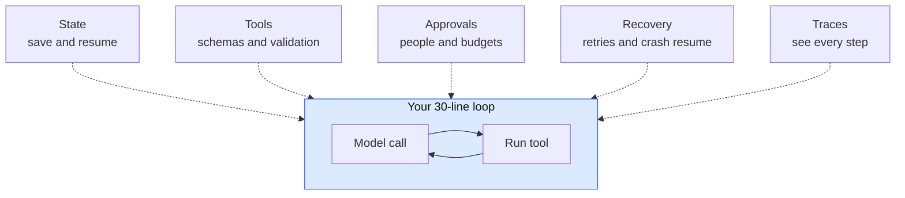
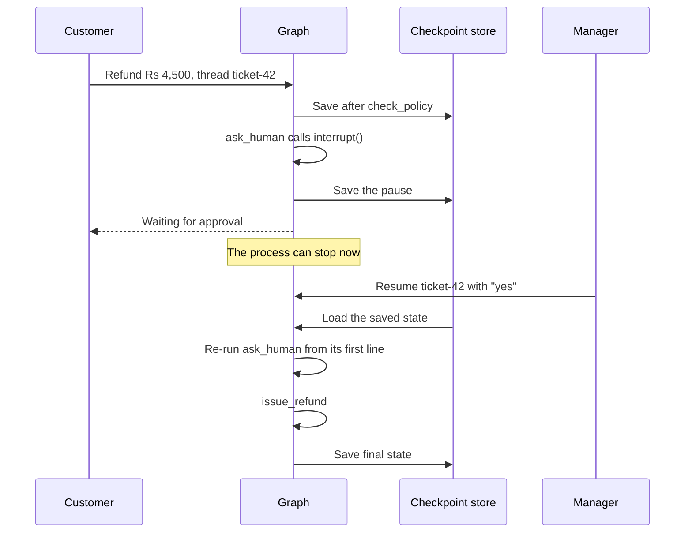
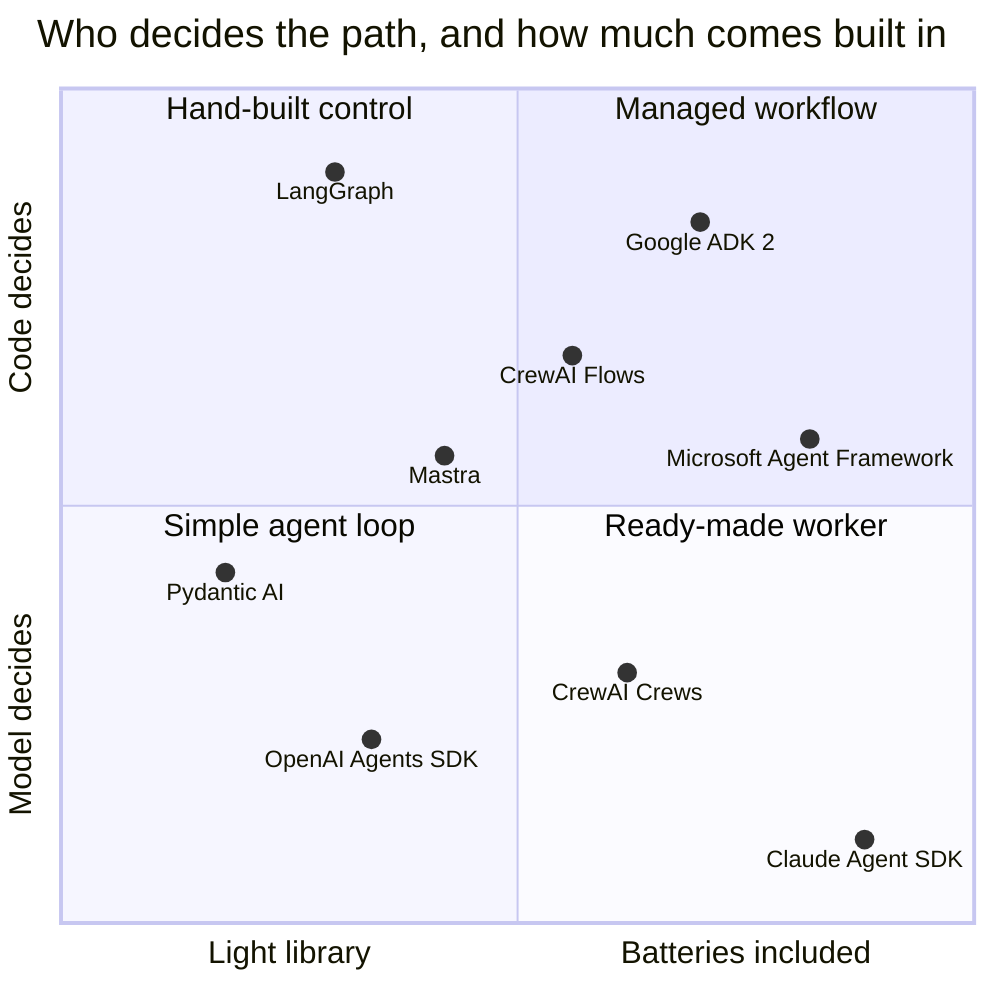
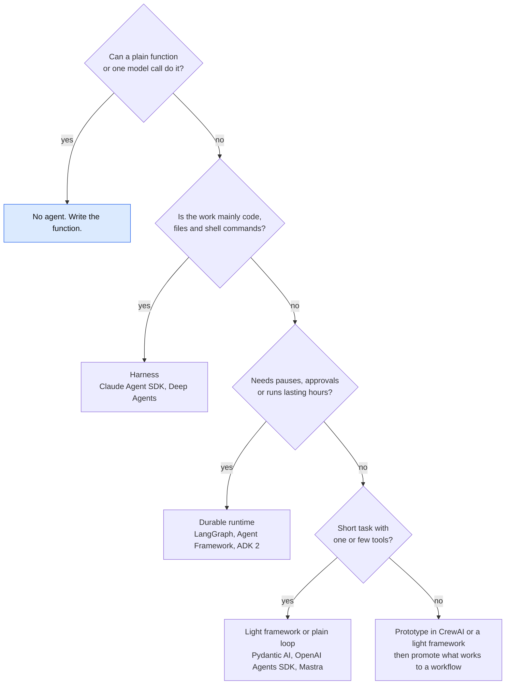
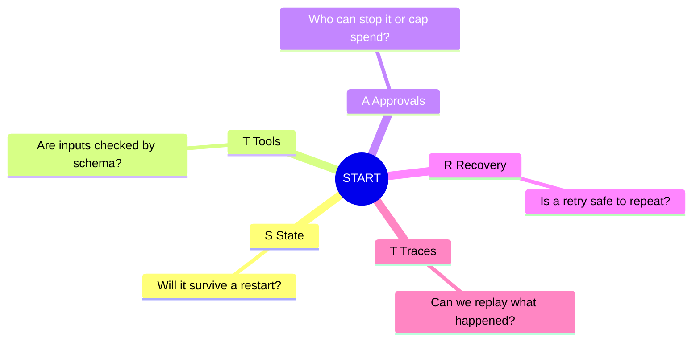



*Utkrishta Sinha · 3 Nov 2026 · about 40 minutes*

*Reading time: about 40 minutes. Facts checked on 3 November 2026. Versions were read from PyPI and npm that day. This field moves weekly, so treat every table as a snapshot.*

## 1. The Five Big Ideas of Today

An agent framework is the plumbing around the agent loop you met on Day 1. It does not make the model smarter. It makes the system survive real life.

1. **The loop is easy. Everything around it is hard.** You can write a loop in 30 lines. Saving state, human approval, crash recovery and tracing are where the months go.
2. **Remember START.** A framework earns its place by giving you **S**tate, **T**ools, **A**pprovals, **R**ecovery and **T**races. If you need none of these, you may not need a framework.
3. **The field is moving to one shape: code for the path, model for the judgment.** LangGraph, Microsoft Agent Framework, Google ADK 2.0 and CrewAI Flows all offer explicit workflows beside free-running agents.
4. **Frameworks fall into three layers.** A runtime keeps agents alive. A framework gives you handy building blocks. A harness gives you a ready-made working agent. Know which layer you are buying.
5. **The framework is now part of your attack surface.** In 2026, researchers disclosed serious bugs in several major frameworks. Pin versions, patch fast and never trust the checkpoint store by default.

> Joke of the day: I chose a framework to save time. I now spend that time reading its changelog.

## 2. Why This Matters for an FDE

A Forward Deployed Engineer (FDE) works inside the customer's messy reality. There, the first question is rarely "which framework is best?" It is usually one of these:

| What the customer says | What they often mean | Your first move |
| --- | --- | --- |
| "We already built it in LangChain." | Changing it is political and costly. | Read the code first. Fix the worst gap, not the whole thing. |
| "Our demo works, but it fell over in production." | No state, no retries, no traces. | Check START. Name the missing letter. |
| "We need a person to approve big refunds." | A pause that can last for days. | You need durable state, not an `input()` call. |
| "We don't want lock-in." | They fear model or vendor changes. | Keep business logic and tools outside the framework. Use MCP where you can. |
| "Should we use multi-agent?" | They saw a nice conference diagram. | Ask what one agent cannot do. Start with one. |

Two truths shape this work. **You will inherit frameworks**, so you must read several, even ones you would not choose. And **your choice will outlive you**. You leave and the customer's team stays, so pick what they can run, patch and hire for.

## 3. Core Concepts, From Simple to Complex

### 3.1 Start with a restaurant kitchen

Picture one cook with one stove. An order comes in. She cooks it and serves it. This is the hand-written agent loop. It works beautifully for a small stall.

Now picture 500 orders a night. You need a ticket rail, so no order is lost. A manager must approve free meals. If the gas fails, someone must know which dishes were half done.

The recipes and the cook stayed the same. You added a **kitchen system**. That is an agent framework.

Spring Boot shows the same idea. You could write an HTTP server by hand, but Spring gives you routing, filters and health checks. It also gives you magic to debug at 2 am.

### 3.2 Glossary: every term in plain English

| Term | Meaning | Everyday example |
| --- | --- | --- |
| Agent | A model that picks its own next step, using tools, until the job is done. | A delivery rider who chooses the route. |
| Agent loop | Call model, run tool, send result back, repeat. | Taste, adjust, taste again. |
| Tool | A function the model can ask your code to run. | The cook asks a helper to check the fridge. |
| Framework | A library that supplies the structure around your code. | A kitchen system. |
| Runtime | The layer that keeps agents running, pausing and resuming. | The ticket rail and shift manager. |
| Harness | A ready-made agent with tools and limits built in. | A fully fitted cloud kitchen. |
| Workflow | A path fixed in code. | A set thali, same order every time. |
| Node | One step in a graph. | One station: chopping, frying or plating. |
| Edge | The link that says which step comes next. | The arrow on the kitchen wall chart. |
| Conditional edge | A link chosen at run time. | "If veg, go left. If non-veg, go right." |
| State | The shared data of a run. | The order ticket, updated at each station. |
| Thread | One conversation or job, with its own state. | One table's bill. |
| Checkpoint | A saved copy of state after a step. | A video game save point. |
| Durable execution | A run survives crashes and restarts. | A bookmark that survives a fallen book. |
| Human-in-the-loop | The run pauses for a person. LangGraph calls this an interrupt. | The manager signs off a big refund. |
| Idempotent | Doing it twice has the same effect as once. A unique key makes this possible. | Pressing a lift button twice. |
| Side effect | A change in the outside world. | Money actually leaves the account. |
| Handoff | One agent passes the conversation to another. | A call transferred to billing. |
| Agent as tool | A manager agent calls a helper and keeps control. | A boss asks an analyst, then replies himself. |
| Guardrail | A check on input or output. | The security guard at the gate. |
| Hook or middleware | Your code that runs at set points in the loop. | An Angular HTTP interceptor. |
| Trace | A record of each model and tool call in a run. | CCTV for your agent. |
| Compaction | Summarising old messages to save context. | Replacing a long chat with its minutes. |
| MCP | A standard way to connect agents to tools. | A universal charger. |
| A2A | A standard for agents to talk to other agents. | A shared language between two offices. |
| AG-UI | A standard for streaming agent activity to a user interface. | The live order tracker in a food app. |

### 3.3 What a plain loop does not give you

Every framework runs some version of your Day 1 loop. Anthropic's advice is still a great starting point: [start with LLM APIs directly](https://www.anthropic.com/engineering/building-effective-agents), and if you use a framework, understand the code underneath. The same post warns that frameworks can hide prompts and tempt you into complexity. It dates from December 2024, and Anthropic now ships its own SDK, so read it as design advice.

So when does a loop stop being enough? When you need the five jobs of START:

| Letter | The job | Without it |
| --- | --- | --- |
| **S**tate | Save progress and memory across steps and days. | A restart forgets everything. |
| **T**ools | Define, validate and connect tools. | Hand-written JSON schemas drift from your code. |
| **A**pprovals | Let people pause, approve or reject. Cap spending. | The agent acts alone, or you build a queue yourself. |
| **R**ecovery | Retry, resume and limit damage after failures. | One timeout loses a 40-minute run. |
| **T**races | See every prompt, tool call and token. | "The agent did something weird" is your only bug report. |



*The loop stays small. A framework is everything wrapped around it.*

### 3.4 Workflows and agents: the most important split

Anthropic defines [workflows as predefined code paths](https://www.anthropic.com/engineering/building-effective-agents), and agents as models that direct their own process.

- A workflow is a train. It is predictable, and it stays on the tracks.
- An agent is a taxi. It is flexible, and it may take a surprising route.

Real systems mix both. Google's ADK 2.0 post calls LLMs used for routing ["slow, expensive, and exhibit variance"](https://developers.googleblog.com/why-we-built-adk-20/). Its refund example calls the model only where language judgment is needed.

Others agree. Microsoft's [overview](https://learn.microsoft.com/en-us/agent-framework/overview/) has a line worth memorising: "If you can write a function to handle the task, do that instead of using an AI agent." CrewAI's guide says to use [Flows when you need precision](https://docs.crewai.com/v1.15.28/en/guides/concepts/evaluating-use-cases), with Crews for creative or analytical subtasks.

> A taxi is lovely until it takes the scenic route through your production database.

### 3.5 Three layers: runtime, framework, harness

LangChain's docs give [the cleanest vocabulary](https://docs.langchain.com/oss/python/concepts/products) I found:

| Layer | Job | LangChain's example | Others like it |
| --- | --- | --- | --- |
| Runtime | Durable execution, streaming, pauses, persistence. | LangGraph | Temporal, DBOS (general engines) |
| Framework | Easy building blocks: agent loop, middleware. | LangChain | Pydantic AI, OpenAI Agents SDK, CrewAI |
| Harness | A ready agent with planning, files, subagents. | Deep Agents | Claude Agent SDK, Microsoft's Harness Agent |

The "others like it" column is my mapping, and the lines blur. Microsoft's Agent Framework spans all three layers.

### 3.6 Two ways to split work between agents

OpenAI's docs explain this with one question: [who owns the reply?](https://developers.openai.com/api/docs/guides/agents/orchestration)

- **Handoff.** The specialist takes over and owns the next reply. Think of a transferred phone call.
- **Agent as tool.** The manager calls a helper, then writes the final answer. Think of a boss with an analyst.

The same page gives the best advice here: start with one agent. Add specialists only when they clearly help with capability isolation, policy isolation, prompt clarity or trace legibility.

CrewAI's [hierarchical process](https://docs.crewai.com/en/concepts/processes) is the manager idea. It needs a manager LLM or agent, which means more model calls.

### 3.7 State, checkpoints and the pause that lasts for days

Suppose a refund waits for a manager who is on leave until Monday. Your server will restart many times before then.

LangGraph handles this with [threads and checkpoints](https://docs.langchain.com/oss/javascript/langgraph/persistence). The same store enables human approval, time travel to earlier states and recovery from faults.



*The pause lives in the database, not in memory, so the process can die and the job still continues.*

Notice one line in that diagram. LangGraph's docs say [the runtime restarts the entire node from the beginning](https://docs.langchain.com/oss/python/langgraph/interrupts) on resume. Code before `interrupt()` runs again. We will see the danger of this in Example 3.

Pydantic AI's docs add a useful distinction: [durability is not storage](https://pydantic.dev/docs/ai/capabilities/durable_execution/overview/). Saving and forking runs needs only a store. Surviving a crash mid-run needs an engine that journals model and tool calls, such as Temporal or DBOS.

### 3.8 The landscape on 3 November 2026

Versions come from PyPI and npm. A 0.x version warns about API stability, not quality.

| Framework | Latest version | Languages | Its shape | Worth knowing |
| --- | --- | --- | --- | --- |
| [LangGraph](https://docs.langchain.com/oss/python/concepts/products) | 1.2.19 (JS 1.6.0) | Python, TS | Graphs, checkpoints | Low-level runtime under LangChain 1.4.8. MIT. |
| [Microsoft Agent Framework](https://learn.microsoft.com/en-us/agent-framework/overview/) | 1.24.0 | .NET, Python, Go preview | Agents, harness, workflows | [1.0 shipped 3 April 2026](https://devblogs.microsoft.com/agent-framework/microsoft-agent-framework-version-1-0/). Successor to AutoGen and Semantic Kernel. |
| [AutoGen](https://github.com/microsoft/autogen) | 0.7.5 | Python | Group chats | Maintenance mode. No new projects. |
| [OpenAI Agents SDK](https://openai.github.io/openai-agents-python/running_agents/) | 0.24.0 (JS 0.21.0) | Python, TS | Small loop, handoffs, guardrails | Adds [sandbox agents](https://developers.openai.com/api/docs/guides/agents/sandboxes) for workspace jobs. MIT. |
| [Claude Agent SDK](https://code.claude.com/docs/en/agent-sdk/overview) | 0.2.177 (TS 0.3.317) | Python, TS | Claude Code as a library | Runs a bundled binary with file and shell tools. |
| [Google ADK](https://cloud.google.com/blog/topics/developers-practitioners/one-agent-development-kit-five-languages) | 2.13.0 (TS 2.4.0) | Python, Go, TS, Java, Kotlin | Agents plus graph workflows | [2.0 had breaking changes](https://adk.dev/2.0/). Kotlin graphs are experimental. |
| [CrewAI](https://docs.crewai.com/en/concepts/processes) | 1.15.34 | Python | Role-based Crews, plus Flows | Quick to prototype. Python below 3.14 only. |
| [Pydantic AI](https://pydantic.dev/docs/ai/overview/) | 2.65.0 | Python | Typed agents | Strong validation and offline tests. MIT. |
| [Mastra](https://mastra.ai/ai-agent-framework) | 1.81.0 | TypeScript | Agents, workflows, memory, Studio | Apache 2.0, but [`ee/` code needs a licence](https://mastra.ai/docs/license) in production. |

[One July 2026 analysis](https://rickhigh.substack.com/p/langgraph-vs-crewai-vs-claude-agent) adds RAG tools (LlamaIndex, Haystack) and low-code builders (Dify, n8n). Its verdict: "There is no universal winner in 2026."



*Placement is my judgment, not a measurement. Most tools can move along the vertical axis.*

Downloads are a weak signal. The July analysis counted about 66.5 million a month for LangGraph, while [Check Point quoted about 46.5 million](https://blog.checkpoint.com/research/when-your-ai-agents-memory-becomes-a-security-liability/) in June. The author warns that CI, Docker and mirror traffic inflate such counts, and the stats site was blocked here, so I have no same-day figures.

### 3.9 Three protocols that reduce lock-in

Frameworks change. Protocols last longer. This [CopilotKit summary](https://www.copilotkit.ai/learning/mcp-vs-a2a-vs-ag-ui) comes from AG-UI's creator:

- **MCP** connects an agent inward to tools and data. It went to the Linux Foundation's Agentic AI Foundation in December 2025.
- **A2A** connects agents to each other. Google gave it to the Linux Foundation in June 2025.
- **AG-UI** connects an agent outward to your user interface. Frontend engineers, take note.

A tool built as an MCP server can outlive your framework. That is cheap insurance.

### 3.10 The money question

Most frameworks are free to download. You pay in three other places:

1. **Model tokens.** More agents usually mean more calls. Google's illustrative example shows [a workflow using 2,265 tokens against 5,152](https://developers.googleblog.com/why-we-built-adk-20/) for a pure agent, at 5.7 against 7.2 seconds. That is a vendor's example, so read it as a direction.
2. **Platforms.** [LangSmith](https://www.langchain.com/pricing) is $0 for one seat and 5,000 base traces a month. Plus is $39 per seat with 10,000 traces and one free small deployment. Base traces last 14 days. LangChain's own comparison says [Temporal Cloud starts at $100 a month](https://www.langchain.com/resources/langgraph-vs-temporal). That is a rival's page, so confirm it.
3. **People.** Someone must upgrade, patch and debug. This is often the largest line.

## 4. Worked Examples: One Refund Desk, Many Frameworks

Our fictional shop, ChaiCart, wants a refund agent. Refunds up to Rs 2,000 go through. Bigger ones need a person.

**What was actually tested on 3 November 2026.** Python 3.13 and Node 22, with `langgraph` 1.2.19, `pydantic-ai-slim` 2.65.0, `openai-agents` 0.24.0, `claude-agent-sdk` 0.2.177, `crewai` 1.15.34 and `@mastra/core` 1.81.0. No real model was called, because the sandbox had no API keys.

- Examples 1, 2, 3 and 4 run with no model at all. The outputs shown are real.
- Examples 5, 6 and 7, and a CrewAI run, used small mock servers I wrote. These prove the wiring works. They say nothing about how a real model behaves.
- Example 7's bundled binary ran for real against a mock Anthropic API, with `ENABLE_TOOL_SEARCH=false` set for the test.

Use a fresh virtual environment per framework. Pitfall 9 explains why.

### Example 1: The plain loop

This is the baseline. It has a fake model, so it needs no key. Save it as `hand_loop.py`:

```python
import json

ORDERS = {"A123": {"amount": 450, "status": "delivered"}}

def get_order(order_id: str) -> str:
    return json.dumps(ORDERS.get(order_id, {"error": "not found"}))

TOOLS = {"get_order": get_order}

def fake_llm(messages: list[dict]) -> dict:
    """Stands in for a real model so this runs with no API key."""
    if messages[-1]["role"] == "user":
        return {"tool": "get_order", "args": {"order_id": "A123"}}
    return {"text": f"Order facts: {messages[-1]['content']}"}

def run_agent(question: str, max_steps: int = 5) -> str:
    messages = [{"role": "user", "content": question}]
    for step in range(max_steps):
        reply = fake_llm(messages)
        if "text" in reply:
            return reply["text"]
        result = TOOLS[reply["tool"]](**reply["args"])
        print(f"step {step}: {reply['tool']} -> {result}")
        messages.append({"role": "tool", "content": result})
    return "Stopped: step limit reached."

print(run_agent("Where is order A123?"))
```

Output:

```text
step 0: get_order -> {"amount": 450, "status": "delivered"}
Order facts: {"amount": 450, "status": "delivered"}
```

Short and clear. Restart it halfway, and everything is gone.

### Example 2: LangGraph pauses and survives a restart

Run `pip install langgraph langgraph-checkpoint-sqlite`. No LLM appears here on purpose. The graph is the point. Save this as `refund_graph.py`:

```python
import sys
from typing import TypedDict
from langgraph.checkpoint.sqlite import SqliteSaver
from langgraph.graph import END, START, StateGraph
from langgraph.types import Command, interrupt

LIMIT_INR = 2000

class State(TypedDict):
    order_id: str
    amount: int
    approved: bool
    result: str

def check_policy(state: State) -> dict:
    print("  node: check_policy")
    return {"approved": state["amount"] <= LIMIT_INR}

def ask_human(state: State) -> dict:
    print("  node: ask_human")
    answer = interrupt({"question": f"Refund Rs {state['amount']}?"})
    return {"approved": answer == "yes"}

def issue_refund(state: State) -> dict:
    print("  node: issue_refund")
    # Real code: send state["order_id"] as the payment idempotency key.
    return {"result": f"refunded Rs {state['amount']}"}

def reject(state: State) -> dict:
    print("  node: reject")
    return {"result": "refund declined"}

graph = StateGraph(State)
graph.add_node("check_policy", check_policy)
graph.add_node("ask_human", ask_human)
graph.add_node("issue_refund", issue_refund)
graph.add_node("reject", reject)
graph.add_edge(START, "check_policy")
graph.add_conditional_edges(
    "check_policy", lambda s: "issue_refund" if s["approved"] else "ask_human"
)
graph.add_conditional_edges(
    "ask_human", lambda s: "issue_refund" if s["approved"] else "reject"
)
graph.add_edge("issue_refund", END)
graph.add_edge("reject", END)

with SqliteSaver.from_conn_string("refunds.db") as saver:
    app = graph.compile(checkpointer=saver)
    config = {"configurable": {"thread_id": "ticket-42"}}
    if sys.argv[1] == "start":
        out = app.invoke({"order_id": "A123", "amount": 4500}, config)
        print("paused:", out["__interrupt__"][0].value)
    else:
        out = app.invoke(Command(resume=sys.argv[1]), config)
        print("final:", out["result"])
```

Run it in two separate processes:

```bash
python refund_graph.py start
python refund_graph.py yes
```

Output:

```text
  node: check_policy
  node: ask_human
paused: {'question': 'Refund Rs 4500?'}
  node: ask_human
  node: issue_refund
final: refunded Rs 4500
```

The first process exited. The second one picked up the job from `refunds.db`. Also notice that `ask_human` ran twice. That is the node restart from section 3.7, seen with your own eyes.

If you know NgRx or Redux, this feels like home: one state object, and each node returns an update. In production, swap SQLite for Postgres. The docs call SQLite [ideal for experimentation](https://docs.langchain.com/oss/python/langgraph/checkpointers) and Postgres ideal for production.

### Example 3: How a resume can pay twice

This is the most important code today. The node pays, then the network dies. Then we resume.

```python
from typing import TypedDict
from langgraph.checkpoint.memory import InMemorySaver
from langgraph.graph import END, START, StateGraph

payments: list[str] = []   # pretend payment provider
seen_keys: set[str] = set()
crash_next = True

def pay(order_id: str, key: str | None) -> None:
    if key and key in seen_keys:
        print("  provider: duplicate key, ignored")
        return
    if key:
        seen_keys.add(key)
    payments.append(order_id)

class State(TypedDict):
    order_id: str
    use_key: bool

def refund(state: State) -> dict:
    global crash_next
    key = f"refund-{state['order_id']}" if state["use_key"] else None
    pay(state["order_id"], key)
    if crash_next:
        crash_next = False
        raise TimeoutError("network died after the money moved")
    return {}

builder = StateGraph(State)
builder.add_node("refund", refund)
builder.add_edge(START, "refund")
builder.add_edge("refund", END)
app = builder.compile(checkpointer=InMemorySaver())

for use_key in (False, True):
    payments.clear(); seen_keys.clear(); crash_next = True
    config = {"configurable": {"thread_id": f"demo-{use_key}"}}
    try:
        app.invoke({"order_id": "A123", "use_key": use_key}, config)
    except TimeoutError as err:
        print("crashed:", err)
    app.invoke(None, config)  # resume from the last checkpoint
    print(f"use_key={use_key}: payments made = {len(payments)}")
```

Output:

```text
crashed: network died after the money moved
use_key=False: payments made = 2
crashed: network died after the money moved
  provider: duplicate key, ignored
use_key=True: payments made = 1
```

The framework kept its promise and re-ran the failed node. Your customer still got paid twice. A [public LangGraph issue](https://github.com/langchain-ai/langgraph/issues/9185) from October 2026 reports this exact shape. Durable execution does not remove the need for idempotency. It makes it mandatory.

### Example 4: Pydantic AI, with types and offline tests

Run `pip install pydantic-ai-slim`. The built-in `TestModel` makes no network call, so your unit tests stay free. Save this as `typed_agent.py`:

```python
from pydantic import BaseModel
from pydantic_ai import Agent, RunContext
from pydantic_ai.models.test import TestModel
from pydantic_ai.usage import UsageLimits

class RefundDecision(BaseModel):
    approve: bool
    reason: str

agent = Agent(
    TestModel(),  # swap for a real model such as "anthropic:<model-id>"
    deps_type=dict,
    output_type=RefundDecision,
    instructions="Decide refunds. Check the order first.",
)

@agent.tool
def get_order(ctx: RunContext[dict], order_id: str) -> str:
    """Look up one order."""
    return ctx.deps.get(order_id, "not found")

result = agent.run_sync(
    "Refund order A123?",
    deps={"A123": "Rs 450, delivered"},
    usage_limits=UsageLimits(request_limit=5),
)
print(type(result.output).__name__, result.output)
print("usage:", result.usage.requests, "requests")
```

Set `PYDANTIC_AI_NO_BANNER=1` to hide its start-up banner. Output:

```text
RefundDecision approve=False reason='a'
usage: 2 requests
```

The `reason='a'` looks silly, because `TestModel` invents data that fits the schema. Yet your tool ran, and you got a real `RefundDecision` object, not a string to parse.

I separately tested a scripted model that left out `reason` on its first try. The framework caught the error and asked again, and the second try passed. In a plain loop, you write that retry yourself. [`UsageLimits`](https://pydantic.dev/docs/ai/production/) caps the run.

### Example 5: OpenAI Agents SDK with a handoff

Run `pip install openai-agents`. Triage hands off to the refund specialist:

```python
from openai import AsyncOpenAI
from agents import (Agent, OpenAIChatCompletionsModel, Runner,
                    function_tool, set_tracing_disabled)

set_tracing_disabled(True)  # traces go to OpenAI by default; off for this mock
# Mock used in testing. Real use: drop base_url, read OPENAI_API_KEY, set a real model.
client = AsyncOpenAI(base_url="http://127.0.0.1:8765/v1", api_key="mock")
model = OpenAIChatCompletionsModel(model="mock", openai_client=client)

@function_tool
def get_order(order_id: str) -> str:
    """Look up one order."""
    return {"A123": "Rs 450, delivered"}.get(order_id, "not found")

refund_agent = Agent(
    name="Refund agent",
    instructions="Handle refunds. Always check the order first.",
    tools=[get_order],
    model=model,
)
triage_agent = Agent(
    name="Triage agent",
    instructions="Send refund questions to the refund agent.",
    handoffs=[refund_agent],
    model=model,
)

result = Runner.run_sync(triage_agent, "Refund order A123", max_turns=6)
print("answered by:", result.last_agent.name)
print(result.final_output)
```

Output from the mock run:

```text
answered by: Refund agent
Done. Tool said: Rs 450, delivered
```

The mock's log showed three calls: one offering `transfer_to_refund_agent`, then two offering `get_order`. The SDK created the transfer tool for you. `max_turns` raises `MaxTurnsExceeded` when [the limit is passed](https://openai.github.io/openai-agents-python/running_agents/).

### Example 6: Mastra for the TypeScript crowd

Run `npm i @mastra/core zod tsx`, set `"type": "module"` in `package.json`, and save as `mastra.ts`. Mastra's [string model format](https://mastra.ai/docs/agents/overview) is `provider/model`.

```typescript
import { Agent } from "@mastra/core/agent";
import { createTool } from "@mastra/core/tools";
import { z } from "zod";

const getOrder = createTool({
  id: "get_order",
  description: "Look up one order.",
  inputSchema: z.object({ order_id: z.string() }),
  execute: async ({ order_id }) => {
    const orders: Record<string, string> = { A123: "Rs 450, delivered" };
    return { result: orders[order_id] ?? "not found" };
  },
});

const agent = new Agent({
  id: "refund-agent",
  name: "Refund Agent",
  instructions: "Check the order before you answer.",
  // Real use: model: "openai/<model-id>" with OPENAI_API_KEY set.
  model: { id: "custom/mock", url: "http://127.0.0.1:8765/v1", apiKey: "mock" },
  tools: { getOrder },
});

const reply = await agent.generate("Refund order A123", { maxSteps: 5 });
console.log("tool calls:", reply.toolCalls.length, "| steps:", reply.steps.length);
console.log(reply.text);
```

Run it with `npx tsx mastra.ts`. Output from the mock run:

```text
tool calls: 1 | steps: 2
Done. Tool said: {"result":"Rs 450, delivered"}
```

One surprise: the model saw the tool as `getOrder`, the object key, not the `id`.

### Example 7: Claude Agent SDK with one custom tool

Run `pip install claude-agent-sdk`. You get a [ready agent](https://code.claude.com/docs/en/agent-sdk/overview) with file, shell and web tools. Your job is to narrow it down.

```python
import asyncio
from typing import Any
from claude_agent_sdk import (ClaudeAgentOptions, ResultMessage, create_sdk_mcp_server,
                              query, tool)

@tool("get_order", "Look up one order", {"order_id": str})
async def get_order(args: dict[str, Any]) -> dict[str, Any]:
    status = {"A123": "Rs 450, delivered"}.get(args["order_id"], "not found")
    return {"content": [{"type": "text", "text": status}]}

shop = create_sdk_mcp_server(name="shop", tools=[get_order])
options = ClaudeAgentOptions(
    mcp_servers={"shop": shop},
    allowed_tools=["mcp__shop__get_order"],  # auto-approve this tool
    disallowed_tools=["Bash", "Write", "Edit"],  # hard block
    max_turns=5,
    max_budget_usd=0.10,
)

async def main() -> None:
    async for message in query(prompt="What is the status of order A123?", options=options):
        if isinstance(message, ResultMessage):
            print(message.subtype, message.result, message.total_cost_usd)

asyncio.run(main())
```

Output from the mock run. The cost is an estimate from fake token counts:

```text
success Tool said: [{"type": "text", "text": "Rs 450, delivered"}] 0.00021
```

Note the two different lists. [`allowed_tools` only auto-approves](https://code.claude.com/docs/en/agent-sdk/python). It does not restrict. To block a tool, use `disallowed_tools`. An earlier mock run also proved the turn cap works: `query()` raised `Reached maximum number of turns (5)`, as [the docs describe](https://code.claude.com/docs/en/agent-sdk/agent-loop).

I also ran a one-agent CrewAI crew on the mock, with `role`, `goal` and `backstory` set. It worked. Those fields all become prompt text, so measure the token cost. [Morph's review](https://www.morphllm.com/ai-agent-framework) names this role-play overhead too, though Morph is a vendor.

## 5. Real-Life Use Cases

Most public stories are vendor marketing. Read every number as "claimed".

| Who | What they did | Framework | Lesson for an FDE |
| --- | --- | --- | --- |
| [Klarna](https://www.langchain.com/blog/customers-klarna) | An assistant for payments and refunds. LangChain's case study claims an 80% cut in resolution time and work equal to 700 staff. | LangGraph, LangSmith | Routing to task-specific agents kept prompts small. |
| [Spotify](https://claude.com/customers/spotify) | A background coding agent for migrations. Anthropic's page claims 650+ merged pull requests a month and up to 90% time saved. | Claude Agent SDK | A harness fits code work, especially with builds and tests as checks. |
| [Razorpay](https://razorpay.com/blog/agent-studio-ai-agents-by-razorpay) (India) | Agent Studio has agents for disputes, subscription recovery and cashflow forecasts. [Launched at FTX 2026](https://www.business-standard.com/finance/news/razorpay-launches-ai-agent-studio-anthropic-claude-payments-126031200388_1.html) on 12 March 2026. | Claude Agent SDK | The framework choice is public, but no results are. It is early access, and approval steps are not described. |
| [Swiggy](https://databricks.com/blog/redefining-customer-support-swiggys-enterprise-scale-ai-agent-built-databricks) (India) | Support moved from RAG to persistent agents, then multi-agent, using node-based graph execution on Databricks. | Not named | The path from simple to complex is the real lesson. |

Three honest caveats:

- **Klarna's story has a sequel.** The case study is from February 2025. By May 2025 its CEO [said it was rehiring humans](https://www.entrepreneur.com/business-news/klarna-ceo-reverses-course-by-hiring-more-humans-not-ai/491396), and [called cost "a too predominant evaluation factor"](https://www.emarketer.com/content/klarna-backtracks-ai-customer-service-plans). A framework can work well while the product decision goes wrong.
- **Swiggy's numbers need care.** The Databricks post claims 100% of queries were fully automated. It is a partner blog with no method shown, so don't repeat that to a customer.
- **Indian evidence is thin at framework level.** Razorpay is the clearest public case I found. [Infosys announced 200+ agents](https://www.infosys.com/newsroom/press-releases/2025/launches-enterprise-ai-agents.html) on Google Cloud's Vertex AI in May 2025, but names no agent framework. LangChain's [case-study list](https://docs.langchain.com/oss/python/langgraph/case-studies) showed no company I could identify as Indian. Absence of public detail is not absence of use.

## 6. Pros, Cons and When to Use a Framework

A framework trades control for speed. Ask whether the trade pays you back.

| Factor | With a framework | Hand-written loop |
| --- | --- | --- |
| First demo | Fast. | Fast. |
| Pause and resume | Built in. | Weeks of your own work. |
| Understanding a failure | Harder. More layers. | Easy. It is your code. |
| Upgrades | You follow their schedule. | You decide. |
| Security patches | Someone else finds the bugs, and you must apply them. | Your bugs stay yours. |
| New agent patterns | You may wait, or fight the design. | Change it today. |



*Start at the top. Most projects should stop earlier than the team expects.*

**Use a framework when:**

- Runs last long enough to crash or wait for people.
- Several people need to see what happened.
- The customer's platform team already supports one.

**Avoid one when:**

- The task is a short, single-model feature.
- Nobody on the team will read the source.
- You need a stable dependency for years, and the project is on 0.x.

A useful warning comes from [Octomind](https://octomind.dev/blog/why-we-no-longer-use-langchain-for-building-our-ai-agents). It removed LangChain in 2024 after a year, citing layered abstractions and hard debugging. That predates LangChain 1.0, but the lesson stands: use abstractions for stable things, not fast-changing ones.

## 7. Common Pitfalls and Production Gotchas

1. **Repeated side effects.** Resume re-runs the node. Use idempotency keys for payments and emails, as Example 3 shows.
2. **`InMemorySaver` in production.** Checkpoints [vanish on restart](https://docs.langchain.com/oss/javascript/langgraph/persistence). The demo works, and then the deploy loses every paused job.
3. **Broad `try/except` around an interrupt.** Interrupts [pause by raising an exception](https://docs.langchain.com/oss/python/langgraph/interrupts). A wide `except` swallows the pause. ADK has a matching trap with [`NodeInterruptedError`](https://adk.dev/2.0/).
4. **Unpatched checkpoint stores.** Check Point found a [chain from SQL injection to remote code execution](https://blog.checkpoint.com/research/when-your-ai-agents-memory-becomes-a-security-liability/) in self-hosted LangGraph. Fixes: `langgraph` 1.0.10, `langgraph-checkpoint-sqlite` 3.0.1, `langgraph-checkpoint-redis` 1.0.2 or later.
5. **Bugs across the whole category.** At Black Hat in August 2026, researchers disclosed [11 flaws](https://www.theregister.com/a/5283585) across LangChain, LangGraph, CrewAI, AutoGen, Microsoft Agent Framework and Google ADK. As [one report](https://forkast.news/check-point-finds-11-flaws-across-every-major-agent-framework-and-the-bugs-were-already-classics/) puts it: assume prompt injection will happen.
6. **No front door.** Check Point notes self-hosted LangGraph servers ship without built-in auth. Put a gateway in front.
7. **Pickle in checkpoints.** LangGraph's [`pickle_fallback`](https://docs.langchain.com/oss/python/langgraph/checkpointers) option exists for awkward objects. Think twice, because unsafe deserialization caused several of these bugs. Encrypt sensitive state.
8. **Traces going to a vendor.** OpenAI's SDK [traces by default](https://openai.github.io/openai-agents-python/tracing/), and sends them to OpenAI. That is unavailable under Zero Data Retention. Without an OpenAI key, turn it off or uploads [fail with a 401](https://openai.github.io/openai-agents-python/models/).
9. **Dependency conflicts.** This hit me today. `crewai` 1.15.34 needs `openai<3`, while `openai-agents` 0.24.0 needs `openai>=3`. They cannot share one environment.
10. **Multiplying retries.** Pydantic's docs warn that [retry layers multiply](https://pydantic.dev/docs/ai/production/). Pick one owner per layer.
11. **Budget caps overshoot.** Limits are checked after a response arrives. Both [Claude's SDK](https://code.claude.com/docs/en/agent-sdk/agent-loop) and Pydantic AI say so. Leave headroom.
12. **Compaction forgets.** Early instructions may not survive summarising. Claude's docs say to keep [persistent rules in CLAUDE.md](https://code.claude.com/docs/en/agent-sdk/agent-loop).
13. **Deploys breaking running jobs.** With durable engines, [a new tool can break a run](https://pydantic.dev/docs/ai/production/) started under old code. Let old runs drain.
14. **Licence surprises.** Mastra's RBAC stops [the server starting](https://mastra.ai/docs/license) without a key. Anthropic also [does not allow third parties](https://code.claude.com/docs/en/agent-sdk/overview) to offer claude.ai login in their products. PyPI lists the Claude Agent SDK as MIT, yet its docs say Anthropic's Commercial Terms apply. Ask legal.
15. **Starting on a dead end.** AutoGen tutorials still rank well in search. Its [README](https://github.com/microsoft/autogen) tells new users to start with Agent Framework.

> Every framework promises "just five lines of code". Nobody mentions the 5,000 lines of dependencies standing behind them.

## 8. Comparing the Alternatives

First choose the layer. Then choose the product.

### Which layer of solution?

| Option | Best for | Watch out for |
| --- | --- | --- |
| Plain client SDK | Short agents, full control. | You will rebuild START slowly. |
| Agent framework | Most custom agents. | Upgrades and abstraction. |
| Harness | Coding and file-heavy work. | Broad power. Lock it down. |
| General durable engine (Temporal) | Teams already running it. | Agent features are your job. |
| Low-code (n8n, Dify) | Non-engineers, simple flows. | Limits on testing and versioning. |
| Managed hosted agents | Fast delivery. | Vendor dependence, data path. |

LangChain's [Temporal comparison](https://www.langchain.com/resources/langgraph-vs-temporal) comes from a competitor, yet it concedes Temporal suits compensating transactions and teams already using it. Anthropic's [Managed Agents](https://code.claude.com/docs/en/agent-sdk/overview) is one hosted option.

### Which framework?

| Tool | Pick it when | Skip it when |
| --- | --- | --- |
| LangGraph | You need explicit control, pauses and audits. | The agent is a short, simple loop. |
| Microsoft Agent Framework | The customer runs on Azure or .NET. | You need preview features to be stable. |
| OpenAI Agents SDK | You want a small loop, handoffs and easy tracing. | You need built-in durable state. |
| Claude Agent SDK | The job is code, files or shell work. | You need other model vendors. |
| Google ADK | The customer is on Google Cloud, or needs Java, Go or Kotlin. | You can't absorb breaking upgrades. |
| CrewAI | You need a fast multi-agent prototype. | You need strict, cheap control. Use Flows then. |
| Pydantic AI | You want typed Python and strong tests. | The team works in TypeScript. |
| Mastra | The whole stack is TypeScript. | The team works in Python. |

### Where the sources disagree

- [Morph](https://www.morphllm.com/ai-agent-framework) lists Pydantic AI as single-agent with no MCP. Pydantic's [own docs](https://pydantic.dev/docs/ai/overview/) show MCP and multi-agent support. Trust the docs.
- Morph says ADK reaches MCP only through adapters. Google says [every language includes an MCP client](https://cloud.google.com/blog/topics/developers-practitioners/one-agent-development-kit-five-languages).
- Hightower said in July that ADK TypeScript lagged. ADK's page shows [TypeScript 2.0 GA on 21 August](https://adk.dev/2.0/). Here, time solved it.
- Techstrong reported [A2A support](https://techstrong.ai/features/microsoft-ships-agent-framework-1-0-a-production-ready-foundation-for-multi-agent-ai/) in Microsoft's 1.0, while Microsoft's post said "coming soon". I did not confirm today's status.

Comparison blogs age fast, and many sell something. Check the docs before you quote a limitation.

## 9. Hands-On Exercise: Build "Refund Desk"

Build the desk, then advise the customer like an FDE. Allow 1 to 2 hours. No API key is needed up to step 5.

**The scenario:** ChaiCart handles 3,000 refund questions a day. Refunds up to Rs 2,000 are automatic. Bigger ones need a manager, who may reply days later.

**Steps:**

1. Start from Example 2. Add `lookup_order`, with five fake orders in a dictionary.
2. Add a `classify` node. Use a plain function as a stand-in for a model.
3. Make the payment step idempotent, using `order_id` as the key. Reuse the idea in Example 3.
4. Crash on purpose. Stop the process between pause and resume, and also inside the payment node.
5. Write five `pytest` tests, including a repeat of the crash.
6. If you have a key, replace `classify` with a real model call. Log tokens and cost.
7. Rebuild only the happy path in a second framework: Pydantic AI, or Mastra if you prefer TypeScript.
8. Fill in a START table for both versions. Write one page on which you would hand to ChaiCart, and why.

**Acceptance criteria:**

- [ ] A refund of Rs 450 finishes with no human step.
- [ ] A refund of Rs 4,500 pauses, and resumes from a new process.
- [ ] Rejecting an approval produces no payment.
- [ ] A crash after payment followed by a resume makes exactly one payment.
- [ ] All five tests pass with no network access.
- [ ] Each package is pinned to an exact version.
- [ ] The START table is complete for both versions.
- [ ] The recommendation names one owner, one risk and one exit plan.

**Stretch goal:** Move the checkpoint store to Postgres in Docker, changing only the saver.

## 10. Interview Questions with Model Answers

Practise these aloud. Interviewers want trade-offs, not feature lists.

**1. Why use a framework instead of a plain loop?**

Not for the loop itself. I use one for state, tools, approvals, recovery and traces, when the job needs them. For a short task, I keep the plain loop, since it is easier to debug.

**2. What is the difference between a workflow and an agent?**

In a workflow, code decides the path. In an agent, the model decides. Most production systems combine them: code for the route and policy, a model for language judgment.

**3. Handoff or agent as tool?**

It depends who owns the reply. With a handoff, the specialist does. With agent as tool, the manager stays in charge. I start with one agent, and split only for clear isolation or clarity gains.

**4. Your resumed agent refunded a customer twice. Why, and what is the fix?**

Resuming re-runs the failed node, so the side effect repeated. I pass a stable idempotency key to the provider and separate the payment into its own step. Then I add a crash test to prove it.

**5. Design a claims agent for an insurer, where approval can take a week.**

I use a graph for the fixed steps: intake, policy check, decision, payment. Models handle document reading and summaries. The approval step is an interrupt on a Postgres-backed checkpointer. I add idempotent payment calls, audit traces and a gateway with auth, then evals before release.

**6. A customer wants 10 agents for a task. How do you respond?**

I ask what each one adds. I measure one agent on their real cases first. Multi-agent adds tokens, latency and failure paths, so each split must earn its place.

**7. The customer has a CrewAI prototype and asks to go live. What do you check?**

I run START on it. Then I check error handling, costs per run, repeatability and data paths. I may keep the Crew for creative steps and wrap it in a Flow for routing and validation. I won't rewrite it out of taste.

**8. A framework CVE is announced on Friday. What do you do?**

I check whether we run the affected package and whether the path is reachable. Then I patch using pinned versions and a tested rollback. I restrict access at the gateway if patching takes time, and check logs and rotate keys if there are signs of exposure.

**9. How do you avoid framework lock-in?**

I keep business logic in plain functions and tools behind MCP where sensible. I keep evals independent of the framework and keep prompts in files I own. Then a move changes the wiring and not the product.

## 11. How It Connects

Today bridges "how an agent works" and "how to run one for a customer".

| Day | Topic | The link |
| --- | --- | --- |
| Day 1 | Agent loops and tools | Every framework wraps that loop. |
| Day 2 | Frontier LLMs | Stronger models change how much control code needs. |
| Day 3 | Model selection | A framework's provider support limits your choices. |
| Day 5 | Coding agents | Harnesses like Claude Agent SDK power these tools. |
| Day 6 | The AI SDK | A TypeScript alternative to Mastra-style stacks. |
| Day 7 | Open-source and local models | Most frameworks accept an OpenAI-compatible URL. |
| Day 8 | Token cost optimization | Agent counts and role prompts raise token bills. |
| Day 9 | Context engineering | Compaction and scoped subagents are context tools. |
| Day 10 | Harness engineering | Goes deep on the layer from section 3.5. |
| Day 13 | LangChain | The framework layer above LangGraph. |
| Day 15 | Claude Agent SDK | Example 7 in depth. |
| Day 18 | Agent architecture | How to choose the patterns frameworks offer. |
| Day 19 | Evals | How to prove a framework change helped. |
| Day 25 | Agent swarms | When many agents really are justified. |
| Day 28 | LangGraph | Examples 2 and 3 in depth. |

## 12. Mental Map to Remember

Remember one word: **START**. It lists the five reasons to use a framework at all.



*Before choosing a framework, ask the START questions.*

Three one-line memory hooks:

- **Train for the path, taxi for the judgment.** Use code where you can, and a model where you must.
- **The loop is the cook. The framework is the kitchen.** Don't buy a kitchen for one cup of chai.
- **Resume means repeat.** If a step moves money, give it an idempotency key.

> Final joke: my agent framework has memory, planning and delegation. Unlike me, it also has a retry policy.

## 13. Further Reading and Sources

If you have 30 minutes, read the first four. Vendor pages are good on their own product and weak on comparisons.

**Best resources:**

1. [Building effective agents, Anthropic](https://www.anthropic.com/engineering/building-effective-agents): the clearest patterns, and still the best first read.
2. [Runtimes, frameworks and harnesses, LangChain](https://docs.langchain.com/oss/python/concepts/products): vocabulary you will reuse.
3. [Interrupts, LangGraph docs](https://docs.langchain.com/oss/python/langgraph/interrupts): the rules that prevent painful bugs.
4. [How the agent loop works, Claude Code docs](https://code.claude.com/docs/en/agent-sdk/agent-loop): a very clear look inside a real harness.
5. [Going to production, Pydantic AI](https://pydantic.dev/docs/ai/production/): frank advice for any framework.
6. [LangGraph RCE chain, Check Point](https://blog.checkpoint.com/research/when-your-ai-agents-memory-becomes-a-security-liability/): why this layer is a security boundary.

**Sources:**

- [Building effective agents, Anthropic](https://www.anthropic.com/engineering/building-effective-agents)
- [Agent SDK overview, Claude Code docs](https://code.claude.com/docs/en/agent-sdk/overview)
- [How the agent loop works, Claude Code docs](https://code.claude.com/docs/en/agent-sdk/agent-loop)
- [Agent SDK Python reference, Claude Code docs](https://code.claude.com/docs/en/agent-sdk/python)
- [Spotify case study, Anthropic (vendor)](https://claude.com/customers/spotify)
- [Runtimes, frameworks and harnesses, LangChain docs](https://docs.langchain.com/oss/python/concepts/products)
- [Persistence, LangGraph docs](https://docs.langchain.com/oss/javascript/langgraph/persistence)
- [Interrupts, LangGraph docs](https://docs.langchain.com/oss/python/langgraph/interrupts)
- [Checkpointers, LangGraph docs](https://docs.langchain.com/oss/python/langgraph/checkpointers)
- [LangGraph case studies, LangChain docs](https://docs.langchain.com/oss/python/langgraph/case-studies)
- [Klarna case study, LangChain (vendor)](https://www.langchain.com/blog/customers-klarna)
- [LangSmith pricing, LangChain](https://www.langchain.com/pricing)
- [LangGraph vs Temporal, LangChain (vendor)](https://www.langchain.com/resources/langgraph-vs-temporal)
- [Issue 9185, LangGraph on GitHub](https://github.com/langchain-ai/langgraph/issues/9185)
- [Running agents, OpenAI Agents SDK](https://openai.github.io/openai-agents-python/running_agents/)
- [Tracing, OpenAI Agents SDK](https://openai.github.io/openai-agents-python/tracing/)
- [Models, OpenAI Agents SDK](https://openai.github.io/openai-agents-python/models/)
- [Orchestration and handoffs, OpenAI](https://developers.openai.com/api/docs/guides/agents/orchestration)
- [Sandbox agents, OpenAI](https://developers.openai.com/api/docs/guides/agents/sandboxes)
- [Agent Framework overview, Microsoft Learn](https://learn.microsoft.com/en-us/agent-framework/overview/)
- [Agent Framework version 1.0, Microsoft](https://devblogs.microsoft.com/agent-framework/microsoft-agent-framework-version-1-0/)
- [AutoGen repository, Microsoft](https://github.com/microsoft/autogen)
- [Microsoft ships Agent Framework 1.0, Techstrong](https://techstrong.ai/features/microsoft-ships-agent-framework-1-0-a-production-ready-foundation-for-multi-agent-ai/)
- [Why we built ADK 2.0, Google](https://developers.googleblog.com/why-we-built-adk-20/)
- [One ADK, five languages, Google Cloud](https://cloud.google.com/blog/topics/developers-practitioners/one-agent-development-kit-five-languages)
- [Welcome to ADK 2.0, Google](https://adk.dev/2.0/)
- [Pydantic AI overview](https://pydantic.dev/docs/ai/overview/)
- [Durable execution, Pydantic AI](https://pydantic.dev/docs/ai/capabilities/durable_execution/overview/)
- [Going to production, Pydantic AI](https://pydantic.dev/docs/ai/production/)
- [Agents overview, Mastra](https://mastra.ai/docs/agents/overview)
- [Licence, Mastra](https://mastra.ai/docs/license)
- [Mastra agent framework page (vendor)](https://mastra.ai/ai-agent-framework)
- [Processes, CrewAI docs](https://docs.crewai.com/en/concepts/processes)
- [Evaluating use cases, CrewAI docs](https://docs.crewai.com/v1.15.28/en/guides/concepts/evaluating-use-cases)
- [AI agent frameworks in 2026, Morph (vendor)](https://www.morphllm.com/ai-agent-framework)
- [LangGraph vs CrewAI vs Claude Agent SDK, Hightower's AI Harness Engineering](https://rickhigh.substack.com/p/langgraph-vs-crewai-vs-claude-agent)
- [MCP vs A2A vs AG-UI, CopilotKit (vendor)](https://www.copilotkit.ai/learning/mcp-vs-a2a-vs-ag-ui)
- [When your AI agent's memory becomes a security liability, Check Point](https://blog.checkpoint.com/research/when-your-ai-agents-memory-becomes-a-security-liability/)
- [Agent framework flaws at Black Hat, The Register](https://www.theregister.com/a/5283585)
- [Check Point finds 11 flaws, Forkast](https://forkast.news/check-point-finds-11-flaws-across-every-major-agent-framework-and-the-bugs-were-already-classics/)
- [Why we no longer use LangChain, Octomind](https://octomind.dev/blog/why-we-no-longer-use-langchain-for-building-our-ai-agents)
- [Agent Studio, Razorpay (vendor)](https://razorpay.com/blog/agent-studio-ai-agents-by-razorpay)
- [Razorpay launches AI Agent Studio, Business Standard](https://www.business-standard.com/finance/news/razorpay-launches-ai-agent-studio-anthropic-claude-payments-126031200388_1.html)
- [Swiggy's support agent, Databricks (vendor)](https://databricks.com/blog/redefining-customer-support-swiggys-enterprise-scale-ai-agent-built-databricks)
- [Infosys launches enterprise AI agents, Infosys](https://www.infosys.com/newsroom/press-releases/2025/launches-enterprise-ai-agents.html)
- [Klarna hires humans again, Entrepreneur](https://www.entrepreneur.com/business-news/klarna-ceo-reverses-course-by-hiring-more-humans-not-ai/491396)
- [Klarna backtracks, eMarketer](https://www.emarketer.com/content/klarna-backtracks-ai-customer-service-plans)
- Version and licence metadata from the PyPI and npm registries, read on 3 November 2026


