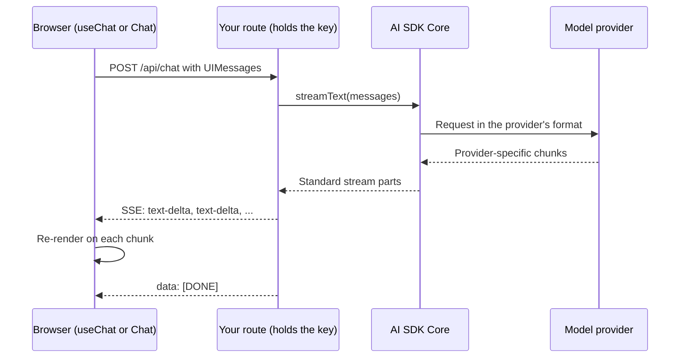
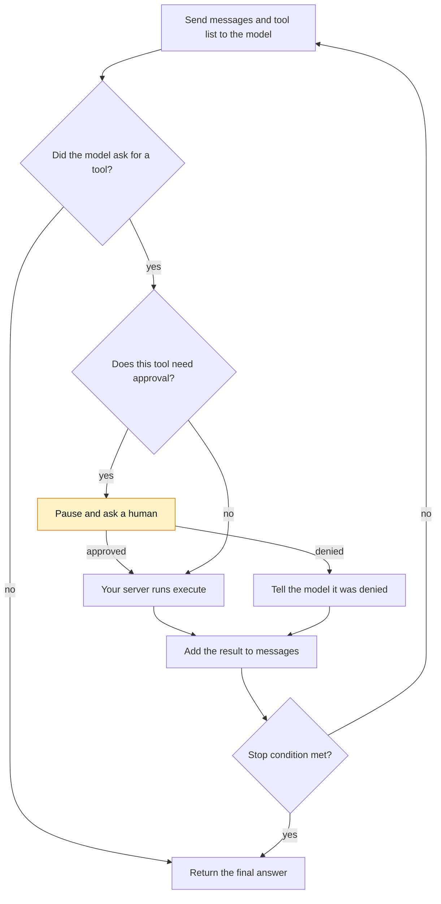
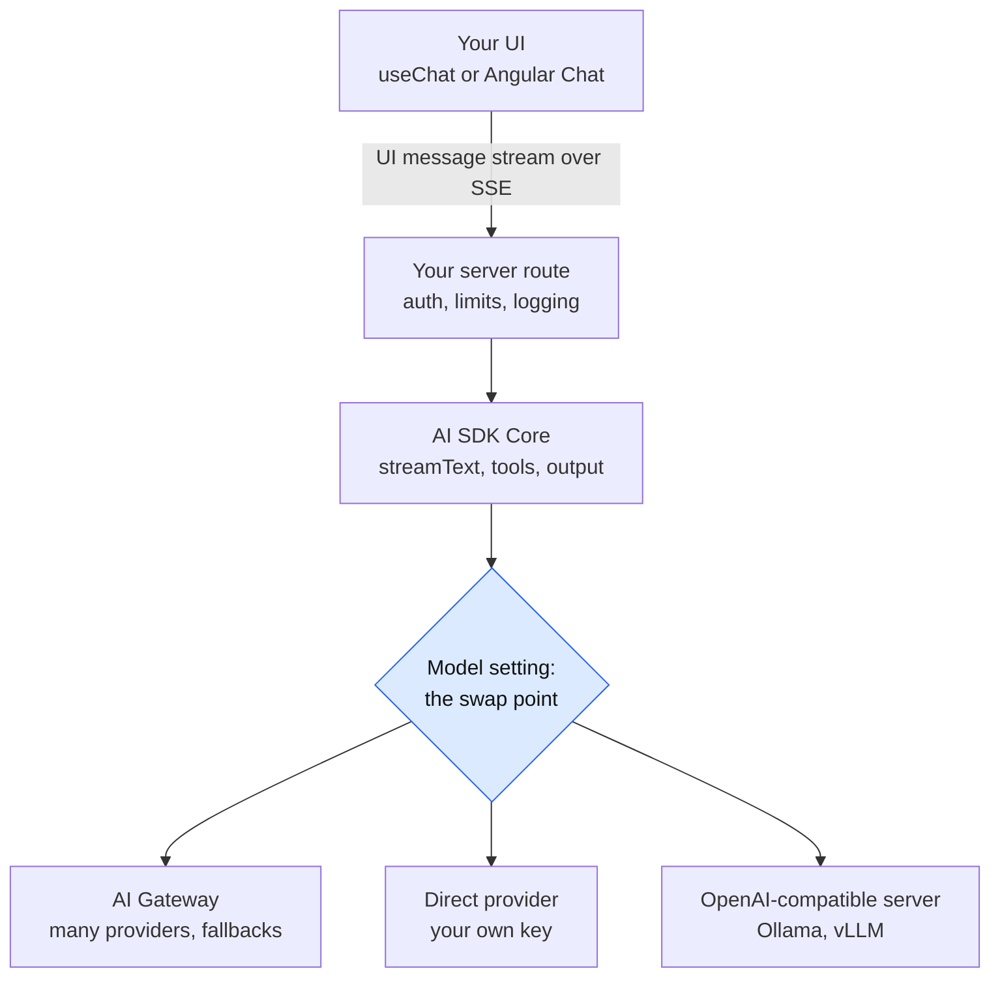
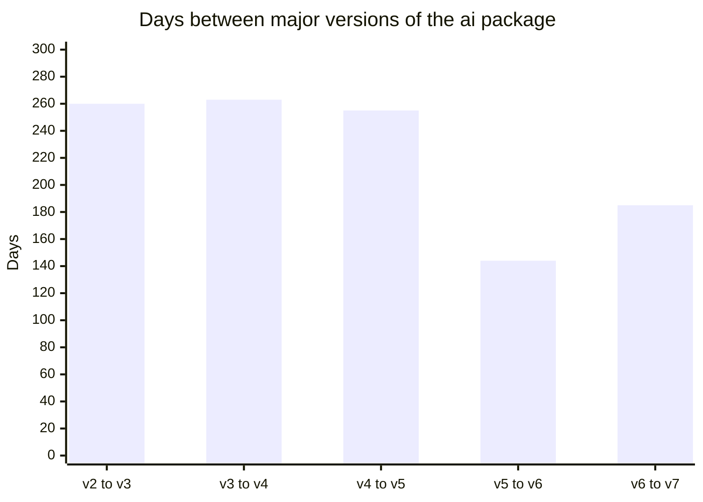
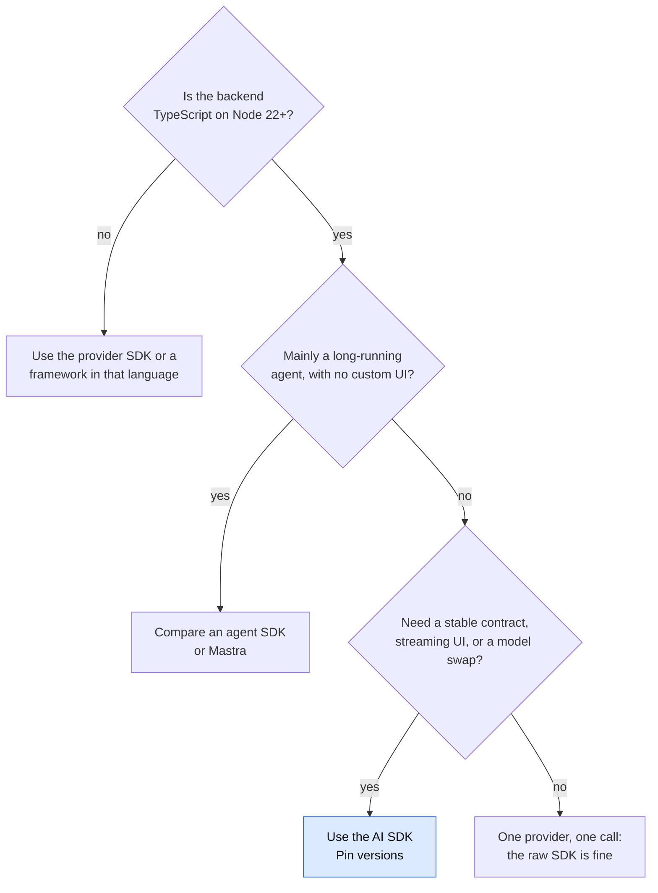
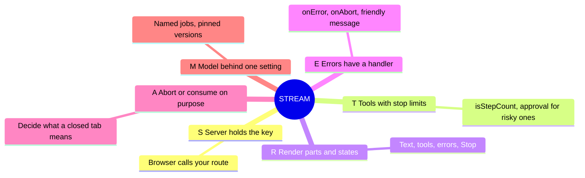



*Utkrishta Sinha · 3 Nov 2026 · about 40 minutes*

*Reading time: about 40 minutes. Facts checked on 3 November 2026. This SDK changes its API between major versions, so treat every function name here as a snapshot of AI SDK 7.*

## 1. The Five Big Ideas of Today

An AI SDK is the adapter between your app and a model. It handles the boring, tricky parts: streaming, tool loops, JSON validation and provider differences. You keep writing a normal web app. This is good news for a frontend engineer, because the hardest part of many AI products is now the screen.

1. **An AI SDK is a plumbing layer, not an agent brain.** It gives one API over many providers, so a model change becomes a small code change. It does not make your prompts, evals or business logic good.
2. **Streaming is a product feature.** Users hate staring at a blank box. Sending tokens as they arrive makes the same slow model feel fast.
3. **Three functions cover most work.** `generateText` waits for the full answer. `streamText` sends it piece by piece. `output: Output.object(...)` makes the answer match a schema.
4. **`ToolLoopAgent` is just the Day 1 loop with a stop limit.** The model asks, your code runs the tool, and the result goes back. The SDK writes that loop for you.
5. **The API key stays on the server, always.** The browser calls your route. Your route calls the model. And Angular has first-party support, so you need not move to React to use this.

> Joke of the day: I asked the AI SDK to fix my life. It streamed the answer word by word, so at least the disappointment felt responsive.

## 2. Why This Matters for an FDE

A Forward Deployed Engineer (FDE) often has to ship a working AI screen inside the customer's existing app, in days. That app is rarely a fresh Next.js project. It may be Angular on an Express backend, and it may have a strict security team.

Here is where this topic shows up in real engagements:

| What the customer says | What they often mean | Your first move |
| --- | --- | --- |
| "The chatbot feels slow." | Time to first word is long. | Measure time to first token. Add streaming before changing the model. |
| "We may change model vendor." | They fear lock-in or a price rise. | Put the model behind one setting. Prove a swap in a demo. |
| "Our frontend is Angular." | They will not rewrite for a chat box. | Use `@ai-sdk/angular`, or a plain streaming client. |
| "Can it issue refunds?" | Tools with real side effects. | Add human approval, audit logs and spending limits. |
| "Can it fill this form from an email?" | Structured output. | Define a schema, then validate and send failures to a person. |
| "Data can't leave India." | A residency rule, maybe. | Ask which rule. Check the gateway's regions before promising. |

Your frontend skills are a real edge here. You already understand loading states, cancelling requests and reactive state. An AI screen needs all of them, plus a stream that can fail halfway through a sentence.

## 3. Core Concepts, From Simple to Complex

### 3.1 Start with a travel adapter

Every country has a different power socket. You could rewire your laptop charger for each trip. Or you could buy a travel adapter.

Model providers are the same. OpenAI, Anthropic and Google each have their own request shape, streaming events and tool format. The AI SDK docs put the problem plainly: [integrating LLMs "is complicated"](https://ai-sdk.dev/docs/introduction) and depends on each provider's details. The SDK standardises that.

It has three parts. **AI SDK Core** runs on the server and handles text, structured data, tools and agents. **AI SDK UI** gives the browser chat state for React, Vue, Svelte and Angular. **AI SDK Harnesses** run existing agents like Claude Code behind one interface.

The package is simply called `ai` on npm. Its maker is Vercel, but it is [Apache 2.0 licensed and runs anywhere](https://vercel.com/kb/guide/vercel-ai-sdk-vs-tanstack-ai), not just on Vercel.

### 3.2 Glossary: every term in plain English

| Term | Meaning | Everyday example |
| --- | --- | --- |
| SDK | A library that makes a service easy to use. | A remote control instead of opening the TV. |
| Provider | A company or server that hosts models. | The electricity company. |
| Model ID | The exact name of a model. | A product code on a shelf. |
| Token | A small chunk of text. | One bite of a dosa. |
| Latency | Time you wait for a response. | Time until your food arrives. |
| TTFT | Time to first token. | Time until the first bite arrives. |
| Streaming | Sending output in pieces as it is made. | A tap running, not a full bucket delivered later. |
| SSE (Server-Sent Events) | A simple way for a server to push text over HTTP. | A radio: the server talks, you listen. |
| WebSocket | A two-way live connection. | A phone call. |
| Backpressure | A slow reader making the producer wait. | A waiter who stops cooking orders when no one is eating. |
| Abort signal | A standard way to cancel work in JavaScript. | Cancelling a food order before it is cooked. |
| Schema | A description of the shape data must have. | A form with fixed boxes. |
| Zod | A TypeScript library for writing schemas. | The clerk who checks that form. |
| Structured output | Model output that follows a schema. | A filled form, not a rambling letter. |
| Tool | A function the model may ask you to run. | Asking a friend to check the fridge. |
| Tool call | The model's request to run a tool. | "Please check the fridge for milk." |
| Step | One model call, plus any tools it triggered. | One round of a conversation. |
| Agent | A model in a loop with tools and a goal. | A helper who keeps going until the job is done. |
| Stop condition | The rule that ends the loop. | "Try at most five shops, then come home." |
| Human in the loop | A person approves a risky action. | A manager signs off a refund. |
| Hook | A reusable piece of UI state logic. | A ready-made kitchen appliance. |
| Signal | Angular's reactive value. | A scoreboard that updates by itself. |
| `UIMessage` | The chat message format for screens. | The full printed bill. |
| `ModelMessage` | The smaller format sent to the model. | Only what the chef needs to read. |
| Transport | The code that carries chat messages to the server. | The delivery rider. |
| Gateway | One endpoint that routes to many providers. | A travel agent who books any airline. |
| Fallback | A backup model if the first one fails. | A second train if the first is cancelled. |
| BYOK | Bring Your Own Key: use your own provider account. | Using your own metro card. |
| ZDR | Zero Data Retention: the provider does not keep your data. | A shredder after each meeting. |
| Telemetry | Automatic records of what the system did. | A flight recorder. |

### 3.3 What streaming really is

Without streaming, the browser sends a request and waits. A long answer can take many seconds. With streaming, the server keeps the HTTP response open and sends small pieces.

[Server-Sent Events](https://developer.mozilla.org/en-US/docs/Web/API/Server-sent_events/Using_server-sent_events) is plain text over HTTP. The response uses `Content-Type: text/event-stream`. Each message is a `data:` line followed by a blank line. That's it. No special port and no upgrade step.

Think of an Observable that emits many values over one long HTTP response.

The SDK adds a typed protocol on top, called the [UI message stream](https://ai-sdk.dev/docs/ai-sdk-ui/stream-protocol). Each `data:` line is JSON with a `type` such as `text-delta` or `tool-output-available`. The stream ends with `data: [DONE]`. A custom backend must also send the header `x-vercel-ai-ui-message-stream: v1`.



*The browser never talks to the model, so the key stays on your server.*

### 3.4 The three core calls

| You need | Use | Returns |
| --- | --- | --- |
| A full answer, no live UI | `generateText` | A promise with `text`, `usage`, `steps` |
| Live text on a screen | `streamText` | Immediately, with streams like `textStream` |
| Data matching a schema | Either one, plus `output` | A typed `output` |

One difference catches everyone. `generateText` is awaited. `streamText` is [not awaited](https://ai-sdk.dev/docs/reference/ai-sdk-core/stream-text): it returns straight away, and its fields such as `usage` are promises.

### 3.5 Structured output

Text is hard for code to use. If a model writes "this seems urgent", your `if` statement can't read it. So you pass a schema:

- [`Output.object({ schema })`](https://ai-sdk.dev/docs/ai-sdk-core/generating-structured-data) for one object.
- `Output.array({ element })` for a list.
- `Output.choice({ options })` to pick one label.
- `Output.json()` for any valid JSON, with no shape check.

If the reply fails validation, `generateText` throws `NoObjectGeneratedError`. Plan for it. A valid shape also isn't a true answer. The schema can check that `urgency` is "high" or "low", but not that the model picked the right one.

### 3.6 Tools and the loop

You met this on Day 1. A [tool](https://ai-sdk.dev/docs/ai-sdk-core/tools-and-tool-calling) has a `description`, an `inputSchema` and usually an `execute` function. The model reads the first two. Your server runs the third.

Here is the catch: `generateText` and `streamText` default to `isStepCount(1)`. After a tool runs, they stop. The final answer never gets written. Set `stopWhen: isStepCount(5)` to let the loop continue. `ToolLoopAgent` [defaults to 20 steps](https://ai-sdk.dev/docs/agents/loop-control) instead.



*The model only asks; your code decides, runs and stops the loop.*

### 3.7 Agents in the SDK

[`ToolLoopAgent`](https://ai-sdk.dev/docs/agents/overview) bundles the model, instructions and tools into one reusable object. You call `.generate()` or `.stream()`. The docs recommend it for most agents, and suggest plain core functions when you need explicit control of each step.

[AI SDK 7](https://vercel.com/changelog/ai-sdk-7) added **`WorkflowAgent`**, which saves state between steps for long jobs, and **`HarnessAgent`**, which wraps an external coding agent.

Risky actions use `toolApproval`. Mark a tool `user-approval` and the call pauses with a `tool-approval-request`. It does not block a thread. It [returns, and you send the answer in a second call](https://ai-sdk.dev/docs/ai-sdk-core/tools-and-tool-calling). That design suits the web, because the human may reply an hour later.

### 3.8 UI: hooks, classes and Angular

On React, `useChat` gives you `messages`, `sendMessage`, `status`, `stop` and `regenerate`. [`status`](https://ai-sdk.dev/docs/ai-sdk-ui/chatbot) moves through `submitted`, `streaming`, `ready` and `error`. You keep the input text in your own state.

Every message has `parts`, not one `content` string, because one reply can mix text, tool calls and files. Render by looping over parts.

Angular has real support. `@ai-sdk/angular` gives you three classes: [`Chat`, `Completion` and `StructuredObject`](https://ai-sdk.dev/docs/reference/ai-sdk-ui). They match `useChat`, `useCompletion` and `useObject`. The [Angular quickstart](https://ai-sdk.dev/docs/getting-started/angular) uses Express and a dev proxy. One gap is listed in the [support table](https://ai-sdk.dev/docs/ai-sdk-ui/overview): MCP Apps are not available on Angular. The docs also warn that non-React frameworks miss some features, so check the table for yours.

### 3.9 Provider swapping and AI Gateway

A plain string like `"anthropic/claude-sonnet-5.5"` works because the [default global provider is AI Gateway](https://ai-sdk.dev/docs/ai-sdk-core/provider-management). So a string model ID sends traffic through Vercel unless you change it. You have three ways to stay flexible:

1. **Direct provider package**, such as `@ai-sdk/anthropic`, using your own key.
2. **`customProvider` or `createProviderRegistry`**, which give your app its own names, like `fast` or `private`.
3. **`createOpenAICompatible`**, for any server that speaks the OpenAI format, including the Ollama and vLLM servers from Day 7.

[AI Gateway](https://vercel.com/docs/ai-gateway) is a separate paid service, not part of the open-source library. It offers one key, many models, fallbacks and budgets. Vercel says it charges [no markup on tokens](https://vercel.com/docs/ai-gateway/pricing), and this is the vendor's own statement. Some add-ons do cost extra:

| Add-on | Price (Vercel docs, last updated 8 Sep 2026) |
| --- | --- |
| Team-wide provider allowlist | $0.10 per 1,000 successful requests |
| Team-wide zero data retention | $0.10 per 1,000 requests |

Per-request `only` filters are free, per-request ZDR is free on Pro and Enterprise, and BYOK needs purchased credits. The free tier has a monthly credit, but the page I read did not state the amount, so check your dashboard.



*Everything above the swap point stays the same when the model changes.*

### 3.10 Why old tutorials break

Most AI SDK tutorials online are out of date. The [v7 migration guide](https://ai-sdk.dev/docs/migration-guides/migration-guide-7-0) lists many renames. AI SDK 7 also requires Node 22 or newer and is ESM only, so `require('ai')` is out.

| If a tutorial says | Current AI SDK 7 |
| --- | --- |
| `system:` | `instructions:` |
| `generateObject()` | `generateText()` with `output` (still exported, marked deprecated in the type file) |
| `stepCountIs(5)` | `isStepCount(5)` |
| `onFinish` | `onEnd` |
| `fullStream` | `stream` |
| `result.toUIMessageStreamResponse()` | `createUIMessageStreamResponse({ stream: toUIMessageStream(...) })` |
| `needsApproval: true` on a tool | `toolApproval: { myTool: "user-approval" }` |
| `totalUsage` | `usage`, which now covers all steps |
| `experimental_telemetry` | `telemetry`, plus `registerTelemetry()` |

Run `npx @ai-sdk/codemod v7` to upgrade older code. And notice how often this happens:



*The last two majors came faster, so pin your versions and read release notes. Source: publish dates in the npm registry for `ai`.*

## 4. Worked Examples: From One Call to a Streaming Agent

Everything below was tested on 3 November 2026 with Node 22.23.4, `ai` 7.0.162, `@ai-sdk/angular` 3.0.162, `@ai-sdk/react` 4.0.166 and Zod 4.6.7, unless a note says otherwise.

**What was and wasn't run.** The sandbox had no model API key, so **no real model was called**. All runs used the SDK's own `MockLanguageModelV4` from `ai/test`. Real model replies will differ. The Next.js route ran as a plain function, not inside Next.js. The AI Gateway fallback example was type-checked only. The local provider example ran against a small fake OpenAI-style server, not real Ollama. The Angular and React screens were real builds, driven in headless Chrome against the mock server.

Set up once:

```bash
mkdir ai-day && cd ai-day
npm init -y && npm pkg set type=module
npm i ai zod express @ai-sdk/openai-compatible
npm i -D tsx typescript @types/node @types/express
```

### Example 1: A fake model, so you can start with no key

This file lets every example run offline. It also doubles as a unit-test helper for your real projects.

```typescript
// file: mock.ts
import { simulateReadableStream } from "ai";
import { MockLanguageModelV4 } from "ai/test";

const usage = {
  inputTokens: { total: 12, noCache: 12, cacheRead: undefined, cacheWrite: undefined },
  outputTokens: { total: 6, text: 6, reasoning: undefined },
};
const stop = { unified: "stop" as const, raw: undefined };

// A fake model that "types" one reply, word by word.
export function fakeModel(reply: string, delayMs = 40) {
  const words = reply.split(/(?<= )/);
  return new MockLanguageModelV4({
    doGenerate: async () => ({
      content: [{ type: "text", text: reply }],
      finishReason: stop,
      usage,
      warnings: [],
    }),
    doStream: async () => ({
      stream: simulateReadableStream({
        chunkDelayInMs: delayMs,
        chunks: [
          { type: "text-start", id: "t1" },
          ...words.map((delta) => ({ type: "text-delta" as const, id: "t1", delta })),
          { type: "text-end", id: "t1" },
          { type: "finish", finishReason: stop, usage },
        ],
      }),
    }),
  });
}

// Turn 1 asks for a tool. Turn 2 writes the answer.
export function fakeToolModel(toolName: string, input: object, answer: string) {
  return new MockLanguageModelV4({
    doGenerate: [
      {
        content: [{
          type: "tool-call",
          toolCallId: "call_1",
          toolName,
          input: JSON.stringify(input),
        }],
        finishReason: { unified: "tool-calls", raw: undefined },
        usage,
        warnings: [],
      },
      { content: [{ type: "text", text: answer }], finishReason: stop, usage, warnings: [] },
    ],
  });
}
```

```typescript
// file: model.ts
import { fakeModel } from "./mock.ts";

// One switch for the whole app.
export const model = process.env.AI_GATEWAY_API_KEY
  ? "anthropic/claude-sonnet-5.5" // real model, through AI Gateway
  : fakeModel("Hello from the fake model. Streaming works.");
```

### Example 2: generateText

```typescript
// file: generate.ts
import { generateText } from "ai";
import { model } from "./model.ts";

const { text, usage, finishReason } = await generateText({
  model,
  instructions: "Answer in one short line.",
  prompt: "Say hello.",
});

console.log(text);
console.log(finishReason, usage.inputTokens, usage.outputTokens);
```

Run `npx tsx generate.ts`. It prints the reply, then `stop 12 6`.

### Example 3: streamText in the terminal

```typescript
// file: stream.ts
import { streamText } from "ai";
import { model } from "./model.ts";

const result = streamText({
  model, // no await here
  prompt: "Say hello.",
  onError: ({ error }) => console.error("stream failed:", error),
});

for await (const delta of result.textStream) {
  process.stdout.write(`[${delta}]`);
}
console.log("\ntokens:", (await result.usage).totalTokens);
```

Output:

```text
[Hello ][from ][the ][fake ][model. ][Streaming ][works.]
tokens: 18
```

The brackets show each chunk. Notice that `usage` needs an `await`, because it is only known at the end.

### Example 4: A streaming chat route

This is the most useful file today. It uses Express, as the Angular quickstart does.

```typescript
// file: server.ts
import express from "express";
import {
  convertToModelMessages,
  pipeUIMessageStreamToResponse,
  streamText,
  toUIMessageStream,
  type UIMessage,
} from "ai";
import { model } from "./model.ts";

const app = express();
app.use(express.json({ limit: "1mb" }));

app.post("/api/chat", async (req, res) => {
  const { messages } = req.body as { messages: UIMessage[] };

  const controller = new AbortController();
  res.on("close", () => {
    if (!res.writableEnded) controller.abort(); // user left mid-answer
  });

  const result = streamText({
    model,
    instructions: "You are a helpful support assistant.",
    messages: await convertToModelMessages(messages),
    abortSignal: controller.signal,
    timeout: { totalMs: 60_000, chunkMs: 20_000 },
    onError: ({ error }) => console.error("model error:", error),
    onEnd: ({ usage }) => console.log("tokens used:", usage.totalTokens),
  });

  pipeUIMessageStreamToResponse({
    response: res,
    stream: toUIMessageStream({
      stream: result.stream,
      onError: () => "Sorry, something went wrong.", // never leak details
    }),
  });
});

app.listen(3000, "127.0.0.1", () => console.log("http://127.0.0.1:3000"));
```

Run it with `npx tsx server.ts`, then look at the raw stream. The `-N` flag turns off curl's buffering:

```bash
curl -N -X POST http://127.0.0.1:3000/api/chat \
  -H 'content-type: application/json' \
  -d '{"messages":[{"id":"1","role":"user","parts":[{"type":"text","text":"Hi"}]}]}'
```

The real output, with many events cut:

```text
data: {"type":"start"}

data: {"type":"text-delta","id":"t1","delta":"Hello "}

data: {"type":"text-delta","id":"t1","delta":"from "}

data: {"type":"finish","finishReason":"stop"}

data: [DONE]
```

The response headers were `content-type: text/event-stream`, `x-vercel-ai-ui-message-stream: v1` and `x-accel-buffering: no`. That last one asks an nginx-style proxy not to buffer.

In a Next.js route handler, the shape is nearly the same. Write `export async function POST(req: Request)`, pass `abortSignal: req.signal`, and return `createUIMessageStreamResponse({ stream: toUIMessageStream({ stream: result.stream }) })`. I ran that version as a plain function and got the same event stream.

### Example 5: The screen, in Angular and React

Here is the Angular version. Run `ng new`, then `npm i ai @ai-sdk/angular`, and proxy `/api` to port 3000 as the quickstart shows.

```typescript
// file: app.ts
import { Component, signal } from '@angular/core';
import { FormsModule } from '@angular/forms';
import { Chat } from '@ai-sdk/angular';

@Component({
  selector: 'app-root',
  imports: [FormsModule],
  template: `
    @for (message of chat.messages; track message.id) {
      <p>
        <b>{{ message.role }}:</b>
        @for (part of message.parts; track $index) {
          @if (part.type === 'text') { <span>{{ part.text }}</span> }
        }
      </p>
    }
    @if (chat.error) { <p role="alert">Something went wrong. Please retry.</p> }

    <form (submit)="send($event)">
      <input name="q" [ngModel]="input()" (ngModelChange)="input.set($event)" />
      <button [disabled]="chat.status !== 'ready'">Send</button>
      @if (chat.status === 'streaming') {
        <button type="button" (click)="chat.stop()">Stop</button>
      }
    </form>
  `,
})
export class App {
  readonly chat = new Chat({}); // posts to /api/chat by default
  readonly input = signal('');

  send(event: Event) {
    event.preventDefault();
    const text = this.input().trim();
    if (!text || this.chat.status !== 'ready') return;
    this.chat.sendMessage({ text });
    this.input.set('');
  }
}
```

The React version has the same shape:

```tsx
// file: Chat.tsx
"use client";
import { useChat } from "@ai-sdk/react";
import { useState } from "react";

export default function Chat() {
  const { messages, sendMessage, status, stop } = useChat();
  const [input, setInput] = useState("");

  return (
    <main>
      {messages.map((m) => (
        <p key={m.id}>
          <b>{m.role}: </b>
          {m.parts.map((p, i) => (p.type === "text" ? <span key={i}>{p.text}</span> : null))}
        </p>
      ))}
      <form
        onSubmit={(e) => {
          e.preventDefault();
          if (!input.trim() || status !== "ready") return;
          sendMessage({ text: input });
          setInput("");
        }}
      >
        <input value={input} onChange={(e) => setInput(e.target.value)} />
        <button disabled={status !== "ready"}>Send</button>
        {status === "streaming" && <button type="button" onClick={stop}>Stop</button>}
      </form>
    </main>
  );
}
```

I tested both in headless Chrome, on Angular 22.2.4 and React 19.3.1. Both showed the text growing through 10 distinct screen states, with the Stop button present while streaming. The Angular build gave one harmless warning about a CommonJS dependency, `@vercel/oidc`. The React build used esbuild, not Next.js.

### Example 6: A tool call

```typescript
// file: tool.ts
import { generateText, isStepCount, tool } from "ai";
import { z } from "zod";
import { fakeToolModel } from "./mock.ts";

const ORDERS: Record<string, string> = {
  A123: "out for delivery",
  B456: "delayed at the warehouse",
};

const getOrderStatus = tool({
  description: "Look up the delivery status of one order by its ID.",
  inputSchema: z.object({ orderId: z.string().describe("Order ID, like A123") }),
  execute: async ({ orderId }) => {
    console.log("tool ran for", orderId);
    return { orderId, status: ORDERS[orderId] ?? "order not found" };
  },
});

const result = await generateText({
  // Real use: model: "anthropic/claude-sonnet-5.5"
  model: fakeToolModel(
    "getOrderStatus",
    { orderId: "A123" },
    "Order A123 is out for delivery.",
  ),
  tools: { getOrderStatus },
  stopWhen: isStepCount(5), // without this, it stops after step 1
  prompt: "Where is my order A123?",
});

console.log(result.text);
console.log("steps:", result.steps.length);
console.log("output tokens, all steps:", result.usage.outputTokens);
```

Output:

```text
tool ran for A123
Order A123 is out for delivery.
steps: 2
output tokens, all steps: 12
```

I also removed `stopWhen` to confirm the trap. The result had `text: ""`, one step and `finishReason: "tool-calls"`. The tool ran, but no answer was written.

### Example 7: Structured output

```typescript
// file: structured.ts
import { generateText, NoObjectGeneratedError, Output, type LanguageModel } from "ai";
import { z } from "zod";
import { fakeModel } from "./mock.ts";

const Ticket = z.object({
  category: z.enum(["billing", "delivery", "technical", "other"]),
  urgency: z.enum(["low", "medium", "high"]),
  summary: z.string().max(120),
  orderId: z.string().nullable(),
});

const email = "Order A123 never arrived and I need it for a wedding tomorrow!";

async function triage(model: LanguageModel) {
  try {
    const { output } = await generateText({
      model,
      output: Output.object({ schema: Ticket }),
      prompt: `Classify this support email:\n${email}`,
    });
    return output; // typed as z.infer<typeof Ticket>
  } catch (error) {
    if (NoObjectGeneratedError.isInstance(error)) {
      console.error("bad model output:", error.text);
      return null; // send to a human queue
    }
    throw error;
  }
}

const good = JSON.stringify({
  category: "delivery",
  urgency: "high",
  summary: "Order A123 missing, needed for a wedding tomorrow.",
  orderId: "A123",
});
console.log(await triage(fakeModel(good)));
console.log(await triage(fakeModel('{"category":"cricket"}')));
```

Output:

```text
{
  category: 'delivery',
  urgency: 'high',
  summary: 'Order A123 missing, needed for a wedding tomorrow.',
  orderId: 'A123'
}
bad model output: {"category":"cricket"}
null
```

Forms can also fill in live. With `streamText`, loop over `partialOutputStream`. On a fake recipe, this printed five growing objects, from `{}` to the full result. Partial values [can't be validated](https://ai-sdk.dev/docs/ai-sdk-core/generating-structured-data), so never act on them. Wait for the final `output`.

### Example 8: An agent with human approval

```typescript
// file: agent.ts
import { ToolLoopAgent, tool, type ModelMessage } from "ai";
import { z } from "zod";
import { fakeToolModel } from "./mock.ts";

let refunds = 0;

const issueRefund = tool({
  description: "Refund an order. Moves real money.",
  inputSchema: z.object({ orderId: z.string(), amountInr: z.number().positive() }),
  execute: async ({ orderId, amountInr }) => {
    refunds++;
    return { orderId, refunded: amountInr };
  },
});

const support = new ToolLoopAgent({
  model: fakeToolModel(
    "issueRefund",
    { orderId: "A123", amountInr: 499 },
    "Refund of 499 issued.",
  ),
  instructions: "You help customers with orders. Be brief.",
  tools: { issueRefund },
  toolApproval: { issueRefund: "user-approval" }, // a human must say yes
});

const history: ModelMessage[] = [{ role: "user", content: "Refund 499 on order A123." }];

const first = await support.generate({ messages: history });
history.push(...first.responseMessages);
console.log("before approval, refunds run:", refunds);

const ask = first.content.find((p) => p.type === "tool-approval-request");
if (!ask) throw new Error("expected an approval request");

// In a real app this comes from a button, maybe hours later.
history.push({
  role: "tool",
  content: [{ type: "tool-approval-response", approvalId: ask.approvalId, approved: true }],
});

const second = await support.generate({ messages: history });
console.log(second.text, "| refunds run:", refunds);
```

Output:

```text
before approval, refunds run: 0
Refund of 499 issued. | refunds run: 1
```

### Example 9: Swapping providers

Name models by job, then map jobs to vendors in one file.

```typescript
// file: models.ts
import { createOpenAICompatible } from "@ai-sdk/openai-compatible";
import { customProvider, generateText } from "ai";
import { fakeModel } from "./mock.ts";

const ollama = createOpenAICompatible({
  name: "ollama",
  baseURL: process.env.LOCAL_URL ?? "http://localhost:11434/v1",
});

// App code asks for a job, not a vendor.
const ai = customProvider({
  languageModels: {
    fast: fakeModel("fast answer"),
    private: ollama("gemma4:e2b"), // from Day 7
  },
});

const { text } = await generateText({
  model: ai.languageModel(process.argv[2] ?? "fast"),
  prompt: "hi",
});
console.log(text);
```

Against my fake OpenAI-style server, the `private` route sent `POST /v1/chat/completions` with model `gemma4:e2b`, for both normal and streaming calls. The app code did not change.

Gateway fallbacks look like this. This one was type-checked only, because it needs a real key. The option names come from [Vercel's router guide](https://vercel.com/kb/guide/how-to-build-your-own-ai-model-router), and the model IDs come from Vercel's docs:

```typescript
// file: gateway.ts
import { generateText } from "ai";

const { text, providerMetadata } = await generateText({
  model: "anthropic/claude-sonnet-5.5", // primary
  prompt: "Summarise this release note in one line.",
  providerOptions: {
    gateway: {
      models: ["openai/gpt-6-astra", "google/gemini-3.1-pro-preview"], // fallbacks, in order
      only: ["bedrock", "anthropic", "openai", "google"], // approved providers
    },
  },
});

console.log(text);
console.log(JSON.stringify(providerMetadata?.gateway, null, 2)); // which route won
```

## 5. Real-Life Use Cases

Most evidence here comes from Vercel, which sells the surrounding platform. I found no neutral audit of any figure below.

| Who | What they did | Evidence | Lesson for an FDE |
| --- | --- | --- | --- |
| [Thomson Reuters](https://vercel.com/blog/ai-sdk-6) | Vercel says it built CoCounsel with the SDK using 3 developers in 2 months, and serves 1,300 accounting firms. | Vendor claim, December 2025. | Small teams can ship fast. Verify before you repeat it. |
| [Clay](https://vercel.com/blog/ai-sdk-6) | Clay's Jeff Barg: "We've gone all in on the AI SDK", for its AI web research agent. | Customer quote on a vendor page. | Tools and streams work for research agents. |
| [ChatPRD](https://vercel.com/customers/leveraging-vercel-and-the-ai-sdk-to-deliver-a-seamless-ai-powered-experience) | A solo founder added streaming. She said it "had a measurable impact on our business", citing satisfaction and sign-ups. | Vendor case study. No exact figure. | Streaming is a business change, not polish. |
| [Searchable](https://vercel.com/blog/how-searchable-ships-customer-requested-features-in-30-minutes-on-vercel) | Tests new models through AI Gateway without new SDKs or key rotation. Claims 100+ billion tokens processed. | Vendor story. | A swap layer speeds up model testing. |
| [Juspay NeuroLink](https://unpkg.com/@juspay/neurolink@7.3.8/README.md) (India) | [Bengaluru fintech](https://www.webpronews.com/juspays-50-million-infusion-crowns-bengaluru-fintech-as-2026s-first-unicorn) Juspay published a TypeScript AI library "extracted from production use at Juspay". | Open package, but self-reported. | Enterprises often wrap an SDK with their own governance. |

**The Thomson Reuters story has a twist.** In June 2026, LawNext reported that the next generation of [CoCounsel Legal was rebuilt on Anthropic's Claude Agent SDK](https://www.lawnext.com/?p=53508). Vercel's claim mentions accounting firms and LawNext's mentions legal, so these may be separate efforts. The sources do not connect them. The lesson still stands: a big company can use several SDKs, and choices change.

**The Juspay evidence is weak but real, and the best Indian example I found.** Version 7.3.8, from August 2025, depends on `ai`, and a [NeuroLink post](https://dev.to/neurolink/neurolink-vs-langchain-vs-vercel-ai-sdk-an-honest-2026-comparison-mjb) says it "extends" the SDK. But the current 13.10.3 on npm no longer lists `ai` as a dependency and names direct clients like `@anthropic-ai/sdk`, although four built files still import from `ai`. So Juspay built on the AI SDK at one point, and today's link is unclear. I found no production numbers, and no Indian customer story on Vercel's site.

**A smaller Indian link:** Sarvam AI is a [community provider](https://ai-sdk.dev/providers/community-providers/sarvam) offering speech-to-text through `transcribe`. A [community post](https://community.vercel.com/t/added-sarvam-ai-support-to-the-vercel-ai-sdk/35978) proposes text support, with no sign it merged. This is an integration, not proof of a customer.

## 6. Pros, Cons and When to Use an AI SDK

An SDK trades a little control and some version churn for a lot of saved plumbing.

| Factor | With the AI SDK | Calling provider APIs directly |
| --- | --- | --- |
| Time to a streaming chat | Hours. | Days, with your own parser and state. |
| Changing provider | Mostly a model setting. | Rewrite requests, streams and tools. |
| Tool loop and schemas | Built in. | You write them, as on Day 1. |
| UI state | Hooks and Angular classes. | You build it. |
| Newest provider feature | May lag, or need `providerOptions`. | Available on day one. |
| Upgrades | Breaking majors, recently about every six months. | Depends on the provider SDK. |
| Runtime | Node 22+, ESM only. | Whatever that SDK supports. |
| Language | TypeScript first; [Python is in public beta](https://vercel.com/kb/guide/vercel-ai-sdk-vs-tanstack-ai). | Most languages. |



*Choose the AI SDK when a TypeScript app needs a streaming screen or a swap point.*

**Use it when:**

- A TypeScript web app needs chat, generated forms or an embedded agent.
- You need streaming, tools, schemas or quick provider tests together.
- The customer's team knows the frontend better than AI infrastructure.

**Avoid it when:**

- The backend is Java or Spring Boot, and adding Node would add an unwanted service. Stream from Spring and speak the SSE protocol yourself, or use a plain text stream.
- The runtime is stuck below Node 22, unless you stay on an older major.
- A small script makes one call. A plain `fetch` is enough.

## 7. Common Pitfalls and Production Gotchas

Many of these were reproduced in the test folder. Those are marked **(tested)**.

1. **The API key in the browser.** Never call the model from client code. Anyone can read it in DevTools. Keep it in your route.
2. **Errors that hide in the stream (tested).** With a broken model, `for await` on `textStream` ended quietly with zero chunks and threw nothing. The default handler only printed to the server console. `await result.text` then threw `NoOutputGeneratedError`. The [troubleshooting page](https://ai-sdk.dev/docs/troubleshooting/stream-text-not-working) describes this, but the [error-handling page](https://ai-sdk.dev/docs/ai-sdk-core/error-handling) says simple streams throw. My test matched the troubleshooting page. Always pass `onError`.
3. **Stopping after the tool (tested).** No `stopWhen` means no final answer.
4. **User disconnect loses work (tested).** Closing the connection with neither abort nor `consumeStream` meant neither `onEnd` nor `onAbort` fired. You lose your save and your usage log. Pick one, on purpose:
   - An abort signal stops spending. `onAbort` runs, and `onEnd` does not.
   - [`result.consumeStream()`](https://ai-sdk.dev/docs/ai-sdk-ui/chatbot-message-persistence) keeps going and saves the full answer, but you pay for it.
5. **Trusting the client's messages.** A browser can post anything, including fake history. Prefer loading history from your database. AI SDK 7 [rejects system messages](https://ai-sdk.dev/docs/migration-guides/migration-guide-7-0) inside `messages` by default **(tested)**. Do not turn on `allowSystemInMessages` for user data.
6. **Compression and buffering.** A proxy can hold the whole stream and release it at the end. The docs' [fix for compression](https://ai-sdk.dev/docs/troubleshooting/streaming-not-working-when-proxied) is a `Content-Encoding: none` header. Test through the customer's real proxy, not only on localhost.
7. **The HTTP/1 connection limit.** MDN notes a limit of [6 connections per domain](https://developer.mozilla.org/en-US/docs/Web/API/Server-sent_events/Using_server-sent_events) across tabs without HTTP/2, so old proxies can stall other tabs.
8. **Serverless timeouts.** A long agent can outlive a function's limit. Set `timeout`, and use a durable option.
9. **Retries that double side effects.** After streaming starts, a retried step can [repeat text, and side effects may run again](https://ai-sdk.dev/docs/ai-sdk-core/error-handling). Make tools idempotent, for example with a unique refund ID.
10. **Trusting valid tool input.** Input can match the schema and still be wrong. Check authorisation inside `execute`, using the logged-in user, never a user ID chosen by the model.
11. **Untrusted text.** A web page read by a tool can contain instructions, so gate risky tools with approval. Model output is untrusted too, so never render it as raw HTML.
12. **Resume and stop fight each other.** With [resumable streams](https://ai-sdk.dev/docs/ai-sdk-ui/chatbot-resume-streams), `stop()` only closes the connection, and generation keeps running. A real stop button then needs its own endpoint.
13. **Saving the wrong format.** Store `UIMessage`, [not `ModelMessage`](https://ai-sdk.dev/docs/ai-sdk-ui/chatbot-message-persistence), and run `validateUIMessages` when loading old rows.
14. **Assuming a gateway region exists for you.** AI Gateway's [`inferenceRegion`](https://vercel.com/docs/ai-gateway/security-and-compliance/regional-inference) lists `us`, `eu`, `au` and `jp`, as of 10 September 2026. India is not listed. The default is `global`, and the note says your request can still be processed in any Vercel region. For an Indian residency rule, look at other options, like an India-region cloud deployment or Day 7's local models.
15. **BYOK surprises.** A failed BYOK request can [retry on Vercel's credentials](https://vercel.com/docs/ai-gateway/pricing), and AI Gateway budgets exclude BYOK spend. Set limits at the provider too.
16. **Floating versions.** Pin exact versions and upgrade on purpose.
17. **Rendering only text parts.** A reply can include tool and reasoning parts. An app that renders only `text` shows an empty bubble during a tool call. Add a "checking your order" state.
> A streaming demo is like a magic trick. It works beautifully, until a corporate proxy asks to see what's up your sleeve.

## 8. Comparing the Alternatives

There are three layers here: UI, SDK and agent framework. Many teams mix them, so these are not always rivals. Versions are from npm on 3 November 2026.

| Option | Version | What it is | Angular? | Pick it when | Skip it when |
| --- | --- | --- | --- | --- | --- |
| Raw provider SDK | Varies | The vendor's own client | Build it yourself | One provider, newest features | You need provider freedom or UI state. |
| [AI SDK](https://ai-sdk.dev/docs/introduction) (`ai`) | 7.0.162 | Toolkit for models, tools, UI | Yes, first-party | Default for TypeScript apps | Non-TypeScript backend. |
| [TanStack AI](https://tanstack.com/blog/tanstack-ai-1-0) | 1.0.1 | Composable, AG-UI based library | Yes, `@tanstack/ai-angular` | You like per-model types and an open protocol | You need the most mature ecosystem. |
| [Mastra](https://mastra.ai/articles/ai-agent-framework) | 1.81.0 | Agent framework: workflows, memory, evals | No first-party UI that I verified | Agents with workflows and evals in one box | You only need a chat box. |
| [LangChain.js](https://docs.langchain.com/oss/javascript/langchain/frontend/overview) | 1.6.1 | Agents via `createAgent` on LangGraph | Yes, `injectStream` from `@langchain/angular` | Complex graphs, an existing LangChain team | Simple apps. |
| [assistant-ui](https://www.assistant-ui.com/docs/runtimes/ai-sdk/overview), [AI Elements](https://vercel.com/changelog/introducing-ai-elements) | `@assistant-ui/react` 0.15.32 | Ready-made React chat components | No Angular docs found | A polished React chat, quickly | You are not on React. |
| [Genkit](https://angular.dev/ai/design-patterns) | Not checked | AI framework shown in Angular's docs | Yes, through `resource` streaming | A Google-centred Angular stack | You want the wider AI SDK ecosystem. |

Four notes on this table, because sources disagree or age fast:

- **TanStack AI's status.** Vercel's [comparison](https://vercel.com/kb/guide/vercel-ai-sdk-vs-tanstack-ai), updated 17 September 2026, calls it a release candidate. That is now out of date: [TanStack shipped 1.0](https://tanstack.com/blog/tanstack-ai-1-0) on 23 October, and npm shows 1.0.1. Its core APIs are declared stable, and the harness APIs remain experimental.
- **TanStack and Angular.** Its [overview page](https://tanstack.com/ai/v0/docs/getting-started/overview.md) names only React and Solid packages, but the 1.0 post lists Angular, and `@tanstack/ai-angular` exists on npm. I did not run it.
- **Mastra and the AI SDK.** A [third-party article](https://dev.to/jangwook_kim_e31e7291ad98/mastra-ai-10-the-typescript-agent-framework-developers-are-actually-shipping-2lan) calls them complementary, and Mastra's own article treats AI SDK providers as one option. On npm, `@mastra/core` depends on AI SDK provider interfaces. Think "compatible", not "built on".
- **Provider counts.** Vercel's comparison says about 38 first-party packages, while the [providers page](https://ai-sdk.dev/docs/foundations/providers-and-models) lists 23. Quote neither to a customer.

Protocols differ too. The AI SDK uses its own UI message stream, TanStack uses [AG-UI events](https://tanstack.com/blog/tanstack-ai-1-0), and LangChain's hooks connect to a LangGraph streaming API. That choice affects which UI libraries can plug in later.

## 9. Hands-On Exercise: Build "Refund Desk"

Build a small support screen that streams answers, looks up orders and asks a human before moving money. Allow 1 to 2 hours. Use Angular, since that is your strength, or React.

**The scenario:** A Pune e-commerce company wants staff to handle refund queries inside its existing Angular admin panel. It may change model vendor next quarter. Refunds above ₹500 need a manager.

**Steps:**

1. Set up the project and copy `mock.ts`, `model.ts` and `server.ts` from section 4. Check Node with `node -v`.
2. Add the Angular screen from Example 5, with a dev proxy for `/api`.
3. Add a `getOrderStatus` tool with five fake orders. Use `stopWhen: isStepCount(5)`.
4. Add an `issueRefund` tool. Require approval when the amount is above ₹500, and allow it automatically below that.
5. Show a "Checking your order..." state while a tool runs.
6. Add a `/api/triage` route that turns a pasted email into a `Ticket` with `Output.object`. Show the fields in a form.
7. Log tokens from `onEnd`, handle `onAbort`, and unit test the tool path and bad JSON with `MockLanguageModelV4`.
8. Map `fast` and `private` to providers in one file. If you have a key or Ollama, run the flow on a second provider.

**Acceptance criteria:**

- [ ] Text appears word by word, and `curl -N` shows `text-delta` events.
- [ ] No API key appears in the browser bundle or network tab.
- [ ] The Stop button works, and the server logs an abort.
- [ ] Asking for a refund of ₹499 runs without a prompt.
- [ ] Asking for a refund of ₹2,000 pauses, and nothing runs until a person approves.
- [ ] Denying a refund produces a polite reply and no refund.
- [ ] A forced model error shows a friendly message and a Retry button, with no stack trace in the UI.
- [ ] Bad structured output goes to a "needs review" state and does not crash.
- [ ] Tests pass with no network and no key.
- [ ] Changing provider touches one file only.

**Stretch goal:** Save chats as `UIMessage` in SQLite and reload them on refresh. Then decide between abort and `consumeStream`, and write down why.

## 10. Interview Questions with Model Answers

Practise these aloud. Short answers with a trade-off beat long ones.

**1. What problem does an AI SDK solve?**

Providers differ in requests, streaming events and tool formats. An SDK gives one interface for these, plus UI state, tool loops and schema validation. It removes plumbing. It doesn't replace prompts, evals or domain logic.

**2. Why SSE for chat, and not WebSockets?**

Chat output flows mainly one way, from server to browser, and each user message can be a normal POST. SSE works over plain HTTP, so it passes through most infrastructure and is simple to debug with curl. WebSockets fit two-way realtime cases like live voice.

**3. What's the difference between `generateText` and `streamText`?**

`generateText` is awaited and returns the complete result, and errors are thrown. `streamText` returns immediately with streams and promise fields, and errors travel in the stream, so you need `onError`. I use the first for background jobs and the second for anything a person watches.

**4. Design a support chat for an existing Angular app with 2,000 agents.**

The Angular `Chat` class calls our own authenticated route. That route loads history from the database, applies rate limits and calls the model behind one provider setting. Risky tools need approval. I'd log usage from `onEnd` and `onAbort`, set timeouts, and load test through the real proxy on HTTP/2. I'd also add a fallback model and a budget.

**5. How would you make a model swap safe?**

Put models behind named jobs in one file. Run the eval set on both models before changing production, since tool behaviour and JSON quality differ. Roll out behind a flag, watch cost and latency, and keep the old model ready for rollback.

**6. Streaming works locally but arrives all at once in production. What do you check?**

Something between is buffering. I check compression middleware, nginx or CDN buffering, and any corporate proxy, using `curl -N` at each hop. The AI SDK docs suggest `Content-Encoding: none` for compression issues.

**7. A customer asks, "Should we use AI Gateway?" How do you answer?**

I ask about data rules first. It's a good fit for fast multi-provider access, fallbacks and budgets. But it adds a third party to the data path, and its listed regions today are US, EU, Australia and Japan. For an Indian residency rule, I'd check with their compliance team before proposing it, then compare direct regional cloud access.

**8. A customer wants the agent to issue refunds. What do you build?**

Start with read-only tools. Add a refund tool with `toolApproval`, a limit by amount, and authorisation from the logged-in user. Use an idempotency key, so retries can't pay twice. Log who approved what. Then expand automation only after evals and a review of real cases.

## 11. How It Connects

Today turns earlier ideas into a screen a customer can use.

| Day | Topic | The link |
| --- | --- | --- |
| Day 1 | Agent loops and tools | `ToolLoopAgent` is that loop, packaged with a step limit. |
| Day 2 | Frontier LLMs | The SDK is how you call them through one interface. |
| Day 3 | Model selection | Named jobs like `fast` turn your choice into one setting. |
| Day 4 | Agent frameworks | Mastra and LangChain sit above this layer. |
| Day 5 | Coding agents | `HarnessAgent` wraps Claude Code and Codex. |
| Day 7 | Open-source and local models | `createOpenAICompatible` points at Ollama or vLLM. |
| Day 8 | Token cost optimization | `usage` and `onEnd` give you the numbers. |
| Day 11 | OpenAI SDK | The vendor client to compare with this one. |
| Day 12 | OpenRouter | Another way to reach many models. |
| Day 15 | Claude Agent SDK | A harness-style option; see the Thomson Reuters twist. |
| Day 19 | Evals | Needed before you trust any model swap. |
| Day 22 | MCP | AI SDK 7 supports MCP tools and, on React, MCP Apps. |
| Day 24 | Human-in-the-loop | `toolApproval` is the mechanism, and Day 24 is the design. |
| Day 38 | Production deployment | Proxies, timeouts, durable agents and rollouts. |

## 12. Mental Map to Remember

Remember one word: **STREAM**. Six checks before any AI screen goes live.



*Before shipping, run the STREAM check.*

Three one-line memory hooks:

- **`generateText` is a full bucket. `streamText` is a running tap.** Pick by whether a person is watching.
- **The model asks. Your code decides.** Tools run on your server, under your rules.
- **Tutorials age like milk.** Check the major version before you copy any code.

> Final joke: we finally made the AI type slowly on purpose, so it feels more human. Next, we add spelling mistakes for enterprise trust.

## 13. Further Reading and Sources

Start with the first four if you only have 30 minutes. Vercel writes most of this material and sells related services, so treat its usage figures as marketing until confirmed.

**Best resources:**

1. [AI SDK 7 changelog](https://vercel.com/changelog/ai-sdk-7): the map of the current version.
2. [Migration guide to 7.0](https://ai-sdk.dev/docs/migration-guides/migration-guide-7-0): the fastest way to spot outdated tutorials.
3. [Angular quickstart](https://ai-sdk.dev/docs/getting-started/angular): your direct path, with Express.
4. [Stream protocol](https://ai-sdk.dev/docs/ai-sdk-ui/stream-protocol): what is really on the wire.
5. [Loop control](https://ai-sdk.dev/docs/agents/loop-control): stop conditions in detail.
6. [TanStack AI 1.0](https://tanstack.com/blog/tanstack-ai-1-0): the main alternative's own case.
7. [Angular AI design patterns](https://angular.dev/ai/design-patterns): `resource` streaming from the Angular team.

**Sources:**

- [AI SDK introduction](https://ai-sdk.dev/docs/introduction)
- [AI SDK 7 changelog, Vercel](https://vercel.com/changelog/ai-sdk-7)
- [Migration guide 7.0, AI SDK](https://ai-sdk.dev/docs/migration-guides/migration-guide-7-0)
- [streamText reference, AI SDK](https://ai-sdk.dev/docs/reference/ai-sdk-core/stream-text)
- [Stream protocol, AI SDK](https://ai-sdk.dev/docs/ai-sdk-ui/stream-protocol)
- [Structured data, AI SDK](https://ai-sdk.dev/docs/ai-sdk-core/generating-structured-data)
- [Tools and tool calling, AI SDK](https://ai-sdk.dev/docs/ai-sdk-core/tools-and-tool-calling)
- [Agents overview, AI SDK](https://ai-sdk.dev/docs/agents/overview)
- [Loop control, AI SDK](https://ai-sdk.dev/docs/agents/loop-control)
- [Testing, AI SDK](https://ai-sdk.dev/docs/ai-sdk-core/testing)
- [Provider management, AI SDK](https://ai-sdk.dev/docs/ai-sdk-core/provider-management)
- [Providers and models, AI SDK](https://ai-sdk.dev/docs/foundations/providers-and-models)
- [Error handling, AI SDK](https://ai-sdk.dev/docs/ai-sdk-core/error-handling)
- [Chatbot, AI SDK UI](https://ai-sdk.dev/docs/ai-sdk-ui/chatbot)
- [Message persistence, AI SDK UI](https://ai-sdk.dev/docs/ai-sdk-ui/chatbot-message-persistence)
- [Resume streams, AI SDK UI](https://ai-sdk.dev/docs/ai-sdk-ui/chatbot-resume-streams)
- [AI SDK UI reference](https://ai-sdk.dev/docs/reference/ai-sdk-ui)
- [AI SDK UI overview](https://ai-sdk.dev/docs/ai-sdk-ui/overview)
- [Angular getting started, AI SDK](https://ai-sdk.dev/docs/getting-started/angular)
- [streamText fails silently, AI SDK troubleshooting](https://ai-sdk.dev/docs/troubleshooting/stream-text-not-working)
- [Streaming not working when proxied, AI SDK troubleshooting](https://ai-sdk.dev/docs/troubleshooting/streaming-not-working-when-proxied)
- [Sarvam community provider, AI SDK](https://ai-sdk.dev/providers/community-providers/sarvam)
- [AI SDK showcase](https://ai-sdk.dev/resources/showcase)
- [AI Gateway overview, Vercel](https://vercel.com/docs/ai-gateway)
- [AI Gateway pricing, Vercel](https://vercel.com/docs/ai-gateway/pricing)
- [AI Gateway regional inference, Vercel](https://vercel.com/docs/ai-gateway/security-and-compliance/regional-inference)
- [How to build your own AI model router, Vercel](https://vercel.com/kb/guide/how-to-build-your-own-ai-model-router)
- [Vercel AI SDK vs TanStack AI, Vercel (competitor-written)](https://vercel.com/kb/guide/vercel-ai-sdk-vs-tanstack-ai)
- [AI SDK 6 announcement, Vercel](https://vercel.com/blog/ai-sdk-6)
- [ChatPRD customer story, Vercel](https://vercel.com/customers/leveraging-vercel-and-the-ai-sdk-to-deliver-a-seamless-ai-powered-experience)
- [Searchable customer story, Vercel](https://vercel.com/blog/how-searchable-ships-customer-requested-features-in-30-minutes-on-vercel)
- [Introducing AI Elements, Vercel](https://vercel.com/changelog/introducing-ai-elements)
- [Sarvam AI support post, Vercel Community](https://community.vercel.com/t/added-sarvam-ai-support-to-the-vercel-ai-sdk/35978)
- [Next-generation CoCounsel Legal, LawNext](https://www.lawnext.com/?p=53508)
- [NeuroLink 7.3.8 README, Juspay](https://unpkg.com/@juspay/neurolink@7.3.8/README.md)
- [NeuroLink comparison, NeuroLink team (vendor)](https://dev.to/neurolink/neurolink-vs-langchain-vs-vercel-ai-sdk-an-honest-2026-comparison-mjb)
- [TanStack AI 1.0, TanStack](https://tanstack.com/blog/tanstack-ai-1-0)
- [TanStack AI overview, TanStack](https://tanstack.com/ai/v0/docs/getting-started/overview.md)
- [AI agent framework guide, Mastra (vendor)](https://mastra.ai/articles/ai-agent-framework)
- [Mastra 1.0 article, DEV Community](https://dev.to/jangwook_kim_e31e7291ad98/mastra-ai-10-the-typescript-agent-framework-developers-are-actually-shipping-2lan)
- [Frontend overview, LangChain docs](https://docs.langchain.com/oss/javascript/langchain/frontend/overview)
- [AI SDK runtime, assistant-ui docs](https://www.assistant-ui.com/docs/runtimes/ai-sdk/overview)
- [Juspay funding report, WebProNews](https://www.webpronews.com/juspays-50-million-infusion-crowns-bengaluru-fintech-as-2026s-first-unicorn)
- [AI design patterns, Angular](https://angular.dev/ai/design-patterns)
- [Using server-sent events, MDN](https://developer.mozilla.org/en-US/docs/Web/API/Server-sent_events/Using_server-sent_events)


