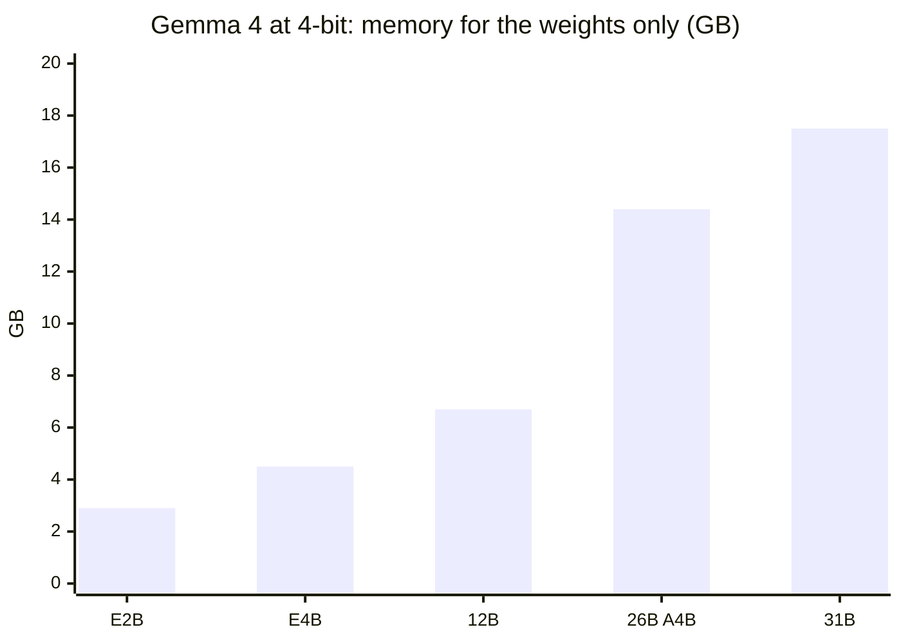
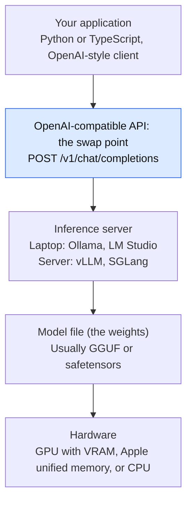
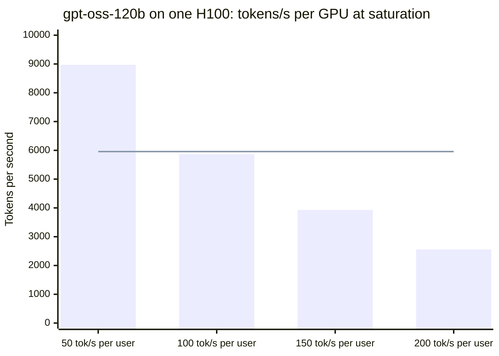
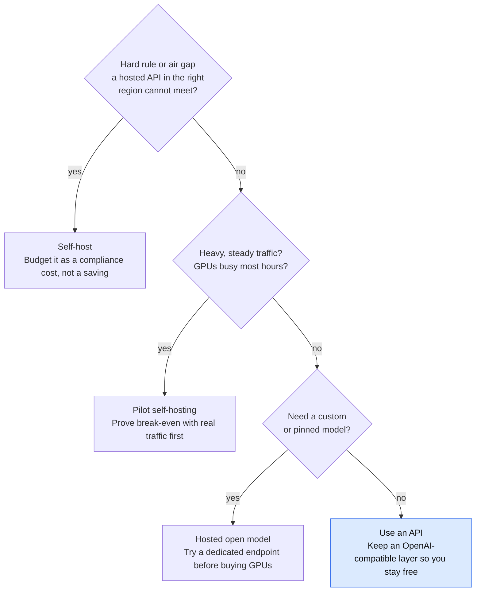
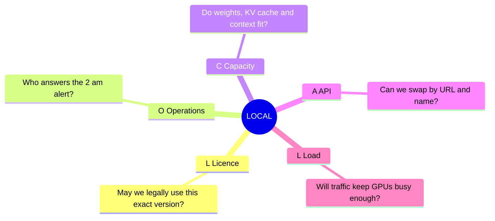



*Utkrishta Sinha · 3 Nov 2026 · about 40 minutes*

*Reading time: about 40 minutes. Facts checked on 3 November 2026. Model names change fast, so treat every model table here as a snapshot.*

## 1. The Five Big Ideas of Today

An open model is a brain you can download. You run it on your own computer, so your data stays with you. The catch: you also become its doctor, landlord and night-shift guard.

1. **"Open source" usually means "open weights".** You get the trained model file, but rarely the training data or the full recipe. Always read the licence of the exact version you use.
2. **Local does not mean free.** You swap a per-token bill for GPUs, electricity and engineer time. At low or daytime-only traffic, a hosted API is usually cheaper.
3. **Memory decides what you can run.** A rough rule is parameters × bytes per parameter × 1.2. Quantization shrinks that number by storing each number with less precision.
4. **The tool depends on the audience.** Use Ollama or LM Studio on one laptop. Use vLLM or SGLang when many users share a GPU server.
5. **The strongest reason to self-host is control, not cost.** Think data rules, air-gapped sites, fixed model versions and fine-tuning. If you can't name one of these, start with an API.

> Joke of the day: I told my laptop I wanted to run a 2.8-trillion-parameter model. Its fan replied by trying to achieve lift-off.

## 2. Why This Matters for an FDE

A Forward Deployed Engineer (FDE) is the engineer who sits with a customer and makes the product work in their messy real world. Sooner or later, that customer asks: "Can this run inside our network?" This topic is how you answer without guessing.

Here is where it shows up in real engagements:

| What the customer says | What they often mean | Your first move |
| --- | --- | --- |
| "Our data can't leave." | A rule, a contract, or just fear. | Ask which data, which rule and who signs off. |
| "OpenAI is too expensive." | One workload has a big bill. | Get token counts by hour, then compare real numbers. |
| "We want no vendor lock-in." | They fear price changes or shutdowns. | Use a common API so the model can be swapped. |
| "Our factory has no internet." | An air-gapped site. | Local is the only option. Size the hardware. |
| "We need Hindi and Tamil." | Language fit matters more than benchmark scores. | Test Indian-language models on their real data. |
| "Can we train it on our data?" | They may only need retrieval. | Try RAG first. Fine-tune only if evals demand it. |

An FDE earns trust by separating a real constraint from a loud opinion. For example, one reading of India's rules says the DPDP Act has [no general localisation mandate](https://ecorpit.com/ecorpit-private-llm-deployment-service-india-2026/), while RBI's payment-data rule does require storage in India. That source sells private LLM services, so check the primary text with the customer's lawyers. The lesson stays: ask "which rule?" before you buy a single GPU.

This is not legal advice. Your job is to bring the facts to the customer's compliance team.

## 3. Core Concepts, From Simple to Complex

### 3.1 Start with a recipe book

Imagine learning to cook from a million recipes. Training is the years of practice. The result is not the recipes themselves but your trained instincts.

An LLM works the same way. **Training** turns huge amounts of text into billions of numbers. Those numbers are the **weights**. Running the model on a new question is called **inference**.

- Calling a hosted API is like ordering from a restaurant. You pay per plate and never see the kitchen.
- Running an open model is like having the chef's instincts installed in your own kitchen. You pay for the kitchen, gas and cleaning.

### 3.2 Glossary: every term in plain English

| Term | Meaning | Everyday example |
| --- | --- | --- |
| Model | A program that predicts the next piece of text. | Very advanced autocomplete. |
| Weights | The learned numbers inside a model. | The chef's trained instincts. |
| Parameters | The count of those numbers. 7B means 7 billion. | How many instincts the chef has. |
| Token | A small chunk of text, often part of a word. | "paneer" may become "pan" + "eer". |
| Inference | Using a trained model to produce output. | Cooking tonight's dinner. |
| Open weights | The weights are downloadable. | You get the instincts, not the training diary. |
| Open source AI | Weights, code and data details are all open. | You get the whole cooking school. |
| Licence | The legal rules for using the model. | The rent agreement. Read it before moving in. |
| Local model | A model running on your own hardware. | Cooking at home. |
| Self-hosted | Running it on servers you control, including rented ones. | Running your own canteen. |
| Air-gapped | A system with no internet connection. | A kitchen with no doors to the outside. |
| GPU | A chip that does many small maths jobs at once. | 1,000 helpers chopping onions together. |
| VRAM | The memory on a GPU. | The size of your kitchen counter. |
| Unified memory | RAM shared by CPU and GPU, as on Apple Silicon. | One big shared counter. |
| Quantization | Storing weights with fewer bits. | Rounding 3.14159 to 3.14. |
| GGUF | A single-file model format used by llama.cpp and Ollama. | A tiffin box with everything packed. |
| Safetensors | A common, safe format for sharing weights. | A sealed ingredient box. |
| Dense model | Every parameter works on every token. | Every helper chops every onion. |
| MoE (Mixture of Experts) | Only some parameters work per token. | Only the specialist helpers step in. |
| Context window | The most tokens the model can consider at once. | How much of the conversation it can hold in mind. |
| KV cache | Saved work from earlier tokens. Grows with context. | Notes on the counter, so you need not re-read everything. |
| TTFT | Time to first token. | Time until the first bite arrives. |
| Throughput | Tokens produced per second, across all users. | Plates leaving the kitchen per hour. |
| Inference server | Software that loads a model and answers requests. | The restaurant's kitchen manager. |
| Fine-tuning | Further training on your own examples. | Teaching the chef your family's recipes. |
| Tool calling | The model asks your code to run a function. | The chef asks you to check the fridge. |

### 3.3 Open source and open weights are not the same thing

The Open Source Initiative's definition, OSAID 1.0, needs [the parameters, the source code and enough training-data information](https://www.softwareseni.com/open-weight-versus-open-source-ai-licensing-and-the-distillation-controversy/) to substantially recreate the system. Most popular models do not clearly meet this. So "open weights" is the honest term for most of them.

This document uses "open models" for short. A sales deck using "open source" may mean something narrower, so ask.

### 3.4 Licences: where the small print bites

The licence can differ between versions of the same family. [Morph's list](https://www.morphllm.com/best-open-source-llm) shows GLM-5.2 under MIT, while GLM-5.3 has its own licence. Never assume that the next version keeps the same terms.

| Licence type | Typical examples | What it means for a customer |
| --- | --- | --- |
| Apache 2.0 / MIT | Qwen3.8-27B, Gemma 4, gpt-oss, DeepSeek V4 | Lowest legal friction. Commercial use is allowed. |
| Community licence | Llama | Extra rules. Llama has a 700 million monthly-user cap. |
| Custom licence | GLM-5.3, Kimi K3 | Read each clause. Kimi K3 reportedly needs a separate deal above $20 million annual revenue. |
| Non-commercial default | MiniMax M3 | Don't ship it in a paid product without permission. |

The Llama cap and the Kimi threshold come from [this licensing review](https://www.softwareseni.com/open-weight-versus-open-source-ai-licensing-and-the-distillation-controversy/). The MiniMax note comes from [Morph's list](https://www.morphllm.com/best-open-source-llm). Always confirm on the model's own page.

### 3.5 Bits, bytes and quantization

Each weight is a number. The precision of that number decides the file size. Take 3.14159265. Rounded to 3.14, it uses less space and stays nearly correct for daily use.

- **F32** means 32 bits, or 4 bytes per weight. **F16 or BF16** means 16 bits, or 2 bytes.
- **Q8** means 8 bits, or 1 byte. **Q4** means 4 bits, or half a byte.
- **Q4\_K\_M** is a popular 4-bit GGUF recipe. It usually gives a good balance of size and quality.

So a 7B model takes roughly 14 GB at 16-bit and 3.5 GB at 4-bit, before overhead. One guide says Q4\_K\_M [adds 3 to 5 percent perplexity compared with F16](https://www.llmhardware.io/guides/llm-quantization-guide), while Q2 adds 15 to 25 percent. Perplexity simply measures how surprised a model is by real text. Lower is better.

The quick memory rule from the same guide is:

```text
Memory (GB) ≈ Parameters (billions) × Bytes per parameter × 1.2
```

For a 7B model at Q4: 7 × 0.5 × 1.2 = 4.2 GB. Add about 2 GB as a working reserve and you get 6.2 GB.

> Quantization is like squeezing into your college jeans. It works, but performance may drop, and you should not try two sizes down.



| Model | 16-bit (GB) | 8-bit (GB) | 4-bit (GB) |
| --- | --- | --- | --- |
| E2B | 11.4 | 5.7 | 2.9 |
| E4B | 17.9 | 8.9 | 4.5 |
| 12B | 26.7 | 13.4 | 6.7 |
| 26B A4B | 57.7 | 28.8 | 14.4 |
| 31B | 69.9 | 34.9 | 17.5 |

*4-bit cuts memory by three quarters, but 26B A4B still loads all 26B. Source: Google AI for Developers, Gemma 4 model overview. Weights only; KV cache is extra.*

### 3.6 The trap in "active parameters"

An MoE model might be labelled 26B with 4B active. It sounds like a 4B model. It is not. Google's documentation says [the 26B A4B must load all 26B parameters](https://ai.google.dev/gemma/docs/core), which is why its memory bar above is close to the 31B model.

Active parameters mainly affect compute per token. Total parameters mainly affect memory. Remember: a big office with few people working still pays rent on the whole office.

### 3.7 What actually fills your memory

Three things use memory while a model runs:

1. **Weights.** These stay fixed in size once loaded.
2. **KV cache.** This grows with context length and with the number of users.
3. **Everything else.** Your operating system, browser and other apps also want space.

This is why context length matters. Ollama's docs say the [default context depends on VRAM](https://docs.ollama.com/context-length): 4k under 24 GiB, 32k from 24 to 48 GiB, and 256k at 48 GiB or more. They recommend at least 64,000 tokens for agents and coding tools.

So an agent can fail quietly on a small GPU because the context is only 4k. Your long system prompt may push important text out. The model then looks stupid, when it is really just short of space.

### 3.8 How one request flows through the stack



*Your app talks to one API, so everything below it can be swapped.*

The important trick is the **OpenAI-compatible API**. Ollama and vLLM accept the same style of request as OpenAI. Your app changes a base URL and a model name. This is your escape hatch from lock-in.

### 3.9 Why a server engine beats a laptop tool under load

Imagine a bus. A simple tool runs a separate trip for each passenger. A server engine keeps the bus moving and picks up new passengers at every stop. That is **continuous batching**: the engine [adds new requests to the running batch](https://www.premai.io/blog/vllm-vs-sglang-vs-lmdeploy-fastest-llm-inference-engine-in-2026/) as soon as there is room.

Two more ideas make this efficient:

- **PagedAttention** in vLLM stores the KV cache in small pages, like virtual memory, instead of big blocks. This reduces wasted GPU memory.
- **Prefix caching** reuses work when requests start the same way, such as a shared system prompt. SGLang is well known for this.

One June 2026 article measured [about 41 tokens per second for Ollama against about 793 for vLLM](https://angelo-lima.fr/en/ollama-2026-state-of-the-art-en/) under concurrent load. Treat the ratio as a hint, not a law. The direction is what matters: laptop tools are built for one user.

### 3.10 The money question

A GPU costs the same per hour whether it is busy or idle. An API charges only for tokens used. So self-hosting wins only when the GPU stays busy.

The break-even formula is simple:

```text
Break-even tokens per second = (GPU cost per hour ÷ API cost per million tokens) × 1,000,000 ÷ 3,600
```

Using [October 2026 figures](https://www.beri.net/article/self-hosted-llm-vs-api-break-even-gpt-oss-120b-h100-b200-deepseek-v4-utilization-2026): a $4.29 per hour H100 against gpt-oss-120b at a blended $0.20 per million tokens needs 5,958 tokens per second, and that average must hold round the clock.



*The line is break-even: 5,958 tokens per second, sustained 24/7. Only the slowest per-user speed clears it. Source: Beri.net, October 2026, InferenceX H100 vLLM FP4 results; 8k input, 1k output; $4.29 per hour GPU against $0.20 per million tokens.*

The same analysis found that business-hours-only use on an H100 costs about 2.2 times the API. Add a spare GPU and a quarter of an engineer, and the smallest serious setup costs about $9,090 a month. A cheap demo can hide all of this.

The analysis is one independent estimate for one traffic shape: 8,000 input and 1,000 output tokens per request. Run the numbers on the customer's traffic before you quote anything.

## 4. Worked Examples: From One Command to a Local Agent

You can run all of this on a normal developer machine. Start small. The Python and TypeScript client code below was tested on 3 November 2026 with `openai` 3.42.1 (Python), `openai` 7.47.0 (npm) and a mock OpenAI-compatible server. The sandbox could not download Ollama or real weights, so the commands were checked against the docs, not run. Your model's output will differ.

### Example 1: Your first local model

Install Ollama from [ollama.com](https://ollama.com/blog), then run:

```bash
# Small model: about 4.6 to 7.5 GB on disk, depending on the build
ollama pull gemma4:e2b

# Chat in the terminal
ollama run gemma4:e2b "Explain Bangalore traffic to a robot."

# See what is loaded
ollama ps
```

In `ollama ps`, read two columns. `CONTEXT` shows the context size. `PROCESSOR` shows GPU or CPU. If you see a CPU share, the model did not fully fit on your GPU, so it will be slower.

The tag sizes come from the [Ollama Gemma 4 page](https://ollama.com/library/gemma4). Pick `gemma4:e4b` if you have more memory.

### Example 2: The same code for local and cloud

This is the most useful trick of the day. Install the client with `pip install openai`, then save this as `hello_local.py`:

```python
from openai import OpenAI

client = OpenAI(base_url="http://localhost:11434/v1", api_key="ollama")  # key is ignored locally

reply = client.chat.completions.create(
    model="gemma4:e2b",
    messages=[{"role": "user", "content": "Explain paneer to a robot in one line."}],
)
print(reply.choices[0].message.content)
```

To move to a hosted provider, change `base_url`, `api_key` and `model`. Nothing else in this script needs to change. As a frontend engineer, think of it as switching your API environment from `localhost` to production.

### Example 3: The same idea in TypeScript with streaming

Streaming prints tokens as they arrive, so the app feels alive. Run `npm i openai tsx`, add `"type": "module"` to `package.json`, and save this as `hello.ts`:

```typescript
import OpenAI from "openai";

const client = new OpenAI({ baseURL: "http://localhost:11434/v1", apiKey: "ollama" });

const stream = await client.chat.completions.create({
  model: "gemma4:e2b",
  messages: [{ role: "user", content: "Say hello in Hindi and English." }],
  stream: true,
});

for await (const chunk of stream) {
  process.stdout.write(chunk.choices[0]?.delta?.content ?? "");
}
console.log();
```

Run it with `npx tsx hello.ts`.

### Example 4: A local agent with one tool

This reuses the agent loop from Day 1. The model does not run the tool. It asks, your code runs it, and the result goes back.

```python
import json
from openai import OpenAI

client = OpenAI(base_url="http://localhost:11434/v1", api_key="ollama")
MODEL = "gemma4:e4b"
ORDERS = {"A123": "out for delivery", "B456": "delayed at the warehouse"}

def get_order_status(order_id: str) -> str:
    return ORDERS.get(order_id, "order not found")

TOOLS = [{
    "type": "function",
    "function": {
        "name": "get_order_status",
        "description": "Look up the delivery status of one order.",
        "parameters": {
            "type": "object",
            "properties": {"order_id": {"type": "string"}},
            "required": ["order_id"],
        },
    },
}]

def run_agent(question: str, max_steps: int = 5) -> str:
    messages = [{"role": "user", "content": question}]
    for _ in range(max_steps):
        reply = client.chat.completions.create(model=MODEL, messages=messages, tools=TOOLS)
        msg = reply.choices[0].message
        if not msg.tool_calls:
            return msg.content or ""
        messages.append(msg.model_dump(exclude_none=True))
        for call in msg.tool_calls:
            try:
                args = json.loads(call.function.arguments)
                result = get_order_status(**args)
            except (json.JSONDecodeError, TypeError) as err:
                result = f"Bad tool arguments: {err}. Please try again."
            messages.append({"role": "tool", "tool_call_id": call.id, "content": result})
    return "Stopped: step limit reached."

print(run_agent("Where is my order A123?"))
```

Notice the `try` block. Smaller models produce broken JSON more often than you would like. vLLM's docs warn too: without strict settings, [arguments may occasionally be malformed](https://docs.vllm.ai/en/latest/features/tool_calling/). Handle it, and let the model retry.

### Example 5: Measure speed instead of guessing

```python
import time
from openai import OpenAI

client = OpenAI(base_url="http://localhost:11434/v1", api_key="ollama")
MODEL = "gemma4:e2b"
PROMPT = "List five uses of a pressure cooker, one line each."

start = time.perf_counter()
first = None
chunks = 0
stream = client.chat.completions.create(
    model=MODEL,
    messages=[{"role": "user", "content": PROMPT}],
    stream=True,
)
for event in stream:
    if event.choices and event.choices[0].delta.content:
        first = first or time.perf_counter()
        chunks += 1
end = time.perf_counter()

ttft = first - start
rate = chunks / max(end - first, 1e-9)
print(f"Time to first token: {ttft:.2f}s | Speed: about {rate:.1f} chunks/s")
```

A chunk is usually close to a token, but not always. Run it twice. The first run includes model loading, so it shows the slow **cold start**. The second run shows normal speed.

### Example 6: A two-function sizing calculator

This prints the numbers from sections 3.5 and 3.10:

```python
def memory_gb(params_billion: float, bits: int, context_gb: float = 2.0) -> float:
    """Rough weights-plus-context estimate. Add 15-20% headroom near the limit."""
    weights = params_billion * bits / 8 * 1.2
    return round(weights + context_gb, 1)

def breakeven_tokens_per_sec(gpu_usd_per_hour: float, api_usd_per_million: float) -> float:
    return gpu_usd_per_hour / api_usd_per_million * 1_000_000 / 3600

def utilisation_needed(gpu_usd_per_hour, api_usd_per_million, gpu_tokens_per_sec):
    return breakeven_tokens_per_sec(gpu_usd_per_hour, api_usd_per_million) / gpu_tokens_per_sec

print("7B at 4-bit:", memory_gb(7, 4), "GB")
print("31B at 4-bit:", memory_gb(31, 4), "GB")
print("Break-even:", round(breakeven_tokens_per_sec(4.29, 0.20)), "tokens/s")
print("Busy share needed:", f"{utilisation_needed(4.29, 0.20, 8973):.0%}")
```

The output is:

```text
7B at 4-bit: 6.2 GB
31B at 4-bit: 20.6 GB
Break-even: 5958 tokens/s
Busy share needed: 66%
```

The 66 percent means the GPU must run at full saturation for 66 percent of the month. Real traffic rarely looks like that.

### Example 7: Moving to a real server with vLLM

This is the shape of a production-style start for Qwen3.8-27B on a Linux GPU server. The flags follow [a September 2026 walkthrough](https://computingforgeeks.com/run-qwen3-8-27b-locally/) and need a matching GPU, so check the image version and model page first:

```bash
docker run --gpus all --ipc=host -p 8000:8000 vllm/vllm-openai:v0.30.0 \
  --model nvidia/Qwen3.8-27B-NVFP4 \
  --served-model-name qwen3.8-27b \
  --max-model-len 32768 \
  --reasoning-parser qwen3 \
  --enable-auto-tool-choice \
  --tool-call-parser qwen3_xml
```

Then set `base_url` to `http://<server>:8000/v1` in the earlier code. Your app stays the same. In plain words, the flags mean: expose port 8000, load this model, limit context to 32,768 tokens, split reasoning from the answer, and turn model output into tool calls.

### Example 8: A coding agent on a local model

Ollama also speaks the Anthropic style of API. Its [official post](https://ollama.com/blog/claude) shows how to point Claude Code at a local model:

```bash
export ANTHROPIC_AUTH_TOKEN=ollama
export ANTHROPIC_BASE_URL=http://localhost:11434
claude --model gpt-oss:20b
```

Use a model with enough context. Ollama's post says at least 32K, and its context docs suggest 64,000 for coding tools. Local models are also generally weaker at long agent tasks, so test first.

## 5. Real-Life Use Cases

These five stories show different reasons for going open. None of them is simply "open is cheaper".

| Who | What they did | Reason | Lesson for an FDE |
| --- | --- | --- | --- |
| [Airbnb](https://fortune.com/2025/10/21/brian-chesky-openai-tools-not-ready) | Its support agent uses 13 models. CEO Brian Chesky said in October 2025: "We're relying a lot on Alibaba's Qwen model." | Speed and cost | Mix models by task. You rarely need one winner. |
| [Cursor](https://techcrunch.com/2026/03/22/cursor-admits-its-new-coding-model-was-built-on-top-of-moonshot-ais-kimi) | Composer 2 started from Moonshot's Kimi K2.5, followed by Cursor's own training. | Faster start on a custom model | Disclose the base model. Cursor later called leaving it out a mistake. |
| [Amazon Rufus](https://www.zenml.io/llmops-database/multi-node-llm-inference-scaling-using-aws-trainium-and-vllm-for-conversational-ai-shopping-assistant) | Used vLLM as the core engine across tens of thousands of Trainium chips. | Scale for custom models | Open-source infrastructure matters even when the model is private. |
| [Gnani.ai](https://blogs.nvidia.com/blog/llms-indian-languages/) (India) | Built a 14-language speech model. Its assistants handle about 10 million voice interactions a day for 150+ financial firms, per NVIDIA. | Language fit and low latency | In India, language and voice can decide the choice. |
| [Sarvam AI](https://www.opensourceforu.com/2026/03/sarvam-releases-30b-and-105b-llms-under-apache-2-0/) (India) | Released 30B and 105B models under Apache 2.0, with a tokenizer for 22 scheduled Indian languages. Training used IndiaAI Mission GPU resources. | Sovereignty | Your data, your language, your country's compute can be a real requirement. |

The Indian public sector adds another angle. [Sarvam's partnerships](https://www.sarvam.ai/blogs/partnerships-with-indian-states) with Tamil Nadu and Odisha plan AI facilities of 20 MW and 50 MW. Sarvam says the Tamil Nadu centre "will ensure sensitive data remains within our boundaries". These are announced plans, and the page does not confirm that either facility is running.

Banking is the usual Indian question. A vendor-written guide says RBI's 2018 rule [requires payment data to be stored in India](https://ecorpit.com/ecorpit-private-llm-deployment-service-india-2026/), and another says RBI's [FREE-AI report is a set of recommendations](https://www.e2enetworks.com/blog/where-to-run-ai-workloads-regulated-india), not a hosting mandate. Both sites sell infrastructure, so verify with the primary text. Sometimes an Indian cloud region is enough, and full self-hosting is overkill.

Also notice a quiet point about Airbnb: using an open model does not mean hosting it yourself. Fortune reports what models Airbnb uses, not where they run. Many teams call open models through a hosted provider.

## 6. Pros, Cons and When to Use Local Models

Open and local models trade convenience for control. That is the whole deal.

| Factor | Open or local model | Closed hosted API |
| --- | --- | --- |
| Data control | Strong. Data can stay on your machines. | Depends on the vendor's terms and region. |
| Top-end quality | Often close, varies by task. | Usually the first to get new abilities. |
| Cost at low traffic | Poor. Idle GPUs still bill you. | Good. You pay per use. |
| Cost at huge steady traffic | Can be good. | Can become very large. |
| Time to first demo | Minutes on a laptop. | Minutes. |
| Time to production | Weeks of serving, monitoring and security. | Much shorter. |
| Version control | Full. The model never changes unless you change it. | The vendor can retire or change models. |
| Customisation | Fine-tuning and full internals. | Limited, vendor-dependent. |
| Offline use | Yes. | No. |
| Staff needed | Someone must own GPUs, upgrades and incidents. | Mostly none. |
| Security work | You own patching and access control. | Shared with the vendor. |



*Self-host only when a rule or steady, heavy traffic demands it.*

**Use local or open models when:**

- A written rule or contract needs data on specific machines.
- The site is air-gapped or has unreliable internet.
- Traffic is steady and heavy enough for busy GPUs, including overnight batch jobs.
- You need to fine-tune or freeze a model version.
- Your workload is simple, like classification or extraction, and a small model passes evals.

**Avoid them when:**

- Traffic is low or only runs in office hours.
- Nobody will own the system at 2 am.
- The customer only says "we want no vendor" and has no budget for a platform team.
- The task truly needs the strongest frontier model and your evals prove it.

There is a useful middle path: **routing**. Send simple or sensitive requests to a local model, and harder ones to a hosted model. Airbnb's 13-model setup shows the same spirit, though the routing rules there are not public.

## 7. Common Pitfalls and Production Gotchas

Most local-model failures look like "the model is bad". Often the setup is the real problem.

1. **Silent context truncation.** A 4k default can cut off your prompt. Set context on purpose and verify with `ollama ps`.
2. **Silent CPU offload.** The model partly spills to the CPU and speed collapses. Watch the `PROCESSOR` column.
3. **Judging quality on a heavy quantization.** A Q2 model may look dumb while the full model is fine. Test the exact build you will ship.
4. **Trusting default settings.** One cited benchmark saw [2,901 tokens per second on default vLLM and 7,648 when tuned](https://www.beri.net/article/self-hosted-llm-vs-api-break-even-gpt-oss-120b-h100-b200-deepseek-v4-utilization-2026), a 2.6x gap.
5. **Thinking text leaking into answers.** Without a reasoning parser, [reasoning can land in `message.content`](https://computingforgeeks.com/run-qwen3-8-27b-locally/). Your UI then shows the model's private scribbles.
6. **Thinking turned on for simple work.** It adds delay to extraction and chat. Turn it off where evals allow.
7. **Broken tool calls.** Each model family may need its own parser. Validate arguments and return errors to the model.
8. **Assuming a demo scales.** One user on Ollama tells you nothing about 50 users. Load test before promising.
9. **Cold starts.** Loading a big model can take a minute or more. In one test, [vLLM took about 62 seconds and a TensorRT-LLM engine build about 28 minutes](https://www.spheron.network/blog/vllm-vs-tensorrt-llm-vs-sglang-benchmarks). Plan your autoscaling around this.
10. **Single GPU, single point of failure.** One card means one outage. A spare improves availability and also raises cost.
11. **Unverified downloads.** Model repositories are supply-chain inputs. Prefer official publishers, pin an exact revision and scan what you pull.
12. **Exposing the port.** A local server with no authentication should never face the internet. Put it behind a gateway with auth.
13. **Cloud tags sold as local.** Ollama's `:cloud` tags [run on Ollama's servers](https://angelo-lima.fr/en/ollama-2026-state-of-the-art-en/). That is a serious mistake in a "data never leaves" project.
14. **Forgetting erasure.** Personal data baked into fine-tuned weights is [harder to erase than data in a retrieval index](https://ecorpit.com/ecorpit-private-llm-deployment-service-india-2026/). Prefer RAG for personal data.
15. **Forgetting provenance.** Fine-tuned models inherit their base model's licence and history. Keep a record of what your model came from.

> Every local-model outage starts the same way: someone says, "Don't worry, it ran fine on my laptop."

## 8. Comparing the Alternatives

There are three choices to make: which way to run, which server, and which model. Make them in that order.

### Way to run the model

| Option | You manage | Data path | Best for |
| --- | --- | --- | --- |
| Closed API (OpenAI, Anthropic, Google) | Only your app | Goes to the vendor | The best models with the least effort. |
| Open model on a hosted API (Together, Fireworks, Bedrock) | Only your app | Goes to the host | Open-model pricing without GPUs. |
| Rented GPUs (RunPod, Lambda, cloud) | Serving, scaling, patching | Your rented machine | Control with no hardware purchase. |
| Your own servers | Everything, including power | Stays on your premises | Air-gapped or strict sites. |
| Laptop or edge device | One machine | Stays on the device | Developers, offline apps, privacy. |

### Inference software

| Tool | What it is | Pick it when | Skip it when |
| --- | --- | --- | --- |
| [Ollama](https://angelo-lima.fr/en/ollama-2026-state-of-the-art-en/) | Easy model runner, like Docker for models | Learning, prototypes, a single user | Many users share a GPU. |
| LM Studio | Desktop app with a visual interface | You want a GUI and model browsing | You need a headless server fleet. |
| llama.cpp | Lean C/C++ engine, runs GGUF | Edge devices, custom builds, CPU use | You want simple managed serving. |
| [vLLM](https://www.spheron.network/blog/vllm-vs-tensorrt-llm-vs-sglang-benchmarks) | Production engine | Your default first server choice | You only have one laptop. |
| [SGLang](https://www.spheron.network/blog/vllm-vs-tensorrt-llm-vs-sglang-benchmarks) | Production engine with strong prefix caching | Shared prompts, RAG, multi-turn chat | Prompts are all unique. |
| [TensorRT-LLM](https://www.spheron.network/blog/vllm-vs-tensorrt-llm-vs-sglang-benchmarks) | NVIDIA's compiled engine | One stable model at maximum speed | Models change often. |

That Spheron test used one model on one H100 and got 1,850 to 2,100 tokens per second across the three engines. The gap was small enough that your choice should depend on your workload, not on a leaderboard.

### A snapshot of open models

This table lists useful examples, not a complete ranking. Rankings change monthly, and the two trackers I checked disagree. [Morph](https://www.morphllm.com/best-open-source-llm) puts Kimi K3 first, while [GeoToolbox](https://geotoolbox.ai/blog/best-open-source-llms) puts GLM-5.3 first.

| Model | Size (total / active) | Licence | Where it fits |
| --- | --- | --- | --- |
| [Gemma 4 E2B to 31B](https://ai.google.dev/gemma/docs/core) | 2B to 31B | Apache 2.0 | Phones, laptops, one consumer GPU. |
| [Qwen3.8-27B](https://computingforgeeks.com/run-qwen3-8-27b-locally/) | 27B dense | Apache 2.0 | Strong choice for one 24 GB GPU. About 17 GB at 4-bit. |
| [gpt-oss-120b](https://geotoolbox.ai/blog/best-open-source-llms) | 117B / 5.1B | Apache 2.0 | Workstation or server. |
| [Sarvam-105B](https://www.opensourceforu.com/2026/03/sarvam-releases-30b-and-105b-llms-under-apache-2-0/) | 105B MoE | Apache 2.0 | Indian-language work. 128K context. |
| [DeepSeek V4.1 Flash](https://www.morphllm.com/best-open-source-llm) | 552B / 16B decode | MIT | Agents on a multi-GPU server. |
| [GLM-5.3](https://geotoolbox.ai/blog/best-open-source-llms) | 753B / 40B | Custom | Agentic coding, usually through an API. |
| [Kimi K3](https://www.morphllm.com/best-open-source-llm) | 2.8T / 104B | Custom | Top performance, needs a GPU cluster. |

"2.8T" means 2.8 trillion parameters. That is not a laptop project, unless your laptop is secretly a data centre.

## 9. Hands-On Exercise: Build "Private Desk"

Build a small support assistant that runs fully on your own machine, then write the advice an FDE would give. Allow 1 to 2 hours.

**The scenario:** A Bengaluru clinic wants staff to ask questions about internal policy notes. They say the notes cannot go to a cloud API.

**Steps:**

1. Install Ollama and pull a model that fits your machine. Start with `gemma4:e2b`, then try `gemma4:e4b`.
2. Write five made-up policy notes in a Python dictionary. Use no real patient data.
3. Adapt Example 4 with one tool: `search_policy(keyword)`.
4. Create 10 test questions with expected answers. Include two questions the notes cannot answer.
5. Run the tests on two model sizes or two quantizations. Record correct answers, tool-call failures, TTFT and memory use.
6. Change only `base_url` and `model`, and point the same script at any hosted provider, using fake data only. This proves your swap layer works.
7. Calculate the monthly GPU cost and the API cost for 2,000 questions a day. State your token assumptions.
8. Write a one-page recommendation for the clinic.

**Acceptance criteria:**

- [ ] The assistant answers offline, with Wi-Fi switched off.
- [ ] `ollama ps` output is captured, showing context and processor.
- [ ] At least 8 of 10 test questions behave correctly.
- [ ] For the two unanswerable questions, the assistant says it does not know.
- [ ] Malformed tool arguments do not crash the program.
- [ ] A results table compares both models.
- [ ] Only `base_url`, `api_key` and `model` change between local and hosted runs.
- [ ] The recommendation names one rule to verify, one owner and one rollback plan.

**Stretch goal:** Add a simple router. Send questions containing a patient-like ID to local only, and the rest to the better model. Log every routing decision.

If your laptop struggles, that is useful evidence too. Write it down. Customers have small machines as well.

## 10. Interview Questions with Model Answers

Practise saying these aloud. An FDE interview rewards clear trade-offs, not model trivia.

**1. What is the difference between open source and open weights?**

Open weights means you can download the trained parameters. Open source AI, under OSAID 1.0, also needs code and enough training-data information to substantially recreate the system. Most popular models are open weights.

**2. What is quantization, and what do you lose?**

Quantization stores weights with fewer bits, which cuts memory and can raise speed. You lose some accuracy. Q4 is a common balance, while Q2 usually hurts more. I always evaluate the exact quantized build on the customer's tasks.

**3. A model says 26B with 4B active. How much memory does it need?**

Plan for 26B of weights, because all parameters must be loaded. Active parameters reduce compute per token, not the loaded size. Gemma 4's 26B A4B needs about 14.4 GB at 4-bit for weights alone, before the KV cache.

**4. Why does a local agent sometimes ignore its instructions?**

Check context first. A small default window can truncate the prompt. Then check CPU offload, the chat template and tool parser. Only after that do I blame the model.

**5. When do you choose Ollama, and when vLLM?**

Ollama suits one developer, prototypes and demos. vLLM suits many concurrent users, because continuous batching shares the GPU well. If prefixes repeat heavily, I also benchmark SGLang.

**6. Design a private chat service for 500 employees.**

First I'd estimate peak concurrency, prompt size and latency targets. Then I'd place an authenticated gateway before vLLM on at least two GPU nodes, and pin the model revision. I'd add rate limits, audit logs, metrics for TTFT and queue depth, plus a load test on real prompts. I'd also set a fallback and name an owner.

**7. How do you tell whether self-hosting saves money?**

Get hourly token counts for a month. Compute break-even tokens per second, then compare with throughput measured at the required user speed. Add a spare GPU, monitoring and engineer time. Daytime-only traffic usually favours the API.

**8. A bank says, "Nothing can leave India." What do you do?**

I ask which data, which rule and who owns the decision. Then I work with their compliance team on the options: India-region hosting, dedicated endpoints or on-premises. I don't assume self-hosting, and I don't interpret law myself. I document the decision.

**9. The customer's legal team rejects a Chinese-origin model. How do you respond?**

I treat it as a valid constraint, and I don't argue. Weights and API hosting are separate questions, so I explain that clearly, then compare approved alternatives such as Gemma 4 or gpt-oss with the same evals. I report any quality gap honestly.

**10. Your local demo was perfect, but production is slow. What do you check?**

I look at queue depth, GPU utilisation, batch settings, context length, thinking mode and CPU offload. Then I compare TTFT against total generation time. A long TTFT with a full queue points to capacity, while slow streaming points to the engine or model configuration.

## 11. How It Connects

Today adds a new option to almost every topic in the course: where the model actually runs.

| Day | Topic | The link |
| --- | --- | --- |
| Day 1 | Agent loops and tools | Example 4 is the same loop, pointed at a local server. |
| Day 2 | Frontier LLMs and AI agents | Open models are the alternative to the frontier APIs. |
| Day 3 | Model selection | Self-hosting adds hardware and licence to your criteria. |
| Day 4 | Agent frameworks | Most frameworks can use an OpenAI-compatible URL. |
| Day 5 | Coding agents | Example 8 points a coding agent at a local model. |
| Day 6 | The AI SDK | A provider setting can swap in a local endpoint. |
| Day 8 | Token cost optimization | The break-even maths continues there. |
| Day 9 | Context engineering | Small context windows make it essential. |
| Day 12 | OpenRouter | Routing to open models with no GPU work. |
| Day 19 | Evaluations and observability | How to prove a smaller model is good enough. |
| Day 20 | Cost and speed trade-offs | TTFT, throughput and utilisation in depth. |
| Days 33 to 34 | Governance, security and guardrails | Licences, provenance and access control. |
| Days 37 to 38 | Cloud infrastructure and deployment | Running vLLM properly on real infrastructure. |
| Day 41 | Serverless infrastructure for agents | Scale-to-zero and the cold-start problem. |

## 12. Mental Map to Remember

Remember one word: **LOCAL**. Five answers tell you whether an open model is a good idea for this customer.



*Before going local, run the LOCAL check.*

Three one-line memory hooks:

- **API is a restaurant. Self-hosting is a kitchen.** A kitchen is only cheap if you cook a lot.
- **Total parameters pay the rent. Active parameters do the work.** Memory follows the first, compute follows the second.
- **Ask "which rule?" before "which GPU?"** Most bad decisions skip this step.

> Final joke: an open model is free like a free puppy. The download costs nothing. Then the real relationship begins.

## 13. Further Reading and Sources

Start with the first five if you only have 30 minutes. Numbers from vendor and tracker sites are snapshots, so confirm them on official pages before a customer meeting.

**Best resources:**

1. [Gemma 4 model overview](https://ai.google.dev/gemma/docs/core): clear official memory tables.
2. [Ollama context length docs](https://docs.ollama.com/context-length): the setting that silently breaks agents.
3. [vLLM tool calling docs](https://docs.vllm.ai/en/latest/features/tool_calling/): how structured tool calls really work.
4. [Self-hosting break-even analysis](https://www.beri.net/article/self-hosted-llm-vs-api-break-even-gpt-oss-120b-h100-b200-deepseek-v4-utilization-2026): the best worked cost example here.
5. [Open weights and licensing review](https://www.softwareseni.com/open-weight-versus-open-source-ai-licensing-and-the-distillation-controversy/): licences and provenance.
6. [vLLM, TensorRT-LLM and SGLang benchmark](https://www.spheron.network/blog/vllm-vs-tensorrt-llm-vs-sglang-benchmarks): engine trade-offs.
7. [Run Qwen3.8-27B locally](https://computingforgeeks.com/run-qwen3-8-27b-locally/): a detailed practical walkthrough.

**Sources:**

- [Gemma 4 announcement, Google](https://blog.google/innovation-and-ai/technology/developers-tools/gemma-4/)
- [Gemma 4 model overview, Google AI for Developers](https://ai.google.dev/gemma/docs/core)
- [Gemma 4 tags, Ollama](https://ollama.com/library/gemma4)
- [Claude Code with Anthropic API compatibility, Ollama](https://ollama.com/blog/claude)
- [Context length, Ollama docs](https://docs.ollama.com/context-length)
- [Tool calling, vLLM docs](https://docs.vllm.ai/en/latest/features/tool_calling/)
- [Ollama in 2026, Angelo Lima](https://angelo-lima.fr/en/ollama-2026-state-of-the-art-en/)
- [Best open source LLMs, October 2026, Morph](https://www.morphllm.com/best-open-source-llm)
- [Best open-source LLMs in November 2026, GeoToolbox](https://geotoolbox.ai/blog/best-open-source-llms)
- [Self-hosting break-even, Beri.net](https://www.beri.net/article/self-hosted-llm-vs-api-break-even-gpt-oss-120b-h100-b200-deepseek-v4-utilization-2026)
- [vLLM vs TensorRT-LLM vs SGLang benchmarks, Spheron](https://www.spheron.network/blog/vllm-vs-tensorrt-llm-vs-sglang-benchmarks)
- [vLLM vs SGLang vs LMDeploy, PremAI](https://www.premai.io/blog/vllm-vs-sglang-vs-lmdeploy-fastest-llm-inference-engine-in-2026/)
- [LLM quantization guide, LLMHardware.io](https://www.llmhardware.io/guides/llm-quantization-guide)
- [Open weight versus open source, SoftwareSeni](https://www.softwareseni.com/open-weight-versus-open-source-ai-licensing-and-the-distillation-controversy/)
- [Run Qwen3.8-27B locally, ComputingForGeeks](https://computingforgeeks.com/run-qwen3-8-27b-locally/)
- [Sarvam releases 30B and 105B under Apache 2.0, Open Source For You](https://www.opensourceforu.com/2026/03/sarvam-releases-30b-and-105b-llms-under-apache-2-0/)
- [Sovereign AI partnerships with Indian states, Sarvam](https://www.sarvam.ai/blogs/partnerships-with-indian-states)
- [Enterprises build LLMs for Indian languages, NVIDIA](https://blogs.nvidia.com/blog/llms-indian-languages/)
- [Private LLM deployment in India, eCorpIT (vendor)](https://ecorpit.com/ecorpit-private-llm-deployment-service-india-2026/)
- [Where to run AI workloads in regulated India, E2E Networks (vendor)](https://www.e2enetworks.com/blog/where-to-run-ai-workloads-regulated-india)
- [Airbnb and Qwen, Fortune](https://fortune.com/2025/10/21/brian-chesky-openai-tools-not-ready)
- [Cursor and Kimi, TechCrunch](https://techcrunch.com/2026/03/22/cursor-admits-its-new-coding-model-was-built-on-top-of-moonshot-ais-kimi)
- [Rufus multi-node inference case study, ZenML LLMOps Database](https://www.zenml.io/llmops-database/multi-node-llm-inference-scaling-using-aws-trainium-and-vllm-for-conversational-ai-shopping-assistant)


