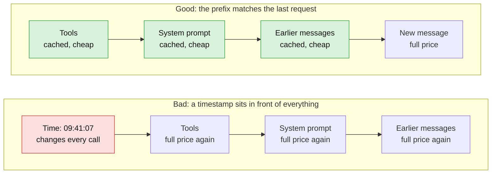
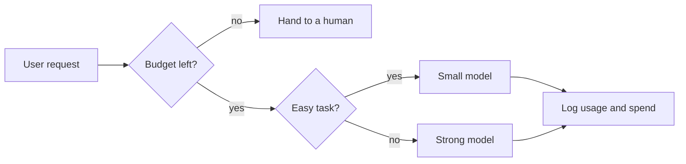
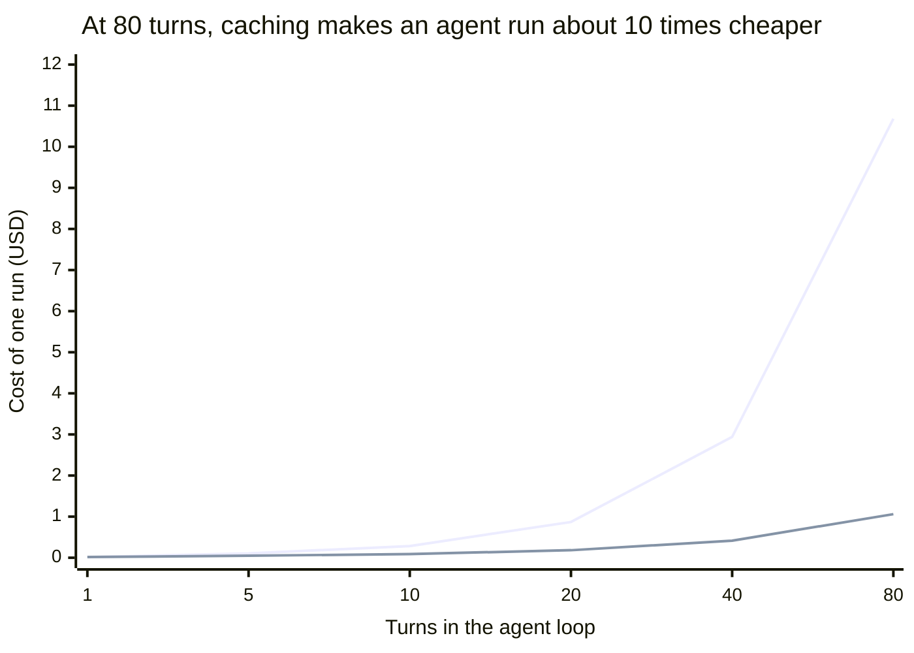
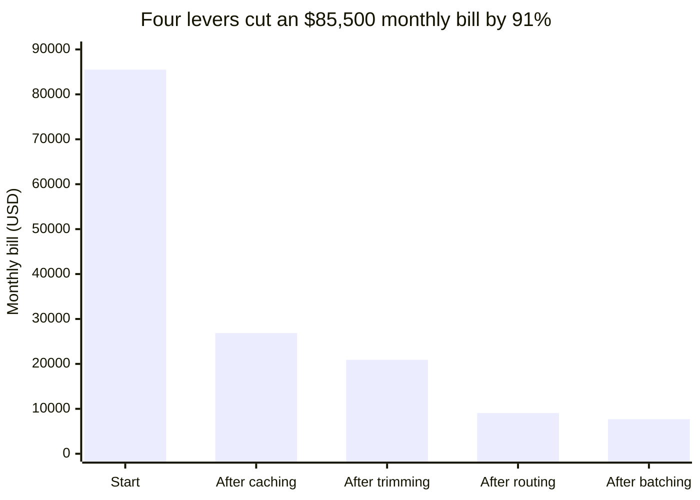
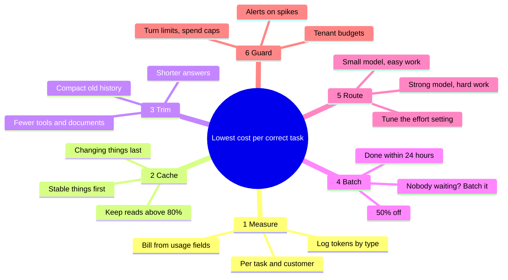



*Utkrishta Sinha · 4 Nov 2026 · about 35 minutes*

## 1. The Five Big Ideas

A well-tuned AI agent can cost about 90% less than a naive one, and caching usually gives the biggest single cut. Prices below were checked on 4 November 2026. Prices change often, so always check the live page before quoting a customer.

- **Measure cost per finished task, not cost per token.** A cheap model that fails and retries can cost more than a strong model that works the first time.
- **Agent loops re-send everything.** Each turn pays again for all earlier turns, so cost grows roughly with the square of the number of turns.
- **Fix caching first.** Cached tokens cost 5% of the normal input price on Claude Sonnet 5.5, Opus 5.5 and GPT-6.1 Sol. A healthy agent reads about 84% of its input from cache.
- **Send fewer tokens, then use a cheaper model.** Trim tools and documents, send easy work to a small model, and move work nobody is waiting for to the Batch API at 50% off.
- **Put a guard around the money.** Use per-customer budgets, spend alerts and an eval that proves quality did not fall. A saving that breaks quality is a bug with a nice chart.

Think of it like a mobile data plan. You do not stop using the internet. You stop streaming 4K video to a phone in your pocket.

## 2. Why This Matters for an FDE

Token cost decides whether a demo becomes a product. An FDE (Forward Deployed Engineer) is the engineer who sits with the customer and makes the AI system work in their real business, so the bill lands on your desk.

A demo with 20 users looks free. The same agent with 200,000 users may cost more than the human team it was meant to help. Here is where cost shows up in real engagements:

| Moment in the engagement | What the customer says | What you do |
| --- | --- | --- |
| Scoping | "What will this cost per month?" | Build a cost model from real traffic numbers |
| Pilot | "The pilot was cheap, why is production 40 times more?" | Show the cost per task and the growth in agent turns |
| Finance review | "Which team spent this money?" | Tag every call by team and customer |
| Scaling | "We hit a rate limit at noon" | Use caching, because cache reads may not count against limits |
| Renewal | "Can we do this for less?" | Run the levers in this doc and prove quality with evals |

There is also an Indian angle. API prices are in US dollars, so a weaker rupee raises the bill even when nothing changes. Mint reported in June 2026 that this made US-priced AI APIs 10% to 15% costlier for Indian startups ([summary](https://www.pulse.bot/ai/news/indian-startups-cut-usage-buy-credits-as-weak-rupee-raises-ai-costs-5ac511ea-17a6-442e-86f0-7314f95be714/)). Those startups responded by tightening prompts and reusing context, which is this whole topic.

On Anthropic's API, cache read tokens have not counted toward the input-tokens-per-minute limit since [March 2025](https://claude.com/resources/articles/token-saving-updates). Check the limit rules for your vendor before you promise this one.

## 3. Core Concepts, From Simple to Deep

Every saving comes from one formula: tokens times price, across each token type, for each attempt. Once you see that, every technique is just shrinking one part of it.

### 3.1 Words You Need First

| Term | Plain meaning | Everyday example |
| --- | --- | --- |
| Token | A small piece of text the model reads or writes. In English, about 4 characters or three quarters of a word | "unbelievably" may become "un", "believ", "ably" |
| Tokenizer | The program that cuts text into tokens. Each model family has its own | Different scissors cut the same paper differently |
| Input tokens | Everything you send: system prompt, tools, history, documents | The question paper |
| Output tokens | Everything the model writes back | The answer sheet |
| MTok | One million tokens. Prices are quoted per MTok | Like price per kilogram |
| Context window | The most tokens a model can look at in one request | The size of the desk |
| System prompt | Fixed instructions at the start of a request | The employee handbook |
| Tool definition | The description of a function the model may call. These cost input tokens | The menu of things it can do |
| Agent loop | The model calls a tool, reads the result, and repeats until done (Day 1) | Checking a recipe after each step |
| Prompt cache | The vendor stores the processed start of your prompt and reuses it cheaply | A chef who keeps chopped onions ready |
| Prefix | The start of a prompt. Caches match from the first byte onward | The first pages of a book |
| Cache hit / miss | Hit: the prefix was found. Miss: it was not, so you pay full price | Item in stock or not in stock |
| TTL | Time to live, how long a cached item stays before it expires | The expiry date on milk |
| Batch API | Send many requests now, collect the answers later, pay half | Overnight parcel rates |
| Model routing | Choosing a model for each request | Sending simple tickets to the junior, hard ones to the senior |
| Compaction | Replacing old conversation turns with a short summary | Meeting minutes instead of the full recording |
| Effort | A setting for how hard the model thinks. More effort means more tokens | A quick glance or a careful review |
| Reasoning tokens | Tokens the model uses to think. Billed, usually as output | Rough work on the back of the exam paper |
| Cost per task | Total spend divided by tasks finished correctly | Cost per delivered parcel, not cost per kilometre |
| FinOps | The practice of tracking and managing cloud spend | Household budgeting for a company |
| Gateway | A service between your app and the vendors that logs, limits and routes calls | A reception desk for every model call |

### 3.2 How a Bill Is Really Built

The full formula has more parts than most people expect:

```text
Cost per task = sum over attempts of
  (input tokens x input price
   + cache-write tokens x write price
   + cache-read tokens x read price
   + output tokens x output price)
  divided by tasks finished correctly
```

Here T means a count of tokens and P means the price per token. A quick example with Claude Sonnet 5.5 at $2 per MTok input and $10 per MTok output: a call with 10,000 input tokens and 500 output tokens costs 2 cents plus 0.5 cents, so $0.025.

Three things surprise beginners:

1. **Output costs more.** Output is 5 times the input price on the models in this doc. Yet agents read far more than they write. Manus reports an input to output ratio of [around 100:1](https://manus.im/blog/Context-Engineering-for-AI-Agents-Lessons-from-Building-Manus). So in agents, input is usually the bigger bill even though output has the higher price.
2. **Tools cost tokens before they do anything.** On Opus 5.5, Sonnet 5.5 and Haiku 5.5, having any tool adds [286 hidden tokens](https://platform.claude.com/docs/en/about-claude/pricing), plus your tool definitions. Browser use adds about 6,600 tokens to each request's input.
3. **The same text can have more tokens on a new model.** Claude 4.7 and later models use a tokenizer that produces [roughly 30% more tokens](https://platform.claude.com/docs/en/about-claude/pricing) for the same text. A price per MTok that looks flat can still be a higher bill.

### 3.3 Why Agent Loops Get Expensive

A language model has no memory between calls. So the agent sends the whole conversation again on every turn. Imagine retelling your entire day to a friend from breakfast onward each time you add one new sentence. Your friend would stop picking up the phone. Vendors just bill you.

Turn 1 sends 6,000 tokens. Turn 2 sends 7,500. Turn 3 sends 9,000. Add those up and cost grows with roughly the square of the turns. Anthropic's cost guide [says the same](https://platform.claude.com/docs/en/about-claude/models/optimizing-for-cost-and-intelligence). Doubling the length of a task can make it about four times as expensive.

### 3.4 How Prompt Caching Works

The model has to process your prompt into internal numbers before it can answer. A prompt cache stores that processed work for the start of the prompt. If the next request starts with exactly the same bytes, the vendor skips the work and charges you far less.

One changed character breaks the match from that point onward. So the golden rule is: **stable things first, changing things last.**



The top request reuses three stored pieces. The bottom request changed its first byte, so nothing after it matches.

Here are Anthropic's rules, from the [prompt caching docs](https://platform.claude.com/docs/en/build-with-claude/prompt-caching):

| Setting | Value |
| --- | --- |
| Cache order | tools, then system, then messages |
| Default TTL | 5 minutes, refreshed free on each read |
| Write price, 5 minutes | 1.25 times the input price |
| Write price, 1 hour | 2 times the input price |
| Read price | 0.05 times input on Opus 5.5 and Sonnet 5.5, 0.1 times on most others |
| Smallest cacheable prompt | 512 tokens on current models, up to 4,096 on some older ones |
| Breakpoints | Up to 4 per request |

The maths is friendly. On Sonnet 5.5 a 5-minute write costs 25% extra, and each read saves 95%. So a single reuse more than pays for the write. The 1-hour write costs 100% extra, so it needs two reads to pay back.

OpenAI differs: caching is automatic on supported models. On GPT-5.6 and later the prefix must be at least 1,024 tokens, default retention is 30 minutes, and writes cost 1.25 times input. Reads cost 0.05 times input on [GPT-6.1 Sol and Terra](https://developers.openai.com/api/docs/guides/prompt-caching).

### 3.5 The Levers, in the Right Order

Anthropic's [cost guide](https://platform.claude.com/docs/en/about-claude/models/optimizing-for-cost-and-intelligence) splits levers into free wins, which keep quality the same, and trade-offs, which do not. Do the free wins first.

1. **Measure.** Log tokens by type, per task, per customer.
2. **Cache.** Keep a stable prefix and watch the hit rate.
3. **Trim.** Remove unused tools, shorten documents, cut old history, and ask for shorter answers.
4. **Batch.** Move work nobody is waiting for to the Batch API.
5. **Route and tune.** Use a smaller model or lower effort where evals say it is safe.
6. **Guard.** Set budgets, alerts and hard stops.



This is the shape of the Guard and Route levers together. Example 4 builds it in TypeScript.

The trimming lever can be dramatic. In one Anthropic test, pasting a 1,862-row CSV into the prompt scored 7 out of 25 at $5.01 per run. Uploading it and querying it with code scored 25 out of 25 at $0.40. It was cheaper and better, which almost never happens in engineering, so enjoy it.

### 3.6 Effort Is a Hidden Price Dial

More thinking costs more, and the last few points of quality cost the most. These are Anthropic's own numbers for Opus 5.5 on [SWE-bench Pro](https://platform.claude.com/docs/en/about-claude/models/optimizing-for-cost-and-intelligence), a set of real coding tasks:

| Effort | Tasks solved | Cost per task |
| --- | --- | --- |
| low | 87.4% | $0.11 |
| medium (default) | 92.8% | $0.21 |
| high | 95.3% | $0.29 |
| xhigh | 96.7% | $0.74 |

A clever pattern: run at low effort, then re-run only the failures at high effort. Anthropic measured about 97% solved for $0.17 per task. That beats running everything at high, but you need a reliable way to detect failure.

### 3.7 Semantic Caching

A prompt cache matches exact bytes. An exact-match cache in your own app skips the model when the same question repeats. A semantic cache goes further. It turns questions into vectors (lists of numbers that capture meaning) and reuses an answer when a new question is close enough.

The danger is a wrong match. One team found "cancel my subscription" and "cancel my order" scored [0.87 similarity](https://venturebeat.com/orchestration/why-your-llm-bill-is-exploding-and-how-semantic-caching-can-cut-it-by-73?rand=3490) but need different answers. Never use it on personal or transactional answers.

## 4. Worked Examples

These examples go from a simple calculator to a router with a budget. Examples 1, 2, 4 and 5 run offline and were tested. Example 3 was syntax-checked only, because it needs an API key and a `refund_policy.txt` file.

### Example 1: Price a Call From Its Usage

This is the most useful 15 lines in the doc. Every API response tells you the tokens used, so you can price each call.

```python
"""Price one LLM call from its usage numbers. Prices: USD per 1M tokens, 4 Nov 2026."""
PRICES = {
    "claude-opus-5-5":   {"input": 4.00, "write_5m": 5.000, "read": 0.20, "output": 20.00},
    "claude-sonnet-5-5": {"input": 2.00, "write_5m": 2.500, "read": 0.10, "output": 10.00},
    "claude-haiku-5-5":  {"input": 0.10, "write_5m": 0.125, "read": 0.01, "output": 0.50},  # prompts up to 100k tokens
}

def call_cost(model, input_tokens=0, cache_write=0, cache_read=0, output_tokens=0):
    p = PRICES[model]
    return (input_tokens * p["input"]
            + cache_write * p["write_5m"]
            + cache_read  * p["read"]
            + output_tokens * p["output"]) / 1_000_000

if __name__ == "__main__":
    # 10,000 tokens in, 500 out, no caching
    print(f"${call_cost('claude-sonnet-5-5', input_tokens=10_000, output_tokens=500):.4f}")
    # the same call when 9,000 of those tokens come from the cache
    print(f"${call_cost('claude-sonnet-5-5', input_tokens=1_000, cache_read=9_000, output_tokens=500):.4f}")
```

Output: `$0.0250` and then `$0.0079`. The same call is about 3 times cheaper with a cache hit. Save this as `cost.py`, because Example 2 imports it.

### Example 2: Watch an Agent Loop Burn Money

```python
"""Why agent loops get expensive: every turn re-sends everything before it."""
from cost import call_cost

MODEL = "claude-sonnet-5-5"
BASE = 6_000      # system prompt + tool definitions
PER_TURN = 1_500  # tool result + assistant message added each turn
OUTPUT = 300      # tokens the model writes each turn

def run(turns, cached):
    total, sent, prior = 0.0, BASE, 0
    for _ in range(turns):
        if cached:
            total += call_cost(MODEL, cache_read=prior, cache_write=sent - prior, output_tokens=OUTPUT)
            prior = sent  # everything sent so far is now in the cache
        else:
            total += call_cost(MODEL, input_tokens=sent, output_tokens=OUTPUT)
        sent += PER_TURN
    return total

print(f"{'turns':>5} {'no cache':>10} {'cached':>10} {'ratio':>6}")
for t in (1, 5, 10, 20, 40, 80):
    a, b = run(t, False), run(t, True)
    print(f"{t:>5} ${a:>9.4f} ${b:>9.4f} {a/b:>5.1f}x")
```

The chart in section 4.1 plots this output. Notice that at one turn the cached run costs more, because you paid to write the cache and never read it. Caching a prompt you use once is like buying a monthly pass for a single bus ride.

### Example 3: A Cache-Friendly Call

```python
import anthropic

client = anthropic.Anthropic()  # reads ANTHROPIC_API_KEY

POLICY = open("refund_policy.txt").read()  # a long document that never changes

def ask(question: str):
    response = client.messages.create(
        model="claude-sonnet-5-5",
        max_tokens=500,
        system=[
            {"type": "text", "text": "You are a support agent for ShopKart."},
            {
                "type": "text",
                "text": POLICY,
                "cache_control": {"type": "ephemeral"},  # cache everything up to here
            },
        ],
        messages=[{"role": "user", "content": question}],
    )
    u = response.usage
    print("written to cache:", u.cache_creation_input_tokens)
    print("read from cache: ", u.cache_read_input_tokens)
    print("not cached:      ", u.input_tokens)
    return response

ask("How long do I have to return shoes?")   # first call writes the cache
ask("Can I return a gift?")                  # second call reads it
```

If both cache numbers are 0, your prompt is under the minimum size or the prefix changed. For chats, you can instead pass one top-level `cache_control` field and let automatic caching move the breakpoint as the conversation grows.

### Example 4: A Router With a Budget Guard (TypeScript)

This one is for your TypeScript muscles. Run it with `npx tsx router.ts`.

```typescript
// A tiny model router with a budget guard. No API calls, so you can run it anywhere.
type Tier = "cheap" | "strong";

const MODEL: Record<Tier, string> = {
  cheap: "claude-haiku-5-5",
  strong: "claude-sonnet-5-5",
};

// USD per 1M tokens, 4 Nov 2026
const PRICE: Record<string, { input: number; output: number }> = {
  "claude-haiku-5-5": { input: 0.1, output: 0.5 },
  "claude-sonnet-5-5": { input: 2, output: 10 },
};

const HARD_WORDS = /refund|legal|complaint|chargeback|escalate/i;

function pickTier(message: string): Tier {
  if (HARD_WORDS.test(message)) return "strong"; // risky topics go to the stronger model
  if (message.length > 600) return "strong";     // long, messy questions too
  return "cheap";
}

class Budget {
  private spent = 0;
  constructor(private limitUsd: number) {}

  charge(model: string, inputTokens: number, outputTokens: number): void {
    const p = PRICE[model];
    this.spent += (inputTokens * p.input + outputTokens * p.output) / 1_000_000;
  }
  get exceeded(): boolean {
    return this.spent >= this.limitUsd;
  }
  get total(): number {
    return this.spent;
  }
}

const budget = new Budget(0.001); // one tenth of a US cent, tiny on purpose

const questions = [
  "Where is my order?",
  "What time do you open?",
  "I want a refund and I will file a complaint",
  "Change my address please",
];

for (const q of questions) {
  if (budget.exceeded) {
    console.log(`BLOCKED  "${q}" -> hand over to a human`);
    continue;
  }
  const model = MODEL[pickTier(q)];
  budget.charge(model, 2_000, 150); // pretend usage from the API response
  console.log(`${model.padEnd(18)} "${q}"  total $${budget.total.toFixed(5)}`);
}
```

The first two questions go to Haiku. The refund goes to Sonnet and costs about 20 times more. The fourth is blocked because the budget is gone. Real routers use a small classifier model instead of a word list, but the shape is the same.

### Example 5: An Exact-Match Cache in Your App

This cache sits in your code, so a repeat question costs nothing at all.

```python
import hashlib, json, time

class ExactCache:
    """Answer repeat questions without calling the model at all."""
    def __init__(self, ttl_seconds=3600):
        self.ttl = ttl_seconds
        self.store = {}

    def _key(self, model, messages):
        # sort_keys makes the JSON stable, so equal requests get equal keys
        raw = json.dumps({"model": model, "messages": messages}, sort_keys=True)
        return hashlib.sha256(raw.encode()).hexdigest()

    def get(self, model, messages):
        hit = self.store.get(self._key(model, messages))
        if hit and time.time() - hit["at"] < self.ttl:
            return hit["answer"]
        return None

    def put(self, model, messages, answer):
        self.store[self._key(model, messages)] = {"answer": answer, "at": time.time()}

cache = ExactCache()
msgs = [{"role": "user", "content": "What is your refund window?"}]
print(cache.get("claude-haiku-5-5", msgs))            # None, a miss
cache.put("claude-haiku-5-5", msgs, "30 days.")
print(cache.get("claude-haiku-5-5", msgs))            # 30 days.
```

Only cache answers that are safe to share across users. Serving one customer's order details to another is the kind of saving that ends careers.

### 4.1 What Each Lever Does to a Real Bill

The two charts in this section use a made-up agent: 300,000 runs a month, 10 turns each, on Sonnet 5.5. The numbers come from the Example 2 model and assume quality stays the same, which you must prove with evals.



*Upper line: no cache, $10.68 at 80 turns. Lower line: cached, $1.06. Note that the x-axis is not evenly spaced.*

The no-cache line bends upward because each turn re-sends all earlier turns. The cached line stays almost straight.



*Illustration, not a measurement. Savings by step: caching $58,635, trimming $5,955, routing $11,854, batching $1,358.*

Caching saves the most here, and order matters: each lever works on what the last one left. Trimming takes the base prompt to 4,000 tokens and each turn to 1,000. Routing sends 60% of runs to Haiku 5.5. Batching moves 30% of runs to half price, though cache hits in batches are best-effort.

## 5. Real-Life Use Cases

The strongest public results come from caching, retrieving fewer tools, and routing. Most numbers below are self-reported by the company or a vendor, so treat them as evidence, not proof.

| Company | Country | What they did | Reported result |
| --- | --- | --- | --- |
| [redBus](https://medium.com/redbus-in/how-llms-transformed-our-customer-service-with-efficient-query-handling-and-cost-reduction-5f72f4a51ea8) | India | Stored function definitions in a vector database, so each query retrieves only the tools it needs. Moved from GPT-4 to GPT-4o | Costs down tenfold from the first version, CSAT up 20%, escalations down 20% |
| [Meesho](https://business-standard.com/companies/start-ups/genai-helped-reduce-customer-support-chat-costs-by-90-meesho-cto-barnwal-124080701028_1.html) | India | GenAI handles about 95% of roughly 100,000 daily support chats (August 2024) | Support chat cost down 90%, compared with humans rather than with an earlier AI bill |
| [Dust](https://claude.com/customers/dust) | Global | Restructured caching into three tiers: global, workspace and per-user | Model spend down about 18%, roughly $10K per day. Cache reads up from 30% to 65% of input |
| [Manus](https://manus.im/blog/Context-Engineering-for-AI-Agents-Lessons-from-Building-Manus) | Global | Kept tools fixed, made context append-only, and kept JSON key order stable | Calls cache hit rate the single most important metric for a production agent |
| [Claude Code](https://www.implicator.ai/anthropic-says-cache-misses-are-production-incidents-reveals-caching-shaped-claude-code/) | US | Designed the whole harness around caching | The team treats a hit-rate drop as a production incident with severity alerts |
| [Ramp](https://runtimewire.com/article/ramp-router-ai-model-gateway-llm-costs) | US | Built a model-selection layer across 100+ internal use cases, opened as Ramp Router in July 2026 | Claims about 30% lower internal LLM cost |

A separate writer reported semantic caching cut one bill from [$47K to $12.7K a month](https://venturebeat.com/orchestration/why-your-llm-bill-is-exploding-and-how-semantic-caching-can-cut-it-by-73?rand=3490), with a 67% hit rate after three months and a 0.8% false-positive rate. The company is not named, so weigh it lightly.

The redBus case is the best one for an FDE interview. The saving came from design, not from bargaining: send only the tools a query needs. In India, [Gnani.ai](https://www.newsbytesapp.com/news/business/indian-firms-switch-to-slms-for-cost-speed-and-privacy/tldr) also argues for small language models, which lower cost and speed up multilingual work. Indian provider [Sarvam](https://docs.sarvam.ai/api/pricing.md) lists Sarvam 105B at ₹15 input, ₹5 cached input and ₹60 output per MTok before GST, which avoids dollar exposure.

## 6. Trade-offs: What Each Lever Costs You

Caching and trimming are close to free. Routing, lower effort and semantic caching can hurt quality, so they need evals.

| Lever | Typical saving | Quality risk | Effort to add | Main catch |
| --- | --- | --- | --- | --- |
| Prompt caching | Very high in agents | None | Low to medium | One changed byte breaks it |
| Trimming tools and context | Medium to high | Low if tested | Medium | Removing too much hides information |
| Output limits | Low to medium | Low | Low | Long answers get cut off |
| Batch API | 50% on eligible work | None | Low | Answers can take up to 24 hours |
| Model routing | High | Medium | Medium | Misrouted hard tasks fail quietly |
| Lower effort | Medium | Medium | Low | Accuracy falls on hard tasks |
| Exact-match app cache | Depends on repeats | Low | Low | Stale answers |
| Semantic cache | Can be high in FAQs | Medium to high | High | Wrong answers from near matches |
| Self-hosted models | High at very large scale | Medium | Very high | You now run GPUs (Day 7) |

**When to spend time on cost:**

- The spend is high enough to pay for the engineering time.
- Traffic has a stable shape, such as support, extraction or a coding agent.
- You have an eval, so you can tell if quality fell.

**When not to:**

- You are still testing whether anyone wants the product. A cost project in week 1 is like tuning the engine of a car with no wheels.
- The spend is $200 a month and your time costs more than that.
- The task is high stakes, such as medical or legal advice, and the cheap option has not been proven safe.

## 7. Common Pitfalls and Production Gotchas

Most cost incidents come from a small change that silently broke the cache, or from a loop nobody capped.

1. **A timestamp at the top of the system prompt.** It changes every request, so the cache never hits. Put the date in the newest user message. Anthropic's guide warns against this directly.
2. **Changing tools mid-session.** Tool definitions come first in the prefix, so a change throws away everything after them. Keep the tool list fixed, and remember that changing tool\_choice also breaks the message cache on Anthropic. OpenAI suggests limiting tools with `tool_choice` or allowed\_tools instead of removing them. On Anthropic, defer rare tools with tool search.
3. **Unstable JSON.** If key order changes between requests, the bytes change and the cache misses. [Manus](https://manus.im/blog/Context-Engineering-for-AI-Agents-Lessons-from-Building-Manus) calls out this silent failure. Use deterministic serialization.
4. **Editing the system prompt mid-conversation.** In one Anthropic test this cost [25 to 50 times](https://platform.claude.com/docs/en/about-claude/models/optimizing-for-cost-and-intelligence) as much as sending the instruction as a system message. Changing effort at the top level cost 20 to 40 times as much.
5. **Cache expiry during long tool calls.** A tool that takes 6 minutes outlives a 5-minute cache, and the clock includes response time. Use the 1-hour TTL when pauses are common.
6. **Switching models mid-session.** Each model has its own cache. Use a subagent for different work on a different model, as [Claude Code does](https://www.implicator.ai/anthropic-says-cache-misses-are-production-incidents-reveals-caching-shaped-claude-code/).
7. **Compaction that changes the prefix.** Summarising is a one-time cache break. Run it with the same system prompt and tools, and make other breaking changes at the same moment.
8. **Crossing a price tier.** Claude Haiku 5.5 charges 5 times more per token once a prompt passes 100,000 tokens. Compact before that line.
9. **Promotional prices.** Gemini 4 Argon is listed at $2 input until 30 November 2026 and $4 from 1 December. Gemini 3.8 Flash doubles from 1 January 2027 ([pricing](https://ai.google.dev/gemini-api/docs/pricing)). Your cost model must carry an expiry date.
10. **A runaway loop.** An agent stuck retrying a failing tool will spend all night. Cap turns, cap spend per run, and alert on spikes. The bill is a very patient kind of pager.
11. **Lowering `max_tokens` to save money.** The model does not economise because of the cap. It just gets cut off, and retries cost more. Anthropic suggests 64,000 for agentic work.
12. **Mixing tenants in a shared cache.** Vendor prompt caches are isolated by organization, but your own app cache is your job. Include the tenant ID in the key.
13. **Comparing token prices, not task costs.** Run the eval, then divide spend by correct tasks.
14. **Trusting the estimate.** Token counts from a counting endpoint are estimates. Bill from the `usage` field in real responses.

## 8. How the Vendors Compare

Mid-tier models now cluster at about $2 input and $10 output, so the real differences are in caching rules and in batch tiers. All prices are USD per MTok, read from official pricing pages on 4 November 2026.

| Model | Input | Cached read | Output | Notes |
| --- | --- | --- | --- | --- |
| [Claude Fable 5.1](https://platform.claude.com/docs/en/about-claude/pricing) | 10.00 | 0.25 | 50.00 | Hardest reasoning |
| [Claude Opus 5.5](https://platform.claude.com/docs/en/about-claude/pricing) | 4.00 | 0.20 | 20.00 | Strong default for agents |
| [Claude Sonnet 5.5](https://platform.claude.com/docs/en/about-claude/pricing) | 2.00 | 0.10 | 10.00 | Balanced |
| [Claude Haiku 5.5](https://platform.claude.com/docs/en/about-claude/pricing) | 0.10 | 0.01 | 0.50 | Up to 100k prompt tokens, 5 times more above that |
| [GPT-6 Astra](https://developers.openai.com/api/docs/pricing) | 10.00 | 1.00 | 50.00 | Top tier |
| [GPT-6.1 Sol](https://developers.openai.com/api/docs/pricing) | 2.00 | 0.10 | 10.00 | Balanced |
| [GPT-6.1 Terra](https://developers.openai.com/api/docs/pricing) | 1.00 | 0.05 | 5.00 | Mid to low |
| [GPT-6 Luna](https://developers.openai.com/api/docs/pricing) | 0.10 | 0.01 | 0.50 | Smallest |
| [Gemini 4 Argon](https://ai.google.dev/gemini-api/docs/pricing) | 2.00 | 0.10 | 10.00 | Doubles on 1 December 2026 |
| [Gemini 3.8 Flash](https://ai.google.dev/gemini-api/docs/pricing) | 0.75 | 0.075 | 3.75 | Doubles on 1 January 2027 |
| [Gemini 3.1 Flash-Lite](https://ai.google.dev/gemini-api/docs/pricing) | 0.25 | 0.025 | 1.50 | Text, image and video input |

OpenAI's pricing page shows its tiers in unlabelled tabs, so the half-price and double-price tiers are inferred from tab order. Confirm on the live page before quoting.

| Feature | Anthropic | OpenAI | Google Gemini |
| --- | --- | --- | --- |
| Caching style | [Breakpoints or one automatic field](https://platform.claude.com/docs/en/build-with-claude/prompt-caching) | [Automatic, with explicit mode on GPT-5.6+](https://developers.openai.com/api/docs/guides/prompt-caching) | [Priced context caching](https://ai.google.dev/gemini-api/docs/pricing) |
| Cache write price | 1.25x (5 min), 2x (1 hour) | 1.25x (30 min), 2.5x (12 hours) on GPT-5.6+ | Storage charged per MTok per hour on most models |
| Smallest cached prompt | 512 tokens on current models | 1,024 tokens on GPT-5.6+ | Not checked |
| Batch discount | [50%, up to 24 hours](https://platform.claude.com/docs/en/build-with-claude/batch-processing) | About 50% | 50% on input and output for most models |
| Data residency uplift | 1.1x for US-only inference | 10% for regional processing | Not checked |

Beyond vendors, compare the approaches:

- **Direct API with your own logging:** the simplest choice for one vendor.
- **Gateway, such as [LiteLLM](https://docs.litellm.ai/docs/proxy/virtual_keys) or OpenRouter (Day 12):** one place for keys, budgets and fallbacks, but another service to run.
- **Self-hosted open models (Day 7):** no per-token bill, but you pay for GPUs, whether they are busy or not.
- **Regional providers, such as Sarvam:** rupee billing, plus Indian language strength. Test quality on your own task.

## 9. Hands-On Exercise: Audit a Support Agent's Bill

Today you build a small cost dashboard for an agent in 1 to 2 hours. No API key is needed for the core task.

**Scenario.** ShopKart runs a support agent with 50,000 conversations a month. Each has 8 turns on average. The base prompt is 8,000 tokens, and each turn adds 1,200 tokens. The agent writes 250 tokens per turn. Finance wants the bill cut by 60% without hurting quality.

**Steps:**

1. Copy `cost.py` and the `run()` function from Examples 1 and 2.
2. Compute the monthly bill on Sonnet 5.5 without caching.
3. Add caching and recompute.
4. Add a trimming step: cut the base prompt to 5,000 tokens and each turn to 800.
5. Add routing: send 50% of conversations to Haiku 5.5.
6. Add a batch step: assume 20% of runs are overnight summaries that can wait.
7. Print a table with one row per step: name, monthly cost, and percent saved so far.
8. Stretch goal: with an API key, send 20 real questions to an agent and log every `usage` object to a CSV file.

**Acceptance criteria:**

- [ ] The script runs with one command and needs no network
- [ ] Each lever can be switched on or off with one flag
- [ ] Output shows the total bill and the cost per conversation
- [ ] Haiku's prices are read from the same price table, not hard-coded in the logic
- [ ] Your result reaches the 60% target, or you explain what stops it
- [ ] A short note lists the assumptions, and what you would test with evals before shipping
- [ ] You can explain each saving in one sentence to a finance manager

## 10. Interview Questions

The best answers start from cost per finished task and end with how you would prove quality held.

**1. What is a token, and why do input and output have different prices?** A token is a small chunk of text. Output costs more because generating each token takes far more compute than reading one. Output is 5 times input on Claude Sonnet 5.5.

**2. Why does an agent's cost grow faster than its number of turns?** Models hold no state, so each turn re-sends the whole history. Sent tokens grow in a straight line per turn, so the total grows with roughly the square of the turns.

**3. How does prompt caching work, and what breaks it?** The vendor stores the processed prefix and reuses it when the next request starts with identical bytes. Changing tools, the system prompt, a timestamp near the start, JSON key order, or the model all break it. Keep stable content first.

**4. Your agent's cache hit rate dropped from 85% to 30% overnight. What do you do?** Treat it as an incident. Check what shipped: a prompt edit, a new tool, or a date in the system prompt. Diff the serialized prefix bytes across two requests to find the first change. Then add an alert. Anthropic says a healthy loop reads a median of 84% from cache, and under about 80% means something is breaking it.

**5. When would you pick the 1-hour cache over the 5-minute cache?** When pauses between turns are common, such as slow tools, subagents or a human reply. Anthropic's rule of thumb is about 1 turn in 20 following a pause of 5 minutes to an hour. The 1-hour write costs 2x rather than 1.25x.

**6. Design cost controls for a multi-tenant agent platform.** Route every call through a gateway. Tag each call with tenant, feature and task IDs. Store usage by token type. Set a per-run turn limit, a per-run spend cap and a monthly tenant budget. Alert on spikes. Report cost per finished task to each tenant.

**7. A customer says, "Just switch to the cheapest model." How do you respond?** I agree on the goal and test the claim. I run the eval on both models and compare cost per correct task, including retries and human escalations. If the cheap model holds for a slice of traffic, I route that slice and keep the stronger model for hard cases.

**8. How would you add model routing without hurting quality?** First tune a single model. Then use an eval to find which task types a small model handles. Start with simple rules, shadow-run on a slice of traffic, and add an escalation path. A multi-model setup must beat the single model's whole cost-quality curve.

**9. When is semantic caching a bad idea?** For personal, transactional or fast-changing answers. A near match can give a wrong answer with total confidence. If you use it, set thresholds per query type and exclude account-specific queries.

**10. A CFO asks why the pilot cost $500 and production will cost $40,000. Explain it simply.** The pilot had few users and short conversations. Production multiplies users, turns and documents, and long conversations cost more than proportionally. I show a one-page model with traffic, turns and cost per task, then the levers that bring it down.

## 11. How It Connects

Token cost sits on top of every earlier topic and feeds many later ones.

| Topic | Link to today |
| --- | --- |
| Day 1, Agent loops and tools | The loop is why cost grows with the square of the turns |
| Day 3, Model selection | Today adds cost per task to that decision |
| Day 5, Coding agents | Claude Code is built around cache hit rate |
| Day 7, Open-source and local models | Self-hosting is the far end of the cost curve |
| Day 9, Context engineering (next) | Decides what goes into the tokens you pay for |
| Day 10, Harness engineering | The harness keeps prefixes stable and caps turns |
| Day 12, OpenRouter | A gateway for routing and fallback |
| Day 19, Evaluations and observability | Proves a saving did not hurt quality |
| Day 20, Cost and speed trade-offs | Takes today's levers into system design |
| Day 27, Langfuse | Tracks cost per trace in production |
| Day 45, Runtime policies | Turns budgets into enforced rules |

## 12. Mental Map to Remember

Remember six words in order: Measure, Cache, Trim, Batch, Route, Guard. A silly sentence helps: **My Cat Takes Big Red Grapes.**



*Foundation under all six: evals prove quality held.*

If a customer wakes you at 2 am about a bill, walk the map from left to right, top to bottom. Then go back to sleep, and let the batch job finish overnight at half price.

## 13. Further Reading and Sources

Start with Anthropic's cost guide, then the Manus post. Together they cover most of what matters in practice.

**Best resources:**

1. [Optimizing for cost and intelligence](https://platform.claude.com/docs/en/about-claude/models/optimizing-for-cost-and-intelligence): the levers in order, with measured numbers.
2. [Context Engineering for AI Agents](https://manus.im/blog/Context-Engineering-for-AI-Agents-Lessons-from-Building-Manus): lessons from building a real agent.
3. [Prompt caching docs from Anthropic](https://platform.claude.com/docs/en/build-with-claude/prompt-caching): the exact rules.
4. [Prompt caching guide from OpenAI](https://developers.openai.com/api/docs/guides/prompt-caching): automatic caching and how to keep it working.
5. [Reducing cost and improving performance](https://claude.com/resources/articles/reducing-cost-and-improving-performance-with-claude-platform): a practical checklist.
6. [redBus case study](https://medium.com/redbus-in/how-llms-transformed-our-customer-service-with-efficient-query-handling-and-cost-reduction-5f72f4a51ea8): an Indian company cutting cost by design.
7. [LiteLLM virtual keys](https://docs.litellm.ai/docs/proxy/virtual_keys): budgets and spend tracking at a gateway.

**Sources:**

- [Claude API pricing](https://platform.claude.com/docs/en/about-claude/pricing)
- [Claude prompt caching](https://platform.claude.com/docs/en/build-with-claude/prompt-caching)
- [Claude token counting](https://platform.claude.com/docs/en/build-with-claude/token-counting)
- [Claude Message Batches](https://platform.claude.com/docs/en/build-with-claude/batch-processing)
- [Optimizing for cost and intelligence](https://platform.claude.com/docs/en/about-claude/models/optimizing-for-cost-and-intelligence)
- [Reducing cost and improving performance with Claude Platform](https://claude.com/resources/articles/reducing-cost-and-improving-performance-with-claude-platform)
- [Token-saving updates](https://claude.com/resources/articles/token-saving-updates)
- [Prompt caching with Claude](https://claude.com/resources/articles/prompt-caching)
- [OpenAI API pricing](https://developers.openai.com/api/docs/pricing)
- [OpenAI prompt caching](https://developers.openai.com/api/docs/guides/prompt-caching)
- [Gemini API pricing](https://ai.google.dev/gemini-api/docs/pricing)
- [Sarvam API pricing](https://docs.sarvam.ai/api/pricing.md)
- [Manus: Context Engineering for AI Agents](https://manus.im/blog/Context-Engineering-for-AI-Agents-Lessons-from-Building-Manus)
- [Dust customer story](https://claude.com/customers/dust)
- [Implicator: cache misses as production incidents](https://www.implicator.ai/anthropic-says-cache-misses-are-production-incidents-reveals-caching-shaped-claude-code/)
- [RuntimeWire: Ramp Router](https://runtimewire.com/article/ramp-router-ai-model-gateway-llm-costs)
- [redBus engineering blog](https://medium.com/redbus-in/how-llms-transformed-our-customer-service-with-efficient-query-handling-and-cost-reduction-5f72f4a51ea8)
- [Business Standard: Meesho support chat costs](https://business-standard.com/companies/start-ups/genai-helped-reduce-customer-support-chat-costs-by-90-meesho-cto-barnwal-124080701028_1.html)
- [NewsBytes: Indian firms switch to SLMs](https://www.newsbytesapp.com/news/business/indian-firms-switch-to-slms-for-cost-speed-and-privacy/tldr)
- [Pulse summary of Mint: weak rupee and AI costs](https://www.pulse.bot/ai/news/indian-startups-cut-usage-buy-credits-as-weak-rupee-raises-ai-costs-5ac511ea-17a6-442e-86f0-7314f95be714/)
- [VentureBeat: semantic caching](https://venturebeat.com/orchestration/why-your-llm-bill-is-exploding-and-how-semantic-caching-can-cut-it-by-73?rand=3490)
- [LiteLLM virtual keys](https://docs.litellm.ai/docs/proxy/virtual_keys)


