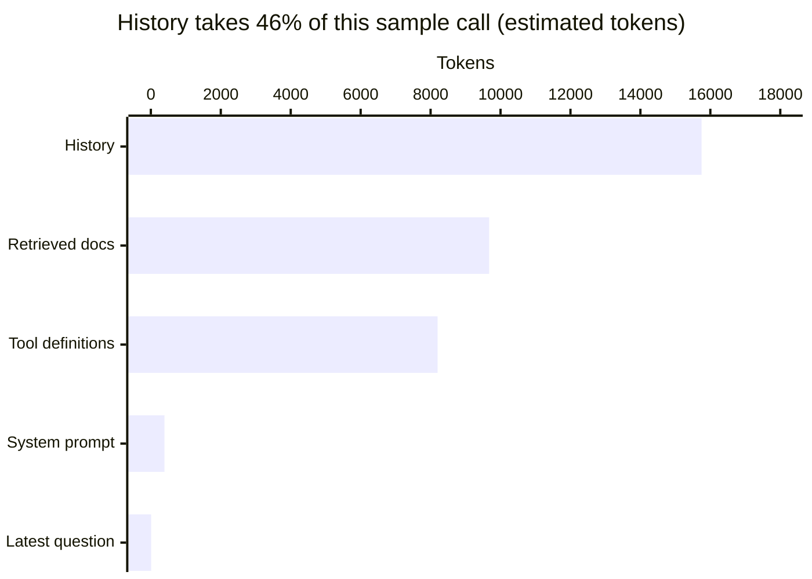
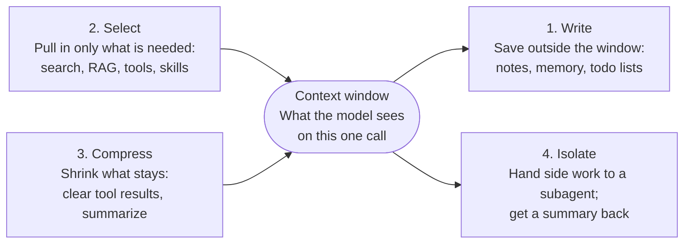
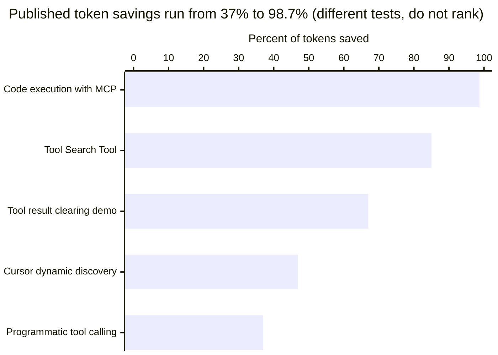
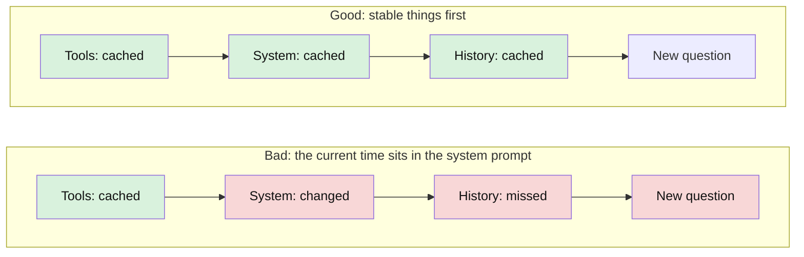
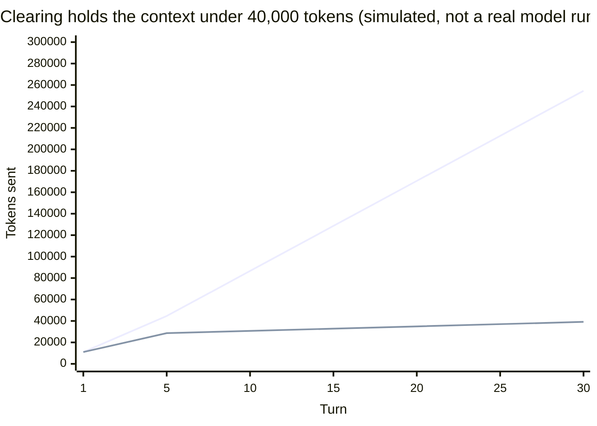
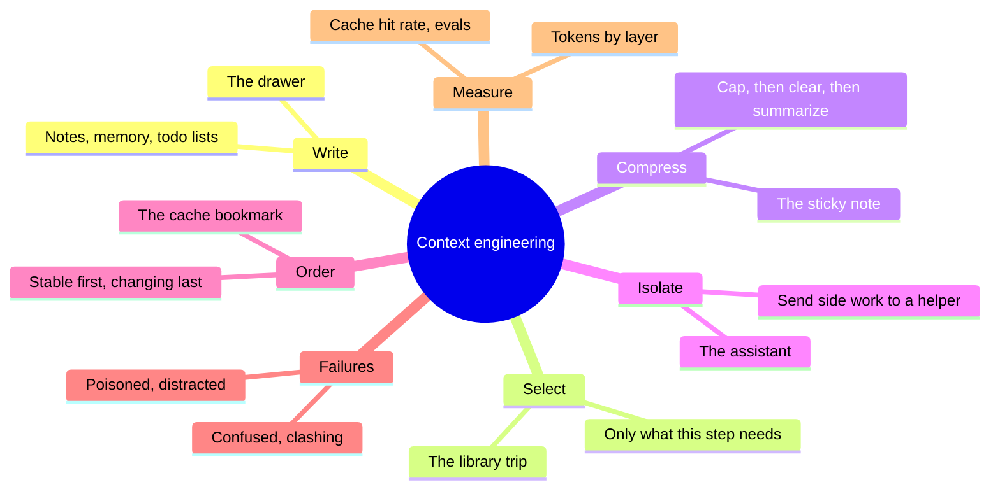



*Utkrishta Sinha · 5 Nov 2026 · about 40 minutes*

## 1. The Five Big Ideas

Context engineering means choosing what the model sees on every single call. That choice drives most of an agent's quality, cost and speed. Facts below were checked on 5 November 2026. Read time is about 40 minutes.

- **The model only knows what is in front of it.** An LLM keeps nothing between calls. If a fact is not in the context window on this call, the model does not have it.
- **Context is a budget, not a bucket.** Windows are now huge, with 1 million tokens on most current Claude models. Stuffing them still costs money and can lower accuracy.
- **Learn four moves: Write, Select, Compress, Isolate.** Save notes outside the window, pull in only what is needed, shrink what stays, and split work across agents.
- **Order matters as much as content.** Put stable things first and changing things last. That keeps the prompt cache alive, so you pay about 5% of the normal input price on cached tokens.
- **Give a map, not an encyclopedia.** Start small and load details when needed. Files, search and tools let the agent fetch what it needs.

Think of a student at a small exam desk. A better student does not buy a bigger desk. They keep the right three pages open and leave the rest in the bag. Bringing the whole library is not a strategy. It is a house move. 😅

## 2. Why This Matters for an FDE

Most "the AI is dumb" complaints from customers are really context bugs. An FDE (Forward Deployed Engineer) sits with the customer and makes the AI work on their real data. You rarely change the model. You change what the model sees.

Cognition, the company behind the Devin coding agent, called context engineering ["effectively the #1 job of engineers building AI agents"](https://cognition.com/blog/dont-build-multi-agents).

Here is how it shows up on a real engagement:

| What the customer says | What is usually wrong | The context fix |
| --- | --- | --- |
| "The bot forgot what I told it." | History is not stored or is trimmed badly | Save state and reload it each turn |
| "It quoted last year's policy." | Old and new documents are both retrieved | Filter by date and version before retrieval |
| "The demo worked, but long tickets fail." | Tool results fill the window | Clear old tool results and cap their size |
| "The bill tripled after we added tools." | Every tool definition is sent on every call | Load tools on demand |
| "It keeps picking the wrong tool." | Too many tools with overlapping descriptions | Merge tools and sharpen descriptions |
| "It got worse after a few weeks." | Bad facts were saved into long-term memory | Review, expire and scope memories |

Context is also a compliance surface. Everything in the window leaves the customer's system and reaches the model provider. So an FDE must also decide what stays out: card numbers, personal data and other tenants' records. Day 33 and Day 34 go deeper on this.

## 3. Core Concepts, From Simple to Deep

An LLM has no memory of its own, so someone must rebuild its world on every call. That someone is your code. This section starts with one plain idea and builds up to how production agents work.

### 3.1 The Forgetful Genius

Imagine a brilliant consultant with total amnesia. Every morning they remember nothing about your company. The only thing they know is the folder on their desk today.

An LLM works the same way. Each API call starts from zero. When a chatbot seems to remember you, your app is re-sending the old messages each time.

```python
# Call 1
messages = [{"role": "user", "content": "My name is Priya."}]

# Call 2: the model knows the name only because we send it again
messages = [
    {"role": "user", "content": "My name is Priya."},
    {"role": "assistant", "content": "Hi Priya!"},
    {"role": "user", "content": "What is my name?"},
]
```

That folder on the desk is the **context**. Deciding what goes in the folder is **context engineering**.

### 3.2 The Words You Need

Read this table once now and come back to it later.

| Term | Plain meaning | Everyday picture |
| --- | --- | --- |
| Token | A small chunk of text, about 4 English characters | A word piece |
| Context | Everything the model sees on one call | The folder on the desk |
| Context window | The most tokens one call can hold | The size of the desk |
| Prompt | The text you send, often just the instructions | A note on top of the folder |
| System prompt | Standing instructions for the model | The job description |
| Tool definition | A description of a function the model may call | A menu of services |
| Tool result | What came back after a tool ran | A reply from another office |
| Message history | Earlier turns of the chat | Minutes of past meetings |
| Agent | A loop where the model calls tools until the job is done | An intern working through a task |
| Harness | The code around the model that runs the loop | The office the intern works in |
| Retrieval | Fetching relevant information from outside | A trip to the library |
| RAG | Retrieval-Augmented Generation: fetch documents, then answer from them | Open-book exam |
| Memory | Information saved between turns or sessions | A notebook |
| Compaction | Replacing old turns with a short summary | Turning minutes into three lines |
| Tool clearing | Removing old tool results but keeping a stub | Filing old replies away |
| Prompt cache | The provider's store of a prompt prefix it already processed | A bookmark so nobody re-reads |
| Cache hit | Reusing that stored prefix at a low price | Skipping pages you already read |
| Subagent | A helper agent with its own clean context | An assistant sent on an errand |
| Just-in-time loading | Fetching data only at the moment it is needed | Ordering food when hungry |
| Progressive disclosure | Showing a little first, with a path to more | A table of contents |

### 3.3 Prompt Engineering vs Context Engineering

Prompt engineering is about writing good instructions. Context engineering is about everything else that lands in the window too.

Anthropic defines context engineering as ["the set of strategies for curating and maintaining the optimal set of tokens"](https://www.anthropic.com/engineering/effective-context-engineering-for-ai-agents) during inference. It calls this the natural next step after prompt engineering.

The term spread in June 2025. Shopify's CEO Tobi Lütke [described it](https://simonwillison.net/2025/Jun/27/context-engineering/) as "the art of providing all the context for the task to be plausibly solvable by the LLM." Andrej Karpathy added that it means filling the window with "just the right information for the next step."

A simple way to hold the difference: a prompt is a sentence you write once. Context is a system you run on every turn.

### 3.4 What Actually Sits in the Window

Five layers fill a typical agent call. On Claude, [the window counts](https://platform.claude.com/docs/en/build-with-claude/context-windows) the system prompt, every message, tool results, images, documents, tool definitions, and the output too.



Notice that your carefully written system prompt is the smallest real layer here. The history and retrieved documents eat the desk. This is typical of agents: Manus reports an [input-to-output token ratio of about 100:1](https://manus.im/blog/Context-Engineering-for-AI-Agents-Lessons-from-Building-Manus).

### 3.5 Why More Context Can Be Worse

Bigger windows did not end the problem. [Most current Claude models have a 1M-token window](https://platform.claude.com/docs/en/build-with-claude/context-windows), and Claude Code's docs say [running out of context is "rarely the problem anymore."](https://code.claude.com/docs/en/best-practices) The problem has moved from size to quality and cost.

Anthropic calls the quality problem **context rot**: as tokens grow, the model's [ability to accurately recall information decreases](https://www.anthropic.com/engineering/effective-context-engineering-for-ai-agents). Drew Breunig named [four ways long contexts fail](https://www.dbreunig.com/2025/06/22/how-contexts-fail-and-how-to-fix-them.html):

| Failure | What happens | Everyday picture | Example from the source |
| --- | --- | --- | --- |
| Poisoning | A wrong fact enters and keeps being reused | A typo copied into every report | A Gemini agent reusing its own hallucination |
| Distraction | So much context that the model ignores what it knows | Reading every page, missing the point | One Databricks test saw correctness fall at about 32k tokens |
| Confusion | Extra content drags the answer off course | Too many options on a menu | A small Llama model failed with 46 tools and worked with 19 |
| Clash | New information conflicts with old | Two managers, two instructions | Splitting a prompt across turns dropped scores 39% on average |

Those studies used 2025 models, so treat the thresholds as a warning, not a law. Measure on your own task.

### 3.6 The Four Moves

LangChain sorted the techniques into [write, select, compress and isolate](https://www.langchain.com/blog/context-engineering-for-agents). Almost every trick you will meet is one of these.



**Move 1: Write.** Save information outside the window so it survives. The common forms are:

- **Notes:** the agent [writes notes to memory outside the window](https://www.anthropic.com/engineering/effective-context-engineering-for-ai-agents) and reads them later.
- **Todo lists:** Manus keeps rewriting a `todo.md` file, which [recites the goal at the end of the context](https://manus.im/blog/Context-Engineering-for-AI-Agents-Lessons-from-Building-Manus) so a task of about 50 tool calls stays on track.
- **The memory tool:** Claude's [memory tool](https://platform.claude.com/docs/en/agents-and-tools/tool-use/memory-tool) asks your app to view, create, edit or delete files under `/memories`. It runs on your side, so you control the storage.

**Move 2: Select.** Bring in only what this step needs. There are two styles:

- **Pre-loaded retrieval:** search first, then paste the top results into the prompt. This is classic RAG, and it is fast and predictable.
- **Just-in-time retrieval:** the agent holds [lightweight identifiers such as file paths and links](https://www.anthropic.com/engineering/effective-context-engineering-for-ai-agents) and loads the content with tools at runtime. This is slower but handles open-ended work.

Tools need selecting too. Five connected servers can burn [about 55,000 tokens before the conversation starts](https://www.anthropic.com/engineering/advanced-tool-use). Shopify found that [past about 50 tools, boundaries get blurry](https://shopify.engineering/building-production-ready-agentic-systems), with several ways to do the same task. Anthropic's rule is blunt: [if a human engineer can't say which tool to use, an agent can't either](https://www.anthropic.com/engineering/effective-context-engineering-for-ai-agents).

The same idea applies to instructions. OpenAI's Codex team keeps [AGENTS.md at about 100 lines, as a map](https://openai.com/index/harness-engineering/), and says to give the agent "a map, not a 1,000-page instruction manual." Claude Code [suggests under 200 lines per CLAUDE.md](https://code.claude.com/docs/en/memory). Anything longer goes into skills that load on demand.



Sources: Anthropic engineering, Cursor blog, Claude Cookbook.

**Move 3: Compress.** Shrink what stays. Use the gentlest option that works, in this order:

1. **Cap tool outputs.** Do not let one log dump take 50,000 tokens. Save the full output to a file and return the first part with its path. Cursor [writes long tool outputs to files](https://cursor.com/blog/dynamic-context-discovery) and lets the agent grep them.
2. **Clear old tool results.** The agent can usually re-read a file, so the old copy is safe to drop. [Claude's context editing](https://platform.claude.com/docs/en/build-with-claude/context-editing) does this for you and keeps the last 3 tool uses by default.
3. **Compact the history.** Replace older turns with a summary. On Claude, [threshold compaction](https://platform.claude.com/docs/en/build-with-claude/compaction-threshold) triggers at 150,000 input tokens by default.

Summaries lose detail, and that is the catch. In one Claude Cookbook test, compaction [kept 3 of 3 high-level facts but 0 of 3 obscure values](https://platform.claude.com/cookbook/tool-use-context-engineering-context-engineering-tools). So write exact values such as IDs and amounts to notes before you compact.

Compaction can also cost more than it saves. Louis Bouchard's team [stopped compacting by default](https://www.louisbouchard.ai/context-engineering-2026/), because a summary rewrites the cached prefix. In their tests of 11 to 13 turn sessions, full history cost $0.11 per turn against $0.24 with their preset, and memory recall was 92% against 38%. Their own conclusion is "Compaction is not dead, it is conditional." Test it on your workload.

**Move 4: Isolate.** Give side work to a helper with a clean context. Anthropic's sub-agents return a [condensed summary, often 1,000 to 2,000 tokens](https://www.anthropic.com/engineering/effective-context-engineering-for-ai-agents). The main agent keeps its desk clear and gets the answer.

Be careful with this one. Cognition warned in 2025 that [actions carry implicit decisions](https://cognition.com/blog/dont-build-multi-agents), so parallel agents can make choices that conflict. Its 2026 update says multi-agent systems [work best when writes stay single-threaded](https://cognition.com/blog/multi-agents-working) and the extra agents add intelligence, not actions. In short, many readers are fine, but keep one writer.

### 3.7 Order Matters: The Cache Rule

Prompt caching rewards a stable start. Claude's cache [reads tools, then system, then messages](https://platform.claude.com/docs/en/build-with-claude/prompt-caching), and it only matches from the beginning. A change early on forces everything after it to be recomputed.



The money is real. On [Sonnet 5.5](https://platform.claude.com/docs/en/about-claude/pricing), input costs $2 per million tokens, and a cache hit costs $0.10. That is why Manus calls cache hit rate ["the single most important metric"](https://manus.im/blog/Context-Engineering-for-AI-Agents-Lessons-from-Building-Manus) for a production agent.

Three habits keep the prefix stable:

- **Keep the tool list fixed during a run.** Manus advises you to [mask tools, not remove them](https://manus.im/blog/Context-Engineering-for-AI-Agents-Lessons-from-Building-Manus). The tool stays listed, but the model is blocked from choosing it.
- **Move changing data to the end.** Put the date, user details and page state in the latest message, not in the system prompt.
- **Attach guidance to tool results.** Shopify returns [just-in-time instructions alongside tool data](https://shopify.engineering/building-production-ready-agentic-systems), which avoids breaking the cache.

### 3.8 Putting It Together: One Turn of a Real Agent

A production agent repeats these steps on every turn:

1. **Load state.** Fetch the session, memories and notes from storage.
2. **Select.** Decide which documents, tools and examples this turn needs.
3. **Assemble.** Build the prompt in a fixed order, stable parts first.
4. **Check the budget.** Count tokens. If over budget, clear tool results, then compact.
5. **Call the model.** Record tokens used and cache hits.
6. **Run tools.** Cap each result and save big ones to files.
7. **Write.** Save decisions and exact values to notes, then go back to step 1.

This loop is the [agent loop from Day 1](https://utkarshsinha10.github.io/fde-notes/days/day-01-agent-loops-and-tools.html) with a context manager wrapped around it. Day 10 calls that wrapper the harness.

## 4. Worked Examples

These examples go from simple to real. Examples 1 to 3 ran successfully on 5 November 2026 and need no API key. Example 4 calls the real Claude API. It was checked against the Python SDK 2.5.0 but not run, because it needs a key.

### Example 1: X-Ray One Model Call

You cannot manage what you cannot see. This script shows how many tokens each layer uses.

```python
"""context_x_ray.py: X-ray one model call. No API key needed."""

def tokens(text: str) -> int:
    # Rough rule: about 4 characters per token in English.
    return max(1, len(text) // 4)

WINDOW = 200_000  # the desk size we choose to work with

call = {
    "system prompt":  "You are a support agent for Acme Bank. " * 40,
    "tool definitions": "search_orders(order_id): finds an order. " * 800,
    "retrieved docs": "Refund policy paragraph with many details. " * 900,
    "history":        "user asked, agent answered, tool replied. " * 1500,
    "latest question": "Where is my refund for order 8841?",
}

total = sum(tokens(text) for text in call.values())
print(f"{'layer':<18}{'tokens':>8}{'share':>8}")
for layer, text in call.items():
    t = tokens(text)
    print(f"{layer:<18}{t:>8,}{t / total:>8.0%}")
print(f"{'TOTAL':<18}{total:>8,}   {total / WINDOW:.0%} of the window")
```

Output:

```text
layer               tokens   share
system prompt          390      1%
tool definitions     8,200     24%
retrieved docs       9,675     28%
history             15,750     46%
latest question          8      0%
TOTAL               34,023   17% of the window
```

The question is 8 tokens. Everything else is luggage. In real work, use the provider's counter instead of the 4-characters rule. Anthropic's [`count_tokens` endpoint](https://platform.claude.com/docs/en/build-with-claude/token-counting) is free, though it returns an estimate.

### Example 2: Three Strategies, Same Agent

Now we watch context grow. Each turn, a fake agent reads one 8,000-token file. We compare keeping everything against clearing old results.

```python
"""context_strategies.py: same agent, three context strategies.
Each turn the agent reads one 8,000-token file, thinks, and replies."""

SYSTEM = 3_000        # system prompt + tool definitions
FILE_READ = 8_000     # one tool result
REPLY = 400           # the assistant's words on that turn
PLACEHOLDER = 20      # "[cleared: re-read the file if needed]"
NOTE = 150            # one line saved to the notes file
KEEP = 3              # how many recent tool results stay in full
TURNS = 30
PRICE = 2.00          # dollars per million input tokens (Sonnet 5.5)

def run(strategy: str) -> list[int]:
    results: list[int] = []   # size of each tool result still in context
    replies = 0
    notes = 0
    sizes = []
    for _ in range(TURNS):
        results.append(FILE_READ)
        if strategy in ("clearing", "clearing + notes"):
            for i in range(len(results) - KEEP):
                results[i] = PLACEHOLDER
        if strategy == "clearing + notes":
            notes += NOTE
        sizes.append(SYSTEM + sum(results) + replies + notes)
        replies += REPLY
    return sizes

for name in ("keep everything", "clearing", "clearing + notes"):
    sizes = run(name)
    billed = sum(sizes)
    print(f"{name:<18} peak {max(sizes):>8,}  "
          f"billed {billed:>10,}  ${billed / 1e6 * PRICE:.2f}")
```

Output:

```text
keep everything    peak  254,600  billed  3,984,000  $7.97
clearing           peak   39,140  billed    967,560  $1.94
clearing + notes   peak   43,640  billed  1,037,310  $2.07
```



The top line keeps everything and reaches about 255k. The bottom line uses clearing and reaches about 39k.

Three lessons sit in these numbers:

- **Clearing cut peak context by about 85%.** It went from 254,600 to 39,140 tokens.
- **Notes cost a little.** They add about 7% to the bill, and they buy back the facts that clearing removes.
- **The dollars are a simplification.** This model ignores caching. Real clearing changes the prefix and causes cache misses, so the real gap is smaller. That is the same effect Bouchard's team measured.

### Example 3: A Context Assembler With a Hard Budget (TypeScript)

This is the heart of a harness: pick what fits, then order it for the cache.

```typescript
// assemble.ts. Run: npx tsx assemble.ts
type Item = { name: string; text: string; priority: number; required?: boolean };

const countTokens = (s: string): number => Math.ceil(s.length / 4);

function assemble(items: Item[], budget: number) {
  const chosen: Item[] = [];
  const dropped: string[] = [];
  let used = 0;

  // Required items first, then the rest from most to least important.
  const ordered = [...items].sort(
    (a, b) => Number(b.required ?? false) - Number(a.required ?? false) || b.priority - a.priority,
  );

  for (const item of ordered) {
    const cost = countTokens(item.text);
    if (item.required && used + cost > budget) {
      throw new Error(`Required item "${item.name}" does not fit`);
    }
    if (used + cost <= budget) {
      chosen.push(item);
      used += cost;
    } else {
      dropped.push(item.name);
    }
  }

  // Stable things first, changing things last, so the cache prefix survives.
  const rank = (i: Item) => (i.required ? 0 : 1);
  chosen.sort((a, b) => rank(a) - rank(b));
  return { used, budget, chosen: chosen.map((i) => i.name), dropped };
}

const items: Item[] = [
  { name: "system rules", text: "x".repeat(2_000), priority: 10, required: true },
  { name: "user question", text: "x".repeat(200), priority: 10, required: true },
  { name: "refund policy", text: "x".repeat(4_000), priority: 8 },
  { name: "last 5 messages", text: "x".repeat(3_000), priority: 6 },
  { name: "old FAQ page", text: "x".repeat(20_000), priority: 2 },
];

console.log(assemble(items, 2_500));
```

Output:

```text
{
  used: 2300,
  budget: 2500,
  chosen: [ 'system rules', 'user question', 'refund policy', 'last 5 messages' ],
  dropped: [ 'old FAQ page' ]
}
```

If you know Angular or React, this feels familiar. It is like a virtualized list, which renders only what fits on screen. The huge FAQ page simply stays off the desk. A real version would put the user question after the history. Fixing that order is part of today's exercise.

### Example 4: Real Claude API Settings

Providers now do much of this work on the server. This call turns on caching, tool clearing, compaction and the memory tool. Model IDs and beta names change, so check [compaction](https://platform.claude.com/docs/en/build-with-claude/compaction-threshold) and [context editing](https://platform.claude.com/docs/en/build-with-claude/context-editing) docs first.

```python
import anthropic

client = anthropic.Anthropic()  # reads ANTHROPIC_API_KEY
STABLE_RULES = "You are a support agent. Save exact IDs and amounts to memory."
messages = [{"role": "user", "content": "Where is my refund for order 8841?"}]

response = client.beta.messages.create(
    model="claude-sonnet-5-5",
    max_tokens=2048,
    betas=["compact-2026-01-12", "context-management-2025-06-27"],
    system=[{
        "type": "text",
        "text": STABLE_RULES,
        "cache_control": {"type": "ephemeral"},  # cache up to here
    }],
    tools=[{"type": "memory_20250818", "name": "memory"}],
    messages=messages,
    context_management={"edits": [
        {
            "type": "clear_tool_uses_20250919",
            "trigger": {"type": "input_tokens", "value": 100_000},
            "keep": {"type": "tool_uses", "value": 3},
            "exclude_tools": ["memory"],  # never clear the notes
        },
        {
            "type": "compact_20260112",
            "trigger": {"type": "input_tokens", "value": 150_000},
        },
    ]},
)

# Keep every block, including any compaction block, for the next call.
messages.append({"role": "assistant", "content": response.content})

u = response.usage
cached = u.cache_read_input_tokens or 0
total = u.input_tokens + (u.cache_creation_input_tokens or 0) + cached
print(f"cache hit rate: {cached / total:.0%}")
```

Two details matter here. The [memory tool](https://platform.claude.com/docs/en/agents-and-tools/tool-use/memory-tool) runs on your side, so a real loop must carry out each file request. The SDKs ship `BetaLocalFilesystemMemoryTool` for that. Also, on prompts under the [minimum size](https://platform.claude.com/docs/en/build-with-claude/prompt-caching), which is 512 tokens on Sonnet 5.5, caching silently does nothing.

## 5. Real-Life Use Cases

The teams below all treat context as an engineering system. Most numbers are self-reported by the companies, so read them as direction, not proof.

**Swiggy, India: support agent.** Swiggy moved its customer support from rules to agents, and context was the turning point. Its [Databricks case study](https://www.databricks.com/blog/redefining-customer-support-swiggys-enterprise-scale-ai-agent-built-databricks) says early RAG was "stateless, leading to context loss in multi-turn conversations," so it added persistent memory. Memory then caused a new bug: stale answers. The fix was to mark signals as static or dynamic, and to force a tool call for fresh data. It also trimmed prompts by removing emojis and cutting few-shot examples. That one bug is worth remembering: memory fixes forgetting, and creates staleness.

**Razorpay, India: incident investigation.** Razorpay's oncall agent gathers evidence from Kubernetes, logs, metrics and AWS. A [ZenML summary](https://www.zenml.io/llmops-database/ai-powered-incident-investigation-for-payment-infrastructure) describes specialist agents that store findings as structured evidence, which a supervisor builds into a timeline. The reported time to investigate fell from 30 minutes to 90 seconds. Razorpay's own post could not be opened, so this rests on the ZenML summary, and the system was in shadow mode as of April 2026.

**Cursor: dynamic context discovery.** Cursor gives the agent [fewer details up front](https://cursor.com/blog/dynamic-context-discovery) and lets it pull what it needs. Long tool outputs, chat history and terminal sessions become files, and MCP tools sync to folders. An A/B test showed 46.9% fewer total tokens in runs that used an MCP tool.

**Manus: designing around the cache.** Manus [rebuilt its agent framework four times](https://manus.im/blog/Context-Engineering-for-AI-Agents-Lessons-from-Building-Manus) and published the lessons. It keeps the prompt prefix stable, masks tools, treats the file system as unlimited memory, and leaves mistakes in the context so the model learns from them.

**Shopify: Sidekick.** Shopify's merchant assistant hit "Death by a Thousand Instructions," when the system prompt became ["an unwieldy collection of special cases."](https://shopify.engineering/building-production-ready-agentic-systems) Its fix was just-in-time instructions, returned with tool data only when relevant.

**OpenAI: Codex.** The Codex team built a product of about a million lines with agents. They [learned that one big instruction file failed](https://openai.com/index/harness-engineering/), and moved to a short AGENTS.md that points to deeper docs.

## 6. Trade-offs: What Each Move Costs You

Every context technique trades one thing for another. There is no free tokens button.

| Technique | What you gain | What you pay | Use it when | Avoid it when |
| --- | --- | --- | --- | --- |
| Keep full history | Nothing lost, cache stays intact | Slow growth in cost and rot | Sessions are short | Sessions run for hours |
| Cap tool outputs | Huge, cheap saving | Agent may need a second look | Always | Rarely a bad idea |
| Clear tool results | Fast shrink, easy to re-fetch | Breaks the cache at that point | Results can be fetched again | Results are one-off or costly |
| Compaction | Long sessions keep going | Lost details, a cache rewrite, summary cost | Multi-hour tasks | Short chats, unless tests say otherwise |
| Notes and memory | Facts survive any reset | Storage, staleness, poisoning risk | Work spans sessions | The data is sensitive or changes quickly |
| Pre-loaded RAG | Fast and predictable | May fetch the wrong thing | Known question types | Exploring unknown data |
| Just-in-time loading | Fresh and precise | More calls, more latency | Open-ended agents | Strict latency limits |
| Subagents | Clean main context, parallel reads | Extra cost and coordination | Independent research | Tasks with tightly linked decisions |

A simple starting rule: cap outputs first, keep the prefix stable, and add compaction only when a real trace proves you need it.

## 7. Common Pitfalls and Production Gotchas

Most context bugs are silent. The model still answers, only worse, and nobody gets an error.

- **A timestamp in the system prompt.** It changes every call and kills the cache. Move it to the latest message.
- **Unstable tool order.** Building the tool list from a hash map can shuffle it. The prefix changes and the cache misses. Sort it.
- **Treating a bigger window as a fix.** 1M tokens hides the problem and raises the bill. On Haiku 5.5, [input price is 5 times higher over 100,000 tokens](https://platform.claude.com/docs/en/about-claude/pricing).
- **Summaries that lose exact values.** Order IDs and amounts vanish first. Save them to notes before compacting.
- **Poisoned memory.** One wrong fact gets reused forever, and a hostile document can plant one. Memory needs review, expiry and scoping. Day 44 covers this.
- **Stale memory.** Swiggy's bug. Mark which facts change and re-fetch those.
- **Memory leaks between customers.** Scope every memory and retrieval query by tenant. A leak here is a security incident.
- **Path traversal in the memory tool.** Your handler [must reject paths outside `/memories`](https://platform.claude.com/docs/en/agents-and-tools/tool-use/memory-tool), including `../`.
- **Python serialization error with compaction.** `model_dump()` can add null fields and trigger a 400. [Use `to_dict()` or `model_dump(exclude_none=True)`](https://platform.claude.com/docs/en/build-with-claude/compaction-threshold).
- **Compaction on old models.** Threshold compaction is [not supported on Claude Haiku 4.5, Opus 4.5 or Sonnet 4.5](https://platform.claude.com/docs/en/build-with-claude/compaction-threshold).
- **Silent cache misses.** Prompts under the minimum size are not cached, and no error is raised. Track `cache_read_input_tokens`.
- **The instruction file nobody prunes.** Every line costs [a little attention on every task](https://code.claude.com/docs/en/best-practices). Delete rules that no longer earn their place.
- **No tracing.** If you cannot see the exact context of a failed run, you are debugging with your eyes shut. Log the assembled prompt. Day 19 covers this.

One more thing: do not clean up failed tool calls. Manus advises you to [keep wrong turns in the context](https://manus.im/blog/Context-Engineering-for-AI-Agents-Lessons-from-Building-Manus), so the model can avoid repeating them. Yes, even AI needs to see its own embarrassing photos.

## 8. Comparison With Alternatives

All major platforms now offer similar building blocks, so the skill transfers. Details below were checked on 5 November 2026 and move quickly.

| Need | Anthropic Claude | OpenAI | LangChain |
| --- | --- | --- | --- |
| Compaction | [`compact_20260112`](https://platform.claude.com/docs/en/build-with-claude/compaction-threshold) edit, or on-demand mode | [`context_management` with `compact_threshold`](https://developers.openai.com/api/docs/guides/compaction), or `/responses/compact` | [`SummarizationMiddleware`](https://docs.langchain.com/oss/python/langchain/short-term-memory) |
| Clearing old results | [`clear_tool_uses_20250919`](https://platform.claude.com/docs/en/build-with-claude/context-editing) | No separate setting in the guides read | Custom middleware with `RemoveMessage` |
| Conversation state | Your app sends the history | [`previous_response_id` or Conversations API](https://developers.openai.com/api/docs/guides/conversation-state) | Checkpointers (Day 28) |
| Caching | Breakpoints or automatic, [up to 4 breakpoints](https://platform.claude.com/docs/en/build-with-claude/prompt-caching) | Automatic | Uses the provider's cache |

Google Gemini also has [implicit caching, on by default for 2.5 and newer models](https://ai.google.dev/gemini-api/docs/caching). It rewards the same habit: put large, common content first.

OpenAI's compaction output is an encrypted item, so you pass it back unchanged. Claude's summary is readable text. That matters when a customer wants to audit what the model saw.

You can also compare the ideas against older habits:

| Approach | Good at | Weak at |
| --- | --- | --- |
| Prompt engineering alone | Single calls with little data | Agents, long sessions |
| Classic RAG | Answering from documents | Multi-step tasks |
| Bigger window, no management | Fast to ship | Cost, rot, cache misses |
| Fine-tuning a model | Style and format | Fresh facts, which belong in context |
| Context engineering | Long-running agents | Takes real engineering and evals |

## 9. Hands-On Exercise: Build a Context Inspector

Build a small tool that shows what fills an agent's context and fixes the waste. Budget 1 to 2 hours. You need Python or TypeScript and no API key, though real calls are a bonus.

**The task:**

1. Start from Example 3. Fix the order so it runs: system rules, tools, stable documents, history, then the user question.
2. Add a `capToolOutput(text, maxTokens)` function. It saves the full text to a file and returns the first part plus the file path.
3. Add `clearOldToolResults(history, keep)`. It replaces all but the last `keep` results with a short stub.
4. Add a notes file. Before clearing, save any order ID or rupee amount found in the result. A simple regex is fine.
5. Print a per-turn report: tokens by layer and a warning above 80% of budget.
6. Replay a fake 25-turn support chat with 10 tool results of 5,000 tokens each.

**Acceptance criteria:**

- [ ] The report shows tokens per layer for every turn.
- [ ] Peak context with clearing is at least 60% lower than without it.
- [ ] The stable part of the prompt is byte-identical on every turn, proven by a hash check.
- [ ] After clearing, every order ID from turn 1 is still findable in the notes.
- [ ] A required item that does not fit raises a clear error instead of being dropped.
- [ ] A short README states one change you would make for a real customer.

**Stretch goal:** call a real model with `count_tokens` and print the cache hit rate over five calls.

## 10. Interview Questions

Practice saying these out loud. The first four are conceptual, the next three are system design, and the last three are customer scenarios.

**1. What is context engineering, and how does it differ from prompt engineering?** Prompt engineering writes good instructions. Context engineering manages everything the model sees on each call: instructions, tools, documents, history and memory. It is a system that runs every turn, not a string you write once.

**2. Why can more context make a model worse?** Extra content can distract, confuse or contradict. Anthropic calls this context rot. It also costs more and slows responses. So a large window is a limit, not a target.

**3. Explain write, select, compress and isolate.** Write saves information outside the window. Select brings in only what the step needs. Compress shrinks what stays. Isolate gives side work to a subagent with a clean context, which returns a summary.

**4. Why does order matter in a prompt?** Caches match from the start of the prompt. A change early on forces everything after it to be recomputed. So place stable content first and changing content last.

**5. Design context management for an agent that runs for six hours.** Keep a stable prefix. Cap tool outputs and save them to files. Clear old results that can be re-fetched. Keep a progress file and a todo list outside the window. Compact only near a threshold, after saving exact values to notes. Use subagents for broad reading. Log every assembled prompt.

**6. Pre-loaded RAG or just-in-time retrieval: which would you pick?** Use pre-loaded RAG for known question types with strict latency. Use just-in-time loading when the task is open-ended or the data changes fast. Many systems use both: load a small base set, then let the agent fetch more.

**7. Your agent has 80 tools. What do you do?** First merge overlapping tools and sharpen their descriptions. Then load tools on demand through tool search. If needed, let the agent write code against tools, so large results stay out of the context. Keep the tool list stable within a run.

**8. A customer says the bot quotes an old refund policy. How do you debug it?** Pull the trace and look at the exact context. Check whether old documents were retrieved, or a stale fact sits in memory. Then add date and version filters, fix the memory, and add an eval case so the bug cannot return.

**9. The bill doubled after a small prompt change. What happened?** Probably a cache break. Compare `cache_read_input_tokens` before and after. Look for a timestamp, a user ID or a reordered tool list early in the prompt. Move that content to the end and confirm the hit rate recovers.

**10. A customer wants the agent to remember users forever. What do you ask?** Ask what must be remembered, for how long, and who can see it. Scope memory per user and tenant. Add expiry, an audit trail and a delete path. Warn that wrong or stale memories get reused, and plan a review step.

## 11. How It Connects

Context engineering sits in the middle of this course. Almost every other day either feeds the context or controls it.

| Day | Topic | The link |
| --- | --- | --- |
| 1 | Agent loops and tools | The loop re-sends context on every turn |
| 3 | Model selection | Window size and cache prices differ by model |
| 4 and 6 | Agent frameworks, AI SDK | They offer context helpers, such as middleware |
| 8 | Token cost optimization | Context size and cache hits drive the bill |
| 10 | Harness engineering, next | The harness is the code that does all this |
| 14 and 15 | Claude Code, Agent SDK | A real example of compaction, skills and subagents |
| 19 | Evaluations and observability | How you prove a context change helped |
| 21 | Agentic RAG and memory | A deep dive on Select and Write |
| 22 | MCP concepts | Tool definitions are a major context cost |
| 23 | Durable state | Where notes and sessions live |
| 25 | Agent swarms | A deep dive on Isolate |
| 34 | Security and guardrails | Context is the prompt injection surface |
| 44 | Memory policies | Who may store what, and for how long |

## 12. Mental Map to Remember

Remember one sentence: **Wise Students Compress Ideas.** That gives you Write, Select, Compress, Isolate.



Three phrases are enough for a whiteboard:

- **Budget, not bucket.** Every token must earn its seat.
- **Map, not encyclopedia.** Start small and load on demand.
- **Stable first, changing last.** Protect the cache.

When a demo goes wrong, ask one question before blaming the model: what exactly was on the desk? The model is rarely the guilty one. It just answered the folder you gave it.

## 13. Further Reading and Sources

Start with the first three if you have only one hour.

**Best resources:**

1. [Effective context engineering for AI agents](https://www.anthropic.com/engineering/effective-context-engineering-for-ai-agents), Anthropic. The clearest overview.
2. [Context Engineering for AI Agents: Lessons from Building Manus](https://manus.im/blog/Context-Engineering-for-AI-Agents-Lessons-from-Building-Manus). Six hard-won production lessons.
3. [Context engineering: memory, compaction, and tool clearing](https://platform.claude.com/cookbook/tool-use-context-engineering-context-engineering-tools), Claude Cookbook. Runnable and measured.
4. [Context Engineering](https://www.langchain.com/blog/context-engineering-for-agents), LangChain. The four moves.
5. [How Long Contexts Fail](https://www.dbreunig.com/2025/06/22/how-contexts-fail-and-how-to-fix-them.html) and [How to Fix Your Context](https://www.dbreunig.com/2025/06/26/how-to-fix-your-context.html), Drew Breunig.
6. [Harness engineering](https://openai.com/index/harness-engineering/), OpenAI. A bridge to Day 10.
7. [Context Engineering in 2026](https://www.louisbouchard.ai/context-engineering-2026/), Louis Bouchard. The case against default compaction.
8. [Multi-Agents: What's Actually Working](https://cognition.com/blog/multi-agents-working), Cognition.

**Sources:**

- Anthropic: [advanced tool use](https://www.anthropic.com/engineering/advanced-tool-use), [code execution with MCP](https://www.anthropic.com/engineering/code-execution-with-mcp)
- Claude Platform docs: [compaction](https://platform.claude.com/docs/en/build-with-claude/compaction), [threshold compaction](https://platform.claude.com/docs/en/build-with-claude/compaction-threshold), [context editing](https://platform.claude.com/docs/en/build-with-claude/context-editing), [context windows](https://platform.claude.com/docs/en/build-with-claude/context-windows), [prompt caching](https://platform.claude.com/docs/en/build-with-claude/prompt-caching), [token counting](https://platform.claude.com/docs/en/build-with-claude/token-counting), [pricing](https://platform.claude.com/docs/en/about-claude/pricing), [memory tool](https://platform.claude.com/docs/en/agents-and-tools/tool-use/memory-tool)
- Claude Code docs: [memory](https://code.claude.com/docs/en/memory), [best practices](https://code.claude.com/docs/en/best-practices)
- OpenAI docs: [compaction](https://developers.openai.com/api/docs/guides/compaction), [conversation state](https://developers.openai.com/api/docs/guides/conversation-state)
- Google: [Gemini caching](https://ai.google.dev/gemini-api/docs/caching)
- LangChain docs: [short-term memory](https://docs.langchain.com/oss/python/langchain/short-term-memory)
- Case studies: [Swiggy on Databricks](https://www.databricks.com/blog/redefining-customer-support-swiggys-enterprise-scale-ai-agent-built-databricks), [Razorpay via ZenML](https://www.zenml.io/llmops-database/ai-powered-incident-investigation-for-payment-infrastructure), [Shopify Sidekick](https://shopify.engineering/building-production-ready-agentic-systems), [Cursor](https://cursor.com/blog/dynamic-context-discovery)
- Others: [Don't Build Multi-Agents](https://cognition.com/blog/dont-build-multi-agents), [Simon Willison on the term](https://simonwillison.net/2025/Jun/27/context-engineering/), [AGENTS.md](https://agents.md/)


