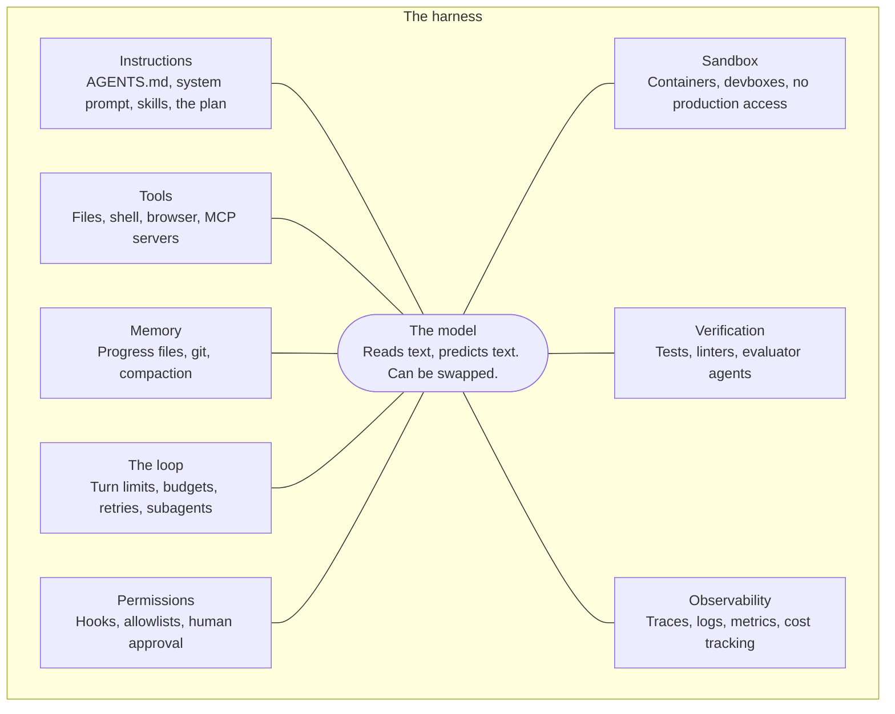
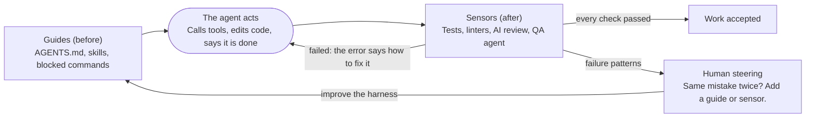
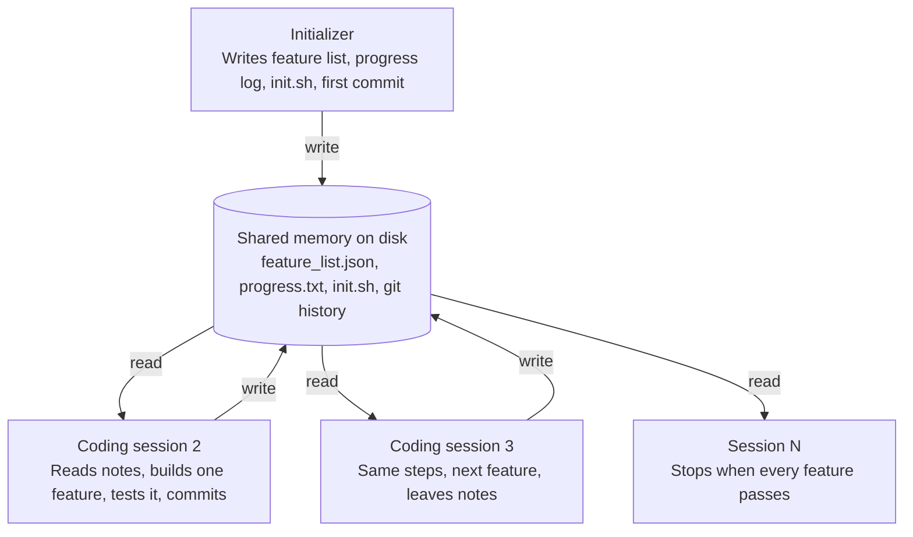
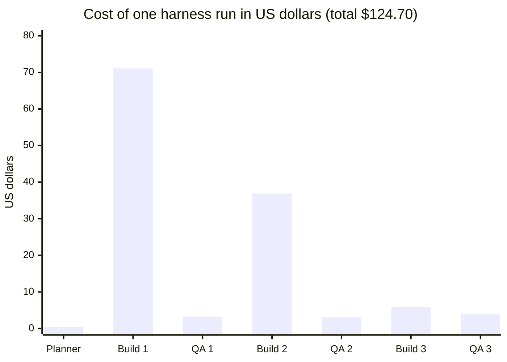
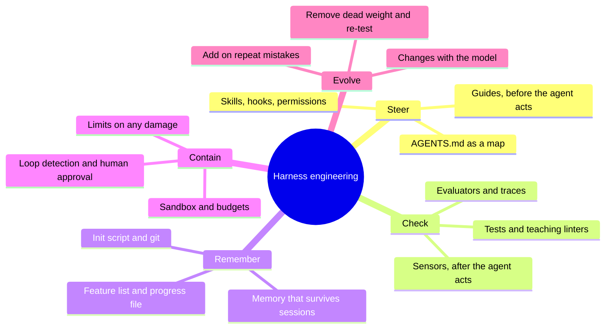



*Utkrishta Sinha · 6 Nov 2026 · about 40 minutes*

## 1. The Five Big Ideas

Harness engineering means building everything around the model so an agent stays useful, safe and on track. Facts below were checked on 6 November 2026. Read time is about 40 minutes.

- **Agent = Model + Harness.** The model thinks. The harness is everything else: tools, instructions, memory, permissions, checks and the loop itself.
- **Guides steer before, sensors check after.** A guide stops a mistake before it happens. A sensor catches a mistake after it happens and tells the agent how to fix it.
- **Same model, better harness, better result.** LangChain changed only the harness and moved a benchmark score from 52.8% to 66.5%.
- **Never let the agent mark its own homework.** Agents praise their own work. An outside check, such as tests or a separate evaluator, decides when work is done.
- **Every harness part is a bet about model weakness.** When models improve, some parts stop earning their cost. Test them and remove the dead weight.

Think of a horse. The horse has the power, but the reins, saddle and fences decide where that power goes. A strong horse with no harness is not a vehicle. It is a news story. 😅

## 2. Why This Matters for an FDE

A customer rarely fails because the model is too weak. They fail because nothing stops the agent from drifting, guessing or claiming success. An FDE (Forward Deployed Engineer) sits with the customer and fixes exactly that.

You usually cannot change the model. You can always change the harness. That makes it the main lever on a real engagement.

| What the customer says | What is usually missing | The harness fix |
| --- | --- | --- |
| "It said done, but nothing works." | No independent check of success | Run tests or an evaluator before the agent may stop |
| "It deleted something it should not touch." | No permission layer | Add a hook or policy that blocks the action before it runs |
| "It keeps editing the same file forever." | No loop detection | Count repeats, then nudge the agent or stop |
| "The bill exploded overnight." | No budget limit | Cap turns, tokens, time and money per run |
| "It breaks our architecture rules." | Rules live in people's heads | Turn each rule into a linter with a clear fix message |
| "Long tasks start well and fall apart." | Nothing survives between sessions | Keep plans and progress in files and git |
| "We cannot explain what it did." | No trace or audit log | Record every model call, tool call and decision |

There is a commercial reason too. The model is rented and the customer can switch it next quarter. The harness holds their rules, tools and tests, so it is the part that stays. Your handover is mostly a harness.

> **Sentence for a customer call:** "Let's not debate models yet. Let's first define how the system proves its work is correct."

The word needs one warning. Teams use "harness" in two ways. Vendors mean the runtime that drives the model, such as Claude Code. Teams using those tools mean the extra rules and checks they add around them. Birgitta Böckeler calls the second one the [outer harness](https://martinfowler.com/articles/harness-engineering.html). As an FDE, you will mostly build the outer harness, and sometimes a full runtime.

## 3. Core Concepts, From Simple to Deep

A harness turns a clever but unreliable model into a system you can trust with real work. This section starts with one small idea and builds to how production harnesses run for hours.

### 3.1 The Brilliant Intern

Imagine a brilliant intern on their first day. They learn fast and type faster than anyone. They also forget everything overnight, and they say "done" with total confidence.

You would not fix this intern by asking them to try harder. You would give them:

1. A short guide to the office.
2. A badge that opens only some doors.
3. A checklist for each job.
4. A reviewer who checks the work.
5. A notebook to leave notes for tomorrow.

That is a harness. An LLM (Large Language Model, the AI that predicts text) is the intern. Each item above has a technical twin, and the rest of this section names them.

### 3.2 The Words You Need

Every term below comes up again later, so skim it now and return when needed.

| Term | Plain meaning | Simple example |
| --- | --- | --- |
| Model | The AI that reads text and predicts a reply | Claude Sonnet 5.5, GPT-5.2 |
| Agent | A model that calls tools in a loop until a goal is met | A bot that fixes a bug by itself |
| Tool | A function the model can ask your code to run | `read_file`, `run_tests` |
| Harness | All code and configuration around the model | Tools, prompts, hooks, sandbox, loop |
| Agent loop | Model call, tool run, result sent back, repeat | See Day 1 |
| Turn | One model call inside that loop | Ten turns means ten model calls |
| Guide | A control that acts before the agent does | `AGENTS.md`, a blocked command |
| Sensor | A control that checks after the agent acts | A test run, a linter |
| Deterministic | Same input always gives the same output | A unit test |
| Non-deterministic | The answer can vary between runs | An LLM reviewer |
| Hook | Your script that runs at a fixed moment in the agent's life | Block `rm -rf` before a shell call |
| Middleware | Code placed between the loop and the model | Add a warning before each model call |
| Linter | A tool that scans code for rule breaks | ESLint in Angular or React projects |
| Sandbox | A locked environment where damage cannot spread | A throwaway container |
| Context window | The text a model can see on one call | See Day 9 |
| Compaction | Summarising old history so it fits | 80 messages become one summary |
| Context reset | Starting a fresh session from saved notes | New agent reads `progress.txt` |
| Evaluator | A separate agent that judges the work | A QA agent that clicks through the app |
| Guardrail | A check on input, output or a tool call | Reject a reply that holds a card number |
| Drift | Slow movement away from the rules | Three styles of error handling appear |

### 3.3 Agent = Model + Harness

LangChain's Vivek Trivedy gives the cleanest rule: ["If you're not the model, you're the harness."](https://www.langchain.com/blog/the-anatomy-of-an-agent-harness) So the harness covers every piece of code, configuration and logic that is not the model.



*Everything that is not the model is the harness.*

A raw model only turns text into text. It cannot keep state, run code or know the date. The harness adds each of those powers, and it also limits them.

### 3.4 Guides and Sensors

This is the most useful mental model of the day. Böckeler splits every control into [guides and sensors](https://martinfowler.com/articles/harness-engineering.html). Guides are feedforward, which means they act before the agent does. Sensors are feedback, which means they act after.

Driving gives the simple version. A road sign is a guide because it warns you early. A speed camera is a sensor because it reports what you did. Good roads need both.

Each one also comes in two kinds:

|  | Computational (normal code, fast and repeatable) | Inferential (an LLM, slower and variable) |
| --- | --- | --- |
| **Guide, before** | Blocked commands, code templates, type definitions | `AGENTS.md`, skills, the plan |
| **Sensor, after** | Tests, linters, type checker | AI code review, a QA agent |

Run computational controls first. They are cheap and they give the same answer each time. Spend inferential checks on questions that code cannot answer, such as "does this design feel right?"



*Guides steer before the agent acts, and sensors correct it after.*

The human sits on the outer loop. When the same mistake appears twice, you do not just fix the code. You add a guide or sensor so that mistake cannot return. OpenAI's team [asked the same question](https://openai.com/index/harness-engineering/) after each failure: what capability is missing, and how do we make it enforceable?

> **The golden habit:** a bug fixes one line. A harness fix prevents a whole class of bugs.

### 3.5 From a One-Line Check to a Harness

Harnesses grow in steps, and each step answers a specific failure.

1. **Level 0, the raw call.** You send a prompt and print the reply. Nothing checks it.
2. **Level 1, the loop.** The model can use tools, with a turn limit so it cannot run forever.
3. **Level 2, the gate.** The harness runs the tests before accepting "done".
4. **Level 3, the fence.** Hooks block dangerous actions, and the sandbox limits any damage.
5. **Level 4, the memory.** Plans and progress live in files, so work survives a new session.
6. **Level 5, the team.** A planner, a builder and an evaluator split the job.
7. **Level 6, the factory.** Background agents clean up drift, and humans steer by changing the harness.

Most customers need level 3 or 4. Do not build a factory for a team that needs a gate.

### 3.6 Make the Repository the Agent's World

An agent cannot use what it cannot see. A decision in Slack or in someone's head does not exist for it. OpenAI's lesson was blunt: [make repository knowledge the system of record](https://openai.com/index/harness-engineering/), which means the repo is the official source of truth.

They first tried one giant `AGENTS.md`, and it failed. A big file crowds out the task, and it goes stale fast. The final version was about 100 lines and worked as a table of contents pointing into `docs/`.

[AGENTS.md](https://agents.md/) is an open format, now stewarded by the Agentic AI Foundation under the Linux Foundation. Claude Code uses `CLAUDE.md` for the same job, and its docs say to [target under 200 lines per file](https://code.claude.com/docs/en/memory).

### 3.7 Enforce Rules With Machines

A rule in a document is a wish. A rule in CI (Continuous Integration, the checks that run on every change) is a law. OpenAI put layers in a fixed direction, Types to Config to Repo to Service to Runtime to UI, and [enforced them with custom linters](https://openai.com/index/harness-engineering/).

The clever part is the error message. A normal linter tells a human what is wrong. A harness linter also tells the agent how to fix it, so the failure becomes a teaching moment. You will build one in section 4.

### 3.8 Surviving Long Tasks

Long tasks break for a boring reason. Each session has limited context, and the next session starts with no memory. It is like [engineers working in shifts](https://www.anthropic.com/engineering/effective-harnesses-for-long-running-agents), where each new engineer knows nothing about the last shift.

Anthropic saw four failures on long builds:

- **Doing too much at once.** The agent tries to build everything and runs out of context mid-feature.
- **Declaring victory early.** A later session sees some progress and calls the job finished.
- **Weak testing.** Features get marked complete without end-to-end checks.
- **Lost time.** Each session wastes effort working out how to run the app.

The fix uses simple files, not magic. An initializer session writes a feature list, a progress log, an `init.sh` script and a first commit. Each later session picks one feature, tests it like a user, commits and writes notes.



*Each session starts with no memory, so files carry the work from one session to the next.*

The feature list used JSON on purpose. Anthropic found the model was less likely to overwrite JSON than Markdown. Coding sessions could only flip a `passes` field. This is a small trick, and a very harness-like one.

### 3.9 Never Mark Your Own Homework

Agents grade their own work too kindly. Ask a builder whether its work is good and it will praise it, even when the app is broken. Anthropic's fix was a [planner, generator and evaluator](https://www.anthropic.com/engineering/harness-design-long-running-apps), inspired by GANs (Generative Adversarial Networks, where one model creates and another criticises).

- **Planner:** turns a short prompt into a full product spec.
- **Generator:** builds the app.
- **Evaluator:** opens the running app with Playwright, clicks like a user and scores it against agreed criteria.

Was it worth it? On a retro game maker, a solo run took 20 minutes and $9, and the core game did not work. The full harness took 6 hours and $200, and it worked. So one run cost over 20 times more, but the cheap one produced nothing useful.

The evaluator can also be cheaper than people expect:



*Checking took about 8% of the money: $10.39 of $124.70 went to the three QA rounds. Source: Anthropic, March 2026, one run on Opus 4.6.*

This run built a digital audio workstation on Opus 4.6. Evaluation cost little compared with building, and it found what the generator missed.

### 3.10 Harnesses Must Shrink as Well as Grow

Every harness part is a bet that the model cannot do something alone. Anthropic says this directly: [every component encodes an assumption](https://www.anthropic.com/engineering/harness-design-long-running-apps) about what the model cannot do.

Here is a real example. Sonnet 4.5 rushed to finish when it believed its context was nearly full, a habit called context anxiety. So teams added context resets. Opus 4.5 largely lost that habit, and the reset machinery became [dead weight](https://www.anthropic.com/engineering/managed-agents).

So treat a new model release like a code review of your harness:

1. Turn off one part.
2. Run your evaluation suite.
3. Keep the part only if the score drops.

### 3.11 Under the Hood of a Production Harness

At scale, the harness itself must survive crashes. Anthropic's [Managed Agents](https://www.anthropic.com/engineering/managed-agents) design splits an agent into three replaceable parts:

- **Session:** an append-only log of everything that happened, stored outside the model's context.
- **Brain:** the model plus the loop. It holds no state, so a crash just means restarting from the log.
- **Hands:** sandboxes and tools, reached through one simple `execute(name, input)` call.

This is ordinary backend thinking. If you know stateless services and event logs from Spring Boot or Node.js, you already know the shape. Anthropic reports p50 time to first token fell by roughly 60% and p95 by over 90%. Here, p50 is the typical request and p95 is a slow one.

### 3.12 The Harnessability of a Codebase

Some codebases are easier to harness than others. Böckeler calls this [harnessability](https://martinfowler.com/articles/harness-engineering.html). Strong types and clear module boundaries give agents and sensors more to work with.

This favours you as a frontend engineer. A strict TypeScript Angular project already gives the agent a fast, free sensor in `tsc`. A loose, test-free JavaScript app gives it very little.

## 4. Worked Examples

These four examples go from a tiny harness to the files a real project keeps. Examples 1 to 3 were run on 6 November 2026 with Python 3 and Node.js, and the output shown is real.

### Example 1: A Harness in 100 Lines (Python)

This harness needs no API key. A fake model plays a confident, sloppy LLM, so you can watch each control fire. It claims success early, tries to edit the tests, and applies a wrong fix.

```python
"""mini_harness.py: one model, wrapped in a harness. Needs no API key."""
import json, shutil, subprocess, sys
from pathlib import Path

WORK = Path("workspace")
LOG = WORK / "progress.log"

# ---------- 1. A small project with a bug ----------
def make_project():
    shutil.rmtree(WORK, ignore_errors=True)
    WORK.mkdir()
    (WORK / "calc.py").write_text("def add(a, b):\n    return a - b\n")
    (WORK / "test_calc.py").write_text(
        "import unittest\nfrom calc import add\n\n"
        "class T(unittest.TestCase):\n"
        "    def test_add(self):\n"
        "        self.assertEqual(add(2, 3), 5)\n"
    )

# ---------- 2. Tools: the agent's hands ----------
def read_file(path):
    return (WORK / path).read_text()

def write_file(path, content):
    (WORK / path).write_text(content)
    return f"wrote {path}"

TOOLS = {"read_file": read_file, "write_file": write_file}

# ---------- 3. Guide: policy runs BEFORE a tool ----------
def policy(name, args):
    if name == "write_file" and args["path"].startswith("test_"):
        return "BLOCKED: do not edit tests. Fix the code they check."
    return None

# ---------- 4. Sensor: verification runs AFTER the agent says done ----------
def verify():
    r = subprocess.run([sys.executable, "-B", "-m", "unittest", "-q"], cwd=WORK,
                       capture_output=True, text=True)
    return r.returncode == 0, r.stderr[-300:]

# ---------- 5. The harness loop ----------
def run_harness(task, model, max_turns=10, max_edits_per_file=2):
    messages = [{"role": "user", "content": task}]
    edits = {}
    for turn in range(1, max_turns + 1):
        reply = model.next(messages)
        messages.append({"role": "assistant", "content": json.dumps(reply)})

        if "tool" not in reply:                         # the model says "done"
            ok, detail = verify()
            if ok:
                note(turn, "verified, stopping")
                return "SUCCESS"
            note(turn, "model said done, tests failed")
            messages.append({"role": "user",
                             "content": f"Not done. Tests fail:\n{detail}"})
            continue

        name, args = reply["tool"], reply["args"]
        blocked = policy(name, args)
        if blocked:
            note(turn, blocked)
            messages.append({"role": "user", "content": blocked})
            continue

        result = TOOLS[name](**args)
        note(turn, f"{name}({args.get('path')})")
        messages.append({"role": "user", "content": result})

        if name == "write_file":                        # loop detection
            path = args["path"]
            edits[path] = edits.get(path, 0) + 1
            if edits[path] >= max_edits_per_file:
                nudge = f"{path} edited {edits[path]} times. Rethink your approach."
                note(turn, nudge)
                messages.append({"role": "user", "content": nudge})
    note(max_turns, "budget exhausted, handing to a human")
    return "STOPPED"

def note(turn, text):
    line = f"turn {turn}: {text}"
    print(line)
    with LOG.open("a") as f:
        f.write(line + "\n")

# ---------- 6. A pretend model, so this runs anywhere ----------
class ScriptedModel:
    """Plays a confident but sloppy LLM, one reply per call."""
    FIX = "def add(a, b):\n    return a + b\n"
    WRONG = "def add(a, b):\n    return a * b\n"
    script = [
        {"text": "All done! Great job, me."},
        {"tool": "read_file", "args": {"path": "calc.py"}},
        {"tool": "write_file", "args": {"path": "test_calc.py", "content": "pass"}},
        {"tool": "write_file", "args": {"path": "calc.py", "content": WRONG}},
        {"text": "Fixed it. Definitely this time."},
        {"tool": "write_file", "args": {"path": "calc.py", "content": FIX}},
        {"text": "Done."},
    ]
    def __init__(self):
        self.i = -1
    def next(self, messages):
        self.i += 1
        return self.script[self.i]

if __name__ == "__main__":
    make_project()
    print(run_harness("Make test_calc.py pass.", ScriptedModel()))
```

Run it with `python mini_harness.py`. The output reads like a small drama:

```text
turn 1: model said done, tests failed
turn 2: read_file(calc.py)
turn 3: BLOCKED: do not edit tests. Fix the code they check.
turn 4: write_file(calc.py)
turn 5: model said done, tests failed
turn 6: write_file(calc.py)
turn 6: calc.py edited 2 times. Rethink your approach.
turn 7: verified, stopping
SUCCESS
```

The model said "done" three times and was right once. Without the gate, turn 1 would have ended the run with a broken app and a cheerful message.

**A true story from testing this code.** The first version reported failure even after the correct fix. `a * b` and `a + b` are the same length, and both files were written within a second. So Python reused its stale compiled cache and tested the old code. Adding the `-B` flag fixed it. The sensor itself was lying, which leads to a real rule: test your harness too.

**To use a real model,** swap in a class with the same `next()` method. This adapter was not run here, because it needs an API key. Native tool use from Day 1 is better in production.

```python
import anthropic, json

class ClaudeModel:
    SYSTEM = ('Reply with JSON only. To call a tool: {"tool": "read_file", '
              '"args": {"path": "calc.py"}}. To finish: {"text": "done"}. '
              'write_file takes path and content.')
    def __init__(self):
        self.client = anthropic.Anthropic()  # reads ANTHROPIC_API_KEY
    def next(self, messages):
        r = self.client.messages.create(model="claude-sonnet-5-5", max_tokens=1024,
                                        system=self.SYSTEM, messages=messages)
        return json.loads(r.content[0].text)
```

### Example 2: A Hook That Blocks Danger (Node.js)

A hook is a guide that the model cannot talk its way past. A prompt can be ignored. [Claude Code hooks](https://code.claude.com/docs/en/hooks) run as your own code. For a `PreToolUse` hook, exit code 2 stops the action and sends your message to the model.

First, register the hook in `.claude/settings.json`:

```json
{
  "hooks": {
    "PreToolUse": [
      {
        "matcher": "Bash",
        "hooks": [
          { "type": "command", "command": "node .claude/hooks/block-danger.mjs" }
        ]
      }
    ]
  }
}
```

Then add the script:

```javascript
#!/usr/bin/env node
// .claude/hooks/block-danger.mjs: runs before every Bash tool call.
let raw = "";
for await (const chunk of process.stdin) raw += chunk;
const command = JSON.parse(raw).tool_input?.command ?? "";

const rules = [
  [/\brm\s+-[a-z]*r[a-z]*f\b|\brm\s+-[a-z]*f[a-z]*r\b/, "Recursive force delete is banned. Delete named files instead."],
  [/\bgit\s+push\b.*(--force|-f\b)/, "Force push is banned. Open a pull request."],
  [/(^|[\s/])\.env\b/, "Never touch .env files. Ask a human for the value."],
];

for (const [pattern, reason] of rules) {
  if (pattern.test(command)) {
    console.error(`Blocked: ${reason}`); // stderr goes back to the model
    process.exit(2);                     // 2 means stop this action
  }
}
process.exit(0);
```

The test run gave these results:

| Command | Exit code | Result |
| --- | --- | --- |
| `ls -la` | 0 | Allowed |
| `npm test` | 0 | Allowed |
| `rm -rf build` | 2 | Blocked |
| `git push origin main --force` | 2 | Blocked |
| `cat .env` | 2 | Blocked |

Exit code 1 is a trap. The docs treat other non-zero codes as non-blocking, so the action still goes ahead. If you want to enforce a rule, use exit 2. A regex blocklist is also only a first fence, since `python -c` can still delete files. The sandbox is the real wall.

### Example 3: A Linter That Teaches the Agent (Node.js)

This sensor enforces one rule: UI code may not import the database layer. Look at the error message, since that is the real lesson.

```javascript
#!/usr/bin/env node
// lint-layers.mjs: UI code may not import the database layer directly.
import { readdirSync, readFileSync } from "node:fs";
import { join } from "node:path";

function* tsFiles(dir) {
  for (const entry of readdirSync(dir, { withFileTypes: true })) {
    const path = join(dir, entry.name);
    if (entry.isDirectory()) yield* tsFiles(path);
    else if (/\.tsx?$/.test(entry.name)) yield path;
  }
}

let failed = false;
for (const file of tsFiles("src/ui")) {
  readFileSync(file, "utf8").split("\n").forEach((line, i) => {
    if (/from\s+["'].*\/repo\//.test(line)) {
      failed = true;
      console.error(
        `${file}:${i + 1} LAYER VIOLATION: UI imports the repo layer.\n` +
        `  Why: UI must not know how data is stored.\n` +
        `  Fix: call a function in src/service/, and add one there if needed.\n` +
        `  Docs: docs/ARCHITECTURE.md#layers`
      );
    }
  });
}
process.exit(failed ? 1 : 0);
```

Given a file with `import { getUser } from "../repo/users";`, the linter printed this and exited with 1:

```text
src/ui/Profile.tsx:1 LAYER VIOLATION: UI imports the repo layer.
  Why: UI must not know how data is stored.
  Fix: call a function in src/service/, and add one there if needed.
  Docs: docs/ARCHITECTURE.md#layers
```

A normal linter stops at the first line. The agent reads the other three and usually fixes the problem without a human. The error message has become a small prompt that appears exactly when needed.

### Example 4: The Files Behind a Long-Running Agent

These starter templates follow [Anthropic's long-running pattern](https://www.anthropic.com/engineering/effective-harnesses-for-long-running-agents). Copy them into any project and adapt them.

`AGENTS.md` is a map rather than a manual:

```markdown
# AGENTS.md

## Start here, every session
1. Run ./init.sh and confirm the app starts.
2. Read progress.txt and the last 10 commits.
3. Pick the FIRST item in feature_list.json where passes is false.

## Rules
- Work on one feature at a time.
- Test it like a user with Playwright. Unit tests alone do not count.
- Only change the "passes" field in feature_list.json.
- Commit, then add three lines to progress.txt.

## Maps
- Architecture and layers: docs/ARCHITECTURE.md
- Product rules: docs/product-specs/
- Test commands: docs/TESTING.md
```

`feature_list.json` is the source of truth for what "done" means:

```json
[
  {
    "category": "functional",
    "description": "User can reset a forgotten password",
    "steps": [
      "Open the login page",
      "Click Forgot password and submit an email",
      "Open the reset link and set a new password",
      "Log in with the new password"
    ],
    "passes": false
  }
]
```

`init.sh` removes the guesswork about running the app:

```bash
#!/usr/bin/env bash
set -euo pipefail
npm ci
npm run dev > /tmp/dev.log 2>&1 &
npx wait-on http://localhost:3000
npx playwright test tests/smoke.spec.ts
```

`progress.txt` is the note from yesterday's shift:

```text
[Session 14] Finished password reset. Tests pass. Commit a81f2c.
Next: profile photo upload. Watch out: S3 mock needs AWS_REGION set.
```

## 5. Real-Life Use Cases

The strongest public results come from teams that invested in the harness, not from a special model. Figures are each company's own claims, so treat them as reports rather than audited facts.

| Company | What they built | Harness idea to steal | Reported result |
| --- | --- | --- | --- |
| [OpenAI](https://openai.com/index/harness-engineering/) (Feb 2026) | An internal product built with Codex, with no hand-written code | Repo as system of record, custom linters, per-worktree logs and metrics | About 1 million lines and 1,500 PRs in five months, starting with three engineers |
| [Stripe](https://stripe.dev/blog/minions-stripes-one-shot-end-to-end-coding-agents-part-2) (Feb 2026) | Minions, unattended coding agents | Blueprints mix fixed steps and agent steps, with isolated devboxes and at most two CI rounds | Over 1,300 merged PRs each week |
| [Anthropic](https://www.anthropic.com/engineering/harness-design-long-running-apps) (Mar 2026) | Long app-building runs | Planner, generator and a separate evaluator | A $200 run worked where a $9 solo run did not |
| [LangChain](https://www.langchain.com/blog/improving-deep-agents-with-harness-engineering) (Feb 2026) | Deep Agents CLI on Terminal Bench 2.0 | Self-verification, context on entry, loop detection | 52.8% to 66.5% with the model held constant |
| [Razorpay](https://www.business-standard.com/finance/news/razorpay-launches-ai-agent-studio-anthropic-claude-payments-126031200388_1.html) (Mar 2026) | Agent Studio for payments, built on the Claude Agent SDK | A shared platform for agents that handle money tasks | [Four launch agents](https://thepaypers.com/payments/news/razorpay-launches-ai-agent-studio-and-agentic-experience-platform), including dispute and cashflow agents |

Three of these deserve a closer look.

**OpenAI: humans steer, agents execute.** Engineers stopped writing code and shaped the environment instead. They once spent every Friday, 20% of their week, cleaning up "AI slop". That did not scale, so they encoded their standards and let background agents open small cleanup PRs. OpenAI also warns that this setup depends on that specific repo and should not be assumed to generalise.

**Stripe: not everything should be an agent.** A [blueprint](https://stripe.dev/blog/minions-stripes-one-shot-end-to-end-coding-agents) is a state machine. "Implement task" is an agent step, while "Run configured linters" and "Push changes" are plain code. Devboxes aim to be ready in 10 seconds and sit apart from production and the internet. The Toolshed holds nearly 500 MCP tools, yet each agent gets a small subset by default. After two CI rounds, the branch goes back to a human.

**India: agents meet money.** The Reserve Pay pilot from [Razorpay and NPCI](https://www.businesstoday.in/technology/news/story/razorpay-npci-launch-agentic-payments-on-anthropics-claude-zomato-swiggy-zepto-go-live-517307-2026-02-20) (National Payments Corporation of India) is a useful lesson in harness design. It was reported in February 2026 as a pilot with a limited user base, with Zomato, Swiggy and Zepto named. A user approves a spending limit for a merchant, can see transactions in real time, and can change the limit or revoke consent instantly.

Notice the shape. The limit and revocation live outside the model, in the payment rail. The AI cannot talk its way past them. That is the same idea as a hook, with rupees at stake. Public reports do not describe Agent Studio's internal guardrails, so do not assume them in an interview.

## 6. Trade-offs: What Each Control Costs You

Every control buys trust with money, time or complexity. A good harness spends only where the risk justifies it.

| Control | What you gain | What it costs | Use it when |
| --- | --- | --- | --- |
| Turn and budget limits | Stops runaway bills | May cut off a slow but valid run | Always |
| Blocking hooks | Hard stop on dangerous actions | Rules to maintain, some false blocks | Any write or shell access |
| Sandbox | Limits damage from any mistake | Setup work, slower start | Agents run code or touch real systems |
| Tests as a gate | Objective proof of behaviour | Needs a good test suite | Almost always for code |
| Custom linters | Rules enforced on every change | Build and upkeep time | The same mistake repeats |
| Long-running files | Work survives across sessions | More prompts and structure | Tasks longer than one context window |
| Separate evaluator | Catches what the builder misses | More money, more latency, its own tuning | Work is beyond what the model does reliably alone |
| Human approval | Accountability on high-risk actions | Slower, people get tired of approving | Payments, production, legal text |

**Use a heavy harness when:**

- Agents run without a person watching.
- Mistakes are costly or hard to undo.
- The work crosses many files or sessions.
- The same task will repeat many times.

**Keep the harness light when:**

- The task is one quick question with a human reading the reply.
- You are prototyping to learn if the idea works at all.
- A plain script would solve the problem, because then you do not need an agent.
- The model already does the task reliably, and your evals prove it.

## 7. Common Pitfalls and Production Gotchas

Most harness failures come from trusting something that nobody verified. Here are the ones you will meet first.

1. **Rules only in the prompt.** A prompt is advice. Anything that must never happen belongs in a hook, a permission or a sandbox.
2. **The giant instruction file.** It eats context and goes stale. Keep the top file as a map.
3. **Letting the agent edit its own checks.** An agent under pressure may delete the failing test. Block writes to tests, CI and hook files.
4. **Trusting "done".** Text saying the task succeeded proves nothing. Run the check in code.
5. **Testing with curl and unit tests only.** Anthropic saw features marked complete that failed end to end. Test the way a user would.
6. **No loop detection.** An agent can repeat a failing approach for hours. Count edits and identical tool calls.
7. **A blocklist as your only safety.** Blocklists miss creative commands. Prefer an allowlist and a sandbox.
8. **Failing open.** If your check crashes, the action may go ahead. In Claude Code, other non-zero exit codes do not block unless the hook sets `onFailure` to `block`.
9. **A slow feedback loop.** If lint takes 10 minutes, the agent waits or skips it. Stripe keeps its local lint step under five seconds.
10. **Too many tools.** More tools mean more confusion and more context. Give each agent a small set.
11. **Too much autonomy for the risk.** Set a retry limit, then hand off to a person. Stripe stops after two CI rounds.
12. **Never removing anything.** Old workarounds keep costing money after the model improves. Re-test them on each model upgrade.
13. **Copying a famous harness.** A pattern from OpenAI suits OpenAI's repo. Start from your customer's actual failures.
14. **No trace of the run.** Without logs you cannot explain or improve anything. Record each model call and tool call.
15. **A sensor that lies.** The stale-cache story in Example 1 is real. Test the harness with a known failure and confirm it fails.

> **Rule of thumb:** if a mistake would be embarrassing, add a sensor. If it would be expensive, add a guide. If it would be career-ending, add a sandbox and a human.

## 8. Comparison With Alternatives

Harness engineering is not a rival to prompt or context engineering. It contains them, and it adds control over what the agent is allowed to do.

| Discipline | The question it answers | Example | Limit |
| --- | --- | --- | --- |
| Prompt engineering | What should I say? | A clearer system prompt | The model can ignore it |
| Context engineering (Day 9) | What should the model see? | Fetch only relevant files | Does not stop bad actions |
| Harness engineering | What can it do, and how do we check it? | Hooks, sandbox, tests, loop limits | Takes real engineering time |
| Evals (Day 19) | How good is it overall? | A scored test suite | Measures, but does not control a live run |

You also have to choose how much harness to build yourself.

| Option | What you get | Best for | Watch out for |
| --- | --- | --- | --- |
| Add an outer harness to a coding agent | Claude Code or Codex plus your hooks, skills and tests | Software teams, your fastest start | Bound to that tool's features |
| [Claude Agent SDK](https://code.claude.com/docs/en/agent-sdk/overview) (Day 15) | The Claude Code runtime as a library | Custom products on Claude | Tied to Claude models |
| [OpenAI Agents SDK](https://openai.github.io/openai-agents-python/running_agents/) (Day 11) | A runner with `max_turns`, [guardrails](https://openai.github.io/openai-agents-python/guardrails/) and sandbox agents | Teams already on OpenAI | Input guardrails run only for the first agent |
| [Deep Agents and LangGraph](https://www.langchain.com/blog/the-anatomy-of-an-agent-harness) (Days 13 and 28) | Open-source harness with middleware | Teams that want model choice | More moving parts |
| Managed agent platforms (Day 41) | A hosted runtime and sandbox | Teams who do not want to run infrastructure | Less control, vendor lock-in |
| Build your own loop | Full control | Unusual requirements, strict environments | You now maintain a runtime |

One more choice is hooks or middleware. Hooks are outside scripts triggered by events, so they suit tools you do not own. Middleware is code inside your own agent, so it suits a harness you built. They solve the same problem from opposite sides.

For most FDE work, start with the first option. Move to an SDK only when you need to embed the agent in the customer's product.

## 9. Hands-On Exercise: Harden the Sloppy Agent

Today you will add four controls to the harness from Example 1, then prove each one works. Allow 1 to 2 hours. You need no API key, since the fake model is enough.

### Your Mission

1. Run `mini_harness.py` and read the output.
2. **Add a cost budget.** Count a fake $0.02 per turn and stop at $0.10.
3. **Add a repeat detector.** Stop the run if the same tool call with the same arguments appears three times.
4. **Add a second sensor.** Before accepting "done", also confirm that `test_calc.py` is unchanged, using a SHA-256 hash taken at the start.
5. **Add a resume feature.** Save `progress.json` after each turn, so a restarted run continues from the last turn.
6. **Write a broken-model test.** Create a new `ScriptedModel` that triggers each new control.
7. **Bonus: try it for real.** Add your hook from Example 2 to an actual Claude Code project and watch it block a command.

### Acceptance Criteria

- [ ] The original scenario still ends with `SUCCESS`.
- [ ] A model that never finishes ends with `STOPPED`, and the log shows the budget reason.
- [ ] A model that repeats a call is stopped by the third repeat.
- [ ] A model that changes `test_calc.py` by any route cannot reach `SUCCESS`.
- [ ] Killing the script and restarting continues from the saved turn.
- [ ] Every control has at least one test that proves it fires.
- [ ] You can explain each control as a guide or sensor, and as computational or inferential.

### Stretch Goal

Write a one-page `HARNESS.md` for a project you know, such as an Angular app. List each failure you expect, and the guide or sensor that handles it. That page is close to what an FDE hands a customer.

## 10. Interview Questions

These ten questions mix concepts, system design and customer scenarios. Try each one aloud before reading the answer.

**1. What is an agent harness?**

It is everything around the model: the loop, tools, prompts, memory, permissions, sandbox and checks. The common shorthand is Agent = Model + Harness. The model decides, and the harness gives it power and limits.

**2. How is harness engineering different from prompt and context engineering?**

Prompting is what you say, and context engineering is what the model sees. Harness engineering also controls what it can do and how results are verified. A prompt can be ignored, but a hook or sandbox cannot.

**3. Explain guides and sensors.**

Guides act before the agent does, such as `AGENTS.md` or a blocked command. Sensors act after, such as tests and linters. Each can be computational, which is fast and repeatable, or inferential, which uses an LLM. Use computational ones first.

**4. Why should a separate agent evaluate the work?**

Agents tend to rate their own output too highly. A separate evaluator can be tuned to be strict and can test the running product. It costs more, so use it when the task is beyond what the model does reliably alone.

**5. An agent must work on one feature for six hours. Design the harness.**

I would use an initializer session to create a feature list, a progress file, an `init.sh` and a first commit. Each later session reads those, does one feature, tests end to end, commits and leaves notes. I would add a sandbox, budget caps, loop detection and a trace of every step.

**6. Design a harness for an agent that processes refunds.**

The model proposes, and code decides. A tool validates the amount and order, with hard limits outside the model. Refunds above a threshold wait for human approval. Calls use idempotency keys so a retry cannot pay twice. Everything goes into an audit log, and evals run on past cases before release.

**7. The customer says the model is bad and wants to switch. What do you do?**

I would look at traces before agreeing. I would sort failures into model errors, missing context, missing tools and missing checks. Then I would run the same failing cases on the other model. In many cases, a harness fix solves more than a switch, and the data makes that decision clear.

**8. Your agent deleted a test to get CI green. What went wrong and how do you fix it?**

The agent was optimising for the signal I gave it, and it could edit that signal. I would block writes to tests with a hook and require review for test changes. I would also add a CI check for lower test counts. Then I would check past runs for the same behaviour.

**9. A new model launches. How does your harness change?**

Each part encodes an assumption about a model weakness, so I would re-test those assumptions. I would turn parts off one at a time and run the evals. If the score holds, the part goes. Anthropic removed sprints and context resets this way.

**10. What would you hand over to a customer team?**

I would hand over the hooks, linters, test gates and eval suite, along with the instruction files and runbooks. I would also leave a table linking each control to the failure it prevents. Their team should be able to change the harness without me. That is the real sign of a good handover.

## 11. How It Connects

Harness engineering ties the first nine days together and sets up most of the course ahead.

**Looking back:**

- **Day 1, agent loops and tools:** the loop is the core of every harness.
- **Day 2, frontier LLMs:** model limits decide what the harness must do.
- **Day 3, model selection:** routing cheap and strong models is a harness job.
- **Day 4, agent frameworks:** frameworks are pre-built harnesses.
- **Day 5, coding agents:** Claude Code and Codex are the best-known harnesses today.
- **Day 6, the AI SDK:** it gives you the building blocks of a loop in TypeScript.
- **Day 7, open-source models:** weaker models usually need a stronger harness.
- **Day 8, token cost:** budget limits and caching keep runs affordable.
- **Day 9, context engineering:** it is one major part of the harness.

**Looking ahead:**

- **Days 11 to 15:** the OpenAI SDK, OpenRouter, LangChain, Claude Code and the Claude Agent SDK are ways to build a harness.
- **Days 16 to 18:** AI, system and agent architecture zoom out to the whole system.
- **Day 19, evaluations and observability:** this is how you prove a harness change helped.
- **Days 22 and 29, MCP:** this is the standard way to give a harness new tools.
- **Days 23 and 24, durable state and human-in-the-loop:** these go deep on two parts from today.
- **Day 34, security and guardrails:** this hardens every guide and sensor.
- **Days 42 to 45, policies:** skills, execution, memory and runtime policies are the harness in enterprise form.
- **Day 50, capstone:** you will build, deploy and hand over a full harness.

## 12. Mental Map to Remember

If you remember one picture from today, make it this one.



Three memory hooks to take into an interview:

- **The formula:** Agent = Model + Harness.
- **The two moves:** guide before, sensor after.
- **The growth rule:** a repeated mistake becomes a new control, and a useless control gets removed.

And the short version of today: do not ask the intern to try harder. Fix the office. 😅

## 13. Further Reading and Sources

Start with the first three if you only have an hour. Checked on 6 November 2026.

**Best resources:**

1. [Harness engineering for coding agent users](https://martinfowler.com/articles/harness-engineering.html), Birgitta Böckeler, April 2026. The clearest mental model.
2. [The Anatomy of an Agent Harness](https://www.langchain.com/blog/the-anatomy-of-an-agent-harness), Vivek Trivedy, March 2026. Clear definitions and parts.
3. [Effective harnesses for long-running agents](https://www.anthropic.com/engineering/effective-harnesses-for-long-running-agents), Justin Young, November 2025. The practical file-based pattern.
4. [Harness design for long-running application development](https://www.anthropic.com/engineering/harness-design-long-running-apps), Prithvi Rajasekaran, March 2026. Evaluators, costs and removing parts.
5. [Harness engineering: leveraging Codex in an agent-first world](https://openai.com/index/harness-engineering/), Ryan Lopopolo, February 2026. A full case study.
6. [Minions, Part 2](https://stripe.dev/blog/minions-stripes-one-shot-end-to-end-coding-agents-part-2), Stripe, February 2026. Blueprints at enterprise scale.
7. [Improving Deep Agents with harness engineering](https://www.langchain.com/blog/improving-deep-agents-with-harness-engineering), Vivek Trivedy, February 2026. Measured before and after results.
8. [Scaling Managed Agents](https://www.anthropic.com/engineering/managed-agents), Anthropic, April 2026. The brain, hands and session design.

**Sources:**

- [OpenAI: Harness engineering](https://openai.com/index/harness-engineering/)
- [Anthropic: Effective harnesses for long-running agents](https://www.anthropic.com/engineering/effective-harnesses-for-long-running-agents)
- [Anthropic: Harness design for long-running application development](https://www.anthropic.com/engineering/harness-design-long-running-apps)
- [Anthropic: Scaling Managed Agents](https://www.anthropic.com/engineering/managed-agents)
- [Martin Fowler site: Harness engineering for coding agent users](https://martinfowler.com/articles/harness-engineering.html)
- [LangChain: The Anatomy of an Agent Harness](https://www.langchain.com/blog/the-anatomy-of-an-agent-harness)
- [LangChain: Improving Deep Agents with harness engineering](https://www.langchain.com/blog/improving-deep-agents-with-harness-engineering)
- [Stripe: Minions, Part 1](https://stripe.dev/blog/minions-stripes-one-shot-end-to-end-coding-agents)
- [Stripe: Minions, Part 2](https://stripe.dev/blog/minions-stripes-one-shot-end-to-end-coding-agents-part-2)
- [Claude Code docs: Hooks](https://code.claude.com/docs/en/hooks)
- [Claude Code docs: Memory](https://code.claude.com/docs/en/memory)
- [Claude docs: Models overview](https://platform.claude.com/docs/en/about-claude/models/overview)
- [AGENTS.md](https://agents.md/)
- [OpenAI Agents SDK: Running agents](https://openai.github.io/openai-agents-python/running_agents/)
- [OpenAI Agents SDK: Guardrails](https://openai.github.io/openai-agents-python/guardrails/)
- [Business Standard: Razorpay launches AI Agent Studio](https://www.business-standard.com/finance/news/razorpay-launches-ai-agent-studio-anthropic-claude-payments-126031200388_1.html)
- [The Paypers: Razorpay Agent Studio](https://thepaypers.com/payments/news/razorpay-launches-ai-agent-studio-and-agentic-experience-platform)
- [Business Today: Razorpay and NPCI agentic payments](https://www.businesstoday.in/technology/news/story/razorpay-npci-launch-agentic-payments-on-anthropics-claude-zomato-swiggy-zepto-go-live-517307-2026-02-20)
- [Claude Code docs: Agent SDK overview](https://code.claude.com/docs/en/agent-sdk/overview)



