

*Utkrishta Sinha · 8 Nov 2026 · about 75 minutes · covers syllabus topics 11, 12, 13, 28*

Today you meet the four tools that sit between your code and a model. One talks to OpenAI. One routes to hundreds of models. One builds agents. One runs them as durable workflows.

**What today covers**

| Part | Syllabus topic | What you will be able to do |
| --- | --- | --- |
| A | 11, OpenAI SDK | Call OpenAI models with the `openai` client, run a tool loop by hand, then build an agent with the Agents SDK, including guardrails and turn limits |
| B | 12, OpenRouter | Send one request that can reach 600+ models, set fallbacks and provider rules, and explain the fees and the data-policy switches |
| C | 13, LangChain | Build an agent with `create_agent`, add middleware for limits, retries and human approval, and swap model vendors with one string |
| D | 28, LangGraph | Draw an agent as a graph, save its state after every step, pause for a human, and resume after a crash in a new process |

## 1. The Five Big Ideas

Facts below were checked on 8 November 2026. Every version number, price and model name was looked up today, because this area changes almost weekly.

- **An SDK is a typed wrapper around HTTP.** The `openai` package turns `POST /v1/responses` into `client.responses.create(...)`, and adds retries, timeouts and typed errors. Learn the HTTP shape once and every SDK looks familiar.
- **A gateway is one door to many models.** OpenRouter speaks the OpenAI format, so changing `base_url` gives you 600+ models, fallbacks and price or latency routing. You trade a small fee and one more hop for that freedom.
- **The agent loop is the same everywhere.** Call the model, run the tools it asks for, send results back, repeat until it stops. The OpenAI Agents SDK, LangChain's `create_agent` and Day 1's hand-written loop are three packagings of one idea.
- **Frameworks earn their keep with hooks, not magic.** LangChain's value today is middleware: small functions that run before or after each model or tool call. That is where you put limits, retries, redaction and approval.
- **Long-running agents need saved state, not longer prompts.** LangGraph saves a checkpoint after each step. So a run can pause for a manager's approval, survive a crash, and continue on another machine tomorrow.

Here is the everyday picture. The OpenAI SDK is a phone with one saved number. OpenRouter is a switchboard that can connect you to six hundred numbers. LangChain is a call-centre script with rules about what the agent may say. LangGraph is the case file that remembers where every call stopped, so the next shift can pick it up.

The switchboard operator also never says "the number you dialled is busy". They just try the next one, which is more than most of us manage on a Monday. 📞

## 2. Why This Matters for an FDE

An FDE (Forward Deployed Engineer) is the engineer who sits with a customer and makes an AI system work in their real environment. On almost every engagement you will touch at least two of today's four tools. The customer's first prototype is usually a direct OpenAI call, and your job is to make it reliable, portable and safe.

Here is where each Part shows up:

- **Part A, OpenAI SDK.** Most prototypes start here. You will read their code, find the missing retries or turn limits, and decide whether the Agents SDK or a plain call suits them.
- **Part B, OpenRouter.** Customers ask "can we try Claude or an open model without a rewrite?" A gateway answers that in an afternoon. It also helps when one provider has an outage during a demo.
- **Part C, LangChain.** Many enterprise teams already use it, often an old version. You will migrate them to the current `create_agent` API and add middleware for their compliance rules.
- **Part D, LangGraph.** Any workflow with approvals, long waits or several agents needs saved state. Refunds, loan checks, claim handling and onboarding all look like graphs.

The table below maps what you will hear on a customer call to what is usually wrong.

| Customer symptom | Part | Root cause | The fix |
| --- | --- | --- | --- |
| "It works on my laptop, then fails with 429 errors in the pilot." | A | No retry or backoff, or retries switched off | Keep the SDK's default retries, add jitter, cap concurrency |
| "The agent sometimes loops forever and the bill spikes." | A | No `max_turns` or call limit | Set `max_turns` in the Agents SDK, or a call-limit middleware |
| "We moved to the new model and tool calls stopped working." | A | The new model needs the Responses API for some tool features | Read the model page, move to Responses, or set the needed options |
| "We want to compare three vendors before we sign a contract." | B | Each vendor has its own SDK and billing | Point the OpenAI client at OpenRouter and switch the model slug |
| "Our demo died because the provider was down." | B | One provider, no fallback | Add a `models` fallback list and provider routing |
| "Legal says no provider may keep our prompts." | B | Routing ignores data policy | Set `data_collection: "deny"` or `zdr: true`, and check account settings |
| "Our LangChain code breaks on every upgrade." | C | Old chains and imports from before 1.0 | Move to `create_agent`, keep legacy parts in `langchain-classic` |
| "We need to hide customer phone numbers from the model." | C | No input or output filter | Add `PIIMiddleware` with a redact or mask strategy |
| "Refunds over a limit need a manager, but the agent just pays." | D | No pause point and no saved state | Add a LangGraph node with `interrupt()` and a durable checkpointer |
| "When the server restarts, every half-finished job starts again." | D | State lives only in memory | Use `PostgresSaver` or `SqliteSaver` and resume with the same `thread_id` |

> **Sentence for a customer call:** "Let's keep your model choice open. We will put one thin layer between your code and the vendor, so switching is a config change, not a rewrite."

There is also a career reason. Interviewers for FDE roles love the question "why not just call the API?" You need a calm, specific answer: what each layer adds, what it costs, and when you would skip it. Today gives you that answer for all four layers.

## 3. Core Concepts, From Simple to Deep

This section has one subsection per Part. Each starts with an everyday picture, gives you the words, then goes down to what happens under the hood. The last subsection shows how the four fit together.

### Part A: The OpenAI SDK

#### A.1 The Phone With Good Habits

You could call a friend by building a radio from parts. Or you could use a phone that redials when the line drops and shows an error you can read. An SDK (Software Development Kit, a library that wraps an API) is that phone.

The OpenAI API is a set of HTTP endpoints. You send JSON, you get JSON back. The `openai` package for Python and the `openai` package for Node.js wrap those endpoints so you write normal function calls instead of raw HTTP.

There are really two OpenAI SDKs to learn, and beginners mix them up:

1. **The client SDK** (`pip install openai`, `npm install openai`). A thin, typed wrapper over the HTTP API. One call goes out, one reply comes back.
2. **The Agents SDK** (`pip install openai-agents`, `npm install @openai/agents`). A framework on top of the client. It runs the agent loop for you, with tools, handoffs, guardrails, sessions and tracing.

#### A.2 The Words You Need

| Term | Plain meaning | Simple example |
| --- | --- | --- |
| API (Application Programming Interface) | A contract for how programs talk | `POST /v1/responses` |
| Endpoint | One URL path that does one job | `v1/chat/completions` |
| SDK | A library that wraps an API in normal functions | `client.responses.create()` |
| Responses API | OpenAI's main endpoint for model calls, tools and state | `client.responses.create(model=..., input=...)` |
| Chat Completions | The older message-list endpoint, still supported | `client.chat.completions.create(messages=[...])` |
| Token | A small chunk of text the model reads or writes | "unbelievable" may be 3 tokens |
| Function calling | The model asks your code to run a named function | `get_order_status(order_id="A-1042")` |
| Tool | Anything the model can ask to use | A function, web search, file search |
| Structured output | A reply forced to match a JSON schema | `{"intent": "refund", "amount": 500}` |
| Streaming | Getting the reply in small pieces as it is written | Words appear one by one in a chat UI |
| Retry with backoff | Trying again after a failure, waiting longer each time | Wait 0.5 s, then 1 s, then give up |
| Rate limit (429) | The server says "too many requests, slow down" | HTTP status 429 |
| Jitter | A small random extra wait added to each retry, so many clients do not all retry at the same instant | Wait 1 s plus a random 0 to 0.3 s |
| `base_url` | The address the SDK sends requests to | `https://openrouter.ai/api/v1` |
| Reasoning effort | How long a reasoning model thinks before answering | `none`, `low`, `medium`, `high` |
| Agent | A model that calls tools in a loop until the job is done | A support bot that checks an order, then replies |
| Runner | The Agents SDK class that runs the loop | `Runner.run(agent, "hi")` |
| Turn | One model call inside the loop | `max_turns=5` allows five |
| Handoff | One agent passes the conversation to another | Triage agent hands to a billing agent |
| Guardrail | A check on input, output or a tool call | Block a message that holds a card number |
| Tripwire | The flag a guardrail raises to stop the run | `tripwire_triggered=True` |
| Session | Saved conversation history between runs | The SDK reloads past messages for you |
| Trace | A recorded timeline of one run | Each model call, tool call and handoff |
| Sandbox agent | An agent that works inside an isolated container | Edits files in a throwaway workspace |

#### A.3 Level 1: One Call

The simplest possible program sends one input and prints one output. The [`openai` 3.46.0 README](https://pypi.org/project/openai/) (released 5 November 2026) calls the Responses API "the primary API for interacting with OpenAI models". Chat Completions is the previous standard and is still supported.

```python
from openai import OpenAI

client = OpenAI()                       # reads OPENAI_API_KEY from the environment
response = client.responses.create(
    model="gpt-6-luna",
    input="Explain a refund policy in one sentence.",
)
print(response.output_text)             # a helper that joins the text parts
```

That snippet needs an API key, so it was not run here. Notice three habits the client gives you for free. It reads the key from `OPENAI_API_KEY`, so the key stays out of code. It retries twice by default on connection errors, 408, 409, 429 and 5xx responses, with exponential backoff. And its default timeout is 10 minutes, which is long for a chat UI, so set your own.

Errors are typed. All of them inherit from `openai.APIError`. You catch `RateLimitError` for 429, `AuthenticationError` for 401 and `APIConnectionError` when the network fails. Typed errors let you write clear handling instead of parsing strings.

#### A.4 Level 2: Which Model, and What It Costs

A model ID is the exact string you pass as `model`. Today the newest general family is GPT-6. The [changelog](https://developers.openai.com/api/docs/changelog) lists GPT-6 Sol and Luna on 22 September 2026, GPT-6.1 Sol on 29 September and GPT-6.1 Terra on 26 October.

Prices are per million tokens, and output costs more than input. Here are three real price points from the official model pages:

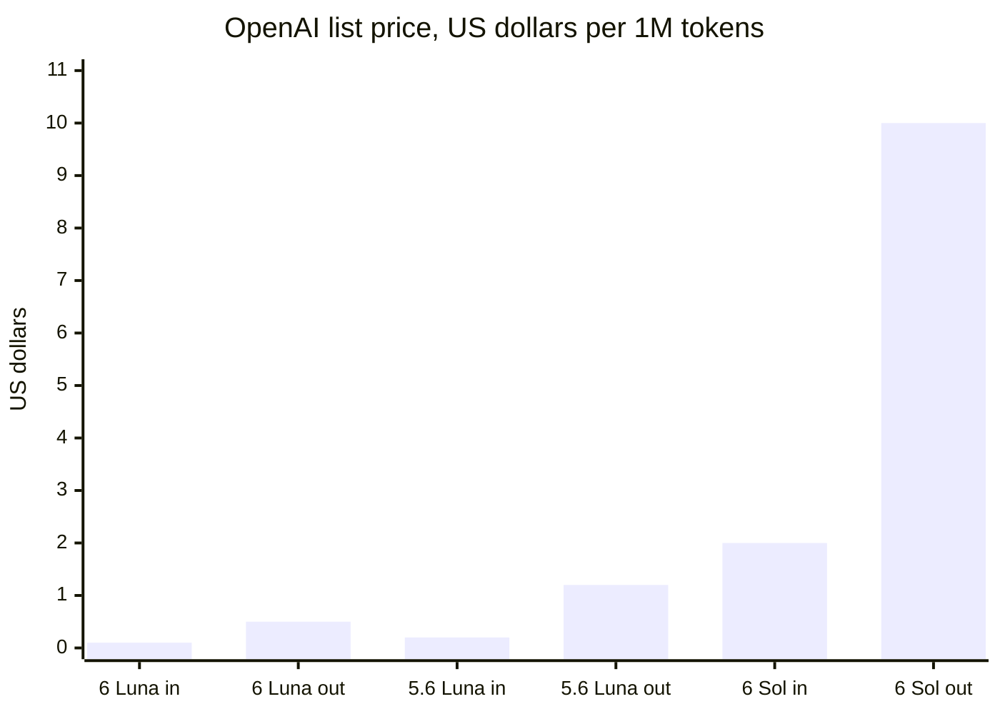

*Output tokens cost five to six times input tokens. Sources: OpenAI model pages for [gpt-6-luna](https://developers.openai.com/api/docs/models/gpt-6-luna), [gpt-5.6-luna](https://developers.openai.com/api/docs/models/gpt-5.6-luna) and [gpt-6-sol](https://developers.openai.com/api/docs/models/gpt-6-sol), checked 8 November 2026.*

Two details matter for real bills. Cached input is ten times cheaper than fresh input on these models, so stable prompt prefixes save money (Day 8). And prompts over 272K input tokens cost 2x input and 1.5x output for the whole request, per the GPT-6 Luna page.

#### A.5 Level 3: Function Calling, the Heart of Every Agent

A model cannot read your database. It can only write text. Function calling is the trick that bridges the gap: you describe a function with a JSON schema, and the model replies with "please call this function with these arguments".

Your code runs the function. Then you send the result back, and the model writes the final answer. That is the agent loop from Day 1, and it looks like this:

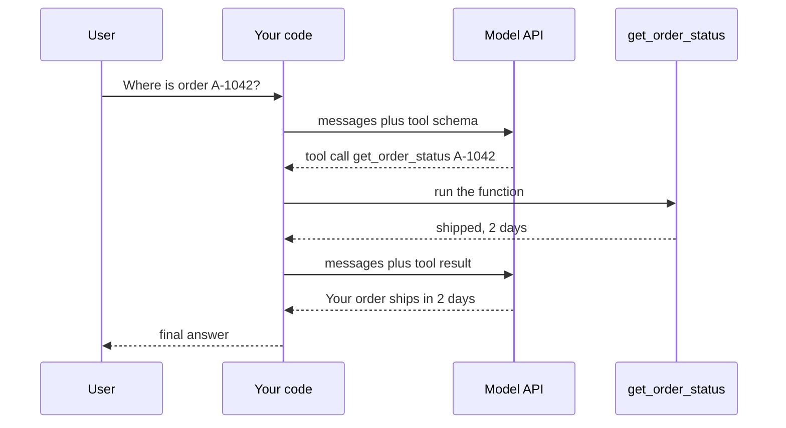

*The model only asks; your code decides whether to run the tool, and runs it.*

The model never runs anything itself. This is the most important safety fact of the whole day. Your code is the gatekeeper, so your code is where you check permissions, amounts and inputs.

One current catch is worth knowing before a customer finds it. The GPT-6 Luna page says built-in tools need the Responses API. On Chat Completions, it supports function calling only when `reasoning.effort` is `none`. The changelog's entry for GPT-6 Astra (another GPT-6 model, released 3 September 2026) is stricter: "Tool calling requires the Responses API." That entry points developers who use tools with Chat Completions to the Responses migration guide. New projects should simply start on Responses.

#### A.6 Level 4: The Agents SDK

Writing the loop by hand is good for learning. In production you also want turn limits, guardrails, handoffs, history and traces. The Agents SDK bundles these. The current Python release is [openai-agents 0.24.0](https://pypi.org/p/openai-agents), from 15 October 2026, and it needs Python 3.10 or newer.

Its building blocks are small:

- **`Agent`:** a name, instructions, a model, tools, guardrails and handoffs.
- **`Runner`:** runs the loop. `Runner.run()` is async, `Runner.run_sync()` wraps it, and `Runner.run_streamed()` streams events.
- **Tools:** Python functions marked with `@function_tool`, plus hosted tools and MCP (Model Context Protocol) servers.
- **Handoffs:** a triage agent can pass control to a specialist agent.
- **Guardrails:** checks on input, output and each tool call.
- **Sessions:** automatic conversation history across runs.
- **Tracing:** a timeline of each run that you can inspect.

The [running agents guide](https://openai.github.io/openai-agents-python/running_agents/) describes the loop exactly. Each turn calls the model for the current agent. If the output is final text of the right type with no tool calls, the loop ends. If it is a handoff, the current agent changes and the loop runs again. If it is a tool call, the tools run, results are added, and the loop runs again.

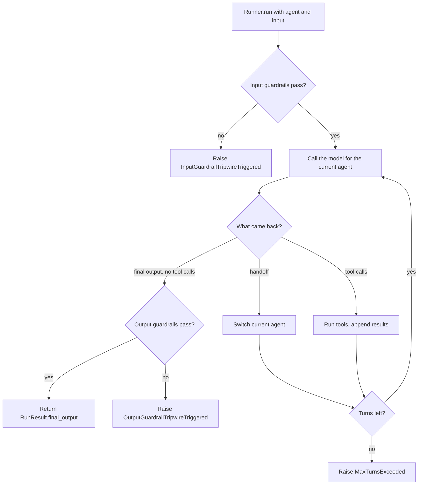

*The Agents SDK loop: guardrails at the edges, a turn budget in the middle.*

`max_turns` caps the loop and raises `MaxTurnsExceeded` when hit. The guide also lists `error_handlers`, which can return a fallback answer instead of raising for `max_turns`, `model_refusal` and `invalid_final_output`. That is useful when a customer would rather see "I could not finish, a human will follow up" than a crash.

#### A.7 Guardrails in Detail

The [guardrails page](https://openai.github.io/openai-agents-python/guardrails/) has three kinds, and each has a sharp edge:

- **Input guardrails** run only for the first agent in a chain. By default they run in parallel with the agent, for speed. That means the agent may already spend tokens or call tools before the tripwire stops it. Set `run_in_parallel=False` when a side effect would be harmful.
- **Output guardrails** run only for the last agent, after it finishes.
- **Tool guardrails** wrap each function tool call. They can skip the call, replace the output or trip. They do not apply to handoffs, hosted tools (such as `WebSearchTool` and `FileSearchTool`), built-in execution tools (such as `ComputerTool` and `ShellTool`) or `Agent.as_tool()`. So a guardrail on your own refund function does not protect a shell tool on the same agent.

A common pattern is a cheap, fast model that screens requests before the expensive model runs. Another is plain code, such as a regex for card numbers. Plain code is cheaper and gives the same answer every time.

#### A.8 Under the Hood: Default Model, Providers and Tracing

If an `Agent` names no model, the [models page](https://openai.github.io/openai-agents-python/models/) says the SDK uses `gpt-5.6-luna` with reasoning effort `none` and low verbosity. You can change that with the `OPENAI_DEFAULT_MODEL` environment variable or `RunConfig(model=...)`. Always set the model explicitly in customer code, so an SDK upgrade cannot silently change behaviour.

The Agents SDK is not locked to OpenAI models. You can pass an `AsyncOpenAI` client with another provider's `base_url` into `OpenAIChatCompletionsModel`. You can also use the LiteLLM or Any-LLM adapters, which the docs mark as beta.

Two traps come with that freedom. Many other providers do not support the Responses API, which can cause 404 errors, so switch to Chat Completions for them. The models page gives two ways: call `set_default_openai_api("chat_completions")`, or wrap the client in `OpenAIChatCompletionsModel` as Example 2 does. And traces upload to OpenAI by default, so without an OpenAI key you get a 401 tracing error. Disable tracing with `set_tracing_disabled(True)`, set a trace-only key with `set_tracing_export_api_key(...)`, or use another trace processor.

#### A.9 Under the Hood: Where the Conversation Lives

An LLM (Large Language Model) is stateless. It forgets everything between calls. So someone must store the history, and the Agents SDK offers four places:

| Approach | Who stores history | How |
| --- | --- | --- |
| `result.to_input_list()` | Your code | You pass old items plus the new message |
| Sessions | Your code, through the SDK | The SDK loads and saves history in your storage |
| `conversation_id` | OpenAI | A named conversation in the Conversations API |
| `previous_response_id` | OpenAI | Each call points to the last response |

Do not mix client-side and server-side history in one run. The guide warns this can duplicate context, which doubles your token bill and confuses the model.

#### A.10 The Bigger OpenAI Platform in 2026

OpenAI now offers three layers, and customers will ask which one to use:

1. **The client SDK:** you own everything.
2. **The Agents SDK:** you own the loop's code, and the SDK supplies the harness. Since [April 2026](https://openai.com/index/the-next-evolution-of-the-agents-sdk/) it adds native sandboxes, workspace manifests and snapshots that let a run resume in a new container.
3. **The Agents API:** OpenAI hosts the harness. It entered [public beta on 10 September 2026](https://openai.com/index/introducing-the-agents-api/). You send the task, model, tools and environment, and OpenAI runs the managed Codex harness, with sandboxes from OpenAI or partners such as Modal, Cloudflare, Daytona and Vercel.

One older layer is gone. The changelog says "The Assistants API shut down on August 26, 2026." If a customer still has Assistants code, it no longer runs, and the migration path is the Responses and Conversations APIs.

### Part B: OpenRouter

#### B.1 The Travel Agent for Models

You can book a flight on each airline's website, one account per airline. Or you can use a travel site that searches every airline, books the cheapest seat, and rebooks you when a flight is cancelled. You pay a small booking fee for that service.

OpenRouter is that travel site for models. It is a gateway, which means one API in front of many model providers. You send one request in the OpenAI format, and OpenRouter forwards it to a provider that can serve the model you asked for.

A gateway is different from a framework. A framework (LangChain, the Agents SDK) runs your agent loop in your process. A gateway is a network service that sits between your process and the providers. You can use both at once, and many teams do.

#### B.2 The Words You Need

| Term | Plain meaning | Simple example |
| --- | --- | --- |
| Gateway | One API that forwards calls to many providers | OpenRouter, LiteLLM proxy, Vercel AI Gateway |
| Provider | A company that actually runs the model on GPUs | OpenAI, Anthropic, or a host for open models |
| Model slug | The model's name on OpenRouter, as `vendor/model` | `openai/gpt-6-luna`, `sarvamai/sarvam-m` |
| OpenAI-compatible | Accepts the same request shape as OpenAI's API | Change `base_url`, keep the code |
| Fallback | A backup model tried when the first one fails | `models: [primary, backup]` |
| Provider routing | Rules for which hosts may serve a request | Sort by latency, deny data collection |
| Load balancing | Spreading requests across several providers | Cheaper stable hosts get more traffic |
| Credits | Prepaid balance that requests draw from | Buy $20, each call subtracts its cost |
| Platform fee | OpenRouter's percentage on top of model prices | 5.5% on the Standard plan |
| BYOK (Bring Your Own Key) | You use your own provider key through the gateway | Your Anthropic key, OpenRouter's routing |
| ZDR (Zero Data Retention) | The provider stores no prompt data | `provider.zdr: true` |
| Quantization | Storing model weights in fewer bits to run cheaper | `fp8`, `int4` |
| Throughput | Tokens produced per second | 150 tokens per second |
| Latency | Time until the first token arrives | 400 ms to first token |
| Auto router | A service that picks the model for each prompt | `openrouter/auto` |
| `:free` variant | A free version of a model with tight limits | `sarvamai/sarvam-m:free` |
| SLA (Service Level Agreement) | A written promise about uptime or support, often with refunds if broken | "99.9% uptime each month" |
| SSO (Single Sign-On) | Logging in with your company account instead of a separate password | Sign in with the company's identity provider |
| `:nitro` / `:floor` | Suffixes that sort by speed or by price | `model:nitro` |

#### B.3 Level 1: Change One Line

The [OpenRouter quickstart](https://www.openrouter.ai/docs/quick-start) shows the core move. You keep the OpenAI SDK and change two things: the `base_url` and the key.

```python
import os
from openai import OpenAI

client = OpenAI(
    base_url="https://openrouter.ai/api/v1",
    api_key=os.environ["OPENROUTER_API_KEY"],
)
response = client.responses.create(
    model="openai/gpt-6-luna",          # vendor/model slug
    input="Explain a refund policy in one sentence.",
)
print(response.output_text)
```

That needs a real key, so it was not run here. The quickstart also lists two optional headers, `HTTP-Referer` and `X-OpenRouter-Title`. They only label your app on openrouter.ai and do not change routing. OpenRouter also ships its own typed clients: `pip install openrouter` (version 1.3.140 on PyPI today) and `npm install @openrouter/sdk`.

#### B.4 Level 2: Fallbacks

The [routing guide](https://openrouter.ai/docs/guides/routing) explains model fallbacks. You pass a `models` array in priority order. If the first model returns an error, OpenRouter tries the next one.

Several kinds of error can trigger a fallback by default: context length errors, moderation flags, rate limits and downtime. If the last fallback also fails, you get its error.

Billing follows the model that actually answered. The response's `model` field tells you which one that was. So a `:free` model that falls back to a paid one costs the paid price. To stay free, list only `:free` models.

With the OpenAI SDK, the `models` array is not a normal OpenAI field, so you send it in `extra_body`. In Node, you spread it into the request object. Example 3 in section 4 shows the exact JSON that leaves your machine.

#### B.5 Level 3: Provider Routing

One model, such as an open-weight Llama or DeepSeek model, may be hosted by many providers. Their prices, speeds and data policies differ. The `provider` object in your request decides which hosts are allowed. These are the main fields from the [full routing reference](https://openrouter.ai/docs/guides/routing/llms-full.txt):

| Field | Default | What it does |
| --- | --- | --- |
| `order` | none | Try these provider slugs in this order. Turns off load balancing |
| `allow_fallbacks` | `true` | When `false`, only your listed providers are used |
| `sort` | none | `"price"`, `"throughput"` or `"latency"`. Turns off load balancing |
| `data_collection` | `"allow"` | `"deny"` skips providers that may store or train on data |
| `zdr` | none | `true` allows only Zero Data Retention endpoints |
| `only` / `ignore` | none | Allowlist or blocklist of providers for this request |
| `max_price` | none | Price ceilings per million prompt and completion tokens |
| `require_parameters` | `false` | `true` skips providers that do not support every parameter you sent |
| `quantizations` | none | Allow only some precision levels, such as `fp8` or `bf16` |

`require_parameters` deserves a star. Without it, a provider may silently ignore a parameter it does not support, such as a JSON schema. Your structured output then breaks only on some requests, which is miserable to debug.

#### B.6 Under the Hood: How the Default Router Chooses

When you set no `order` or `sort`, OpenRouter load-balances. The reference describes the steps:

1. Skip providers with significant outages in the last 30 seconds.
2. Among the stable ones, favour the cheapest, weighted by the inverse square of price.
3. Keep the rest as fallbacks.
4. If your request has `tools` or `tool_choice`, send it only to providers that support tool use. If it sets `max_tokens`, send it only to providers that support that response length.

The inverse-square rule is easy to check by hand. Suppose provider A costs $1 and provider B costs $2 per million tokens. A gets weight 1/1² = 1 and B gets 1/2² = 0.25, so A receives about 80% of the traffic. The reference's own example uses $1 against $3: the weights are 1 and 1/9, so the $1 provider is 9 times more likely to be tried first.

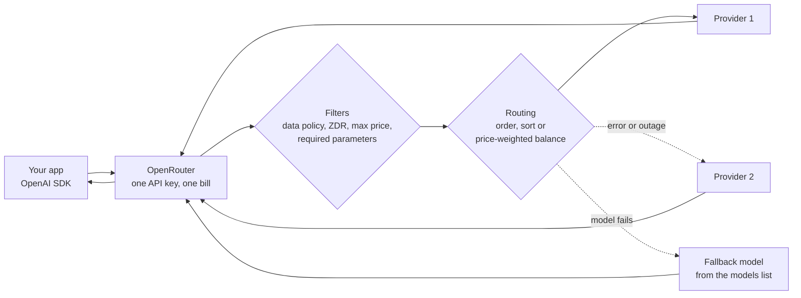

*Filters remove providers first; routing then picks one and falls back on failure.*

Shortcuts exist for the common cases. A `:nitro` suffix on the slug means "sort by throughput". A `:floor` suffix means "sort by price". The model `openrouter/auto` hands the choice of model to an auto router powered by NotDiamond, with no extra router fee. The response's `model` field tells you what it chose.

#### B.7 Money: Fees, Free Tier and BYOK

Read the fee table before you put OpenRouter in a customer's budget. These figures come from the [pricing page](https://openrouter.ai/pricing) and the [FAQ](https://openrouter.ai/docs/faq), checked today.

| Plan | Platform fee | Catalogue | Notes |
| --- | --- | --- | --- |
| Free | none | 25+ free models, 4 free providers | 50 requests per day |
| Standard, pay as you go | 5.5% | 600+ models, 80+ providers | Provider rate limits pass through |
| Business, pay as you go | 8% | 600+ models, 80+ providers | Up to 1,000 workspaces |
| Enterprise | Discounts available | Same | Invoicing, SLAs, SSO, private endpoints add-on |

Free models allow 50 requests per day without purchased credits, or 1,000 per day once you have bought at least 10 credits. BYOK includes $25,000 of list-price inference per month with no fee, then 5% of what the same call would cost on OpenRouter.

A quick sum shows when the fee matters. A team spending $2,000 per month on tokens pays $110 extra on the Standard plan. That is often cheaper than one engineer-day spent wiring three vendor SDKs. At $200,000 per month, the same 5.5% is $11,000, and a self-hosted gateway or a direct contract starts to look attractive.

#### B.8 Data Policy: The Question Legal Will Ask

The FAQ says OpenRouter logs only basic request metadata by default, such as timestamps, model and token counts. "Prompt and completion are not logged by default." You can opt in to logging for a 1% discount.

But OpenRouter is only the first hop. The provider that runs the model has its own policy. That is why `data_collection: "deny"` and `zdr: true` exist, and why an FDE sets them in an account-wide setting, not only per request. One forgotten request without the flag is still a leak.

#### B.9 What the Traffic Tells Us

OpenRouter sees a huge cross-section of real usage. In January 2026, OpenRouter and a16z published [a study of over 100 trillion tokens](https://arxiv.org/abs/2601.10088). The [full paper](https://arxiv.org/html/2601.10088v1) has numbers that matter for agent builders:

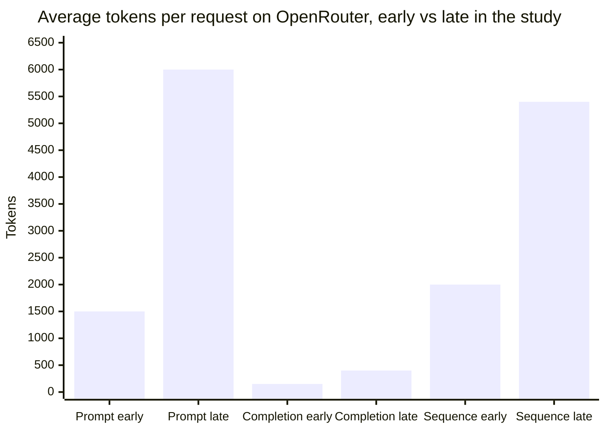

*Prompts grew about fourfold as agents sent more context. Source: State of AI, OpenRouter and a16z, arXiv 2601.10088, January 2026; sequence figures run from late 2023 to late 2025.*

The paper reports other useful facts. Open-weight models reached roughly one third of token usage by late 2025. Reasoning models carried more than half of all tokens. Programming grew from about 11% of tokens in early 2025 to over 50% in recent weeks. Asia's share of spend rose from about 13% to about 31%.

The authors also warn that this is one platform, not the whole market. Self-hosted models are mostly invisible to it. Quote these numbers as "on OpenRouter", never as "in the industry".

#### B.10 An Indian Angle: Indic Models Behind the Same API

A gateway makes regional models as easy to try as global ones. [Sarvam-M](https://openrouter.ai/sarvamai) is listed on OpenRouter. It comes from Sarvam AI, a Bengaluru company that the Indian government [picked in April 2025](https://inc42.com/buzz/sarvam-to-build-indias-first-homegrown-sovereign-ai-model) to build a sovereign model under the IndiaAI Mission. It is a 24B-parameter model built on Mistral Small 3.1 and post-trained on English and Indic languages including Hindi, Bengali, Tamil, Telugu, Marathi and Kannada. It handles native scripts and romanised text, which matters for Indian support chats full of "mera order kab aayega?".

For an Indian customer, that means you can A/B test a global model against an Indic model with one slug change. You then measure quality on their real Hinglish tickets before any contract talk. That experiment used to take weeks of vendor onboarding.

### Part C: LangChain

#### C.1 The Universal Adapter Kit

When you travel, you carry a universal plug adapter. Your laptop charger stays the same, and the adapter fits the wall socket of each country. Add a surge protector and a timer, and you control what reaches the laptop too.

LangChain is that kit for models. Its standard interfaces let the same agent code use OpenAI, Anthropic, Google, AWS Bedrock or a local Ollama model. Its middleware is the surge protector and timer: small pieces that check, limit or change each call.

LangChain is also the oldest and most widely used of today's four tools. That brings a large ecosystem, and also a lot of old tutorials. Much of what you find online predates version 1.0 and no longer matches the current API.

#### C.2 The Words You Need

| Term | Plain meaning | Simple example |
| --- | --- | --- |
| Framework | A library that gives structure and runs your code inside it | LangChain, Agents SDK |
| Chat model | LangChain's standard wrapper around any model API | `ChatOpenAI`, `ChatAnthropic` |
| Integration package | A separate package for one vendor | `langchain-openai`, `langchain-openrouter` |
| `langchain-core` | The base package with shared interfaces | Messages, tools, runnables |
| Message | One item in a conversation, with a role | `HumanMessage`, `AIMessage`, `ToolMessage` |
| Content blocks | A standard view of message parts across vendors | `text`, `reasoning`, `tool_call` blocks |
| Tool | A function the model can call, with a schema made from its signature and docstring | `def get_weather(city: str)` |
| `create_agent` | The function that builds a standard agent loop | `create_agent(model, tools, system_prompt)` |
| Harness | The code around the model: prompt, tools, middleware | See Day 10 |
| Middleware | A hook that runs at a fixed point in the agent loop | Log, limit, redact, retry |
| `before_model` / `after_model` | Hooks that run before or after each model call | Count calls, trim history |
| `wrap_model_call` / `wrap_tool_call` | Hooks that wrap a call, like a decorator | Retry, fallback, timing |
| Structured output | Forcing the final answer into a schema | A Pydantic `Ticket` object |
| Pydantic | A Python library where you describe data as a class with typed fields, and it checks real data against that class | `class Ticket(BaseModel): intent: str` |
| Runnable | The older LangChain interface with `invoke`, `stream`, `batch` | Every chat model is one |
| LCEL (LangChain Expression Language) | The older style that joins prompt, model and parser with a pipe symbol | Common in pre-1.0 tutorials |
| `langchain-classic` | The package that holds legacy chains and helpers | Old `RetrievalQA` code |
| LangSmith | LangChain's tracing and evaluation product | A trace of every model and tool call in a run |
| Deep Agents | A batteries-included harness built on LangChain | Planning, a virtual filesystem, subagents |

#### C.3 Level 1: One Model, Any Vendor

The simplest LangChain program calls a chat model. Model strings use a `provider:model` format, such as `openai:gpt-5.5` in the [LangChain overview](https://docs.langchain.com/oss/python/langchain/overview). Each provider needs its integration package installed.

```python
from langchain.chat_models import init_chat_model

model = init_chat_model("openai:gpt-6-luna")      # needs langchain-openai and a key
reply = model.invoke("Explain a refund policy in one sentence.")
print(reply.content)
```

That needs a key, so it was not run here. The useful part is what changes when the customer wants another vendor: only the string. The rest of the agent code stays the same.

There is also an OpenRouter integration. The [ChatOpenRouter guide](https://openrouter.ai/blog/tutorials/langchain-chatopenrouter-setup/) from July 2026 describes `langchain-openrouter` (in beta) and `@langchain/openrouter`. It reads `OPENROUTER_API_KEY` and exposes provider routing as `openrouter_provider`. So Parts B and C combine without glue code.

#### C.4 Level 2: Tools From Plain Functions

In LangChain, a normal Python function becomes a tool. The function name becomes the tool name, the type hints become the JSON schema, and the docstring becomes the description the model reads.

```python
def get_order_status(order_id: str) -> str:
    """Look up the delivery status of one order."""
    return f"Order {order_id} is shipped."
```

This is why docstrings suddenly matter. The model chooses tools by reading their descriptions. A vague docstring like "helper function" leads to wrong tool choices, and no amount of model upgrade fixes it.

#### C.5 Level 3: `create_agent`

LangChain 1.0 shipped on [22 October 2025](https://www.langchain.com/blog/langchain-langgraph-1dot0), together with LangGraph 1.0. The team promised no breaking changes before 2.0. The current release is [langchain 1.4.9](https://pypi.org/project/langchain/), from 4 November 2026.

The headline API is `create_agent`. The [v1 release notes](https://docs.langchain.com/oss/python/releases/langchain-v1) call it "the new standard for building agents in LangChain". It replaces the older `langgraph.prebuilt.create_react_agent`. The loop is the familiar one: call the model, run any tools it picks, and finish when it calls no more tools.

```python
from langchain.agents import create_agent

agent = create_agent(
    model="openai:gpt-6-luna",
    tools=[get_order_status],
    system_prompt="You are a support agent. Use tools for facts.",
)
result = agent.invoke({"messages": [{"role": "user", "content": "Where is A-1042?"}]})
print(result["messages"][-1].content)
```

The input and output are both a dictionary with a `messages` list. The last message is the final answer, and the earlier ones show every tool call. That makes debugging easy: print the list and read the story.

#### C.6 Level 4: Middleware, Where the Real Work Happens

Middleware is the most important idea in modern LangChain. The release notes list six hooks you can implement by subclassing `AgentMiddleware`, or by using decorators of the same names:

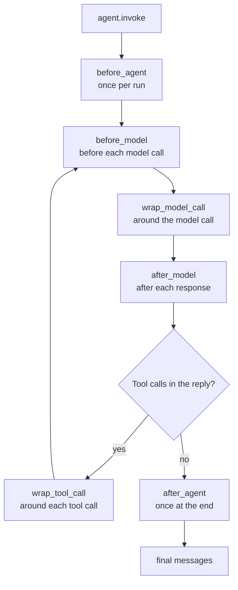

*Each hook is a slot where you can log, limit, change or block what passes through.*

The "before" and "after" hooks see the state and can return changes. The "wrap" hooks receive a handler and decide whether, and how often, to call it. That is how retry and fallback work: a wrapper calls the handler, catches the error, and tries again or switches model.

You rarely start from scratch. The [middleware reference](https://reference.langchain.com/python/langchain/middleware/) lists built-in classes. These are the ones an FDE uses most:

| Middleware | What it does | Customer problem it solves |
| --- | --- | --- |
| `ModelCallLimitMiddleware` | Caps model calls per run or per thread | Runaway loops and surprise bills |
| `ToolCallLimitMiddleware` | Caps calls to all tools or one tool | An agent hammering a slow internal API |
| `ModelRetryMiddleware` / `ToolRetryMiddleware` | Retries with exponential backoff | Flaky networks and rate limits |
| `ModelFallbackMiddleware` | Switches to backup models on failure | Provider outages |
| `PIIMiddleware` | Detects PII and blocks, redacts, masks or hashes it | Phone numbers and IDs reaching the model |
| `HumanInTheLoopMiddleware` | Pauses before chosen tool calls for approve, edit or reject | High-risk actions such as refunds |
| `SummarizationMiddleware` | Summarises old history near the token limit | Long chats that overflow context |
| `ContextEditingMiddleware` | Clears old tool outputs when context grows | Big tool results crowding the prompt |
| `LLMToolSelectorMiddleware` | Uses a small model to pick relevant tools first | Agents with dozens of tools |
| `TodoListMiddleware` | Gives the agent a `write_todos` planning tool | Multi-step tasks that lose track |

PII (Personally Identifiable Information) means data that identifies a person, such as a name, phone number or Aadhaar number. In India the DPDP Act (Digital Personal Data Protection Act, 2023) makes this a legal topic, not only a technical one. Later governance days go deeper.

Order matters when you stack middleware. I tested it: `before_model` hooks ran in list order (1, then 2), and `after_model` hooks ran in reverse (2, then 1), like layers of an onion. Put cheap checks such as call limits early, and expensive ones such as an LLM tool selector later.

#### C.7 Structured Output and Content Blocks

Many customer tasks need data, not prose. You want `{"intent": "refund", "amount": 500}` that your code can trust. In LangChain 1.0, structured output is produced inside the main agent loop, using strategies such as `ToolStrategy`, instead of an extra model call afterwards. That saves one call per run.

Content blocks solve a different problem. Each vendor returns reasoning, citations and tool calls in its own shape. The `.content_blocks` property gives one standard view across providers, so your UI code does not need a branch per vendor.

#### C.8 Under the Hood: LangChain Runs on LangGraph

Here is the fact that ties Parts C and D together. The [1.0 announcement](https://www.langchain.com/blog/langchain-langgraph-1dot0) says `create_agent` runs on the LangGraph runtime. Your agent is a small graph with a model node and a tools node.

So every LangChain agent can use LangGraph features: checkpointers, `thread_id`, streaming and interrupts. `HumanInTheLoopMiddleware` needs a checkpointer for exactly this reason. It pauses the graph and resumes it later.

One more under-the-hood detail surprised me while testing for this page. In `langchain-openai` 1.7.4, `ChatOpenAI` switches to the Responses API automatically when the model name starts with `gpt-6` and the request has tools. That matches OpenAI's own rule from Part A. It is helpful, but it broke my offline test server, which only spoke Chat Completions. Setting `use_responses_api=False` fixed it.

#### C.9 Old LangChain Versus New LangChain

You will meet old code at customers, so learn to spot it:

| You see this | It is from | Do this now |
| --- | --- | --- |
| `LLMChain`, `RetrievalQA`, `ConversationChain` | Before 1.0 | Rebuild with `create_agent`, or import from `langchain-classic` |
| `initialize_agent(..., agent="zero-shot-react-description")` | Very early versions | Rebuild with `create_agent` |
| `from langgraph.prebuilt import create_react_agent` | LangGraph 0.x | Use `from langchain.agents import create_agent` |
| Prompt, model and parser joined by pipe symbols | LCEL era | Still works for simple pipelines; agents use `create_agent` |
| Python 3.8 or 3.9 | Old projects | LangChain 1.x needs Python 3.10+ |

The legacy package, `langchain-classic`, holds old chains, some retrievers, the indexing API and the hub module. Treat it as a bridge. Migrate the critical path first, and leave rarely used chains on the bridge until they need changes.

#### C.10 Where LangChain Sits in the Ecosystem

LangChain has three layers that people often blur:

- **LangChain:** the agent framework, with `create_agent`, middleware and integrations.
- **LangGraph:** the runtime underneath, for durable state and control flow (Part D).
- **Deep Agents:** a fuller harness on top, with context compression, a virtual filesystem and subagents. The overview suggests it when you want "batteries included".

Adoption is real. The 1.0 post reports 90 million monthly downloads. LangChain's [State of Agent Engineering](https://langchain.com/state-of-agent-engineering) survey of 1,340 people, run in late 2025 and published in June 2026, found 57.3% with agents in production. Quality was the top barrier at 32%, and over three quarters use more than one model. Those are LangChain's own survey figures, so treat them as a view from its community.

That last number explains the whole Part. If most teams use several models, a standard model interface is not a luxury. It is the cheapest way to keep switching costs low.

### Part D: LangGraph

#### D.1 The Board Game You Can Pause

Think of a long board game with friends. Each turn, you move a piece, and somebody writes the board down in a notebook. If the power cuts out, you do not start again. You open the notebook and continue from the last written board.

Now add a rule: some squares say "wait for the referee". The game stops there, everyone goes home, and next week the referee gives a ruling. You open the notebook and carry on from that exact square.

LangGraph is that game, with the notebook built in. The squares are nodes, the paths between them are edges, the board is the state, and the notebook is the checkpointer. The [overview](https://docs.langchain.com/oss/python/langgraph/overview) calls it "a low-level orchestration framework and runtime for long-running, stateful agents".

#### D.2 The Words You Need

| Term | Plain meaning | Simple example |
| --- | --- | --- |
| Graph | A set of steps and the arrows between them | Check policy, then review, then pay |
| State | The shared data every step reads and updates | `{"order_id": "A-1042", "amount": 12000}` |
| `StateGraph` | The class you use to build a graph | `StateGraph(RefundState)` |
| Node | One step, written as a normal function | `def pay(state): ...` |
| Edge | A fixed arrow from one node to the next | `add_edge("review", "pay")` |
| Conditional edge | An arrow chosen by a function at run time | Big refund goes to review, small goes to pay |
| `START` / `END` | Special markers for entry and exit | `add_edge(START, "check_policy")` |
| Reducer | A rule for merging a node's update into state | Append messages instead of replacing them |
| Compile | Turning the builder into a runnable graph | `graph = builder.compile(checkpointer=...)` |
| Checkpointer | Saves a snapshot of state after each step | `SqliteSaver`, `PostgresSaver` |
| Checkpoint | One saved snapshot | State after `check_policy` |
| Thread | One run's history of checkpoints, named by an ID | `thread_id="refund-A-1042"` |
| Super-step | One round where all ready nodes run | Two parallel searches in one round |
| Interrupt | A pause inside a node that waits for outside input | "Approve refund?" |
| `Command` | An object used to resume a paused graph | `Command(resume="approve")` |
| Durable execution | Work that survives crashes and restarts | Resume tomorrow on another server |
| Durability mode | How often checkpoints are written | `"exit"`, `"async"`, `"sync"` |
| Idempotent | Safe to run twice with the same effect as once | Upsert a row instead of inserting it |
| Subgraph | A graph used as a node inside another graph | A research team inside a report graph |
| Time travel | Looking at or replaying from an old checkpoint | Re-run from before a bad tool call |
| Store | Long-term memory shared across threads | A user's saved preferences |

#### D.3 Level 1: A Graph With Two Steps

Here is the hello-world from the overview, slightly shortened. No model is needed. It shows the three moves: add nodes, add edges, compile.

```python
from langgraph.graph import StateGraph, MessagesState, START, END

def mock_llm(state: MessagesState):
    return {"messages": [{"role": "ai", "content": "hello world"}]}

builder = StateGraph(MessagesState)
builder.add_node(mock_llm)
builder.add_edge(START, "mock_llm")
builder.add_edge("mock_llm", END)
graph = builder.compile()
print(graph.invoke({"messages": [{"role": "user", "content": "hi!"}]}))
```

This one was run here with `langgraph` 1.2.20. It prints a dict whose `messages` list holds two items: a `HumanMessage` with `'hi!'` and an `AIMessage` with `'hello world'`, each with an auto-generated `id`. Notice that the dict-style messages you passed in came back as LangChain message objects.

A node returns only the keys it changed. LangGraph merges that update into the state. For `messages`, the merge rule is "append", so history grows instead of being overwritten. That merge rule is called a reducer.

#### D.4 Level 2: Branches and Loops

Real work branches. A conditional edge is a function that looks at the state and returns the name of the next node. In the refund graph you will run in section 4, a refund above Rs 5,000 goes to a human, and smaller ones go straight to payment.

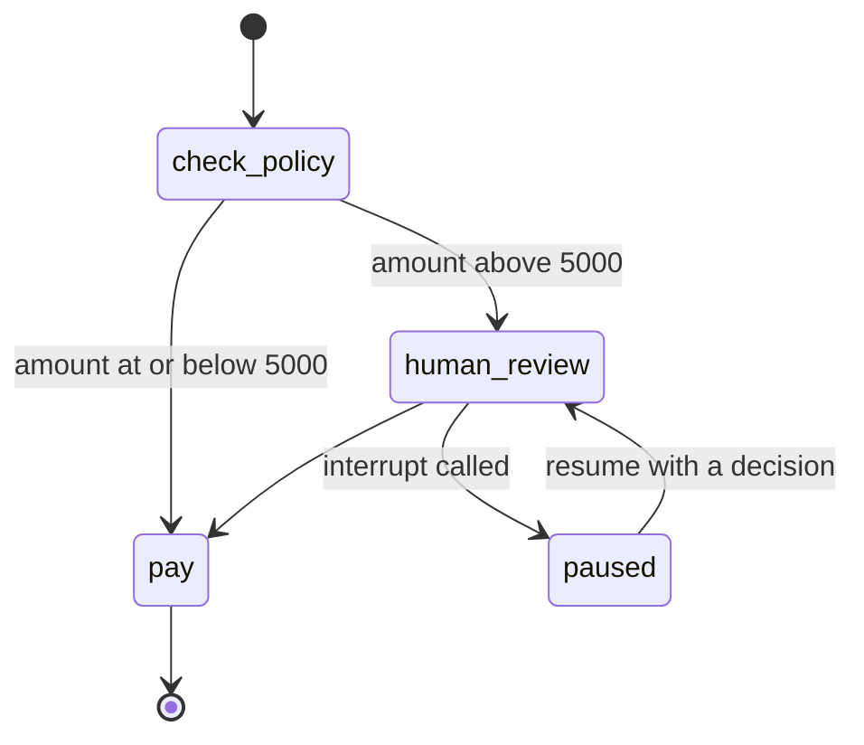

*The refund graph from Example 6: one conditional edge and one pause point.*

Graphs can also loop. An agent is just a loop between a model node and a tools node, until the model stops asking for tools. Loops are why LangGraph exists at all. Older pipeline tools used DAGs (Directed Acyclic Graphs, graphs with no cycles), which cannot express "try again".

#### D.5 Level 3: Checkpointers and Threads

A checkpointer saves the state after each step. You pass it to `compile()`. Then every call names a thread with `{"configurable": {"thread_id": "..."}}`.

The [LangGraph persistence docs](https://docs.langchain.com/oss/python/langgraph/durable-execution) list the main options:

| Checkpointer | Where state lives | Use it for |
| --- | --- | --- |
| `InMemorySaver` | Process memory, lost on restart | Tests and notebooks |
| `SqliteSaver` | A local SQLite file | Local development and demos |
| `PostgresSaver` / `AsyncPostgresSaver` | A PostgreSQL database | Production |

The savers beyond `InMemorySaver` ship as separate packages, so a beginner's first `ImportError` is usually this one. `SqliteSaver` comes from `pip install langgraph-checkpoint-sqlite`, and `PostgresSaver` from `pip install langgraph-checkpoint-postgres` (version 3.2.0 on PyPI today), imported as `from langgraph.checkpoint.postgres import PostgresSaver`.

Reusing a `thread_id` continues that thread. A new one starts fresh. With PostgreSQL, keep thread IDs under 255 characters. Checkpoints also pile up in long conversations, so plan a retention policy from day one.

A checkpointer gives you four powers at once. Conversations continue across requests. A human can step in. You can time-travel to an older state to debug. And a crash costs one step, not the whole run.

#### D.6 Level 4: Interrupts, the Human in the Loop

`interrupt()` pauses a graph inside a node and saves the state. The value you pass to it goes back to the caller, such as a question for a manager. Later you call the graph again with `Command(resume=...)` and the same `thread_id`. Inside the node, `interrupt()` now returns the resume value.

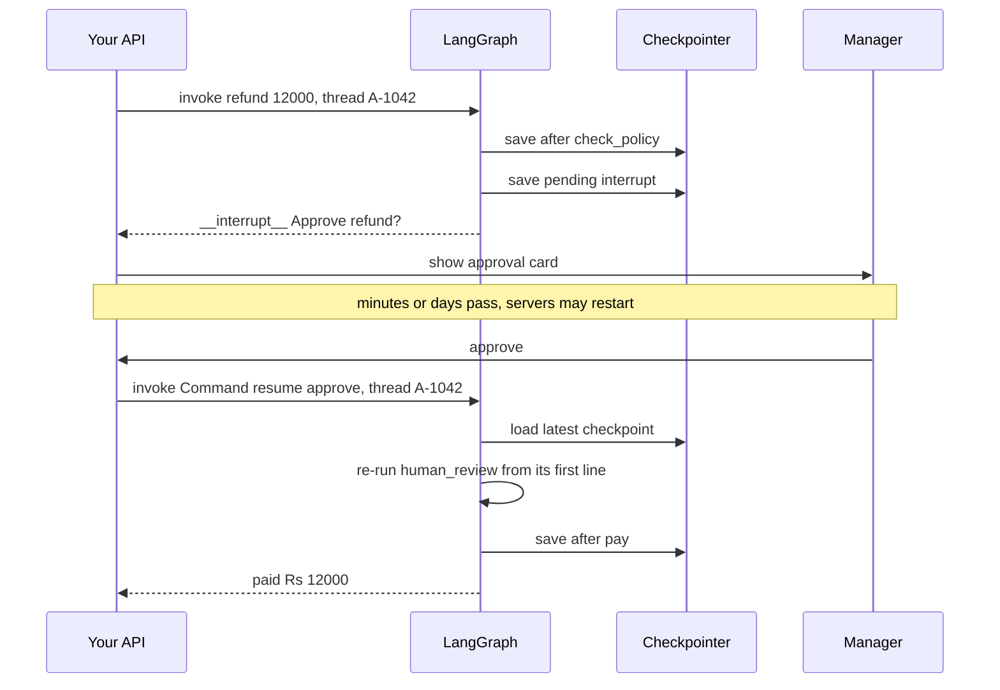

*The process does not wait; the checkpoint waits, so a pause can last days.*

The [interrupts guide](https://docs.langchain.com/oss/python/langgraph/interrupts) gives four rules. Learn them, because each one is a real production bug:

1. **The node restarts from the top on resume.** Code before `interrupt()` runs again. So keep it side-effect free, or make it idempotent.
2. **Do not wrap `interrupt()` in a bare `try/except`.** The pause works by raising a special exception, and a bare `except` swallows it.
3. **Keep interrupts in the same order every time.** Resume values are matched by position inside the node. A conditional skip shifts every later answer.
4. **Pass only JSON-serialisable values.** Strings, numbers, lists and simple dicts are fine. Functions and class instances are not.

Since `langgraph` 1.2.12 you can also pass a `response_schema`: a Pydantic model, a `TypedDict` or a dataclass that validates the resume value. A plain JSON Schema dict is passed through but not validated. A UI can use the schema to draw a typed approval form.

#### D.7 Level 5: Durable Execution

Durable execution means a workflow can stop for any reason and continue later without redoing finished work. The [durable execution docs](https://docs.langchain.com/oss/python/durable-execution) list three requirements: a checkpointer, a thread ID, and side effects wrapped in tasks or nodes so they are not repeated on resume.

You choose how often LangGraph writes checkpoints with the `durability` setting:

| Mode | When it saves | Trade-off |
| --- | --- | --- |
| `"exit"` | Only when the run ends, by success or error | Fastest; no mid-run recovery and no interrupts |
| `"async"` | In the background while the next step runs | Fast; a crash may lose the latest checkpoint |
| `"sync"` | Before the next step starts | Safest; a little slower |

To recover from a crash, such as a provider outage, call the graph again with input `None` and the same thread ID. It resumes from the last successful checkpoint. Example 7 in section 4 shows this: the expensive research step ran once, even though the run crashed and resumed.

Resume points differ by API. In a `StateGraph`, a resumed run restarts at the beginning of the node that stopped. If a subgraph was running, the parent node restarts, while the subgraph resumes at its own stopped node.

#### D.8 Under the Hood: Pregel, Channels and Super-Steps

LangGraph's engine uses the Pregel and BSP (Bulk Synchronous Parallel) model of graph processing, where work happens in rounds. Nuno Campos explains the design in [Building LangGraph](https://www.langchain.com/blog/building-langgraph) (September 2025):

- **Channels** hold the data. Each has a version number that goes up when it changes.
- **Nodes** subscribe to channels. A node runs when a channel it watches changes.
- **Each super-step** finds every node whose inputs changed and runs them in parallel, each on its own copy of state.
- **Updates are applied in a fixed order** after the step. So the timing of parallel nodes cannot change the result.
- **After each step**, the runtime saves the channel values, their versions, and which versions each node has seen. That is the checkpoint.

The loop ends when no node has new input or when an iteration limit is hit. Checkpoints are serialised with MsgPack (a compact binary format, like JSON but smaller and faster) by default and can be encrypted. Because they hold everything, a run can resume on any machine.

The same post states the design's only assumptions about models: they are slow, flaky and open-ended. Every feature follows from that. Slow means stream. Flaky means checkpoint and retry. Open-ended means let a human step in.

LangGraph also streams in six modes: `values`, `updates`, `messages`, `tasks`, `checkpoints` and `custom`. For a chat UI you usually stream `messages` for tokens and `updates` for progress such as "checking policy".

#### D.9 Multi-Agent Graphs

A node can be a whole agent, and a graph can be a team of agents. The most common shape is a supervisor: one agent reads the request and routes it to specialist agents. LinkedIn's Hiring Assistant uses this shape, with a supervisor routing to intake, sourcing and evaluation agents, according to a [ZenML summary of LinkedIn's talk](https://zenml.io/llmops-database/building-linkedin-s-first-production-agent-hiring-assistant-platform-and-architecture).

Multi-agent graphs multiply errors as well as abilities. The same summary notes that two stages at 90% accuracy each give about 81% overall. Later days cover multi-agent design properly. For today, remember to add stages only when one agent clearly cannot do the job.

#### D.10 Running LangGraph in Production

LangGraph is a library, so you can host it inside your own FastAPI or Spring-style service. The [current release](https://pypi.org/project/langgraph/) is 1.2.20, from 5 November 2026, and PyPI names Klarna, Replit and Elastic as users.

The persistence docs note that LangChain's Agent Server handles checkpointing and stores for you. You then trade some control for less infrastructure work. Later deployment days compare these hosting choices in depth.

### How the Four Parts Fit Together

These four tools are layers, not rivals. Most real systems use two or three of them at once.

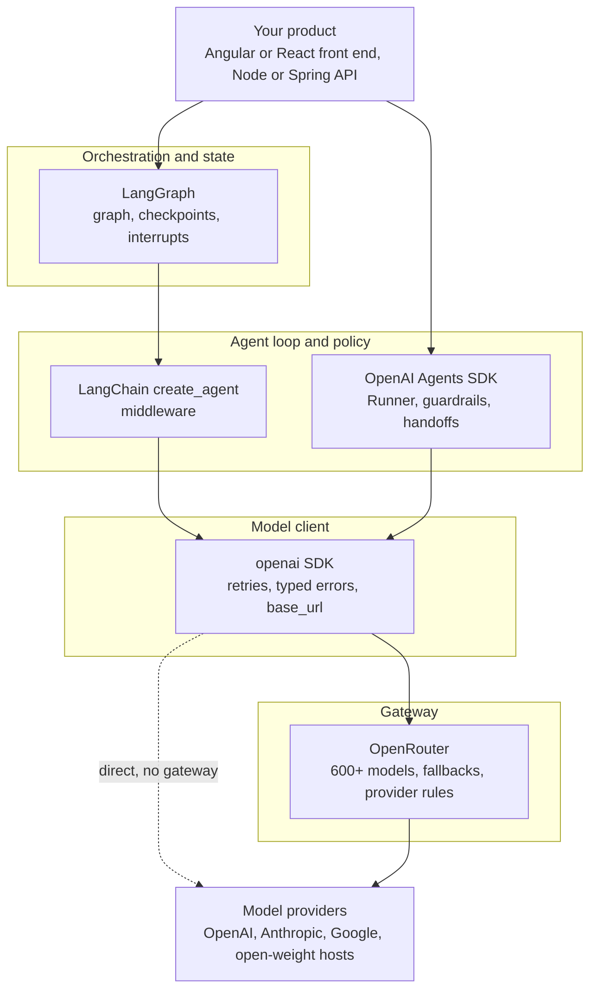

*Each layer answers one question: what runs next, how one agent behaves, how to call a model, and which model serves it.*

A useful way to explain this to a customer is with four questions:

1. **Which step runs next, and can we pause and resume?** That is LangGraph.
2. **How does one agent think, use tools and stay within limits?** That is LangChain's `create_agent` or the OpenAI Agents SDK.
3. **How do we call a model safely?** That is the `openai` client, with retries, timeouts and typed errors.
4. **Which model and provider serve this call?** That is OpenRouter, or a direct provider.

You can skip layers. A simple FAQ bot needs only layer 3. A vendor bake-off needs layers 3 and 4. A refund workflow with approvals needs all four.

## 4. Worked Examples

Every example below was run in this sandbox on 8 November 2026 with `openai` 3.46.0, `openai-agents` 0.24.0, `langchain` 1.4.9, `langchain-openai` 1.7.4, `langgraph` 1.2.20 and the Node `openai` package 7.53.0. No real API key was used. Instead, a tiny fake server that speaks the OpenAI Chat Completions format stands in for the model. Swap `base_url` and the key, and the same code talks to a real model.

### Example 0: The Fake Model Server (Python, run here)

This 50-line server lets you practise offline and for free. If tools are offered and no tool result exists yet, it asks for the first tool. Once a tool result arrives, it answers with text. A request with the header `x-fail-once` gets one 429, so you can watch retries work.

```python
# fake_llm_server.py  -  run with: python3 fake_llm_server.py
import json, time
from http.server import BaseHTTPRequestHandler, HTTPServer
FAILED = set()

class Handler(BaseHTTPRequestHandler):
    def log_message(self, *args): pass
    def do_POST(self):
        body = json.loads(self.rfile.read(int(self.headers["Content-Length"])))
        extras = {k: v for k, v in body.items() if k in ("models", "provider")}
        print(f"[server] model={body.get('model')} messages={len(body['messages'])} "
              f"tools={len(body.get('tools', []))} extras={json.dumps(extras)}", flush=True)
        key = self.headers.get("x-fail-once")
        if key and key not in FAILED:
            FAILED.add(key); print("[server] returning 429 once", flush=True)
            return self.reply(429, {"error": {"message": "slow down"}})
        msgs, tools = body["messages"], body.get("tools", [])
        results = [m for m in msgs if m["role"] == "tool"]
        if tools and not results:
            fn = tools[0]["function"]
            message = {"role": "assistant", "content": None, "tool_calls": [{
                "id": "call_1", "type": "function",
                "function": {"name": fn["name"], "arguments": json.dumps({"order_id": "A-1042"})}}]}
            finish = "tool_calls"
        else:
            last = results[-1]["content"] if results else "no tools used"
            message, finish = {"role": "assistant", "content": f"Done. Tool said: {last}"}, "stop"
        self.reply(200, {"id": "chatcmpl-fake", "object": "chat.completion",
            "created": int(time.time()), "model": body.get("model"),
            "choices": [{"index": 0, "message": message, "finish_reason": finish}],
            "usage": {"prompt_tokens": 50, "completion_tokens": 10, "total_tokens": 60}})
    def reply(self, code, payload):
        data = json.dumps(payload).encode()
        self.send_response(code); self.send_header("Content-Type", "application/json")
        self.send_header("Content-Length", str(len(data))); self.end_headers(); self.wfile.write(data)

HTTPServer(("127.0.0.1", 8765), Handler).serve_forever()
```

*Start it in one terminal, then run the examples in another.*

### Example 1: The Tool Loop by Hand With the OpenAI SDK (Part A, Python, run here)

This is Day 1's agent loop, written with the real `openai` client. Read it slowly, because every framework below hides this same loop.

```python
import json
from openai import OpenAI

client = OpenAI(base_url="http://127.0.0.1:8765/v1",  # the only line that picks the backend
                api_key="not-needed-for-the-fake", max_retries=2, timeout=20.0)

def get_order_status(order_id: str) -> str:
    return json.dumps({"order_id": order_id, "status": "shipped", "eta": "2 days"})

TOOLS = [{"type": "function", "function": {
    "name": "get_order_status",
    "description": "Look up the delivery status of one order.",
    "parameters": {"type": "object",
                   "properties": {"order_id": {"type": "string"}},
                   "required": ["order_id"]}}}]
REGISTRY = {"get_order_status": get_order_status}

messages = [{"role": "system", "content": "You are a support agent. Use tools for facts."},
            {"role": "user", "content": "Where is my order A-1042?"}]

for turn in range(1, 6):                      # a hard turn limit
    resp = client.chat.completions.create(
        model="gpt-6-luna", messages=messages, tools=TOOLS,
        reasoning_effort="none",              # GPT-6 Luna needs this for tools on Chat Completions
        extra_headers={"x-fail-once": "demo"})  # the fake sends one 429
    msg = resp.choices[0].message
    print(f"turn {turn}: finish_reason={resp.choices[0].finish_reason}")
    if not msg.tool_calls:
        print("final answer:", msg.content)
        print("tokens used:", resp.usage.total_tokens)
        break
    messages.append(msg.model_dump(exclude_none=True))   # keep the tool request
    for call in msg.tool_calls:
        args = json.loads(call.function.arguments)
        result = REGISTRY[call.function.name](**args)    # YOUR code runs the tool
        print(f"  ran {call.function.name}({args}) -> {result}")
        messages.append({"role": "tool", "tool_call_id": call.id, "content": result})
```

Real output:

```text
turn 1: finish_reason=tool_calls
  ran get_order_status({'order_id': 'A-1042'}) -> {"order_id": "A-1042", "status": "shipped", "eta": "2 days"}
turn 2: finish_reason=stop
final answer: Done. Tool said: {"order_id": "A-1042", "status": "shipped", "eta": "2 days"}
tokens used: 60
```

The server log shows something the program output hides: `[server] returning 429 once`, then a successful retry. The SDK retried the 429 on its own, so your loop never saw the error. That is the default `max_retries=2` at work.

For a real model, remove `base_url`, set `OPENAI_API_KEY`, and prefer `client.responses.create` for new code (not run here). Tool calls then arrive as `function_call` items in `response.output`, and you send results back as `function_call_output` items.

### Example 2: The Same Agent With the Agents SDK, Plus a Guardrail (Part A, Python, run here)

Now the SDK runs the loop. We add an input guardrail that blocks anything that looks like a card number, before the agent spends a single token.

```python
import asyncio
from agents import (Agent, AsyncOpenAI, GuardrailFunctionOutput,
                    InputGuardrailTripwireTriggered, OpenAIChatCompletionsModel,
                    Runner, function_tool, input_guardrail, set_tracing_disabled)

set_tracing_disabled(True)        # traces upload to OpenAI; off for an offline demo
fake = AsyncOpenAI(base_url="http://127.0.0.1:8765/v1", api_key="fake")
model = OpenAIChatCompletionsModel(model="gpt-6-luna", openai_client=fake)

@function_tool
def get_order_status(order_id: str) -> str:
    """Look up the delivery status of one order.

    Args:
        order_id: The order number, such as A-1042.
    """
    return f"Order {order_id} is shipped and arrives in 2 days."

@input_guardrail(run_in_parallel=False)       # finish the check before the agent runs
async def no_card_numbers(ctx, agent, user_input):
    digits = sum(ch.isdigit() for ch in str(user_input))
    return GuardrailFunctionOutput(output_info={"digits": digits},
                                   tripwire_triggered=digits >= 12)

support = Agent(name="Support agent",
                instructions="Answer order questions. Always use tools for facts.",
                tools=[get_order_status], input_guardrails=[no_card_numbers], model=model)

async def main():
    result = await Runner.run(support, "Where is order A-1042?", max_turns=5)
    print("final_output:", result.final_output)
    print("items produced:", [item.type for item in result.new_items])
    try:
        await Runner.run(support, "My card is 4111 1111 1111 1111, refund me")
    except InputGuardrailTripwireTriggered as e:
        print("blocked by guardrail:", e.guardrail_result.output.output_info)

asyncio.run(main())
```

Real output:

```text
final_output: Done. Tool said: Order A-1042 is shipped and arrives in 2 days.
items produced: ['tool_call_item', 'tool_call_output_item', 'message_output_item']
blocked by guardrail: {'digits': 16}
```

Compare this with Example 1. The tool schema came from the type hints and docstring. The loop, the turn cap and the error type came from the SDK. The guardrail is plain code, so it is fast, free and gives the same answer every time.

Two lines are there because of facts from section 3. `OpenAIChatCompletionsModel` is used because the fake only speaks Chat Completions. `set_tracing_disabled(True)` stops the 401 tracing error you get without an OpenAI key.

### Example 3: OpenRouter Fallbacks and Provider Rules (Part B, Python, run here offline)

This shows exactly what leaves your machine when you add OpenRouter options. The OpenAI SDK does not know these fields, so they travel in `extra_body`.

```python
import os
from openai import OpenAI

client = OpenAI(
    base_url=os.getenv("BASE_URL", "http://127.0.0.1:8765/v1"),  # real: https://openrouter.ai/api/v1
    api_key=os.getenv("OPENROUTER_API_KEY", "fake"),
    default_headers={"HTTP-Referer": "https://example.com/support-bot",   # optional labels
                     "X-OpenRouter-Title": "Support Bot Demo"})

resp = client.chat.completions.create(
    model="openai/gpt-6-luna",
    messages=[{"role": "user", "content": "Summarise this ticket in one line."}],
    extra_body={
        "models": ["anthropic/claude-sonnet-5.5", "sarvamai/sarvam-m"],  # fallbacks, in order
        "provider": {
            "sort": "latency",                 # fastest provider first
            "data_collection": "deny",         # skip providers that may keep data
            "require_parameters": True,        # skip providers missing a feature
            "max_price": {"prompt": 3, "completion": 12},   # USD per 1M tokens
        },
    },
)
print("answered by:", resp.model)            # the model that actually served it
print("text:", resp.choices[0].message.content)
```

Real output, plus the line the fake server logged:

```text
answered by: openai/gpt-6-luna
text: Done. Tool said: no tools used
[server] model=openai/gpt-6-luna messages=1 tools=0 extras={"models": ["anthropic/claude-sonnet-5.5", "sarvamai/sarvam-m"], "provider": {"sort": "latency", "data_collection": "deny", "require_parameters": true, "max_price": {"prompt": 3, "completion": 12}}}
```

The fake does not route, of course. The point is to see the request body you would send to OpenRouter. The slugs were checked on OpenRouter's [Anthropic provider page](https://openrouter.ai/provider/anthropic), which lists `anthropic/claude-sonnet-5.5` at $2 input and $10 output per million tokens today.

Look at `max_price` with care. My first draft set a $1 input ceiling. That would have silently excluded the Claude fallback, which costs $2. A price cap and a fallback list must agree, or your fallback is fiction.

### Example 4: One Client, Three Backends, Chosen by Config (Part B, Node.js, run here)

Front-end-heavy teams often own a Node API layer. This pattern keeps the backend a deployment setting, not a code change.

```javascript
// b2_gateway.mjs  -  npm install openai ; LLM_BACKEND=local node b2_gateway.mjs
import OpenAI from "openai";

const BACKENDS = {
  openai:     { baseURL: "https://api.openai.com/v1",    key: process.env.OPENAI_API_KEY,     model: "gpt-6-luna" },
  openrouter: { baseURL: "https://openrouter.ai/api/v1", key: process.env.OPENROUTER_API_KEY, model: "openai/gpt-6-luna" },
  local:      { baseURL: "http://127.0.0.1:8765/v1",     key: "fake",                         model: "gpt-6-luna" },
};
const name = process.env.LLM_BACKEND ?? "local";
const cfg = BACKENDS[name];
const client = new OpenAI({ baseURL: cfg.baseURL, apiKey: cfg.key, maxRetries: 2 });

const started = Date.now();
const res = await client.chat.completions.create({
  model: cfg.model,
  messages: [{ role: "user", content: "Say hello to the support team." }],
  // OpenRouter-only field. Other backends may reject unknown fields, so send it only there.
  ...(name === "openrouter" ? { models: ["anthropic/claude-sonnet-5.5"] } : {}),
});
console.log(`[${name}] ${res.model} in ${Date.now() - started} ms:`, res.choices[0].message.content);
console.log("usage:", res.usage);
```

Real output with `LLM_BACKEND=local`:

```text
[local] gpt-6-luna in 31 ms: Done. Tool said: no tools used
usage: { prompt_tokens: 50, completion_tokens: 10, total_tokens: 60 }
```

The millisecond figure is timing, so it changes on every run: a re-run for this review printed 52 ms, with every other character identical. The `openai` and `openrouter` backends need real keys, so they were not run here. Log `res.model` and `res.usage` on every call in production. They are your evidence when someone asks "which model answered, and what did it cost?"

### Example 5: A LangChain Agent With Middleware (Part C, Python, run here)

Same support agent, now built with `create_agent`. We add a custom logging hook and the built-in call limit.

```python
from langchain.agents import create_agent
from langchain.agents.middleware import ModelCallLimitMiddleware, before_model
from langchain_openai import ChatOpenAI

model = ChatOpenAI(model="gpt-6-luna", base_url="http://127.0.0.1:8765/v1",
                   api_key="fake", max_retries=2,
                   use_responses_api=False)   # the fake only speaks Chat Completions

def get_order_status(order_id: str) -> str:
    """Look up the delivery status of one order."""
    return f"Order {order_id} is shipped and arrives in 2 days."

@before_model
def log_calls(state, runtime):
    print(f"[middleware] model call with {len(state['messages'])} messages")
    return None                                # None means: change nothing

agent = create_agent(
    model=model,
    tools=[get_order_status],
    system_prompt="You are a support agent. Use tools for facts.",
    middleware=[log_calls, ModelCallLimitMiddleware(run_limit=3, exit_behavior="end")],
)
result = agent.invoke({"messages": [{"role": "user", "content": "Where is A-1042?"}]})
for m in result["messages"]:
    text = m.content or [t["name"] for t in getattr(m, "tool_calls", [])]
    print(f"{type(m).__name__:>13}: {text}")
```

Real output:

```text
[middleware] model call with 1 messages
[middleware] model call with 3 messages
 HumanMessage: Where is A-1042?
    AIMessage: ['get_order_status']
  ToolMessage: Order A-1042 is shipped and arrives in 2 days.
    AIMessage: Done. Tool said: Order A-1042 is shipped and arrives in 2 days.
```

The hook ran twice, once per model call. The message list tells the whole story: question, tool request, tool result, answer. With a real key you would write `model="openai:gpt-6-luna"` and drop the `ChatOpenAI` setup (not run here).

I also ran a four-hook test with a fake chat model to confirm ordering. The output was `before 1`, `before 2`, `after 2`, `after 1`. So "before" hooks run in list order and "after" hooks run in reverse.

### Example 6: A Refund Graph That Waits for a Manager (Part D, Python, run here)

No model is needed to learn LangGraph's core. This graph pays small refunds at once and pauses big ones for a person. The pause survives the process ending, because state lives in SQLite.

```python
import sqlite3, sys
from typing import TypedDict
from langgraph.checkpoint.sqlite import SqliteSaver      # pip install langgraph-checkpoint-sqlite
from langgraph.graph import END, START, StateGraph
from langgraph.types import Command, interrupt

class RefundState(TypedDict, total=False):
    order_id: str
    amount: int          # in rupees
    decision: str
    log: list[str]

LIMIT = 5000

def check_policy(state):
    return {"log": state.get("log", []) + [f"policy: amount {state['amount']} vs limit {LIMIT}"]}

def route(state) -> str:
    return "human_review" if state["amount"] > LIMIT else "pay"

def human_review(state):
    # Everything above interrupt() re-runs on resume, so keep it side-effect free.
    answer = interrupt({"question": "Approve refund?", "order_id": state["order_id"],
                        "amount": state["amount"]})
    return {"decision": answer, "log": state["log"] + [f"human said: {answer}"]}

def pay(state):
    if state.get("decision", "approve") != "approve":
        return {"log": state["log"] + ["refund rejected, nothing paid"]}
    # Real code: call the payment API with an idempotency key = order_id.
    return {"log": state["log"] + [f"paid Rs {state['amount']} for {state['order_id']}"]}

builder = StateGraph(RefundState)
builder.add_node("check_policy", check_policy)
builder.add_node("human_review", human_review)
builder.add_node("pay", pay)
builder.add_edge(START, "check_policy")
builder.add_conditional_edges("check_policy", route, ["human_review", "pay"])
builder.add_edge("human_review", "pay")
builder.add_edge("pay", END)

conn = sqlite3.connect("refunds.db", check_same_thread=False)
graph = builder.compile(checkpointer=SqliteSaver(conn))
config = {"configurable": {"thread_id": "refund-A-1042"}}

if sys.argv[1] == "start":
    small = graph.invoke({"order_id": "A-7", "amount": 800},
                         {"configurable": {"thread_id": "refund-A-7"}})
    print("small refund:", small["log"])
    big = graph.invoke({"order_id": "A-1042", "amount": 12000}, config)
    print("big refund paused:", big["__interrupt__"][0].value)
    print("next node:", graph.get_state(config).next)
else:
    final = graph.invoke(Command(resume="approve"), config)   # a brand-new process
    print("resumed:", final["log"])
    print("checkpoints saved:", len(list(graph.get_state_history(config))))
```

Real output from two separate commands, `python3 d1_refund_graph.py start` and then `python3 d1_refund_graph.py approve`:

```text
small refund: ['policy: amount 800 vs limit 5000', 'paid Rs 800 for A-7']
big refund paused: {'question': 'Approve refund?', 'order_id': 'A-1042', 'amount': 12000}
next node: ('human_review',)
resumed: ['policy: amount 12000 vs limit 5000', 'human said: approve', 'paid Rs 12000 for A-1042']
checkpoints saved: 5
```

The first process ended while the refund was paused. The second process knew nothing except the thread ID, yet it carried on from `human_review`. In a real product, the "approve" command is a button in your Angular or React admin screen that calls an API, which calls `graph.invoke(Command(resume=...))`.

### Example 7: Crash Recovery Without Redoing Expensive Work (Part D, Python, run here)

Here the second step fails once, like a provider outage. Watch the call counts.

```python
from typing import TypedDict
from langgraph.checkpoint.memory import InMemorySaver
from langgraph.graph import END, START, StateGraph

calls = {"research": 0, "write": 0}
class S(TypedDict, total=False):
    topic: str
    notes: str
    draft: str

def research(state):
    calls["research"] += 1
    print(f"  research ran (call {calls['research']}) - imagine 40 seconds and $0.30")
    return {"notes": f"facts about {state['topic']}"}

def write(state):
    calls["write"] += 1
    if calls["write"] == 1:
        raise RuntimeError("provider outage: 503")
    print(f"  write ran (call {calls['write']})")
    return {"draft": f"Report using {state['notes']}"}

g = StateGraph(S)
g.add_node("research", research); g.add_node("write", write)
g.add_edge(START, "research"); g.add_edge("research", "write"); g.add_edge("write", END)
graph = g.compile(checkpointer=InMemorySaver())
cfg = {"configurable": {"thread_id": "job-1"}}

try:
    graph.invoke({"topic": "UPI growth"}, cfg, durability="sync")
except RuntimeError as e:
    print("first run crashed:", e)
    print("saved state has notes:", "notes" in graph.get_state(cfg).values)

result = graph.invoke(None, cfg)          # None + same thread_id = resume
print("second run result:", result["draft"])
print("call counts:", calls)
```

Real output:

```text
  research ran (call 1) - imagine 40 seconds and $0.30
first run crashed: provider outage: 503
saved state has notes: True
  write ran (call 2)
second run result: Report using facts about UPI growth
call counts: {'research': 1, 'write': 2}
```

Research ran once, not twice. That single number is the business case for checkpoints: a crash costs one step, not the whole job. Swap `InMemorySaver` for `PostgresSaver` and the same recovery works across servers.

## 5. Real-Life Use Cases

Figures below are each company's own claims, reported by them or their vendors. Treat them as reports, not audited facts.

| Company | Part | What they built | Idea to steal | Reported result | Source |
| --- | --- | --- | --- | --- | --- |
| Klarna | A | Support agent on OpenAI's agent stack | Start with the highest-volume, best-documented task | Handles two thirds of all support tickets | [OpenAI AgentKit post](https://openai.com/index/introducing-agentkit/), Oct 2025 |
| Ciridae | A | Subagent workflows on the hosted Agents API | Split a big task into subagents | Eval score from 0.71 to 0.85, 4x lower latency | [OpenAI Agents API post](https://openai.com/index/introducing-the-agents-api/), Sep 2026 |
| Swiggy (India) | B, D | Customer support agent with a gateway and graph-style execution | Gateway with traffic fallback, model tiers by task difficulty, graceful human fallback | Thousands of concurrent sessions at sub-second latency; 90% accuracy for LLM-only agent assignment | [Databricks blog](https://databricks.com/blog/redefining-customer-support-swiggys-enterprise-scale-ai-agent-built-databricks), Oct 2025 |
| Swiggy (India) | C | Hermes V3, a conversational data analyst over Snowflake | Agent loop that asks clarifying questions and states its assumptions | Query accuracy from 54% to 93% on about 100 tagged queries | [ZenML LLMOps database](https://www.zenml.io/llmops-database/evolution-of-hermes-v3-building-a-conversational-ai-data-analyst), 2025 |
| Uber | D | Validator and AutoCover developer tools on LangGraph | Reuse one agent as a node inside another | About 21,000 developer hours saved; about 10% more coverage | [ZenML summary of Uber's talk](https://www.zenml.io/llmops-database/building-ai-developer-tools-using-langgraph-for-large-scale-software-development), 2025 |
| AppFolio | C, D | Realm-X copilot for property managers | Let the agent run bulk actions, with a graph for control | Over 10 hours a week saved per user | [LangChain blog](https://www.langchain.com/blog/top-5-langgraph-agents-in-production-2024), Dec 2024 |
| LinkedIn | D | Hiring Assistant and SQL Bot as multi-agent graphs | A supervisor routes to specialist agents | No figures published | [LangChain blog](https://www.langchain.com/blog/is-langgraph-used-in-production), Feb 2025 |
| OpenRouter's own traffic | B | One gateway for many apps | Measure before you pick a model | 10+ trillion tokens a day | [OpenRouter joins Stripe](https://openrouter.ai/blog/announcements/openrouter-is-joining-stripe/), Aug 2026 |

**Swiggy support: a gateway is a reliability tool.** The Databricks post describes a gateway that handles permissions, rate limits, payload logging and traffic fallback. Routing mixes rule-based intent triggers with a small LLM. Simple, small-reasoning and large-reasoning models are matched to task difficulty. That is Part B's idea, run on Databricks' own gateway instead of OpenRouter.

The same post also claims "100% of customer queries were fully automated without human intervention", yet it describes a fallback to human agents. It gives no baseline. This is a good habit to practise: when a customer quotes a vendor case study, ask how the number was measured.

**Swiggy Hermes: the agent loop beats a single prompt.** Hermes began as a one-shot text-to-SQL bot in Slack. Version 3 added memory, an agent layer that can clarify and rewrite queries, and confidence scores from 1 to 3. Accuracy rose from 54% to 93%, but on a small benchmark of about 100 queries. Small benchmarks are fine for direction, not for promises.

**Uber: graphs make agents reusable.** AutoCover reuses the Validator agent as a component. That is the subgraph idea from Part D. Once an agent is a node with clear input and output state, another team can plug it into their graph.

**Klarna: start where the volume is.** Two thirds of support tickets is a big number because support is repetitive and well documented. Your first agent at a customer should look like that, not like a heroic all-purpose assistant.

## 6. Trade-offs: Layers Buy Control and Cost Simplicity

| Part | You gain | You pay |
| --- | --- | --- |
| A, client SDK | Full control, fewest dependencies, typed errors and retries | You write the loop, history, limits and tracing |
| A, Agents SDK | Loop, guardrails, handoffs, sessions and tracing in a few lines | OpenAI-first defaults; tracing to OpenAI unless changed; pre-1.0 version numbers |
| B, OpenRouter | 600+ models, one bill, fallbacks, price and latency routing | 5.5% fee on Standard, one more network hop, a third party in the data path |
| C, LangChain | Any vendor with one string, ready middleware, big ecosystem | Abstraction layers to debug, many stale tutorials, version churn |
| D, LangGraph | Saved state, pause and resume, crash recovery, parallel steps | More concepts, a database to run, idempotency rules to learn |

**Part A, use it when:**

- You use mainly OpenAI models and want the shortest path.
- You need built-in OpenAI tools, such as hosted search, or the Responses API state.
- You want handoffs and guardrails without a large framework.

**Part A, avoid it when:**

- The customer needs several vendors as equals from day one.
- Data rules forbid traces leaving their network, and nobody owns switching tracing off.

**Part B, use it when:**

- You are comparing models, or need fallback across vendors.
- The team is small and one bill matters more than a 5.5% fee.
- You want regional or open models, such as Sarvam-M, without new contracts.

**Part B, avoid it when:**

- Spend is large enough that the fee beats the cost of running your own gateway.
- A regulator or contract demands a direct provider relationship.
- Every millisecond of latency counts.

**Part C, use it when:**

- You need middleware such as PII redaction, call limits or tool approval.
- The customer already runs LangChain, or wants vendor-neutral code.

**Part C, avoid it when:**

- The job is one prompt and one answer. A plain SDK call is clearer.
- The team cannot afford to learn the abstractions before a deadline.

**Part D, use it when:**

- A workflow waits on people, survives restarts, or runs for minutes to days.
- You need branches, loops, parallel steps or several agents.

**Part D, avoid it when:**

- The flow is a single request and response with no waiting.
- You already run a durable workflow engine such as Temporal and only need a simple agent inside it.

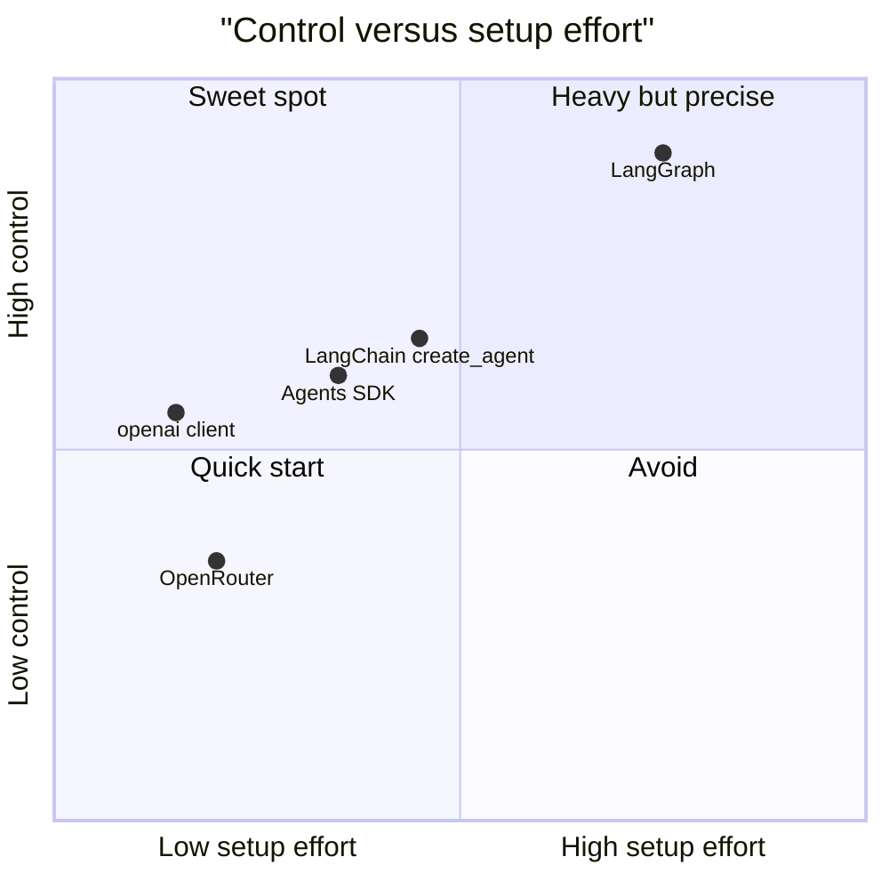

*A rough author's sketch, not measured data: more control usually costs more setup.*

## 7. Common Pitfalls and Production Gotchas

1. **(A) Using Chat Completions for a new GPT-6 project.** Tool calling and built-in tools need the Responses API on newer models. Fix: start new work on Responses.
2. **(A) Leaving the 10-minute default timeout.** A chat UI hangs while users leave. Fix: set `timeout` per client, such as 20 to 60 seconds.
3. **(A) Turning off retries to "fail fast".** Every brief 429 becomes a user-facing error. Fix: keep `max_retries`, cap concurrency, add jitter.
4. **(A) No `max_turns`.** One confused tool loop burns money all night. Fix: always pass `max_turns` and add an error handler with a polite fallback.
5. **(A) Parallel input guardrails before side effects.** The agent may call a tool before the tripwire fires. Fix: `run_in_parallel=False` for any agent with write tools.
6. **(A) Relying on the default model.** An SDK upgrade can change it under you. Fix: set `model` on every `Agent`.
7. **(A) Tracing errors with non-OpenAI models.** Traces upload to OpenAI, so you get 401s. Fix: disable tracing or add your own trace processor.
8. **(A) Code still on the Assistants API.** It shut down on 26 August 2026. Fix: migrate to Responses and Conversations.
9. **(B) Forgetting that fallbacks change the bill.** A free model that falls back to a paid one is billed at the paid price. Fix: read `model` in every response and alert on surprises.
10. **(B) A price cap that excludes your own fallback.** `max_price` silently filters providers. Fix: check that every fallback fits the cap, as in Example 3.
11. **(B) Structured output that breaks on some requests.** A provider ignored a parameter it does not support. Fix: `require_parameters: true`.
12. **(B) Data policy set only per request.** One missed call can reach a provider that stores prompts. Fix: set data policy and ZDR at account level too.
13. **(B) Quoting one platform's numbers as the market.** OpenRouter's study covers OpenRouter only. Fix: say "on OpenRouter".
14. **(B) Trusting a model count from one page.** OpenRouter pages said 400+ and 600+ models in 2026. Fix: quote the live models page, with a date.
15. **(C) Copying a 2023 tutorial.** `LLMChain` and `initialize_agent` are legacy. Fix: `create_agent`, with `langchain-classic` as a bridge.
16. **(C) Vague tool docstrings.** The model picks tools by their descriptions. Fix: one clear sentence per tool and per argument.
17. **(C) Middleware in the wrong order.** "After" hooks run in reverse. Fix: put cheap limits first and test the order once, as in Example 5.
18. **(C) Responses API switch surprises.** `ChatOpenAI` moves to Responses for `gpt-6` models with tools. Fix: know the rule; set `use_responses_api` when your backend only speaks Chat Completions.
19. **(D) Side effects before `interrupt()`.** The node re-runs from the top on resume, so the customer gets two emails. Fix: move side effects after the interrupt, or make them idempotent.
20. **(D) A bare `try/except` around `interrupt()`.** It swallows the pause. Fix: catch only specific exceptions.
21. **(D) `InMemorySaver` in production.** A restart forgets every paused refund. Fix: `PostgresSaver`, with a checkpoint retention policy.
22. **(D) Random or reused `thread_id` values.** You lose threads or mix two customers' state. Fix: derive it from a business key, such as `refund-<order_id>`.
23. **(D) Too many agents.** Two 90% stages give about 81% overall. Fix: add a stage only when an eval shows it helps.

> Rule of thumb: every layer you add must earn its place with a limit, a fallback or a saved state you can point to.

## 8. Comparison With Alternatives

**Part A: OpenAI's three layers and close rivals**

| Option | What it is | Who hosts the loop | Good for |
| --- | --- | --- | --- |
| `openai` client 3.46.0 | Typed HTTP wrapper | You | Single calls, custom loops |
| `openai-agents` 0.24.0 | Agent framework | You | Agents with handoffs and guardrails |
| OpenAI Agents API | Managed harness, public beta since September 2026 | OpenAI | Long tasks in sandboxes without running infrastructure |
| Vercel AI SDK (Day 6) | TypeScript toolkit for many providers | You | Next.js and React apps |
| Temporal plus an agent SDK | Durable workflow engine with GA integrations for the OpenAI Agents SDK, LangGraph, Google ADK and others | You or Temporal Cloud | Long, failure-prone agent runs |

The Temporal row comes from its [October 2026 integrations post](https://temporal.io/blog/ai-framework-integrations), which lists GA (Generally Available, meaning supported for production use rather than preview) integrations for the OpenAI Agents SDK, LangGraph, Google ADK, AWS Strands and the AI SDK by Vercel.

**Part B: gateways**

| Gateway | Hosting | Fee on tokens | Notable facts |
| --- | --- | --- | --- |
| [OpenRouter](https://openrouter.ai/pricing) | Hosted | 5.5% Standard, 8% Business; BYOK free up to $25,000 a month, then 5% | Joining Stripe, announced August 2026; product and API unchanged per the post |
| [Vercel AI Gateway](https://vercel.com/docs/ai-gateway/pricing) | Hosted | "No markup and no platform fee on tokens" | Paid add-ons such as team-wide ZDR at $0.10 per 1,000 requests |
| [LiteLLM](https://pypi.org/project/litellm/) | Self-hosted, open source | None, you pay for servers | Version 1.108.3; proxy server for 100+ LLMs |
| Direct provider | None | None | Simplest data path, no cross-vendor fallback |

**Part C: agent frameworks**

| Framework | Core idea | Current version | Pick it when |
| --- | --- | --- | --- |
| LangChain | `create_agent` plus middleware, any vendor | 1.4.9 | You want hooks and vendor neutrality |
| OpenAI Agents SDK | Agents, handoffs, guardrails | 0.24.0 | OpenAI-first projects |
| [CrewAI](https://pypi.org/project/crewai/) | Role-playing agent "crews", plus event-driven "flows" | 1.15.37 | Teams that think in roles and tasks |
| Plain SDK loop | 40 lines you own | n/a | Small, stable tools and full control |

**Part D: orchestration**

| Option | State model | Human pause | Pick it when |
| --- | --- | --- | --- |
| LangGraph 1.2.20 | Checkpoints per super-step | `interrupt()` and `Command` | Agent-centric workflows in Python or JS |
| Temporal | Recorded progress, replayed on recovery | Long waits for approval without polling | The company already runs Temporal |
| CrewAI Flows | Flow state between steps, conditional branches | Not checked for this page | Crew-based teams |
| Hand-written state machine | Your database tables | Your code | Tiny flows with two or three states |

## 9. Hands-On Exercise: A Refund Copilot With a Swappable Brain

**Time:** 2 to 3 hours. **Goal:** one small service that uses all four Parts. It answers order questions, pays small refunds, and waits for a manager on big ones.

1. **Set up.** Create a virtual environment with Python 3.10+. Run `pip install openai openai-agents langchain langchain-openai langgraph langgraph-checkpoint-sqlite`. Start the fake server from Example 0.
2. **Part A, the client.** Write `llm.py` with one function, `make_client()`, that reads `LLM_BASE_URL`, `LLM_API_KEY` and `LLM_MODEL` from the environment. Set `timeout=30` and `max_retries=2`.
3. **Part A, the hand loop.** Port Example 1 to use `make_client()`. Add a `lookup_order` tool and a five-turn cap. Log `resp.model` and `resp.usage` on every call.
4. **Part B, the gateway switch.** Add an `LLM_EXTRA_BODY` setting that holds a JSON string. When the base URL is OpenRouter, pass it as `extra_body` with a `models` fallback list, `data_collection: "deny"` and `require_parameters: true`. Print the request body against the fake to prove it.
5. **Part C, the agent.** Rebuild the support agent with `create_agent`. Add `ModelCallLimitMiddleware(run_limit=4)` and a `before_model` hook that masks any 10-digit phone number in the latest user message.
6. **Part D, the workflow.** Build a `StateGraph` with nodes `classify`, `answer`, `check_policy`, `human_review` and `pay`. `answer` calls your LangChain agent. Refunds above Rs 5,000 go through `interrupt()`.
7. **Persistence.** Compile with `SqliteSaver`. Use `thread_id = "refund-" + order_id`.
8. **Crash test.** Make `pay` raise once, then resume with `graph.invoke(None, config)`. Confirm `check_policy` did not run twice.
9. **A tiny API.** Wrap it in FastAPI or Express with `POST /ask` and `POST /approve/{order_id}`. The approve route resumes the graph with `Command(resume="approve")`.
10. **Write a one-page README** for a customer. Name each layer, what it adds, and how to switch from the fake to OpenAI or OpenRouter.

### Acceptance Criteria

- [ ] Changing three environment variables moves the app between the fake, OpenAI and OpenRouter, with no code change.
- [ ] Every model call logs the model that answered and its token usage.
- [ ] A loop longer than the cap stops cleanly with a friendly message.
- [ ] A phone number in a user message never reaches the model, shown by a log line.
- [ ] A Rs 12,000 refund pauses, survives a process restart, and pays after `/approve`.
- [ ] A Rs 800 refund pays with no human step.
- [ ] After the crash test, the counter shows `check_policy` ran once.
- [ ] The README explains when the customer could drop OpenRouter or LangChain.

**Stretch goal:** run the same five tickets through two OpenRouter models, such as a global model and `sarvamai/sarvam-m`, and score the answers with a simple rubric of correct, polite and in the user's language.

## 10. Interview Questions

**1. (A) What is the difference between the `openai` package and `openai-agents`?**
The first is a typed wrapper over the HTTP API: one call, one reply, with retries and typed errors. The second is an agent framework on top. It runs the tool loop, handoffs, guardrails, sessions and tracing.

**2. (A) Walk me through function calling. Who runs the function?**
You describe a function with a JSON schema. The model replies with a call request and arguments. Your code validates and runs it, sends the result back, and the model writes the answer. The model never executes anything, so permissions live in your code.

**3. (A) Responses API or Chat Completions for a new project?**
Responses. OpenAI calls it the primary API, and newer GPT-6 models need it for built-in tools and, in some cases, tool calling. Chat Completions still works and is what most other providers copy, so keep it for portability layers.

**4. (A) An input guardrail exists, yet the agent still issued a refund. How?**
Input guardrails run in parallel with the agent by default. The agent called the refund tool before the tripwire fired. Set `run_in_parallel=False` for agents with side effects, and add tool guardrails on the refund tool itself.

**5. (B) What does OpenRouter add over calling each vendor directly?**
One OpenAI-compatible API and bill for 600+ models, fallbacks across models, and routing across providers by price, speed or data policy. The cost is a platform fee, one more hop, and a third party in the data path.

**6. (B) How does OpenRouter choose a provider by default?**
It skips providers with recent outages, then load-balances among stable ones weighted by inverse square of price. So a provider at half the price gets four times the weight. `order` or `sort` turns this off.

**7. (B) Legal says no provider may store prompts. What do you configure?**
`data_collection: "deny"` to skip providers that may store or train on data, and `zdr: true` for zero data retention endpoints. Set them account-wide, not only per request. Then confirm OpenRouter's own logging is off, which is the default.

**8. (B, customer scenario) Their bill doubled after adding a fallback to a free model. Why?**
Billing follows the model that answered. When the free model failed, the paid fallback served the request at full price. Log the response's `model` field, alert on fallback rates, and list only free models if cost must stay zero.

**9. (C) What is middleware in LangChain 1.x, and why does it matter?**
Hooks that run at fixed points in the agent loop: before and after the agent, before and after each model call, and around model and tool calls. They hold the production rules: limits, retries, fallbacks, PII redaction and human approval.

**10. (C) A customer runs `LLMChain` and `initialize_agent`. How do you migrate?**
Rebuild the critical path with `create_agent` and middleware, on Python 3.10+. Move rarely used legacy chains to `langchain-classic` as a bridge. Add an eval set first, so you can prove the new version is no worse.

**11. (C) How does LangChain relate to LangGraph?**
`create_agent` runs on the LangGraph runtime, as a small graph of model and tools nodes. So LangChain agents get checkpointers, threads, streaming and interrupts. Human-in-the-loop middleware needs a checkpointer for that reason.

**12. (D) What is a checkpointer, and what four things does it give you?**
It saves graph state after each step, keyed by `thread_id`. You get multi-turn memory, human-in-the-loop pauses, time travel for debugging, and crash recovery that resumes from the last good step.

**13. (D) A manager approval resumed and the customer got two emails. Why?**
On resume, the node re-runs from its first line. The email was sent before `interrupt()`, so it ran twice. Move it after the interrupt or into a later node, or make it idempotent with a key.

**14. (D, system design) Design a loan document check that waits up to three days for a human.**
A `StateGraph` with extract, validate, risk-score, human-review and decide nodes. Use `PostgresSaver`, durability `"sync"`, and `thread_id` from the application ID. The review node calls `interrupt()` with a JSON summary, and an API resumes it with `Command`. Add retention rules for old checkpoints.

**15. (All, system design) Where would you put each of today's tools in one architecture?**
LangGraph at the top for steps, state and pauses. A LangChain or Agents SDK agent inside nodes for tool use and policy. The `openai` client for model calls. OpenRouter or a direct provider underneath for model choice and fallback. Skip any layer that has no job.

**16. (All, customer scenario) The CTO asks, "Why not just call the API?" What do you say?**
For one prompt and one answer, you should. Add a layer only for a named need: a gateway for vendor choice and failover, a framework for limits and redaction, a graph for approvals and restarts. Each layer has a fee or a learning cost, so each must earn its place.

## 11. How It Connects

**Looking back:**

- **Day 1, agent loops and tools:** Example 1 is the Day 1 loop, written with the real OpenAI SDK.
- **Day 2, frontier LLMs and agents:** GPT-6 and Claude 5.5 slugs today are the models Day 2 described.
- **Day 3, model selection:** OpenRouter turns model selection into an experiment you can run with one slug change.
- **Day 4, agent frameworks:** LangChain, the Agents SDK and LangGraph are three concrete frameworks from that map.
- **Day 5, coding agents:** OpenAI's hosted Agents API runs the same Codex harness that powers its coding agent.
- **Day 6, the AI SDK:** it is the TypeScript cousin of today's tools, and Temporal integrates with it too.
- **Day 7, open-source and local models:** gateways and `base_url` let open models such as Sarvam-M slot in without code changes.
- **Day 8, token cost optimization:** cached input, gateway fees and fallback billing are all cost levers from Day 8.
- **Day 9, context engineering:** summarisation and context-editing middleware are context engineering in code.
- **Day 10, harness engineering:** guardrails, call limits and checkpoints are harness parts, packaged by these tools.

**Looking ahead:**

- **Day 16, connecting agents:** MCP servers become tools for both the Agents SDK and LangChain agents.
- **Day 16, human-in-the-loop:** LangGraph's `interrupt()` and LangChain's approval middleware are the core building blocks there.
- **Day 16, enterprise integrations:** the refund graph's `pay` node becomes a real call into a customer's payment or CRM system.
- **Later days:** evaluation, observability, security and deployment build on today's layers, so keep your exercise code.

## 12. Mental Map to Remember

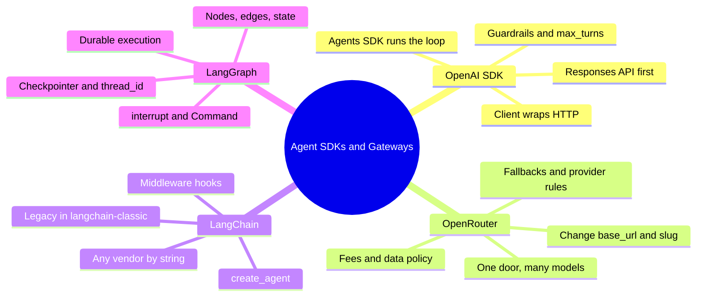

Memory hooks, one per Part:

- **OpenAI SDK, "the phone with good habits":** it redials and shows readable errors; the Agents SDK also holds the conversation.
- **OpenRouter, "the travel site":** one booking, any airline, a small fee, and it rebooks you when a flight is cancelled.
- **LangChain, "the adapter with a surge protector":** any socket, and middleware filters what reaches the model.
- **LangGraph, "the board game with a notebook":** pause on any square, resume from the last written board.

And the short version of today: four layers, four questions. Which step next, how does the agent behave, how do we call the model, and which model answers? If a layer has no question to answer, leave it out and enjoy the free afternoon. 😄

## 13. Further Reading and Sources

Start with the first three if you only have an hour. Checked on 8 November 2026.

**Best resources:**

1. [OpenAI Agents SDK: running agents](https://openai.github.io/openai-agents-python/running_agents/). The exact loop, turn limits and conversation options.
2. [OpenAI Agents SDK: guardrails](https://openai.github.io/openai-agents-python/guardrails/). The parallel-execution trap, explained by the source.
3. [LangGraph interrupts](https://docs.langchain.com/oss/python/langgraph/interrupts). The four rules that prevent real production bugs.
4. [OpenRouter provider routing reference](https://openrouter.ai/docs/guides/routing/llms-full.txt). Every routing field and the default load-balancing rule.
5. [LangChain v1 release notes](https://docs.langchain.com/oss/python/releases/langchain-v1). `create_agent`, middleware and what moved to `langchain-classic`.
6. [Building LangGraph](https://www.langchain.com/blog/building-langgraph), September 2025. Why the runtime uses Pregel, channels and checkpoints.
7. [LangGraph durable execution](https://docs.langchain.com/oss/python/durable-execution). Durability modes and resume rules.
8. [OpenAI changelog](https://developers.openai.com/api/docs/changelog). Model launches and shutdowns; read before every engagement.
9. [OpenRouter FAQ](https://openrouter.ai/docs/faq). Fees, BYOK and logging in plain words.
10. [State of AI on OpenRouter](https://arxiv.org/html/2601.10088v1), January 2026. What 100 trillion tokens say about real usage.

**Sources:**

- [OpenAI: openai on PyPI](https://pypi.org/project/openai/)
- [OpenAI: API changelog](https://developers.openai.com/api/docs/changelog)
- [OpenAI: gpt-6-luna model page](https://developers.openai.com/api/docs/models/gpt-6-luna)
- [OpenAI: gpt-5.6-luna model page](https://developers.openai.com/api/docs/models/gpt-5.6-luna)
- [OpenAI: gpt-6-sol model page](https://developers.openai.com/api/docs/models/gpt-6-sol)
- [OpenAI: openai-agents on PyPI](https://pypi.org/p/openai-agents)
- [OpenAI Agents SDK: running agents](https://openai.github.io/openai-agents-python/running_agents/)
- [OpenAI Agents SDK: guardrails](https://openai.github.io/openai-agents-python/guardrails/)
- [OpenAI Agents SDK: models](https://openai.github.io/openai-agents-python/models/)
- [OpenAI: The next evolution of the Agents SDK](https://openai.com/index/the-next-evolution-of-the-agents-sdk/)
- [OpenAI: Introducing the Agents API](https://openai.com/index/introducing-the-agents-api/)
- [OpenAI: Introducing AgentKit](https://openai.com/index/introducing-agentkit/)
- [OpenRouter: quickstart](https://www.openrouter.ai/docs/quick-start)
- [OpenRouter: routing guide](https://openrouter.ai/docs/guides/routing)
- [OpenRouter: full routing reference](https://openrouter.ai/docs/guides/routing/llms-full.txt)
- [OpenRouter: pricing](https://openrouter.ai/pricing)
- [OpenRouter: FAQ](https://openrouter.ai/docs/faq)
- [OpenRouter: Anthropic provider page](https://openrouter.ai/provider/anthropic)
- [OpenRouter: Sarvam AI models](https://openrouter.ai/sarvamai)
- [OpenRouter: ChatOpenRouter with LangChain](https://openrouter.ai/blog/tutorials/langchain-chatopenrouter-setup/)
- [OpenRouter: OpenRouter is joining Stripe](https://openrouter.ai/blog/announcements/openrouter-is-joining-stripe/)
- [OpenRouter: enterprise](https://openrouter.ai/enterprise)
- [arXiv: State of AI, OpenRouter and a16z, abstract](https://arxiv.org/abs/2601.10088)
- [arXiv: State of AI, full paper](https://arxiv.org/html/2601.10088v1)
- [Inc42: Sarvam picked to build India's sovereign model](https://inc42.com/buzz/sarvam-to-build-indias-first-homegrown-sovereign-ai-model)
- [LangChain: overview](https://docs.langchain.com/oss/python/langchain/overview)
- [LangChain: v1 release notes](https://docs.langchain.com/oss/python/releases/langchain-v1)
- [LangChain: middleware reference](https://reference.langchain.com/python/langchain/middleware/)
- [LangChain: langchain on PyPI](https://pypi.org/project/langchain/)
- [LangChain: LangChain and LangGraph 1.0](https://www.langchain.com/blog/langchain-langgraph-1dot0)
- [LangChain: State of Agent Engineering](https://langchain.com/state-of-agent-engineering)
- [LangChain: Top 5 LangGraph agents in production 2024](https://www.langchain.com/blog/top-5-langgraph-agents-in-production-2024)
- [LangChain: Is LangGraph used in production?](https://www.langchain.com/blog/is-langgraph-used-in-production)
- [LangGraph: overview](https://docs.langchain.com/oss/python/langgraph/overview)
- [LangGraph: persistence and durable execution](https://docs.langchain.com/oss/python/langgraph/durable-execution)
- [LangGraph: durable execution](https://docs.langchain.com/oss/python/durable-execution)
- [LangGraph: interrupts](https://docs.langchain.com/oss/python/langgraph/interrupts)
- [LangChain: Building LangGraph](https://www.langchain.com/blog/building-langgraph)
- [LangGraph on PyPI](https://pypi.org/project/langgraph/)
- [ZenML: LinkedIn Hiring Assistant](https://zenml.io/llmops-database/building-linkedin-s-first-production-agent-hiring-assistant-platform-and-architecture)
- [ZenML: Uber developer tools on LangGraph](https://www.zenml.io/llmops-database/building-ai-developer-tools-using-langgraph-for-large-scale-software-development)
- [ZenML: Swiggy Hermes V3](https://www.zenml.io/llmops-database/evolution-of-hermes-v3-building-a-conversational-ai-data-analyst)
- [Databricks: Swiggy's customer support agent](https://databricks.com/blog/redefining-customer-support-swiggys-enterprise-scale-ai-agent-built-databricks)
- [Temporal: AI framework integrations are GA](https://temporal.io/blog/ai-framework-integrations)
- [Vercel: AI Gateway pricing](https://vercel.com/docs/ai-gateway/pricing)
- [LiteLLM on PyPI](https://pypi.org/project/litellm/)
- [CrewAI on PyPI](https://pypi.org/project/crewai/)



