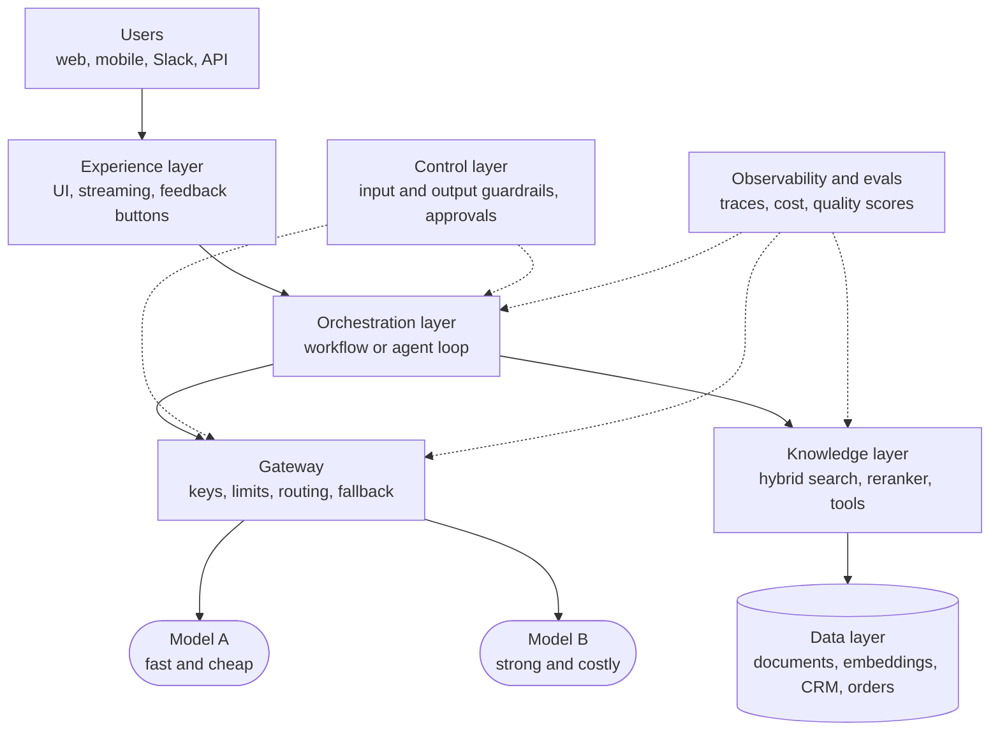
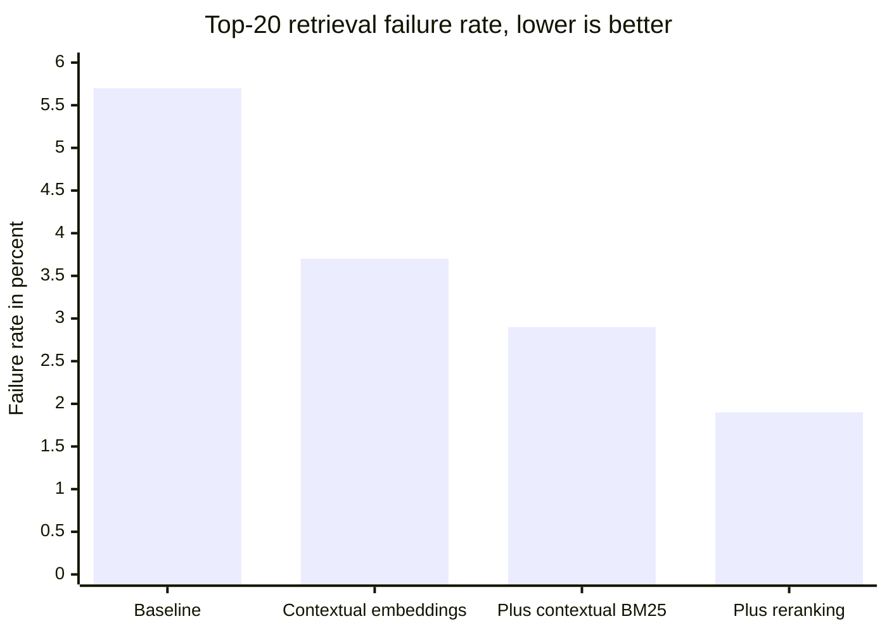
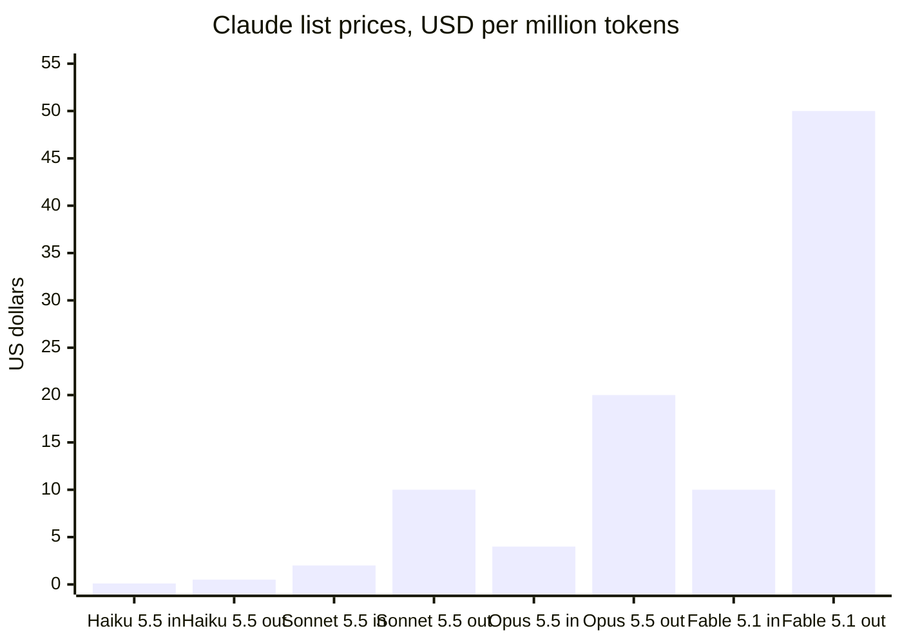
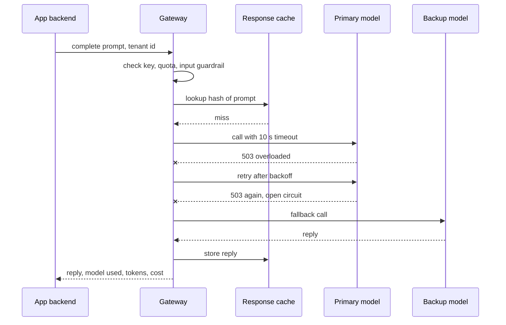
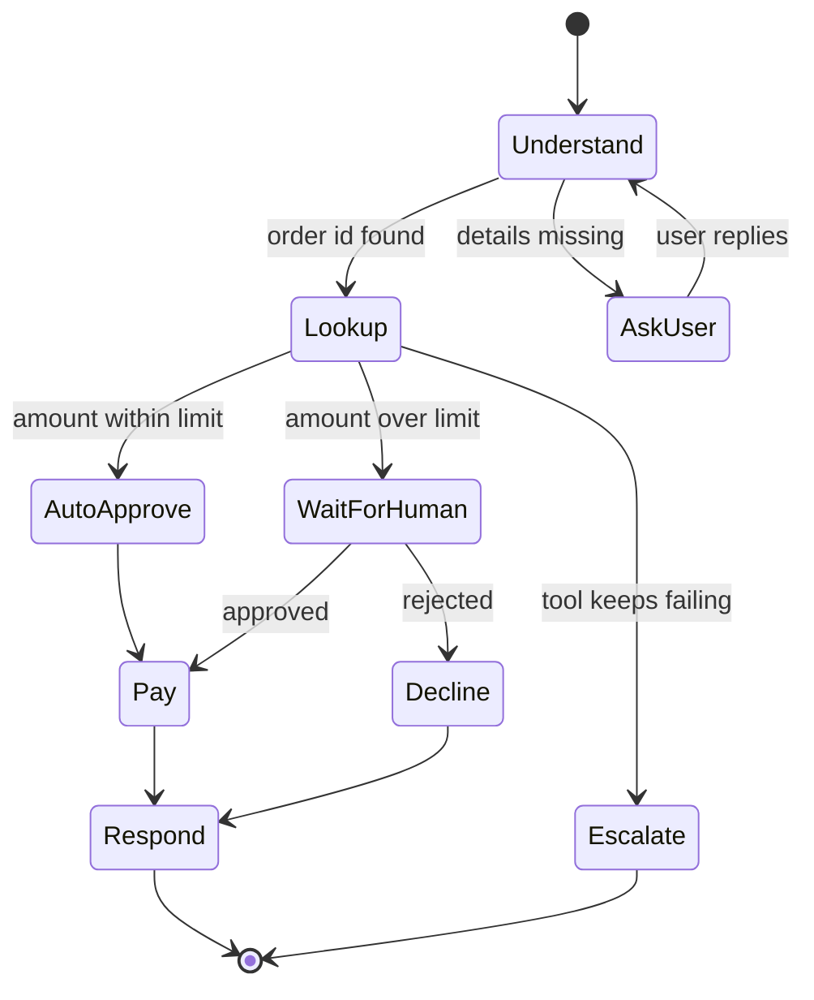
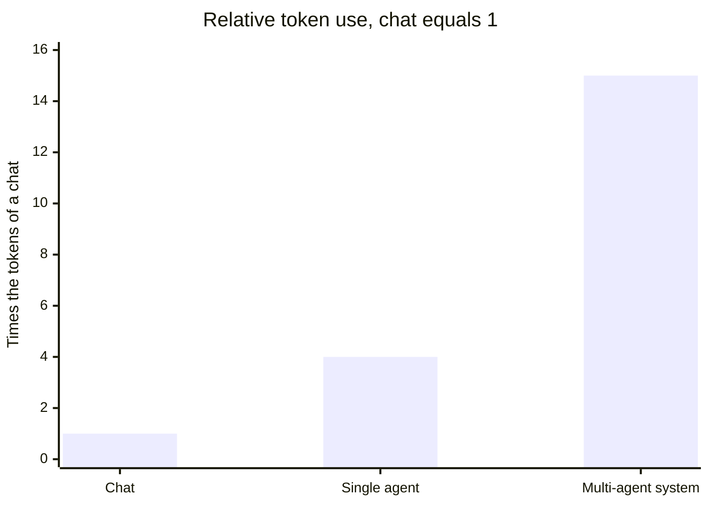
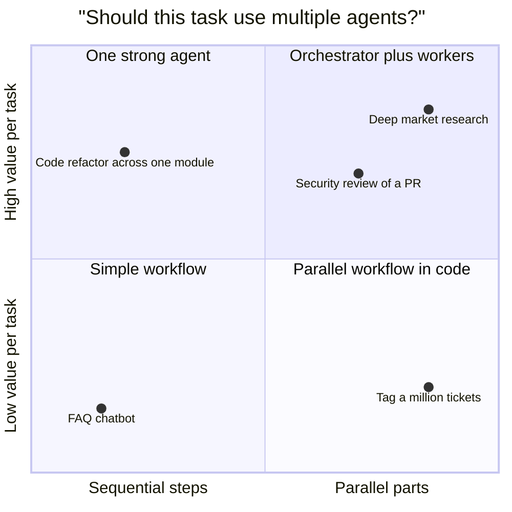
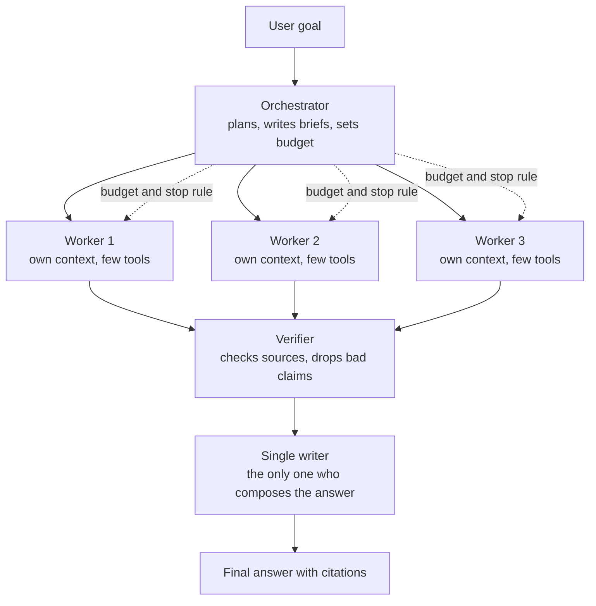
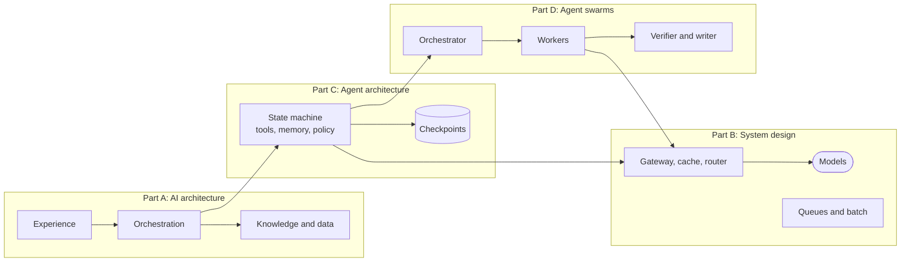
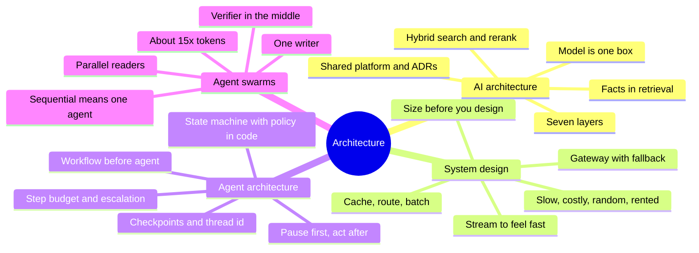



*Utkrishta Sinha · 8 Nov 2026 · about 75 minutes · covers syllabus topics 16, 17, 18, 25*

**What today covers**

| Part | Syllabus topic | What you will be able to do |
| --- | --- | --- |
| A | 16. AI architecture | Draw the layers of an AI product and say what each layer owns |
| B | 17. System design for AI systems | Design for latency, cost, failure and scale when the core part is a slow, costly, random model |
| C | 18. Agent architecture | Build one agent as a state machine with tools, memory, policy and checkpoints |
| D | 25. Agent swarms (multi-agent systems) | Decide when many agents beat one, and build an orchestrator with workers and a verifier |

## 1. The Five Big Ideas

Today zooms out from one agent to the whole system around it. Facts below were checked on 8 November 2026. Read time is about 75 minutes, so take a tea break halfway.

- **The model is one box, not the system.** An AI product is layers: data, retrieval, model, guardrails, orchestration, application and observability. Most bugs live between the boxes.
- **Design for a slow, costly, random dependency.** A model call can take seconds, cost real money and give a different answer each time. Caches, gateways, timeouts and fallbacks exist because of that.
- **Use the simplest shape that works.** A fixed workflow beats an agent when the steps are known. Anthropic's advice is to [start simple and add complexity only when it pays](https://www.anthropic.com/engineering/building-effective-agents).
- **An agent is a loop with state.** Think → act → observe, repeated, with memory, tools, a budget and a stop rule. Treat it as a state machine you can pause, resume and audit.
- **Many agents help only for parallel work.** A Google study found multi-agent setups gained 80.9% on a parallel finance task but lost 39% to 70% on a sequential planning task ([Google Research](https://research.google/blog/towards-a-science-of-scaling-agent-systems-when-and-why-agent-systems-work/)). Swarms read in parallel, but one writer should decide.

Think of a restaurant kitchen. The chef is talented. But the menu, pantry, order tickets, line cooks and health inspector are what make it a restaurant. Today is about designing the kitchen, not hiring a better chef. And if ten chefs stir one pot at the same time, you get soup with opinions. 🍲

## 2. Why This Matters for an FDE

An FDE (Forward Deployed Engineer) is an engineer who sits with a customer and gets an AI product working in their real world. Customers rarely ask "what architecture should we use?" They say "it is slow", "it is expensive" or "it does strange things". Each of those is usually an architecture problem in disguise.

Here is where each of today's four topics shows up on a real engagement:

- **Part A, AI architecture.** In the first week you draw the customer's system on a whiteboard. You find where data lives, where the model sits and what checks the answer.
- **Part B, system design.** When traffic grows, the demo breaks. You add caching, rate limits, a gateway, queues and fallbacks so it survives Monday morning.
- **Part C, agent architecture.** The customer wants the bot to *do* things, such as refunds or ticket updates. You design the loop, tools, memory, approvals and checkpoints.
- **Part D, agent swarms.** Someone has read about "agent teams" and wants twelve agents. You decide whether one agent, a workflow, or an orchestrator with workers fits best.

| Part | What the customer says | Usual root cause | The fix |
| --- | --- | --- | --- |
| A | "It makes up policy details." | No retrieval layer, so the model answers from memory | Add RAG with citations and an output check |
| A | "Every team built its own chatbot." | No shared platform layer | One gateway, one prompt store, shared guardrails and tracing |
| A | "We can't tell why it answered that." | No observability layer | Trace every request: prompt, retrieved documents, model, cost |
| B | "It takes 12 seconds to reply." | Long outputs, sequential calls, no streaming | Stream, shorten outputs, run steps in parallel, use a smaller model where it is enough |
| B | "The bill tripled this month." | Same big prompt sent every call, no caching, one expensive model for everything | Prompt caching, a router to cheaper models, batch jobs for offline work |
| B | "It died when the provider had an outage." | One provider, no fallback | Gateway with retries, timeouts and a fallback model |
| C | "It refunded the wrong amount." | Money rules live in the prompt | Put limits in code, and require human approval for write actions |
| C | "It loops forever on hard tickets." | No step budget or stop rule | Max steps, loop detection and escalation to a human |
| C | "A crash halfway lost the whole job." | State only in memory | Checkpoint state after each step, resume from the last one |
| D | "Our five agents contradict each other." | Many agents writing with different assumptions | One writer, others read; share context or use a single agent |
| D | "The research agent is great but costs a fortune." | Multi-agent runs burn many more tokens | Use workers only for broad, parallel tasks; cap budget per run |

> **Sentence for a customer call:** "Before we add more agents, let's draw the system and find the slowest, costliest and least-checked box."

There is a career reason too. In FDE interviews, "design a support bot for 10 million users" is a common question. It mixes all four Parts. If you can draw the layers, size the costs, design the agent loop and justify one agent versus many, you are already ahead.

## 3. Core Concepts, From Simple to Deep

This section has one part per syllabus topic. Each part starts with an everyday picture, then a word list, then builds from simple to deep. Read Part A first, because the other three parts sit on top of it.

### Part A: AI Architecture

#### A.1 The Everyday Picture: A Hospital, Not a Doctor

A great doctor alone is not a hospital. A hospital also needs patient records, a lab, a pharmacy, rules about who may prescribe what, and a front desk. It also keeps a log of every treatment, so mistakes can be traced.

An AI product works the same way. The model is the doctor. The records are your data, the lab is retrieval, the pharmacy rules are guardrails, the front desk is your app, and the log is observability.

**AI architecture** is the plan for all of those parts and how they talk. It answers four questions. Where does knowledge come from? Where does thinking happen? What checks the result? How do we see what happened?

#### A.2 The Words You Need

| Term | Plain meaning | Simple example |
| --- | --- | --- |
| LLM (Large Language Model) | An AI that reads text and predicts the next words | Claude Sonnet 5.5 |
| Foundation model | A large general model that many products build on | The same model powers a chatbot and a summariser |
| Inference | Running a trained model to get an answer | One API call that returns a reply |
| Token | A small piece of text that models read and bill by | "Refund" might be one or two tokens |
| Context window | The most text a model can see in one call | 1 million tokens on current Claude models |
| Prompt | The full text you send to the model | System rules plus the user's question |
| System prompt | Fixed instructions at the start of every call | "You are a support agent for Acme" |
| RAG (Retrieval-Augmented Generation) | Find relevant documents first, then let the model answer from them | Look up the refund policy, then answer |
| Grounding | Making the answer depend on real sources | The bot quotes the policy page |
| Hallucination | A confident answer that is false | The bot invents a 30-day refund rule |
| Chunk | A small slice of a long document | One paragraph of a 40-page policy |
| Embedding | A list of numbers that captures meaning | "refund" and "money back" get similar numbers |
| Vector database | A store that finds chunks with similar embeddings | pgvector, Azure AI Search |
| BM25 | A classic keyword search score | Finds the exact error code "E-4021" |
| Hybrid search | Keyword search and embedding search together | Catches both "E-4021" and "payment failed" |
| Reranker | A model that re-sorts search results by relevance | Picks the best 20 from 150 hits |
| Guardrail | A check on input, output or action | Block replies that contain card numbers |
| Orchestration | Code that decides which step runs next | Retrieve, then call the model, then check |
| Gateway | One front door for all model calls | Adds keys, limits, logging and fallback |
| Prompt registry | A versioned store for prompts | Prompt v12 is live, v13 is in test |
| Observability | Seeing inside the system while it runs | A trace of each step with time and cost |
| Trace | A record of one request across every step | Retrieved docs, prompt, model, answer, cost |
| Evals (evaluations) | Tests that score AI quality | 200 known questions with expected answers |
| Fine-tuning | Training a model further on your own examples | Teaching a model your ticket labels |
| Reference architecture | A vendor's tested blueprint for a common system | Microsoft's baseline chat design |
| Data residency | Rules about where data may be stored | Customer data must stay in one country |
| PaaS (Platform as a Service) | A cloud service you use without managing servers | A managed search index |

#### A.3 The Simplest Version: Three Boxes

The smallest AI app has three boxes. A user interface sends text to your backend. The backend calls a model API and sends the reply back.

This works for a demo. It fails in production for four reasons. The model does not know the customer's private data. Nothing checks the answer. Nobody can see why it said what it said. Every team copies the same code with different bugs.

Each failure adds a layer. That is the whole story of AI architecture: layers added for a reason, not for fashion.

#### A.4 The Seven Layers of an AI Product

Here is the full stack you will draw on a customer whiteboard. Names vary between vendors, but the jobs stay the same.

1. **Experience layer.** The chat window, the Angular screen, the Slack bot or the API that users touch.
2. **Orchestration layer.** Code that runs the steps: retrieve, prompt, call, check, act. Agents live here (Part C).
3. **Model layer.** One or more models, reached through a gateway. This includes routing between cheap and strong models (Day 3).
4. **Knowledge layer.** Search over documents and data: RAG, databases and tools that read live systems.
5. **Data layer.** The source systems, the document pipeline, embeddings and conversation history.
6. **Control layer.** Guardrails, permissions, policies and human approval. Day 18 goes deep on this.
7. **Observability and evaluation layer.** Traces, logs, cost tracking and eval suites that cut across every other layer.



*The seven layers of an AI product: the model is one box among many.*

Notice the dotted lines. Control and observability are not steps in a line. They wrap everything, like the walls and cameras of the hospital.

#### A.5 Where Knowledge Comes From: Four Patterns

The biggest architecture choice is how the model gets the facts it needs. There are four main patterns, from simplest to heaviest.

| Pattern | How it works | Good for | Weak spot |
| --- | --- | --- | --- |
| Prompt only | Facts are written into the system prompt | Small, stable rules | Goes stale, costs tokens on every call |
| Long context plus caching | Put the whole knowledge base in the prompt and cache it | Under about 500 pages | Grows costly and slow as data grows |
| RAG | Search first, then send only the best chunks | Large or changing document sets | Retrieval misses cause wrong answers |
| Fine-tuning | Train the model on examples | Style, format, narrow labels | Poor at fresh facts, costly to redo |

Anthropic gives a useful threshold. If the knowledge base is under 200,000 tokens, about 500 pages, you can [skip RAG and put it all in the prompt](https://www.anthropic.com/engineering/contextual-retrieval). With prompt caching, they report this cut latency by more than 2x and cost by up to 90%.

Fine-tuning has a real-world warning too. Swiggy's support team tried a fine-tuned open-source model and saw ["catastrophic forgetting"](https://databricks.com/blog/redefining-customer-support-swiggys-enterprise-scale-ai-agent-built-databricks), where the model lost general skills. They relied mainly on prompt engineering instead.

> **FDE rule:** facts go in retrieval, behaviour goes in prompts, and fine-tuning comes last.

#### A.6 Under the Hood: How a Good RAG Pipeline Works

RAG has two halves. The offline half prepares documents. The online half answers questions.

**Offline (indexing):**

1. Load documents from the source systems.
2. Split them into chunks of a few hundred tokens.
3. Add context to each chunk, so it still makes sense alone.
4. Create an embedding for each chunk and store it in a vector index.
5. Also build a keyword index, such as BM25.

**Online (answering):**

1. Turn the question into an embedding and a keyword query.
2. Search both indexes, then merge the lists with rank fusion.
3. Rerank the top candidates and keep the best few.
4. Send them to the model with an instruction to cite sources.
5. Check the answer before showing it.

Step 3 of the offline half is called **contextual retrieval**. A chunk saying "revenue grew 3%" is useless without knowing which company and which quarter. Anthropic prepends a short, generated context to each chunk before indexing.

Their measured results are a good example of architecture beating model size:



*Failure fell from 5.7% to 1.9%, a 67% cut, without changing the model. Source: Anthropic, Contextual Retrieval, September 2024.*

Anthropic estimated the one-time cost of adding context at about $1.02 per million document tokens, using prompt caching. That is cheap compared with wrong answers in front of customers.

#### A.7 A Real Reference Architecture: Microsoft's Baseline Chat

Vendors publish reference architectures, which are tested blueprints. Reading one is the fastest way to learn what "production" means. Microsoft's [baseline Microsoft Foundry chat architecture](https://learn.microsoft.com/en-us/azure/architecture/ai-ml/architecture/baseline-microsoft-foundry-chat), last updated in August 2026, is a good example.

Its request flow, in plain words:

1. A user request enters through Application Gateway with a WAF (Web Application Firewall), the only public entry point.
2. App Service hosts the chat UI and calls the agent over a private network link.
3. Foundry Agent Service applies the system prompt and picks tools, such as AI Search for grounding.
4. Calls to outside tools leave through Azure Firewall, which only allows named destinations.
5. The agent sends context to the model.
6. Conversations and agent state are saved in Cosmos DB, so users can resume later.

Two details teach a lot. First, nearly every service talks over private endpoints, not the public internet. Second, the page says plainly that the agent service has no built-in disaster recovery. So you store agent definitions as code and back up the database yourself.

#### A.8 A Second Lens: The AWS Generative AI Lens

AWS publishes a [Well-Architected Generative AI Lens](https://docs.aws.amazon.com/wellarchitected/latest/generative-ai-lens/generative-ai-lens.html), dated November 2025. It is a checklist for reviewing an AI workload. It uses six lifecycle phases: scoping, model selection, customization, development, deployment and continuous improvement.

It reviews each phase against six pillars: operational excellence, security, reliability, performance efficiency, cost optimization and sustainability. The [November 2025 update](https://aws.amazon.com/blogs/architecture/announcing-the-updated-aws-well-architected-generative-ai-lens) added a section on agentic architecture paradigms and eight scenarios, including autonomous call centres.

You do not need to memorise either framework. Use them as a question list in a customer architecture review. "Which pillar is weakest here?" is a strong opening question.

#### A.9 The Platform Layer: Stop Every Team Building Its Own

In large companies, the second AI project is where architecture really starts. Without a shared platform, each team picks its own model, keys, prompts and logging. Security cannot audit any of it.

A shared AI platform usually offers:

- **One gateway** for all model calls, with keys, rate limits, logs and fallback.
- **A prompt registry**, so prompts are versioned like code.
- **Shared guardrails**, so every app blocks the same bad content.
- **One tracing system**, so any request can be replayed.
- **An eval service**, so every change is scored before release.

Swiggy's support agent shows this shape. It used Databricks AI Gateway for [permissions, rate limits, payload logging and traffic fallback](https://databricks.com/blog/redefining-customer-support-swiggys-enterprise-scale-ai-agent-built-databricks), plus MLflow for tracing and a prompt registry. LinkedIn built a similar internal platform, with a central registry of agents and [OpenTelemetry-based tracing in production](https://news.linkedin.com/2025/linkedin-s-ai-stack--expanding-to-build-tomorrow-s-agents).

#### A.10 Deep Dive: Architecture Decisions an FDE Writes Down

Good architects write short decision records. An ADR (Architecture Decision Record) is a one-page note: the choice, the options, the reason and the cost. For AI systems, these are the decisions that matter most:

| Decision | Typical options | What usually decides it |
| --- | --- | --- |
| Where models run | Vendor API, cloud marketplace, self-hosted | Data rules, cost at scale, team skills |
| How knowledge arrives | Prompt, long context, RAG, fine-tune | Data size, change rate, accuracy needs |
| How many models | One, or a router across several | Cost pressure, task variety |
| Where state lives | In memory, database, managed agent service | Need to resume, audit, scale out |
| Where checks run | Prompt only, code checks, separate evaluator | Risk of a wrong answer |
| How to observe | Logs only, full traces, traces plus evals | Regulation, debugging needs |

The point of writing these down is handover. When you leave, the customer's team must know why each box exists. Otherwise the next engineer removes the guardrail because "it seemed slow".

### Part B: System Design for AI Systems

#### B.1 The Everyday Picture: A Famous but Moody Supplier

Imagine your shop depends on one famous supplier. Their goods are excellent. But each delivery takes a few seconds to a minute, costs real money, and is slightly different every time. Sometimes they are closed without warning.

You would not run your shop the same way as with a normal supplier. You would keep stock of popular items, have a backup supplier, order in bulk overnight, and tell customers "your order is on its way" instead of making them stare at the door.

That is system design for AI. The model is the moody supplier. Caches, fallbacks, batch jobs and streaming are how you keep the shop open.

#### B.2 The Words You Need

| Term | Plain meaning | Simple example |
| --- | --- | --- |
| Functional requirement | What the system must do | Answer order questions |
| Non-functional requirement | How well it must do it | Reply within 2 seconds, 99.9% of the time |
| Latency | Time from request to response | 1.8 seconds for a reply |
| TTFT (Time To First Token) | Time until the first word appears | 400 ms, then the rest streams in |
| Streaming | Sending the reply word by word as it is made | Text appears as it is generated |
| p50, p95, p99 | The time that 50%, 95% or 99% of requests beat | p95 of 3 s means 1 in 20 is slower |
| Throughput | Work done per unit of time | 200 conversations per second |
| RPM / TPM | Requests per minute and tokens per minute | Provider limits you to 4,000 RPM |
| Rate limit | A cap on how often you may call | HTTP 429 "too many requests" |
| Backoff | Waiting longer after each failed retry | Wait 0.1 s, then 0.2 s, then 0.4 s |
| Timeout | Giving up on a call that takes too long | Abort after 10 seconds |
| Fallback | A second option when the first fails | Switch to another model or provider |
| Circuit breaker | Stop calling a failing service for a while | After 2 failures, skip it for 10 s |
| Idempotency | Doing it twice has the same effect as once | A retried refund pays only once |
| Prompt caching | The provider reuses the processed start of a prompt | The 6,000-token policy block is billed at a tenth |
| Response cache | You store whole answers and reuse them | Same question, same stored answer |
| Semantic cache | Reuse an answer for a question with similar meaning | "Where's my order" matches "track my order" |
| Batch API | Send many requests to run later at a discount | Score 1 million reviews overnight |
| Queue | A waiting line of jobs for workers | A message queue for long summaries |
| Router | Picks which model handles a request | Easy questions go to a small model |
| Multi-tenancy | Many customers share one system safely | Tenant A never sees tenant B's data |
| SLO (Service Level Objective) | A target you promise to hit | 99.5% of replies under 3 s |
| Canary release | Send a small share of traffic to a new version | 5% of users get prompt v13 |
| Shadow mode | Run the new version silently beside the old | Compare answers without showing them |
| Back-of-envelope estimate | A quick sum to size cost or load | Calls per day times cost per call |

#### B.3 Why AI Changes System Design

You already know classic system design from Spring Boot and Node.js: load balancers, databases, caches and queues. All of that still applies. AI adds four strange properties to one key dependency.

1. **It is slow.** A database read takes milliseconds. A model reply can take seconds, and long agent runs take minutes.
2. **It is costly per call.** You pay for every token in and out, so traffic growth is a bill growth.
3. **It is random.** The same input can give different outputs. You cannot test with simple equality.
4. **It is rented.** Providers have rate limits, outages and model retirements you do not control.

Every pattern below exists because of one of these four. When a customer asks why you added a component, name which property it handles.

#### B.4 Start With Requirements and a Back-of-Envelope Sum

Never design before you size. Ask the customer for five numbers: users, requests per user, tokens per request, latency target and budget. Then multiply.

Here is a real-shaped example. A support bot handles 50,000 conversations a day, with 4 model calls each. Each call sends 6,000 fixed tokens of policy and tools, 1,500 changing tokens, and gets 250 tokens back.

That is 6 million calls a month. Section 4 runs this sum with current prices. The headline result: one strong model with no caching costs about $105,000 a month, while caching and a router bring it near $10,600.

Prices matter, so look them up on the day. The [Claude pricing page](https://platform.claude.com/docs/about-claude/pricing) on 8 November 2026 listed these rates per million tokens:



*Output tokens cost five times input tokens on every model. Haiku prices shown are for prompts up to 100K tokens. Source: Claude pricing page, checked 8 November 2026.*

Two more facts from that page change designs. The Batch API gives a 50% discount on input and output. Cache reads cost 0.1x the base input price on Haiku 5.5 and 0.05x on Sonnet 5.5 and Opus 5.5.

#### B.5 Latency: Where the Seconds Go

Most of the time in an LLM call is spent generating output tokens. OpenAI's [latency optimization guide](https://developers.openai.com/api/docs/guides/latency-optimization) lists seven principles that apply to any provider:

1. **Process tokens faster**, with a smaller model.
2. **Generate fewer tokens.** Their rule of thumb is that cutting 50% of output tokens may cut about 50% of latency.
3. **Use fewer input tokens.** This helps less: cutting 50% of the prompt may improve latency only 1% to 5%.
4. **Make fewer requests**, by combining steps.
5. **Parallelize** independent steps.
6. **Make users wait less**, with streaming and visible progress.
7. **Don't default to an LLM**, when a cache, a rule or a normal UI would do.

Notice principle 2 versus principle 3. Output is the expensive part of the wait. So "reply in under 60 words" in a prompt is a latency fix, not just a style choice.

Streaming deserves special mention for a frontend engineer. The total time stays the same, but the user sees words after a fraction of a second. In Angular or React, you render tokens as they arrive from a server-sent event stream (Day 6 covers the AI SDK helpers).

#### B.6 The Gateway: One Front Door for Model Calls

A **gateway** sits between your app and every model provider. Think of it as an API gateway that understands tokens. It is where most reliability features live.

A good gateway handles:

- **Authentication and keys**, so apps never hold provider keys.
- **Rate limiting and quotas** per team or tenant.
- **Retries with backoff** for temporary errors.
- **Timeouts**, so one slow call does not hold a user forever.
- **Fallbacks** to another deployment, model or provider.
- **Routing** by cost, latency or task type.
- **Logging and cost tracking** for every call.

LiteLLM is a popular open-source gateway, and its [router docs](https://docs.litellm.ai/docs/routing) show how this works in practice. Routing strategies include `simple-shuffle`, which the docs call the default and recommended choice for production, plus `latency-based-routing`, `usage-based-routing-v2`, `least-busy` and `cost-based-routing`.

Its failure handling has three layers. `num_retries` retries the same call, with exponential backoff for rate-limit errors. `allowed_fails` and `cooldown_time` pull a failing deployment out of rotation, with a default cooldown of 5 seconds. `fallbacks` moves to a different model group when everything else fails.



*A gateway turns a provider outage into a slightly slower reply instead of an error page.*

#### B.7 Caching: Three Kinds, Three Risks

Caching is the biggest cost lever in AI systems. There are three kinds, and they work very differently.

**Prompt caching** happens at the provider. You mark a stable prefix, such as the system prompt and tool definitions. Later calls that start with the same prefix are billed at the cache-read rate. The trick is ordering: put stable content first and changing content last (Day 8 and Day 9 cover this in detail).

**Response caching** happens in your system. You hash the full prompt and store the answer. It is perfect for repeated identical requests, such as a product description generated once and shown a million times.

**Semantic caching** matches questions by meaning, using embeddings. It saves more calls, but it is risky. "Cancel my order" and "don't cancel my order" can look similar to an embedding. Use it only for low-risk, non-personal answers, with a strict similarity threshold.

| Cache | Saves | Main risk |
| --- | --- | --- |
| Prompt cache | Input cost and some latency | Low; mainly a design-order mistake that kills hit rate |
| Response cache | The whole call | Stale answers after data changes |
| Semantic cache | The whole call, for similar questions | Wrong answer for a question that only looks similar |

#### B.8 Sync, Streaming, Async and Batch

Not every AI task needs an instant answer. Picking the right mode is a big design decision.

| Mode | User experience | Good for | Example |
| --- | --- | --- | --- |
| Synchronous | Wait, then see the answer | Short answers under 2 to 3 seconds | Classify a ticket |
| Streaming | Words appear as they are made | Chat, long answers | Support chat |
| Asynchronous job | "We'll notify you when ready" | Tasks of minutes | A 40-page report |
| Batch | Results arrive within hours | Large offline jobs | Tag 1 million old tickets |

Asynchronous jobs use a queue. The API returns a job ID at once, a worker runs the long task, and the UI polls or gets a push when it finishes. This is the same pattern as video encoding or report generation in normal backends.

Batch is the cheapest mode. If a job can wait, the 50% batch discount on the Claude pricing page is often the easiest saving on the whole bill.

#### B.9 Reliability: Designing for Failure

Assume every model call can fail, time out or return nonsense. Then design so that each failure has a planned response.

1. **Timeouts on everything.** A missing timeout is how one slow provider freezes your whole thread pool.
2. **Retries only for temporary errors.** Retry 429 and 503 with backoff. Never blindly retry a bad request.
3. **Idempotency keys for any write.** If a retry might repeat a refund or an email, attach a key so the second attempt does nothing.
4. **Circuit breakers.** Stop hammering a provider that is down, and fail over quickly.
5. **Graceful degradation.** When all models fail, show a useful static message or route to a human.
6. **Validation of model output.** Parse JSON with a schema, and treat a parse failure like any other error.

Anthropic described a subtle production problem in its research agent: errors compound in long stateful runs. Their fix was [durable execution with checkpoints and retry logic](https://www.anthropic.com/engineering/multi-agent-research-system), so a run resumes instead of restarting. Part C shows how to build that.

#### B.10 Deploying Changes Safely

In AI systems, a prompt edit is a code change. A model upgrade is a dependency upgrade. Both can silently break quality, so release them like risky code.

- **Offline evals first.** Run the change against a fixed test set of scored questions.
- **Shadow mode next.** Run the new version beside the old one and compare, without showing users.
- **Canary release.** Send 1% to 5% of traffic to the new version and watch quality, latency and cost.
- **Instant rollback.** Keep the old prompt version live in the registry.

Long-running agents add one more twist. Anthropic uses [rainbow deployments](https://www.anthropic.com/engineering/multi-agent-research-system) for its research system. Old and new versions run side by side, and traffic shifts gradually, so agents already mid-task are not broken by the update.

#### B.11 Multi-Tenancy and Data Boundaries

An FDE often builds one system that serves many business units or end customers. Each one is a tenant. The design rule is simple: one tenant must never see another's data, even through the model.

Practical controls include a tenant ID on every request and a filter on every retrieval query. Add separate indexes for high-risk tenants and per-tenant quotas at the gateway. Never rely on the prompt to keep tenants apart. "Only use documents for tenant A" is a wish, while a database filter is a law. Day 18 covers the security side in depth.

#### B.12 Deep Dive: The Observability Stack

You cannot fix what you cannot see. For each request, a good AI system records a trace with:

- The user input, after redaction of personal data.
- The retrieved documents and their scores.
- The exact prompt version and model used.
- Each tool call, its input, output and duration.
- Tokens in, tokens out, cached tokens and cost.
- Guardrail results and any human feedback.

Then you watch four numbers on a dashboard: quality score, p95 latency, cost per conversation and error rate. When any one moves, the trace tells you why. LinkedIn's agent platform feeds production traces into an [evaluation platform for regression tests](https://news.linkedin.com/2025/linkedin-s-ai-stack--expanding-to-build-tomorrow-s-agents), which closes the loop between watching and improving.

### Part C: Agent Architecture

#### C.1 The Everyday Picture: A New Bank Teller

Picture a new bank teller. They can talk to customers, look up accounts and move money. But the bank does not let them do anything they like.

They follow a procedure. They can approve small withdrawals alone, and they call a manager for large ones. They write every action in a ledger. If their shift ends mid-task, the next teller reads the ledger and carries on.

That is agent architecture. The teller is the model. The procedure, the limits, the manager, the ledger and the handover are the architecture around it.

#### C.2 The Words You Need

| Term | Plain meaning | Simple example |
| --- | --- | --- |
| Agent | A model that chooses actions in a loop until a goal is met | A bot that finds an order and issues a refund |
| Workflow | Steps fixed in code, with models used inside some steps | Classify, then route, then answer |
| Augmented LLM | A model given retrieval, tools and memory | The basic building block of any agent |
| Tool | A function the model may ask your code to run | `get_order(order_id)` |
| Tool call | The model's structured request to run a tool | `{"name": "get_order", "input": {"order_id": "A-1"}}` |
| ACI (Agent-Computer Interface) | How tools are named, described and shaped for a model | Clear tool docs, hard-to-misuse arguments |
| Poka-yoke | Designing so mistakes are hard to make | Ask for an absolute file path, not a relative one |
| State | Everything the agent knows at one moment | Messages, order ID, amount, approval status |
| State machine | A system that moves between named states by rules | Understand, look up, approve, pay, done |
| Node | One step in a graph-based agent | The "lookup" step |
| Edge | A link that says which node runs next | After lookup, go to approval |
| Conditional edge | A link chosen by a rule | Over 500 rupees goes to a human |
| Short-term memory | What the agent remembers within one task | The conversation so far |
| Long-term memory | What it keeps across tasks | "This customer prefers Hindi" |
| Checkpoint | A saved copy of state after a step | Row in a database after each node |
| Checkpointer | The component that saves checkpoints | `SqliteSaver`, `PostgresSaver` in LangGraph |
| Thread ID | The key that groups one run's checkpoints | `T-42` |
| Durable execution | A run that survives crashes and resumes | Restart the process, carry on at step 4 |
| Interrupt | A planned pause that waits for outside input | Wait for a manager to approve |
| HITL (Human-In-The-Loop) | A person approves or edits at key points | Refunds over a limit need a person |
| Side effect | A change in the outside world | Money moved, email sent |
| Step budget | The most steps an agent may take | Stop after 15 tool calls |
| Stop rule | The condition that ends the loop | Tests pass, or the user is answered |
| Escalation | Handing the task to a person | "Passing you to a specialist" |
| Planner | A step that breaks a goal into sub-steps | A to-do list written before acting |
| Reflection | The agent checks its own result and retries | Re-run after reading a test failure |
| Autonomy level | How much the agent may do without asking | Suggest only, act with approval, act alone |

#### C.3 Agents Versus Workflows

The first decision is whether you need an agent at all. Anthropic draws the line clearly in [Building effective agents](https://www.anthropic.com/engineering/building-effective-agents), published December 2024.

- **Workflows** orchestrate models and tools through predefined code paths.
- **Agents** let the model direct its own process and tool use.

Workflows are predictable and cheap. Agents are flexible but slower, costlier and harder to test. Anthropic's advice is to find the simplest solution possible and add complexity only when needed.

The same article names five workflow patterns that cover most real needs:

| Pattern | What it does | Real example |
| --- | --- | --- |
| Prompt chaining | Steps in sequence, each using the last output | Draft, then translate, then check tone |
| Routing | Classify the input, send it to a specialist path | Refund, delivery or account question |
| Parallelization | Run parts at once, or vote across several runs | Check five policy rules in parallel |
| Orchestrator-workers | A central model splits work and merges results | Research across many sources |
| Evaluator-optimizer | One model writes, another critiques, loop until good | Write, review, rewrite a reply |

A useful mental slider: fixed workflow on the left, full agent on the right. Most production systems sit in the middle. Stripe's coding agents, covered on Day 10, mix fixed steps and agent steps in one state machine.

#### C.4 The Anatomy of One Agent

Every agent, from a support bot to Claude Code, has the same parts. Learn this list and you can review any agent design.

1. **Model.** The reasoning engine, chosen for the task (Day 3).
2. **Instructions.** The system prompt: role, rules, tone and output format.
3. **Tools.** Functions to read and change the world, ideally few and well described.
4. **State.** What the agent knows now: messages, facts found, decisions made.
5. **Memory.** Short-term for this task, long-term across tasks.
6. **Control flow.** The loop and the rules for what runs next.
7. **Policy.** Hard limits in code: amounts, permissions, allowed tools.
8. **Budgets and stop rules.** Maximum steps, tokens, time and money.
9. **Human checkpoints.** Where a person must approve.
10. **Persistence.** Checkpoints so the run survives a crash.
11. **Tracing.** A record of every step for debugging and audit.

Items 1 to 3 make the "augmented LLM". Items 4 to 11 make it a production system.

#### C.5 Tool Design Is Interface Design

Anthropic says to invest as much effort in the [agent-computer interface](https://www.anthropic.com/engineering/building-effective-agents) as in a human interface. As a frontend engineer, you already know this skill. A confusing form makes users fail, and a confusing tool makes models fail.

Practical rules:

- **One clear job per tool.** `get_order` and `refund_order`, not one `do_order_stuff`.
- **Describe it like a docstring for a new teammate.** Include when to use it, and when not to.
- **Make mistakes hard.** Use enums for fixed choices, required fields and clear units, such as `amount_rupees`.
- **Return useful errors.** "Order not found. Ask the customer to check the ID" teaches the model what to do next.
- **Keep the tool list short.** Each tool's description costs tokens and attention on every call.

Swiggy found a further trick. Leaving tool use optional sometimes produced stale answers, so they [made tool calls mandatory](https://databricks.com/blog/redefining-customer-support-swiggys-enterprise-scale-ai-agent-built-databricks), requiring the agent to use at least one tool instead of leaving the call optional. (The post describes this as the fix for stale answers. It does not say exactly how strictly it was applied to every reply.) Live data beat the model's guess.

#### C.6 The Agent as a State Machine

Here is the most important idea in Part C. A production agent is best designed as a **state machine**, not as a free-running chat. Each step is a named state, and the rules for moving between states are explicit.



*A refund agent as a state machine: each arrow is a rule you can test, and WaitForHuman is a durable pause.*

Why is this better than one big loop? You can test each transition. You can pause in any state and resume later. You can see in a trace exactly which state went wrong. And policy, such as the approval limit, lives in an edge rule, not in the prompt.

The model still has a job. It reads messy language, picks tools and writes replies. But code decides what is allowed to happen next.

#### C.7 Twelve-Factor Agents

Dex Horthy of HumanLayer collected production lessons as [12-Factor Agents](https://github.com/humanlayer/12-factor-agents), named after the classic twelve-factor app guide. The list reads like advice for backend engineers, because it is.

1. Natural language to tool calls.
2. Own your prompts.
3. Own your context window.
4. Tools are just structured outputs.
5. Unify execution state and business state.
6. Launch, pause and resume with simple APIs.
7. Contact humans with tool calls.
8. Own your control flow.
9. Compact errors into the context window.
10. Small, focused agents.
11. Trigger from anywhere, meet users where they are.
12. Make your agent a stateless reducer.

Factor 12 is worth slowing down for. A **reducer** is a function that takes the current state and an event, and returns the next state. If you know Redux or NgRx from frontend work, you already know reducers.

An agent built this way holds no hidden memory. All state sits in a store, so any server can run the next step. That is what makes pause, resume, retries and scaling simple.

#### C.8 Memory: Short-Term, Long-Term, and Who May Read It

Memory has two kinds, and they need different designs.

**Short-term memory** is the state of one task: the conversation, tool results and decisions so far. It lives in checkpoints for that thread. When it grows too long, you summarise or trim it (Day 9 covers compaction).

**Long-term memory** survives across tasks: user preferences, past outcomes and learned facts. It lives in a separate store and is searched when needed. It also needs privacy rules, because it holds personal data.

LinkedIn's agent platform keeps these apart on purpose. It has [experiential memory and conversation memory](https://news.linkedin.com/2025/linkedin-s-ai-stack--expanding-to-build-tomorrow-s-agents), siloed by design, with policy-governed access. That is a good default to propose to a customer.

#### C.9 Under the Hood: Durable Execution With Checkpoints

Let us look at how one popular framework makes agents durable. In LangGraph, you compile a graph with a **checkpointer**. It saves state at every super-step, which is one tick where all scheduled nodes run.

According to the [LangGraph checkpointer docs](https://docs.langchain.com/oss/langgraph/checkpointers):

- You must pass a `thread_id` in the config, which groups the checkpoints of one run.
- A graph `START -> A -> B -> END` creates four checkpoints in one run.
- `graph.get_state(config)` returns the latest snapshot, including which node runs `next`.
- `graph.get_state_history(config)` lists every snapshot, newest first.
- Durability has three modes. `"exit"` saves only at the end, `"async"` saves in the background, and `"sync"` saves before each next step.

The [durable execution page](https://docs.langchain.com/oss/python/langgraph/durable-execution) adds the storage rule. `InMemorySaver` loses everything on restart, so use `PostgresSaver` in production and `SqliteSaver` for local work.

#### C.10 Under the Hood: Pausing for a Human

The human approval step uses an **interrupt**. In LangGraph, a node calls `interrupt(value)`, the checkpointer saves state, and the run stops. Later, you call the graph again with `Command(resume=...)` and the same `thread_id`.

There is one sharp edge, and interviewers love it. The [interrupts docs](https://docs.langchain.com/oss/python/langgraph/interrupts) say that on resume, the node restarts from its beginning. Code before `interrupt()` runs again.

So any side effect before the pause must be idempotent, or moved after it. Imagine sending "your refund is being reviewed" by SMS, then pausing. On resume, the customer gets a second SMS. Worse, if that code moved money, you pay twice.

> **The golden habit:** pause first, act after, and give every side effect an idempotency key.

#### C.11 Autonomy Levels and Where Humans Sit

Not every agent should act alone. A simple scale helps customers choose:

| Level | The agent... | Human role | Example |
| --- | --- | --- | --- |
| 0. Suggest | Drafts only | Sends every reply | Draft replies for support staff |
| 1. Act with approval | Prepares an action | Approves each one | Refund queued for one click |
| 2. Act within limits | Acts alone below a threshold | Approves above it | Refunds under 500 rupees are automatic |
| 3. Act, then report | Acts and logs | Reviews samples later | Tag and route all tickets |
| 4. Fully autonomous | Runs end to end | Monitors dashboards | Overnight data clean-up |

Start one level lower than the customer wants. Move up only when evals and traces prove the agent is reliable at that level. This is also an easy way to win trust with a nervous compliance team.

#### C.12 Deep Dive: A Production Agent Platform

At enterprise scale, agents become a platform, not a script. LinkedIn's description of its agent stack, published September 2025, is one of the most detailed public examples. Its key components were:

- **An orchestrator** that manages task flow, dependencies, communication between agents and human steps.
- **Messaging for agent traffic**, giving ordered delivery, history, parallel threads and persistent retries.
- **A sync mode** that skips the async queue for interactive experiences.
- **A skill registry** that tracks agents and how to call them, which LinkedIn said it is moving toward MCP and A2A.
- **Siloed memory** with policy-governed access.
- **Observability** with LangSmith before production and OpenTelemetry spans in production.

The [LinkedIn post](https://news.linkedin.com/2025/linkedin-s-ai-stack--expanding-to-build-tomorrow-s-agents) shows a lesson for FDEs. They reused existing company infrastructure, such as their messaging system, instead of inventing agent-only plumbing. When you design for a customer, ask what queue, database and tracing they already run.

### Part D: Agent Swarms (Multi-Agent Systems)

#### D.1 The Everyday Picture: A Newspaper on Election Night

On election night, a newspaper sends reporters to twenty counting centres at once. Each reporter collects facts in parallel. A fact-checker verifies them, and one editor writes the front page.

Notice what does not happen. Twenty reporters do not each write their own front page. If they did, you would get twenty headlines that disagree.

That is the best shape for a multi-agent system. Many agents read and gather in parallel. One agent decides and writes. A checker stands between them.

#### D.2 The Words You Need

| Term | Plain meaning | Simple example |
| --- | --- | --- |
| Multi-agent system | Several agents, each with its own prompt and context, working on one goal | A lead researcher plus five search agents |
| Agent swarm | Popular name for many agents working together, often in parallel | Ten agents reviewing ten files |
| Orchestrator (lead agent) | The agent that plans, delegates and merges | Splits a research question into topics |
| Worker (subagent) | An agent that does one delegated piece | Searches only for pricing facts |
| Verifier | An agent or code that checks workers' output | Drops claims with untrusted sources |
| Single writer | Only one agent produces the final output or edits shared state | The editor writes the front page |
| Handoff | One agent passes control of the conversation to another | Triage agent hands a billing question to a billing agent |
| Agents as tools | A manager calls a specialist like a function and keeps control | Manager calls `translator.as_tool()` |
| Topology | The shape of who talks to whom | Star, chain, peer-to-peer |
| Centralized | One orchestrator coordinates all workers | Hub and spokes |
| Decentralized | Peers talk directly and reach agreement | A debate between agents |
| Independent | Agents work alone, results merged at the end | Five parallel searches, no talking |
| Hybrid | A mix of central control and peer talk | A lead plus teammates who message each other |
| Group chat | Agents share one conversation | A writer and a critic take turns |
| Magentic | A manager agent dynamically coordinates specialists | Microsoft's name for this pattern |
| Shared task list | A list of jobs that agents claim and finish | Claude Code agent teams |
| Mailbox | A place where one agent leaves messages for another | A JSON inbox file per agent |
| Context isolation | Each agent sees only its own context | A worker never sees the full chat |
| Error amplification | One agent's mistake spreads through others | A wrong fact copied into five reports |
| A2A (Agent2Agent) | An open protocol for one agent to delegate work to another | A travel agent calls a hotel's agent |
| Agent Card | A JSON file describing an agent's skills and endpoints for A2A | Published at `/.well-known/agent-card.json` |
| MCP (Model Context Protocol) | An open protocol for connecting agents to tools and data | A Swiggy MCP server for ordering |
| Fan-out / fan-in | Send work to many, then gather the results | Ask four workers, merge four answers |

#### D.3 Why Use More Than One Agent at All?

Three real reasons justify more agents. Everything else is usually fashion.

1. **Parallel work.** Independent parts run at the same time, so wall-clock time falls.
2. **Context isolation.** Each worker gets a clean context window for its piece. The lead never sees the noisy search results, only the summary.
3. **Specialisation.** Each agent gets a focused prompt and a small tool set, which often improves quality.

Anthropic's research system shows all three. A lead agent plans and spins up subagents, each with [its own context window, tools and search path](https://www.anthropic.com/engineering/multi-agent-research-system). On their internal research eval, an Opus 4 lead with Sonnet 4 subagents beat single-agent Opus 4 by 90.2%.

They also found something surprising. Token usage alone explained about 80% of the performance variance on the BrowseComp benchmark. In their words, multi-agent systems work mainly because they help spend enough tokens on the problem.

#### D.4 The Price: Tokens, Coordination and Conflict

That same article gives the cost. Agents used about 4 times the tokens of a chat, and multi-agent systems about 15 times.



*Multi-agent research used about 15 times the tokens of a chat. Source: Anthropic, How we built our multi-agent research system, June 2025.*

So a multi-agent design must earn its bill. Anthropic says the task value must be high enough to pay for the extra performance. A swarm that answers "what are your opening hours?" is pure waste.

Cognition, the team behind the Devin coding agent, made the opposite case in [Don't Build Multi-Agents](https://cognition.com/blog/dont-build-multi-agents), June 2025. Walden Yan gave two principles:

1. **Share context.** Pass agents full traces of prior work, not just short messages.
2. **Actions carry implicit decisions.** Workers acting on different assumptions produce results that clash.

His example is memorable. Asked to build a Flappy Bird clone, one subagent built a Super Mario-style background, while another built a bird that matched neither. The final agent was left to glue together two different games. 🐦

Both articles are right, for different tasks. Research is mostly reading, so parallel readers help. Building is mostly writing, so parallel writers clash.

#### D.5 The Science: When Many Agents Help or Hurt

Google Research tested this systematically and published [Towards a science of scaling agent systems](https://research.google/blog/towards-a-science-of-scaling-agent-systems-when-and-why-agent-systems-work/) in January 2026. They compared five architectures: single agent, independent, centralized, decentralized and hybrid.

Their key findings:

- On a parallel finance task, centralized coordination improved performance by 80.9% over a single agent.
- On a sequential planning task, every multi-agent variant degraded performance, by 39% to 70%.
- Independent agents amplified errors 17.2 times, while centralized systems limited this to 4.4 times.
- Tool-heavy tasks raised coordination costs disproportionately.
- A predictive model picked the best architecture for 87% of unseen task setups, using measurable task properties.

The practical rule falls out directly. If the task splits into independent parts, a centralized orchestrator helps. If each step depends on the last, stay with one agent.



*Multi-agent designs pay off only in the top right: parallel parts and high value per task.*

#### D.6 The Main Topologies

Every multi-agent system uses one of a few shapes. Microsoft's Agent Framework names [five orchestration patterns](https://learn.microsoft.com/en-us/agent-framework/user-guide/workflows/orchestrations/overview), and they map well to the research terms.

| Pattern | Shape | How it works | Best for | Main risk |
| --- | --- | --- | --- | --- |
| Sequential | Chain | Agents run one after another | Pipelines with clear stages | Slow, errors pass down the line |
| Concurrent | Fan-out, fan-in | Agents run in parallel, results merged | Independent research or checks | Merging conflicting results |
| Handoff | Relay | Control passes to the right specialist | Support triage | Ping-pong between agents |
| Group chat | Round table | Agents share one conversation | Debate, critique | Long, costly chatter |
| Magentic | Manager and specialists | A manager plans and assigns dynamically | Open-ended complex tasks | Hard to predict and test |



*The safe default swarm: parallel readers, one checker, one writer.*

#### D.7 Handoffs Versus Agents as Tools

The OpenAI Agents SDK makes a distinction that every FDE should know. Its [multi-agent guide](https://openai.github.io/openai-agents-python/multi_agent/) offers two core patterns.

- **Agents as tools** (`Agent.as_tool()`). A manager keeps control and calls specialists like functions. Use it when one agent should own the final answer or enforce shared guardrails.
- **Handoffs.** A triage agent routes to a specialist, which then becomes the active agent. Use it when the specialist should talk to the user directly.

The same guide splits orchestration into two styles. **LLM-driven** orchestration lets the model plan the flow. **Code-driven** orchestration fixes the flow in code, which makes speed, cost and quality more predictable. You can mix them, and most good systems do.

#### D.8 A Real Implementation: Subagents and Agent Teams in Claude Code

Claude Code ships both styles, and its docs show real design limits. [Subagents](https://code.claude.com/docs/en/sub-agents) run in their own context window with their own prompt, tools and permissions. They return only a summary to the caller, so the main conversation stays clean.

Some current limits from those docs:

- A subagent can spawn its own subagents up to three layers below the main conversation.
- By default, at most 20 subagents run at the same time.
- Each subagent is a Markdown file with frontmatter; only `name` and `description` are required.

[Agent teams](https://code.claude.com/docs/en/agent-teams) are the second style, and they are experimental and off by default. A team lead coordinates teammates, which are separate sessions that can message each other directly. They share a task list with file locking, so two teammates cannot claim the same task.

The docs give advice that matches the research. Start with 3 to 5 teammates. Give each teammate its own files, because two teammates editing the same file leads to overwrites. Teams use significantly more tokens, and for sequential tasks a single session or subagents work better.

#### D.9 Agents Across Company Lines: A2A

So far, all agents lived in one system. But what if your agent needs to ask another company's agent to do something? That is the job of **A2A**, the Agent2Agent protocol.

According to the [Agentic AI Foundation's builder guide](https://aaif.io/blog/a2a-v1-0-a-builder-s-guide-part-1-discovery-tasks-and-clients), published August 2026, the A2A v1.0 spec froze on 12 March 2026. Google released A2A in April 2025 and donated it to the Linux Foundation that June. In August 2026 it moved into the Agentic AI Foundation, alongside MCP and AGENTS.md.

A2A standardises four objects:

- **Agent Card.** A JSON manifest of identity, skills, endpoints and authentication, at `/.well-known/agent-card.json`.
- **Task.** A unit of work with a lifecycle.
- **Message.** Communication made of parts.
- **Artifact.** What the task produces.

A task moves through states such as SUBMITTED, WORKING, INPUT_REQUIRED, AUTH_REQUIRED, COMPLETED, FAILED, CANCELED and REJECTED. That is a state machine again, exactly like Part C.

The difference from MCP is one sentence, quoted in that guide: MCP standardises how an agent uses a tool, while A2A standardises how one agent delegates work to another. In A2A the remote agent is opaque. You see its card and task states, but not its tools or plan.

#### D.10 Under the Hood: How a Good Orchestrator Delegates

Anthropic's lessons on delegation are the most practical guide available. Their early lead agent gave vague briefs, and workers duplicated work or left gaps. The fix was detail.

Each worker brief should include:

1. **An objective.** One clear question.
2. **An output format.** For example, a list of fact and source pairs.
3. **Tool guidance.** Which tools to use and which sources to prefer.
4. **Boundaries.** What not to cover, so workers do not overlap.
5. **A budget.** How many tool calls or tokens to spend.

They also wrote explicit scaling rules into the prompt. Simple queries need one agent and a few tool calls, while complex research may use more than ten subagents. Without such rules, they saw the lead [spawn 50 subagents for simple queries](https://www.anthropic.com/engineering/multi-agent-research-system).

Running workers in parallel cut research time by up to 90% on complex queries. But their lead waited for each batch to finish, so one slow worker could block the system. Going fully asynchronous would add speed, at the price of harder coordination and error handling.

#### D.11 Deep Dive: Failure Modes Unique to Swarms

Multi-agent systems add new ways to fail. Knowing the names helps in design reviews.

| Failure | What happens | Defence |
| --- | --- | --- |
| Duplicated work | Two workers search the same thing | Clear boundaries in each brief |
| Conflicting writes | Two agents edit the same file or record | Single writer, file ownership, locks |
| Error amplification | One wrong fact spreads through all outputs | Verifier between workers and writer |
| Runaway spawning | The lead creates far too many workers | Hard caps on count and budget |
| Chatter | Agents message each other endlessly | Turn limits on group chat |
| Lost context | A worker misses a decision the lead made | Share the relevant trace, not one line |
| Message injection | One agent's output tricks another into unsafe actions | Treat agent messages as data, never as approval |

The last row deserves care. Claude Code's agent teams docs state that a teammate [cannot approve a permission prompt on the user's behalf](https://code.claude.com/docs/en/agent-teams). An approval claim relayed from another agent is treated as untrusted. Build the same rule into any swarm you design (Day 18 goes deeper).

### How the Four Parts Fit Together

The four parts are zoom levels on one system. Part A is the map of the building. Part B is how it survives crowds and outages. Part C is one worker's procedure. Part D is how a team of workers coordinates.



*Orchestration hosts the agent, the agent may lead a swarm, and every model call goes through the system design layer.*

A good design answer in an interview moves through the parts in this order. Draw the layers, size the load and cost, design the single agent, and only then ask whether more agents would help.

## 4. Worked Examples

Each Part gets at least one example, from a tiny script to a realistic design. Examples 1 to 5 were run on 8 November 2026 with Python 3.13 and Node.js 22, and the output shown is real. None of them needs an API key, because fake models stand in for real ones.

### Example 1 (Part A): A Five-Layer AI Product in 60 Lines

This script builds the layers from Part A in miniature: data, retrieval, model, guardrail, and orchestration with a trace. The fake model answers the refund question well, then hallucinates on the second question. Watch the guardrail catch it.

```python
"""layers.py: a tiny AI product in five layers. Needs no API key."""
import json, re, time, uuid

# ---------- Layer 1: data ----------
DOCS = {
    "refund-policy": "Refunds are allowed within 7 days of delivery. Damaged items get a full refund.",
    "delivery-faq": "Standard delivery takes 30 to 45 minutes in metro cities.",
    "membership": "Members get free delivery on orders above 199 rupees.",
}

# ---------- Layer 2: retrieval ----------
def tokens(text):
    return set(re.findall(r"[a-z0-9]+", text.lower()))

def retrieve(question, k=2):
    q = tokens(question)
    scored = sorted(((len(q & tokens(t)), doc_id) for doc_id, t in DOCS.items()), reverse=True)
    return [doc_id for score, doc_id in scored[:k] if score > 0]

# ---------- Layer 3: model (a fake one, so this runs anywhere) ----------
def fake_model(prompt):
    question = prompt.split("Q:")[-1].lower()
    if "refund" in question:
        return "You can get a refund within 7 days of delivery [refund-policy]."
    return "Delivery is always free for everyone [delivery-faq]."   # a confident hallucination

# ---------- Layer 4: guardrails ----------
def check_output(answer, sources):
    cited = re.findall(r"\[([a-z-]+)\]", answer)
    if not cited or any(c not in sources for c in cited):
        return False, "answer cites a source that was not retrieved"
    claim_words = tokens(re.sub(r"\[.*?\]", "", answer)) - {"you", "can", "a", "is", "the", "of", "for", "get"}
    source_words = set().union(*(tokens(DOCS[s]) for s in sources))
    unsupported = claim_words - source_words
    if len(unsupported) > 2:
        return False, f"words not in sources: {sorted(unsupported)}"
    return True, "ok"

# ---------- Layer 5: orchestration + observability ----------
def answer(question):
    trace = {"trace_id": uuid.uuid4().hex[:8], "question": question}
    t0 = time.perf_counter()
    sources = retrieve(question)
    trace["retrieved"] = sources
    context = "\n".join(f"[{s}] {DOCS[s]}" for s in sources)
    prompt = f"Answer only from the sources and cite them.\n{context}\n\nQ: {question}"
    draft = fake_model(prompt)
    ok, why = check_output(draft, sources)
    trace["guardrail"] = why
    final = draft if ok else "I am not sure. Let me connect you to a human agent."
    trace["answer"] = final
    trace["ms"] = round((time.perf_counter() - t0) * 1000, 2)
    print(json.dumps({k: v for k, v in trace.items() if k != "ms"}))
    return final

answer("How many days do I have to ask for a refund?")
answer("Is delivery free?")
```

Run it with `python3 layers.py`. Real output:

```text
{"trace_id": "8a7dce86", "question": "How many days do I have to ask for a refund?", "retrieved": ["refund-policy", "delivery-faq"], "guardrail": "ok", "answer": "You can get a refund within 7 days of delivery [refund-policy]."}
{"trace_id": "83edae5a", "question": "Is delivery free?", "retrieved": ["membership", "refund-policy"], "guardrail": "answer cites a source that was not retrieved", "answer": "I am not sure. Let me connect you to a human agent."}
```

Three lessons hide in that output. First, the guardrail turned a false promise into a safe handover. Second, retrieval for "Is delivery free?" missed `delivery-faq`, because the word "delivery" appears in every document. Simple keyword scoring is weak, which is why Part A recommends hybrid search and reranking.

Third, the trace made both problems visible in one line each. Without it, you would only hear "the bot is weird" from a customer.

### Example 2 (Part B): Sizing the Bill Before Building

This back-of-envelope script uses the prices from the Claude pricing page on 8 November 2026. It is the sum from Part B: 50,000 conversations a day, 4 calls each, 6,000 fixed tokens, 1,500 changing tokens and 250 output tokens.

```python
"""cost.py: back-of-envelope monthly cost for a support bot.
Prices are USD per million tokens from the Claude pricing page, checked 8 Nov 2026."""
PRICES = {  # input, output, cache_read
    "claude-haiku-5-5":  (0.10, 0.50, 0.01),   # prompts up to 100K tokens
    "claude-sonnet-5-5": (2.00, 10.00, 0.10),
    "claude-opus-5-5":   (4.00, 20.00, 0.20),
}
CONV_PER_DAY = 50_000
CALLS_PER_CONV = 4          # turns, each one model call
SYSTEM_TOKENS = 6_000       # policies + tool definitions, same on every call
DYNAMIC_TOKENS = 1_500      # user message + retrieved chunks + history
OUTPUT_TOKENS = 250

def monthly(model, cache_hit_rate=0.0):
    p_in, p_out, p_cache = PRICES[model]
    calls = CONV_PER_DAY * CALLS_PER_CONV * 30
    cached = SYSTEM_TOKENS * cache_hit_rate
    fresh = SYSTEM_TOKENS - cached + DYNAMIC_TOKENS
    per_call = (fresh * p_in + cached * p_cache + OUTPUT_TOKENS * p_out) / 1_000_000
    return calls * per_call

print(f"{'model':20} {'no cache':>12} {'90% cache hits':>16}")
for m in PRICES:
    print(f"{m:20} {monthly(m):>12,.0f} {monthly(m, 0.9):>16,.0f}")

# A router: 80% of calls to Haiku, 20% to Sonnet, with caching
mix = 0.8 * monthly("claude-haiku-5-5", 0.9) + 0.2 * monthly("claude-sonnet-5-5", 0.9)
print(f"{'router 80/20 + cache':20} {'':>12} {mix:>16,.0f}")
```

Real output, in US dollars per month:

```text
model                    no cache   90% cache hits
claude-haiku-5-5            5,250            2,334
claude-sonnet-5-5         105,000           43,440
claude-opus-5-5           210,000           86,880
router 80/20 + cache                        10,555
```

Read this like an architect. Caching the fixed block cut the Sonnet bill by about 59%. Routing 80% of calls to Haiku cut it by about 90% overall. The router only works if evals prove Haiku is good enough for those calls (Day 3 covers model selection).

The script simplifies on purpose. It ignores cache write costs, which are 1.25x input for a 5-minute cache, because busy systems rewrite the cache rarely. It also ignores retries and agent loops that add calls. Add 20% to 30% headroom before you show a customer.

### Example 3 (Part B): A Tiny LLM Gateway in Node.js

This gateway adds the reliability features from Part B: a response cache, timeouts, retries with backoff, a circuit breaker and a fallback. The fake primary provider works once, then hangs, then fails.

```javascript
// gateway.mjs: a tiny LLM gateway with cache, timeout, retry, circuit breaker and fallback.
// Needs no API key: two fake providers stand in for real ones.
import { createHash } from "node:crypto";

const sleep = (ms) => new Promise((r) => setTimeout(r, ms));

// ---------- Fake providers ----------
let primaryCalls = 0;
const providers = {
  primary: async (prompt) => {             // flaky: slow, then failing
    primaryCalls++;
    if (primaryCalls === 2) { await sleep(3000); return "late answer"; }
    if (primaryCalls >= 3) throw new Error("503 overloaded");
    await sleep(120);
    return `primary says: ${prompt.slice(0, 24)}`;
  },
  backup: async (prompt) => { await sleep(80); return `backup says: ${prompt.slice(0, 24)}`; },
};

// ---------- Circuit breaker: stop calling a provider that keeps failing ----------
const breaker = { primary: { fails: 0, openUntil: 0 }, backup: { fails: 0, openUntil: 0 } };
const FAIL_LIMIT = 2, COOLDOWN_MS = 10_000;

function withTimeout(promise, ms) {
  return Promise.race([promise, sleep(ms).then(() => { throw new Error(`timeout ${ms}ms`); })]);
}

async function callProvider(name, prompt, { retries = 1, timeoutMs = 1000 } = {}) {
  const b = breaker[name];
  if (Date.now() < b.openUntil) throw new Error(`${name} circuit open`);
  for (let attempt = 0; attempt <= retries; attempt++) {
    try {
      const out = await withTimeout(providers[name](prompt), timeoutMs);
      b.fails = 0;
      return out;
    } catch (err) {
      b.fails++;
      console.log(`  ${name} attempt ${attempt + 1} failed: ${err.message}`);
      if (b.fails >= FAIL_LIMIT) { b.openUntil = Date.now() + COOLDOWN_MS; console.log(`  ${name} circuit OPEN`); break; }
      await sleep(100 * 2 ** attempt);    // exponential backoff
    }
  }
  throw new Error(`${name} gave up`);
}

// ---------- The gateway ----------
const cache = new Map();
const stats = { cacheHits: 0, primary: 0, backup: 0 };

async function complete(prompt) {
  const key = createHash("sha256").update(prompt).digest("hex");
  if (cache.has(key)) { stats.cacheHits++; return { text: cache.get(key), via: "cache" }; }
  for (const name of ["primary", "backup"]) {
    try {
      const text = await callProvider(name, prompt);
      stats[name]++;
      cache.set(key, text);
      return { text, via: name };
    } catch (err) {
      console.log(`  fallback: ${err.message}`);
    }
  }
  return { text: "Sorry, please try again in a minute.", via: "static" };
}

const prompts = ["Where is my order 123?", "Where is my order 123?", "Cancel order 456",
                 "Refund order 789", "Track order 999"];
for (const p of prompts) {
  const t0 = Date.now();
  const r = await complete(p);
  console.log(`${p.padEnd(24)} -> via ${r.via.padEnd(7)} ${String(Date.now() - t0).padStart(5)} ms`);
}
console.log(stats);
process.exit(0);
```

Run it with `node gateway.mjs`. Real output:

```text
Where is my order 123?   -> via primary   120 ms
Where is my order 123?   -> via cache       0 ms
  primary attempt 1 failed: timeout 1000ms
  primary attempt 2 failed: 503 overloaded
  primary circuit OPEN
  fallback: primary gave up
Cancel order 456         -> via backup   1190 ms
  fallback: primary circuit open
Refund order 789         -> via backup     81 ms
  fallback: primary circuit open
Track order 999          -> via backup     85 ms
{ cacheHits: 1, primary: 1, backup: 3 }
```

The third request shows the cost of a failure: about 1.2 seconds lost to a timeout and a retry. After that, the circuit is open, so later requests skip the broken provider and take about 80 ms. Without the breaker, every user would wait for the timeout.

In production, you would not hand-roll this. A gateway such as LiteLLM gives the same features through configuration, with `num_retries`, `allowed_fails`, `cooldown_time` and `fallbacks`. The [routing page](https://docs.litellm.ai/docs/routing) shows the first three as `Router` settings (for example, `allowed_fails=1` cools a deployment down after too many failures in a minute, and `cooldown_time` sets how long). Fallbacks are listed there as a reliability feature, with the detailed setup in LiteLLM's proxy docs. Writing it once by hand is how you learn what those settings mean.

### Example 4 (Part C): A Durable Refund Agent With Human Approval

This is the state machine from Part C, built with LangGraph 1.2.20 and `langgraph-checkpoint-sqlite` 3.1.3. The "understand" step is code here so it runs without a key. In real life it would be one model call with structured output.

Install with `pip install langgraph langgraph-checkpoint-sqlite`.

```python
"""refund_agent.py: one agent as a state machine with a durable checkpoint and a human approval.
Run 1:  python refund_agent.py start T-42     (pauses for approval, process exits)
Run 2:  python refund_agent.py approve T-42   (a NEW process resumes from the database)"""
import sqlite3, sys
from typing import TypedDict
from langgraph.graph import StateGraph, START, END
from langgraph.checkpoint.sqlite import SqliteSaver
from langgraph.types import interrupt, Command

ORDERS = {"A-1": 180, "B-7": 2400}          # order id -> amount in rupees
AUTO_LIMIT = 500                             # policy lives in code, not in the prompt
PAID = set()                                 # stands in for the payment system

class State(TypedDict, total=False):
    message: str
    order_id: str
    amount: int
    approved: bool
    log: list

def understand(state: State):                # in real life: one LLM call with structured output
    order_id = next(w for w in state["message"].split() if w in ORDERS)
    return {"order_id": order_id, "log": [f"understood: refund for {order_id}"]}

def lookup(state: State):                    # a tool call
    amount = ORDERS[state["order_id"]]
    return {"amount": amount, "log": state["log"] + [f"looked up: {amount} rupees"]}

def route(state: State):
    return "auto_ok" if state["amount"] <= AUTO_LIMIT else "ask_human"

def auto_ok(state: State):
    return {"approved": True, "log": state["log"] + ["policy: under limit, auto-approved"]}

def ask_human(state: State):
    decision = interrupt({"question": f"Approve refund of {state['amount']} for {state['order_id']}?"})
    return {"approved": decision == "yes", "log": state["log"] + [f"human said: {decision}"]}

def pay(state: State):
    if not state["approved"]:
        return {"log": state["log"] + ["refund declined, customer told why"]}
    key = f"refund:{state['order_id']}"      # idempotency key: a retry cannot pay twice
    if key not in PAID:
        PAID.add(key)
    return {"log": state["log"] + [f"paid with idempotency key {key}"]}

builder = StateGraph(State)
for name, fn in [("understand", understand), ("lookup", lookup), ("auto_ok", auto_ok),
                 ("ask_human", ask_human), ("pay", pay)]:
    builder.add_node(name, fn)
builder.add_edge(START, "understand")
builder.add_edge("understand", "lookup")
builder.add_conditional_edges("lookup", route, ["auto_ok", "ask_human"])
builder.add_edge("auto_ok", "pay")
builder.add_edge("ask_human", "pay")
builder.add_edge("pay", END)

saver = SqliteSaver(sqlite3.connect("agent.db", check_same_thread=False))
graph = builder.compile(checkpointer=saver)
cmd, thread = sys.argv[1], sys.argv[2]
config = {"configurable": {"thread_id": thread}}
if cmd == "start":
    msg = sys.argv[3]
    result = graph.invoke({"message": msg}, config, durability="sync")
else:
    result = graph.invoke(Command(resume="yes" if cmd == "approve" else "no"), config, durability="sync")
for line in result.get("log", []):
    print(" ", line)
if "__interrupt__" in result:
    print("  PAUSED:", result["__interrupt__"][0].value["question"])
snap = graph.get_state(config)
print("  next node:", snap.next or "(finished)",
      "| checkpoints saved:", len(list(graph.get_state_history(config))))
```

Three separate commands, each a new Python process. Real output:

```text
$ python refund_agent.py start T-41 "refund order A-1 please"
  understood: refund for A-1
  looked up: 180 rupees
  policy: under limit, auto-approved
  paid with idempotency key refund:A-1
  next node: (finished) | checkpoints saved: 6
$ python refund_agent.py start T-42 "refund order B-7 it arrived broken"
  understood: refund for B-7
  looked up: 2400 rupees
  PAUSED: Approve refund of 2400 for B-7?
  next node: ('ask_human',) | checkpoints saved: 4
$ python refund_agent.py approve T-42
  understood: refund for B-7
  looked up: 2400 rupees
  human said: yes
  paid with idempotency key refund:B-7
  next node: (finished) | checkpoints saved: 6
```

The key moment is the third command. The second process exited while paused. A brand new process read thread `T-42` from `agent.db` and carried on from `ask_human`, without repeating the lookup. That is durable execution.

Do not be fooled by the first two lines of the third run. They are not the nodes running again. They are the saved `log` field, read back from the checkpoint and printed with the new lines.

Notice where the policy lives. The 500-rupee limit is in the `route` function, not in a prompt, so no clever message can talk the agent past it. And `pay` uses an idempotency key, so a retry after a crash cannot pay twice.

One build note from testing. The first version used `with SqliteSaver(...) as saver:` and failed with `'SqliteSaver' object does not support the context manager protocol`. Constructing it directly from a `sqlite3` connection, as the docs show, worked. Always test snippets against the installed version.

### Example 5 (Part D): Orchestrator, Parallel Workers, Verifier and One Writer

This script builds the safe swarm from Part D. Four fake workers each take 0.5 seconds and 4,000 tokens. A verifier drops claims from untrusted sources, and only the writer composes the answer.

```python
"""swarm.py: orchestrator, parallel workers, a verifier and ONE writer. Needs no API key.
Fake workers sleep to imitate model latency and report a token cost."""
import asyncio, time

SOURCES = {   # what each worker can "search"
    "pricing":  [("Plan A costs 499 rupees a month", "vendor-site"), ("Plan A costs 399", "old-forum")],
    "security": [("Vendor holds ISO 27001", "vendor-trust-page")],
    "reviews":  [("Users praise support speed", "review-site"), ("Some report slow refunds", "review-site")],
    "india":    [("Data stored in Mumbai region", "vendor-docs")],
}
TRUSTED = {"vendor-site", "vendor-trust-page", "review-site", "vendor-docs"}
BUDGET_TOKENS = 20_000

class Budget:
    def __init__(self, limit): self.limit, self.used = limit, 0
    def spend(self, n, who):
        if self.used + n > self.limit:
            raise RuntimeError(f"budget exceeded by {who}")
        self.used += n

# ---------- Orchestrator: plan the split ----------
def plan(question):
    # In real life an LLM writes this plan. Each brief has an objective, a format and a boundary.
    return [{"topic": t, "brief": f"Find facts about {t} for: {question}. Return (fact, source). Max 3."}
            for t in SOURCES]

# ---------- Workers: read in parallel, never write the final answer ----------
async def worker(task, budget):
    await asyncio.sleep(0.5)                         # imitates a 0.5 s model + search call
    budget.spend(4_000, task["topic"])               # each worker has its own context, so its own tokens
    return {"topic": task["topic"], "findings": SOURCES[task["topic"]][:3]}

# ---------- Verifier: check before anything reaches the writer ----------
def verify(results):
    kept, dropped = [], []
    for r in results:
        for fact, src in r["findings"]:
            (kept if src in TRUSTED else dropped).append((r["topic"], fact, src))
    return kept, dropped

# ---------- Writer: the single place where the answer is composed ----------
def write(question, facts):
    lines = [f"Answer to: {question}"]
    lines += [f"- {fact} [{src}]" for _, fact, src in facts]
    return "\n".join(lines)

async def run(question):
    budget = Budget(BUDGET_TOKENS)
    t0 = time.perf_counter()
    tasks = plan(question)
    results = await asyncio.gather(*(worker(t, budget) for t in tasks))
    kept, dropped = verify(results)
    print(write(question, kept))
    print(f"\nworkers: {len(tasks)} | wall time: {time.perf_counter() - t0:.2f}s "
          f"(sequential would be about {0.5 * len(tasks):.1f}s) | tokens: {budget.used:,}")
    print("dropped by verifier:", dropped)

asyncio.run(run("Should we buy Vendor X for our support team?"))
```

Real output:

```text
Answer to: Should we buy Vendor X for our support team?
- Plan A costs 499 rupees a month [vendor-site]
- Vendor holds ISO 27001 [vendor-trust-page]
- Users praise support speed [review-site]
- Some report slow refunds [review-site]
- Data stored in Mumbai region [vendor-docs]

workers: 4 | wall time: 0.50s (sequential would be about 2.0s) | tokens: 16,000
dropped by verifier: [('pricing', 'Plan A costs 399', 'old-forum')]
```

Then the budget was lowered from 20,000 to 10,000 tokens and the script was run again. The last line of real output was:

```text
RuntimeError: budget exceeded by reviews
```

So the swarm was four times faster in wall time, but it spent four workers' worth of tokens. The verifier stopped a stale price from reaching the answer, which is error amplification blocked at the source. And the budget failed loudly instead of quietly spending money. In production, you would catch that error and return partial results with a warning.

**To use a real model in each worker,** swap the body of `worker()` for an API call. This was not run here, because it needs an API key. It follows the current Anthropic Python SDK and model IDs from the Claude models overview.

```python
import anthropic

client = anthropic.AsyncAnthropic()  # reads ANTHROPIC_API_KEY

async def worker(task, budget):
    r = await client.messages.create(
        model="claude-haiku-5-5",          # cheap model for narrow worker tasks
        max_tokens=800,
        system="You are a research worker. Return only (fact, source) pairs as JSON.",
        messages=[{"role": "user", "content": task["brief"]}],
    )
    budget.spend(r.usage.input_tokens + r.usage.output_tokens, task["topic"])
    return {"topic": task["topic"], "findings": r.content[0].text}
```

### Example 6 (All Parts): A One-Page Architecture Review Template

Not every FDE artifact is code. This is a template you can fill in during week one of an engagement. It touches all four Parts.

```markdown
# Architecture Review: <customer> <use case>      Date: <date>

## A. Layers (draw them, then fill the gaps)
| Layer          | What exists today        | Gap                     | Owner   |
| Experience     | Angular chat widget       | No feedback buttons     | Web team |
| Orchestration  | One Node.js service       | No step tracing         | AI team  |
| Model          | One vendor, one model     | No fallback, no router  | Platform |
| Knowledge      | Vector search only        | Misses error codes      | AI team  |
| Control        | Prompt rules only         | No output check         | Security |
| Observability  | Request logs              | No cost per conversation| Platform |

## B. Load and cost
- Conversations per day: ____  Calls per conversation: ____
- Tokens in / out per call: ____ / ____   Cache-able share: ____%
- p95 latency target: ____ s    Monthly budget: $____
- Estimated monthly cost (no cache / cache / router): ____ / ____ / ____

## C. Agent design (if any action is taken)
- Actions the agent may take: ____
- Hard limits in code (amounts, scopes): ____
- Human approval points: ____   Autonomy level (0-4): ____
- State store and checkpoint mode: ____   Step budget: ____

## D. Multi-agent decision
- Does the task split into independent parts?  yes / no
- Is the value per task high enough for ~15x tokens?  yes / no
- Who is the single writer?  ____
- Decision: workflow / one agent / orchestrator + workers

## Top 3 risks and the fix for each
1. ____
2. ____
3. ____
```

The value is in the blanks. A customer who cannot fill in "p95 latency target" or "human approval points" has found their first problem, before you write any code.

## 5. Real-Life Use Cases

These cases are public write-ups by the companies or their vendors. Figures are each company's own claims, not audited facts.

| Company | Part | What they built | Idea to steal | Reported result | Source |
| --- | --- | --- | --- | --- | --- |
| Swiggy (India) | A, B, C | Support agent for its delivery platform, built on Databricks | Gateway with fallback, tiered models, mandatory tool calls | Claims thousands of concurrent sessions with sub-second latency | [Databricks blog, Oct 2025](https://databricks.com/blog/redefining-customer-support-swiggys-enterprise-scale-ai-agent-built-databricks) |
| Swiggy (India) | A | Ordering through ChatGPT, Claude and Gemini using MCP | Expose your service as tools other agents can call | Over 40,000 products available to browse and buy | [YourStory, Jan 2026](https://yourstory.com/2026/01/swiggy-lets-users-order-through-chatgpt-claude-gemini) |
| LinkedIn | C, D | Agent platform behind Hiring Assistant | Reuse company messaging for agents, siloed memory, OTel tracing | No figures published | [LinkedIn, Sep 2025](https://news.linkedin.com/2025/linkedin-s-ai-stack--expanding-to-build-tomorrow-s-agents) |
| Anthropic | B, D | Multi-agent research in Claude | Orchestrator-workers, detailed briefs, rainbow deploys | 90.2% better than single agent on internal eval | [Anthropic, Jun 2025](https://www.anthropic.com/engineering/multi-agent-research-system) |
| Anthropic | A | Contextual retrieval for RAG | Add context to chunks, hybrid search, rerank | 67% fewer retrieval failures | [Anthropic, Sep 2024](https://www.anthropic.com/engineering/contextual-retrieval) |
| Cognition | D | Devin coding agent design choices | Single-threaded agent, share full context | A design argument, no figures | [Cognition, Jun 2025](https://cognition.com/blog/dont-build-multi-agents) |
| Google Research | D | Controlled study of 5 agent architectures | Choose topology by task shape | +80.9% on parallel tasks, -39% to -70% on sequential | [Google Research, Jan 2026](https://research.google/blog/towards-a-science-of-scaling-agent-systems-when-and-why-agent-systems-work/) |
| Microsoft | A, B | Baseline Foundry chat reference architecture | Private endpoints, firewall egress, state in a database | A blueprint, not a result | [Microsoft Learn, Aug 2026](https://learn.microsoft.com/en-us/azure/architecture/ai-ml/architecture/baseline-microsoft-foundry-chat) |

**Swiggy: an architecture that evolved.** Swiggy's support system did not start as an agent. The write-up describes a path from an intent classifier plus LLM, to RAG, to a stateful agent framework with graph-based intent handlers. Each step answered a limit of the one before.

The final design uses a separate agent instance per type of issue. Assignment uses rule-based triggers plus a lightweight LLM, because LLM-only assignment reached 90% accuracy against a goal of 100%. That is a good lesson: put rules where rules work, and models where language is messy.

They also tiered models: a simple LLM, a small reasoning model and a large reasoning model, matched to task difficulty. Their stated targets were p99 latency under 500 ms and accuracy above 99% for agent operations. The 100% automation figure in that post is the authors' claim, so quote it carefully. The same post also describes a graceful fallback to human agents, so "100% automated" and "humans as a fallback" sit side by side. When a customer quotes a figure like this, ask how it was measured.

**Swiggy and MCP: architecture facing outward.** In January 2026, Swiggy let users order food, groceries and Dineout tables through ChatGPT, Claude and Gemini. The integration uses MCP, and Swiggy published technical specs on GitHub. For an FDE, this is Part A thinking at company scale: your product becomes a tool layer inside someone else's agent.

**Anthropic research: when a swarm pays.** This is the strongest public case for multi-agent design. It is also honest about the cost: 15 times the tokens of chat. The lessons on briefs, scaling rules and rainbow deployments are the most reusable parts.

**Cognition versus Google: the honest debate.** Cognition argues against multi-agent writing, and Google measures when it helps or hurts. Put together, they give a clear rule. Parallel readers help, parallel writers clash, and sequential tasks belong to one agent.

## 6. Trade-offs: Simple Versus Powerful at Every Layer

Every architecture choice trades simplicity against power. This table puts the main choices in one place.

| Part | Choice | What you gain | What it costs |
| --- | --- | --- | --- |
| A | Long context instead of RAG | No retrieval misses, simpler build | Cost and latency grow with data size |
| A | RAG with hybrid search and rerank | Scales to large, changing data | More moving parts to tune and monitor |
| A | Shared AI platform | One place for keys, guardrails and traces | Upfront work, a platform team to run it |
| A | Fine-tuning | Consistent style and format | Training cost, can forget general skills |
| B | Streaming | Fast perceived response | More complex frontend and error handling |
| B | Semantic cache | Fewer model calls | Risk of wrong answers for similar questions |
| B | Model router | Big cost savings | Needs evals to prove the cheap model is enough |
| B | Batch processing | 50% discount | Results arrive hours later |
| B | Multi-provider fallback | Survives outages | Two prompt sets to test, behaviour differs |
| C | Agent instead of workflow | Handles unexpected cases | Slower, costlier, harder to test |
| C | Durable checkpoints | Survive crashes, pause for humans | Storage, idempotency discipline |
| C | Human approval | Safety on risky actions | Slower, approval fatigue |
| C | More tools | More capability | More confusion and token cost |
| D | Orchestrator plus workers | Parallel speed, clean contexts | Many more tokens, coordination bugs |
| D | Peer-to-peer agents | Debate can find better answers | Chatter, hard to predict or stop |
| D | Handoffs | Specialist talks directly to user | Ping-pong, lost context between agents |

**Part A, use it when:**

- Use RAG when data is larger than about 500 pages or changes often.
- Build a shared platform when a second team starts an AI project.
- Write ADRs when the system will outlive your engagement.

**Part A, avoid it when:**

- Avoid RAG when the knowledge base fits in a cached prompt.
- Avoid fine-tuning for facts that change.
- Avoid a full platform for a single pilot with one team.

**Part B, use it when:**

- Use a gateway as soon as you have more than one app or one model.
- Use batch when results can wait hours.
- Use a router when evals show many requests are easy.

**Part B, avoid it when:**

- Avoid semantic caching for personal or high-risk answers.
- Avoid multi-provider setups before one provider works well.
- Avoid premature scaling: size first with a back-of-envelope sum.

**Part C, use it when:**

- Use an agent when the steps cannot be known in advance.
- Use checkpoints when runs last longer than a request or need human input.
- Use autonomy level 2, act within limits, for most money-moving tasks.

**Part C, avoid it when:**

- Avoid agents when a fixed workflow covers 95% of cases.
- Avoid putting limits only in the prompt.
- Avoid giving an agent every tool "just in case".

**Part D, use it when:**

- Use orchestrator-workers when the task splits into independent reading tasks.
- Use parallel reviewers when each one has a distinct lens, such as security and performance.
- Use A2A when agents belong to different teams or companies.

**Part D, avoid it when:**

- Avoid multiple writers on the same files or records.
- Avoid multi-agent designs on sequential tasks.
- Avoid swarms when the value per task cannot pay for about 15 times the tokens.

## 7. Common Pitfalls and Production Gotchas

These are the mistakes you will see first on real engagements. Each one has a fix you can apply in a day or two.

1. **(A) Treating the model as the system.** Teams pick a model and skip retrieval, checks and tracing. Fix: draw all seven layers and mark each gap.
2. **(A) RAG on keyword-heavy data with vectors only.** Embeddings miss exact codes like "E-4021". Fix: hybrid search with BM25 plus a reranker.
3. **(A) Chunks without context.** "It grew 3%" means nothing alone. Fix: add a short document context to each chunk before indexing.
4. **(A) No tenant filter in retrieval.** One customer's documents leak to another. Fix: enforce tenant filters in the query code, never in the prompt.
5. **(A) Fine-tuning for fresh facts.** The model forgets or goes stale. Fix: facts in retrieval, behaviour in prompts.
6. **(B) No timeouts.** One slow provider freezes every worker thread. Fix: a timeout on every model and tool call.
7. **(B) Retrying everything.** Bad requests retried forever burn money. Fix: retry only 429, 5xx and timeouts, with backoff and a cap.
8. **(B) Changing content at the start of the prompt.** A timestamp first kills every prompt cache hit. Fix: stable content first, changing content last.
9. **(B) Cost measured per call, not per task.** An agent's 12 calls look cheap one by one. Fix: track cost per conversation or per task.
10. **(B) Prompt edits shipped without evals.** Quality drops silently. Fix: treat prompts as code with offline evals, canary and rollback.
11. **(B) Semantic cache on personal answers.** "Cancel" and "don't cancel" collide. Fix: use it only for generic, low-risk answers with a strict threshold.
12. **(C) Rules only in the prompt.** The model is talked into a large refund. Fix: hard limits in code, as in Example 4.
13. **(C) No step budget or stop rule.** The agent loops on a hard ticket. Fix: maximum steps and tokens, then escalate to a human.
14. **(C) In-memory state.** A deploy or crash loses every running task. Fix: a durable checkpointer such as Postgres.
15. **(C) Side effects before an interrupt.** On resume, the node re-runs and repeats them. Fix: pause first, act after, and use idempotency keys.
16. **(C) Too many vague tools.** The model picks the wrong one. Fix: few tools, one job each, clear descriptions and useful errors.
17. **(C) Optional tool use for live data.** The model answers from memory and is out of date. Fix: require a tool call for questions about live state.
18. **(D) Many writers.** Agents overwrite or contradict each other. Fix: one writer, file ownership or locks.
19. **(D) Vague briefs.** Workers duplicate or miss work. Fix: objective, format, tool guidance, boundaries and budget in every brief.
20. **(D) No spawn cap.** The lead creates dozens of workers for a simple question. Fix: explicit scaling rules and hard caps.
21. **(D) No verifier.** One wrong fact spreads into every output. Fix: check worker output before the writer sees it.
22. **(D) Trusting messages from other agents.** An injected message triggers an unsafe action. Fix: treat agent messages as data, and keep approvals with humans.
23. **(D) Swarms for sequential work.** Planning gets worse, not better. Fix: one agent for sequential tasks, as the Google study shows.

> **Rule of thumb:** add a layer only to fix a named failure, add an agent only to run parallel work, and keep every limit in code.

## 8. Comparison With Alternatives

These tables compare real options for each Part. Facts were checked on 8 November 2026 from the pages linked.

**Part A: ways to give the model knowledge**

| Approach | Setup effort | Best data size | Freshness | Notes |
| --- | --- | --- | --- | --- |
| Prompt plus cache | Very low | Under about 200K tokens | Update the prompt | Anthropic reports over 2x faster and up to 90% cheaper with caching |
| Basic vector RAG | Medium | Any | Re-index changes | Misses exact terms |
| Hybrid RAG plus rerank | Higher | Any | Re-index changes | 67% fewer retrieval failures in Anthropic's tests |
| Agentic search | Highest | Any, including live systems | Live | The agent writes its own queries; costs more tokens |

**Part A: reference blueprints**

| Blueprint | Owner | What it gives you | Watch out for |
| --- | --- | --- | --- |
| Baseline Foundry chat | Microsoft | Full network, identity and state design | Single region, no built-in agent DR |
| Generative AI Lens | AWS | Review questions across six pillars | A checklist, not a diagram |

**Part B: LLM gateway options**

| Option | Type | Strengths | Trade-off |
| --- | --- | --- | --- |
| LiteLLM | Open-source proxy and SDK | Many routing strategies, retries, cooldowns, fallbacks | You run and secure it |
| Databricks AI Gateway | Managed, in Databricks | Permissions, rate limits, payload logging, fallback, guardrails | Tied to Databricks |
| Cloud API gateway, such as Azure API Management | Managed, general purpose | Fits existing enterprise gateways | Less AI-specific out of the box |
| Hand-rolled gateway | Your code | Full control | You maintain every feature |

**Part C: ways to build one agent**

| Option | Control flow | Durability | Best for |
| --- | --- | --- | --- |
| Plain loop in your code | You write it | You build it | Learning, small agents |
| LangGraph | Graph of nodes and edges | Checkpointers with `exit`, `async`, `sync` modes | Explicit state machines, human pauses |
| OpenAI Agents SDK | Runner with handoffs and agents as tools | Depends on your setup | Teams on OpenAI models |
| Claude Agent SDK | The Claude Code loop as a library | Session-based | Claude-based products |
| Managed agent services | Vendor-run runtime | Vendor stores state | Teams that do not want to run infrastructure |

**Part D: multi-agent options**

| Option | Style | Coordination | Status or limit from docs |
| --- | --- | --- | --- |
| Claude Code subagents | Orchestrator-workers | Results return to caller | Nesting up to 3 layers, 20 concurrent by default |
| Claude Code agent teams | Lead plus peer teammates | Shared task list and mailboxes | Experimental, off by default, start with 3 to 5 |
| OpenAI Agents SDK | Handoffs or agents as tools | LLM-driven or code-driven | Both patterns can be combined |
| Microsoft Agent Framework | Five patterns | Sequential, concurrent, handoff, group chat, magentic | Page updated August 2026 |
| A2A protocol | Cross-system delegation | Agent Cards and task states | v1.0 spec froze March 2026, now under AAIF |
| Single agent | No swarm | Not needed | Often best for sequential work |

## 9. Hands-On Exercise: Design and Build a Mini Support Platform

You will turn today's examples into one small system for a fictional food delivery company. Allow 2 to 3 hours. No API key is needed, though you may swap in a real model at the end.

### Your Mission

1. **Draw the architecture (Part A, 20 minutes).** Sketch the seven layers for a support bot that answers policy questions and issues refunds. Mark which layer each of today's examples belongs to.
2. **Size it (Part B, 15 minutes).** Edit `cost.py` for 20,000 conversations a day, 5 calls each. Record the monthly cost for no cache, 90% cache hits and an 80/20 router.
3. **Upgrade retrieval (Part A, 25 minutes).** In `layers.py`, add a fourth document and a simple synonym map, so "free delivery" finds `membership`. Add a test that the hallucination is still blocked.
4. **Put the gateway in front (Part B, 25 minutes).** Port the gateway logic to Python, or call `gateway.mjs` from Python as a subprocess. Every model call in `layers.py` must go through it.
5. **Add a cost meter (Part B, 10 minutes).** Count fake tokens per request and print cost per conversation.
6. **Extend the agent (Part C, 30 minutes).** In `refund_agent.py`, add a `max_steps` counter in state and an `escalate` node for unknown order IDs. Make the escalation path end cleanly.
7. **Prove durability (Part C, 10 minutes).** Start a large refund, delete nothing, restart your terminal, then approve it. Show that the lookup did not run twice by adding a counter.
8. **Add a swarm, carefully (Part D, 25 minutes).** For a "weekly complaints report", use `swarm.py` with three workers: delivery delays, refunds and food quality. Keep one writer and a verifier.
9. **Write the decision (Part D, 10 minutes).** In five lines, explain why the live support chat stays a single agent while the weekly report uses workers.
10. **Fill in the review template (all Parts, 10 minutes).** Complete Example 6 for your mini platform.

### Acceptance Criteria

- [ ] The architecture sketch shows all seven layers and labels each example.
- [ ] Your cost table has three numbers, and you can explain the biggest saving.
- [ ] "Is delivery free?" retrieves `membership`, and a false claim is still blocked by the guardrail.
- [ ] A forced primary failure still returns an answer through the fallback.
- [ ] Cost per conversation is printed for every run.
- [ ] An unknown order ID ends in `escalate`, not a crash or a loop.
- [ ] A refund over 500 rupees pauses, survives a new process, and pays exactly once.
- [ ] The swarm runs workers in parallel, drops at least one untrusted claim and stops on a budget breach.
- [ ] Your five-line decision cites a task property, such as parallel versus sequential.
- [ ] The review template has no empty blanks.

### Stretch Goal

Replace the fake model in `layers.py` with a real one through your gateway, using a cheap model such as `claude-haiku-5-5`. Run 20 test questions and record accuracy, p95 latency and cost per question. That small table is exactly what a customer wants to see after week one.

## 10. Interview Questions

Try each answer aloud before reading the model answer. Real interviews mix all four Parts.

**1. (A) What are the main layers of an AI product?**

Experience, orchestration, model behind a gateway, knowledge, data, control and observability. The model is one box. Most production problems are in the gaps between boxes, such as missing checks or missing traces.

**2. (A) When would you skip RAG?**

When the knowledge base is small and stable, roughly under 200,000 tokens. Then I put it in the prompt and use prompt caching. Anthropic reports this cut latency by over 2x and cost by up to 90%.

**3. (A) A customer's bot gives wrong answers about policy. How do you diagnose it?**

I read traces for failing questions. I check whether retrieval found the right chunk. If not, I fix retrieval with hybrid search, chunk context and reranking. If it did, I fix the prompt or add an output check that answers must be supported by sources.

**4. (A) What belongs in a shared AI platform for a large company?**

One gateway, a prompt registry, shared guardrails, central tracing and an eval service. It gives security one audit point. It also stops every team rebuilding the same plumbing with different bugs.

**5. (B) Design a support bot for 10 million users.**

I start with numbers: conversations, calls, tokens, latency target and budget. Then I add streaming, a gateway with fallback, prompt caching and a router to cheaper models. Writes go through idempotent tools. Every request is traced, and offline jobs use batch.

**6. (B) The AI bill tripled. What do you check first?**

Cost per conversation, not per call, to see if agent loops grew. Then the cache hit rate, since a prompt change may have broken the cached prefix. Then the model mix, to see if traffic moved to an expensive model.

**7. (B) How do you make an LLM feature survive a provider outage?**

A gateway with timeouts, limited retries with backoff, a circuit breaker and a fallback model or provider. A static, useful message is the last resort. I also test the fallback path regularly, because untested fallbacks fail.

**8. (B) How do you release a new prompt safely?**

Offline evals on a fixed test set, then shadow mode, then a small canary. I watch quality, latency and cost, and keep the old version ready to roll back. For long-running agents, I shift traffic gradually so running tasks are not broken.

**9. (C) What is the difference between a workflow and an agent?**

A workflow follows predefined code paths with models inside some steps. An agent lets the model choose its own steps and tools. I use a workflow when steps are known, and an agent only when they are not.

**10. (C) Design a refund agent.**

A state machine: understand, look up, check policy, approve or ask a human, pay, respond. The limit lives in code. Large refunds pause with a durable checkpoint. Payment uses an idempotency key, and every step is traced.

**11. (C) What breaks if you put side effects before a human-approval pause?**

On resume, frameworks like LangGraph re-run the node from the start. So the side effect happens twice, such as two SMS messages or two payments. I pause first and act after, with idempotency keys.

**12. (C) How do you stop an agent looping forever?**

A step budget, a token and time budget, and loop detection for repeated identical tool calls. When a limit hits, the agent escalates to a human with a summary. I also log which state it looped in, so the cause can be fixed.

**13. (D) When do multiple agents beat one?**

When the task splits into independent parts and is valuable enough to pay for the extra tokens. Google found an 80.9% gain on a parallel finance task, but 39% to 70% losses on sequential planning. So I check task shape first.

**14. (D) A customer wants twelve agents for their sales workflow. What do you say?**

I ask what each agent does and which steps depend on each other. Usually most steps are sequential, so one agent or a workflow fits. I would keep workers only for parallel research, with one writer, a verifier and a token budget.

**15. (D) Handoffs versus agents as tools?**

With agents as tools, a manager keeps control and calls specialists like functions. With handoffs, a specialist takes over the conversation. I use tools when one agent must own the answer, and handoffs when the specialist should talk to the user.

**16. (D) How do you keep agents in a swarm from contradicting each other?**

One writer composes the final output, and workers only read and report. Each brief has clear boundaries. A verifier checks claims before the writer sees them. Where agents must edit, each owns separate files.

**17. (D) What is A2A, and how is it different from MCP?**

A2A is an open protocol for one agent to delegate work to another, using Agent Cards and tasks with states. MCP connects an agent to tools and data. In A2A the remote agent is opaque: you see its card and task state, not its tools or plan.

## 11. How It Connects

Today zooms out from the single agent to the whole system. Almost every earlier day becomes one box in today's diagrams.

**Looking back:**

- **Day 1, agent loops and tools:** the loop is the core of Part C's state machine.
- **Day 2, frontier LLMs and AI agents:** model strengths decide where agents are worth it.
- **Day 3, model selection:** the router in Part B is model selection at runtime.
- **Day 4, agent frameworks:** LangGraph and others are ready-made agent architectures.
- **Day 5, coding agents:** Claude Code's subagents and teams are Part D in a real product.
- **Day 6, the AI SDK:** streaming and tool helpers power the experience layer.
- **Day 7, open-source and local models:** self-hosting is a model-layer choice in Part A.
- **Day 8, token cost optimization:** caching, batch and routing are Part B's cost levers.
- **Day 9, context engineering:** context isolation is the main reason swarms help.
- **Day 10, harness engineering:** budgets, hooks and verifiers wrap every agent in Parts C and D.

**Looking ahead:**

- **Day 18, safety and control:** guardrails, governance, enterprise control layers and runtime policies fill in Part A's control layer and Part D's message-trust rule.

## 12. Mental Map to Remember

If you remember one picture from today, make it this one.



Memory hooks, one per Part:

- **Part A, the hospital:** the model is the doctor, not the hospital.
- **Part B, the moody supplier:** slow, costly, random and rented, so cache, fall back, batch and stream.
- **Part C, the bank teller:** procedure, limits, manager and ledger, which means state machine, policy in code, human pause and checkpoints.
- **Part D, the newsroom:** many reporters, one fact-checker, one editor.

And the short version of today: draw the kitchen before you hire more chefs. 👩‍🍳

## 13. Further Reading and Sources

Start with the first three if you only have an hour. Checked on 8 November 2026.

**Best resources:**

1. [Building effective agents](https://www.anthropic.com/engineering/building-effective-agents), Anthropic, December 2024. The clearest guide to workflows versus agents.
2. [How we built our multi-agent research system](https://www.anthropic.com/engineering/multi-agent-research-system), Anthropic, June 2025. The best real case of a swarm, with costs.
3. [Towards a science of scaling agent systems](https://research.google/blog/towards-a-science-of-scaling-agent-systems-when-and-why-agent-systems-work/), Google Research, January 2026. Evidence for when many agents help.
4. [Don't Build Multi-Agents](https://cognition.com/blog/dont-build-multi-agents), Cognition, June 2025. The strongest counter-argument.
5. [12-Factor Agents](https://github.com/humanlayer/12-factor-agents), HumanLayer. Backend-style rules for production agents.
6. [Contextual Retrieval](https://www.anthropic.com/engineering/contextual-retrieval), Anthropic, September 2024. RAG done properly, with numbers.
7. [Baseline Microsoft Foundry chat architecture](https://learn.microsoft.com/en-us/azure/architecture/ai-ml/architecture/baseline-microsoft-foundry-chat), Microsoft, updated August 2026. A full enterprise blueprint.
8. [Latency optimization](https://developers.openai.com/api/docs/guides/latency-optimization), OpenAI. Seven principles that apply to any provider.
9. [LangGraph persistence](https://docs.langchain.com/oss/langgraph/checkpointers), LangChain docs. How durable agents really work.
10. [Swiggy's support agent on Databricks](https://databricks.com/blog/redefining-customer-support-swiggys-enterprise-scale-ai-agent-built-databricks), October 2025. An Indian case at scale.
11. [A2A v1.0 builder's guide](https://aaif.io/blog/a2a-v1-0-a-builder-s-guide-part-1-discovery-tasks-and-clients), Agentic AI Foundation, August 2026. Cross-company agents.

**Sources:**

- [Anthropic: Building effective agents](https://www.anthropic.com/engineering/building-effective-agents)
- [Anthropic: How we built our multi-agent research system](https://www.anthropic.com/engineering/multi-agent-research-system)
- [Anthropic: Contextual Retrieval](https://www.anthropic.com/engineering/contextual-retrieval)
- [Google Research: Towards a science of scaling agent systems](https://research.google/blog/towards-a-science-of-scaling-agent-systems-when-and-why-agent-systems-work/)
- [Cognition: Don't Build Multi-Agents](https://cognition.com/blog/dont-build-multi-agents)
- [Claude docs: Pricing](https://platform.claude.com/docs/about-claude/pricing)
- [Claude docs: Models overview](https://platform.claude.com/docs/en/about-claude/models/overview)
- [Claude Code docs: Subagents](https://code.claude.com/docs/en/sub-agents)
- [Claude Code docs: Agent teams](https://code.claude.com/docs/en/agent-teams)
- [OpenAI: Latency optimization](https://developers.openai.com/api/docs/guides/latency-optimization)
- [OpenAI Agents SDK: Orchestrating multiple agents](https://openai.github.io/openai-agents-python/multi_agent/)
- [LiteLLM: Router, load balancing and fallbacks](https://docs.litellm.ai/docs/routing)
- [LangGraph: Persistence and checkpointers](https://docs.langchain.com/oss/langgraph/checkpointers)
- [LangGraph: Durable execution](https://docs.langchain.com/oss/python/langgraph/durable-execution)
- [LangGraph: Interrupts](https://docs.langchain.com/oss/python/langgraph/interrupts)
- [HumanLayer: 12-Factor Agents](https://github.com/humanlayer/12-factor-agents)
- [Microsoft Learn: Baseline Microsoft Foundry chat reference architecture](https://learn.microsoft.com/en-us/azure/architecture/ai-ml/architecture/baseline-microsoft-foundry-chat)
- [Microsoft Agent Framework: Orchestrations overview](https://learn.microsoft.com/en-us/agent-framework/user-guide/workflows/orchestrations/overview)
- [AWS: Generative AI Lens](https://docs.aws.amazon.com/wellarchitected/latest/generative-ai-lens/generative-ai-lens.html)
- [AWS Architecture Blog: Announcing the updated Generative AI Lens](https://aws.amazon.com/blogs/architecture/announcing-the-updated-aws-well-architected-generative-ai-lens)
- [Agentic AI Foundation: A2A v1.0 builder's guide, part 1](https://aaif.io/blog/a2a-v1-0-a-builder-s-guide-part-1-discovery-tasks-and-clients)
- [LinkedIn: The LinkedIn Generative AI Application Tech Stack, extending to build AI agents](https://news.linkedin.com/2025/linkedin-s-ai-stack--expanding-to-build-tomorrow-s-agents)
- [Databricks: Swiggy's enterprise-scale AI agent](https://databricks.com/blog/redefining-customer-support-swiggys-enterprise-scale-ai-agent-built-databricks)
- [YourStory: Swiggy lets users order through ChatGPT, Claude and Gemini](https://yourstory.com/2026/01/swiggy-lets-users-order-through-chatgpt-claude-gemini)


