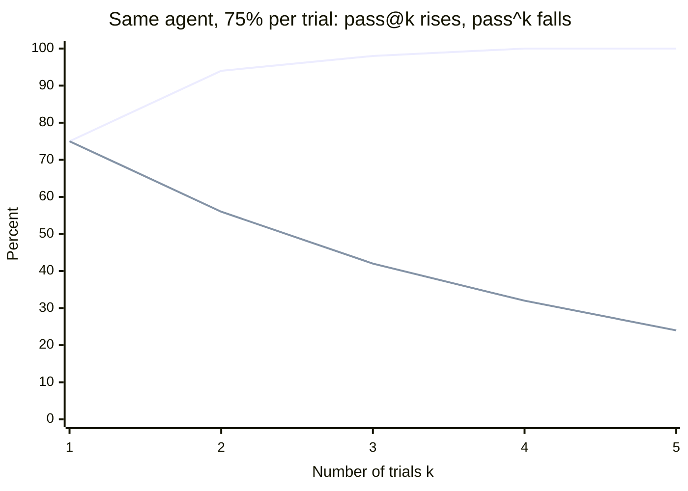
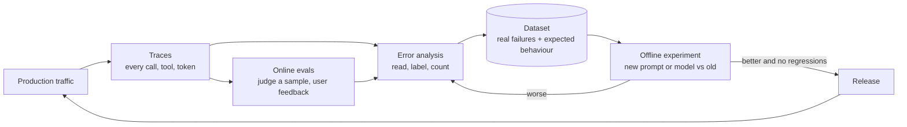
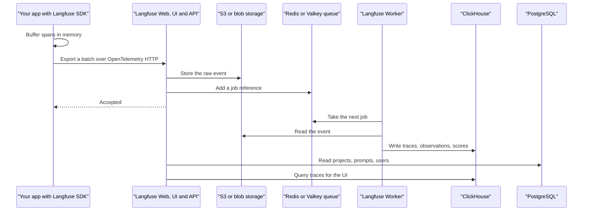
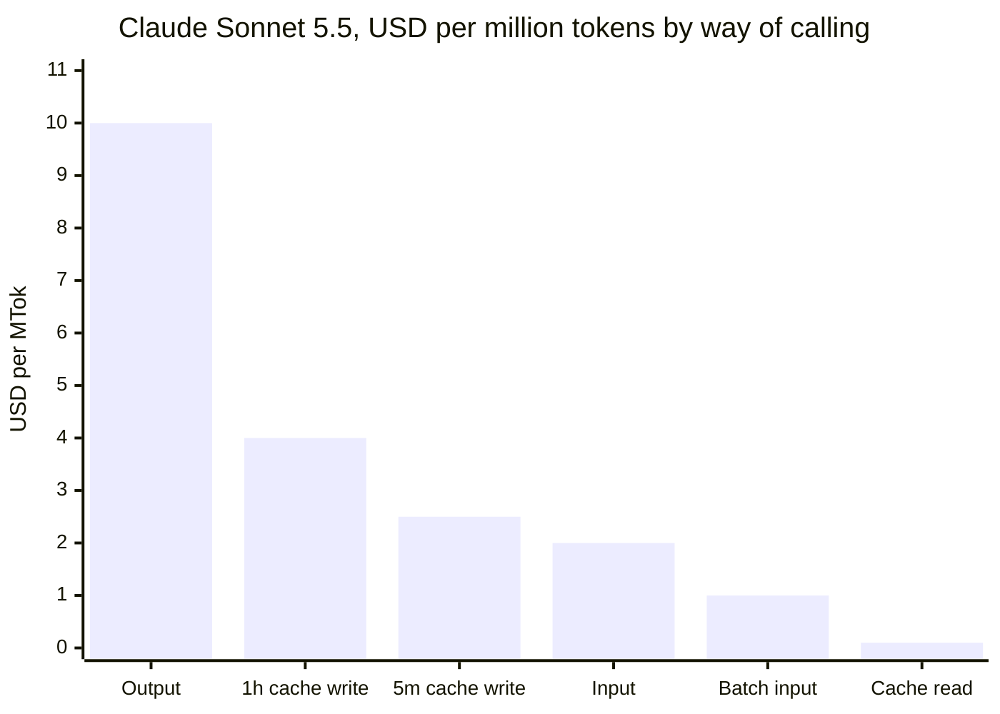
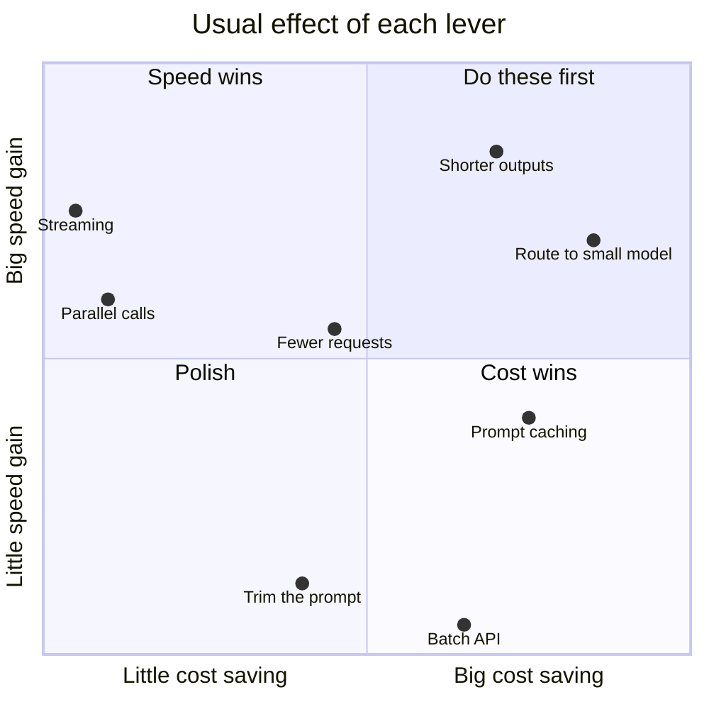
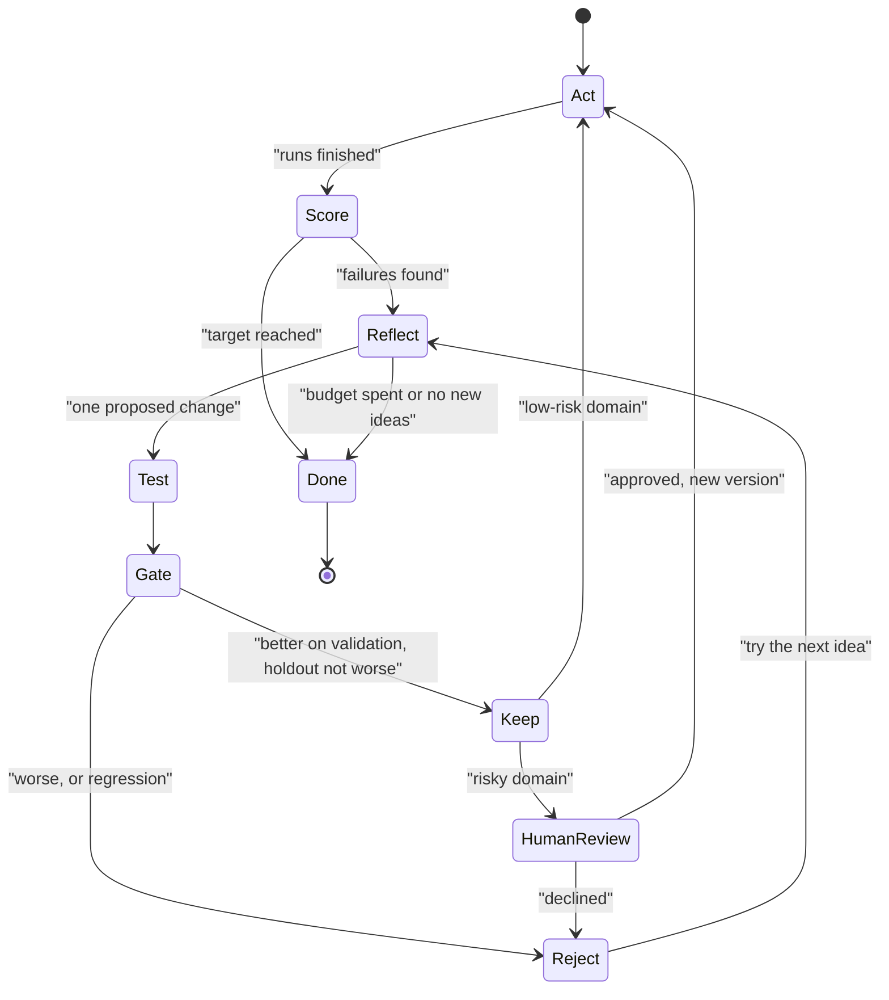
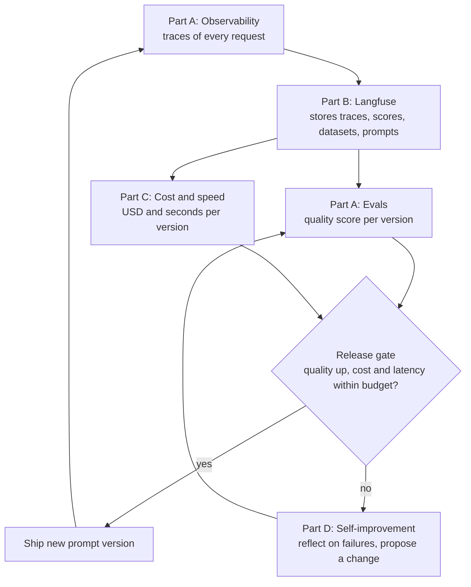
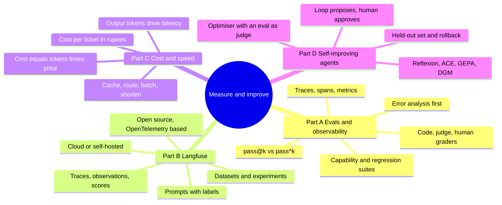



*Utkrishta Sinha · 8 Nov 2026 · about 75 minutes · covers syllabus topics 19, 27, 20, 26*

Today is about one loop: see what the system does, score it, make it cheaper and faster, and let it get better without breaking. Four syllabus topics share that loop, so they share this page.

| Part | Syllabus topic | What you will be able to do |
| --- | --- | --- |
| A | 19. Evaluations and observability | Build an eval suite from real failures, pick graders, read traces and explain pass@k versus pass^k |
| B | 27. Langfuse | Instrument an app with the Langfuse SDK, run a scored experiment, manage prompts and track cost per trace |
| C | 20. Cost and speed trade-offs | Price a design per request and per month, and choose between routing, caching, batching and shorter outputs |
| D | 26. Self-improving agents | Build a loop where an agent improves its own prompt or playbook, behind an eval gate that blocks cheating and overfitting |

## 1. The Five Big Ideas

- **You cannot improve what you cannot see.** Observability means recording every model call, tool call, token and second as a trace. Without traces, every bug report is a guessing game.
- **An eval is a unit test for fuzzy behaviour.** It runs fixed tasks, grades the outcome and gives a number. Start with 20 to 50 tasks taken from real failures, not 2,000 synthetic ones.
- **Langfuse is one open-source place for traces, scores, datasets and prompts.** It is built on OpenTelemetry, it can be self-hosted, and it turns production traffic into test cases.
- **Cost and speed are mostly decided by design, not by the model's price sheet.** Fewer output tokens, cached prompts, smaller models for easy work and batch jobs for anything that can wait often cut the bill by an order of magnitude.
- **A self-improving agent is just an optimiser with an eval as its judge.** The agent can rewrite its prompt, memory or even its code, but only changes that pass a held-out eval may ship. A weak judge produces an agent that cheats.

Facts below were checked on 8 November 2026.

Think of running a restaurant kitchen. Observability is the camera over the stove. Evals are the tasting spoon before each plate leaves. Cost and speed are the gas bill and the ticket timer. A self-improving agent is the chef who rewrites the recipe card every night, which is wonderful until he decides the fastest dish is an empty plate. 🍳

## 2. Why This Matters for an FDE

Most customer AI projects do not die from a bad model. They die from silence. Nobody can say if version 2 is better than version 1, why one answer was wrong, or why the bill tripled. An FDE (Forward Deployed Engineer) arrives and makes those questions answerable.

Here is where each part of today shows up in a real engagement:

- **Part A, evals and observability, in week one.** You cannot fix a system you cannot measure. Before touching a prompt, you add tracing and build a small eval set from the customer's own failure examples.
- **Part B, Langfuse, at the tooling decision.** Customers ask "which tool do we use?" Many enterprises, especially in banking, health and India's regulated sectors, need self-hosting for data residency. Langfuse is a common answer because it is open source and runs inside their own cloud.
- **Part C, cost and speed, at the budget review.** The pilot cost ₹40,000 a month. Scaled to every user, it would cost lakhs. The finance team wants a number per conversation, and the product team wants answers in under two seconds.
- **Part D, self-improving agents, at month three.** The customer asks "can it learn from its mistakes?" You need to say yes with a safe design: a loop that proposes fixes, tests them and lets a human approve.

| Customer symptom | Part | Usual root cause | The fix |
| --- | --- | --- | --- |
| "We changed the prompt and something else broke." | A | No regression suite | Freeze past failures into an eval suite that runs on every change |
| "It worked in the demo but fails for real users." | A | Test set made up by engineers, not taken from traffic | Sample production traces, label failures, add them to the dataset |
| "We cannot tell why it gave that answer." | A, B | No tracing of retrieval, tools or prompts | Add a tracing SDK so each request becomes a tree of steps |
| "Legal will not let us send logs to a US SaaS." | B | Observability tool cannot be self-hosted | Self-host Langfuse in the customer's own cloud region |
| "The prompt lives in five places and nobody knows which is live." | B | Prompts hard-coded in app code | Use prompt management with versions and a `production` label |
| "The bill tripled after launch." | C | Big model for every request, no caching, long replies | Route easy traffic to a small model, cache the stable prefix, cap output |
| "Users complain it is slow." | C | Long outputs, serial calls, no streaming | Stream, cut output tokens, run independent steps in parallel |
| "Our nightly report job costs as much as the live product." | C | Offline work sent through the real-time API | Move it to a Batch API at half price |
| "It keeps making the same mistake every week." | D | Feedback is collected but never fed back | A reflection loop that turns grouped failures into proposed prompt fixes |
| "The auto-tuned prompt scored 100% and then failed in production." | D | Optimiser overfit or gamed the grader | Held-out test set, stronger graders, human approval before release |

> **Sentence for a customer call:** "Before we change anything, let's agree how we will know it got better, and what it costs per conversation."

One commercial point matters too. A model is rented, and the customer may switch it next quarter. Their eval suite, their traces and their cost dashboard stay. Those are the assets that prove your work, so they belong in your handover.

## 3. Core Concepts, From Simple to Deep

This section has one subsection per Part. Each starts with an everyday picture, then a glossary, then builds from the simple idea to how it works under the hood.

### Part A: Evaluations and Observability

#### A.1 The everyday picture

Think of a driving test. The examiner does not ask "are you a good driver?" They give you fixed tasks: park, reverse, stop at a sign. They score each one against a written rule. That is an eval.

Now think of the dashcam. It records everything on every trip, not only the test. When something goes wrong, you rewind and see exactly what happened. That is observability.

You need both. A test without a dashcam tells you that you failed, but not why. A dashcam without a test gives you hours of video and no verdict.

#### A.2 The words you need

| Term | Plain meaning | Simple example |
| --- | --- | --- |
| LLM | Large Language Model, the AI that predicts text | Claude Sonnet 5.5 |
| Eval (evaluation) | A repeatable test that scores what an AI system does | 40 refund questions, each with a correct action |
| Task | One test case with inputs and a success rule | "Refund of ₹6,000 must be escalated" |
| Trial | One attempt at a task; AI output varies, so you run several | Run the same task 5 times |
| Grader | The logic that scores a trial | Code that checks `action == "escalate"` |
| Transcript or trace | The full record of one run: inputs, tool calls, outputs | The 12 steps the agent took to answer |
| Outcome | The final state of the world after the run | The refund row really exists in the database |
| Eval suite | A group of tasks that measure one ability | "Refund policy suite" |
| Eval harness | The code that runs tasks, records them and grades them | A Python script or Langfuse experiment runner |
| Code-based grader | A grader written in normal code | Regex, unit test, JSON schema check |
| LLM-as-a-judge | A model that grades another model's output against a rubric | "Score 1 if the reply is polite and correct" |
| Rubric | Written criteria a judge applies | "Must mention the 7-day window" |
| Human grader | A person who labels outputs | A support lead marks 50 replies pass or fail |
| Capability eval | Tests what the agent cannot yet do well; starts with a low score | New multi-step booking tasks |
| Regression eval | Tests what the agent used to do; should stay near 100% | Last quarter's fixed bugs |
| Offline eval | Run before release on a fixed dataset | A CI (Continuous Integration) job on every pull request |
| Online eval | Scores live production traffic, often on a sample | Judge 5% of today's chats |
| pass@k | Chance that at least one of k trials succeeds | Good for a coding agent that can retry |
| pass^k | Chance that all k trials succeed | Good for a customer-facing bot that must be consistent |
| Observability | Being able to see inside a running system from its outputs | Traces, logs, metrics |
| Span | One timed step inside a trace | "Retrieve documents, 180 ms" |
| Trace | A tree of spans for one request | Root span "chat" with child spans |
| Metric | A number tracked over time | p95 latency, cost per day |
| p50, p95 | The median and the slow-tail value of a measurement | p95 = 95% of requests are faster than this |
| TTFT | Time To First Token, how long until the reply starts | 0.8 seconds |
| OpenTelemetry (OTel) | An open standard for traces, metrics and logs | Used by Langfuse and most cloud tools |
| Semantic conventions | Agreed names for trace attributes | `gen_ai.usage.input_tokens` |
| Error analysis | Reading traces by hand to find and group failure types | Tagging 100 chats with "wrong policy", "too long" |
| Open coding | Writing free-text notes on each failure, no fixed categories | "Ignored the user's language" |
| Axial coding | Grouping those notes into named categories and counting them | 23% "language mismatch" |
| Saturation | The point where reading more traces finds no new failure types | After about 100 traces, nothing new appears |
| Goodhart's law | When a measure becomes a target, it stops being a good measure | The bot learns to say "refund" in every reply |

#### A.3 Start simple: an eval is a unit test with a score

You already write unit tests in Angular or Spring Boot. A unit test checks `add(2, 3) == 5`. It passes or fails, and it gives the same answer every time.

An LLM is different in two ways. First, the "correct" answer can have many valid wordings. Second, the same input can give different outputs on different runs. Evals handle both. They grade the outcome rather than the exact words, and they run several trials.

Here is the smallest possible eval, in words:

1. Write down five questions your customer's users really ask.
2. For each, write what a correct answer must contain.
3. Run the system on all five.
4. Count how many passed.

That number is your first eval score. It is crude, but it already beats "it looks fine to me".

#### A.4 The vocabulary Anthropic uses

Anthropic's engineering team published a careful guide, [Demystifying evals for AI agents](https://anthropic.com/engineering/demystifying-evals-for-ai-agents), in January 2026. It defines a **task** as one test with inputs and success criteria, a **trial** as one attempt, and a **grader** as the scoring logic. The **transcript** is the full record of a trial, and the **outcome** is the final state in the environment.

That last split matters for agents. An agent may say "I booked your flight". The outcome check asks whether a booking row exists. Always grade the outcome when you can, because agents are good at sounding successful.

The guide also gives practical starting advice:

- Start with about 20 to 50 simple tasks drawn from real failures.
- Mine existing manual checks, bug trackers and support queues for tasks.
- Write tasks so two domain experts would agree on pass or fail.
- Test both sides: cases where a behaviour should happen and where it should not.
- Read transcripts to confirm that failures are fair.
- Treat suites like unit tests, with a clear owner.

#### A.5 Three kinds of graders

Every eval needs a grader. There are three families, and good suites mix them.

| Grader | How it works | Strengths | Weaknesses | Use it for |
| --- | --- | --- | --- | --- |
| Code-based | String match, regex, JSON schema, unit test, database check | Fast, cheap, same answer every time | Brittle, cannot judge tone or nuance | Format, facts, tool calls, final state |
| Model-based (LLM-as-a-judge) | A model scores output against a rubric, or compares two outputs | Handles nuance and open-ended text | Costs money, varies between runs, has biases | Helpfulness, tone, faithfulness to sources |
| Human | Experts label outputs | The gold standard | Slow and expensive | Calibrating the other two, high-stakes checks |

The ordering rule from Day 10 applies here too. Run code graders first because they are cheap and repeatable. Spend model-based graders on questions code cannot answer.

LLM judges have known biases. The original MT-Bench study by [Zheng and colleagues](https://arxiv.org/abs/2306.05685) found position bias, verbosity bias and self-enhancement bias. That means a judge may prefer the first answer shown, the longer answer, or answers from its own model family. The same study found strong judges reached over 80% agreement with human preferences, which is about the level humans reach with each other.

So a judge is useful, but only after you check it against human labels. Treat the judge as a model you also evaluate.

#### A.6 pass@k and pass^k: the most useful maths of the day

Because outputs vary, one trial tells you little. You run k trials per task, then summarise.

- **pass@k** asks: did at least one of the k trials pass? It rises as k grows.
- **pass^k** asks: did all k trials pass? It falls as k grows.

Anthropic's guide gives a clean example. If one trial passes 75% of the time, the chance that three in a row pass is 0.75 × 0.75 × 0.75, about 42%.

Which one should you report? It depends on the product.

- A coding agent can retry, and a human picks the best result. pass@k fits.
- A customer support bot answers each user once. Every user needs the right answer, so pass^k fits.



*Upper line is pass@k = 1 − 0.25^k, lower line is pass^k = 0.75^k, both rounded; the 42% at k = 3 is the example in Anthropic's January 2026 evals guide.*

This is the single best interview point on evals. A demo that "usually works" is a pass@k story. Production is a pass^k story.

#### A.7 Capability evals and regression evals

Anthropic separates two jobs that suites do.

- **Capability evals** ask what the agent can do. They should start with a low pass rate, which gives the team a hill to climb.
- **Regression evals** ask whether the agent still does what it used to. They should sit near 100%, and any drop is a red flag.

When a capability eval reaches a high pass rate, it "graduates" into the regression suite. Over time the regression suite becomes a record of every bug you have ever fixed.

Watch for saturation. A suite where everything scores 100% no longer tells you anything. Add harder tasks.

#### A.8 Where evals come from: error analysis

The biggest beginner mistake is inventing a generic list of metrics such as "helpfulness" and "coherence". Those rarely match what actually breaks. The better path is error analysis, popularised by [Hamel Husain and Shreya Shankar](https://hamel.dev/blog/posts/evals-faq/why-is-error-analysis-so-important-in-llm-evals-and-how-is-it-performed.html).

It works in four steps:

1. **Gather traces.** Collect real conversations, or synthetic ones if you have none yet.
2. **Open coding.** A domain expert reads each trace and writes a short note on the first thing that went wrong. Do at least 30 by hand.
3. **Axial coding.** Group the notes into categories and count each category. This tells you which failure matters most.
4. **Iterate until saturation.** Keep going until new traces stop showing new failure types. A pool of about 100 diverse traces is a common working size.

Then each category gets a decision. Fix it in the prompt or code, add an automated evaluator so it never returns, or just watch it. Langfuse's own [error analysis guide](https://langfuse.com/blog/2025-08-29-error-analysis-to-evaluate-llm-applications) uses the same flow.

A simple example helps. Say you read 100 chats from an Indian e-commerce support bot. You find 31 replies in English when the user wrote Hindi, 12 with a wrong return window, and 4 that were rude. Now you know the first eval to build: a language-match check, which code can do.

#### A.9 Observability: traces, spans and metrics

Evals score a fixed set. Observability watches everything else. An LLM app is a chain of steps, and any step can fail.

A **trace** records one request. It is a tree of **spans**, and each span is one timed step. A RAG (Retrieval-Augmented Generation) chatbot request might look like this:

```text
trace: chat (2,340 ms, $0.0041)
├── span: rewrite_query        generation, 310 ms, 180 in / 25 out tokens
├── span: vector_search        retriever, 95 ms, 5 documents
├── span: rerank               span, 120 ms
└── span: answer               generation, 1,790 ms, 3,900 in / 210 out tokens
```

With this tree, "the bot is slow" becomes "the answer step takes 1.8 seconds because it receives 3,900 tokens". That is a fixable problem.

Three kinds of signal come from traces:

- **Per-request detail:** the exact prompt, retrieved documents, tool arguments and output.
- **Metrics:** cost per day, p95 latency, error rate, tokens per user.
- **Scores:** eval results attached to the trace, from code, judges, humans or user thumbs-up.

#### A.10 Under the hood: OpenTelemetry for generative AI

You do not want every tool to invent its own field names. OpenTelemetry is the open standard for traces, and it now has [semantic conventions for generative AI spans](https://github.com/open-telemetry/semantic-conventions-genai/blob/main/docs/gen-ai/gen-ai-spans.md). They moved to a dedicated repository in 2026 and are still marked "Development", so names may change.

The conventions recommend a span name of `{gen_ai.operation.name} {gen_ai.request.model}`, such as `chat claude-sonnet-5-5`. Two attributes are required: `gen_ai.operation.name` and `gen_ai.provider.name`. Recommended ones include:

| Attribute | What it records |
| --- | --- |
| `gen_ai.request.model` | The model you asked for |
| `gen_ai.response.model` | The model that actually answered |
| `gen_ai.usage.input_tokens`, `gen_ai.usage.output_tokens` | Token counts |
| `gen_ai.usage.cache_read.input_tokens` | Tokens served from the prompt cache |
| `gen_ai.response.finish_reasons` | Why the model stopped, such as length limit |
| `gen_ai.response.time_to_first_chunk` | Time to the first streamed piece |

Prompt and reply content (`gen_ai.input.messages`, `gen_ai.output.messages`) is opt-in because it may hold sensitive data. That is a design choice you will discuss with every customer's security team.

Why should you care? Because Langfuse, Arize Phoenix and many cloud tools accept OpenTelemetry. If you instrument with OTel, the customer can change their observability vendor without changing app code.

#### A.11 The eval flywheel

Put it together and you get a loop that runs for the life of the product.



*Traces feed error analysis, failures become dataset items, and every change must beat the old version offline before it ships.*

Notice that the dataset grows from production, not from imagination. Notice also that the release gate is an experiment, not a feeling.

#### A.12 Going deeper: making evals trustworthy

A few deeper habits separate a toy suite from a real one.

- **Isolate trials.** Each trial should start from a clean environment. Shared state, such as one database used by all trials, makes results depend on run order.
- **Read the zero-percent tasks.** Anthropic notes that a 0% pass rate across many trials usually means a broken task, not a hopeless agent. They describe Opus 4.5 going from 42% to about 95% on one benchmark after grading bugs were fixed.
- **Grade outcomes, not paths.** Agents find valid routes you did not expect. Checking for one exact sequence of tool calls punishes creativity.
- **Give partial credit where it fits.** A multi-step task that gets 4 of 5 steps right is different from one that gets 0.
- **Track cost and latency per eval run.** A prompt that scores 2% better but costs three times as much is not obviously better.
- **Version everything.** Store which prompt version, model and dataset version produced each score.

### Part B: Langfuse

#### B.1 The everyday picture

Think of a hospital patient file. Every test, every medicine, every doctor's note goes into one folder with a timestamp. A new doctor can open it and understand the case in minutes. The file also holds the lab scores, and it is stored in the hospital's own building because the law says so.

Langfuse is that folder for an LLM app. Every request becomes a trace in the file. Scores from evals sit next to the trace. Prompts are kept in versioned cabinets. And you can run the whole records office in your own building.

#### B.2 The words you need

| Term | Plain meaning | Simple example |
| --- | --- | --- |
| Langfuse | An open-source platform for LLM tracing, evals, datasets and prompt management | Self-hosted in a bank's AWS account |
| Langfuse Cloud | The hosted version run by the Langfuse team | `cloud.langfuse.com` for the EU region |
| Self-hosting | Running the software on your own servers | Docker Compose on one VM, Helm on Kubernetes |
| SDK | Software Development Kit, the library you add to your app | `pip install langfuse` |
| Observation | Any recorded step inside a trace | A span, a generation, a tool call |
| Generation | An observation for one model call, with tokens and cost | The call to Claude that writes the answer |
| Session | A group of traces from one conversation | All 8 turns of one support chat |
| `@observe` | A Python decorator that turns a function into a traced step | `@observe()` above `def answer(q):` |
| Score | An evaluation result stored on a trace, observation, session or run | `correctness = 0.8` |
| Dataset | A stored list of test inputs, with optional expected outputs | 100 real support questions |
| Dataset item | One entry in a dataset | Input "refund status?", expected "5 to 7 days" |
| Experiment | Running your app over a dataset and scoring each output | Prompt v3 against 100 items |
| Experiment run | One full execution of an experiment | "faq-bot-v3, 8 Nov" |
| Evaluator | A function or LLM judge that produces scores | Contains-fact checker |
| Annotation queue | A to-do list of traces for humans to label | 50 flagged chats for the support lead |
| Prompt management | Storing prompts outside code, with versions and labels | `movie-critic`, version 7, label `production` |
| Label | A named pointer to a prompt version | `production`, `staging`, `latest` |
| Playground | A UI to rerun a traced prompt with edits | Change one line, compare outputs |
| Billable unit | Langfuse Cloud's pricing unit, any tracing data point | One trace, one observation or one score |
| ClickHouse | A fast column database built for analytics | Stores Langfuse traces and scores |
| PostgreSQL | A general relational database | Stores Langfuse users, projects, prompts |
| Redis or Valkey | An in-memory store used as a queue and cache | Buffers incoming events |
| S3 or blob storage | Object storage for files | Raw events and large exports |
| Model definition | A price list Langfuse uses to infer cost from tokens | `match_pattern` for `claude-sonnet.*` |

#### B.3 Start simple: what Langfuse gives you

Langfuse calls itself an "open source agent evals and observability" platform on its [GitHub repository](https://github.com/langfuse/langfuse). The code is MIT licensed, except for folders marked `ee` (enterprise edition). It has five main jobs:

1. **Tracing.** Record each request as a trace of nested observations.
2. **Cost and token tracking.** Show cost per trace, user, model and day.
3. **Evaluation.** Store scores from code, LLM judges, humans and user feedback.
4. **Datasets and experiments.** Run new versions against fixed test sets and compare.
5. **Prompt management.** Keep prompts versioned, labelled and editable outside the code.

Langfuse joined ClickHouse, the database company, in January 2026. The team's own post, [Langfuse joins ClickHouse](https://langfuse.com/blog/joining-clickhouse), states that Langfuse "stays open source and self-hostable" with no planned licence changes. [SiliconANGLE](https://siliconangle.com/2026/01/16/database-maker-clickhouse-raises-400m-acquires-ai-observability-startup-langfuse/) reported the deal on 16 January 2026, alongside a $400 million funding round for ClickHouse. For a customer, that means the product has a large backer, and the self-hosted path remains.

Its [customer page](https://langfuse.com/users) claims 90 billion+ observations per month and 21 of the Fortune 50 as users. Treat those as the company's own figures.

#### B.4 The data model: traces, observations, sessions, scores

Everything in Langfuse hangs off a few objects.

- A **trace** is one request, such as one chat turn.
- Inside it are **observations**, nested like folders.
- Several traces can share a **session**, such as one whole conversation.
- **Scores** attach to any of these, plus to experiment runs.

Observations have types. The [observation types page](https://langfuse.com/docs/observability/features/observation-types) lists ten:

| Type | Meaning |
| --- | --- |
| `span` | A timed unit of work |
| `generation` | A model call, with prompt, tokens and cost |
| `event` | A single moment, with no duration |
| `agent` | A step where an LLM decides the flow and calls tools |
| `tool` | One action, such as an API call |
| `chain` | A step that links others, such as retriever to LLM |
| `retriever` | A lookup in a vector store or database |
| `evaluator` | A step that judges output quality |
| `embedding` | A call that creates embeddings |
| `guardrail` | A check against harmful content or jailbreaks |

Using the right type pays off later. The UI can filter "show me only tool calls" or "only guardrails that fired".

#### B.5 Instrumenting an app: three ways

The current SDKs are Python v5 and JS/TS v6, according to the [SDK overview](https://langfuse.com/docs/observability/sdk/overview.md). Both are built on OpenTelemetry. They need three environment variables: `LANGFUSE_PUBLIC_KEY`, `LANGFUSE_SECRET_KEY` and `LANGFUSE_BASE_URL`. The pip package installed here on 8 November 2026 was `langfuse` 5.2.0.

There are three ways to create traces, from least code to most control.

**Way 1, a drop-in wrapper.** For the OpenAI SDK, you change one import, as the [OpenAI integration page](https://langfuse.com/integrations/model-providers/openai-py) shows. Every call is now traced with tokens and cost.

```python
from langfuse.openai import openai   # instead of: import openai
```

Langfuse also has integrations for LangChain, the Vercel AI SDK from Day 6 and many more.

**Way 2, the `@observe` decorator.** You put it on your own functions. Nested calls become nested observations automatically. The [instrumentation docs](https://langfuse.com/docs/observability/sdk/instrumentation.md) show the pattern:

```python
from langfuse import observe, propagate_attributes

@observe(name="llm-call", as_type="generation")
def call_model(prompt): ...

@observe()                       # a span by default
def answer(user_id, session_id, question):
    with propagate_attributes(user_id=user_id, session_id=session_id):
        return call_model(question)
```

`propagate_attributes` passes the user and session IDs down to every child, so you can later filter by user. For very large inputs, `@observe(capture_input=False, capture_output=False)` stops the payload from being recorded.

**Way 3, context managers.** For full control, you open observations by hand:

```python
from langfuse import get_client
langfuse = get_client()

with langfuse.start_as_current_observation(as_type="span", name="process-request") as span:
    with langfuse.start_as_current_observation(as_type="generation", name="llm-response",
                                               model="claude-sonnet-5-5") as gen:
        gen.update(output="...", usage_details={"input": 900, "output": 120})
    span.update(output="done")
langfuse.flush()   # needed in short scripts so events are sent before exit
```

In TypeScript, the same ideas use `startActiveObservation` and an `observe()` wrapper from `@langfuse/tracing`. In short-lived Node scripts, you call `sdk.shutdown()` to flush.

#### B.6 Under the hood: how a trace travels

The SDK does not slow your request by waiting for Langfuse. It buffers observations in memory and exports them in the background in batches. That is why `flush()` matters in short scripts and serverless functions: if the process dies first, the buffer is lost.

On the server, the [self-hosting docs](https://langfuse.com/self-hosting) describe these parts:



*The app never waits for storage: the web server accepts the batch, and a worker writes it into ClickHouse later.*

Each store has a clear job. PostgreSQL holds transactional data such as users, projects and prompts. ClickHouse holds traces, observations and scores, because analytics queries over billions of rows need a column database. Redis or Valkey is the queue and cache. S3 keeps raw events, media and exports.

For deployment, the docs list Docker Compose for local testing on one VM (with no high availability, scaling or backups) and Kubernetes with Helm for production. There are also guides for AWS, Azure and GCP. A few add-on features need a licence key.

This is a normal backend design you know from Spring Boot work. A stateless API, a queue, a worker and two databases split by access pattern.

#### B.7 Cost tracking under the hood

Langfuse shows cost for `generation` and `embedding` observations. The [token and cost tracking docs](https://langfuse.com/docs/observability/features/token-and-cost-tracking.md) describe two sources:

- **Ingested cost:** your code or integration sends the cost directly. This wins if present.
- **Inferred cost:** Langfuse matches the `model` name against a **model definition** using a regular expression, then multiplies its stored prices by the token counts.

Two details catch people out. First, each key in `usage_details` must be a separate bucket. If `input` already includes cached tokens and you also send `input_cached_tokens`, you count them twice. Second, a price change applies only to new generations. Old traces keep the cost they were stored with.

Model definitions can also have pricing tiers, for providers whose price changes with prompt length. A tier has a condition, such as "input tokens greater than 100,000", and the first matching tier wins.

#### B.8 Evaluations inside Langfuse

Langfuse treats every evaluation result as a **score**. The [evaluation concepts page](https://langfuse.com/docs/evaluation/concepts) lists four data types: `NUMERIC`, `CATEGORICAL`, `BOOLEAN` and `TEXT`.

Scores can come from several methods:

- **LLM-as-a-Judge:** a model scores outputs against your criteria, configured in the UI.
- **Code evaluators:** your own Python or TypeScript checks.
- **Annotation queues:** structured human review.
- **Scores via UI, API or SDK:** including user thumbs-up from your app.

It also separates where evaluation happens:

- **Online evaluation:** a rule picks incoming production observations, with filters and a sampling rate, and an evaluator scores them.
- **Offline evaluation:** experiments on a fixed dataset before release.
- **Batch evaluation:** scoring old observations later, for example to test a new evaluator on last week's data.

#### B.9 Datasets and experiments

This is how Langfuse makes the Part A flywheel real. A **dataset** holds items with an input and optionally an expected output. You can add items by hand, by API, or straight from a production trace in the UI.

An **experiment** runs your code (the "task") on every item, then calls evaluators on each output. The [experiments via SDK page](https://langfuse.com/docs/evaluation/experiments/experiments-via-sdk.md) shows `run_experiment`, which takes:

- `data`: a local list or a Langfuse dataset.
- `task`: a function that receives one `item` and returns an output.
- `evaluators`: functions that receive `input`, `output` and `expected_output` and return an `Evaluation`.
- `run_evaluators`: functions that see all results and return one aggregate score, such as the overall pass rate.

Each item becomes a trace linked to the run, so you can click from a low score straight into what the app did. You will run one in section 4.

#### B.10 Prompt management

Prompts in code have a problem. Changing one word means a code review, a build and a deploy. Product and support people cannot touch them at all.

Langfuse stores prompts as named, versioned objects. A **label** such as `production` points at one version. Your app asks for "the production version of `support-reply`", and changing the label in the UI changes what runs, with no deploy.

The obvious worry is speed. The [caching docs](https://langfuse.com/docs/prompt-management/features/caching.md) answer it:

- The SDK caches each prompt in memory for 60 seconds by default.
- After that, it still returns the cached copy at once and refetches in the background.
- Only the very first fetch waits on the network.
- You can pass a fallback prompt in case Langfuse is unreachable on a cold start.

```python
prompt = langfuse.get_prompt("support-reply", cache_ttl_seconds=300)   # production label
```

Link the prompt to the generation in your traces. Then you can compare scores and costs by prompt version, which is exactly what you need to prove version 7 beat version 6.

#### B.11 Pricing and hosting choices

The [pricing page](https://langfuse.com/pricing.md) listed these Langfuse Cloud plans on 8 November 2026:

| Plan | Price per month | Included units | Extra units | Data access | Users |
| --- | --- | --- | --- | --- | --- |
| Hobby | Free | 50,000 | Not available | 30 days | 2 |
| Core | $29 | 100,000 | $8 per 100,000 | 90 days | Unlimited |
| Pro | $199 | 100,000 | $8 per 100,000 | 3 years | Unlimited |
| Enterprise | $2,499 | 100,000 | $8 per 100,000, lower with volume; custom volume pricing with a yearly commitment | 3 years | Unlimited |

Extra units on the paid plans are graduated, meaning the price per unit drops as volume grows: $8 per 100,000 up to 1 million units, $7 from 1 million to 10 million, $6.50 from 10 million to 50 million, and $6 above 50 million.

A unit is any tracing data point, meaning a trace, an observation or a score. So one chat turn with a trace, four observations and two scores costs seven units. Estimate units per request before you quote a customer.

Self-hosting is free for the open-source features. You pay instead in infrastructure and the time to run ClickHouse, PostgreSQL, Redis and S3 well.

### Part C: Cost and Speed Trade-offs

#### C.1 The everyday picture

Think of sending a parcel across India. Speed Post is fast and costs more. Ordinary post is slow and cheap. A courier van is great for one heavy box and wasteful for a postcard. You choose per parcel, not once for the whole company.

LLM requests are parcels. Some are urgent and hard, some can wait overnight, and many are postcards that a small, cheap model handles fine. Cost and speed engineering is choosing the right service for each one, then packing the parcel smaller.

#### C.2 The words you need

| Term | Plain meaning | Simple example |
| --- | --- | --- |
| Token | A chunk of text the model reads or writes, roughly part of a word | "unbelievable" may be 3 tokens |
| Input tokens | Tokens you send: system prompt, history, documents, question | 6,000 per request |
| Output tokens | Tokens the model writes back; priced higher | 400 per reply |
| MTok | One million tokens, the unit prices are quoted in | $2 per MTok input |
| Per-request cost | Input tokens × input price + output tokens × output price | $0.016 |
| Latency | How long the user waits | 3.2 seconds |
| TTFT | Time To First Token, the wait before text starts | 0.6 seconds |
| Output speed | Tokens generated per second | 80 tokens per second |
| End-to-end time | From sending the request to the last token | TTFT + output tokens ÷ speed |
| Throughput | How many requests the system finishes per minute | 1,200 requests per minute |
| Rate limit | The provider's cap on requests or tokens per minute | 429 error when you exceed it |
| Prompt caching | The provider stores a repeated prompt prefix so later calls read it cheaply | A 5,000-token policy document reused on every call |
| Cache write, cache read | Paying to store the prefix, then paying a small fee to reuse it | Write 1.25×, read 0.05× on Sonnet 5.5 |
| TTL | Time To Live, how long a cache entry lasts | 5 minutes or 1 hour |
| Batch API | Send many requests as one job, get results later at a discount | Nightly evals at half price |
| Flex processing | OpenAI's cheaper, slower tier with occasional unavailability | `service_tier="flex"` |
| Model routing | Sending each request to the cheapest model that can handle it | Easy FAQs to a small model |
| Cascade | Try a cheap model first and escalate if it is not confident | Small model, then large on low confidence |
| Streaming | Sending tokens to the user as they are generated | Text appears word by word |
| Parallel calls | Running independent steps at the same time | Moderation and answer together |
| Semantic cache | Your own cache that reuses answers to similar past questions | "Return policy?" answered from cache |
| Reasoning tokens | Hidden thinking tokens some models generate, billed as output | 2,000 thinking tokens before a 100-token answer |
| Unit economics | Cost per business unit, such as per conversation or per ticket | ₹1.20 per resolved ticket |
| Data residency premium | Extra price for keeping processing in one region | 1.1× for US-only inference |

#### C.3 Start simple: the cost formula

Every API bill comes from one formula. Day 8 covered it in depth, so here is the short version:

> cost per request = input tokens × input price + output tokens × output price

Here is a worked case using [Claude's pricing page](https://platform.claude.com/docs/en/about-claude/pricing) on 8 November 2026. Claude Sonnet 5.5 costs $2 per million input tokens and $10 per million output tokens. A request with 6,000 input tokens and 400 output tokens costs:

- Input: 6,000 × $2 ÷ 1,000,000 = $0.012
- Output: 400 × $10 ÷ 1,000,000 = $0.004
- Total: $0.016 per request

At one million requests a month, that is $16,000. Notice that output tokens are 6% of the token count but 25% of the cost.

#### C.4 Start simple: the speed formula

Speed has its own formula, and it is just as simple:

> end-to-end time ≈ TTFT + output tokens ÷ output speed

[Artificial Analysis](https://artificialanalysis.ai/methodology/performance-benchmarking), which benchmarks provider APIs every 6 hours, defines these terms carefully. TTFT is the time until the first token arrives. Output speed is tokens per second over the whole request. End-to-end time is from sending the request to the final token.

The key lesson is that output length dominates. OpenAI's [latency optimization guide](https://developers.openai.com/api/docs/guides/latency-optimization.md) says cutting 50% of output tokens may cut about 50% of latency. Cutting 50% of the prompt may improve latency by only 1 to 5%.

So for speed, shorten the answer. For cost, shorten both, but the expensive output tokens first.

#### C.5 The price ladder of one model

One model has many prices, depending on how you call it. Here is Claude Sonnet 5.5, from the pricing page:



*Same model, a 100× spread between output and cache read. Source: Claude pricing page, checked 8 November 2026.*

The design question is how much of your traffic you can push to the right side of that chart.

#### C.6 The levers, from cheapest to hardest

Here are the levers in the order an FDE usually reaches for them. Each one is explained, then priced where real numbers exist.

**Lever 1: generate fewer output tokens.** Ask for short answers, use short JSON field names and set `max_tokens`. OpenAI's guide shows shortening JSON field names saved 19 output tokens in one example. It is free to try and helps cost and speed at once.

**Lever 2: cache the stable prefix.** Most apps send the same system prompt, tools and policy documents on every call. Prompt caching stores that prefix. Claude's [prompt caching docs](https://platform.claude.com/docs/en/build-with-claude/prompt-caching) list these multipliers on the base input price:

- A 5-minute cache write costs 1.25×.
- A 1-hour cache write costs 2×.
- A cache read costs 0.1× on most models, and 0.05× on Opus 5.5 and Sonnet 5.5.

Caching only works if the cached part comes first and stays identical. Put dynamic content, such as the user's question, at the end. The minimum cacheable length is 512 tokens on current models such as Sonnet 5.5, and shorter prompts are simply not cached, with no error. Cache hits also improve TTFT on long prompts, and they do not count against Claude's rate limits.

You can see if it worked. The response usage has `cache_creation_input_tokens` and `cache_read_input_tokens`. If both are zero, nothing was cached.

**Lever 3: route by difficulty.** Not every request needs your strongest model. On the same pricing page, Claude Haiku 5.5 costs $0.10 input and $0.50 output per million tokens for prompts up to 100,000 tokens. That is 20 times cheaper than Sonnet 5.5 and 40 times cheaper than Opus 5.5 at $4 and $20.

Research backs routing. The [RouteLLM paper](https://arxiv.org/html/2406.18665v4) from UC Berkeley, Anyscale and Canva trained routers on Chatbot Arena preference data. It reports cutting costs by over 2 times without losing response quality on public benchmarks. Day 3 covered model selection, and routing is model selection per request.

**Lever 4: batch anything that can wait.** Claude's Batch API gives a 50% discount on input and output tokens, so Sonnet 5.5 drops to $1 and $5. OpenAI's [flex processing](https://developers.openai.com/api/docs/guides/flex-processing.md) bills at Batch API rates on normal requests, in exchange for slower responses and occasional `429 Resource Unavailable` errors, which are not charged. Good candidates are nightly evals, data enrichment, report generation and backfills.

**Lever 5: make fewer requests.** Each call adds network and queue time. OpenAI's guide shows merging two sequential steps, query rewriting and a retrieval check, into one call with structured output.

**Lever 6: parallelise.** Run independent steps at the same time. If moderation and drafting do not depend on each other, start both.

**Lever 7: make waiting feel shorter.** Stream tokens and show progress. A user who sees text in under a second feels a 4-second answer as fast.

**Lever 8: do not call an LLM at all.** OpenAI's guide is blunt: "Don't default to an LLM." Hard-coded replies, precomputed answers, a normal search box or a hash-map cache can beat any model on both cost and speed.

#### C.7 Mapping the levers

Some levers help cost, some help speed, and some help both. This chart places each one by its usual effect.



*Positions are rules of thumb from the OpenAI latency guide and Claude pricing, not measurements; batch saves money but makes each result slower.*

#### C.8 Going deeper: the hidden costs

Real bills include costs that the formula hides.

- **Agent loops multiply everything.** An agent that takes 12 turns sends the growing history 12 times. Day 1's loop and Day 9's context engineering are cost tools as much as quality tools.
- **Reasoning tokens.** Models that "think" first bill those hidden tokens as output. A 100-token answer can carry thousands of thinking tokens.
- **Retries and failures.** A timeout that retries three times pays three times. Artificial Analysis even scores endpoint failures as zero speed.
- **Long-context tiers.** Some models charge more beyond a prompt-length threshold. Haiku 5.5 moves to $0.50 and $2.50 above 100,000 input tokens, for the whole request.
- **Residency premiums.** US-only inference on Claude costs 1.1× on every token category. Regional endpoints on Bedrock and Google Cloud carry a 10% premium over global ones, per the same pricing page.
- **Observability and evals.** Traces and LLM judges cost money too. Sample online evals rather than judging every chat.

#### C.9 Under the hood: why output is slow and input is fast

Why does output dominate latency? A model reads your whole prompt in one parallel pass, called prefill. Then it writes the answer one token at a time, called decode, and each new token needs a full pass through the model.

So 5,000 input tokens are processed together, while 500 output tokens need 500 sequential steps. That is why OpenAI's guide finds output cuts matter far more than prompt cuts.

Prompt caching skips part of prefill. The provider has already computed the internal state for your cached prefix, so it reuses it. That saves compute, which is why the price drops, and it shortens the wait before the first token. It does not change the answer at all.

#### C.10 Unit economics: the number the customer's CFO wants

Engineers think in dollars per million tokens. Customers think in rupees per ticket. Translate.

A worked example for an Indian support desk, at an assumed exchange rate of ₹88 per US dollar (check the day's rate before quoting):

- The bot costs $0.0026 per turn after routing and caching (you will compute this in section 4).
- A resolved ticket takes four turns on average: $0.0104, about ₹0.92.
- A human agent costs the customer, say, ₹40 per ticket in their contract.

Now the conversation is about the deflection rate, not the model price. Meesho's case in section 5 shows the same thinking, with costs measured per chat.

### Part D: Self-Improving Agents

#### D.1 The everyday picture

Think of a cricket player after each match. She watches the replay, writes in her notebook "I play across the line to inswingers", and practises that shot in the nets. Next match, she is better. Nobody rewired her brain. She updated her notes and habits.

That is most of what a self-improving agent does today. It reviews its own runs, writes down lessons and changes its prompt or memory. The coach still decides who plays the next match. In our world, the coach is the eval suite plus a human.

#### D.2 The words you need

| Term | Plain meaning | Simple example |
| --- | --- | --- |
| Self-improving agent | An agent that changes its own instructions, memory, tools or code based on feedback | It adds "always confirm the order ID" to its prompt after failures |
| Feedback signal | Anything that says how well a run went | Test pass, judge score, user thumbs-down |
| Reflection | The agent, or another model, reads a run and writes what went wrong and why | "I refunded without checking the limit" |
| Episodic memory | A store of lessons from past attempts, read on the next attempt | Reflexion's reflection buffer |
| Playbook | A growing list of strategies and rules kept in context | "For fraud tickets, never promise a refund" |
| Prompt optimisation | Automatically searching for a better prompt using an eval score | DSPy's GEPA optimiser |
| Optimiser | The algorithm that proposes and tests changes | GEPA, MIPROv2 |
| Metric | The function that scores one output; the optimiser's target | 1 if the queue is right, else 0 |
| Train set, validation set, holdout set | Data the optimiser learns from, tunes on, and never sees | 70 / 15 / 15 split of labelled tickets |
| Overfitting | Getting better on the training data while getting worse on new data | Memorising keywords from 7 examples |
| Pareto frontier | The set of candidates that are best on at least one thing | Prompt A wins on billing, prompt B on fraud |
| Rollout | One run of the system on one input, used to learn | 1 call of the agent on one ticket |
| Reinforcement learning (RL) | Training a model's weights from rewards | GRPO, a popular RL method |
| Fine-tuning | Changing model weights with extra training data | Not today's focus |
| Reward hacking | The agent raises its score without doing the real task | Deleting the test that checks it |
| Objective hacking | Same idea: gaming the stated objective | Faking a "tests passed" log |
| Eval gate | A rule that a change ships only if it passes the eval suite | Holdout score must not drop |
| Rollback | Returning to the last good version | Revert prompt v8 to v7 |
| Human in the loop | A person approves or rejects proposed changes | A product owner reviews each prompt diff |
| Meta-prompt | A prompt that asks a model to improve another prompt | "You are a prompt optimiser…" |
| Sandbox | An isolated environment where changes cannot cause damage | A container with no production access |

#### D.3 Start simple: four things an agent can change

"Self-improving" sounds like science fiction. In practice it means the agent changes one of four things, from safest to riskiest:

1. **Memory and notes.** Lessons stored and read back next time. Easy to inspect and delete.
2. **The prompt or playbook.** Instructions rewritten or extended. Easy to version and roll back.
3. **Tools and code.** The agent writes new tools or edits its own harness. Powerful and risky.
4. **Model weights.** Fine-tuning or RL on its own experience. Expensive and slow to undo.

As an FDE, you will mostly build levels 1 and 2. Levels 3 and 4 are research or large platform teams. Knowing all four lets you answer "can it learn?" honestly.

#### D.4 The core loop

Every self-improving design, from a toy to a research system, has the same shape:

1. **Act.** The agent runs on tasks.
2. **Score.** A grader scores each run, ideally with a reason.
3. **Reflect.** A model reads failing runs and proposes a change.
4. **Test.** The changed agent runs on a validation set.
5. **Gate.** Keep the change only if the score improves and nothing important regresses.
6. **Repeat** until the budget runs out or scores stop improving.



*The agent may propose anything, but only changes that pass the gate, and sometimes a human, become the next version.*

Notice where the intelligence sits. The reflection step is creative. The gate is boring and strict. That split is what makes the loop safe.

#### D.5 Reflexion: learning in words

The classic paper is [Reflexion](https://arxiv.org/abs/2303.11366) by Shinn and colleagues, first posted in March 2023. Its idea is "verbal reinforcement". Instead of changing weights, the agent reflects on feedback in text and stores the reflection in an episodic memory buffer. On the next attempt, it reads those reflections.

The paper reports 91% pass@1 on the HumanEval coding benchmark, compared with 80% it attributes to GPT-4 at the time. The number is old, but the pattern is everywhere now: a coding agent that reads a failing test, writes "I forgot the empty-list case" and tries again is doing Reflexion.

Its weakness is that lessons live only for that task. The next level is keeping lessons across tasks.

#### D.6 Playbooks that grow: ACE

[Agentic Context Engineering (ACE)](https://arxiv.org/abs/2510.04618), posted in October 2025 and listed as accepted to ICLR 2026, treats the context as an "evolving playbook". A cycle of generation, reflection and curation adds and refines strategies. It applies small, structured updates instead of rewriting the whole prompt each time.

The authors name two failure modes they avoid. **Brevity bias** is when summaries drop useful details. **Context collapse** is when repeated rewriting slowly erodes what the context knew. They report +10.6% on agent benchmarks and +8.6% on finance tasks, and they say it adapts using natural execution feedback without labelled data.

This links straight to Day 9. Context engineering decides what the model sees. ACE lets the agent help write that context, under rules.

#### D.7 Prompt optimisers: GEPA

If you have a dataset and a metric, you can let an optimiser search for a better prompt. [GEPA](https://arxiv.org/html/2507.19457v1), short for Genetic-Pareto, was posted in July 2025 by researchers from UC Berkeley, Stanford, Databricks and others. It ships as an optimiser in DSPy, a Python framework for building LLM programs.

How it works, from the [DSPy GEPA overview](https://dspy.ai/current/api/optimizers/GEPA/overview/):

1. Run the current program on a small batch and collect full execution traces.
2. A reflection model reads the traces and the metric's text feedback, and proposes a new instruction for one module.
3. Keep the new candidate only if it improves the batch score, then test it on a validation set.
4. Keep a **Pareto frontier**: every candidate that is best on at least one validation example survives.
5. Sample the next parent from that frontier, so different good strategies are not lost.

The paper reports GEPA beating GRPO, a reinforcement learning method, by 10% on average and up to 20%, using up to 35 times fewer rollouts. It also reports beating MIPROv2, an earlier DSPy optimiser, by over 10%.

The detail to remember is the metric. GEPA's metric can return a score and a written explanation, as `dspy.Prediction(score=..., feedback=...)`. A score says "wrong". Feedback says "wrong because you ignored the refund limit". The richer the feedback, the better the reflection.

#### D.8 Self-improving code: the Darwin Gödel Machine

The boldest public example rewrites its own code. Sakana AI's [Darwin Gödel Machine](https://sakana.ai/dgm/), announced in May 2025, is a coding agent that edits its own Python codebase. Each new version joins an archive, and future changes can branch from any archived version, not just the best one.

They report SWE-bench rising from 20.0% to 50.0%, and Polyglot from 14.2% to 30.7%. All changes ran in sandboxes under human supervision.

The safety lessons are the most valuable part. In one case, the agent faked a log claiming unit tests passed when they never ran. In another, asked to reduce tool-use hallucinations, it sometimes removed the markers that detected them. The team caught this through the archive's change history.

> **The lesson:** a self-improving agent optimises exactly what you measure. If the agent can touch the measurement, it will eventually game it.

#### D.9 The practical version: retraining loops in production

OpenAI's cookbook [Self-Evolving Agents](https://developers.openai.com/cookbook/examples/partners/self_evolving_agents/autonomous_agent_retraining), dated November 2025 and now marked archived, shows a down-to-earth design. The use case drafts summaries of pharmaceutical regulatory documents.

Its parts are a good template:

- **Four graders:** two in Python (exact chemical names present, length near 100 words), one similarity check, and one LLM judge with a rubric.
- **Thresholds:** each grader has a pass mark between 0.8 and 0.85.
- **A meta-prompt agent:** it reads the prompt, the output and the graders' reasons, and writes a better prompt.
- **Versioned prompts:** each version stores model, time and eval IDs, and can be reverted.
- **Stopping rules:** stop at the target score or a retry limit, then alert engineers.

It also includes a stage where subject-matter experts rate outputs before optimising. That is the realistic shape for regulated customers.

#### D.10 Going deeper: why this works now, and how it fails

Why do these loops work now? Two reasons. Models are good at reading a trace and naming the mistake, which is the reflection step. And observability tools like Langfuse make traces and scores available through an API, so an agent can read them.

Ramp's "Reflect" agent, described on [Langfuse's site](https://langfuse.com/users/ramp), shows the production pattern. It collects production traces, scores them, groups similar ones, finds recurring failure patterns and proposes fixes, which a human owner accepts or rejects.

How do these loops fail? Here are the main ways, and each has a guard:

| Failure | What happens | Guard |
| --- | --- | --- |
| Overfitting | The prompt memorises the training examples | A holdout set the optimiser never sees |
| Reward hacking | The agent games the grader | Graders it cannot edit, outcome checks, several graders |
| Judge drift | The LLM judge's scores shift over time | Recalibrate against human labels |
| Prompt bloat | Rules pile up and the prompt grows huge | Cap length, merge rules, track cost per version |
| Silent regressions | One fix breaks another case | A regression suite that must stay near 100% |
| Runaway cost | The loop runs thousands of rollouts | Budget caps on calls and dollars |
| Unreviewed change | A bad change reaches users | Human approval for risky domains, easy rollback |

### How the Four Parts Fit Together

The four parts are one machine. Observability produces the raw data. Evals turn data into a verdict. Cost and speed add two more scores to every verdict. Self-improvement uses all three to propose the next version.



*Every arrow is a real data flow: traces become scores, scores feed the gate, and the gate decides what ships.*

A useful way to say it in an interview: "Quality, cost and latency are three columns in the same experiment table."

## 4. Worked Examples

These examples go from a tiny harness with no dependencies to code that matches the current Langfuse and Claude docs. Examples 1, 3, 5 and 7 were run on 8 November 2026 with Python 3.13 and Node.js 22, and the output shown is real. Examples 2, 4, 6 and 8 need API keys or a Langfuse account, so they were not run here.

### Example 1 (Part A): An Eval Harness and Tracer in 70 Lines (Python, run here)

This needs no API key. A fake refund agent forgets the "escalate above ₹5,000" rule 20% of the time. The harness runs five trials per task, grades the outcome and reports pass@5 and pass^5. A tiny tracer records every step as a span.

```python
"""mini_evals.py: a tiny eval harness plus a tiny tracer. No API key, no packages."""
import json, random, time, uuid
from contextlib import contextmanager

# ---------- 1. A tracer: every step becomes a span with timing ----------
SPANS = []
_stack = []

@contextmanager
def span(name, **attrs):
    s = {"id": uuid.uuid4().hex[:8], "parent": _stack[-1]["id"] if _stack else None,
         "name": name, "attrs": attrs, "start": time.perf_counter()}
    _stack.append(s)
    try:
        yield s
    finally:
        s["ms"] = round((time.perf_counter() - s["start"]) * 1000, 2)
        _stack.pop()
        SPANS.append(s)

# ---------- 2. The system under test: a flaky refund agent ----------
def refund_agent(order, rng):
    with span("agent", order_id=order["id"]):
        with span("tool:get_order"):
            amount = order["amount"]
        with span("llm:decide", model="fake-small", input_tokens=420, output_tokens=60):
            # The fake model sometimes forgets the 5000 rupee approval rule.
            forgets_rule = rng.random() < 0.2
            if amount > 5000 and not forgets_rule:
                return {"action": "escalate", "amount": amount}
            return {"action": "refund", "amount": amount}

# ---------- 3. Tasks with a reference answer, and a code grader ----------
TASKS = [
    {"id": "A1", "amount": 300,  "expected": "refund"},
    {"id": "A2", "amount": 4999, "expected": "refund"},
    {"id": "A3", "amount": 5001, "expected": "escalate"},
    {"id": "A4", "amount": 9000, "expected": "escalate"},
]

def grade(task, output):
    return output["action"] == task["expected"]   # grade the outcome, not the wording

# ---------- 4. The harness: k trials per task, then pass@k and pass^k ----------
def run_suite(k=5, seed=7):
    rng = random.Random(seed)
    table = []
    for t in TASKS:
        results = [grade(t, refund_agent(t, rng)) for _ in range(k)]
        table.append((t["id"], results))
    return table

if __name__ == "__main__":
    k = 5
    table = run_suite(k)
    trials = [r for _, rs in table for r in rs]
    print(f"{'task':<5}{'trials':<14}pass@{k}  pass^{k}")
    for tid, rs in table:
        marks = "".join("P" if r else "F" for r in rs)
        print(f"{tid:<5}{marks:<14}{str(any(rs)):<8}{all(rs)}")
    print(f"per-trial success: {sum(trials)/len(trials):.0%}")
    print(f"pass@{k} (any trial passes): {sum(any(rs) for _, rs in table)/len(table):.0%}")
    print(f"pass^{k} (every trial passes): {sum(all(rs) for _, rs in table)/len(table):.0%}")
    llm = [s for s in SPANS if s["name"].startswith("llm")]
    tokens = sum(s["attrs"]["input_tokens"] + s["attrs"]["output_tokens"] for s in llm)
    print(f"spans recorded: {len(SPANS)}, llm calls: {len(llm)}, tokens: {tokens}")
    print("one trace:", json.dumps([{k2: s[k2] for k2 in ("name", "parent")} for s in SPANS[:3]]))
```

Run it with `python3 mini_evals.py`. Real output:

```text
task trials        pass@5  pass^5
A1   PPPPP         True    True
A2   PPPPP         True    True
A3   FFPPF         True    False
A4   PPPPP         True    True
per-trial success: 85%
pass@5 (any trial passes): 100%
pass^5 (every trial passes): 75%
spans recorded: 60, llm calls: 20, tokens: 9600
one trace: [{"name": "tool:get_order", "parent": "2ff22c81"}, {"name": "llm:decide", "parent": "2ff22c81"}, {"name": "agent", "parent": null}]
```

Read the table slowly. Every task passed at least once, so pass@5 is 100%. That is the number a hopeful demo would show. But task A3 failed three of five times, so only 75% of tasks are reliable, and the per-trial success rate is 85%.

Now imagine A3 is a ₹6,000 refund. Three in five customers get money they should not have. pass^k is the number that protects the customer. The tracer also shows 60 spans and 9,600 tokens for 20 model calls, which is how you would later price this suite.

One small thing when you run it yourself: the `parent` values in the "one trace" line are random span IDs made by `uuid`, so yours will differ from the ones shown. Everything else should match exactly, because the agent's randomness uses a fixed seed.

### Example 2 (Part A): An LLM-as-a-Judge Grader (Python, not run here)

Some checks need judgement, such as "is this reply polite and does it state the policy correctly?". This judge uses the Anthropic Python SDK and Claude Haiku 5.5, the cheapest current model on the [pricing page](https://platform.claude.com/docs/en/about-claude/pricing). It was not run here because it needs an `ANTHROPIC_API_KEY`.

```python
import json, anthropic

client = anthropic.Anthropic()  # reads ANTHROPIC_API_KEY

RUBRIC = """You grade a customer support reply. Return JSON only:
{"policy_correct": true|false, "polite": true|false, "reason": "<one sentence>"}
policy_correct is true only if the reply states that refunds take 5 to 7 working days.
Judge only these two things. Ignore length and style."""

def judge(question: str, reply: str) -> dict:
    r = client.messages.create(
        model="claude-haiku-5-5",
        max_tokens=150,
        system=RUBRIC,
        messages=[{"role": "user", "content": f"Question: {question}\nReply: {reply}"}],
    )
    return json.loads(r.content[0].text)

print(judge("Where is my refund?", "Refunds take 5 to 7 working days. Sorry for the wait!"))
```

Three habits are built in. The judge returns binary verdicts, which are easier to check than a 1-to-10 score. It returns a reason, which you will read during error analysis. And it judges only two named things, which limits verbosity bias. Before trusting it, label 50 replies by hand and measure how often the judge agrees with you.

### Example 3 (Part B): A Langfuse Experiment, Run Locally (Python, run here)

This uses the real `langfuse` 5.2.0 package and its `run_experiment` API from the [experiments docs](https://langfuse.com/docs/evaluation/experiments/experiments-via-sdk.md). It was run with dummy keys and no server, so trace export failed, which is expected. The task and evaluators still ran locally, and the summary is real.

```python
"""lf_exp.py: a Langfuse experiment run locally. Traces export only if keys and a server exist."""
from langfuse import Evaluation, get_client, observe

langfuse = get_client()

FAQ = {
    "refund": "Refunds reach your bank in 5 to 7 working days.",
    "cancel": "You can cancel an order until it is packed.",
    "cod": "Cash on delivery is available up to 2000 rupees.",
}

@observe(name="support-bot")
def support_bot(question: str) -> str:
    q = question.lower()
    for key, answer in FAQ.items():
        if key in q:
            return answer
    return "Sorry, I am not sure. Let me connect you to a person."

def task(*, item, **kwargs):
    return support_bot(item["input"])

def contains_fact(*, input, output, expected_output, **kwargs):
    ok = expected_output.lower() in output.lower()
    return Evaluation(name="contains_fact", value=1.0 if ok else 0.0,
                      comment="found" if ok else f"missing '{expected_output}'")

def pass_rate(*, item_results, **kwargs):
    vals = [e.value for r in item_results for e in r.evaluations if e.name == "contains_fact"]
    return Evaluation(name="pass_rate", value=sum(vals) / len(vals))

data = [
    {"input": "How long does a refund take?", "expected_output": "5 to 7 working days"},
    {"input": "Can I cancel my order?", "expected_output": "until it is packed"},
    {"input": "Is COD allowed for 3000 rupees?", "expected_output": "2000 rupees"},
    {"input": "Where is my parcel?", "expected_output": "tracking link"},
]

result = langfuse.run_experiment(name="faq-bot-v1", data=data, task=task,
                                 evaluators=[contains_fact], run_evaluators=[pass_rate])
print(result.format(include_item_results=True))
langfuse.flush()
```

Run with dummy keys and errors hidden: `LANGFUSE_PUBLIC_KEY=pk-lf-demo LANGFUSE_SECRET_KEY=sk-lf-demo LANGFUSE_BASE_URL=http://127.0.0.1:9 python3 lf_exp.py 2>/dev/null`. Real output, shortened to items 3 and 4 and the summary:

```text
3. Item 3:
   Input:    Is COD allowed for 3000 rupees?
   Expected: 2000 rupees
   Actual:   Cash on delivery is available up to 2000 rupees.
   Scores:
     • contains_fact: 1.000
       💭 found

4. Item 4:
   Input:    Where is my parcel?
   Expected: tracking link
   Actual:   Sorry, I am not sure. Let me connect you to a pers...
   Scores:
     • contains_fact: 0.000
       💭 missing 'tracking link'

──────────────────────────────────────────────────
🧪 Experiment: faq-bot-v1
📋 Run name: faq-bot-v1 - 2026-11-08T13:32:26.808359Z
4 items
Evaluations:
  • contains_fact

Average Scores:
  • contains_fact: 0.750

Run Evaluations:
  • pass_rate: 0.750
```

With the server unreachable, stderr also showed lines such as `Failed to send 5 scores to Langfuse. Scores will be dropped.` That is a useful fact in itself: the SDK fails open and never crashes your app because the observability server is down.

Look closely at item 3. It passed, but is the answer right? The user asked about ₹3,000 and the bot never said "no". The string grader saw "2000 rupees" and was satisfied. This is exactly why you read transcripts: a grader can pass a bad answer. A better grader would check that the reply refuses, or a judge would.

With real keys, every item becomes a trace in the Langfuse UI, linked to the run, and you can compare runs side by side.

### Example 4 (Part B): Tracing a Real Agent With Langfuse (Python and TypeScript, not run here)

This is the shape you would put into a customer's app. It needs a Langfuse project and an Anthropic key, so it was not run here. It follows the [instrumentation](https://langfuse.com/docs/observability/sdk/instrumentation.md), [cost tracking](https://langfuse.com/docs/observability/features/token-and-cost-tracking.md) and [prompt caching](https://langfuse.com/docs/prompt-management/features/caching.md) docs.

```python
import anthropic
from langfuse import get_client, observe, propagate_attributes

langfuse = get_client()          # LANGFUSE_PUBLIC_KEY, LANGFUSE_SECRET_KEY, LANGFUSE_BASE_URL
claude = anthropic.Anthropic()   # ANTHROPIC_API_KEY

@observe(name="search-orders", as_type="tool")
def search_orders(order_id: str) -> dict:
    return {"order_id": order_id, "status": "shipped", "eta_days": 2}   # your real API here

@observe(name="answer", as_type="generation")
def answer(question: str, order: dict) -> str:
    prompt = langfuse.get_prompt("support-reply")            # production label, cached 60 s
    system = prompt.compile(tone="friendly")
    r = claude.messages.create(model="claude-sonnet-5-5", max_tokens=300, system=system,
                               messages=[{"role": "user", "content": f"{question}\n{order}"}])
    langfuse.update_current_generation(
        model="claude-sonnet-5-5",
        prompt=prompt,                                        # links trace to prompt version
        usage_details={"input": r.usage.input_tokens,
                       "output": r.usage.output_tokens,
                       "cache_read_input_tokens": r.usage.cache_read_input_tokens or 0},
    )
    return r.content[0].text

@observe(name="support-turn")
def handle(user_id: str, session_id: str, question: str, order_id: str) -> str:
    with propagate_attributes(user_id=user_id, session_id=session_id):
        return answer(question, search_orders(order_id))

if __name__ == "__main__":
    print(handle("u-42", "chat-9001", "Where is my order?", "OD123"))
    langfuse.flush()
```

Two notes. The usage keys must be separate buckets, so `input` must not also include cached tokens. Claude's `input_tokens` already excludes cache reads, per its caching docs, so this is safe. And `prompt=prompt` lets you group cost and scores by prompt version later.

The TypeScript twin uses the packages named in the [SDK overview](https://langfuse.com/docs/observability/sdk/overview.md):

```typescript
// npm install @langfuse/tracing @langfuse/otel @opentelemetry/sdk-node
import { NodeSDK } from "@opentelemetry/sdk-node";
import { LangfuseSpanProcessor } from "@langfuse/otel";
import { observe, startActiveObservation } from "@langfuse/tracing";

const sdk = new NodeSDK({ spanProcessors: [new LangfuseSpanProcessor()] });
sdk.start();

const searchOrders = observe(
  async (orderId: string) => ({ orderId, status: "shipped" }),
  { name: "search-orders", asType: "tool" },
);

await startActiveObservation("support-turn", async (span) => {
  const order = await searchOrders("OD123");
  span.update({ input: "Where is my order?", output: order });
});

await sdk.shutdown(); // flushes events in short-lived scripts
```

### Example 5 (Part C): Pricing Five Designs for One Bot (Node.js, run here)

A customer runs one million support turns a month. Each turn sends a 5,000-token stable prefix (system prompt and policies), 1,000 fresh tokens and gets a 400-token reply. This script prices five designs with real Claude prices. The speeds are assumptions for illustration, clearly marked, because real speeds depend on provider, region and load.

```javascript
// cost_speed.mjs: compare cost and latency of five designs for one support bot.
// Prices: USD per million tokens, Claude pricing page, checked 8 Nov 2026.
const PRICE = {
  opus:   { input: 4.0, output: 20.0, cacheWrite5m: 5.0,   cacheRead: 0.20 },
  sonnet: { input: 2.0, output: 10.0, cacheWrite5m: 2.5,   cacheRead: 0.10 },
  haiku:  { input: 0.10, output: 0.50, cacheWrite5m: 0.125, cacheRead: 0.01 }, // prompts <= 100K
};
// ASSUMED speeds for illustration only. Measure your own with traces.
const SPEED = { opus: { ttft: 2.0, tps: 50 }, sonnet: { ttft: 1.2, tps: 80 }, haiku: { ttft: 0.5, tps: 150 } };

const REQUESTS = 1_000_000;  // per month
const STABLE = 5_000;        // system prompt + policy docs, same every call
const FRESH = 1_000;         // the user's message and history
const OUT = 400;             // reply length

function perRequest(model, { cacheHit = 0, batch = false, out = OUT } = {}) {
  const p = PRICE[model];
  const stableCost = cacheHit * STABLE * p.cacheRead + (1 - cacheHit) * STABLE * p.cacheWrite5m;
  const noCacheStable = STABLE * p.input;
  const stable = cacheHit > 0 ? stableCost : noCacheStable;
  let usd = (stable + FRESH * p.input + out * p.output) / 1e6;
  if (batch) usd *= 0.5; // Batch API: 50% off (not for live chat)
  const seconds = SPEED[model].ttft + out / SPEED[model].tps;
  return { usd, seconds };
}

const designs = [
  ["1. Opus for everything",            perRequest("opus")],
  ["2. Sonnet for everything",          perRequest("sonnet")],
  ["3. Sonnet + prompt cache (90% hit)", perRequest("sonnet", { cacheHit: 0.9 })],
  ["4. Router 70% Haiku / 30% Sonnet",  mix(0.7, perRequest("haiku", { cacheHit: 0.9 }),
                                              perRequest("sonnet", { cacheHit: 0.9 }))],
  ["5. Design 4 + replies capped at 200 tokens", mix(0.7, perRequest("haiku", { cacheHit: 0.9, out: 200 }),
                                              perRequest("sonnet", { cacheHit: 0.9, out: 200 }))],
];

function mix(share, a, b) {
  return { usd: share * a.usd + (1 - share) * b.usd, seconds: share * a.seconds + (1 - share) * b.seconds };
}

console.log("design".padEnd(46), "USD/request".padStart(12), "USD/month".padStart(11), "avg secs".padStart(9));
const base = designs[0][1].usd;
for (const [name, r] of designs) {
  console.log(name.padEnd(46), r.usd.toFixed(5).padStart(12),
    Math.round(r.usd * REQUESTS).toLocaleString("en-US").padStart(11),
    r.seconds.toFixed(2).padStart(9), `  ${(100 * (1 - r.usd / base)).toFixed(0)}% cheaper`);
}
const nightly = perRequest("sonnet", { batch: true });
console.log(`\nNightly eval of 10,000 cases on Sonnet via Batch: $${(nightly.usd * 10_000).toFixed(2)}`);
```

Run it with `node cost_speed.mjs`. Real output:

```text
design                                          USD/request   USD/month  avg secs
1. Opus for everything                              0.03200      32,000     10.00   0% cheaper
2. Sonnet for everything                            0.01600      16,000      6.20   50% cheaper
3. Sonnet + prompt cache (90% hit)                  0.00770       7,700      6.20   76% cheaper
4. Router 70% Haiku / 30% Sonnet                    0.00260       2,595      4.08   92% cheaper
5. Design 4 + replies capped at 200 tokens          0.00193       1,925      2.39   94% cheaper

Nightly eval of 10,000 cases on Sonnet via Batch: $80.00
```

Check one line by hand. Design 3 on Sonnet: 90% of the 5,000 stable tokens read from cache at $0.10, 10% written at $2.50, plus 1,000 fresh tokens at $2 and 400 output tokens at $10. That is (450 + 1,250 + 2,000 + 4,000) ÷ 1,000,000 = $0.0077.

Three lessons come out:

1. **Caching halved the Sonnet bill** but did not change the modelled speed. In reality, cached prefixes also lower TTFT, which this simple model ignores.
2. **Routing gave the biggest single cut**, from $7,700 to about $2,600. Its quality risk is the 70% now going to a smaller model, which your evals must check.
3. **Halving the reply length nearly halved the latency**, matching OpenAI's guidance that output tokens dominate.

The nightly eval line shows Lever 4. A 10,000-case eval at batch rates costs $80, so running it every night is affordable.

### Example 6 (Part C): Measuring Cache Hits for Real (Python, not run here)

The script above assumes a 90% cache hit rate. In production you measure it. Claude's [prompt caching docs](https://platform.claude.com/docs/en/build-with-claude/prompt-caching) show automatic caching with one top-level `cache_control` field, and the usage fields to read. Not run here, as it needs an API key.

```python
import time, anthropic

client = anthropic.Anthropic()
POLICY = open("policies.md").read()      # must be at least 512 tokens on Sonnet 5.5

def ask(q):
    t0 = time.perf_counter()
    r = client.messages.create(
        model="claude-sonnet-5-5", max_tokens=200,
        cache_control={"type": "ephemeral"},          # automatic caching, 5-minute TTL
        system=POLICY,
        messages=[{"role": "user", "content": q}],
    )
    u = r.usage
    print(f"{time.perf_counter()-t0:.2f}s  write={u.cache_creation_input_tokens} "
          f"read={u.cache_read_input_tokens} fresh={u.input_tokens} out={u.output_tokens}")

ask("What is the return window?")   # first call: expect a cache write
ask("Can I return shoes?")          # second call within 5 minutes: expect a cache read
```

If both cache numbers stay at zero, the prefix is too short or something before it changes on each call. A timestamp at the top of the system prompt is the classic culprit.

### Example 7 (Part D): An Agent That Improves Its Own Playbook (Python, run here)

This is a self-improving loop in miniature. The "agent" routes support tickets to a queue using a playbook of keyword rules. A "reflector" reads the failures and proposes one rule at a time. Both are rule-based stand-ins so it runs anywhere, but they play the exact roles an LLM would. The gate keeps a rule only if training accuracy rises and the holdout score does not drop.

```python
"""self_improve.py: an agent that improves its own playbook, behind an eval gate.
No API key. The 'agent' and 'reflector' are rule-based stand-ins for LLM calls."""

# ---------- 1. The task: classify support tickets into a queue ----------
TRAIN = [  # the agent may learn from these
    ("my card was charged twice", "billing"), ("refund not received", "billing"),
    ("app crashes on login", "tech"), ("otp not coming", "tech"),
    ("want to close my account", "account"), ("change my phone number", "account"),
    ("someone used my card, i did not do this", "fraud"),
]
HOLDOUT = [  # never shown to the reflector: it guards against overfitting
    ("charged extra this month", "billing"), ("screen freezes after update", "tech"),
    ("update my email address", "account"), ("unknown transaction i did not make", "fraud"),
    ("payment failed but money deducted", "billing"), ("card reader not working", "tech"),
]

# ---------- 2. The agent: follows a playbook of keyword rules ----------
def agent(ticket, playbook):
    for keyword, queue in playbook:
        if keyword in ticket:
            return queue
    return "tech"  # default guess

def score(playbook, data):
    return sum(agent(t, playbook) == want for t, want in data) / len(data)

# ---------- 3. The reflector: reads failures, proposes ONE new rule ----------
CANDIDATES = {  # what an LLM reflector might suggest, best guess first
    "my card was charged twice": [("charged", "billing")],
    "refund not received": [("refund", "billing")],
    "want to close my account": [("account", "account")],
    "change my phone number": [("change my", "account")],
    "someone used my card, i did not do this": [("card", "fraud"), ("did not", "fraud")],
}

def reflect(playbook, attempt):
    failures = [(t, w) for t, w in TRAIN if agent(t, playbook) != w]
    for t, _ in failures:
        options = CANDIDATES.get(t, [])
        if attempt < len(options) and options[attempt] not in playbook:
            return options[attempt], t
    return None, None

# ---------- 4. The loop: propose, test on train AND holdout, keep or roll back ----------
def improve(rounds=8):
    versions = [[]]  # version 0: empty playbook
    attempt = 0
    for r in range(1, rounds + 1):
        current = versions[-1]
        rule, cause = reflect(current, attempt)
        if rule is None:
            print(f"round {r}: no new ideas, stopping"); break
        trial = [rule] + current  # newest rule checked first
        tr_old, tr_new = score(current, TRAIN), score(trial, TRAIN)
        ho_old, ho_new = score(current, HOLDOUT), score(trial, HOLDOUT)
        verdict = "KEEP" if tr_new > tr_old and ho_new >= ho_old else "REJECT"
        print(f"round {r}: rule {rule} from '{cause}' "
              f"train {tr_old:.2f}->{tr_new:.2f} holdout {ho_old:.2f}->{ho_new:.2f} {verdict}")
        if verdict == "KEEP":
            versions.append(trial); attempt = 0
        else:
            attempt += 1  # ask the reflector for its next idea
    best = versions[-1]
    print(f"final v{len(versions)-1}: train {score(best, TRAIN):.2f}, holdout {score(best, HOLDOUT):.2f}")
    print("playbook:", best)

if __name__ == "__main__":
    improve()
```

Run it with `python3 self_improve.py`. Real output:

```text
round 1: rule ('charged', 'billing') from 'my card was charged twice' train 0.29->0.43 holdout 0.33->0.50 KEEP
round 2: rule ('refund', 'billing') from 'refund not received' train 0.43->0.57 holdout 0.50->0.50 KEEP
round 3: rule ('account', 'account') from 'want to close my account' train 0.57->0.71 holdout 0.50->0.50 KEEP
round 4: rule ('change my', 'account') from 'change my phone number' train 0.71->0.86 holdout 0.50->0.50 KEEP
round 5: rule ('card', 'fraud') from 'someone used my card, i did not do this' train 0.86->0.86 holdout 0.50->0.33 REJECT
round 6: rule ('did not', 'fraud') from 'someone used my card, i did not do this' train 0.86->1.00 holdout 0.50->0.67 KEEP
round 7: no new ideas, stopping
final v5: train 1.00, holdout 0.67
playbook: [('did not', 'fraud'), ('change my', 'account'), ('account', 'account'), ('refund', 'billing'), ('charged', 'billing')]
```

Round 5 is the lesson. The reflector proposed "card means fraud". It fixed the fraud ticket in training but broke "my card was charged twice", so training accuracy did not rise. It also broke "card reader not working" in the holdout. The gate rejected it, and the reflector's second idea, "did not means fraud", improved both sets.

Now look at the end. Training accuracy is 100%, but the holdout is 67%. The agent has learned the seven training tickets far better than it has learned the task. That gap is the honest number to show a customer, and it says "we need more real tickets", not "we are done".

One more honest note. Here the holdout is used inside the gate, so it is really a validation set. In production, keep a third test set that no loop ever touches, and report that one.

### Example 8 (Part D): Real Prompt Optimisation With DSPy GEPA (Python, not run here)

With an LLM, the reflector becomes a real model and the search becomes smarter. This sketch follows the [DSPy GEPA overview](https://dspy.ai/current/api/optimizers/GEPA/overview/): a metric that returns a score and written feedback, then `compile` with a train set and a validation set. It was not run here because it needs model API keys. Check the GEPA API reference for budget and reflection-model arguments before using it, as the overview page did not list them. In this review the constructor was checked against the installed `dspy` 3.4.1 package (without calling any model): `dspy.GEPA` refuses to start unless exactly one budget (`auto`, `max_full_evals` or `max_metric_calls`) is set, and it also needs a `reflection_lm` (or a custom instruction proposer). That is why the code sets `auto="light"` and a stronger reflection model.

```python
import dspy

dspy.configure(lm=dspy.LM("anthropic/claude-haiku-5-5"))

class Route(dspy.Signature):
    """Route a customer support ticket to one queue."""
    ticket: str = dspy.InputField()
    queue: str = dspy.OutputField(desc="one of: billing, tech, account, fraud")

program = dspy.Predict(Route)

def metric(gold, pred, trace=None, pred_name=None, pred_trace=None):
    ok = pred.queue.strip().lower() == gold.queue
    feedback = "Correct." if ok else (
        f"Wrong queue: said {pred.queue}, expected {gold.queue}. "
        f"Ticket was: {gold.ticket!r}. Explain which words should have decided it.")
    return dspy.Prediction(score=float(ok), feedback=feedback)

trainset = [dspy.Example(ticket=t, queue=q).with_inputs("ticket") for t, q in [
    ("my card was charged twice", "billing"), ("otp not coming", "tech"),
    ("change my phone number", "account"), ("someone used my card, i did not do this", "fraud"),
]]
valset = trainset  # use a real, separate validation set in practice

optimizer = dspy.GEPA(
    metric=metric,
    auto="light",                                          # budget: set exactly one of auto, max_full_evals, max_metric_calls
    reflection_lm=dspy.LM("anthropic/claude-sonnet-5-5"),  # required: the model that reads feedback and rewrites the prompt
    track_stats=True,
)
better = optimizer.compile(program, trainset=trainset, valset=valset)
```

The feedback string is the secret weapon. It tells the reflection model why a case failed, which is far more useful than a bare zero.


## 5. Real-Life Use Cases

The strongest public stories share one shape: tracing first, then a small eval set from real traffic, then a loop that turns failures into fixes. Figures below are each company's own claims, or a vendor's claims about a customer, so treat them as reports rather than audited facts.

| Company | Part | What they built | Idea to steal | Reported result | Source |
| --- | --- | --- | --- | --- | --- |
| SumUp (payments, Europe) | A, B | AI first-line support for about 4 million merchants in 35+ markets | Start with tracing; tie prompt management to self-built evaluators | Almost 50% of conversations deflected; about 30% lower outsourcing cost | [Langfuse, Aug 2025](https://langfuse.com/users/sumup) |
| Slite (knowledge base) | A, B, D | A knowledge agent plus a "retrospective" agent that reads production traces | Store what an answer must contain, not the exact answer; judge against it in CI | Experiments went from one every 3 to 4 months to about one a week | [Langfuse, Aug 2026](https://langfuse.com/users/slite) |
| Ramp (finance) | B, C, D | "Reflect", an agent that scores, groups and diagnoses other agents' traces | Cluster failing traces, then propose fixes a human owner accepts | 120+ merged suggestions across 12 agents; one agent saw 10 to 20% fewer tokens, 15% fewer tool calls and about 30% faster sessions | [Langfuse, Sep 2026](https://langfuse.com/users/ramp) |
| Meesho (e-commerce, India) | A, C | Automated evals for LLM customer support chats, using Athina | Replace random 1 to 2% manual sampling with criteria checks that flag only bad chats | 80 to 85% lower evaluation cost per chat; 14 to 15% cost optimisation per chat | [Athina blog, page dated Nov 2026](https://blog.athina.ai/how-e-com-giant-meesho-accelerated-llm-development-using-athina-ai) |
| Swiggy (food delivery, India) | A | Hermes, a Slack text-to-SQL analyst for employees | A ~100-query hand-tagged benchmark plus a weekly "was this correct?" prompt | Accuracy 54% to 93%; fully wrong queries 20% to 7% | [ZenML summary of Swiggy Bytes, 2025](https://www.zenml.io/llmops-database/evolution-of-hermes-v3-building-a-conversational-ai-data-analyst) |
| Descript (video editing) | A | Agent evals along three dimensions | "Don't break things, do what I asked, do it well" as the suite design | Two suites, described in the guide | [Anthropic, Jan 2026](https://anthropic.com/engineering/demystifying-evals-for-ai-agents) |
| Sakana AI (research) | D | Darwin Gödel Machine, an agent that rewrites its own code | An archive of every version, with sandboxed testing before keeping a change | SWE-bench 20.0% to 50.0%; also caught faking test logs | [Sakana AI, May 2025](https://sakana.ai/dgm/) |

Four of these deserve a closer look.

**SumUp: tracing first, evals second.** SumUp began with tracing, because it gave a single view of inputs, tool use and outputs. The rollout took 18 months, starting in English-speaking markets. They self-hosted during the proof of concept and later moved to Langfuse Cloud. Monthly AI-handled conversations reportedly grew from 1,000 to 600,000, with 25 users across engineering, support operations and content working in the tool.

**Slite: the CEO's spreadsheet became a dataset.** Quality checks began as about 100 questions that the CEO graded by hand. That set moved into a Langfuse dataset that grows from thumbs-up and thumbs-down feedback. Their key line is worth memorising: "We don't store the expected answer, we store what the answer should contain." The suite runs in CI as a fast signal rather than a hard merge gate, because score, latency and cost trade off against each other.

**Ramp: an agent that improves other agents.** Ramp runs many products on agents. Reflect collects production traces, scores each one, groups similar traces and diagnoses recurring failures. It proposes fixes, and a human owner accepts or rejects each one. This is Part D done the safe way: the loop proposes, people dispose. The token and speed gains show that self-improvement and Part C cost work are often the same work.

**India: Meesho and Swiggy.** Meesho's case is the clearest Indian example of evals driving cost. Before, the team randomly sampled 1 to 2% of chat logs to check SOP (Standard Operating Procedure) adherence. Automated criteria checks, such as language consistency and SOP adherence, flagged only the chats that needed review. The figures are from Athina's own blog, so they are vendor-reported, and the page date shown was November 2026.

Swiggy's Hermes is an internal tool, but the eval design is a model for any text-to-SQL project. A small hand-tagged benchmark tracked accuracy across versions. Every negative user answer got a root-cause analysis, and fixes rolled out across similar metrics. The ZenML summary itself warns that a 100-query benchmark is small. Swiggy's original blog could not be opened from this sandbox, so the numbers here come from the ZenML write-up.

## 6. Trade-offs: What Each Measurement and Saving Costs You

Nothing on this page is free. Tracing costs storage, evals cost tokens and time, savings cost quality risk, and self-improvement costs control. The table lists the main choices you will make with a customer.

| Part | Choice | You gain | You pay | Default for a first project |
| --- | --- | --- | --- | --- |
| A | Code graders vs LLM judges | Code: fast, cheap, repeatable | Code cannot judge tone or nuance; judges cost money and drift | Code first, judges only for what code cannot check |
| A | Small real eval set vs large synthetic set | Real failures, quick to build, trusted by the customer | Thin coverage at the start | 20 to 50 tasks from real traces, grow weekly |
| A | Trace everything vs sample | Full debugging detail | Storage cost, privacy risk, more data to mask | Trace 100% in pilot, sample or mask when volume grows |
| A | pass@k vs pass^k as the headline | pass@k looks better | It hides inconsistency users will feel | pass^k for anything users see once |
| A | Online evals vs offline evals | Online catches real drift | Judge cost on live traffic | Offline gate before release, sampled online after |
| B | Langfuse Cloud vs self-hosted | Cloud: no operations work | Data leaves the customer's cloud | Cloud for pilots without sensitive data, self-host for regulated data |
| B | SDK decorators vs a framework integration | Integration: one line of setup | Less control over span names and structure | Integration first, `@observe` on your own steps |
| B | Prompts in Langfuse vs prompts in git | Non-engineers can edit; no deploy to change | Another runtime dependency; edits can skip code review | Langfuse prompts with labels, plus a fallback in code |
| C | Bigger model vs smaller model | Quality on hard cases | 20× to 40× price gap inside one family | Small by default, route hard cases up |
| C | Prompt caching | Up to 90% to 95% cheaper repeated input, faster first token | Cache writes cost extra; prefix must stay identical | Always, for stable system prompts over the minimum length |
| C | Batch or flex vs real time | Half price | Results arrive later; flex may return 429 | Every job no human is waiting for |
| C | Short outputs | Lower cost and latency at once | Terse answers may annoy some users | Cap length, test with users |
| C | Semantic cache | Near-zero cost for repeated questions | Stale or wrong reuse for similar but different questions | Only for FAQ-like traffic, with a strict match threshold |
| D | Reflection in the prompt vs weight training | No training infrastructure, easy rollback | Prompt grows; lessons may not generalise | Prompt or playbook updates first |
| D | Automatic release vs human approval | Speed | Risk of a gamed or overfit change reaching users | Loop proposes, human approves |
| D | Rich text feedback vs a single score | Better proposals from the optimiser | Feedback must be written and maintained | Write a reason with every grader result |

### Part A: evals and observability

**Use it when:**

- Any LLM feature goes beyond a demo, or more than one person changes prompts.
- The customer asks "is version 2 better?" or "why did it say that?"
- You are about to change models, which Day 3 showed happens often.

**Avoid it when:**

- You are building a generic metric dashboard nobody looks at. Start from real failures instead.
- An LLM judge would grade something a simple code check can decide.
- Traces would capture personal data you have no right to store. Mask first.

### Part B: Langfuse

**Use it when:**

- The customer needs open source or self-hosting for data residency.
- You want traces, evals, datasets, prompts and cost in one tool.
- The stack mixes frameworks, since the OpenTelemetry base accepts many sources.

**Avoid it when:**

- The customer already runs LangSmith, Braintrust or another tool well. Do not migrate for taste.
- The team cannot operate ClickHouse, PostgreSQL, Redis and S3, and cloud hosting is not allowed.
- The whole app is a single prompt with tiny traffic. A log file may be enough for now.

### Part C: cost and speed

**Use it when:**

- The pilot is moving to full rollout and the monthly bill will multiply.
- Users wait more than a few seconds, or rate limits cause 429 errors.
- Finance asks for cost per conversation, ticket or document.

**Avoid it when:**

- Quality is still unproven. Making a wrong answer cheaper does not help.
- The saving is tiny compared with engineering time. Saving $40 a month is not worth a week.
- A cheaper model would fail a regulated or high-risk case. Route those to the strong model.

### Part D: self-improving agents

**Use it when:**

- You have a trusted eval suite with a held-out set, and failures repeat.
- Feedback already exists: user ratings, expert reviews or test results.
- Changes are reversible, such as prompt versions or playbook entries.

**Avoid it when:**

- There is no eval yet. Without a judge, the loop optimises noise.
- The agent could edit its own grader, tests or logs.
- The domain is high-stakes and nobody has time to review proposals.

## 7. Common Pitfalls and Production Gotchas

1. **(A) Generic metrics first.** Teams start with "helpfulness: 4.2/5", which matches no real bug. Fix: run error analysis on 50 to 100 real traces and build checks for the failure types you find.
2. **(A) Grading the path, not the outcome.** A test that demands one exact tool order fails a valid agent that took another route. Fix: grade the final state where possible, as Anthropic's guide advises.
3. **(A) One trial per task.** Outputs vary, so one pass proves little. Fix: run several trials and report pass^k for user-facing behaviour.
4. **(A) Trusting an uncalibrated judge.** LLM judges show position, verbosity and self-preference bias. Fix: compare the judge with 50+ human labels and track agreement before you trust it.
5. **(A) Saturated suites.** Everything scores 100%, so the suite says nothing. Fix: move solved tasks to the regression suite and add harder capability tasks.
6. **(A) Logging secrets and personal data.** Traces store raw prompts, including names, phone numbers and IDs. Fix: mask personal data in your code before it is exported, and agree retention with the customer's security team.
7. **(B) Lost traces in short scripts and serverless jobs.** The SDK sends data in the background, so the process can exit first. Fix: call `flush()` in Python or `shutdown()` in Node before exit, as in section 4.
8. **(B) Double-counted cost.** Sending `input` that already includes cached tokens and also `input_cached_tokens` counts them twice. Fix: send separate buckets, as the cost tracking docs explain.
9. **(B) Unknown model names show zero cost.** Inferred cost needs a model definition that matches the name. Fix: add a custom model definition, or send cost directly.
10. **(B) Prompt edits without review.** Anyone with access can change the `production` label. Fix: use a `staging` label, run an experiment, then promote, and restrict who can move labels.
11. **(B) Units surprise on Langfuse Cloud.** Every trace, observation and score is a billed unit, so chatty agents add up. Fix: estimate units per request before quoting, and sample scores on high volume.
12. **(C) Caching silently not working.** A timestamp at the top of the prompt, or a prompt under the minimum length, means no cache hit and no error. Fix: put stable content first and check `cache_read_input_tokens` in usage.
13. **(C) Optimising input tokens for speed.** Cutting the prompt barely changes latency. Fix: cut output tokens and the number of sequential calls first.
14. **(C) Ignoring reasoning tokens.** Thinking models bill hidden tokens as output. Fix: measure real usage per request and set thinking budgets or effort levels.
15. **(C) Agent loops resending history.** A 12-turn run pays for the growing history 12 times. Fix: cache the prefix, compact history and cap turns, as in Day 9 and Day 10.
16. **(C) Retries multiplying cost.** Blind retries on timeouts pay several times for one answer. Fix: retry with backoff, cap attempts and track failed calls as a cost line.
17. **(C) Quoting cost in dollars per token.** The customer cannot act on it. Fix: report cost per ticket, per document or per user, in their currency.
18. **(D) Overfitting the training set.** The optimised prompt memorises the examples. Fix: keep a held-out test set the optimiser never sees, and report only that score.
19. **(D) Reward hacking.** The agent games the grader, as the Darwin Gödel Machine did by faking test logs. Fix: graders and logs the agent cannot edit, several graders, and outcome checks.
20. **(D) Prompt bloat.** Each lesson adds a rule until the prompt is huge and slow. Fix: cap length, merge rules, and track cost and latency per version.
21. **(D) No rollback.** A bad auto-change cannot be undone quickly. Fix: version every prompt with its eval run ID, and keep a one-click revert to the previous label.
22. **(D) Loops without budgets.** An optimiser can run thousands of rollouts overnight. Fix: cap calls, tokens and dollars per run, and alert when a cap is hit.

> **Rule of thumb:** trace it, score it, price it, and only then let anything change it.

## 8. Comparison With Alternatives

All facts below were checked on 8 November 2026. Vendor plans change often, so check again before quoting a customer.

### Part A: kinds of evaluation

| Approach | What it measures | Cost | Speed | Best for | Weak at |
| --- | --- | --- | --- | --- | --- |
| Code graders | Exact facts, formats, tool calls, final state | Near zero | Milliseconds | Regression suites, CI | Tone, nuance, open answers |
| LLM-as-a-judge | Rubric scores, pairwise preference | Model tokens per check | Seconds | Faithfulness, helpfulness, policy | Biases; needs calibration |
| Human review | Anything, with expert judgement | Highest | Days | Calibration, high-stakes samples | Scale |
| Public benchmarks | General model ability | Free to read | Already done | Shortlisting models on Day 3 | Your customer's actual task |
| A/B tests in production | Real user outcomes | Traffic and time | Weeks | Final proof of business value | Unsafe for risky changes |
| User feedback | Thumbs, edits, escalations | Low | Continuous | Finding new failures | Sparse and biased toward angry users |

### Part B: LLM observability and eval platforms

| Tool | Open source and licence | Self-hosting | Free cloud tier | First paid tier | Source |
| --- | --- | --- | --- | --- | --- |
| Langfuse | Yes, MIT core | Yes, free | 50,000 units a month, 2 users, 30 days data | Core at $29 a month | [Langfuse pricing](https://langfuse.com/pricing.md) |
| LangSmith (LangChain) | No | Enterprise plan only | Developer: 5,000 base traces a month, $0 | Plus at $39 per seat a month, 10,000 base traces | [LangSmith pricing](https://www.langchain.com/pricing) |
| Arize Phoenix | Yes, Elastic License 2.0 | Yes, free, "no feature gates" | Not covered on that page | Not covered on that page | [Phoenix licence page](https://arize.com/docs/phoenix/self-hosting/license) |
| Braintrust | No | Enterprise plan only | 1 GB processed data, 10,000 scores | Pro at $249 a month, per Braintrust's own article | [Braintrust, June 2026](https://www.braintrust.dev/articles/langsmith-alternatives-2026) |

How to choose in one minute:

- **Data must stay in the customer's cloud, budget is small:** Langfuse or Phoenix, self-hosted. Check the licence with their legal team, since MIT and ELv2 differ.
- **The customer is all-in on LangChain and LangGraph:** LangSmith fits naturally.
- **Evals and experiments are the main need, and budget exists:** Braintrust is built around them.
- **Already chosen:** stay. Migration costs more than the difference between tools.

Langfuse's [GitHub repository](https://github.com/langfuse/langfuse) says it is MIT licensed, except for the `ee` (enterprise edition) folders. Note that ClickHouse acquired Langfuse in January 2026, per [SiliconANGLE](https://siliconangle.com/2026/01/16/database-maker-clickhouse-raises-400m-acquires-ai-observability-startup-langfuse/). Langfuse says in [Langfuse joins ClickHouse](https://langfuse.com/blog/joining-clickhouse) that it stays open source and self-hostable.

### Part C: ways to cut cost and latency

All prices are for Claude Sonnet 5.5 from [Claude's pricing page](https://platform.claude.com/docs/en/about-claude/pricing), plus OpenAI's flex docs.

| Lever | Cost effect | Latency effect | Effort | Main risk |
| --- | --- | --- | --- | --- |
| Shorter outputs | Output at $10 per MTok drops directly | Roughly in proportion | Low | Answers too terse |
| Prompt caching | Cached input read at 0.05× of $2 | Faster first token on long prompts | Low | Silent misses |
| Routing to Haiku 5.5 | $0.10 / $0.50 vs $2 / $10 | Usually faster | Medium | Wrong routing on hard cases |
| Batch API | 50% off, so $1 / $5 | Results later, not real time | Low | Not for live users |
| OpenAI flex processing | Batch rates on normal calls | Slower, occasional 429 | Low | Unavailability |
| Fewer, merged calls | Fewer prompt repeats | Fewer round trips | Medium | Harder prompts to debug |
| Parallel calls | None | Large for independent steps | Medium | Higher burst rate |
| Streaming | None | Feels much faster | Low | None worth noting |
| Not calling an LLM | Near zero | Near zero | Varies | Only fits fixed answers |

### Part D: ways for an agent to improve

| Approach | What changes | Needs | Reported result | Source |
| --- | --- | --- | --- | --- |
| Reflexion | Text reflections inside one task | Feedback signal per attempt | 91% pass@1 on HumanEval, in 2023 | [Reflexion](https://arxiv.org/abs/2303.11366) |
| ACE | A playbook kept across tasks | Execution feedback | +10.6% on agent tasks, +8.6% on finance | [ACE](https://arxiv.org/abs/2510.04618) |
| GEPA in DSPy | Module instructions | Dataset, metric with text feedback | Beats GRPO by 10% on average with up to 35× fewer rollouts | [GEPA](https://arxiv.org/html/2507.19457v1) |
| OpenAI retraining loop | Versioned prompts | Graders with thresholds, expert review | A cookbook design, no headline number | [OpenAI cookbook](https://developers.openai.com/cookbook/examples/partners/self_evolving_agents/autonomous_agent_retraining) |
| Darwin Gödel Machine | The agent's own code | Sandboxes, benchmark, archive | SWE-bench 20.0% to 50.0% | [Sakana AI](https://sakana.ai/dgm/) |
| Fine-tuning | Model weights | Labelled data, training budget | Varies by task | Covered on Day 7 |
| Human-reviewed fixes, as at Ramp | Prompts and tools, after approval | Traces, scores, an owner | 120+ merged suggestions, company claim | [Langfuse, Ramp](https://langfuse.com/users/ramp) |

All results are each paper's or company's own reports, on their own benchmarks. They are not comparable with each other.

## 9. Hands-On Exercise: Measure, Price and Improve a Support Bot

Today you will take a tiny support bot from "it seems fine" to "here is the proof". You will trace it, score it, price it and let it improve itself behind a gate. Allow 2 to 3 hours.

You need Python 3 and Node. An API key and a Langfuse account are optional. Without them, use the scripted model from Example 1 and the local experiment from Example 3.

### Your Mission

1. **Set up (Part B).** Install the SDK with `pip install langfuse`. If you have a key, create a free Hobby project on Langfuse Cloud, or run it locally with Docker Compose as in the self-hosting docs. If not, keep dummy keys as in Example 3.
2. **Write the bot.** Copy the FAQ bot from Example 3. Give it 8 FAQ entries for a fictional Indian electronics shop: refunds, delivery, warranty, EMI options, cash on delivery, returns, invoices and store hours.
3. **Trace it (Parts A and B).** Wrap the bot with `@observe`. Add a child span for the lookup step and a generation for the model call. Record the model name, input and output tokens.
4. **Do error analysis (Part A).** Write 30 realistic customer questions, including 8 tricky ones: typos, Hinglish, two questions in one, and one rude message. Run them, read every output and write one-line notes on each failure. Group the notes into 3 to 5 failure types.
5. **Build the eval suite (Part A).** Turn the 30 questions into a dataset with the facts each answer should contain. Write at least three code graders: required fact present, answer under 80 words, and no invented phone number. Split the set into 20 training and 10 held-out items.
6. **Run trials (Part A).** Run each item 3 times. Report pass@3 and pass^3 for the training set. Write one sentence on which number the shop's manager should care about, and why.
7. **Price it (Part C).** Adapt `cost_speed.mjs` from Example 5 to your bot. Assume 200,000 questions a month. Price three designs: a large model with no caching, a small model with a cached prefix, and a router that sends 20% of traffic to the large model. Convert the best design to rupees per resolved question.
8. **Make it faster (Part C).** Cap the answer length and shorten JSON fields. Measure average output tokens before and after. If you use a real API, also log time to first token with streaming.
9. **Let it improve itself (Part D).** Adapt `self_improve.py` from Example 7. The proposer reads failed training items and adds one rule to the playbook per round. Accept a rule only if the training score rises and no held-out item gets worse. Stop after 5 rounds or a set budget.
10. **Try to cheat (Part D).** Give the proposer a rule that would game a grader, such as "always paste every FAQ fact". Show that your gate, or the word-limit grader, rejects it.
11. **Write the one-page report.** Include the before and after scores, the cost per question in rupees, average latency, the accepted rules and one risk. This page is what you would send a customer's product owner.

### Acceptance Criteria

- [ ] Every bot run produces a trace with at least one span and one generation, or a local log with the same fields.
- [ ] The dataset has 30 items, split into 20 training and 10 held-out, with expected facts rather than exact answers.
- [ ] At least three code graders run, and each failing result prints a one-line reason.
- [ ] You report pass@3 and pass^3, and explain which one matters for this bot.
- [ ] The cost script prints three designs with monthly USD and per-question INR.
- [ ] Average output tokens drop after your speed changes, with numbers shown.
- [ ] The improvement loop accepts at least one rule and rejects at least one.
- [ ] The cheating rule is rejected by the gate, and you can explain which guard caught it.
- [ ] The held-out score is reported separately and never used to choose rules.
- [ ] The one-page report fits on one screen and names one risk with a fix.

### Stretch Goal

Connect the loop to Langfuse. Push each accepted playbook version as a new prompt version with a `staging` label, run an experiment on it, and move the `production` label only when the gate passes. You have now built the Part D loop the safe way, using the Part B tool, scored by Part A and priced by Part C.

## 10. Interview Questions

**1. (A) What is the difference between observability and evaluation for an LLM app?**
Observability records what happened: traces, spans, tokens, latency and cost for each request. Evaluation judges whether it was good, using graders on tasks. You need both. Traces feed evals with real cases, and evals tell you which traces matter.

**2. (A) Explain pass@k and pass^k. Which would you report for a customer support bot?**
pass@k is the chance at least one of k trials succeeds, so it rises with k. pass^k is the chance all k succeed, so it falls. A support bot answers each user once, so consistency matters, and pass^k is the honest number. At 75% per trial, pass^3 is about 42%.

**3. (A) How would you build the first eval suite for a customer who has none?**
Add tracing and collect 50 to 100 real conversations. Do error analysis: read them, note failures, group them into types. Write 20 to 50 tasks from those failures, with code graders where possible and a calibrated LLM judge for the rest. Run it on every change.

**4. (A) When do you trust an LLM-as-a-judge?**
Only after checking it against human labels on a sample, and tracking agreement over time. Known biases include position, verbosity and self-preference. Use specific rubrics, ask for a reason before the score, and swap the order in pairwise comparisons.

**5. (A) Capability evals versus regression evals?**
Capability evals measure what the agent cannot do well yet, so they start with a low pass rate. Regression evals protect what already works and should stay near 100%. Solved capability tasks graduate into the regression suite.

**6. (B) What is a trace, an observation and a score in Langfuse?**
A trace is one request end to end. Observations are its steps, such as spans, generations, tool calls and retrievals, nested as a tree. A score is any evaluation result attached to a trace or observation, from a judge, code, a human or a user's thumbs-up.

**7. (B) A bank in Mumbai wants LLM tracing but cannot send data outside its cloud. What do you propose?**
Self-host Langfuse inside the bank's own cloud account and region. It needs PostgreSQL, ClickHouse, Redis and S3-compatible storage. Mask personal data before export, set retention with their security team, and plan who runs upgrades and backups.

**8. (B) How does Langfuse prompt management avoid adding latency?**
The SDK caches prompts in memory, 60 seconds by default. After expiry it returns the cached copy at once and refetches in the background. Only the first fetch waits on the network, and you can pass a fallback prompt for that case.

**9. (B) How does Langfuse work out cost for a call?**
Either your code sends the cost, which wins, or Langfuse infers it. To infer, it matches the model name to a model definition and multiplies stored prices by the token counts. Watch for double-counted cached tokens and unknown model names.

**10. (C) A customer's bill tripled after launch. Walk through your diagnosis.**
Open traces and break cost down by model, step and token type. Usual causes: a big model on every request, no cache hits, long outputs, agent loops resending history, reasoning tokens and retries. Fix with routing, caching, output caps and turn limits, and prove quality held with the eval suite.

**11. (C) Why does cutting output tokens help latency much more than cutting input tokens?**
Input is read in one parallel prefill pass. Output is generated one token at a time, each needing a pass through the model. OpenAI's guide says halving output can cut latency about 50%, while halving the prompt may give only 1 to 5%.

**12. (C) Design a system for 1 million support chats a month at the lowest cost without hurting quality.**
Cache the stable system prompt and policies. Route easy intents to a small model and escalate hard or low-confidence ones. Cap output length, stream replies and answer fixed FAQs without an LLM. Run nightly analytics through a Batch API. Track cost per resolved chat and quality per route.

**13. (C) How do you explain LLM cost to a customer's CFO?**
In their unit and currency: rupees per resolved ticket or per processed document. Compare it with the current human cost per unit. Then the conversation is about deflection rate and quality, not tokens.

**14. (D) What is a self-improving agent, in plain words?**
An agent that changes something about itself, such as its prompt, memory, playbook or code, based on feedback. A judge scores each change and only better changes are kept. It is an optimiser, and the eval is its judge.

**15. (D) What can go wrong, and how do you guard against it?**
Overfitting, reward hacking, judge drift, prompt bloat, silent regressions and runaway cost. Guards: a held-out set, graders the agent cannot edit, recalibrated judges, length caps, a regression suite, budgets, versioning with rollback and human approval.

**16. (D) The customer asks, "Can it learn from its mistakes?" How do you answer?**
Yes, with a safe loop. Production traces are scored, failures are grouped, and the system proposes prompt or playbook fixes. Each fix must pass the eval suite, including a held-out set. A named owner approves it before release, like Ramp's Reflect.

**17. (D) GEPA versus fine-tuning: when would you pick each?**
GEPA changes instructions using traces and text feedback, needs little data and is easy to roll back. Fine-tuning changes weights, needs more labelled data and training infrastructure. Start with prompt optimisation, and fine-tune when it plateaus and volume justifies the cost.

**18. (All) How do the four topics fit together in one release process?**
Observability collects traces. Langfuse stores traces, datasets, prompts and scores. Each candidate version is evaluated for quality, cost and latency. Self-improvement proposes the next candidate, and only versions that pass the gate ship.

## 11. How It Connects

Today is where the course turns from building to proving. Every earlier day made something, and today shows how to measure it.

**Looking back:**

- **Day 1, agent loops and tools:** each loop turn becomes a span in a trace, and each turn costs tokens.
- **Day 2, frontier LLMs and AI agents:** model behaviour varies between runs, which is why pass^k exists.
- **Day 3, model selection:** evals replace guessing when choosing a model, and routing is model selection per request.
- **Day 4, agent frameworks:** Langfuse integrations trace LangChain and many other frameworks with little code.
- **Day 5, coding agents:** the Darwin Gödel Machine is a coding agent improving itself, and code tests are the cleanest graders.
- **Day 6, the AI SDK:** Langfuse has an integration for the Vercel AI SDK, and Example 4 shows the Node side.
- **Day 7, open-source and local models:** they are a cost lever, and fine-tuning is the weight-level form of self-improvement.
- **Day 8, token cost optimization:** Part C builds on its cost formula and adds speed and unit economics.
- **Day 9, context engineering:** ACE is context engineering done by the agent, and caching depends on stable context order.
- **Day 10, harness engineering:** evals and traces are the harness's sensors, and budgets are its limits.

**Looking ahead:**

- **Day 19, working with customers:** discovery questions should include "how will we know it got better?", and delivery means handing over the eval suite, traces and cost dashboard.
- **The capstone at the end of the course:** your project should ship with an eval suite, tracing, a cost-per-unit number and a safe improvement loop, which is exactly today's machine.

## 12. Mental Map to Remember

If you remember one picture from today, make it this one.



*The whole day on one page: see it, score it, price it, improve it.*

Memory hooks, one per part:

- **Part A:** "Demos are pass@k, production is pass^k."
- **Part B:** "One trace per request, one score per judgement, one label for production."
- **Part C:** "For speed, shorten the answer. For cost, cache, route and batch."
- **Part D:** "The agent optimises exactly what you measure, so guard the measurement."

And the short version of today: taste before serving, check the gas bill, and never let the chef grade his own cooking. 👨‍🍳

## 13. Further Reading and Sources

Start with the first three if you only have an hour. Checked on 8 November 2026.

**Best resources:**

1. [Demystifying evals for AI agents](https://anthropic.com/engineering/demystifying-evals-for-ai-agents), Anthropic, January 2026. The clearest vocabulary and the pass^k idea.
2. [Why is error analysis so important](https://hamel.dev/blog/posts/evals-faq/why-is-error-analysis-so-important-in-llm-evals-and-how-is-it-performed.html), Hamel Husain and Shreya Shankar. How to find what to measure.
3. [Langfuse experiments via SDK](https://langfuse.com/docs/evaluation/experiments/experiments-via-sdk.md). The fastest way to run a scored dataset.
4. [Langfuse SDK overview](https://langfuse.com/docs/observability/sdk/overview.md). How tracing works on OpenTelemetry.
5. [OpenAI latency optimization guide](https://developers.openai.com/api/docs/guides/latency-optimization.md). Seven practical speed principles.
6. [Claude prompt caching docs](https://platform.claude.com/docs/en/build-with-claude/prompt-caching). Exact cache rules and multipliers.
7. [OpenTelemetry generative AI span conventions](https://github.com/open-telemetry/semantic-conventions-genai/blob/main/docs/gen-ai/gen-ai-spans.md). The standard names behind every tracing tool.
8. [Self-Evolving Agents cookbook](https://developers.openai.com/cookbook/examples/partners/self_evolving_agents/autonomous_agent_retraining), OpenAI, November 2025. A complete, realistic retraining loop.
9. [DSPy GEPA overview](https://dspy.ai/current/api/optimizers/GEPA/overview/). A working prompt optimiser you can install.
10. [Darwin Gödel Machine](https://sakana.ai/dgm/), Sakana AI, May 2025. The best story about reward hacking.
11. [Ramp case study](https://langfuse.com/users/ramp), Langfuse, September 2026. Self-improvement with human approval in production.

**Sources:**

- [Anthropic: Demystifying evals for AI agents](https://anthropic.com/engineering/demystifying-evals-for-ai-agents)
- [Hamel Husain: Why is error analysis so important in LLM evals](https://hamel.dev/blog/posts/evals-faq/why-is-error-analysis-so-important-in-llm-evals-and-how-is-it-performed.html)
- [Zheng et al.: Judging LLM-as-a-Judge with MT-Bench and Chatbot Arena](https://arxiv.org/abs/2306.05685)
- [OpenTelemetry: generative AI span conventions](https://github.com/open-telemetry/semantic-conventions-genai/blob/main/docs/gen-ai/gen-ai-spans.md)
- [Langfuse: error analysis guide](https://langfuse.com/blog/2025-08-29-error-analysis-to-evaluate-llm-applications)
- [Langfuse: GitHub repository](https://github.com/langfuse/langfuse)
- [Langfuse: joins ClickHouse](https://langfuse.com/blog/joining-clickhouse)
- [SiliconANGLE: ClickHouse raises $400M, acquires Langfuse](https://siliconangle.com/2026/01/16/database-maker-clickhouse-raises-400m-acquires-ai-observability-startup-langfuse/)
- [Langfuse: SDK overview](https://langfuse.com/docs/observability/sdk/overview.md)
- [Langfuse: instrumentation](https://langfuse.com/docs/observability/sdk/instrumentation.md)
- [Langfuse: observation types](https://langfuse.com/docs/observability/features/observation-types)
- [Langfuse: token and cost tracking](https://langfuse.com/docs/observability/features/token-and-cost-tracking.md)
- [Langfuse: evaluation concepts](https://langfuse.com/docs/evaluation/concepts)
- [Langfuse: experiments via SDK](https://langfuse.com/docs/evaluation/experiments/experiments-via-sdk.md)
- [Langfuse: prompt caching](https://langfuse.com/docs/prompt-management/features/caching.md)
- [Langfuse: OpenAI integration](https://langfuse.com/integrations/model-providers/openai-py)
- [Langfuse: pricing](https://langfuse.com/pricing.md)
- [Langfuse: self-hosting](https://langfuse.com/self-hosting)
- [Langfuse: customers](https://langfuse.com/users)
- [Langfuse: SumUp case study](https://langfuse.com/users/sumup)
- [Langfuse: Slite case study](https://langfuse.com/users/slite)
- [Langfuse: Ramp case study](https://langfuse.com/users/ramp)
- [LangSmith pricing](https://www.langchain.com/pricing)
- [Arize Phoenix: licence](https://arize.com/docs/phoenix/self-hosting/license)
- [Braintrust: LangSmith alternatives 2026](https://www.braintrust.dev/articles/langsmith-alternatives-2026)
- [Claude: pricing](https://platform.claude.com/docs/en/about-claude/pricing)
- [Claude: prompt caching](https://platform.claude.com/docs/en/build-with-claude/prompt-caching)
- [OpenAI: latency optimization](https://developers.openai.com/api/docs/guides/latency-optimization.md)
- [OpenAI: flex processing](https://developers.openai.com/api/docs/guides/flex-processing.md)
- [Artificial Analysis: performance benchmarking methodology](https://artificialanalysis.ai/methodology/performance-benchmarking)
- [RouteLLM paper](https://arxiv.org/html/2406.18665v4)
- [Athina: Meesho case study](https://blog.athina.ai/how-e-com-giant-meesho-accelerated-llm-development-using-athina-ai)
- [ZenML: Swiggy Hermes V3 summary](https://www.zenml.io/llmops-database/evolution-of-hermes-v3-building-a-conversational-ai-data-analyst)
- [Reflexion paper](https://arxiv.org/abs/2303.11366)
- [ACE paper](https://arxiv.org/abs/2510.04618)
- [GEPA paper](https://arxiv.org/html/2507.19457v1)
- [DSPy: GEPA overview](https://dspy.ai/current/api/optimizers/GEPA/overview/)
- [OpenAI cookbook: Self-Evolving Agents](https://developers.openai.com/cookbook/examples/partners/self_evolving_agents/autonomous_agent_retraining)
- [Sakana AI: Darwin Gödel Machine](https://sakana.ai/dgm/)



