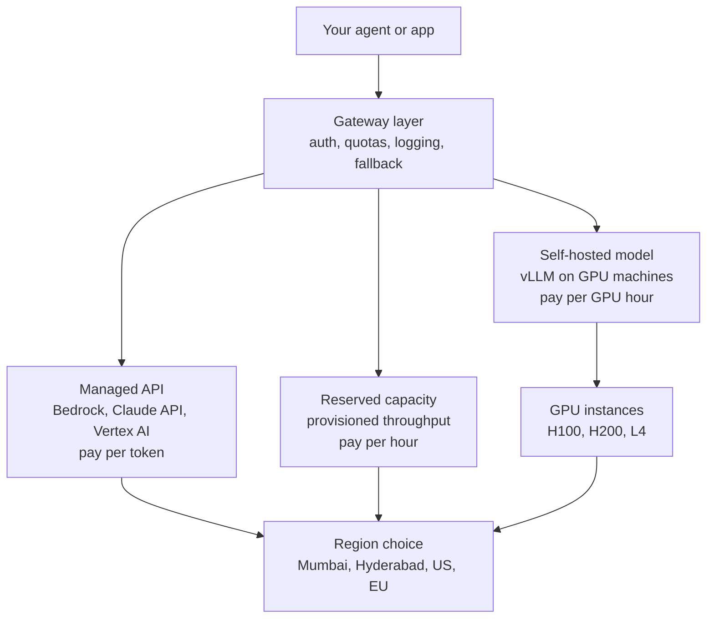
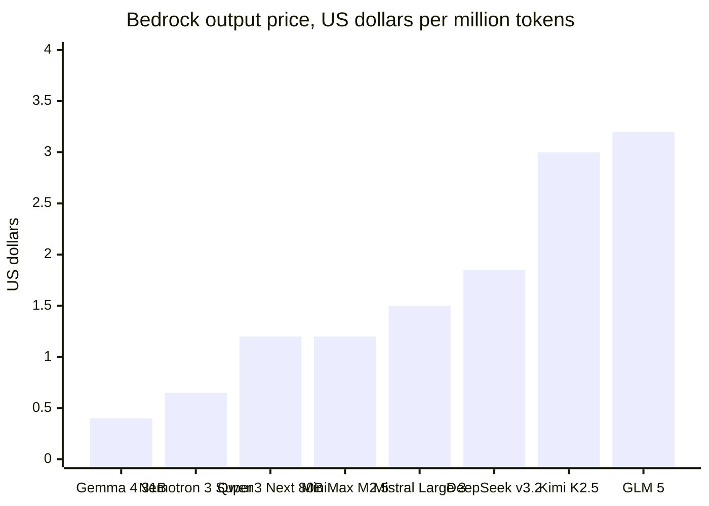
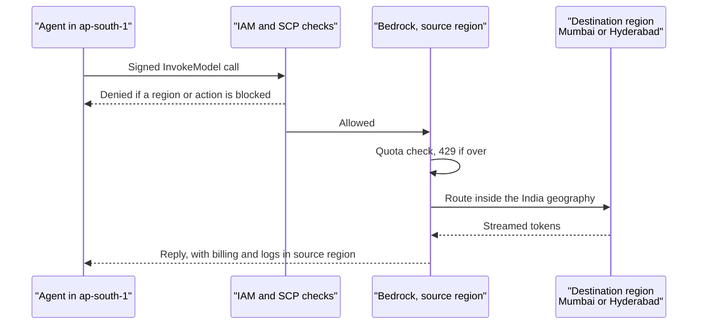
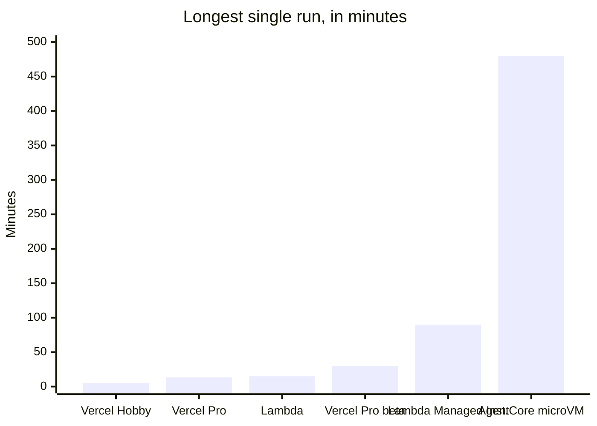
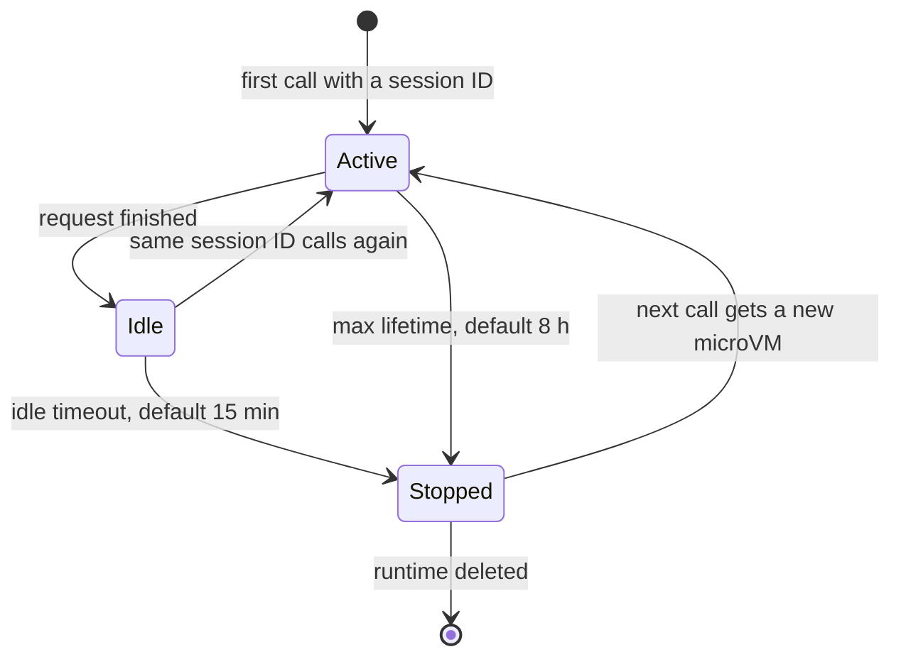
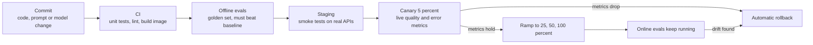
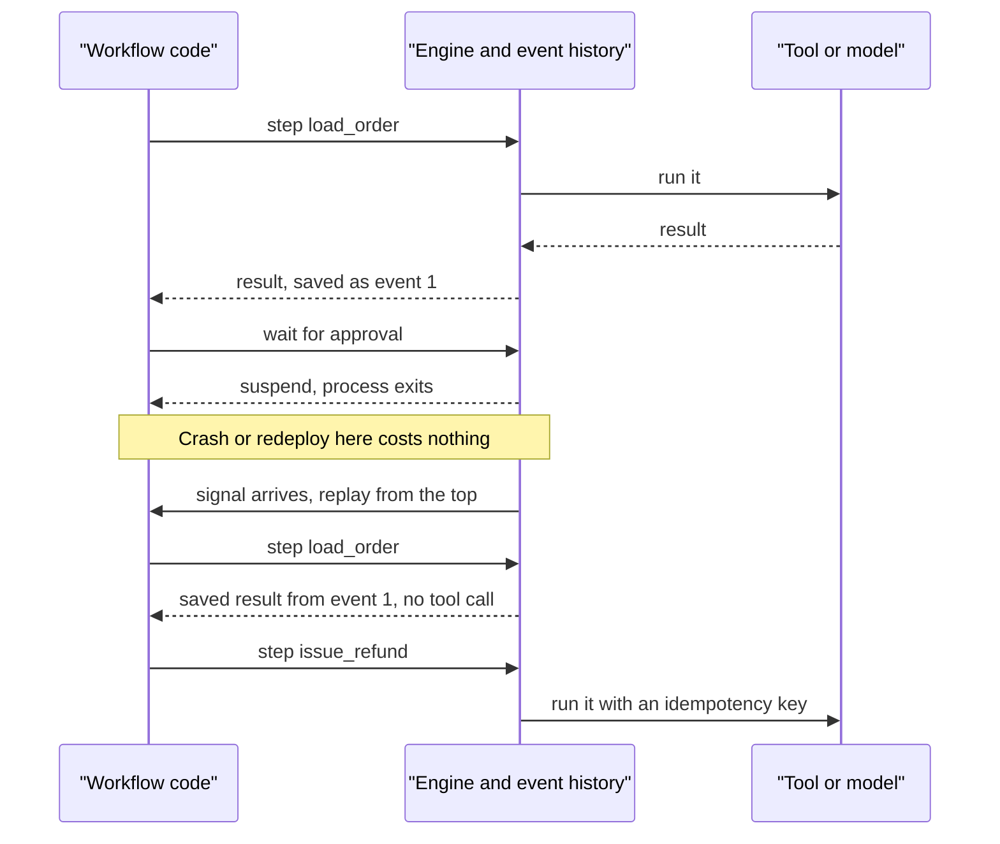
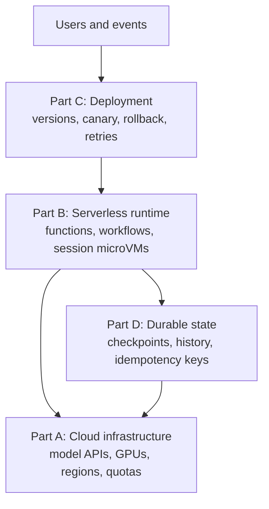
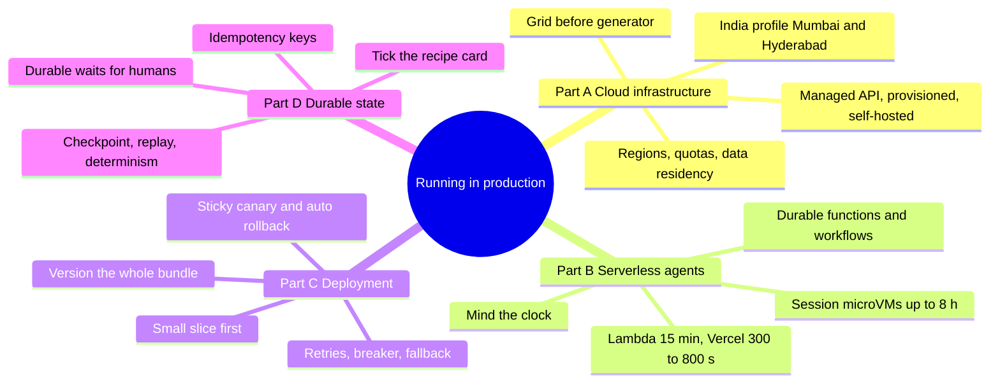



*Utkrishta Sinha · 8 Nov 2026 · about 75 minutes · covers syllabus topics 37, 41, 38, 23*

Today is about the gap between "it works on my laptop" and "it works for ten thousand customers at 3 a.m." That gap has four parts, and each one gets a full section below.

| Part | Syllabus topic | What you will be able to do |
| --- | --- | --- |
| A | 37, Cloud infrastructure for AI | Choose between a managed model API, provisioned capacity and self-hosted GPUs, and explain regions, quotas and data residency |
| B | 41, Serverless infrastructure for agents | Run an agent on Lambda, AgentCore Runtime, Vercel or Cloudflare without hitting timeouts or losing sessions |
| C | 38, Production deployment | Ship a new prompt or model safely with containers, health checks, canaries, retries and fast rollback |
| D | 23, Durable state | Make an agent survive crashes, redeploys and week-long waits, using checkpoints, replay and idempotency |

## 1. The Five Big Ideas

Production is where an agent stops being a demo and starts being a service. Facts below were checked on 8 November 2026.

- **Rent the model before you rent the GPU.** A managed API such as Amazon Bedrock turns AI into a per-token bill. Self-hosting on GPUs only wins at high, steady volume, and only after you load test it.
- **Where the model runs is a legal question, not only a technical one.** Regions, cross-region routing and data residency decide whether a bank or hospital can say yes. India now has an in-country Bedrock route for Claude.
- **Serverless is great for agents until the clock runs out.** Functions have hard time limits, such as 15 minutes on AWS Lambda. Agents that think for hours need a runtime built for sessions, or a way to pause and resume.
- **Deploy prompts and models like code.** Version them, roll them out to a small slice first, compare against the old version, and keep a one-click way back.
- **Agents must remember where they were.** Durable state saves each finished step, so a crash or redeploy resumes the run instead of restarting it. Every side effect also needs an idempotency key, so a retry cannot pay twice.

Think of a busy restaurant. Part A is renting the kitchen and the gas supply. Part B is hiring cooks by the hour instead of full time. Part C is how you change the menu without poisoning anyone. Part D is the order slip on the rail, so when a cook faints, the next cook knows the biryani is already half done. 😄

## 2. Why This Matters for an FDE

Most customer demos run on one laptop, one API key and one happy path. Then the customer asks, "Can we put this in front of all our users next month?" That question is your job.

An FDE (Forward Deployed Engineer) is the person who turns a working prototype into a system the customer can run. Today's four topics are where most prototypes break.

**Where each Part shows up on a real engagement:**

- **Part A, cloud infrastructure.** The security review asks where prompts are processed and stored. Procurement asks for a monthly cost forecast. Platform teams ask which AWS account, region and quota you need.
- **Part B, serverless agents.** The customer's platform team says "we only allow Lambda" or "we deploy on Vercel". Your 20-minute research agent now has a 15-minute or 5-minute ceiling.
- **Part C, production deployment.** A product manager changes the system prompt on Friday evening. On Monday, answer quality has dropped and nobody knows which version is live.
- **Part D, durable state.** An agent waits two days for a manager's approval. Meanwhile the team deploys twice and a server restarts. Without durable state, the approval lands on a run that no longer exists.

| What the customer says | Part | Root cause | The fix |
| --- | --- | --- | --- |
| "Legal blocked us. Data cannot leave India." | A | Model called in a US region by default | Use an in-country inference profile and document the data path |
| "We keep getting 429 errors at lunch time." | A | Quota sized for the pilot, not for peak | Request quota early, spread load across regions, add backoff |
| "The GPU bill is huge but the GPUs are idle." | A | Self-hosted for a spiky, small workload | Move to a per-token API, or scale to zero |
| "The agent dies at exactly 15 minutes." | B | Hit the Lambda function timeout | Split work into steps, or move to a session runtime |
| "Users lose their chat when they refresh." | B | State kept in function memory | Keep session state in a database or a per-user object |
| "The first reply is slow in the morning." | B | Cold starts after scale to zero | Keep warm capacity for interactive paths, stream early |
| "Quality dropped and we do not know why." | C | Prompt changed with no version or canary | Version prompts, canary them, compare against control |
| "A deploy broke every running conversation." | C | New code could not read old in-flight state | Drain or pin old versions, add version checks |
| "One provider outage took us down." | C | Single model, single region, no fallback | Add fallback models and a circuit breaker |
| "The agent restarted and did everything again." | D | No checkpoint between steps | Save each step result, replay on restart |
| "A customer got refunded twice." | D | Retry repeated a side effect | Use an idempotency key on every write |
| "Approvals that take days get lost." | D | The wait lived in memory | Use a durable wait, signal or callback |

You will notice a pattern. None of these fixes need a better model. They need ordinary backend engineering applied to a new kind of workload. Your Spring Boot and Node.js years count here more than you might expect.

> **Sentence for a customer call:** "Before we scale this, let's agree where it runs, how long one run can take, how we roll back, and what happens if a server dies mid-task."

## 3. Core Concepts, From Simple to Deep

This section has four parts, one per syllabus topic. Each starts with an everyday picture, gives you the words, and then goes under the hood.

### Part A: Cloud Infrastructure for AI (Topic 37)

#### A.1 The Electricity Picture

You do not build a power plant to run a fan. You plug into the grid and pay per unit. A factory that runs huge machines all day may buy a generator, because the grid bill becomes larger than the generator's cost.

AI works the same way. A managed model API is the grid: you pay per token. Self-hosted GPUs are the generator: you pay per hour, whether you use them or not. Most customers should start on the grid.

#### A.2 The Words You Need

| Term | Plain meaning | Simple example |
| --- | --- | --- |
| Cloud provider | A company that rents computers, storage and networks | AWS (Amazon Web Services), Google Cloud, Microsoft Azure |
| Region | A group of data centres in one geography | `ap-south-1` is Mumbai, `ap-south-2` is Hyderabad |
| Availability Zone | One or more separate data centres inside a region | Mumbai has several, so one fire does not stop the region |
| GPU | Graphics Processing Unit, a chip that does many small maths operations at once | NVIDIA H100, which LLMs run on |
| VRAM | The GPU's own memory, where model weights must fit | An H100 has 80 GB |
| Inference | Running a trained model to get an answer | Sending a prompt and getting a reply |
| Training | Teaching a model by adjusting its weights on data | Building a new model, which most customers never do |
| Managed model API | The provider runs the model and you call it over HTTP | Amazon Bedrock, the Claude API |
| Token | A small piece of text, roughly three quarters of a word | "Production" might be two tokens |
| On-demand | Pay per token, no commitment | The default Bedrock mode |
| Batch inference | Send many requests together, get answers later, pay less | Overnight summarising of 1 lakh support tickets |
| Provisioned throughput | Reserved model capacity you pay for by the hour | Guaranteed speed for a launch day |
| Self-hosting | You run an open-weight model on your own GPUs | Llama or Qwen served with vLLM |
| Serving engine | Software that loads a model and answers requests fast | vLLM |
| Quota | A limit the provider sets on how much you can use | Tokens per minute per region |
| Rate limit error | The provider refuses a request because you are over quota | HTTP 429 |
| Inference profile | A Bedrock ID that can route your call to more than one region | `in.anthropic.claude-sonnet-5` |
| Data residency | A rule that data must stay inside a country or area | An Indian bank keeping data in India |
| VPC | Virtual Private Cloud, your private network inside the cloud | The customer's locked-down AWS network |
| IAM | Identity and Access Management, the rules for who may call what | A policy that allows `bedrock:InvokeModel` |
| SCP | Service Control Policy, an organisation-wide rule in AWS | "No one may use regions outside India" |
| Scale to zero | The service shuts all copies down when idle, so idle costs nothing | A GPU service on Cloud Run at night |
| Cold start | The delay when a new copy must start before it can answer | About 5 seconds for a Cloud Run GPU instance |

#### A.3 The Three Ways to Get a Model

Every AI system answers one question first: who runs the model? There are three answers.

1. **A managed API.** You call Bedrock, the Claude API, Azure or Vertex AI. The provider owns the GPUs. You pay per token.
2. **Reserved capacity on a managed service.** You still call an API, but you pay per hour for guaranteed capacity. On Bedrock this is called provisioned throughput.
3. **Self-hosted.** You rent GPU machines and run an open-weight model yourself, usually with a serving engine such as vLLM.



*Three ways to get a model, all behind one gateway, and all landing in a region you must choose on purpose.*

The gateway box matters. If every team calls the model directly, you cannot add quotas, logging or a fallback later. Swiggy's support agent, for example, used an [AI Gateway for rate limits, payload logging and traffic fallback](https://databricks.com/blog/redefining-customer-support-swiggys-enterprise-scale-ai-agent-built-databricks).

#### A.4 How Managed APIs Charge You

Managed APIs charge per million tokens, with separate prices for input and output. Output usually costs more. On top of the standard price, providers sell cheaper and dearer tiers.

[Amazon Bedrock's pricing page](https://aws.amazon.com/bedrock/pricing/) lists these modes:

- **Standard (on-demand):** the normal per-token price.
- **Batch:** for select models, 50% lower than on-demand. You wait for results instead of getting them live.
- **Flex:** for some providers, a 50% discount to Standard, in exchange for less predictable speed.
- **Priority:** a 75% premium to Standard, for faster and more reliable service.
- **Provisioned throughput:** hourly rates per "model unit", with one-month or six-month commitments. For Anthropic models, the page says to contact your account team.

Prices vary a lot between models. Here are output prices for some open-weight models on Bedrock.



*An eightfold spread in output price for open models alone. Source: Amazon Bedrock pricing page, Standard tier, US East, checked 8 November 2026.*

The lesson for an FDE is simple. Model choice (Day 3) is also a cloud bill choice. A cheap model that passes your evals can cut the bill more than any infrastructure trick.

#### A.5 GPUs, Under the Hood

If a customer self-hosts, you need to know what a GPU machine is. An LLM's weights must sit in GPU memory, called VRAM, to run fast. A 70-billion-parameter model in 16-bit numbers needs about 140 GB just for weights, so it cannot fit on one 80 GB GPU.

AWS sells this hardware as EC2 instances. The [P5 family](https://aws.amazon.com/ec2/instance-types/p5/) looks like this:

| Instance | GPUs | GPU memory | Network |
| --- | --- | --- | --- |
| p5.4xlarge | 1 NVIDIA H100 | 80 GB HBM3 | 100 Gbps EFA |
| p5.48xlarge | 8 NVIDIA H100 | 640 GB HBM3 | 3200 Gbps EFA |
| p5e.48xlarge | 8 NVIDIA H200 | 1128 GB HBM3e | 3200 Gbps EFA |
| p5en.48xlarge | 8 NVIDIA H200 | 1128 GB HBM3e | 3200 Gbps EFA |

HBM (High Bandwidth Memory) is the fast memory on the GPU. EFA (Elastic Fabric Adapter) is AWS's fast network between machines, which matters when one model spans several GPUs.

Memory is not only for weights. Every active conversation also keeps a KV cache (key-value cache), which stores attention data for the tokens seen so far. Long contexts and many users fill VRAM quickly. That is why serving engines work so hard on memory.

[vLLM](https://docs.vllm.ai/en/latest/) is the best-known open serving engine. Its main tricks are worth knowing by name:

- **PagedAttention:** stores the KV cache in small pages, like an operating system stores memory, so less is wasted.
- **Continuous batching:** adds new requests to the GPU batch as soon as old ones finish, instead of waiting for the whole batch.
- **Prefix caching:** reuses work when many requests share the same start, such as a long system prompt.
- **An OpenAI-compatible server:** your app can call it with the same client code it uses for hosted APIs. The docs say it also offers an Anthropic Messages API.

You do not need to tune vLLM in an FDE interview. You need to explain why self-hosting is hard: GPU memory, batching, scaling and staying up are now your problems.

#### A.6 Serverless GPUs and Scale to Zero

Between "managed API" and "rent a whole GPU machine" sits a middle option. Some platforms run your container on a GPU and shut it down when idle. Google [Cloud Run with GPUs](https://docs.cloud.google.com/run/docs/configuring/services/gpu) is one example.

The facts on its docs page show the trade-off clearly:

- It offers NVIDIA L4 (24 GB) and RTX PRO 6000 Blackwell (96 GB) GPUs, one per instance.
- Services can scale to zero when not in use, so idle nights cost nothing.
- An instance with drivers starts in about 5 seconds. Your container still has to load the model after that.
- The GPU is billed for the whole instance lifecycle, and minimum instances are charged even when idle.
- L4 is listed in Mumbai (`asia-south1`, invitation only), and RTX PRO 6000 in Delhi (`asia-south2`).

Read that cold start line carefully. Five seconds to start, plus model loading, is fine for a nightly batch job. It is painful for a chat user waiting for the first word.

#### A.7 Regions, Quotas and Data Residency

A region is not just a location on a map. It decides latency, which models exist there, how much quota you get, and which laws apply. Customers in banking, insurance, health and government care about the last point most.

Bedrock solves part of this with **cross-region inference**. Instead of calling one region's model ID, you call an inference profile. The [Bedrock docs](https://docs.aws.amazon.com/bedrock/latest/userguide/geographic-cross-region-inference.html) explain the rules:

- A geographic profile keeps requests inside one geography, such as the US, EU, APAC or India. The ID prefix shows it, like `us.` or `in.`.
- Prompts and outputs may move between regions inside that geography during inference.
- Serving across several regions absorbs more demand than one region alone.
- IAM must allow the profile and the model in the source region and in every destination region.
- If an SCP denies regions, you must allow every destination region, or add an exception tied to the inference profile. Otherwise calls fail even though your own region is allowed.

That last point is a classic FDE trap. The customer's cloud team blocks all non-India regions with an SCP, and your calls fail with an access error that looks like a code bug.

**The India route.** On 29 September 2026, AWS announced an [India geographic profile for Claude](https://aws.amazon.com/blogs/machine-learning/amazon-bedrock-expands-claude-model-availability-to-india-cross-region-inference/). The post says requests route only between Mumbai (`ap-south-1`) and Hyderabad (`ap-south-2`). It lists Claude Opus 5, Claude Sonnet 5 and Claude Haiku 4.5, with IDs such as `in.anthropic.claude-sonnet-5`. Note that the Haiku ID is longer and dated: `in.anthropic.claude-haiku-4-5-20251001-v1:0`. Copy IDs from the docs, never type them from memory.

The same post says customer data is not stored in the destination region, and billing and logs stay in the source region. It also notes that some models may require AWS human review if automatic safety classifiers flag content. Read that sentence aloud to a compliance team before they discover it themselves.

**Government compute in India.** The other Indian context is public compute. A MeitY (Ministry of Electronics and IT) statement on 25 March 2026, [reported by TelecomTalk](https://telecomtalk.info/over-38000-gpus-onboarded-under-indiaai-mission/1005751/), said more than 38,000 GPUs had been onboarded to the IndiaAI compute portal. They are offered to start-ups, researchers and academia at subsidised rates. The mission outlay is Rs 10,372 crore, with 190 projects approved.

For an FDE, this matters when a customer must self-host in India for sovereignty reasons. It is one more option on the table, alongside the big clouds.

#### A.8 Capacity Planning: The Maths Behind the Choice

The decision between "grid" and "generator" is arithmetic. You need four numbers: requests per day, tokens per request, price per token, and what a GPU costs and serves per hour.

The tricky part is utilisation. A GPU you rent for 24 hours but use for 4 hours costs six times its useful work. Managed APIs hide this because the provider shares GPUs across many customers.

A short checklist covers most of the planning:

1. Estimate peak tokens per minute, not average. Lunch time is not 3 a.m.
2. Compare that peak with the region's default quota, and request more weeks ahead.
3. Price on-demand, batch and provisioned options for the expected volume.
4. Price self-hosting only if volume is high and steady, and include at least two GPUs for redundancy.
5. Add the cost of people. Someone must patch, scale and page on the GPU cluster.

Example A in section 4 turns this into code you can rerun with a customer's numbers.

#### A.9 Under the Hood: What Happens on One Bedrock Call

It helps to trace one request end to end. Here is what happens when your agent in Mumbai calls `in.anthropic.claude-sonnet-5`.

1. Your code signs the request with AWS credentials. IAM checks that your role may call that inference profile.
2. The request reaches Bedrock in your source region, `ap-south-1`. Any SCP in the customer's AWS organisation is checked here too.
3. Bedrock picks a destination region inside the India geography, Mumbai or Hyderabad, based on available capacity.
4. The model runs on the provider's accelerators there. The prompt and output may travel between the two regions, but the AWS post says they are not stored in the destination.
5. The reply streams back. Usage, billing and logs are recorded in your source region.

Each step is a place where an engagement can stall. Step 1 fails on a missing IAM action. Step 2 fails on an SCP. Step 3 fails with a 429 when the quota is too small. None of these are model problems.



*One cross-region call, and the three gates where it can fail before the model ever runs.*

### Part B: Serverless Infrastructure for Agents (Topic 41)

#### B.1 The Taxi Picture

You can own a car, or you can take a taxi. Owning means paying for parking and insurance even on days you stay home. A taxi charges only for the ride, appears when you call it and disappears when you arrive.

Serverless computing is the taxi. You hand the platform a function or container, and it runs copies only while requests arrive. The catch is the meter. Every taxi company has rules about how far one ride may go, and agents love long rides.

#### B.2 The Words You Need

| Term | Plain meaning | Simple example |
| --- | --- | --- |
| Serverless | You deploy code, the platform manages servers and scaling | AWS Lambda, Vercel Functions, Cloudflare Workers |
| Function | A piece of code the platform runs per request or event | A Node.js handler that answers `/api/chat` |
| Invocation | One run of a function | One user message triggers one invocation |
| Timeout | The longest one invocation may run before it is killed | 900 seconds on Lambda |
| Concurrency | How many copies run at the same moment | 1,000 per region by default on Lambda |
| Cold start | Delay while the platform creates a fresh copy | First request after a quiet hour |
| Stateless | The function keeps nothing in memory between invocations | A new invocation cannot see the last one's variables |
| Session | A series of related calls from one user or task | One support conversation |
| microVM | A very small virtual machine with strong isolation | Each AgentCore session gets its own |
| Response streaming | Sending the reply in pieces as it is produced | Tokens appearing one by one in a chat UI |
| Durable function | A function whose progress is saved so it can pause and resume | Lambda durable functions, Vercel Workflows |
| Checkpoint | A saved record of finished work | "Step 3 done, result was X" |
| Durable Object | Cloudflare's single named object with its own storage | One object per chat room or per agent |
| Hibernation | The platform frees memory while keeping the object's identity | A quiet WebSocket that costs almost nothing |
| Alarm | A timer that wakes an object later | "Remind me in 2 hours" |
| Active CPU billing | You pay for CPU only while code runs, not while it waits | Waiting on a model reply is not billed as CPU |
| I/O wait | Time spent waiting for a network or disk reply | 20 seconds waiting for the LLM |
| Queue | A list of jobs that workers pick up later | SQS, Vercel Queues |

#### B.3 Why Agents and Serverless Clash

Classic serverless was designed for short web requests. A request arrives, the function runs for 200 milliseconds, it replies and it dies. Agents break each of those assumptions.

- **They run long.** A research agent might call the model 40 times and tools 60 times. That can take 20 minutes.
- **They wait a lot.** Most of an agent's wall-clock time is waiting for the model, a tool or a human. Paying for CPU while waiting is wasteful.
- **They hold state.** The conversation, the plan and the tool results must survive between calls.
- **They need isolation.** A coding agent runs code the model wrote. That code must not see another customer's files.

So "can we run this on serverless?" is really four questions. How long, how much waiting, where is the state, and how strong is the wall between users?

#### B.4 The Hard Numbers

Limits decide architecture, so learn the current ones. These were checked on 8 November 2026.

[AWS Lambda quotas](https://docs.aws.amazon.com/lambda/latest/dg/gettingstarted-limits.html):

- Function timeout: **900 seconds (15 minutes)**. Lambda Managed Instances allow up to 90 minutes for asynchronous and event source invocations.
- Memory: 128 MB to 10,240 MB. At 1,769 MB, a function gets the equivalent of one vCPU (virtual CPU).
- Payload: 6 MB for a synchronous request and response. A streamed response can reach 200 MB.
- Concurrency: 1,000 per region by default, and it can be raised.

[Vercel Functions duration](https://vercel.com/docs/functions/configuring-functions/duration) with fluid compute, which is on by default:

| Plan | Default | Maximum | Extended maximum |
| --- | --- | --- | --- |
| Hobby | 300 s | 300 s | none |
| Pro | 300 s | 800 s | 1,800 s, in beta |
| Enterprise | 300 s | 800 s | 1,800 s, in beta |

Vercel also says active CPU billing pauses while your function waits on I/O. For an agent that spends most of its life waiting on a model, that changes the bill a lot.

[Amazon Bedrock AgentCore Runtime](https://docs.aws.amazon.com/bedrock-agentcore/latest/devguide/runtime-lifecycle-settings.html):

- Each session gets a dedicated microVM.
- Idle timeout defaults to 15 minutes, and maximum lifetime to 8 hours.
- On the "Instances" option with a capacity provider, both can go up to 14 days.

Here are those ceilings on one chart, in minutes.



*Ceilings differ by about 100 times. Sources: Vercel duration docs, Lambda quotas page and AgentCore lifecycle docs, checked 8 November 2026.*

#### B.5 Pattern 1: Short Functions Plus Saved State

The simplest pattern keeps each invocation short. All state lives outside the function, in a database such as DynamoDB, Postgres or Redis.

The flow for a chat agent looks like this:

1. The request arrives with a `session_id`.
2. The function loads the conversation from the database.
3. It runs one model turn, maybe a few tool calls, and streams the reply.
4. It saves the new messages and exits.

This works well when each user turn finishes inside the timeout. It is how most chat apps on Vercel or Lambda run. Your React or Angular frontend already works this way with REST APIs, so it will feel familiar.

It fails when a single turn needs more time than the ceiling. Then you need one of the next three patterns.

#### B.6 Pattern 2: Chunk the Work and Re-invoke

If a task is longer than one invocation, split it into steps. The function watches its own clock. When little time is left, it saves progress and returns a "continue" signal. A queue, a scheduler or the client then calls it again.

This is cheap and works anywhere. It is also easy to get wrong: you must save after every step, and every step must be safe to run twice. Example B in section 4 builds this pattern in Node.js.

#### B.7 Pattern 3: Durable Functions and Workflows

The cleaner answer is a platform that saves progress for you. You write normal code, mark the risky parts as steps, and the platform does the checkpointing. Part D explains the theory. Here is what the serverless platforms offer.

**AWS Lambda durable functions.** The [Lambda docs](https://docs.aws.amazon.com/lambda/latest/dg/durable-functions.md) say a durable execution can run for up to one year. Steps get built-in retries and checkpoints. Waits suspend the function without compute charges. The SDK is available for JavaScript, TypeScript, Python, Java, Go and C#.

The [quotas page](https://docs.aws.amazon.com/lambda/latest/dg/gettingstarted-limits.html) adds limits you must design around: 30,000 operations per execution, 100 MB of saved state per execution, and 1 MB per operation's payload. Those last two cannot be raised. So do not checkpoint a whole PDF into a step result. Save it to S3 and checkpoint the S3 key.

**Vercel Workflows.** [Vercel Workflows](https://vercel.com/docs/workflow) uses `'use workflow'` and `'use step'` directives in JavaScript or TypeScript, plus Python support. The docs say runs can pause for minutes or months, and survive deployments and crashes through deterministic replay. Each run is pinned to one region for its whole life.

**Cloudflare Agents.** On Cloudflare, [each agent runs on a Durable Object](https://developers.cloudflare.com/agents/), which the docs call a stateful micro-server. Each agent has its own SQL database, can sync state to clients over WebSockets, and can schedule future work. [Durable Objects](https://developers.cloudflare.com/durable-objects) are globally unique by name, hold SQLite storage, hibernate when idle and can wake themselves with alarms.

Notice the shared idea. All three move state out of process memory and into storage the platform owns. That is what lets a function die and still finish its job.

#### B.8 Pattern 4: A Session Runtime Built for Agents

The last pattern is a runtime made for agents. You give it a container. It gives every session an isolated machine that stays alive while the session is active.

[AgentCore Runtime](https://docs.aws.amazon.com/bedrock-agentcore/latest/devguide/runtime-how-it-works.html) is AWS's version. Its docs list these features:

- You build a container image, push it to Amazon ECR (Elastic Container Registry) and create a runtime from it.
- It supports HTTP, MCP (Model Context Protocol), A2A (Agent-to-Agent protocol) and WebSocket streaming.
- Each change creates an immutable version. A `DEFAULT` endpoint follows the latest version, and you can create custom endpoints such as `prod`.
- Background tasks of up to 8 hours are tracked through a `/ping` health endpoint.

The [session docs](https://docs.aws.amazon.com/bedrock-agentcore/latest/devguide/runtime-sessions.html) add three details you must know before a design review:

- When a session ends, its microVM is terminated and memory is sanitised. Data on disk is lost unless you configure session storage.
- Session IDs need at least 33 characters. AgentCore does not map users to sessions. Your backend must do that and enforce limits per user.
- A call that hits a session while it is starting or stopping gets HTTP 409. Retry with short backoff.

The [pricing page](https://aws.amazon.com/tr/bedrock/agentcore/pricing/) explains why this suits agents. CPU is billed per second and scales to zero during I/O wait, which includes waiting for LLM responses and tool calls. It lists v1 at $0.0895 per vCPU-hour and $0.00945 per GB-hour of memory. The newer v2 platform costs more per hour on consumption pricing: $0.1276 per vCPU-hour and $0.0169 per GB-hour. On v2, idle memory is reclaimed after 120 seconds, so memory charges can continue for a short while during a wait, even though CPU charges stop.



*An AgentCore session. A stopped session can resume, but on a fresh machine, so memory is gone unless you saved it.*

#### B.9 Under the Hood: Why Isolation and Cold Starts Fight

Serverless platforms keep a pool of warm copies. A warm copy answers fast. A cold one must start a runtime, load your code and open connections first.

Strong isolation makes cold starts worse. A per-session microVM is safer than a shared process, but it must be created for each new session. AgentCore's v2 platform starts agents from a snapshot to make cold starts more consistent, according to its docs. On v2, the container must report healthy on `/ping` within 120 seconds of startup.

The FDE lesson is to choose isolation by risk. A support chatbot that only reads documents can share processes. A coding agent that runs model-written code needs a microVM or a sandbox per session.

#### B.10 Choosing a Pattern

Use this short decision list in a design meeting.

1. Does every user turn finish in under about 4 minutes? Short functions plus saved state are enough.
2. Does a task run longer, but in clear steps? Use a durable function or workflow.
3. Does it wait hours or days for people or events? Use a durable function, a workflow, or a Durable Object with alarms.
4. Does it run untrusted code or need a filesystem for hours? Use a session runtime with per-session isolation.

Most real systems mix two. A chat front door runs as short functions, and long jobs are handed to a workflow.

### Part C: Production Deployment (Topic 38)

#### C.1 The Restaurant Menu Picture

Imagine changing the menu at a busy restaurant. A careless owner prints new menus overnight and hands them to everyone at once. If the new dish makes people ill, every table is affected.

A careful owner tests the dish in the kitchen first. Then they offer it to two tables, watch their faces, and only then print menus. They also keep the old recipe card, so they can switch back in minutes. That is production deployment.

#### C.2 The Words You Need

| Term | Plain meaning | Simple example |
| --- | --- | --- |
| Deployment | Putting a new version where real users reach it | Shipping v13 of the agent |
| Release | Making a feature visible to users, which can be separate from deploying | A feature flag turned on |
| Environment | A separate copy of the system | Dev, staging, production |
| Container | A packaged app with everything it needs to run | A Docker image of your Node.js agent |
| Image tag | A label naming one exact build | `agent:2026-11-08-a1b2c3` |
| CI/CD | Continuous Integration and Continuous Delivery, automated build, test and deploy | GitHub Actions running tests on every push |
| Health check | A URL the platform calls to see if the app is fine | `/ping` returns 200 |
| Liveness probe | Kubernetes check that decides whether to restart a container | Restart a deadlocked process |
| Readiness | Whether a copy may receive traffic yet | Wait until the model client is warmed up |
| Rolling deploy | Replace old copies with new ones a few at a time | 10 pods, two at a time |
| Blue/green | Run old and new side by side, then switch all traffic | Flip a load balancer from blue to green |
| Canary | Send a small share of traffic to the new version first | 5% of users get the new prompt |
| Shadow traffic | Copy real requests to the new version without showing users its answers | Compare v13 answers offline |
| Feature flag | A switch in config that turns behaviour on or off without a deploy | `use_new_router=true` for one customer |
| Rollback | Going back to the last good version | Point the alias at v12 again |
| Prompt registry | A store of versioned prompts outside the code | MLflow Prompt Registry |
| Model pinning | Calling an exact model ID, not a moving alias | `claude-sonnet-5-5` instead of "latest" |
| Deprecation | A provider warns a model will be removed | Sonnet 4.5 retires 30 November 2026 |
| Retry with backoff | Try again after waiting longer each time | Wait 1 s, 2 s, 4 s |
| Circuit breaker | Stop calling a failing service for a while | Skip provider A for 60 seconds |
| Fallback | A second option used when the first fails | Switch to another model or region |
| SLO | Service Level Objective, a target for reliability | 99.5% of replies within 10 seconds |
| p95 latency | The time under which 95% of requests finish | p95 of 8 seconds |
| Runbook | A written guide for handling an incident | "If 429s exceed 5%, do this" |

#### C.3 What Is Different About Deploying AI

Normal software is deterministic. The same input gives the same output, so a passing test today passes tomorrow. AI systems break this in three ways.

1. **More things change.** You can break the system by changing code, but also the prompt, the model ID, a tool description, the retrieval index or a provider's backend.
2. **Failure is quiet.** A broken API returns a 500 error. A worse prompt returns a polite, confident, slightly wrong answer, with HTTP 200.
3. **Things change under you.** Providers retire models on a schedule and change their infrastructure.

So the deployment unit for an AI system is bigger than the container. Think of it as a bundle: code, prompt version, model ID, tool definitions, retrieval config and eval results. Version the whole bundle together.

#### C.4 A Lesson From the Provider Side

Even model providers get this wrong. In September 2025, Anthropic published [a postmortem of three issues](https://www.anthropic.com/engineering/a-postmortem-of-three-recent-issues) that degraded Claude's answers.

One bug sent some Sonnet 4 requests to servers set up for a coming 1M-token context window. It began on 5 August at about 0.8% of requests. A load balancing change on 29 August made it worse. At the worst hour, on 31 August, 16% of Sonnet 4 requests were affected.

Anthropic said its evaluations "simply didn't capture the degradation users were reporting." Its fixes included more sensitive evals and running quality evals continuously on true production systems. The routing fix itself was deployed on 4 September and took until 18 September to finish rolling out across every platform, the last being Amazon Bedrock. Even a fix needs a staged rollout, which is the idea behind section C.7. An [InfoQ summary](https://infoq.com/news/2025/10/anthropic-infrastructure-bugs) adds that Claude runs on AWS Trainium, NVIDIA GPUs and Google TPUs, so every infrastructure change must be checked on each platform.

The lessons transfer directly to your customers:

- A small rollout can quietly grow through a routing change.
- Error rates alone will not catch quality drops. You need quality metrics in production.
- Your own system needs evals that run on live traffic, not only before release.

#### C.5 The Deployment Pipeline, Step by Step

Here is a pipeline that suits most agent services. It is ordinary CI/CD with two AI-specific gates.



*A normal CI/CD pipeline with two extra gates: offline evals before release and quality checks during and after.*

Let us walk through each box.

1. **Commit.** Prompts live in files or a prompt registry, never pasted in a dashboard. A prompt change gets a pull request like code.
2. **CI.** Build a container image with an immutable tag. Run unit tests on tools and parsers.
3. **Offline evals.** Run the new bundle on a fixed golden set of real cases. It must match or beat the current version. Day 19 covers how to build these evals.
4. **Staging.** Call the real model provider from the same region and account type as production. Many quota and IAM problems appear only here.
5. **Canary.** Send a small share of real traffic to the new version. Watch error rate, latency, cost per request and a quality score.
6. **Ramp or roll back.** Increase the share in steps. If any metric drops beyond a set limit, roll back automatically.

#### C.6 Health Checks Done Right

A health check tells the platform whether a copy should get traffic. For an agent, "the process is running" is not enough. A useful check confirms the app can reach its dependencies.

There is a trap, though. Kubernetes [liveness probes](https://v1-34.docs.kubernetes.io/docs/concepts/configuration/liveness-readiness-startup-probes) restart a container that fails them, and the docs note that liveness probes do not wait for readiness probes to succeed. If your liveness check calls the LLM provider, a provider outage makes Kubernetes restart every pod. Now you have two outages.

So split the checks:

- **Liveness:** "Is my process stuck?" Check only local things.
- **Readiness:** "Can I serve now?" Check config is loaded and connections are open.
- **Deep health:** a separate dashboard check that calls the model. Alert on it, but do not restart on it.

AgentCore follows a similar idea with its `/ping` endpoint. On v2, a container that does not report healthy within 120 seconds fails to deploy.

#### C.7 Canaries, Blue/Green and Traffic Shifting

Three rollout styles cover almost every case.

- **Rolling:** replace copies a few at a time. Cheap, but old and new versions serve together for a while.
- **Blue/green:** run the full new version next to the old one, then switch all traffic at once. Rollback is one switch back.
- **Canary:** send a small share to the new version, measure, then ramp. Slower, but it limits harm.

On Lambda, canaries use alias weights. The [AWS Compute blog](https://aws.amazon.com/blogs/compute/implementing-canary-deployments-of-aws-lambda-functions-with-alias-traffic-shifting/) shows `update-alias` with `AdditionalVersionWeights`, for example 0.05 to send 5% to a new version. With SAM (Serverless Application Model) and CodeDeploy, a `DeploymentPreference` such as `Linear10PercentEvery1Minute` shifts traffic in steps and rolls back if a CloudWatch alarm fires.

For AI, add one rule: **make canary assignment sticky by user.** If a user's messages bounce between two prompt versions, the conversation gets confusing and your metrics get noisy. Hash the user ID into a bucket, as Example C does.

#### C.8 Pin Models and Plan for Retirement

Providers retire models on a published schedule. Anthropic's [model deprecations page](https://platform.claude.com/docs/en/about-claude/model-deprecations) defines four stages: Active, Legacy, Deprecated and Retired. Requests to retired models fail. The page says publicly released models get at least 60 days' notice.

A current example: `claude-sonnet-4-5-20250929` was deprecated on 30 September 2026 and retires on 30 November 2026 (the page marks that date as tentative), with `claude-sonnet-5-5` as the recommended replacement. The page also says Amazon Bedrock and Google-managed Claude on Google Cloud set their own schedules, so dates can differ by platform.

The practical rules:

- Call exact model IDs, and keep them in config, not scattered in code.
- Put every model's retirement date on the team calendar.
- Treat a model upgrade as a deployment, with offline evals and a canary.
- The same page notes some request parameters were removed in API version `2026-10-21`. Parameter changes can break you too. The removed ones are `temperature`, `top_p` and `top_k`: requests that include them on that API version get a 400 error, and the page recommends steering behaviour with the prompt instead.

#### C.9 Retries, Timeouts, Circuit Breakers and Fallbacks

Model APIs fail in normal ways: timeouts, 429 rate limits, 5xx errors and the occasional regional outage. Production code needs four defences.

1. **Timeouts on every call.** A hung call ties up a worker forever.
2. **Retries with exponential backoff and jitter.** Wait longer each time, with a little randomness so clients do not retry in sync.
3. **A circuit breaker.** After repeated failures, stop calling the sick provider for a while. This protects both sides.
4. **A fallback.** Another region, another model or a polite "please try later" message.

Only retry operations that are safe to repeat. A retried model call is fine. A retried refund is a disaster unless it carries an idempotency key, which Part D explains.

Swiggy's support agent shows these defences in a real system. Its [Databricks write-up](https://databricks.com/blog/redefining-customer-support-swiggys-enterprise-scale-ai-agent-built-databricks) from October 2025 lists an AI Gateway with rate limits, payload logging and traffic fallback. It also uses MLflow tracing, evaluation and a Prompt Registry.

#### C.10 Under the Hood: Version Skew

Here is a problem that bites agent teams later than web teams. A user starts a long task on version 12. Halfway through, you deploy version 13. The task's next step now runs on new code that may not understand the saved state.

This is called version skew. Platforms handle it in different ways:

- AgentCore keeps existing sessions on the code version they started with, until they end, according to its [lifecycle docs](https://docs.aws.amazon.com/bedrock-agentcore/latest/devguide/runtime-lifecycle-settings.html).
- Vercel Workflows lists skew protection as a feature.
- On your own platform, you either drain old work before removing old code, or you write new code that can read old state.

Part D shows why durable workflows are especially sensitive to this.

### Part D: Durable State (Topic 23)

#### D.1 The Recipe Card Picture

A cook makes a long recipe with twelve steps. Halfway through, the power goes out. A forgetful cook starts again from step one and adds salt twice. A careful cook ticks each step on the recipe card as it is done, so after the power returns, they continue from step seven.

Durable state is the tick marks. The agent writes down each finished step outside its own memory. When anything crashes, the work resumes instead of repeating.

#### D.2 The Words You Need

| Term | Plain meaning | Simple example |
| --- | --- | --- |
| State | Everything a program needs to remember to continue | Messages, plan, tool results |
| In-memory state | State held in RAM, lost when the process dies | A JavaScript array of messages |
| Durable state | State saved to storage that survives crashes | A row in Postgres |
| Durable execution | Running code so that it always finishes, despite failures | A refund flow that survives a restart |
| Workflow | The overall multi-step process | Approve and issue a refund |
| Step or activity | One unit of work whose result is saved | "Call the payment API" |
| Checkpoint | A saved snapshot or record of progress | LangGraph saves one per step |
| Event history | An ordered log of everything that happened in a run | Step 1 done, step 2 done, waiting |
| Replay | Re-running the workflow code from the start, using saved results | Skip steps 1 to 6, run step 7 |
| Determinism | Same inputs give the same sequence of calls | No random numbers outside steps |
| Side effect | An action that changes the outside world | Sending an email, charging a card |
| Idempotent | Safe to do twice, with the same result as once | Setting a status to "paid" |
| Idempotency key | A unique ID that lets a server ignore repeats | Stripe's `Idempotency-Key` header |
| At-least-once | A step may run more than once, never zero times | Most queues and workflow engines |
| Exactly-once effect | The outside world sees one result, even with retries | One refund despite three attempts |
| Signal or callback | A message from outside that resumes a waiting run | A manager clicks "Approve" |
| Durable timer | A wait the engine remembers, even across restarts | "Wait 3 days, then remind" |
| Thread | LangGraph's name for one conversation's saved history | `thread_id = "ticket-9001"` |
| Interrupt | Pausing a graph to ask a human | LangGraph `interrupt()` |
| Saga | A multi-step process with an undo step for each action | Cancel the hotel if the flight fails |

#### D.3 Why Agents Need It More Than Web Apps

A web request lasts a second, so a crash loses one second of work. An agent run might last an hour, cost a few dollars in tokens and have already sent two emails. A crash at minute 55 is expensive and messy.

Agents also wait. They wait for models, for slow tools and most of all for people. A process cannot sit in memory for three days waiting for a manager. Servers restart, deploys happen and serverless functions time out long before then.

So durable state solves three problems at once:

- **Crash recovery:** resume from the last finished step.
- **Long waits:** pause with nothing in memory, and wake on a signal or timer.
- **No double side effects:** each external action happens once, even with retries.

#### D.4 Level 1: Save the Conversation

The simplest durable state is the chat history in a database. Each turn loads the messages, runs the model and saves the new ones. Pattern 1 in Part B is exactly this.

It handles refreshes and new servers well. It does not handle a crash in the middle of a turn. If the agent called three tools and died before saving, those tool calls are lost or repeated.

#### D.5 Level 2: Checkpoint Every Step

The next level saves after every step, not every turn. LangGraph does this with a **checkpointer**. The [LangGraph persistence docs](https://docs.langchain.com/oss/python/langgraph/persistence) describe it this way:

- A checkpointer saves a thread's graph state as checkpoints. You pick the thread with a `thread_id` in the config.
- `InMemorySaver` keeps checkpoints in RAM and loses them on restart. It is for development only.
- `PostgresSaver`, with `AsyncPostgresSaver`, is the production option. `SqliteSaver` is a local file option for development.
- With Postgres, keep `thread_id` under 255 characters, because of the column size.

Checkpoints unlock a pause for humans. The [LangGraph interrupts docs](https://docs.langchain.com/oss/python/langgraph/interrupts) list a checkpointer as a requirement for this. A node calls `interrupt()`, the graph saves its state and stops. Later, even in a new process, you call the graph again with `Command(resume=...)` and the same `thread_id`. Example D2 in section 4 shows this running.

#### D.6 Level 3: Durable Execution With Replay

The strongest level is durable execution. Temporal made the idea popular. AWS Lambda durable functions, Vercel Workflows and Cloudflare Workflows offer it on serverless platforms.

Here is how it works under the hood, in five ideas.

1. **You write ordinary code.** The workflow looks like a normal function with loops and `if` statements.
2. **Risky work goes in steps.** Model calls, tool calls, database writes and anything random go inside a step.
3. **Each step's result is recorded.** The engine writes it to an event history before moving on.
4. **On restart, the code replays.** The engine runs your function from the top. When it reaches a finished step, it returns the saved result instead of running the step again.
5. **Waits are free.** A wait or signal saves state and lets the process exit. A timer or event wakes it later.

The [Lambda durable functions docs](https://docs.aws.amazon.com/lambda/latest/dg/durable-functions.md) describe the same thing: replay "re-executing from the beginning while skipping completed work."



*Replay: the workflow runs again from the top, but finished steps return their saved results instantly.*

#### D.7 The Determinism Rule

Replay only works if the workflow makes the same calls in the same order each time. If the code takes a different branch on replay, the saved history no longer matches.

The AWS [durable execution key concepts](https://docs.aws.amazon.com/durable-execution/getting-started/key-concepts/) list what must go inside a step: random numbers and UUIDs, the current time, external API calls, database queries and file I/O. Outside a step, these give different answers on replay.

LLM calls are the most non-deterministic thing in your system. So every model call must be a step. Temporal's [OpenAI Agents SDK integration](https://temporal.io/blog/announcing-openai-agents-sdk-integration) does exactly this: it runs every agent invocation as a Temporal Activity. The post says the Python integration became generally available on 23 March 2026.

A second consequence is about deploys. If you change the order of steps while runs are in flight, replay breaks. Example D's engine detects this and raises a "non-determinism" error. Real engines offer versioning tools for safe changes.

#### D.8 Idempotency: The Other Half

Durable execution gives at-least-once steps. Imagine the payment API succeeds, then the process dies before the result is saved. On replay, the engine does not know the step finished, so it runs it again.

The fix is an **idempotency key**. The client creates a unique key per logical action and sends it with the request. The server remembers keys it has seen and returns the first result for repeats.

[Stripe's docs](https://docs.stripe.com/api/idempotent_requests.md) are the textbook version:

- Send an `Idempotency-Key` header on POST requests. GET and DELETE are already idempotent.
- Keys can be up to 255 characters. Stripe suggests V4 UUIDs, and warns against using personal data such as email addresses.
- Stripe saves the first response for a key and returns it for retries, even if it was a 500 error.
- Keys can be pruned after at least 24 hours. A reused key with different parameters returns an error.
- These rules are written for Stripe's API v1. The docs say API v2 behaves differently: a retry does not repeat a successful operation, and Stripe tries to finish failed or partly failed work. Always read the idempotency rules for the exact API version you call.

For your own tools, build the same thing: a table with a unique key column, and an insert that ignores duplicates. Derive the key from the run ID and step number, so a replay produces the same key. Example D does exactly this.

> **The pair to remember:** durable execution makes sure a step runs at least once. Idempotency makes sure its effect happens only once.

#### D.9 Where the State Lives

Durable state needs a home. Each choice has a different cost and shape.

| Option | What it stores | Good for | Watch out for |
| --- | --- | --- | --- |
| Postgres | Checkpoints, threads, business data | Most teams, strong consistency | Connection limits from serverless functions |
| DynamoDB or similar | Session state by key | Serverless on AWS, high scale | Item size limits, design keys carefully |
| Redis | Short-lived session data | Fast caching | Not durable by default, treat as cache |
| Durable Object storage | One agent's state, next to its code | Cloudflare, per-user or per-room agents | One object is one thread of execution |
| Workflow engine history | Step results and waits | Long, multi-step processes | Payload limits, for example 1 MB per Lambda durable operation |
| S3 or blob storage | Large files and artefacts | PDFs, images, big tool outputs | Save the key in state, not the file |

Two rules apply whatever you pick. Keep big blobs out of checkpoints. And encrypt state, because it holds prompts, tool results and often personal data.

#### D.10 Under the Hood: What a Checkpoint Holds

It helps to see what is actually saved. A typical agent checkpoint holds:

- **The run identity:** run ID, thread ID, user and tenant.
- **The position:** which step or node comes next.
- **The data:** messages, plan, tool results so far, and any counters such as tokens used.
- **The version:** which code and prompt version wrote it.
- **Pending work:** writes or tool calls that were started but not confirmed.

The version field saves you during deploys. When new code loads an old checkpoint, it can migrate the data, refuse politely or route the run to old code. Without the field, you are guessing.

### How the Four Parts Fit Together

The four Parts are layers of one system. Each layer depends on the one below it.



*Deployment decides which version runs. Serverless decides where it runs. Durable state lets it survive. Cloud infrastructure supplies the model and the region.*

A single request touches all four. It arrives at a deployed version chosen by the canary router (C). It runs in a function or session (B). It saves each step (D). It calls a model in a chosen region under a quota (A). When an FDE debugs a production issue, the first question is which layer failed.

## 4. Worked Examples

There is one example per Part, plus a second one for Part D, going from a spreadsheet-style model to a real library. Examples A, B, C, D1 and D2 were run on 8 November 2026 in this sandbox with Python 3.13.18, Node.js 22.23.4 and LangGraph 1.2.20. The output shown is real. The cloud snippets at the end need an AWS account, so they were not run.

### Example A: Grid or Generator? A Capacity Calculator (Python)

This script compares a per-token API with self-hosted GPUs for the same workload. It is deliberately simple, so you can change the inputs on a customer call.

**Important:** every price and throughput below is an example input, not a quote. Replace each with the customer's real prices and your own load test.

```python
"""capacity.py: grid (per-token API) versus generator (self-hosted GPUs).
Every number in INPUTS is an example to replace with the customer's real quotes."""

INPUTS = {
    "requests_per_day": 50_000,
    "input_tokens": 3_000,          # per request, system prompt + context
    "output_tokens": 500,           # per request
    "api_in_per_m": 0.60,           # US dollars per million input tokens (example)
    "api_out_per_m": 2.40,          # US dollars per million output tokens (example)
    "batch_share": 0.40,            # share of traffic that can wait for batch
    "batch_discount": 0.50,         # Bedrock lists batch at 50% off on-demand for select models
    "gpu_hour": 8.00,               # US dollars per GPU machine hour (example, get a real quote)
    "gpus_min": 2,                  # always keep two for redundancy
    "tokens_per_sec_per_gpu": 20_000,  # measured by YOUR load test, not a spec sheet
    "ops_cost_month": 3_000,        # share of an engineer to run the cluster
    "peak_factor": 3.0,             # lunch peak versus daily average
}

def api_cost_month(p):
    per_req = (p["input_tokens"] * p["api_in_per_m"] + p["output_tokens"] * p["api_out_per_m"]) / 1e6
    live = per_req * (1 - p["batch_share"])
    batch = per_req * p["batch_share"] * (1 - p["batch_discount"])
    return (live + batch) * p["requests_per_day"] * 30

def gpu_cost_month(p):
    tokens_day = p["requests_per_day"] * (p["input_tokens"] + p["output_tokens"])
    avg_tps = tokens_day / 86_400
    peak_tps = avg_tps * p["peak_factor"]
    gpus = max(p["gpus_min"], -(-peak_tps // p["tokens_per_sec_per_gpu"]))  # ceiling
    util = avg_tps / (gpus * p["tokens_per_sec_per_gpu"])
    return gpus * p["gpu_hour"] * 24 * 30 + p["ops_cost_month"], int(gpus), util, peak_tps

def report(p, label):
    api = api_cost_month(p)
    gpu, n, util, peak = gpu_cost_month(p)
    winner = "API" if api < gpu else "SELF-HOST"
    print(f"{label:<18} api=${api:>10,.0f}/mo  gpu=${gpu:>10,.0f}/mo  "
          f"gpus={n:<3} util={util:5.1%} peak_tps={peak:>8,.0f}  -> {winner}")

if __name__ == "__main__":
    for scale in (1, 10, 100):
        p = dict(INPUTS, requests_per_day=INPUTS["requests_per_day"] * scale)
        report(p, f"{p['requests_per_day']:,} req/day")
    # break-even search
    for n in range(10_000, 10_000_001, 10_000):
        p = dict(INPUTS, requests_per_day=n)
        if api_cost_month(p) > gpu_cost_month(p)[0]:
            print(f"break-even near {n:,} requests/day with these inputs")
            break
    else:
        print("self-hosting never wins below 10 million requests/day with these inputs")
    # the same volume, but the load test shows only 5,000 tokens/s per GPU
    p = dict(INPUTS, requests_per_day=500_000, tokens_per_sec_per_gpu=5_000)
    report(p, "500k, slow GPUs")
```

Output:

```text
50,000 req/day     api=$     3,600/mo  gpu=$    14,520/mo  gpus=2   util= 5.1% peak_tps=   6,076  -> API
500,000 req/day    api=$    36,000/mo  gpu=$    26,040/mo  gpus=4   util=25.3% peak_tps=  60,764  -> SELF-HOST
5,000,000 req/day  api=$   360,000/mo  gpu=$   181,560/mo  gpus=31  util=32.7% peak_tps= 607,639  -> SELF-HOST
break-even near 210,000 requests/day with these inputs
500k, slow GPUs    api=$    36,000/mo  gpu=$    77,880/mo  gpus=13  util=31.2% peak_tps=  60,764  -> API
```

Read the output like a consultant:

- At pilot scale, the GPUs sit 95% idle. The API is four times cheaper.
- Self-hosting wins only past a break-even volume, here about 210,000 requests a day.
- The last line is the warning. If the real load test shows a quarter of the assumed throughput, self-hosting loses even at 500,000 a day. Never decide from a spec sheet.

**My first version had a bug worth sharing.** With different inputs, self-hosting never won, and the break-even search was a `while True` loop. It ran until the sandbox killed it at two minutes. Any search over a customer's numbers needs an upper bound and a "never" answer.

### Example B: An Agent That Respects the Timeout (Node.js)

This is Pattern 2 from Part B. The handler checks its own deadline, saves after every step and returns `CONTINUE` before the platform kills it. Here the "platform limit" is 250 ms so the demo is fast. On Lambda it would be 900 seconds.

```javascript
// budget-agent.mjs: a serverless-safe agent loop.
// It watches its own deadline, saves progress before the platform kills it,
// and returns a "continue" token so the next invocation resumes. No API key needed.
import { mkdirSync, readFileSync, writeFileSync, existsSync } from "node:fs";

const STORE = "./state";            // stand-in for DynamoDB, Redis or a Durable Object
mkdirSync(STORE, { recursive: true });
const load = (id) => existsSync(`${STORE}/${id}.json`)
  ? JSON.parse(readFileSync(`${STORE}/${id}.json`, "utf8"))
  : { id, done: [], todo: ["search", "read-1", "read-2", "read-3", "compare", "draft", "check"] };
const save = (s) => writeFileSync(`${STORE}/${s.id}.json`, JSON.stringify(s));

// A fake tool call that takes 40-90 ms, like a slow model or API call.
const work = (name) => new Promise((r) => setTimeout(() => r(`${name}: ok`), 40 + (name.length * 7)));

// The "function". timeoutMs plays the platform limit (900 s on Lambda, 300 s default on Vercel).
export async function handler({ runId, timeoutMs }, invocation) {
  const started = Date.now();
  const safety = 100;                                   // stop this long before the hard limit
  const s = load(runId);
  while (s.todo.length) {
    const left = timeoutMs - (Date.now() - started);
    if (left < safety) {                                // not enough time for another step
      save(s);
      console.log(`  invocation ${invocation}: ${left} ms left, saved, asking to continue`);
      return { status: "CONTINUE", runId };
    }
    const step = s.todo.shift();
    s.done.push(await work(step));
    save(s);                                            // checkpoint after EVERY step
  }
  console.log(`  invocation ${invocation}: finished`);
  return { status: "DONE", result: s.done };
}

// The caller: a queue, Step Functions, or the client re-invoking.
const runId = "run-" + Date.now();
let res, i = 0;
do { res = await handler({ runId, timeoutMs: 250 }, ++i); } while (res.status === "CONTINUE");
console.log(`steps done: ${res.result.length}, invocations used: ${i}`);
console.log(res.result.join(" | "));
```

Output of `node budget-agent.mjs`:

```text
  invocation 1: 84 ms left, saved, asking to continue
  invocation 2: 84 ms left, saved, asking to continue
  invocation 3: 84 ms left, saved, asking to continue
  invocation 4: finished
steps done: 7, invocations used: 4
search: ok | read-1: ok | read-2: ok | read-3: ok | compare: ok | draft: ok | check: ok
```

Seven steps that need about 600 ms finished across four 250 ms invocations, and none ran twice. Two design points matter:

- The safety margin must be larger than your slowest step. If a model call can take 90 seconds, stop when fewer than 90 seconds remain.
- The state file stands in for a real store. In production, use DynamoDB, Postgres or a Durable Object, because a function's local disk does not survive.

### Example C: A Sticky Canary With Auto-Rollback and a Circuit Breaker (Python)

This example ships a new prompt version to a growing share of users. It grades answers, compares canary with stable and rolls back automatically. The fake `support-v13` prompt is secretly worse: it forgets the order ID 30% of the time.

```python
"""canary.py: ship a new prompt version to a small, sticky slice of users,
watch an eval metric, and roll back automatically. Also a circuit breaker
that falls back to a second model when the first keeps failing. No API key."""
import hashlib, random

random.seed(7)

PROMPTS = {  # versioned prompts live in a registry, never inline in code
    "support-v12": "You are a helpful support agent. Cite the order ID.",
    "support-v13": "You are a concise support agent. Cite the order ID. Max 3 sentences.",
}

def bucket(user_id: str) -> float:
    """Same user always lands in the same bucket, so their experience is consistent."""
    h = hashlib.sha256(user_id.encode()).hexdigest()
    return int(h[:8], 16) / 0xFFFFFFFF

def choose_version(user_id, stable, canary, weight):
    return canary if bucket(user_id) < weight else stable

# --- pretend model + grader. v13 is secretly worse: it forgets the order ID 30% of the time.
def call_model(version, provider):
    if provider == "primary" and random.random() < FAIL_RATE["primary"]:
        raise TimeoutError("primary timed out")
    forgets = 0.30 if version == "support-v13" else 0.05
    return "no-id" if random.random() < forgets else "has-id"

def grade(answer):
    return 1.0 if answer == "has-id" else 0.0

class CircuitBreaker:
    """After `limit` failures in a row, skip the primary for `cooldown` calls."""
    def __init__(self, limit=3, cooldown=20):
        self.limit, self.cooldown, self.fails, self.open_for = limit, cooldown, 0, 0
    def call(self, version):
        if self.open_for > 0:
            self.open_for -= 1
            return call_model(version, "fallback"), "fallback"
        try:
            out = call_model(version, "primary")
            self.fails = 0
            return out, "primary"
        except TimeoutError:
            self.fails += 1
            if self.fails >= self.limit:
                self.open_for = self.cooldown
                print(f"    breaker OPEN after {self.fails} failures, using fallback")
            return call_model(version, "fallback"), "fallback"

FAIL_RATE = {"primary": 0.0}

def rollout(stable, canary, stages=(0.01, 0.05, 0.25, 0.5, 1.0), users_per_stage=400, max_drop=0.05):
    cb = CircuitBreaker()
    for weight in stages:
        scores = {stable: [], canary: []}
        for n in range(users_per_stage):
            v = choose_version(f"user-{weight}-{n}", stable, canary, weight)
            out, _ = cb.call(v)
            scores[v].append(grade(out))
        s = sum(scores[stable]) / max(1, len(scores[stable])) if scores[stable] else None
        c = sum(scores[canary]) / max(1, len(scores[canary]))
        s_txt = f"{s:.2f}" if s is not None else " n/a"
        print(f"  weight {weight:>4.0%}: stable={s_txt} (n={len(scores[stable])}) "
              f"canary={c:.2f} (n={len(scores[canary])})")
        if s is not None and len(scores[canary]) >= 20 and s - c > max_drop:
            print(f"  ROLLBACK: canary {canary} is {s - c:.2f} below stable. Traffic back to {stable}.")
            return stable
    print(f"  PROMOTED: {canary} now serves 100%")
    return canary

if __name__ == "__main__":
    print("Sticky buckets: user-42 ->", round(bucket("user-42"), 3), "twice:", round(bucket("user-42"), 3))
    print("Rollout 1, a worse prompt:")
    live = rollout("support-v12", "support-v13")
    print("live version:", live)
    print("Rollout 2, same prompt, but the primary provider starts failing 60% of calls:")
    FAIL_RATE["primary"] = 0.6
    PROMPTS["support-v12b"] = PROMPTS["support-v12"]
    cb = CircuitBreaker()
    used = {"primary": 0, "fallback": 0}
    for i in range(60):
        _, who = cb.call("support-v12")
        used[who] += 1
    print("  calls served:", used)
```

Output:

```text
Sticky buckets: user-42 -> 0.428 twice: 0.428
Rollout 1, a worse prompt:
  weight   1%: stable=0.93 (n=395) canary=0.40 (n=5)
  weight   5%: stable=0.97 (n=378) canary=0.82 (n=22)
  ROLLBACK: canary support-v13 is 0.15 below stable. Traffic back to support-v12.
live version: support-v12
Rollout 2, same prompt, but the primary provider starts failing 60% of calls:
    breaker OPEN after 3 failures, using fallback
    breaker OPEN after 3 failures, using fallback
    breaker OPEN after 4 failures, using fallback
  calls served: {'primary': 2, 'fallback': 58}
```

Three lessons sit in this output:

- At 1%, the canary had only five samples. A score of 0.40 from five answers is noise, so the code waits for at least 20. Real systems need a proper statistical test, and Day 19 covers that.
- At 5%, the drop was clear and the rollback was automatic. Only about 27 simulated users ever saw the bad prompt.
- In rollout 2, the breaker stopped hammering a sick provider. Users kept getting answers from the fallback.

### Example D1: A Durable Engine in 80 Lines (Python)

This is the core idea of Temporal, Lambda durable functions and Vercel Workflows, in miniature. Steps are saved in SQLite. A restart replays from the top and skips finished steps. A wait suspends with nothing in memory. The refund carries an idempotency key.

```python
"""durable.py: a tiny durable-execution engine in about 80 lines.
Each step's result is saved in SQLite. On restart the workflow REPLAYS from the top,
skipping finished steps. Side effects carry idempotency keys. Run it twice:
  python3 durable.py crash     # dies in the middle
  python3 durable.py           # resumes and finishes, without refunding twice
"""
import json, sqlite3, sys, hashlib

DB = sqlite3.connect("durable.db")
DB.execute("CREATE TABLE IF NOT EXISTS steps (run TEXT, seq INT, name TEXT, result TEXT, PRIMARY KEY (run, seq))")
DB.execute("CREATE TABLE IF NOT EXISTS payments (idem_key TEXT PRIMARY KEY, amount INT)")
DB.execute("CREATE TABLE IF NOT EXISTS signals (run TEXT, name TEXT, value TEXT, PRIMARY KEY (run, name))")

class Suspend(Exception):
    """Raised to pause the run until a signal arrives. Nothing stays in memory."""

class Ctx:
    def __init__(self, run):
        self.run, self.seq = run, 0
    def step(self, name, fn):
        self.seq += 1
        row = DB.execute("SELECT name, result FROM steps WHERE run=? AND seq=?", (self.run, self.seq)).fetchone()
        if row:
            if row[0] != name:   # the code changed shape under a running workflow
                raise RuntimeError(f"non-determinism: step {self.seq} was {row[0]}, now {name}")
            print(f"  replay  step {self.seq} {name}")
            return json.loads(row[1])
        result = fn()
        DB.execute("INSERT INTO steps VALUES (?,?,?,?)", (self.run, self.seq, name, json.dumps(result)))
        DB.commit()
        print(f"  execute step {self.seq} {name} -> {result}")
        return result
    def wait_for_signal(self, name):
        row = DB.execute("SELECT value FROM signals WHERE run=? AND name=?", (self.run, name)).fetchone()
        if not row:
            print(f"  waiting for signal '{name}' (process can exit, costs nothing)")
            raise Suspend()
        return json.loads(row[0])
    def idem_key(self, label):
        return hashlib.sha256(f"{self.run}:{self.seq}:{label}".encode()).hexdigest()[:16]

def pay_refund(key, amount):
    """A payment API that honours idempotency keys, like Stripe's Idempotency-Key header."""
    cur = DB.execute("INSERT OR IGNORE INTO payments VALUES (?,?)", (key, amount))
    DB.commit()
    return "created" if cur.rowcount else "duplicate ignored"

CRASH = "crash" in sys.argv

def refund_workflow(ctx, order_id):
    order = ctx.step("load_order", lambda: {"id": order_id, "amount": 1499})
    verdict = ctx.step("ask_model", lambda: {"refund": True, "reason": "late delivery"})
    approval = ctx.wait_for_signal("manager_approval")      # could be days
    if not approval["ok"]:
        return "rejected by manager"
    key = ctx.idem_key("refund")
    def do_refund():
        status = pay_refund(key, order["amount"])
        if CRASH:
            print("  !! process killed right after the payment call, before the checkpoint")
            sys.exit(1)
        return status
    status = ctx.step("issue_refund", do_refund)
    ctx.step("notify", lambda: f"sent SMS for {order_id}")
    return f"done, refund {status}"

def run(run_id):
    try:
        print("  result:", refund_workflow(Ctx(run_id), "ORD-77"))
    except Suspend:
        print("  run suspended")

if __name__ == "__main__":
    if "reset" in sys.argv:
        for t in ("steps", "payments", "signals"):
            DB.execute(f"DELETE FROM {t}")
        DB.commit()
    elif "approve" in sys.argv:
        DB.execute("INSERT OR REPLACE INTO signals VALUES ('run-1','manager_approval',?)", (json.dumps({"ok": True}),))
        DB.commit()
        print("  signal stored: manager approved")
    else:
        run("run-1")
    print("  payments table:", DB.execute("SELECT COUNT(*) FROM payments").fetchone()[0], "row(s)")
```

The run sequence, with real output. First the workflow runs until it needs approval:

```text
$ python3 durable.py
  execute step 1 load_order -> {'id': 'ORD-77', 'amount': 1499}
  execute step 2 ask_model -> {'refund': True, 'reason': 'late delivery'}
  waiting for signal 'manager_approval' (process can exit, costs nothing)
  run suspended
  payments table: 0 row(s)
$ python3 durable.py approve
  signal stored: manager approved
  payments table: 0 row(s)
```

Now the worst case. The refund succeeds, then the process dies before saving the step:

```text
$ python3 durable.py crash
  replay  step 1 load_order
  replay  step 2 ask_model
  !! process killed right after the payment call, before the checkpoint
exit code: 1
$ python3 durable.py
  replay  step 1 load_order
  replay  step 2 ask_model
  execute step 3 issue_refund -> duplicate ignored
  execute step 4 notify -> sent SMS for ORD-77
  result: done, refund duplicate ignored
  payments table: 1 row(s)
$ python3 durable.py
  replay  step 1 load_order
  replay  step 2 ask_model
  replay  step 3 issue_refund
  replay  step 4 notify
  result: done, refund duplicate ignored
  payments table: 1 row(s)
```

Walk through what just happened:

1. The model was called once, on the very first run. Every later run replayed its saved answer, so no tokens were wasted.
2. The wait cost nothing. The process simply exited, and the approval arrived as a row in the database.
3. The crash hit the most dangerous moment: money moved, but the step was not saved. On restart the step ran again, and the idempotency key made the payment table ignore it. One refund, not two.
4. The key is derived from the run ID and step number. A random UUID created inside the step would differ on replay and defeat the purpose.

Notice also the `notify` step. Its text says an SMS was "sent", but if it had crashed the same way, a second SMS would go out. Not every API supports idempotency keys. For those, accept rare duplicates or record "about to send" first and check it.

### Example D2: The Same Idea With LangGraph (Python)

LangGraph gives you checkpoints and human pauses as a library. This graph drafts a reply, pauses for approval and sends. The second command is a brand new process that resumes from SQLite.

Install with `pip install langgraph langgraph-checkpoint-sqlite`.

```python
"""lg_durable.py: LangGraph with a SQLite checkpointer and a human approval interrupt.
Run 1 stops at the approval. Run 2 is a NEW process that resumes the same thread_id."""
import sys, sqlite3
from typing import TypedDict
from langgraph.graph import StateGraph, START, END
from langgraph.checkpoint.sqlite import SqliteSaver
from langgraph.types import interrupt, Command

class State(TypedDict):
    ticket: str
    draft: str
    approved: bool

def draft_reply(state: State):
    print("  node draft_reply runs")
    return {"draft": f"Sorry about {state['ticket']}. A refund of Rs 1,499 is on its way."}

def human_approval(state: State):
    print("  node human_approval runs")
    decision = interrupt({"question": "Send this reply?", "draft": state["draft"]})
    return {"approved": decision == "yes"}

def send(state: State):
    print("  node send runs, approved =", state["approved"])
    return {}

builder = StateGraph(State)
builder.add_node("draft_reply", draft_reply)
builder.add_node("human_approval", human_approval)
builder.add_node("send", send)
builder.add_edge(START, "draft_reply")
builder.add_edge("draft_reply", "human_approval")
builder.add_edge("human_approval", "send")
builder.add_edge("send", END)

conn = sqlite3.connect("lg.db", check_same_thread=False)
graph = builder.compile(checkpointer=SqliteSaver(conn))
config = {"configurable": {"thread_id": "ticket-9001"}}

if sys.argv[1] == "start":
    out = graph.invoke({"ticket": "late order ORD-77", "draft": "", "approved": False}, config)
    print("  paused with:", out["__interrupt__"][0].value["question"])
else:
    out = graph.invoke(Command(resume="yes"), config)
    print("  final state approved =", out["approved"])
snap = graph.get_state(config)
print("  next node(s):", snap.next, "| checkpoints saved:", len(list(graph.get_state_history(config))))
```

Output:

```text
$ python3 lg_durable.py start
  node draft_reply runs
  node human_approval runs
  paused with: Send this reply?
  next node(s): ('human_approval',) | checkpoints saved: 3
$ python3 lg_durable.py resume
  node human_approval runs
  node send runs, approved = True
  final state approved = True
  next node(s): () | checkpoints saved: 5
```

Look closely at the second run. `human_approval runs` printed **again**. When LangGraph resumes, it re-runs the interrupted node from its start, and `interrupt()` then returns the resume value.

That has a sharp consequence. Any side effect placed before `interrupt()` in the same node happens twice. Put side effects in their own node after the approval, as `send` is here. This is the same determinism lesson as Part D, met in a real library. For production, swap `SqliteSaver` for `PostgresSaver`.

### Cloud Snippets (Not Run Here)

These need an AWS account, so they were not run. They follow the docs opened on 8 November 2026.

**A Lambda durable function in TypeScript.** The shape comes from the [durable execution key concepts](https://docs.aws.amazon.com/durable-execution/getting-started/key-concepts/) page, using the `@aws/durable-execution-sdk-js` package.

```typescript
import { DurableContext, withDurableExecution } from "@aws/durable-execution-sdk-js";

export const handler = withDurableExecution(
  async (event: { orderId: string }, context: DurableContext) => {
    // Each step is checkpointed. On replay its saved result is returned.
    const order = await context.step("load-order", async () => loadOrder(event.orderId));
    const verdict = await context.step("ask-model", async () => askModel(order));
    // A wait suspends the function with no compute charge.
    await context.wait({ seconds: 30 });
    return await context.step("issue-refund", async () =>
      refund(order, { idempotencyKey: `${event.orderId}:refund` }));
  },
);
```

`loadOrder`, `askModel` and `refund` are your own functions. Check the SDK's Callback reference for waiting on a human, since the key concepts page names the operation without showing its API.

The [Callback reference](https://docs.aws.amazon.com/durable-execution/sdk-reference/operations/callback/) fills that gap. In TypeScript, `context.createCallback(name, config)` returns a promise and a callback ID. You send the ID to the approver's system, then `await` the promise, and the function suspends with no compute charge. The approver's system resumes the run by calling the Lambda API `SendDurableExecutionCallbackSuccess` (or `SendDurableExecutionCallbackFailure`) with that ID. A `timeout` such as `{ hours: 24 }` stops the wait from lasting forever. Here is the shape, also not run:

```typescript
// Inside the same withDurableExecution handler as above.
const [approval, callbackId] = await context.createCallback("manager-approval", {
  timeout: { hours: 24 },          // fail the wait if nobody answers in a day
});
await context.step("send-approval-request", async () =>
  sendApprovalRequest(callbackId, event.orderId));   // your own function, e.g. a Slack message
const decision = await approval;   // suspended here, free, until the callback arrives
```

The docs also offer `context.waitForCallback(name, submitter, config)`, which creates the callback, runs your submit function and waits, all in one operation.

**Creating an AgentCore runtime.** This call appears on the [AgentCore how-it-works page](https://docs.aws.amazon.com/bedrock-agentcore/latest/devguide/runtime-how-it-works.html). `client` is the AgentCore control-plane client from the AWS SDK for Python, created on that page with `boto3.client("bedrock-agentcore-control", region_name="us-west-2")`. The page says `platformVersion` is optional, and a runtime created without it uses V1.

```python
client.create_agent_runtime(
    agentRuntimeName="my-agent",
    roleArn="arn:aws:iam::111122223333:role/AgentExecutionRole",
    agentRuntimeArtifact={
        "containerConfiguration": {
            "containerUri": "111122223333.dkr.ecr.us-west-2.amazonaws.com/my-agent:latest"
        }
    },
    networkConfiguration={"networkMode": "PUBLIC"},
    platformVersion="V2",
)
```

For an Indian customer you would build in an Indian region and use a private network mode, after checking regional availability in the docs.

**A longer Vercel function.** From the [Vercel duration docs](https://vercel.com/docs/functions/configuring-functions/duration), a Next.js App Router route can raise its own limit. Values above 800 seconds need a Pro or Enterprise plan and the extended duration beta.

```typescript
// app/api/long-task/route.ts
export const maxDuration = 1800; // up to 30 minutes, beta, Pro or Enterprise

export async function POST(request: Request) {
  return Response.json({ ok: true });
}
```

## 5. Real-Life Use Cases

These cases show each Part in a real system. Company figures are each company's own claims, so treat them as reports, not audited facts.

| Company | Part | What they built | Idea to steal | Reported result | Source |
| --- | --- | --- | --- | --- | --- |
| Swiggy (India) | A, C | Multi-agent customer support on Databricks | One AI Gateway for rate limits, payload logging and traffic fallback, plus a Prompt Registry | Thousands of concurrent sessions with sub-second latency, by their account | [Databricks blog, Oct 2025](https://databricks.com/blog/redefining-customer-support-swiggys-enterprise-scale-ai-agent-built-databricks) |
| Druva | B | DruAI, 8 to 10 specialised agents on AgentCore Runtime, Gateway and Memory | Serverless session isolation instead of running their own agent servers | 68% of customer issues resolved through agent workflows, 17,500+ conversations in 4 months | [AWS case study, updated Nov 2026](https://aws.amazon.com/solutions/case-studies/druva-agentcore-case-study/) |
| Anthropic | C | Postmortem of three infrastructure bugs that degraded Claude | Run quality evals continuously on production, not only before release | At peak, 16% of Sonnet 4 requests hit the routing bug | [Anthropic engineering, Sep 2025](https://www.anthropic.com/engineering/a-postmortem-of-three-recent-issues) |
| Temporal with OpenAI | D | Durable execution for the OpenAI Agents SDK | Every agent invocation runs as a Temporal Activity, so crashes resume | Python integration generally available from 23 March 2026 | [Temporal blog, Jul 2025, updated 2026](https://temporal.io/blog/announcing-openai-agents-sdk-integration) |
| Stripe | D | Idempotent payment API | Client-made idempotency keys, saved first response, parameter check on reuse | The standard pattern most payment APIs copy | [Stripe API docs, checked Nov 2026](https://docs.stripe.com/api/idempotent_requests.md) |
| IndiaAI Mission (India) | A | Subsidised national GPU compute portal | A sovereign, in-country self-hosting option for start-ups and researchers | 38,000+ GPUs onboarded, per a MeitY statement | [TelecomTalk, Mar 2026](https://telecomtalk.info/over-38000-gpus-onboarded-under-indiaai-mission/1005751/) |

**Swiggy: the gateway is the hinge.** Swiggy's team moved from an intent classifier, to RAG (Retrieval-Augmented Generation), to agents and then to multi-agent support. The write-up says model serving was tuned to scale from near zero to hundreds of nodes. The steal for an FDE is the single gateway. Rate limits, logs and fallback lived in one place, so changing models or routes did not mean changing every agent.

Two cautions keep this honest. The article states "100% of customer queries" were automated, which is a strong company claim. It also lists p99 latency (the time 99% of requests beat) under 500 ms as a target, not a measured result. Quote it that way in an interview.

**Druva: buy the runtime, own the agents.** Druva runs a team of specialised agents for data security on AgentCore. The case study names Runtime for session isolation and scaling, Gateway for tools, Memory for user preferences and Identity for scoped access. The lesson is about where to spend engineering time. They spent it on agent behaviour, not on servers and session plumbing.

**Anthropic: quiet failures need live checks.** This is the best case to tell a customer who says "our tests passed". Every request returned a valid answer, so error rates stayed green. Only quality changed, and only on some hardware. The fix was more sensitive evals running on real production traffic. Your canary needs a quality metric for the same reason.

**Temporal and OpenAI: model calls are activities.** The integration did not change how developers write agents. It swapped the agent runner for one that turns each model call into a saved, retryable activity. That is a clean example of durable state added under an existing framework.

## 6. Trade-offs: Speed, Cost, Control and Survival

Each Part asks you to trade one good thing for another. This table shows the main choices side by side.

| Part | Choice | You gain | You pay |
| --- | --- | --- | --- |
| A | Managed per-token API | No GPUs to run, instant scale, newest models | Per-token cost at high volume, quota limits, less control |
| A | Provisioned throughput | Guaranteed capacity and speed | Hourly cost even when idle, commitment terms |
| A | Self-hosted GPUs | Lowest unit cost at high steady volume, full control | Idle cost, people, scaling, security and upgrades |
| A | In-country routing | Passes data residency reviews | Fewer models or regions, possibly less capacity |
| B | Plain serverless functions | Cheap, simple, scale to zero | Hard time limits, cold starts, no memory between calls |
| B | Durable functions or workflows | Long runs, free waits, crash recovery | Determinism rules, payload limits, a new mental model |
| B | Session runtime with microVMs | Strong isolation, hours-long sessions | Higher cost per session, cold starts, vendor coupling |
| C | Canary with live evals | Bad changes reach few users | Slower releases, needs metrics and traffic |
| C | Blue/green | Instant switch and instant rollback | Double capacity during the switch |
| C | Model fallback | Survives provider outages | Answers may differ between models, more evals |
| D | Chat history only | Simple, fits most chatbots | Mid-turn crashes lose or repeat work |
| D | Checkpoint every step | Resume anywhere, human pauses | More storage writes, state schema to version |
| D | Full durable execution engine | Strongest guarantees, long waits | Determinism discipline, another system to run or pay for |

**Part A, use a managed API when:**

- Volume is small, spiky or unknown.
- The customer needs a frontier model that is only available as an API.
- The team has no one to run GPUs at 3 a.m.

**Part A, avoid it when:**

- Volume is high and steady, and a load test proves self-hosting is cheaper.
- Law or contract forbids any third-party processing.

**Part B, use serverless when:**

- Traffic is bursty and idle time is long.
- Each turn finishes well inside the time limit, or work splits into steps.
- The customer's platform team already standardises on it.

**Part B, avoid it when:**

- One indivisible job needs more time than the ceiling.
- You need a GPU or a big model loaded in memory at all times.
- Cold starts would hurt a latency-sensitive voice or chat path.

**Part C, use canaries and live evals when:**

- Prompt or model changes happen weekly.
- A quality drop would cost money or trust.

**Part C, keep it lighter when:**

- Traffic is too low for a canary to mean anything. Use offline evals and blue/green instead.
- It is an internal pilot with a handful of users watching closely.

**Part D, use durable execution when:**

- Runs last minutes to days, or wait for people.
- Steps have side effects such as payments, emails or tickets.
- Repeating work wastes real token money.

**Part D, avoid it when:**

- Every task is one quick, read-only answer.
- Simple chat history already covers every failure that matters.

## 7. Common Pitfalls and Production Gotchas

Most production failures here are ordinary backend failures wearing an AI costume. These are the ones you will meet first.

1. **(A) Calling a US region by default.** SDK samples often use `us-east-1`. Set the region and inference profile explicitly, and write the data path into the design document.
2. **(A) An SCP that blocks cross-region routing.** The customer allows only Indian regions, but a geographic profile routes to several. Allow every destination region, or add the exception the Bedrock docs describe.
3. **(A) Sizing quota for the average.** Peaks are often several times the average. Request quota for peak, weeks before launch.
4. **(A) Self-hosting for pride.** GPUs bought for a small pilot sit mostly idle. Run the Example A maths with real load test numbers first.
5. **(A) Forgetting the KV cache.** Long contexts eat GPU memory beyond the weights. Load test with real prompt lengths, not "hello".
6. **(B) Assuming the function lives on.** Work started after the response is sent may be killed. Use the platform's background or workflow feature.
7. **(B) Keeping state in memory.** The next invocation may run on another copy. Store sessions in a database or a Durable Object.
8. **(B) No safety margin on timeouts.** A step that starts with 5 seconds left will be killed halfway. Stop when the remaining time is less than your slowest step.
9. **(B) Session IDs mapped to nothing.** AgentCore does not tie sessions to users. Your backend must map and limit them, or one user can reach another's session.
10. **(B) Huge checkpoints.** Lambda durable operations allow 1 MB per payload. Store files in S3 and save only the key.
11. **(C) Editing prompts in a dashboard.** Nobody knows what changed or when. Keep prompts in version control or a registry, and deploy them like code.
12. **(C) Floating model aliases.** A "latest" alias can change behaviour without a deploy. Pin exact model IDs and calendar each retirement date.
13. **(C) Canaries without a quality metric.** Errors stay flat while answers get worse. Grade a sample of canary answers.
14. **(C) Non-sticky canaries.** Users bounce between versions mid-conversation. Hash the user or session ID into a fixed bucket.
15. **(C) Liveness checks that call the model.** A provider outage restarts every pod. Keep liveness local and alert on deep health separately.
16. **(C) Retrying everything.** Retries on writes cause duplicates, and retries without jitter make every client retry at the same instant. Retry only idempotent calls, with backoff and jitter.
17. **(C) Deploys that break in-flight runs.** New code cannot read old state. Store a version in each checkpoint, and drain or pin old runs.
18. **(D) Random values outside steps.** A UUID or timestamp made in workflow code changes on replay. Generate them inside a step.
19. **(D) Side effects before an interrupt.** In LangGraph, the interrupted node re-runs on resume. Put side effects in a separate node after approval.
20. **(D) No idempotency key on writes.** At-least-once steps will eventually repeat a payment. Derive a key from run ID and step, and make the server honour it.
21. **(D) In-memory checkpointers in production.** `InMemorySaver` loses everything on restart. Use Postgres or a managed store.
22. **(D) Unencrypted, unexpiring state.** Checkpoints hold prompts and personal data. Encrypt them, restrict access and set retention.

> **Rule of thumb:** assume every process will die at the worst moment, then make sure the customer cannot tell.

## 8. Comparison With Alternatives

Facts below come from the pages cited in section 3, checked on 8 November 2026.

**Part A, ways to get model capacity:**

| Option | Billing | Scale and limits | Best for |
| --- | --- | --- | --- |
| Bedrock on-demand | Per token | Regional quotas, cross-region profiles | Most production starts |
| Bedrock batch | Per token, 50% lower for select models | Results later, not live | Overnight bulk jobs |
| Bedrock Priority | 75% premium to Standard | Faster, more reliable service | Latency-critical paths |
| Bedrock provisioned throughput | Hourly per model unit, 1 or 6 month terms | Reserved capacity | Steady, high, predictable load |
| Cloud Run with GPUs | Per instance lifetime | Scale to zero, about 5 s instance start plus model load | Spiky self-hosted open models |
| EC2 P5 with vLLM | Per instance hour | Up to 8 H100 or H200 GPUs per machine | High steady volume, full control |
| IndiaAI compute portal | Subsidised rates | For start-ups, researchers and academia | Sovereign Indian projects |

**Part B, serverless options for agents:**

| Option | Longest run | State model | Isolation | Notes |
| --- | --- | --- | --- | --- |
| AWS Lambda | 15 minutes | None, bring a database | Per function copy | 6 MB sync payload, 200 MB streamed |
| Lambda durable functions | Up to one year | Checkpoints and replay | Per function copy | 30,000 operations and 100 MB state per run |
| Vercel Functions | 300 s Hobby, 800 s Pro, 1,800 s beta | None, bring a database | Per instance | Active CPU billing pauses on I/O |
| Vercel Workflows | Minutes to months | Managed event log and replay | Per run, region-pinned | `'use workflow'` and `'use step'` |
| Cloudflare Agents on Durable Objects | Long-lived, hibernates when idle | SQL storage inside each object | One object per agent | Alarms and WebSockets built in |
| AgentCore Runtime | 8 hours per microVM, 14 days on Instances | Ephemeral, plus session storage or Memory | microVM per session | CPU not billed during I/O wait |

**Part C, rollout strategies:**

| Strategy | Blast radius | Rollback speed | Extra cost | Best for |
| --- | --- | --- | --- | --- |
| All at once | Everyone | Slow, redeploy | None | Internal demos only |
| Rolling | Grows during the rollout | Medium | Little | Stateless code changes |
| Blue/green | Everyone, after the switch | Instant | Double capacity briefly | Infrastructure changes |
| Canary | Small, sticky slice | Fast, automatic | Metrics and time | Prompt and model changes |
| Shadow traffic | None, users never see it | Not needed | Double model cost | Testing a new model safely |
| Feature flag | Chosen users or tenants | Instant toggle | Flag system | Per-customer releases |

**Part D, ways to keep durable state:**

| Option | Model | Waits for humans | You run it? | Best for |
| --- | --- | --- | --- | --- |
| Chat history in a database | Load and save per turn | Only between turns | Yes | Simple chatbots |
| LangGraph checkpointer | Checkpoint per step, threads | `interrupt()` and `Command(resume=...)` | Yes, with Postgres | Graph-shaped agents |
| Temporal | Event history and replay | Signals and durable timers | Self-host or Temporal Cloud | Complex, long, critical flows |
| Lambda durable functions | Checkpoint and replay inside Lambda | Waits and callbacks | No, AWS runs it | AWS-native teams |
| Vercel Workflows | Event log and replay | Sleep and hooks | No, Vercel runs it | Next.js and TypeScript teams |
| AWS Step Functions | Graph-based state machine | Yes | No, AWS runs it | Visual orchestration of AWS services |

The Lambda docs draw the last line clearly. Durable functions use normal code inside Lambda. Step Functions is a separate service with a graph language, a visual designer and native integrations with over 220 AWS services.

## 9. Hands-On Exercise: Ship a Refund Agent That Survives Anything

Build a small refund agent that is cheap to run, safe to deploy and impossible to double-pay. Allow 2 to 3 hours. You need no cloud account, since the examples run locally.

### Your Mission

1. **Plan the infrastructure (Part A).** Write a one-page note for a fictional Indian bank. Name the region, the inference profile you would use, the data path and the quota you would request for 200,000 requests a day. Run Example A with your own assumptions and paste the output.
2. **Make it serverless-safe (Part B).** Take Example B's pattern and give the agent a 2-second "platform limit". Make each step a fake model or tool call of 300 to 800 ms.
3. **Make it durable (Part D).** Replace the JSON file with Example D1's SQLite engine. Add a `wait_for_signal("manager_approval")` before the refund.
4. **Add idempotency (Part D).** Give the refund and the SMS steps derived keys. Make the fake SMS API honour keys too.
5. **Add versioned deployment (Part C).** Put two prompt versions in a registry dictionary. Route users with Example C's sticky bucket, and roll back if the canary's grade drops by more than 0.05.
6. **Add a fallback (Part C).** Wrap the fake model call in Example C's circuit breaker.
7. **Break it on purpose.** Kill the process at random points 20 times with a script. Each time, restart and check the payments table.
8. **Write a runbook.** One page: what to check when 429s spike, when the canary rolls back, and when a run is stuck waiting.

### Acceptance Criteria

- [ ] The infrastructure note names a region, an inference profile, the data path and a peak quota figure.
- [ ] No single invocation runs past the 2-second limit, and every run still finishes.
- [ ] After 20 random kills, every order has exactly one row in the payments table.
- [ ] A run waiting for approval uses no running process, and resumes after `approve`.
- [ ] The same user always gets the same prompt version.
- [ ] A deliberately worse prompt is rolled back automatically.
- [ ] With the primary model failing 60% of the time, users still get answers.
- [ ] Each checkpoint stores the code and prompt version that wrote it.
- [ ] The runbook fits on one page and a teammate could follow it.

### Stretch Goal

Port step 3 to LangGraph with `SqliteSaver`, as in Example D2. Then explain in three sentences where your side effects must live, and why.

## 10. Interview Questions

These questions mix concepts, system design and customer scenarios. Say each answer aloud before reading the model answer.

**1. (A) When would you self-host a model instead of using a managed API?**

Only when volume is high and steady, and a load test shows lower total cost including people and redundancy. Or when law forbids third-party processing. Otherwise a managed API wins, because idle GPUs cost money and the provider shares capacity across customers.

**2. (A) An Indian bank says data must stay in India. How do you design model access?**

I would use an in-country route, such as the Bedrock India geographic profile that routes only between Mumbai and Hyderabad. I would document where prompts travel, where they are stored and where logs live. I would also check SCPs allow both regions and flag the human review clause for flagged content.

**3. (A) Your customer sees 429 errors at lunch time. What do you do?**

A 429 means over quota, so first I confirm peak tokens per minute against the quota. Short term, I add backoff with jitter and move non-urgent work to batch. Longer term, I request more quota and use cross-region inference to spread load.

**4. (A) Why does GPU memory limit self-hosting?**

The weights and the KV cache for every active conversation must fit in VRAM. Long contexts and many users fill it quickly. That is why serving engines like vLLM use paged KV caches and continuous batching.

**5. (B) Your agent dies at exactly 15 minutes on Lambda. Explain and fix.**

That is Lambda's 900-second function timeout. I would split the work into checkpointed steps and re-invoke, or move to Lambda durable functions, which can run up to a year. If it needs one long session with a filesystem, I would use a session runtime such as AgentCore.

**6. (B) How is an agent session runtime different from a normal function?**

A function is short and stateless, and copies may be shared. A session runtime gives each session its own isolated machine that lives across calls, for hours. AgentCore, for example, gives each session a microVM with an 8-hour maximum lifetime and sanitises memory at the end.

**7. (B) Why is serverless a good fit for agents despite the limits?**

Agents spend most of their time waiting on models, tools and people. Platforms that bill active CPU, or suspend during waits, make that waiting nearly free. Scale to zero also suits spiky enterprise traffic.

**8. (B) Design a coding agent backend that runs model-written code for 1,000 customers.**

Each session gets an isolated microVM or sandbox, never a shared process. Sessions map to users in my own database, with per-user limits. State goes to session storage or a database, and long jobs run as durable workflows. Network access from the sandbox is restricted.

**9. (C) How do you deploy a new system prompt safely?**

I version it, run offline evals against the current prompt, then canary it to a small sticky slice of users. I watch errors, latency, cost and a quality grade. If any drops past a limit, rollback is automatic. Only then do I ramp up.

**10. (C) What can change an AI system's behaviour without a code deploy?**

A prompt edit, a floating model alias, a provider's backend change, a model retirement, a new retrieval index or a tool description change. So I pin model IDs, version prompts and run quality evals on live traffic.

**11. (C) The provider has an outage. What should your system do?**

Timeouts stop calls hanging. Retries with backoff handle short blips. A circuit breaker stops hammering the sick provider. A fallback model or region keeps serving, with a clear message if nothing works. Health checks must not restart pods because of the outage.

**12. (C) How do you handle a model retirement?**

I put the date on the calendar when it is announced. Anthropic, for example, gives at least 60 days' notice. I run the replacement through offline evals, then canary it like any deployment. I also check platform dates, since Bedrock sets its own schedule.

**13. (D) Explain durable execution to a product manager.**

It is like ticking off steps on a recipe card. The system saves each finished step, so after a crash it continues instead of starting again. It can also pause for days, waiting for approval, without a server running.

**14. (D) What is replay and why does it need determinism?**

On restart, the engine runs the workflow code from the top but returns saved results for finished steps. That only works if the code makes the same calls in the same order. So model calls, random values, time and I/O must all go inside steps.

**15. (D) Durable execution gives at-least-once steps. How do you avoid double refunds?**

I attach an idempotency key to the refund call, derived from the run ID and step. The payment API saves the first result for that key and ignores repeats, as Stripe does. For APIs without keys, I record intent first and check before acting.

**16. (D) LangGraph, Temporal or a database table. How do you choose?**

A database table of chat history is enough for simple chat. LangGraph checkpointers suit graph-shaped agents that need human pauses. Temporal or a managed durable workflow suits long, critical, multi-system flows with side effects. I would pick the lightest one that covers the customer's real failures.

**17. (Scenario) A customer's two-day approval flow keeps losing approvals after deploys. Diagnose it.**

The wait probably lives in process memory, so a deploy kills it. I would move the wait into a durable signal or callback, with state in storage. I would also add a version to each saved run, so new code can read old runs or route them to old code.

## 11. How It Connects

Today turns everything you built earlier into something a customer can run at scale.

**Looking back:**

- **Day 1, agent loops and tools:** the loop is what we now checkpoint step by step.
- **Day 2, frontier LLMs and agents:** managed APIs from Part A are how you reach them.
- **Day 3, model selection:** model choice is also a cloud bill choice, as the Bedrock price chart shows.
- **Day 4, agent frameworks:** LangGraph's checkpointer is a framework feature you used in Example D2.
- **Day 5, coding agents:** they need the per-session isolation from Part B.
- **Day 6, the AI SDK:** its agents deploy naturally on Vercel Functions and Workflows.
- **Day 7, open-source and local models:** these are what you would self-host with vLLM in Part A.
- **Day 8, token cost optimisation:** replay without repeated model calls and batch pricing both cut cost.
- **Day 9, context engineering:** checkpoints are where long context and plans are stored between steps.
- **Day 10, harness engineering:** durable sessions and budgets are harness parts running in production.
- **Day 12, the Claude stack:** Claude Code, the Agent SDK and execution policies are what you deploy and govern with today's tools.

**Looking ahead:**

- **Day 14, measure and improve (evaluations and observability):** the offline and live evals that make canaries meaningful.
- **Day 16, connecting agents (human-in-the-loop):** builds on today's durable waits and signals.
- **Day 18, safety and control (security and guardrails):** hardens isolation, IAM and state encryption.
- **Days 12, 15 and 18, policies (execution, memory and runtime):** turn today's deployment rules into enterprise governance.
- **Day 20, the FDE capstone:** you will deploy and hand over a full agent using all four Parts.

## 12. Mental Map to Remember

Here is the whole day as one picture.



Memory hooks, one per Part:

- **Part A:** rent the grid before you buy the generator, and know which city the wires run through.
- **Part B:** every taxi has a meter, so plan the ride before it runs out.
- **Part C:** two tables taste the new dish before the whole restaurant does.
- **Part D:** at least once from the engine, only once from the key.

And the short version of today: production is a place where everything dies sometimes, and good systems do not mind. 🙂

## 13. Further Reading and Sources

Start with the first four if you only have an hour. All pages were opened on 8 November 2026.

**Best resources:**

1. [Lambda durable functions](https://docs.aws.amazon.com/lambda/latest/dg/durable-functions.md), AWS docs. The clearest official explanation of checkpoint and replay.
2. [A postmortem of three recent issues](https://www.anthropic.com/engineering/a-postmortem-of-three-recent-issues), Anthropic, September 2025. Why quiet quality failures need live evals.
3. [Idempotent requests](https://docs.stripe.com/api/idempotent_requests.md), Stripe docs. The textbook idempotency key design.
4. [Use isolated sessions for agents](https://docs.aws.amazon.com/bedrock-agentcore/latest/devguide/runtime-sessions.html), AWS docs. Session lifecycle and isolation in detail.
5. [LangGraph persistence](https://docs.langchain.com/oss/python/langgraph/persistence), LangChain docs. Checkpointers and threads.
6. [Vercel Workflows](https://vercel.com/docs/workflow), Vercel docs. Durable workflows for TypeScript teams.
7. [Cloudflare Agents](https://developers.cloudflare.com/agents/), Cloudflare docs. Agents built on Durable Objects.
8. [Geographic cross-region inference](https://docs.aws.amazon.com/bedrock/latest/userguide/geographic-cross-region-inference.html), AWS docs. Regions, IAM and SCP rules.
9. [Claude in India via cross-region inference](https://aws.amazon.com/blogs/machine-learning/amazon-bedrock-expands-claude-model-availability-to-india-cross-region-inference/), AWS blog, September 2026. The India data path.
10. [Swiggy's enterprise-scale AI agent](https://databricks.com/blog/redefining-customer-support-swiggys-enterprise-scale-ai-agent-built-databricks), Databricks blog, October 2025. An Indian production case.
11. [Temporal and the OpenAI Agents SDK](https://temporal.io/blog/announcing-openai-agents-sdk-integration), Temporal blog. Durable execution under an agent framework.

**Sources:**

- [Amazon Bedrock pricing](https://aws.amazon.com/bedrock/pricing/)
- [Amazon EC2 P5 instances](https://aws.amazon.com/ec2/instance-types/p5/)
- [vLLM documentation](https://docs.vllm.ai/en/latest/)
- [Google Cloud Run GPU configuration](https://docs.cloud.google.com/run/docs/configuring/services/gpu)
- [Amazon Bedrock geographic cross-region inference](https://docs.aws.amazon.com/bedrock/latest/userguide/geographic-cross-region-inference.html)
- [AWS blog: Claude availability in India with cross-region inference](https://aws.amazon.com/blogs/machine-learning/amazon-bedrock-expands-claude-model-availability-to-india-cross-region-inference/)
- [TelecomTalk: 38,000 GPUs onboarded under IndiaAI Mission](https://telecomtalk.info/over-38000-gpus-onboarded-under-indiaai-mission/1005751/)
- [Databricks: Swiggy's enterprise-scale AI agent](https://databricks.com/blog/redefining-customer-support-swiggys-enterprise-scale-ai-agent-built-databricks)
- [AWS Lambda quotas](https://docs.aws.amazon.com/lambda/latest/dg/gettingstarted-limits.html)
- [AWS Lambda durable functions](https://docs.aws.amazon.com/lambda/latest/dg/durable-functions.md)
- [AWS Durable Execution SDK: key concepts](https://docs.aws.amazon.com/durable-execution/getting-started/key-concepts/)
- [Vercel: configuring maximum duration](https://vercel.com/docs/functions/configuring-functions/duration)
- [Vercel Workflows](https://vercel.com/docs/workflow)
- [Cloudflare Agents](https://developers.cloudflare.com/agents/)
- [Cloudflare Durable Objects](https://developers.cloudflare.com/durable-objects)
- [AgentCore lifecycle settings](https://docs.aws.amazon.com/bedrock-agentcore/latest/devguide/runtime-lifecycle-settings.html)
- [AgentCore isolated sessions](https://docs.aws.amazon.com/bedrock-agentcore/latest/devguide/runtime-sessions.html)
- [AgentCore Runtime: how it works](https://docs.aws.amazon.com/bedrock-agentcore/latest/devguide/runtime-how-it-works.html)
- [AgentCore pricing](https://aws.amazon.com/tr/bedrock/agentcore/pricing/)
- [AWS case study: Druva and AgentCore](https://aws.amazon.com/solutions/case-studies/druva-agentcore-case-study/)
- [Anthropic: A postmortem of three recent issues](https://www.anthropic.com/engineering/a-postmortem-of-three-recent-issues)
- [InfoQ: Anthropic infrastructure bugs](https://infoq.com/news/2025/10/anthropic-infrastructure-bugs)
- [Claude docs: Model deprecations](https://platform.claude.com/docs/en/about-claude/model-deprecations)
- [Kubernetes: liveness, readiness and startup probes](https://v1-34.docs.kubernetes.io/docs/concepts/configuration/liveness-readiness-startup-probes)
- [AWS Compute blog: canary deployments with alias traffic shifting](https://aws.amazon.com/blogs/compute/implementing-canary-deployments-of-aws-lambda-functions-with-alias-traffic-shifting/)
- [LangGraph persistence](https://docs.langchain.com/oss/python/langgraph/persistence)
- [Temporal: OpenAI Agents SDK integration](https://temporal.io/blog/announcing-openai-agents-sdk-integration)
- [Stripe: Idempotent requests](https://docs.stripe.com/api/idempotent_requests.md)


