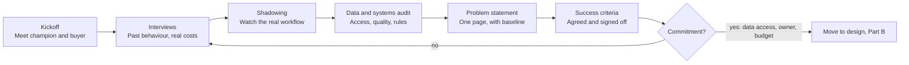
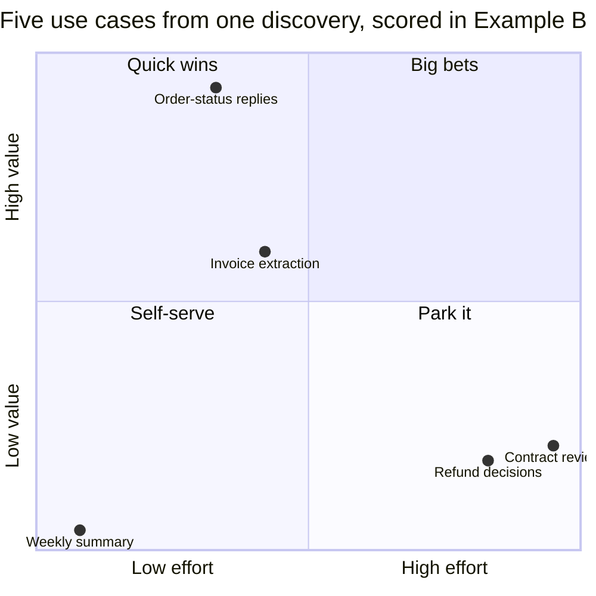
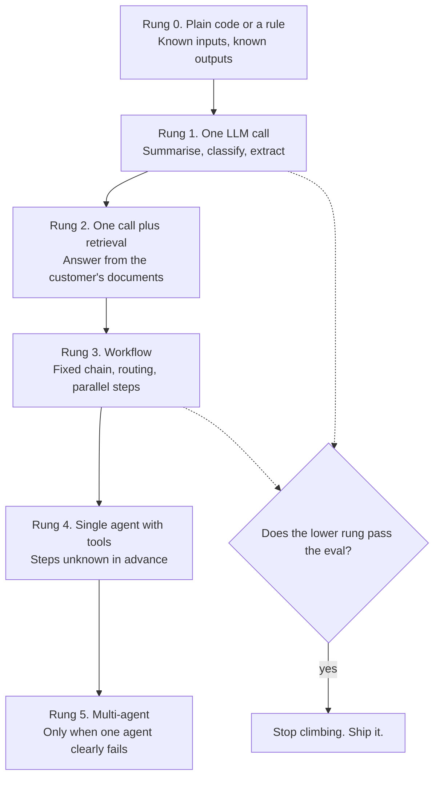
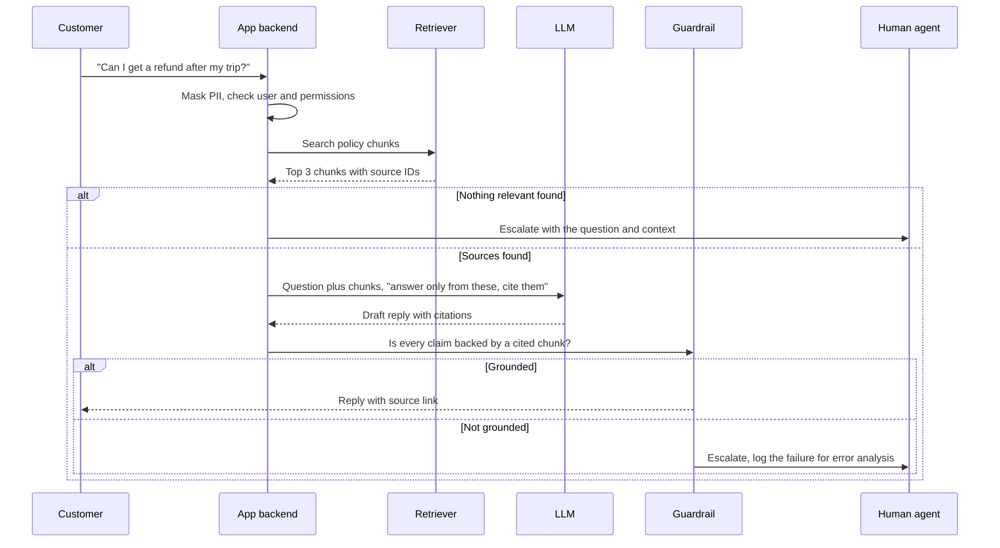
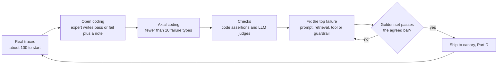
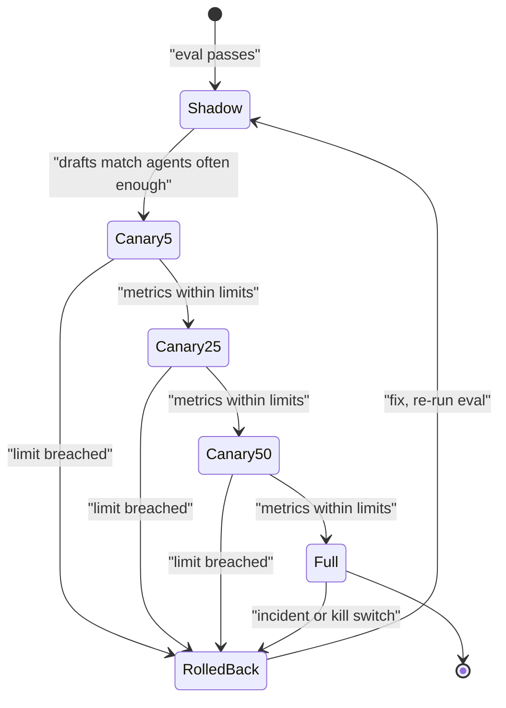
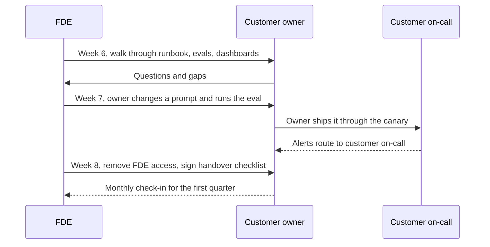
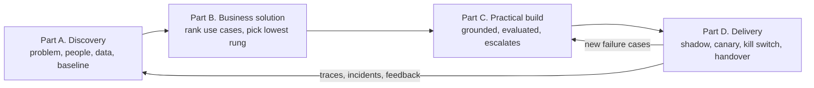
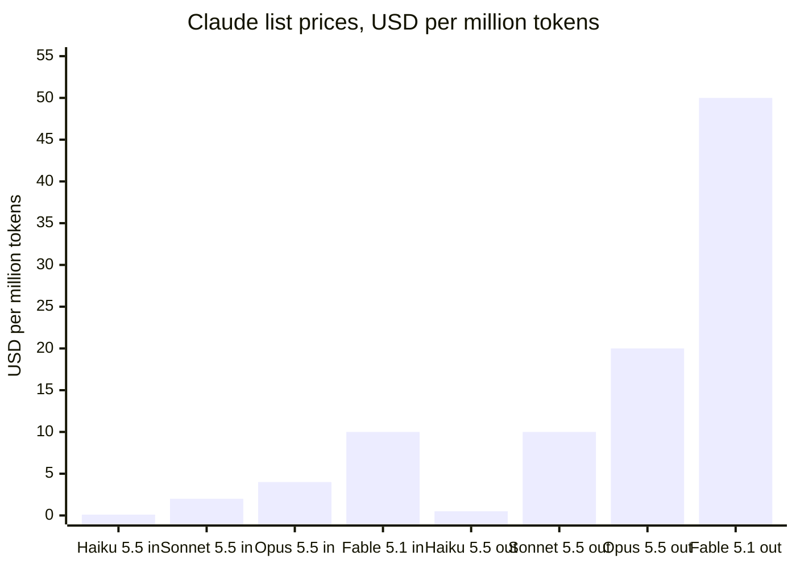
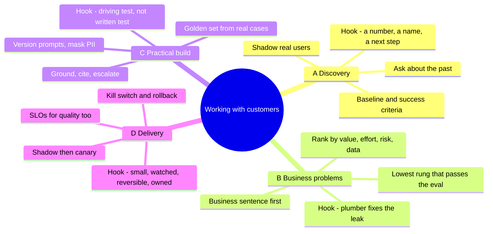



*Utkrishta Sinha · 8 Nov 2026 · about 75 minutes · covers syllabus topics 32, 46, 48, 47*

**What today covers**

| Part | Syllabus topic | What you will be able to do |
| --- | --- | --- |
| A | 32. Customer discovery | Run a discovery call, ask questions that get honest answers, and write a one-page problem statement with success criteria |
| B | 46. Solving real-world business problems with LLMs and AI agents | Turn a vague business pain into ranked use cases, and choose the simplest design that works: a rule, one LLM call, a workflow or an agent |
| C | 48. Practical customer-facing implementation | Build a small bot that answers only from the customer's documents, escalates when unsure, and passes an eval before anyone sees it |
| D | 47. Delivering AI solutions to customers in production | Ship it safely with a canary, a kill switch, monitoring, a runbook and a clean handover |

## 1. The Five Big Ideas

Today is about the half of the FDE (Forward Deployed Engineer) job that is not code. It is also about the code that only gets written once you understand the customer.

- **Discovery comes before design.** Ask about the customer's real past behaviour, not their opinions about your idea. People are polite, and polite answers kill projects.
- **Start from the business number, not the model.** A good AI project moves a metric the customer already tracks, such as handling time, cost per ticket or error rate. Most pilots fail this test.
- **The simplest design that works wins.** A rule, one LLM call or a fixed workflow often beats an agent. Use an agent only where the steps cannot be known in advance.
- **Practical means grounded, measured and humble.** A customer-facing system answers from the customer's data, knows when to say "I don't know", and passes an agreed test before launch.
- **Delivery is a process, not a launch day.** Ship to a small slice first, watch the numbers, keep a kill switch, and hand over something the customer's team can run without you.

Facts below were checked on 8 November 2026.

Think of a good family doctor. They do not prescribe on the first sentence you say. They ask what happened, when, and what you already tried. Then they choose the mildest treatment that works, check back in a week, and leave notes the next doctor can read. An FDE does the same job, except the patient is a company and the medicine sometimes needs a GPU. 😄

## 2. Why This Matters for an FDE

An FDE is a software engineer who works directly inside a customer's world. Palantir, which made the role famous, describes its forward deployed engineers as ["one customer, many capabilities"](https://blog.palantir.com/dev-versus-delta-demystifying-engineering-roles-at-palantir-ad44c2a6e87). A product engineer is the opposite: one capability, many customers.

That one line explains why today matters. A product engineer gets a ticket. You get a messy business and a deadline. Nobody hands you the problem statement. You have to find it, then solve it, then ship it, then leave it in good hands.

The four topics map to the life of one engagement:

- **Part A, discovery,** happens in the first one or two weeks. You learn the workflow, the data, the people and the number that matters.
- **Part B, solving the business problem,** is where you choose what to build. You rank use cases and pick a design.
- **Part C, practical implementation,** is the build. Here theory meets messy PDFs, strange edge cases and a support lead who knows every trick customers try.
- **Part D, delivery,** is the rollout and the handover. This is where many pilots quietly die.

There is evidence that the gap is real. An MIT NANDA report, as covered by [Fortune in August 2025](https://fortune.com/2025/08/18/mit-report-95-percent-generative-ai-pilots-at-companies-failing-cfo), said about 95% of enterprise generative AI pilots showed little or no measurable profit impact. Its method was 150 leader interviews, a survey of 350 employees and analysis of 300 public deployments. Treat the number as one study's claim, not a law of nature. But the direction matches what FDEs see every week.

A venture firm made the business case for the role too. a16z (Andreessen Horowitz) argued in June 2025 that enterprise AI needs deep integration work, and that this work is [worth trading early margin for](https://a16z.com/services-led-growth/). The person doing that work is often called an FDE.

| Part | What the customer says | The real root cause | The fix you bring |
| --- | --- | --- | --- |
| A | "We need a chatbot." | A solution was named before the problem | Ask what happened the last time the problem hurt, and what it cost |
| A | "Everyone loved the demo, but nobody uses it." | Discovery talked to managers, not the people doing the work | Shadow real users and watch the current workflow |
| A | "We don't know if it's working." | No agreed success metric before the build | Write measurable success criteria with the customer in week one |
| B | "We tried AI and the ROI is unclear." | The use case was low volume or low value | Rank use cases by volume, value, risk and data readiness |
| B | "Our agent is slow, costly and random." | An agent was used where a fixed workflow would do | Replace known steps with code, and keep the model for judgement |
| B | "It automates the easy part and leaves the hard part." | The process was not mapped end to end | Map the full workflow, then automate the costly step |
| C | "It makes up policies." | Answers are not grounded in the customer's documents | Retrieve sources, cite them, and escalate when nothing matches |
| C | "It worked in the demo, then failed on real tickets." | Tested on clean examples only | Build a golden set from real, messy cases with the domain expert |
| C | "Our compliance team blocked it." | Privacy and access rules were found late | Map data flows and permissions in discovery |
| D | "The new version broke and we found out on social media." | Shipped to everyone at once | Use a canary rollout with automatic rollback rules |
| D | "We can't turn it off quickly." | No kill switch or fallback path | Add a feature flag and a human handoff from day one |
| D | "The FDE left and now nobody can change it." | Handover was a demo, not a transfer | Hand over runbooks, evals, dashboards and a trained owner |

> **Sentence for a customer call:** "Before we talk about models, can you walk me through the last time this problem cost you money?"

## 3. Core Concepts, From Simple to Deep

This section has one long subsection per Part. Each starts with an everyday picture, gives you the words, then goes deep. The last subsection shows how the four Parts fit into one engagement.

### Part A: Customer Discovery

#### A.1 The Tailor

A good tailor does not ask, "Would you like a nice suit?" Everyone says yes, and the answer is useless. The tailor measures you, asks where you will wear it, and asks what went wrong with your last suit.

Customer discovery is measuring before cutting. You learn the customer's real problem, the people involved, the data available and the number that defines success. Only then do you design.

#### A.2 The Words You Need

| Term | Plain meaning | Simple example |
| --- | --- | --- |
| Customer discovery | Structured learning about a customer's problem before building | Ten interviews and two shadowing sessions in week one |
| Customer development | Steve Blank's four-step method that starts with discovery | Discovery, validation, creation, company building |
| Stakeholder | Anyone who gains, loses or decides because of the project | Support agents, their manager, the CFO, the security team |
| Economic buyer | The person who controls the budget | Head of Customer Operations |
| Champion | An insider who wants the project to win and helps you | A team lead who is tired of the backlog |
| End user | The person who will use the system every day | A support agent with 40 open tickets |
| Workflow | The real sequence of steps people follow today | Read ticket, open order system, check policy, reply |
| Shadowing | Watching someone do their real work | Sitting with an agent for two hours |
| Pain point | A step that costs time, money or stress | Agents search five tabs to find one policy |
| Root cause | The underlying reason a pain exists | Policies live in 300 unlinked PDFs |
| Baseline | Today's measured value of a metric | Average handling time is 11 minutes |
| Success criteria | Measurable targets agreed before building | Handling time under 6 minutes with no drop in CSAT |
| CSAT | Customer Satisfaction score, usually from a survey | 4.2 out of 5 |
| KPI | Key Performance Indicator, a number the business tracks | Cost per ticket |
| The Mom Test | Rules for asking questions that even your mother cannot lie about | Ask about the past, not about your idea |
| Leading question | A question that hints at the answer you want | "Wouldn't AI make this easier?" |
| Commitment | Something the customer gives up to show they are serious | Time, an introduction, data access or money |
| Problem statement | A short written definition of the problem and its cost | One page signed off by the champion |
| Data readiness | How available, clean and allowed the needed data is | Tickets are in Zendesk, policies are in scanned PDFs |
| Constraint | A fixed limit the solution must respect | Data must stay in India, or no customer PII to outside vendors |
| PII | Personally Identifiable Information, data that identifies a person | Name, phone number, address |
| Technical decomposition | Breaking a big business problem into buildable parts | "Reduce refunds" becomes classify, check policy, draft reply |

#### A.3 The Simple Version: Ask About Their Life, Not Your Idea

The most useful discovery rules come from a small book by Rob Fitzpatrick called *The Mom Test*. A [book report by Michael Lynch](https://mtlynch.io/book-reports/the-mom-test/) sums up the three rules:

1. Talk about their life instead of your idea.
2. Ask about specifics in the past, not opinions about the future.
3. Talk less and listen more.

Why does this work? Opinions about the future are free. Anyone can say "I would use that." Past behaviour cost them something real, so it is honest data.

Compare the two styles:

| Bad question | Why it misleads | Better question |
| --- | --- | --- |
| "Would you use an AI assistant for this?" | Invites a polite yes | "How did you handle the last ticket like this?" |
| "How much would you pay for it?" | Pure guess | "What does this problem cost you each month today?" |
| "Is search a big problem?" | Leading, and yes or no | "Walk me through your last search for a policy." |
| "Do you like our demo?" | Asks for a compliment | "What did you try before, and why did you stop?" |
| "Would faster replies help?" | Obvious answer | "When did a slow reply last cause a complaint?" |

The book also says each meeting should end in a commitment. A commitment can be time, such as a follow-up session. It can be reputation, such as an introduction to the decision maker. It can be money, such as a paid pilot. If nobody commits to anything, the meeting probably told you little.

#### A.4 Where Discovery Comes From

Steve Blank created the customer development method. Eric Ries summarised its [four steps](https://www.startuplessonslearned.com/2008/11/what-is-customer-development.html) in 2008: customer discovery, customer validation, customer creation and company building. Discovery is the first step. Its famous line is "In a startup no facts exist inside the building, only opinions."

For a startup, discovery asks "does anyone want this product?" For an FDE, the product usually exists already. Your discovery asks a narrower question: "which problem in this customer's business should our product solve first, and how will we prove it worked?"

Palantir calls part of this skill [technical decomposition](https://blog.palantir.com/dev-versus-delta-demystifying-engineering-roles-at-palantir-ad44c2a6e87). You take a high-level business problem, split it into parts, and design a solution. Their forward deployed engineers also scope the project with the client and check with users that the product meets their needs.

#### A.5 The Discovery Map: Five Things to Learn

A complete discovery covers five areas. If one is missing, the project usually stalls at that exact spot later.

1. **The problem and its cost.** What hurts, how often, and what it costs in money, time or risk. Get a baseline number.
2. **The people.** Who does the work, who pays, who can block you, and who will own the system after you leave.
3. **The workflow.** The real steps today, including the workarounds nobody writes down. Shadowing finds these.
4. **The data and systems.** Where the inputs live, who controls access, how clean they are, and what rules apply.
5. **The definition of done.** The success criteria, the launch bar and the people who will sign off.



*A discovery loop ends only when the customer commits something real, such as data access, an owner or a budget.*

#### A.6 The People Map

Enterprise projects fail more often from people problems than model problems. You need to know four roles by name.

- **Economic buyer:** controls money. Cares about cost, risk and a business number.
- **Champion:** wants you to win. Opens doors, books meetings and explains politics.
- **End users:** do the work. Care about whether the tool saves them time today.
- **Blockers:** security, legal, compliance, IT and sometimes a worried team lead. Meet them early, not in week eight.

A common mistake is to talk only to the buyer. Managers describe the workflow as it appears in the process document. Agents describe the workflow as it really happens. Both are useful, but only the second tells you what to build.

#### A.7 Under the Hood: Turning Notes Into Decisions

Interviews produce messy notes. A good FDE turns them into structured evidence. The method is close to what Hamel Husain and Shreya Shankar call [open coding and axial coding](https://www.lennysnewsletter.com/p/building-eval-systems-that-improve) for AI errors, and it works for interviews too.

1. **Open coding.** After each interview, write each pain as a short, separate note. Use the speaker's words and add the evidence, such as "said it happens daily".
2. **Axial coding.** Group the notes into a few themes, ideally under ten. Count how many people mentioned each one.
3. **Weigh by evidence.** A pain that three agents showed you on screen beats one that a VP mentioned once.
4. **Write the problem statement.** One page. The problem, who has it, how often, what it costs, the baseline, and what is out of scope.

This turns discovery from a chat into a decision record. It also protects you later. When someone asks "why did we build this?", you can point at the notes.

#### A.8 Discovery for AI Projects Has Extra Questions

Normal software discovery asks what to build. AI discovery adds questions about risk and data, because the system will sometimes be wrong.

- **What does a wrong answer cost?** A wrong order-status reply is annoying. A wrong refund policy can cost money, as Air Canada found out (see Part D).
- **Who checks the output today?** If a human checks every reply now, a human-in-the-loop design is natural.
- **What data may leave the building?** In India, the Digital Personal Data Protection (DPDP) Rules were [notified by MeitY in November 2025](https://takshashila.org.in/content/blogs/20251114-meity-notifies-dpdp-rules-2025.html), with most obligations phased in over about 18 months. Ask the customer's legal team how this affects their data.
- **Is there ground truth?** Can you get 50 to 100 real past cases with known correct answers? Without them, you cannot build an eval in Part C.
- **What is the fallback?** When the AI is unsure, who takes over, and how fast?

The Claude docs give a good rule for the last step. Success criteria should be [specific, measurable, achievable and relevant](https://platform.claude.com/docs/en/test-and-evaluate/define-success). "Good performance" is not a criterion. "F1 of at least 0.85 on a held-out set of 10,000 posts" is. Two words in that example need a definition. **F1** is a single score from 0 to 1 that balances how many of the model's "yes" answers were right (precision) with how many of the true "yes" cases it found (recall). A **held-out set** is a group of test cases you keep aside and never use while tuning, so the score shows how the system does on cases it has not seen. The docs' full example also adds "a 5% improvement over the current baseline", which ties the target to today's number from discovery.

#### A.9 Deep Version: Discovery Never Really Ends

Discovery is heaviest in the first weeks, but it continues through the whole engagement. Each demo is a discovery session. Each failed eval case teaches you something about the domain.

There is a trap here too. Eric Ries warns that customer development is ["emphatically not an excuse to slow down"](https://www.startuplessonslearned.com/2008/11/what-is-customer-development.html). Time-box it. A common FDE pattern is one to two weeks of discovery, then a working prototype on real data, then more learning from that prototype. Real users react to a working thing far more honestly than to slides.

> **The golden habit:** never leave a discovery meeting without a number, a name and a next step.

### Part B: Solving Real-World Business Problems With LLMs and AI Agents

#### B.1 The Plumber

A good plumber with a leaking tap does not replace your whole house's pipes. They find the leak, fit the smallest part that stops it, and check the water bill next month.

Solving business problems with AI works the same way. You find the costly step, pick the smallest AI design that fixes it, and measure the business number afterwards. The fancy pipe system is sometimes right, but rarely first.

#### B.2 The Words You Need

| Term | Plain meaning | Simple example |
| --- | --- | --- |
| Use case | One specific job the AI will do for the business | Draft replies to order-status emails |
| Use case primitive | A common type of AI job | Content creation, research, coding, data analysis |
| ROI | Return on Investment, value gained compared with cost | Saves ₹7 lakh a month, costs ₹1 lakh a month |
| Impact | How much the business number moves | 30% fewer escalations |
| Effort | Time, people and risk needed to build it | Six weeks for two engineers |
| Prioritisation matrix | A grid that ranks ideas by impact and effort | Quick wins in the top left |
| Quick win | High impact, low effort | Automatic call summaries |
| Big bet | High impact, high effort | A full claims-processing agent |
| LLM call | One request to a language model and one reply | Summarise this ticket |
| Workflow | LLM calls and tools in a fixed, code-defined order | Classify, then fetch order, then draft reply |
| Agent | An LLM that decides its own steps and tools in a loop | Investigates a dispute until solved |
| Prompt chaining | One LLM step feeds the next in a fixed chain | Outline, then draft, then translate |
| Routing | Classify an input, then send it to a specialist path | Refunds go to one prompt, delivery to another |
| Orchestrator-workers | A lead LLM splits work and gives parts to worker LLMs | One plans a report, three write sections |
| Evaluator-optimizer | One LLM writes, another critiques, repeat | Draft and review loop |
| RAG | Retrieval-Augmented Generation, fetch documents then answer from them | Look up the refund policy, then answer |
| Tool | A function the model can ask your code to run | `get_order(order_id)` |
| Human in the loop | A person approves or takes over at set points | Refunds above ₹5,000 need approval |
| Back office | Internal operations work that customers do not see | Invoice processing, reconciliation |
| Front office | Customer-facing work | Sales, support, marketing |
| Unit economics | Cost and value per single item of work | Cost per resolved ticket |
| Deflection | A customer issue solved without a human | Bot answers the question fully |

#### B.3 The Simple Version: Problem, Number, Design

Every real business problem fits one sentence: "**Who** spends **how much** on **what step**, and **which number** improves if we fix it?" If you cannot write that sentence, go back to Part A.

Here are three examples:

- "Support agents spend 4 minutes on each of 40,000 order-status chats a month. Fixing it lowers cost per ticket."
- "Finance clerks spend 6 minutes typing fields from 12,000 invoices a month. Fixing it cuts processing time and typing errors."
- "Lawyers spend 45 minutes on each of 300 contracts a month. Fixing it speeds up deal closing."

Notice these are all about time and money today. None of them mention a model yet.

#### B.4 What Kinds of Problems AI Is Good At

OpenAI analysed over 600 customer use cases and found [six common primitives](https://cdn.openai.com/business-guides-and-resources/identifying-and-scaling-ai-use-cases.pdf). These are the shapes most real use cases take:

1. **Content creation:** drafting, editing, translating, adapting to a style.
2. **Research:** finding and combining information into a requested format.
3. **Coding:** writing, porting and debugging code, even for non-coders.
4. **Data analysis:** combining sources and finding trends without SQL skills.
5. **Ideation and strategy:** brainstorming and stress-testing plans.
6. **Automations:** handing repeatable tasks to the AI.

OpenAI's guide on [building agents](https://www.maginative.com/article/how-to-build-ai-agents-a-detailed-practical-guide-from-openai/), as summarised by Maginative in April 2025, adds where agents beat old automation. They help with complex judgement, such as refund approvals. They help with rule sets too big to maintain, such as vendor security reviews. And they help with unstructured data, such as insurance claims.

A useful test: if a junior employee could do the task after reading a good guide, an LLM probably can too. If the task needs ten years of judgement and is rarely checked, be careful.

#### B.5 Ranking Use Cases: Impact Against Effort

Customers usually arrive with ten ideas. You can build one or two well. OpenAI's guide uses an [impact and effort matrix](https://cdn.openai.com/business-guides-and-resources/identifying-and-scaling-ai-use-cases.pdf) with four boxes:

- **Quick wins:** high impact, low effort. Do these first to build trust.
- **Self-serve:** low effort, lower impact. Let people use a general assistant.
- **Big bets:** high impact, high effort. Plan them carefully.
- **Deprioritise:** high effort, low impact. Park them and revisit when models improve.



*Value is monthly rupees saved and effort is build weeks, both from the scoring script in section 4.*

Two more factors matter beyond the grid. **Risk** is the cost of a wrong answer. **Data readiness** is whether the inputs exist and you are allowed to use them. A high-value idea with scattered data and severe error costs is not a quick win, whatever the grid says.

#### B.6 Back Office Often Beats Front Office

The MIT NANDA report found something surprising. Over half of generative AI budgets went to sales and marketing. Yet the [largest returns were in back-office automation](https://fortune.com/2025/08/18/mit-report-95-percent-generative-ai-pilots-at-companies-failing-cfo), such as cutting outsourcing and agency costs.

Why? Back-office work is high volume, repetitive and measured already. Errors are often caught by a later step. The customer does not see a funny mistake. That makes it safer and easier to prove value.

The same report said buying from specialised vendors or partnering succeeded about 67% of the time. Internal builds succeeded about one-third as often. This is one study, but it is a strong hint. As an FDE, your product plus your help is that "partner" option.

#### B.7 Choosing the Design: The Ladder of Complexity

This is the most important engineering idea in Part B. Anthropic's [Building effective agents](https://www.anthropic.com/research/building-effective-agents) post, from December 2024, splits systems into two kinds:

- **Workflows:** LLMs and tools follow predefined code paths.
- **Agents:** LLMs direct their own process and tool use.

Its advice is to start with the simplest solution and add complexity only when needed. For many applications, one optimised LLM call with retrieval and examples is enough. Agents trade higher latency and cost for flexibility, and their errors can compound.

So climb a ladder, one rung at a time:



*Climb only when the lower rung fails the eval, because each rung adds cost, latency and new failure modes.*

The five workflow patterns from that post are your toolbox for rung 3:

1. **Prompt chaining:** fixed steps, with optional checks between them.
2. **Routing:** classify, then send to a specialist path.
3. **Parallelisation:** split into parts, or run several times and vote.
4. **Orchestrator-workers:** a lead model plans and hands out subtasks.
5. **Evaluator-optimizer:** one model writes, another reviews, in a loop.

#### B.8 A Real Example of Climbing the Ladder: Swiggy

Swiggy, the Indian food and grocery delivery company, described its support agent's evolution in an [October 2025 Databricks post](https://databricks.com/blog/redefining-customer-support-swiggys-enterprise-scale-ai-agent-built-databricks) co-written with Databricks. It is a vendor post, so read the results as claims. The design story is still very useful. The post lists eight stages in all, including model selection, agent evaluation, prompt engineering and an experimentation platform. The four below are the architecture stages, which are the ones that show the ladder.

1. **Two tiers:** an LLM classified intent, then formatted a reply from order data.
2. **RAG:** retrieval added more context, but hard-coded branches and no memory limited it.
3. **Agentic:** memory across turns, graph-based handlers and feedback loops.
4. **Multi-agent:** a separate agent instance handled each type of issue.

Two details are gold for an FDE. First, LLM-only agent assignment reached 90% accuracy against a 100% goal. So they added a rule-based routing layer, which is climbing back down the ladder where rules work better. The final design was a hybrid: intent-based rules route most requests in a fixed way, and a separate lightweight LLM with its own prompts handles the assignments that rules cannot. Second, they tiered models by task difficulty to control cost and latency: a simple LLM for basic tasks, a small reasoning model for moderate ones and a large reasoning model for complex ones.

#### B.9 Under the Hood: The Unit Economics

A business problem becomes real when you can compute value per unit of work. The formula is simple:

- **Monthly value** = tasks per month × minutes per task ÷ 60 × cost per hour × share the AI fully handles.
- **Monthly cost** = tasks per month × (model cost per task + review cost per task) + platform and support costs.
- **Net value** = monthly value − monthly cost.

The "share the AI fully handles" is the number everyone guesses wrongly. Do not guess it. Measure it on a sample of real cases during the pilot.

Model cost per task also needs real prices. On 8 November 2026, Anthropic's [models overview](https://platform.claude.com/docs/en/about-claude/models/overview) lists Claude Haiku 5.5 from $0.10 per million input tokens. Claude Opus 5.5 is $4 per million input tokens. A ticket of 3,000 input tokens costs a tiny fraction of a rupee on the small model. Usually, staff time and review dominate the cost, not tokens. Day 8 covers token maths in depth.

#### B.10 Deep Version: Pricing by Outcome

Some vendors now price AI by result rather than by seat. Intercom's [Fin outcomes page](https://www.intercom.com/help/en/articles/8205718-fin-ai-agent-outcomes), dated September 2026, bills $0.99 per resolution. It counts both confirmed resolutions and "assumed" ones, where the customer leaves after Fin's last answer without asking for more help. A resolution is charged at most once per conversation. Most escalations to humans are not billed, such as when the customer asks for a person or shows frustration. One exception matters: a "procedure" that is configured to end in a handoff to a human or a workflow is billed at $0.99, so read the billing rules closely before you design the handoff.

Sierra's [December 2024 post](https://sierra.ai/blog/outcome-based-pricing-for-ai-agents) describes the same idea: pay only when the agent achieves an agreed outcome, such as a resolved conversation or a saved cancellation. If no outcome happens, the customer generally pays nothing.

This matters to you for two reasons. It forces everyone to define "resolved" precisely, which is a discovery task. And it tells you how customers will judge your work: by outcomes per rupee, not by clever prompts.

> **The golden habit:** write the business sentence first, then pick the lowest rung of the ladder that passes the eval.

### Part C: Practical Customer-Facing Implementation

#### C.1 The Driving Test

Knowing the theory of driving is not the same as driving in Bengaluru traffic at 6 pm. You can recite every road rule and still stall at the first busy junction. The written test checks knowledge. The road test checks whether you can handle real, messy conditions safely.

Theoretical AI knowledge is the written test: transformers, embeddings, agent loops. Practical customer-facing implementation is the road test. It means building something that works on the customer's real data, in front of their real users, with their rules, and that fails safely when it is unsure.

#### C.2 The Words You Need

| Term | Plain meaning | Simple example |
| --- | --- | --- |
| Customer-facing | Seen or used directly by the customer's own customers or staff | A support bot on the customer's website |
| Grounding | Making the model answer only from given sources | "Use only the policy text below" |
| Hallucination | A confident answer that is not supported by facts | Inventing a 90-day refund rule |
| Citation | A pointer to the source behind a claim | `[source: policy/refund]` |
| Retrieval | Finding the most relevant documents for a question | Fetch the three best policy chunks |
| Chunk | A small piece of a long document, stored for retrieval | One paragraph of the refund policy |
| Escalation | Handing the conversation to a human | "Connecting you to a person" |
| Fallback | What the system does when the main path fails | A canned reply plus a ticket |
| Guardrail | A check on input, output or a tool call | Block replies that mention competitors' prices |
| Eval | A repeatable test that scores the system's outputs | 50 real questions with expected facts |
| Golden set | A curated list of test cases with known correct answers | Written with the support lead |
| Assertion | A simple code check on an output | Reply must contain "7 days" |
| LLM-as-judge | Using a model to grade another model's output | "Is this reply polite? PASS or FAIL" |
| Domain expert | The person who knows what "correct" means in this business | A senior support agent |
| Error analysis | Reading real outputs and sorting the failures into types | 40 failures, 22 of them "wrong policy" |
| Trace | A record of every step one request took | Question, retrieved docs, prompt, reply, latency |
| Edge case | A rare or unusual input | A question in Hinglish with an order ID typo |
| Latency | Time from request to reply | p95 of 3 seconds |
| p95 | The value 95% of requests are faster than | 95 of 100 replies arrive within 3 s |
| Prompt version | A saved, numbered copy of a prompt | `support-reply` v14 |
| Integration | Connecting your system to the customer's systems | Reading orders from their API |
| Least privilege | Giving a system only the access it needs | Read-only access to orders, no refunds |
| Prototype | A quick working version on real data | A notebook demo on 100 real tickets |
| Pilot | A limited real-world trial with agreed goals | One team, four weeks |

#### C.3 The Simple Version: The 80% Trap

Here is the most important fact about practical AI. Getting a demo to look good is fast. Getting it to be reliable is slow.

LinkedIn shared this lesson from building its generative AI features. According to [The New Stack's May 2024 summary](https://thenewstack.io/5-lessons-from-linkedins-first-foray-into-genai-development/), the team "had completed 80% of the basic design within the first month". It then took "an additional four months to get within a 95% completion rate". Each later 1% came more slowly, and the early speed "created a false sense of 'almost there'".

That curve is the whole difference between theory and practice. Theory gets you to the first 80%. The last 20% is made of real edge cases, messy data, policy details and people's expectations. Plan your timeline and your customer's expectations around it.

#### C.4 What "Practical" Adds to Theory

The table below shows the gap. The left column is what courses teach. The right column is what customers notice.

| Theoretical knowledge | Practical, customer-facing version |
| --- | --- |
| "RAG reduces hallucinations." | Which 300 PDFs, who updates them, and what happens when two disagree? |
| "Use a strong model." | It must answer in 3 seconds on a busy Diwali sale day, within budget. |
| "Evaluate with benchmarks." | Evaluate on 100 of this customer's real tickets, graded by their support lead. |
| "Agents can call tools." | The refund tool must be read-only until the customer's finance team signs off. |
| "Models can say I don't know." | When it does, a human takes over within two minutes, with the full context. |

The practical column is not harder maths. It is more care, more questions and more testing. That is good news for you as a software engineer, because it is mostly engineering discipline.

#### C.5 The First Big Lesson: The Company Owns What the Bot Says

In November 2022, a man asked Air Canada's chatbot about bereavement fares after his grandmother died. The chatbot told him he could book a normal ticket and claim a partial refund within 90 days of the ticket's issue date. That was wrong. The airline's real policy did not allow refunds after travel: Air Canada later said bereavement fares could not be claimed retroactively.

He took the airline to British Columbia's Civil Resolution Tribunal. Air Canada argued, in effect, that the chatbot was responsible for its own words. As [Manatt reported in February 2024](https://manatt.com/insights/newsletters/advertising-law/ai-gone-wild-airline-has-to-honor-a-refund-policy), the tribunal rejected this. It found the airline "did not take reasonable care to ensure its chatbot was accurate" and ordered a partial refund of CAD 650.88 plus interest and fees.

The money was small. The lesson is large. If your system speaks for the customer's business, the business owns every sentence. So a practical system must be grounded, must cite its sources, and must escalate instead of guessing. You will build exactly that in section 4, using this case as the first test.

#### C.6 The Grounded Answer Pattern

Most customer-facing assistants share one shape. Learn it once and you can build dozens of variants.



*The grounded answer pattern: retrieve, answer only from sources, check, and escalate on any doubt.*

The Claude docs list simple techniques that support this pattern. They include [giving the model permission to say "I don't know"](https://platform.claude.com/docs/en/test-and-evaluate/strengthen-guardrails/reduce-hallucinations), asking for direct quotes before answering, and requiring a citation for each claim. They also suggest telling the model to use only the provided documents and not its general knowledge. The docs warn that these reduce hallucinations but do not remove them, so critical answers still need checks.

#### C.7 Evals: The Road Test You Run Every Day

An eval is a repeatable test of your AI system. It is the single biggest difference between a demo and a product. Hamel Husain put it bluntly in March 2024: unsuccessful AI products almost always share ["a failure to create robust evaluation systems"](https://hamel.dev/blog/posts/evals/).

His post describes three levels:

1. **Level 1, unit tests.** Fast, cheap assertions that run on every change. Example: "the reply must never show an internal ID."
2. **Level 2, human and model review.** People and LLM judges grade logged traces on a schedule.
3. **Level 3, A/B testing.** Real users get different versions, and you compare business outcomes.

Start with level 1 on day one. Add level 2 once you have real traces. Use level 3 only for mature products with enough traffic.

He also says something that surprises engineers: "Your pass rate is a product decision." Not every eval must be 100%. But some must. For an airline's refund policy, the agreed bar might be zero wrong answers on the golden set. That bar comes from discovery in Part A, not from the engineer's taste.

#### C.8 How to Build a Good Golden Set

A golden set is only as good as its cases. Husain and Shreya Shankar describe a practical process in their [September 2025 guide](https://www.lennysnewsletter.com/p/building-eval-systems-that-improve):

1. **Pick one domain expert as the final judge.** They call this person a "benevolent dictator". It avoids endless arguments about what "good" means.
2. **Start with about 100 real interactions,** sampled at random. Later, add targeted ones, such as conversations with negative feedback or many tool calls.
3. **Open coding.** The expert writes a short critique and a pass or fail for each one.
4. **Axial coding.** Group the critiques into fewer than ten failure types and count them.
5. **Write checks.** Use code for objective rules and an LLM judge for subjective ones, with binary pass or fail labels.
6. **Split the labelled data.** Keep a held-out test set that you never tune against.

Note how this mirrors discovery in Part A. You open-code interview notes before building, and you open-code failures after building. Both are about listening to real evidence.



*The practical build loop: real traces become failure types, checks and fixes, and only a passing eval earns a canary.*

#### C.9 Integration: Where Most of the Time Really Goes

The model call is often 50 lines of code. The integration is often weeks. You need to read from the customer's order system, write to their ticketing tool, log in with their single sign-on, and respect their network rules.

Four practical rules save a lot of pain:

- **Least privilege first.** Start read-only. Add write tools, such as "issue refund", only after the customer's owners agree, and add limits outside the model.
- **Wrap every external call.** Add timeouts, retries and a clear error message. A slow order API should give a polite fallback, not a frozen chat.
- **Log traces, but mask personal data.** You need traces for evals. You must not leak phone numbers into a log tool. India's DPDP Rules, [notified in November 2025](https://takshashila.org.in/content/blogs/20251114-meity-notifies-dpdp-rules-2025.html), add detail on security safeguards and breach reporting, so involve the customer's legal team early.
- **Version prompts like code.** Store prompts with a version number and a label, so you know what is live. Tools like [Langfuse prompt management](https://langfuse.com/docs/prompts) let the app fetch the version labelled `production`, and they cache it so the app keeps working if the prompt service is down.

#### C.10 Deep Version: Practical Means Designing for Failure

Theory asks, "how good can this be?" Practice asks, "what happens when it is wrong?" Design four things for every customer-facing feature:

- **Detection:** how will you know it was wrong? Guardrails, user feedback buttons, sampled human review.
- **Containment:** how far can the damage spread? Read-only tools, spending limits, no actions without approval.
- **Recovery:** how does the user get to a right answer? A fast human handoff that carries the context.
- **Learning:** how does this failure become a test case? Every escalation and thumbs-down should flow back into the golden set.

OpenAI's agent guide makes the same point. As [Maginative summarised in April 2025](https://www.maginative.com/article/how-to-build-ai-agents-a-detailed-practical-guide-from-openai/), it calls human intervention "a critical safeguard" and suggests planning it for high-risk actions and for repeated failures. That is practical design in one sentence.

> **The golden habit:** every customer-facing answer is grounded, checked, and has a human behind it.

### Part D: Delivering AI Solutions to Customers in Production

#### D.1 Opening a Restaurant

A new restaurant does not open with a 500-guest wedding. It holds a soft launch for friends and family. The chef watches every plate. The owner keeps the old menu ready in case the new dish fails. After a few weeks, a trained head chef runs the kitchen, and the consultant who set it up goes home.

Delivering AI to production is that soft launch. You start small, watch closely, keep a way back, and hand the kitchen to the customer's own team. The launch is one day. Delivery is weeks.

#### D.2 The Words You Need

| Term | Plain meaning | Simple example |
| --- | --- | --- |
| Production | The live system real users depend on | The bot on the customer's website |
| Staging | A copy of production for final testing | Same setup, test data |
| Rollout | Releasing a change to users step by step | 5%, then 25%, then 100% |
| Canary | A small slice of traffic that gets the new version first | 5% of users get prompt v15 |
| Control | The users who stay on the current version | The other 95% |
| Rollback | Returning to the last good version | Re-label v14 as production |
| Feature flag | A switch in code that turns a feature on or off without a deploy | `ai_reply_enabled = false` |
| Kill switch | A long-lived flag that turns a feature off fast in an emergency | On-call turns the bot off at 2 am |
| Shadow mode | The new system runs on real traffic but users do not see its output | Bot drafts replies, agents still write their own |
| Human in the loop | A person approves the AI's output before it reaches the user | Agent clicks "send" on the draft |
| SLI | Service Level Indicator, a measured number about service quality | p95 latency, escalation rate |
| SLO | Service Level Objective, the target for an SLI | p95 under 4 seconds |
| SLA | Service Level Agreement, a contract promise with a penalty | 99.5% uptime or a credit |
| Monitoring | Watching live numbers and alerting on problems | A dashboard plus a pager |
| Drift | Slow change in inputs or behaviour over time | New product line, new question types |
| Runbook | Step-by-step instructions for operating and fixing the system | "If escalations jump, do this" |
| On-call | The person responsible for responding to alerts | The customer's platform engineer this week |
| Incident | An event that harms users or the business | Bot gives wrong prices for an hour |
| Postmortem | A blameless written review after an incident | What happened, why, what we changed |
| Handover | Transferring ownership to the customer's team | Training, docs, access, dashboards |
| RACI | Responsible, Accountable, Consulted, Informed: who does what | The customer owns prompts after week 8 |
| Adoption | How much the intended users really use the system | 70% of agents use drafts daily |
| Model deprecation | The provider announcing a model will be retired | A retirement date for an old model ID |

#### D.3 The Simple Version: Small, Watched, Reversible

Every safe delivery has three properties.

1. **Small.** Only a few users see the change at first. Mistakes stay small too.
2. **Watched.** You compare the new version against the old one on agreed numbers.
3. **Reversible.** You can switch back in minutes, without a deploy.

If any one is missing, you are gambling. Klarna's story below shows why even a successful launch needs all three over the long term.

#### D.4 Canary Releases, Properly

Google's Site Reliability Engineering (SRE) workbook defines canarying as ["a partial and time-limited deployment of a change in a service and its evaluation"](https://sre.google/workbook/canarying-releases/). The canary group gets the change. The control group does not. You compare them, which is effectively an A/B test.

The chapter gives several rules that apply directly to AI:

- **Compare canary against control, not against the total.** If a canary on 5% of traffic fails 20% of the time, the overall error rate rises only by 1%. Blended numbers hide it.
- **Start small, then grow in stages.** A small canary uses less of your error budget. An **error budget** is the amount of failure your SLO allows in a period. For example, an SLO of 99.5% successful requests leaves a budget of 0.5% failed requests, and a bad canary spends part of it.
- **Pick a few metrics that show user pain.** The chapter suggests no more than about a dozen. For AI, use escalation rate, bad-answer rate from sampled reviews, latency and cost.
- **Run one canary at a time.** Two changes at once make results impossible to read.
- **Deploy under realistic load.** Some problems appear only when traffic is high.

For AI, one more rule matters. **The change is not only code.** A new prompt version, a new model ID, a new retrieval index or a new tool are all changes. Each deserves a canary.



*Each stage of the rollout has a way back, and every rollback returns to the eval before trying again.*

#### D.5 Shadow Mode and Human in the Loop

Before any canary, a good FDE often runs **shadow mode**. The AI processes real traffic, but users never see its output. You compare its drafts with what the humans actually wrote.

Shadow mode is cheap insurance. It tests the system on real, messy inputs with zero customer risk. It also gives you hundreds of free eval cases.

The next step is often **human in the loop**. The AI drafts and a human approves. This builds trust and produces labelled data, because every edit the human makes is a signal. Only after that do you let the AI reply directly, and often only for low-risk intents first.

#### D.6 Feature Flags and the Kill Switch

A feature flag is a switch in code that turns behaviour on or off at runtime, without a new deploy. Pete Hodgson's long article on [Martin Fowler's site](https://www.martinfowler.com/articles/feature-toggles.html) sorts flags into four kinds:

| Kind | What it does | How long it lives | AI example |
| --- | --- | --- | --- |
| Release toggle | Hides unfinished work | Days to weeks | New "track my order" intent, off until ready |
| Experiment toggle | Splits users into cohorts | Hours to weeks | Prompt v14 against v15 |
| Ops toggle | Controls operational behaviour | Short, or long as a kill switch | Turn AI replies off during an incident |
| Permission toggle | Shows features to some users | Months to years | Beta access for one support team |

The kill switch is the most important flag in AI delivery. It must work without a deploy, and the customer's on-call person must be able to flip it. When it is off, traffic goes to the old path, usually human agents or a simple menu.

Hodgson warns that flags carry a cost, so give each release flag an expiry date. The kill switch is the exception.

[OpenFeature](https://openfeature.dev/), a Cloud Native Computing Foundation incubating project, gives one standard flag API across vendors. It has SDKs for Node.js, Java, Python, React and Angular, among others. That suits an FDE, because each customer may already use a different flag tool.

#### D.7 Monitoring: SLIs and SLOs for AI

You cannot manage what you do not measure. The Google SRE book defines an SLI as ["a carefully defined quantitative measure of some aspect of the level of service"](https://sre.google/sre-book/service-level-objectives?hl=id). An SLO is the target for that measure. An SLA is a contract with consequences, often money.

Normal services watch latency, errors and traffic. AI services need those plus quality numbers:

| Layer | SLI example | Example SLO |
| --- | --- | --- |
| Speed | p95 time to full reply | Under 4 seconds |
| Reliability | Share of requests that error or time out | Under 0.5% |
| Quality | Bad-answer rate in a daily sample reviewed by humans | Under 1% |
| Safety | Replies blocked by the grounding guardrail | Watched, alert on a sudden jump |
| Outcome | Escalation rate to humans | Within 3 points of the canary baseline |
| Cost | Model cost per resolved conversation | Under the budget agreed in Part B |
| Adoption | Share of agents using AI drafts daily | Above 60% by week 6 |

The SRE book adds useful advice for choosing targets. Do not just copy today's numbers as the goal. Keep definitions simple. Avoid absolute promises such as "always correct". Use as few SLOs as you need.

Day 14 covers the tooling for this in depth: traces, evals and dashboards in tools like Langfuse.

#### D.8 The Model Under You Will Change

Traditional software changes when you deploy. AI systems can also change when a provider retires a model. Anthropic's [model deprecations page](https://platform.claude.com/docs/en/about-claude/model-deprecations) says it gives at least 60 days' notice before retiring a publicly released model. After retirement, requests to that model fail.

That page lists `claude-sonnet-4-5-20250929` as deprecated on 30 September 2026, with retirement on 30 November 2026. A customer still calling it after that date will have an outage, not a slow decline. So delivery must include three things:

- A list of every model ID in use, owned by someone.
- An eval suite the customer can re-run on a replacement model.
- A calendar reminder before every announced retirement date.

#### D.9 Under the Hood: What Klarna Teaches About Delivery

Klarna, the Swedish payments company, launched an AI assistant in early 2024. [CX Today reported in February 2024](https://www.cxtoday.com/contact-center/klarna-claims-its-new-ai-assistant-does-the-work-of-700-full-time-agents/) Klarna's claims: about two-thirds of chats handled, work equal to 700 full-time agents, and resolution time down from 11 to 2 minutes. Klarna estimated a USD 40 million profit improvement for 2024.

Then the story turned. In May 2025, [Maginative reported](https://www.maginative.com/article/klarna-dials-back-its-ai-customer-service-strategy-now-its-hiring-humans-again/) that Klarna's CEO said the push "went too far". He said a cost focus meant "what you end up having is lower quality". Klarna began recruiting human agents again, and the CEO promised that "there will be always a human if you want".

The FDE lesson is not "AI failed". The lesson is that the launch metrics were about speed and volume. Long-term delivery also needs quality and customer choice. A production system must keep watching quality after launch, and must keep a good human path open.

#### D.10 The Handover: Leaving Something They Can Run

Your engagement ends. The system must not. A good handover transfers six things:

1. **Ownership.** A named owner on the customer side, with a RACI table showing who does what.
2. **Runbooks.** What to do for each alert, written for someone who did not build it.
3. **Evals.** The golden set, the scripts and the ship bar, runnable by their team.
4. **Dashboards and alerts.** Wired to their on-call system, not to your email.
5. **Access and secrets.** Moved to their accounts, with your access removed.
6. **Training.** At least one session where their engineer changes a prompt, runs the eval and ships it while you watch.

The last item is the real test. If their engineer cannot ship a safe change without you, you have not delivered. You have only deployed.



*A handover is complete only when the customer ships a safe change without you.*

> **The golden habit:** small, watched, reversible, and owned by someone who is not you.

### How the Four Parts Fit Together

One engagement uses all four Parts, in order at first and then as a loop.



*Discovery picks the problem, Part B picks the design, Part C makes it trustworthy, and Part D makes it last.*

A short way to say it in an interview:

- **Part A** decides *what* to solve and *how to measure it*.
- **Part B** decides *how much AI* to use and *whether it pays*.
- **Part C** makes it *correct and safe* on real data.
- **Part D** makes it *live, reversible and owned*.

## 4. Worked Examples

One fictional customer runs through all four examples: **ShopKart**, an Indian online retailer with a 60-person support team. The company is invented for teaching. The code in Examples B, C and D was run on 8 November 2026 with Python 3 and Node.js 22, and the output shown is real.

### Example A: A Discovery Kit (Part A)

This is a non-technical example. It gives you the three artifacts you need in week one.

#### A1. The interview question list

Use these with support agents, team leads and the head of support. Each one asks about the past, not about your idea.

1. "Walk me through the last ticket you handled. What did you open, in what order?"
2. "Which ticket type took the longest this week? Show me one."
3. "When did you last give a customer a wrong answer? What caused it?"
4. "Where do you look up policies? Show me how you find the refund rule."
5. "What do you do when two documents disagree?"
6. "Who checks your replies today? What do they usually correct?"
7. "What have you tried before to speed this up? Why did it stop?"
8. "What number does your manager review each week?"
9. "Which customer data are you not allowed to copy or share?"
10. "If we could fix one thing by next month, what would you pick, and why that one?"

End every interview by asking for a commitment, such as "Can you share 100 past tickets of this type, with the final replies?"

#### A2. The one-page problem statement

```text
PROBLEM STATEMENT: ShopKart support, order-status and policy chats      v1, signed off by: Head of Support

Problem      Agents spend about 4 minutes on each order-status or policy chat.
Volume       About 40,000 such chats a month (from helpdesk export, Sep 2026).
Baseline     Average handling time 4.1 min. CSAT 4.1 / 5. 3 policy errors found in a 200-ticket audit.
Root cause   Policies live in 300 PDFs; order data needs 3 separate screens.
Who          60 agents (users), Head of Support (buyer), Team lead Priya (champion), Legal + IT security (approvers).
Data         Helpdesk tickets (API, read-only OK). Order API (read-only OK). Policies: PDFs, owner = Legal.
Constraints  No customer phone numbers in third-party logs. Hindi and English. Must hand off to a human in-chat.
Success      In a 4-week pilot on one team: handling time under 2.5 min, CSAT not below 4.0,
             zero wrong policy answers on the 100-case golden set, escalation path used within 2 min.
Out of scope Refund decisions, payments, voice calls.
Next step    Priya shares 100 tickets by Friday; IT grants read-only order API key in staging.
```

#### A3. The follow-up email

```text
Subject: Summary of Tuesday's discovery session and next steps

Hi Priya,

Thank you for the time with your team today. What we heard:
1. Order-status and policy chats are the biggest time sink, about 4 minutes each.
2. Agents search several PDFs for policies, and the PDFs sometimes disagree.
3. Your weekly review focuses on handling time and CSAT.

Proposed success criteria for a 4-week pilot are in the attached one-page problem statement.
Please correct anything we got wrong.

Next steps: you share 100 past tickets by Friday; we show a prototype on them next Thursday; IT sends a read-only staging key.

Regards,
Utkrishta
```

Notice the email repeats their words, not your plans. It also gives them a chance to correct you.

### Example B: Ranking Use Cases and Checking the Money (Part B)

Discovery at ShopKart produced five ideas. This script ranks them using the unit economics from Part B. It also penalises risk and poor data readiness.

```python
"""score_use_cases.py: rank AI use cases from discovery notes. No API key needed."""
from dataclasses import dataclass

@dataclass
class UseCase:
    name: str
    tasks_per_month: int      # how often the work happens
    minutes_per_task: float   # human time today
    cost_per_hour_inr: float  # loaded staff cost
    automatable_share: float  # share the AI can fully handle, 0..1 (from a pilot or a guess)
    error_cost: int           # 1 low .. 5 severe if the AI is wrong
    data_ready: int           # 1 data scattered .. 5 clean and accessible
    effort_weeks: float       # build estimate

    def monthly_value_inr(self):
        hours = self.tasks_per_month * self.minutes_per_task / 60
        return hours * self.cost_per_hour_inr * self.automatable_share

    def score(self):
        value = self.monthly_value_inr() / 100_000          # in lakh rupees
        risk_penalty = 1 + (self.error_cost - 1) * 0.25     # 1.0 .. 2.0
        readiness = self.data_ready / 5                      # 0.2 .. 1.0
        return value * readiness / (risk_penalty * self.effort_weeks)

def quadrant(u, value_cut=200_000, effort_cut=6):
    high_value = u.monthly_value_inr() >= value_cut
    low_effort = u.effort_weeks <= effort_cut
    return {(True, True): "Quick win", (True, False): "Big bet",
            (False, True): "Self-serve", (False, False): "Park it"}[(high_value, low_effort)]

cases = [
    UseCase("Order-status replies",        40_000, 4,  400, 0.70, 2, 5, 4),
    UseCase("Refund decisions",              6_000, 9,  400, 0.40, 5, 3, 10),
    UseCase("Invoice field extraction",    12_000, 6,  500, 0.80, 3, 4, 5),
    UseCase("Weekly sales summary email",       20, 90, 1200, 0.90, 1, 4, 1),
    UseCase("Contract clause review",        300, 45, 2500, 0.30, 5, 2, 12),
]

print(f"{'Use case':30} {'Value/month (INR)':>18} {'Score':>7}  Quadrant")
for u in sorted(cases, key=lambda c: c.score(), reverse=True):
    print(f"{u.name:30} {u.monthly_value_inr():>18,.0f} {u.score():>7.2f}  {quadrant(u)}")
```

Real output:

```text
Use case                        Value/month (INR)   Score  Quadrant
Order-status replies                      746,667    1.49  Quick win
Invoice field extraction                  480,000    0.51  Quick win
Weekly sales summary email                 32,400    0.26  Self-serve
Refund decisions                          144,000    0.04  Park it
Contract clause review                    168,750    0.03  Park it
```

The winner is boring, frequent and low risk. That is normal. Refund decisions sound exciting, but a wrong answer costs money and the data is scattered. Park it until the first win has earned trust.

Next, check the cost side for the winner. This small script uses the prices from Anthropic's models overview page, checked today. The rupee rate is an assumption you must update.

```python
"""cost_per_ticket.py: model cost vs human review cost for one ticket. No API key needed.
Prices: Claude models overview page, checked 8 Nov 2026 (USD per million tokens)."""
PRICES = {  # (input, output)
    "claude-haiku-5-5":  (0.10, 0.50),   # "from" prices
    "claude-sonnet-5-5": (2.00, 10.00),
    "claude-opus-5-5":   (4.00, 20.00),
}
USD_TO_INR = 88.0          # ASSUMPTION: check today's rate before quoting a customer
IN_TOKENS, OUT_TOKENS = 3_000, 300   # one ticket: policy chunks + history in, short reply out
REVIEW_MIN, AGENT_COST_PER_HOUR_INR = 0.5, 400   # a human glances at 30 seconds per draft

def model_cost_inr(model):
    p_in, p_out = PRICES[model]
    usd = IN_TOKENS / 1e6 * p_in + OUT_TOKENS / 1e6 * p_out
    return usd * USD_TO_INR

review_inr = REVIEW_MIN / 60 * AGENT_COST_PER_HOUR_INR
print(f"Human review per ticket: Rs {review_inr:.2f}")
for m in PRICES:
    c = model_cost_inr(m)
    print(f"{m:18} model Rs {c:.3f}/ticket | 40,000 tickets/month Rs {c*40_000:>9,.0f} "
          f"| review is {review_inr / c:,.0f}x the model cost")
```

Real output:

```text
Human review per ticket: Rs 3.33
claude-haiku-5-5   model Rs 0.040/ticket | 40,000 tickets/month Rs     1,584 | review is 84x the model cost
claude-sonnet-5-5  model Rs 0.792/ticket | 40,000 tickets/month Rs    31,680 | review is 4x the model cost
claude-opus-5-5    model Rs 1.584/ticket | 40,000 tickets/month Rs    63,360 | review is 2x the model cost
```

Even on the largest model, tokens cost far less than the roughly ₹7.5 lakh of monthly value. Even 30 seconds of human review costs more per ticket than any model here. So the business case depends on the *share the AI fully handles*, not on the model price. Measure that share in the pilot.



*Haiku prices are "from" prices. Source: Anthropic models overview, checked 8 November 2026.*

### Example C: A Grounded Support Bot and the Eval That Gates It (Part C)

This is the heart of practical work. A tiny bot answers from ShopKart's policies, a guardrail checks grounding, and a golden set decides whether it may ship. Two fake "models" stand in for two prompt versions, so it runs with no API key. Version 1 behaves like the Air Canada chatbot, and the bereavement rule is borrowed from that case as a test.

```python
"""support_bot_eval.py: a tiny customer-facing bot plus the eval that decides if it may ship.
No API key needed: two fake 'models' stand in for prompt v1 and prompt v2."""
import json, re

POLICY = {
    "refund": "Refunds are allowed within 7 days of delivery for unused items.",
    "bereavement": "Bereavement fares must be requested before travel. No refunds after travel.",
    "delivery": "Standard delivery takes 3 to 5 working days.",
}

def retrieve(question):
    """Very small retrieval step: keyword match against policy keys."""
    q = question.lower()
    hits = {k: v for k, v in POLICY.items() if k in q or (k == "delivery" and "when" in q)}
    words = set(re.findall(r"[a-z]+", q))
    overlap = lambda kv: len(words & set(re.findall(r"[a-z]+", kv[1].lower())))
    return dict(sorted(hits.items(), key=overlap, reverse=True))  # best match first

# ---------- two versions of the 'model' ----------
def model_v1(question, docs):
    # Sounds helpful, ignores the documents. This is the Air Canada failure mode.
    if "bereavement" in question.lower():
        return "Sure! You can claim a bereavement refund within 90 days after travel."
    if docs:
        return next(iter(docs.values()))
    return "Our policy allows that. Anything else?"

def model_v2(question, docs):
    # Answers only from documents, cites the source, and escalates otherwise.
    if not docs:
        return "ESCALATE: I could not find this in our policy. Connecting you to a person."
    key, text = next(iter(docs.items()))
    return f"{text} [source: policy/{key}]"

# ---------- guardrail that runs on every reply ----------
def guard(reply, docs):
    if reply.startswith("ESCALATE"):
        return reply
    if not any(text in reply for text in docs.values()):
        return "ESCALATE: answer not grounded in policy. Connecting you to a person."
    return reply

def bot(question, model, use_guard):
    docs = retrieve(question)
    reply = model(question, docs)
    return guard(reply, docs) if use_guard else reply

# ---------- the golden set: written WITH the customer's support lead ----------
GOLDEN = [
    {"q": "Can I get a refund on a bereavement fare after my trip?", "must": ["before travel"], "must_not": ["90 days"]},
    {"q": "What is your refund window?",                            "must": ["7 days"],        "must_not": []},
    {"q": "When will my delivery arrive?",                          "must": ["3 to 5"],        "must_not": []},
    {"q": "Can I pay with crypto?",                                 "must": ["ESCALATE"],      "must_not": ["allows"]},
    {"q": "Do you price match competitors?",                        "must": ["ESCALATE"],      "must_not": ["allows"]},
]

def run_eval(name, model, use_guard):
    passed, failures = 0, []
    for case in GOLDEN:
        out = bot(case["q"], model, use_guard)
        ok = all(m in out for m in case["must"]) and not any(m in out for m in case["must_not"])
        passed += ok
        if not ok:
            failures.append({"q": case["q"], "got": out})
    rate = passed / len(GOLDEN)
    print(f"{name:28} pass rate {rate:.0%}  ({passed}/{len(GOLDEN)})")
    for f in failures:
        print("   FAIL:", json.dumps(f))
    return rate

SHIP_BAR = 1.0   # agreed in discovery: zero wrong policy answers on the golden set
results = {
    "v1, no guardrail": run_eval("v1, no guardrail", model_v1, False),
    "v1 + guardrail":   run_eval("v1 + guardrail", model_v1, True),
    "v2 + guardrail":   run_eval("v2 + guardrail", model_v2, True),
}
best = max(results, key=results.get)
print(f"\nShip decision: {best!r} ->", "SHIP to canary" if results[best] >= SHIP_BAR else "DO NOT SHIP")
```

**A true story from testing this code.** The first version of `retrieve()` had no ranking line. It returned matching policies in dictionary order. The bereavement question contains the word "refund", so the refund policy came first, and v2 answered with the wrong rule. That run printed:

```text
v2 + guardrail               pass rate 80%  (4/5)
   FAIL: {"q": "Can I get a refund on a bereavement fare after my trip?", "got": "Refunds are allowed within 7 days of delivery for unused items. [source: policy/refund]"}

Ship decision: 'v1 + guardrail' -> DO NOT SHIP
```

Look closely. The answer was grounded and cited, and the guardrail passed it. It was still wrong. Grounding checks prove a reply came from a document, not that it came from the *right* document. The fix was retrieval ranking, not the prompt. After adding the ranking line, the real output was:

```text
v1, no guardrail             pass rate 40%  (2/5)
   FAIL: {"q": "Can I get a refund on a bereavement fare after my trip?", "got": "Sure! You can claim a bereavement refund within 90 days after travel."}
   FAIL: {"q": "Can I pay with crypto?", "got": "Our policy allows that. Anything else?"}
   FAIL: {"q": "Do you price match competitors?", "got": "Our policy allows that. Anything else?"}
v1 + guardrail               pass rate 80%  (4/5)
   FAIL: {"q": "Can I get a refund on a bereavement fare after my trip?", "got": "ESCALATE: answer not grounded in policy. Connecting you to a person."}
v2 + guardrail               pass rate 100%  (5/5)

Ship decision: 'v2 + guardrail' -> SHIP to canary
```

Three lessons sit in this output. The guardrail turned v1's invented policy into a safe escalation, which is containment. The grounded prompt plus good retrieval passed the agreed bar, which earns a canary, not a full launch. And the eval caught a retrieval bug that no demo would have shown.

**To use a real model,** replace `model_v2` with a call like this. It was not run here, because it needs an API key. The call shape matches the Claude docs opened today.

```python
import anthropic

client = anthropic.Anthropic()  # reads ANTHROPIC_API_KEY

SYSTEM = ("You answer ShopKart customer questions using ONLY the policy text provided. "
          "Quote the policy and end with [source: policy/<key>]. "
          "If the policy does not answer the question, reply exactly: "
          "ESCALATE: I could not find this in our policy. Connecting you to a person.")

def model_claude(question, docs):
    if not docs:
        return "ESCALATE: I could not find this in our policy. Connecting you to a person."
    context = "\n".join(f"<policy key='{k}'>{v}</policy>" for k, v in docs.items())
    msg = client.messages.create(
        model="claude-haiku-5-5",
        max_tokens=300,
        system=SYSTEM,
        messages=[{"role": "user", "content": f"{context}\n\nQuestion: {question}"}],
    )
    return next(b.text for b in msg.content if b.type == "text")
```

A real model will not copy text exactly, so the `guard()` check would need to change. A common choice is an LLM judge that answers PASS or FAIL to "is every claim supported by the cited policy?" Day 14 covers judges and their own evals.

### Example D: Canary Gate, Kill Switch, Runbook and RACI (Part D)

This Node.js script simulates a 5% canary for the new bot version. Users are assigned by a hash of their ID, so each user always sees the same version. It then compares canary against control and decides.

```javascript
// canary_gate.mjs: route a slice of traffic to a new bot version, compare it with control,
// and decide: promote, hold, or roll back. No API key needed; traffic is simulated.
import { createHash } from "node:crypto";

const config = {
  canaryPercent: 5,          // start small, as in Google's SRE canary chapter
  killSwitch: false,         // one flag the customer's on-call can flip
  minRequests: 400,          // do not judge on too little data
  maxEscalationDelta: 0.03,  // canary may escalate at most 3 points more than control
  maxP95LatencyMs: 4000,
  maxBadAnswerRate: 0.01,    // from human-reviewed samples
};

// Sticky assignment: the same user always sees the same version.
function bucket(userId) {
  const h = createHash("sha256").update(userId).digest();
  return h.readUInt16BE(0) % 100;
}
function chooseVersion(userId) {
  if (config.killSwitch) return "control";
  return bucket(userId) < config.canaryPercent ? "canary" : "control";
}

// Seeded random numbers, so every run prints the same result.
let seed = 42;
const rand = () => ((seed = (seed * 1103515245 + 12345) % 2 ** 31) / 2 ** 31);

// Simulated behaviour of each version.
const behaviour = {
  control: { escalate: 0.18, bad: 0.004, latency: 1800 },
  canary:  { escalate: 0.12, bad: 0.006, latency: 2300 },
};

function simulate(nUsers) {
  const stats = { control: [], canary: [] };
  for (let i = 0; i < nUsers; i++) {
    const v = chooseVersion(`user-${i}`);
    const b = behaviour[v];
    stats[v].push({
      escalated: rand() < b.escalate,
      bad: rand() < b.bad,
      latencyMs: b.latency * (0.5 + rand()) + (rand() < 0.03 ? 3000 : 0),
    });
  }
  return stats;
}

const p95 = (xs) => xs.sort((a, b) => a - b)[Math.floor(xs.length * 0.95)];
function summarise(rows) {
  const n = rows.length;
  return {
    n,
    escalationRate: +(rows.filter((r) => r.escalated).length / n).toFixed(3),
    badRate: +(rows.filter((r) => r.bad).length / n).toFixed(4),
    p95LatencyMs: Math.round(p95(rows.map((r) => r.latencyMs))),
  };
}

function decide(c, k) {
  if (k.n < config.minRequests) return `HOLD: only ${k.n} canary requests, need ${config.minRequests}`;
  if (k.badRate > config.maxBadAnswerRate) return "ROLL BACK: bad-answer rate above limit";
  if (k.p95LatencyMs > config.maxP95LatencyMs) return "ROLL BACK: p95 latency above limit";
  if (k.escalationRate - c.escalationRate > config.maxEscalationDelta) return "ROLL BACK: escalations up";
  return "PROMOTE: widen canary to the next step (5 -> 25 -> 50 -> 100)";
}

for (const users of [4000, 20000]) {
  seed = 42;
  const s = simulate(users);
  const c = summarise(s.control), k = summarise(s.canary);
  console.log(`--- ${users} users ---`);
  console.log("control", JSON.stringify(c));
  console.log("canary ", JSON.stringify(k));
  console.log("decision:", decide(c, k));
}

config.killSwitch = true;
console.log("--- kill switch on ---");
console.log("user-7 now gets:", chooseVersion("user-7"));
```

Real output from `node canary_gate.mjs`:

```text
--- 4000 users ---
control {"n":3806,"escalationRate":0.178,"badRate":0.0042,"p95LatencyMs":2656}
canary  {"n":194,"escalationRate":0.139,"badRate":0.0052,"p95LatencyMs":4858}
decision: HOLD: only 194 canary requests, need 400
--- 20000 users ---
control {"n":18975,"escalationRate":0.183,"badRate":0.0044,"p95LatencyMs":2670}
canary  {"n":1025,"escalationRate":0.123,"badRate":0.0078,"p95LatencyMs":3436}
decision: PROMOTE: widen canary to the next step (5 -> 25 -> 50 -> 100)
```

The last two lines print `--- kill switch on ---` and `user-7 now gets: control`.

Read the first block carefully. With only 194 canary requests, the p95 latency looked terrible at 4,858 ms. A rushed engineer would roll back. The gate said "HOLD" because small samples are noisy. With 1,025 requests, p95 settled at 3,436 ms, inside the limit. The minimum sample rule prevented a wrong decision.

In production, the same logic runs on real metrics from your tracing tool, and the kill switch lives in a flag service, not in a variable.

#### D1. A one-page runbook

```text
RUNBOOK: ShopKart AI support replies                 Owner: ShopKart Platform team

Kill switch     Flag "ai_reply_enabled" in the flag service. OFF = all chats go to human queue.
Dashboards      "AI support - live": p95 latency, escalation rate, guardrail blocks, cost per chat.
Prompt rollback In the prompt tool, move label "production" back to the last good version.

ALERT: Escalation rate up more than 5 points for 30 min
  1. Check the release log: was a prompt, model or index changed today? If yes, roll it back.
  2. Open 20 recent escalated traces. Look for a new question type (new product, sale, outage).
  3. If it is a new topic, add a policy chunk and a golden-set case; re-run eval before release.

ALERT: Wrong answer reported by a customer or agent
  1. Severity high if it concerns money, legal terms or safety: turn kill switch OFF now.
  2. Save the trace ID. Add the case to the golden set. Write a blameless postmortem in 48 hours.

Model retirement Check the provider's deprecation page monthly. Re-run the eval on the replacement first.
```

#### D2. A RACI table for after handover

R is Responsible (does the work), A is Accountable (owns the result), C is Consulted and I is Informed.

| Activity | ShopKart Head of Support | ShopKart Platform engineer | ShopKart Legal | FDE (until week 8) |
| --- | --- | --- | --- | --- |
| Approve policy content | C | I | A, R | I |
| Change a prompt | A | R | C for policy topics | C |
| Run the eval and ship via canary | I | A, R | I | C |
| Respond to alerts | I | A, R | I | I |
| Flip the kill switch | R | A, R | I | I |
| Monthly quality review | A, R | R | C | C for the first quarter |

#### D3. The handover checklist

- [ ] Named owner signed the RACI table.
- [ ] Customer engineer changed a prompt, ran the eval and shipped through the canary without help.
- [ ] Alerts route to the customer's on-call tool.
- [ ] Kill switch tested in production by the customer, with time to effect recorded.
- [ ] Golden set, eval scripts and ship bar are in the customer's repository.
- [ ] All secrets moved to customer accounts; FDE access removed.
- [ ] Model IDs and their announced retirement dates listed in the runbook.

## 5. Real-Life Use Cases

Figures below are each company's own claims, as reported by the linked source. Treat them as reports, not audited facts.

| Company | Part | What they built | Idea to steal | Reported result | Source |
| --- | --- | --- | --- | --- | --- |
| Palantir | A | Forward deployed engineering as a role | Decompose the client's high-level problem before designing | Not a metric; a working model of the FDE job | [Palantir blog](https://blog.palantir.com/dev-versus-delta-demystifying-engineering-roles-at-palantir-ad44c2a6e87) |
| Meesho (India) | B, C | Generative AI voice bot for post-order support calls | Off-the-shelf LLMs plus custom speech parts tuned for noisy, low-end phones | About 60,000 calls a day, 95% resolved by the bot, per-call cost down about 75% | [TechCrunch, Nov 2024](https://techcrunch.com/2024/11/26/ai-helps-indias-meesho-cut-customer-call-costs-by-75) |
| Swiggy (India) | B, C | Support agent that grew from intent classifier to multi-agent | Add rules where the LLM falls short; tier models by difficulty | LLM-only routing hit 90% against a 100% goal, so rules were added | [Databricks, Oct 2025](https://databricks.com/blog/redefining-customer-support-swiggys-enterprise-scale-ai-agent-built-databricks) |
| LinkedIn | C | Generative AI features on its platform | Expect the last 20% to take most of the time | 80% of the basic design in month one, four more months to get within 95% | [The New Stack, May 2024](https://thenewstack.io/5-lessons-from-linkedins-first-foray-into-genai-development/) |
| Rechat | C | Lucy, an assistant for real estate agents | Hundreds of assertion tests plus trace review when prompting plateaued | Steady progress after systematic evals | [Hamel Husain, Mar 2024](https://hamel.dev/blog/posts/evals/) |
| Air Canada | C, D | Website chatbot | The company owns every answer; ground and escalate | Tribunal ordered CAD 650.88 plus interest and fees | [Manatt, Feb 2024](https://manatt.com/insights/newsletters/advertising-law/ai-gone-wild-airline-has-to-honor-a-refund-policy) |
| Klarna | D | AI assistant for customer chats | Keep watching quality and keep a human path after launch | Two-thirds of chats and 700 agents' work claimed in 2024; human hiring resumed in 2025 | [CX Today, Feb 2024](https://www.cxtoday.com/contact-center/klarna-claims-its-new-ai-assistant-does-the-work-of-700-full-time-agents/), [Maginative, May 2025](https://www.maginative.com/article/klarna-dials-back-its-ai-customer-service-strategy-now-its-hiring-humans-again/) |

**Meesho: practical beats impressive.** Meesho did not build its own LLM. It combined existing models with custom parts for speech recognition and Indian language nuances. The hard work was practical: latency, background noise and strict return and refund policies. About 5% of calls still go to humans, who now handle complex queries and seller support.

**Swiggy: climbing down the ladder is allowed.** Swiggy's design grew more complex over time. But when LLM-only routing stalled at 90%, the team added rule-based routing. That is Part B's ladder in action: use code where code is better. The post also lists 100% automation as a result without a method, so quote it carefully.

## 6. Trade-offs: Speed, Safety and Ownership

| Part | Choice | What you gain | What it costs |
| --- | --- | --- | --- |
| A | Long discovery | Fewer wrong builds | Slower first demo, lost momentum |
| A | Prototype on real data early | Honest reactions, real test cases | Needs data access in week one |
| B | Agent over workflow | Handles unknown steps | Cost, latency, compounding errors |
| B | Buy or partner over internal build | Faster, often more successful per one MIT study | Less control, vendor lock-in |
| C | Strict grounding and escalation | Far fewer invented answers | More escalations, lower automation rate |
| C | Bigger model | Better judgement on hard cases | Higher cost and latency per call |
| D | Slow staged canary | Small blast radius (how many users a bad change can hurt) | Weeks before full value |
| D | Human in the loop | Trust and labelled data | Staff time per item |

**Part A. Use deep discovery when:** the problem is vague, many teams are involved, or errors are costly. **Avoid it when:** the problem is clear and measured already, and a two-day prototype will teach more.

**Part B. Use an agent when:** steps truly vary per case and the eval shows a workflow fails. **Avoid it when:** the steps are known, the volume is high, or latency matters.

**Part C. Use strict grounding when:** answers speak for the business on policy, money or legal terms. **Avoid it when:** the task is creative drafting that a human edits anyway.

**Part D. Use slow canaries and shadow mode when:** traffic is high, users are external or errors are public. **Avoid heavy process when:** it is an internal tool for ten people who can give feedback in a chat group.

## 7. Common Pitfalls and Production Gotchas

1. **(A) Asking about your idea.** "Would you use this?" gets polite lies. Ask about the last real case.
2. **(A) Talking only to managers.** Shadow the people who do the work.
3. **(A) No baseline.** Without today's number, you cannot prove improvement. Measure it in week one.
4. **(A) Meeting blockers late.** Security and legal can stop a launch. Meet them in week one.
5. **(B) Starting with the model.** Write the business sentence first.
6. **(B) Agents by default.** Climb the ladder only when the lower rung fails the eval.
7. **(B) Guessing the automation share.** Measure it on real cases in the pilot.
8. **(C) Demo on hand-picked questions.** Test on 100 real cases the customer chose.
9. **(C) Trusting grounding alone.** Example C showed a cited answer from the wrong document. Test retrieval too.
10. **(C) No "I don't know" path.** A guess is worse than an escalation. Make escalation easy and fast.
11. **(C) Logging personal data.** Mask PII before traces leave the customer's boundary.
12. **(C) Unversioned prompts.** You cannot roll back what you did not save. Label the production version.
13. **(D) Big-bang launch.** Use shadow mode, then a staged canary.
14. **(D) Judging canaries on blended metrics.** Compare canary against control, as the SRE workbook advises.
15. **(D) No kill switch.** It must work without a deploy, and the customer must own it.
16. **(D) Forgetting model retirement.** Track model IDs and announced retirement dates, and re-run evals early.
17. **(D) Handover as a demo.** The customer must ship a safe change without you.

> **Rule of thumb:** if you cannot name the number, the owner and the off switch, you are not ready to ship.

## 8. Comparison With Alternatives

**Part A: discovery methods**

| Method | Core question | Best for | Watch out for |
| --- | --- | --- | --- |
| [The Mom Test](https://mtlynch.io/book-reports/the-mom-test/) interviews | What did you actually do last time? | Fast, honest problem evidence | Needs discipline not to pitch |
| Shadowing, also called contextual inquiry | What happens on screen in real work? | Finding hidden workarounds | Takes hours per person |
| [Jobs to be done](https://cdixon.org/2011/12/21/what-jobs-are-users-hiring-your-product-to-perform/) | What job is the customer "hiring" this for? | Reframing the real need, like the milkshake story | Can stay abstract |
| Prototype on real data | How do they react to a working thing? | Late-stage discovery | Can anchor people on one design |

**Part B: build options**

| Option | Example | Strength | Limit |
| --- | --- | --- | --- |
| Rule or plain code | Order status lookup by ID | Fast, free, predictable | Breaks on free text |
| One grounded LLM call | Policy answer with citations | Simple, cheap, easy to eval | No multi-step actions |
| Workflow | Classify, fetch order, draft | Predictable, testable | Rigid for unusual cases |
| Agent | Investigate a disputed delivery | Flexible | Cost, latency, harder to test |
| Outcome-priced vendor | [Intercom Fin](https://www.intercom.com/help/en/articles/8205718-fin-ai-agent-outcomes), USD 0.99 per resolution; [Sierra](https://sierra.ai/blog/outcome-based-pricing-for-ai-agents) | Fast start, aligned incentives | "Assumed" resolutions need scrutiny |

**Part C: ways to check a customer-facing system**

Hamel Husain's [three levels of evals](https://hamel.dev/blog/posts/evals/) and the [Husain and Shankar guide](https://www.lennysnewsletter.com/p/building-eval-systems-that-improve) give four practical ways to check quality. Most real projects use all four, added in this order.

| Check | Example | Best for | Watch out for |
| --- | --- | --- | --- |
| Code assertion (Level 1 unit test) | Reply must contain "7 days" and never an internal ID | Objective rules, run on every change | Cannot judge tone or subtle meaning |
| LLM-as-judge with a binary PASS or FAIL | "Is every claim supported by the cited policy?" | Subjective rules at scale | The judge needs its own test against the expert's labels |
| Human and expert review of traces (Level 2) | Support lead grades 100 sampled conversations | Finding new failure types | Slow and costly, so sample |
| A/B test (Level 3) | Prompt v14 against v15 on real users | Proving business impact | Needs enough traffic and a mature product |

**Part D: delivery tooling**

| Need | Option | Current fact checked today |
| --- | --- | --- |
| Flags, vendor-neutral | [OpenFeature](https://openfeature.dev/) | CNCF incubating project, Apache 2.0, providers include LaunchDarkly, Flagsmith and Unleash |
| Flags, self-hosted | Flipt, Unleash, Flagsmith, GrowthBook | [PostHog's Feb 2026 roundup](https://posthog.com/blog/best-open-source-feature-flag-tools) lists Flipt as GPL-3.0 |
| Prompt versions and rollback | [Langfuse](https://langfuse.com/docs/prompt-management/features/prompt-version-control) | `production` label, roll back by moving it; protected labels on Enterprise or Pro with Teams add-on |
| Tracing platform | [Langfuse vs LangSmith](https://langfuse.com/faq/all/langsmith-alternative) | Langfuse is MIT-licensed and self-hostable on all tiers; LangSmith self-hosting is an enterprise add-on, per Langfuse's own page |

## 9. Hands-On Exercise: Ship a Policy Bot for a Pretend Customer

Allow 2 to 3 hours. No API key is needed, though you may add one in step 7.

1. **Discovery (30 min).** Pick a real public policy page you know, such as a shop's returns page. Write ten Mom Test questions and a one-page problem statement in the format of Example A.
2. **Rank (15 min).** Add three ideas of your own to `score_use_cases.py`. Explain the winner in two sentences.
3. **Golden set (30 min).** Write 15 test cases from the policy page: 10 answerable, 5 that must escalate.
4. **Build (30 min).** Replace `POLICY` in `support_bot_eval.py` with chunks from the page. Make the eval pass your agreed bar.
5. **Break it (15 min).** Add one question that matches two policies. Fix retrieval until it passes.
6. **Deliver (30 min).** Change `canary_gate.mjs` so the canary is worse on bad answers. Confirm it rolls back.
7. **Optional real model.** Swap in `model_claude` and replace `guard()` with an LLM judge.
8. **Handover (15 min).** Write a runbook and a RACI table for your pretend customer.

### Acceptance Criteria

- [ ] The problem statement has a baseline, success criteria and an out-of-scope line.
- [ ] Every interview question asks about past behaviour.
- [ ] The golden set includes at least five "must escalate" cases.
- [ ] The bot passes the ship bar, and you can explain each failure you fixed.
- [ ] The canary gate rolls back on a worse bad-answer rate and holds on small samples.
- [ ] The runbook names the kill switch, the rollback step and one alert.
- [ ] You can explain the project in two minutes using Parts A to D.

## 10. Interview Questions

**1. (A) What is customer discovery, and how is it different for an FDE than for a founder?**
It is structured learning about the customer's problem before building. A founder asks whether anyone wants the product. An FDE usually has the product and asks which problem to solve first and how to prove it worked.

**2. (A) Give an example of a bad discovery question and fix it.**
"Would AI help you?" invites a polite yes. Better: "Walk me through the last ticket that took over ten minutes." Past behaviour is honest evidence.

**3. (A) The buyer and the end users disagree about the main pain. What do you do?**
I show both views with evidence, such as counts from shadowing and ticket data. Then I propose a pilot that moves the buyer's metric through the users' pain. If neither fits, I escalate the choice to the buyer with the trade-offs written down.

**4. (B) When would you choose a workflow over an agent?**
When the steps are known in advance. Workflows are cheaper, faster and easier to test. I use an agent only when the eval shows a workflow cannot handle the variety.

**5. (B) How do you estimate ROI for an AI use case?**
Tasks per month times minutes per task times staff cost, times the share the AI fully handles. Subtract model, review and platform costs. I measure the automation share in a pilot instead of guessing.

**6. (B) Design a support system for an Indian e-commerce company with millions of chats.**
I route by intent with a small classifier or rules. Order status uses code plus one LLM call. Policy questions use grounded retrieval with citations. Hard cases go to humans with context. I tier models by difficulty, add Hindi support, and track escalation rate, cost per resolution and CSAT.

**7. (C) What separates a practical customer-facing system from a demo?**
It is grounded in the customer's data, tested on real messy cases, versioned, monitored, and it escalates when unsure. A demo shows the best case. A product handles the worst one.

**8. (C) How do you build a golden set?**
I start from about 100 real interactions. One domain expert labels pass or fail with notes. We group failures into types, write checks, and keep a held-out set we never tune against.

**9. (C) The bot answered with a correct citation but the wrong rule. Why, and how do you fix it?**
Retrieval returned the wrong document, and grounding checks only prove the source was used. I add golden cases that match several documents, improve ranking, and check the cited document is the right one.

**10. (D) How do you roll out a new prompt version safely?**
Run the eval first. Then shadow mode or a small canary, compared against control on escalations, bad answers, latency and cost. Widen in stages, with a minimum sample size and automatic rollback.

**11. (D) What is a kill switch, and who should own it?**
A long-lived flag that turns the AI path off without a deploy, sending traffic to humans or a simple fallback. The customer's on-call team must own and test it.

**12. (D) Which SLOs would you set for an AI support bot?**
p95 latency, error rate, sampled bad-answer rate, escalation rate, cost per resolution and adoption. Speed and cost alone are not enough, as Klarna's 2025 reversal shows.

**13. (D) Your provider announces a model retirement. What do you do?**
I find every place the model ID is used. I run the eval suite on the replacement, then ship it through the normal canary well before the date.

**14. (D) How do you know a handover worked?**
The customer's engineer ships a safe change through the canary without you, alerts reach their on-call, and your access is removed.

## 11. How It Connects

**Looking back:**

- **Day 1, agent loops and tools:** the agent rung of Part B's ladder is the Day 1 loop.
- **Day 3, model selection:** Example B's cost table is model selection with business numbers.
- **Day 8, token cost optimization:** it explains the token maths behind cost per ticket.
- **Day 9, context engineering:** grounded answers in Part C depend on choosing the right context.
- **Day 10, harness engineering:** guardrails, escalation and limits outside the model are harness parts.
- **Day 14, evals and observability:** the golden sets, judges and dashboards in Parts C and D are built there.

**Looking ahead:**

- **Day 20, finishing strong:** operational handover goes deeper than today's D.10, adoption extends the adoption SLO in D.7, and the capstone runs today's full A to D loop on one customer problem.

## 12. Mental Map to Remember



Four memory hooks, one per Part:

- **A:** never leave without a number, a name and a next step.
- **B:** the plumber fixes the leak, not the whole house.
- **C:** pass the road test on their roads, not yours.
- **D:** small, watched, reversible, and owned by someone who is not you.

The good news: none of this needs a bigger GPU, only better questions. 🙂

## 13. Further Reading and Sources

Checked on 8 November 2026.

**Best resources:**

1. [The Mom Test book report](https://mtlynch.io/book-reports/the-mom-test/), Michael Lynch. The fastest way into honest interviews.
2. [Building effective agents](https://www.anthropic.com/research/building-effective-agents), Anthropic, December 2024. The workflow-versus-agent ladder.
3. [Identifying and scaling AI use cases](https://cdn.openai.com/business-guides-and-resources/identifying-and-scaling-ai-use-cases.pdf), OpenAI. Six primitives and the impact-effort matrix.
4. [Your AI product needs evals](https://hamel.dev/blog/posts/evals/), Hamel Husain, March 2024. Three levels of evals.
5. [Building eval systems that improve your AI product](https://www.lennysnewsletter.com/p/building-eval-systems-that-improve), Husain and Shankar, September 2025. Error analysis step by step.
6. [Define success criteria](https://platform.claude.com/docs/en/test-and-evaluate/define-success), Claude docs. How to write measurable criteria.
7. [Canarying releases](https://sre.google/workbook/canarying-releases/), Google SRE workbook. The canary method.
8. [Feature Toggles](https://www.martinfowler.com/articles/feature-toggles.html), Pete Hodgson. Flag kinds and kill switches.
9. [Swiggy's support agent](https://databricks.com/blog/redefining-customer-support-swiggys-enterprise-scale-ai-agent-built-databricks), Databricks, October 2025. An Indian design journey.
10. [Klarna reverses course](https://www.maginative.com/article/klarna-dials-back-its-ai-customer-service-strategy-now-its-hiring-humans-again/), Maginative, May 2025. Delivery beyond launch metrics.

**Sources:**

- [Palantir: Dev versus Delta](https://blog.palantir.com/dev-versus-delta-demystifying-engineering-roles-at-palantir-ad44c2a6e87)
- [Fortune: MIT report on generative AI pilots](https://fortune.com/2025/08/18/mit-report-95-percent-generative-ai-pilots-at-companies-failing-cfo)
- [a16z: Services-led growth](https://a16z.com/services-led-growth/)
- [Michael Lynch: The Mom Test book report](https://mtlynch.io/book-reports/the-mom-test/)
- [Eric Ries: What is customer development](https://www.startuplessonslearned.com/2008/11/what-is-customer-development.html)
- [Chris Dixon: What jobs are users hiring your product to perform](https://cdixon.org/2011/12/21/what-jobs-are-users-hiring-your-product-to-perform/)
- [Takshashila: MeitY notifies DPDP Rules 2025](https://takshashila.org.in/content/blogs/20251114-meity-notifies-dpdp-rules-2025.html)
- [Claude docs: Define success criteria](https://platform.claude.com/docs/en/test-and-evaluate/define-success)
- [Claude docs: Reduce hallucinations](https://platform.claude.com/docs/en/test-and-evaluate/strengthen-guardrails/reduce-hallucinations)
- [Claude docs: Models overview](https://platform.claude.com/docs/en/about-claude/models/overview)
- [Claude docs: Model deprecations](https://platform.claude.com/docs/en/about-claude/model-deprecations)
- [OpenAI: Identifying and scaling AI use cases](https://cdn.openai.com/business-guides-and-resources/identifying-and-scaling-ai-use-cases.pdf)
- [Maginative: OpenAI's practical guide to building agents](https://www.maginative.com/article/how-to-build-ai-agents-a-detailed-practical-guide-from-openai/)
- [Anthropic: Building effective agents](https://www.anthropic.com/research/building-effective-agents)
- [Databricks: Swiggy's enterprise-scale AI agent](https://databricks.com/blog/redefining-customer-support-swiggys-enterprise-scale-ai-agent-built-databricks)
- [Intercom: Fin AI Agent outcomes](https://www.intercom.com/help/en/articles/8205718-fin-ai-agent-outcomes)
- [Sierra: Outcome-based pricing for AI agents](https://sierra.ai/blog/outcome-based-pricing-for-ai-agents)
- [The New Stack: Five lessons from LinkedIn's GenAI development](https://thenewstack.io/5-lessons-from-linkedins-first-foray-into-genai-development/)
- [Manatt: Air Canada chatbot ruling](https://manatt.com/insights/newsletters/advertising-law/ai-gone-wild-airline-has-to-honor-a-refund-policy)
- [Hamel Husain: Your AI product needs evals](https://hamel.dev/blog/posts/evals/)
- [Lenny's Newsletter: Building eval systems that improve your AI product](https://www.lennysnewsletter.com/p/building-eval-systems-that-improve)
- [Langfuse: Prompt management](https://langfuse.com/docs/prompts)
- [Langfuse: Prompt version control](https://langfuse.com/docs/prompt-management/features/prompt-version-control)
- [Langfuse: Langfuse vs LangSmith](https://langfuse.com/faq/all/langsmith-alternative)
- [TechCrunch: Meesho cuts customer call costs](https://techcrunch.com/2024/11/26/ai-helps-indias-meesho-cut-customer-call-costs-by-75)
- [CX Today: Klarna's AI assistant claims](https://www.cxtoday.com/contact-center/klarna-claims-its-new-ai-assistant-does-the-work-of-700-full-time-agents/)
- [Maginative: Klarna hiring humans again](https://www.maginative.com/article/klarna-dials-back-its-ai-customer-service-strategy-now-its-hiring-humans-again/)
- [Google SRE workbook: Canarying releases](https://sre.google/workbook/canarying-releases/)
- [Google SRE book: Service level objectives](https://sre.google/sre-book/service-level-objectives?hl=id)
- [Martin Fowler site: Feature Toggles](https://www.martinfowler.com/articles/feature-toggles.html)
- [OpenFeature](https://openfeature.dev/)
- [PostHog: Best open-source feature flag tools](https://posthog.com/blog/best-open-source-feature-flag-tools)



