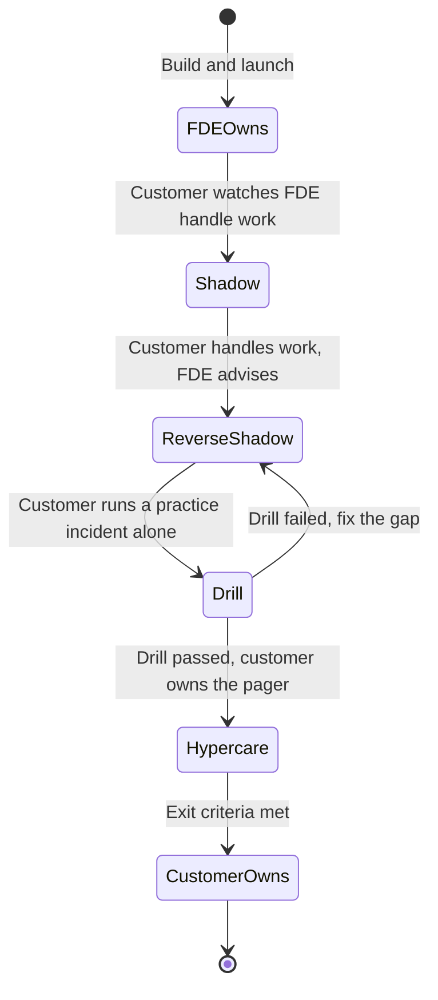
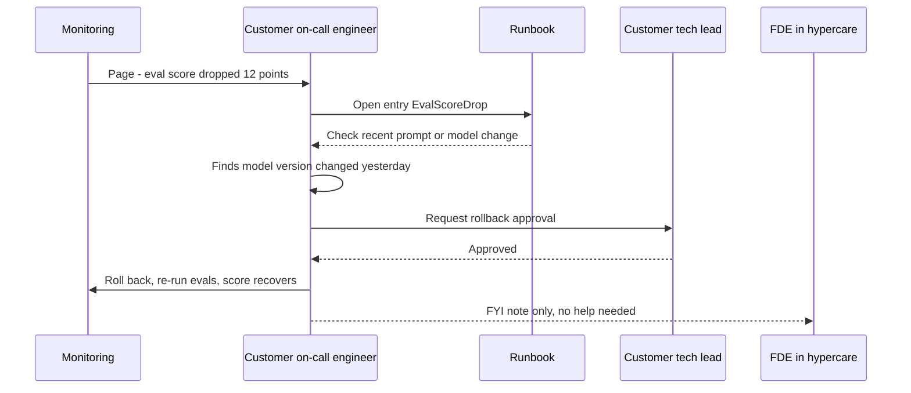
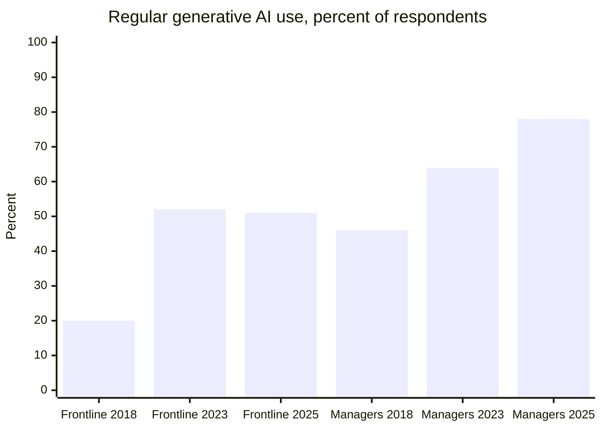
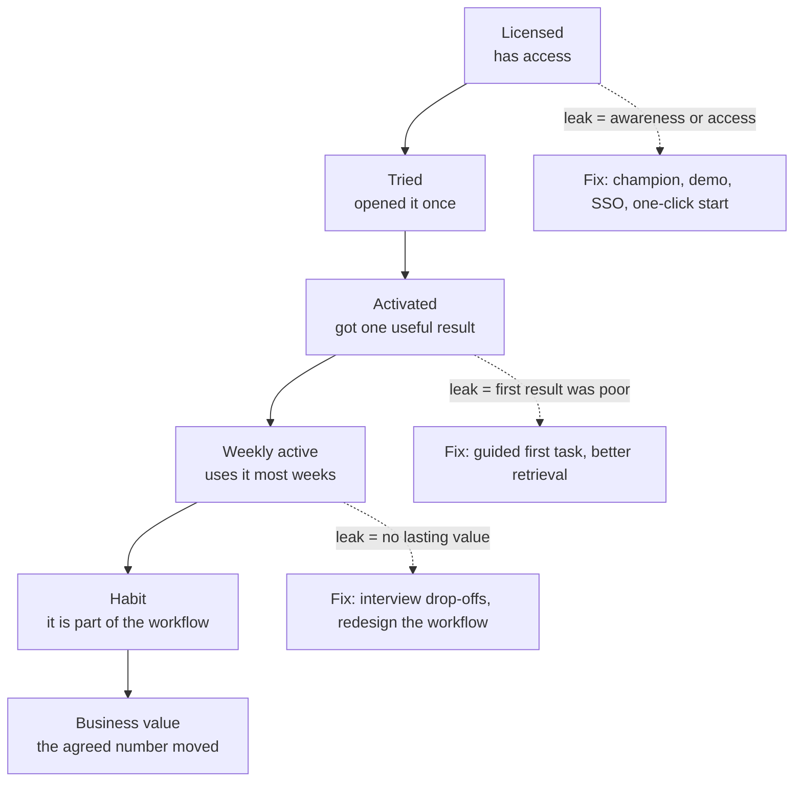
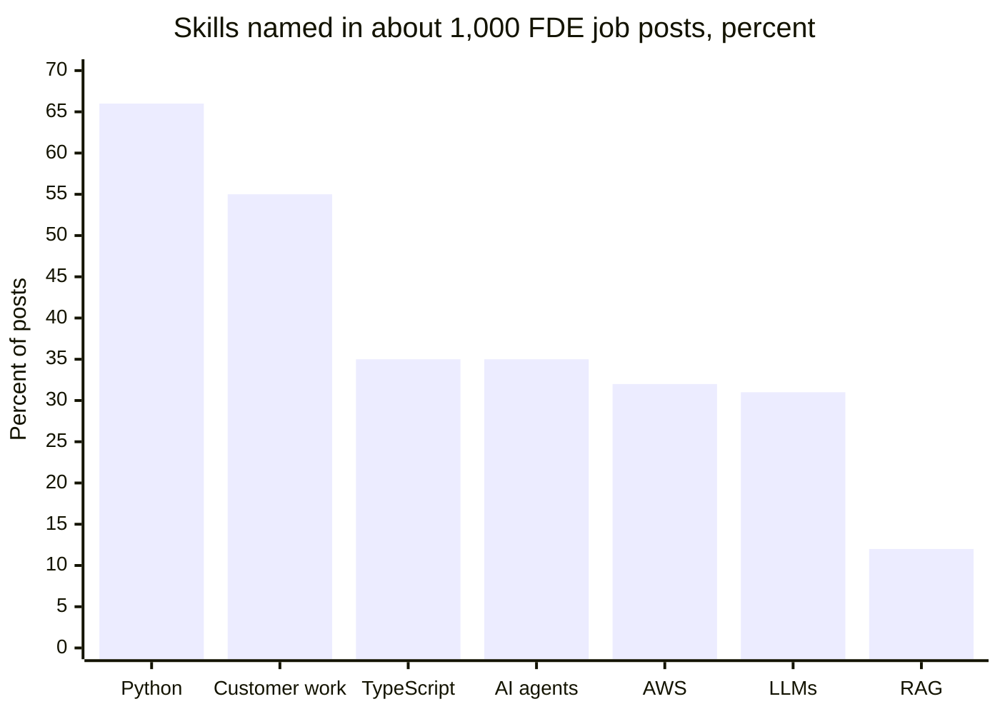
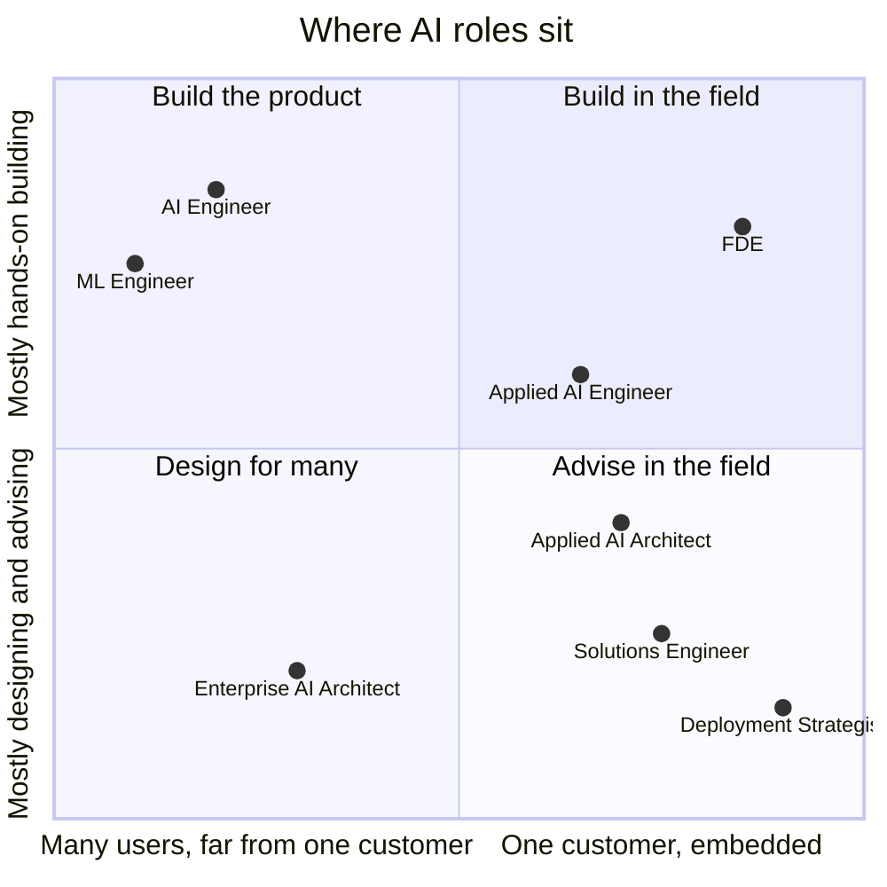
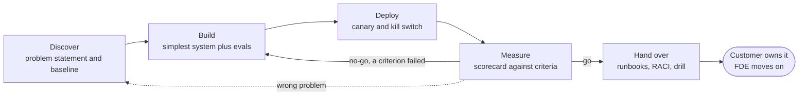
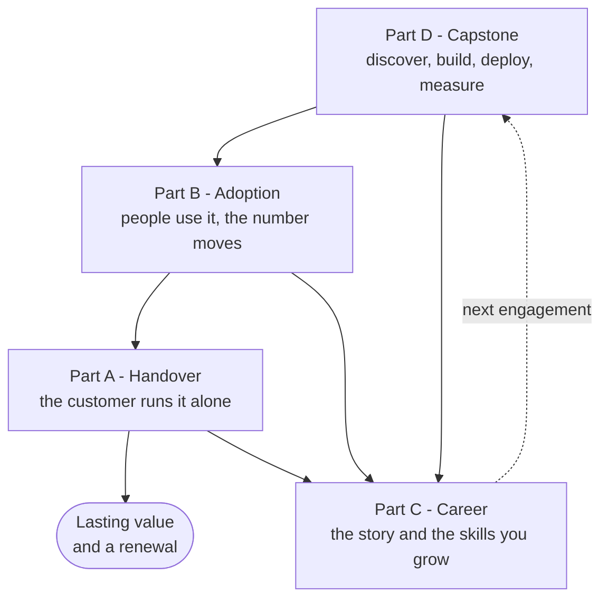
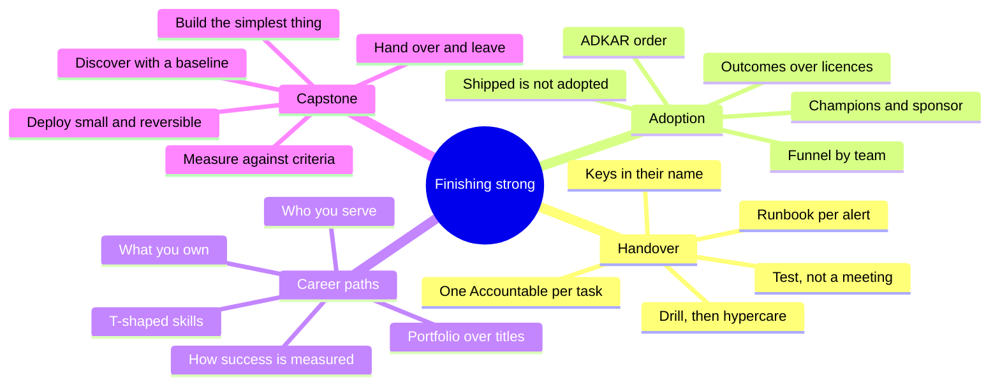



*Utkrishta Sinha · 8 Nov 2026 · about 75 minutes · covers syllabus topics 39, 40, 49, 50*

**What today covers**

| Part | Syllabus topic | What you will be able to do |
| --- | --- | --- |
| A | 39. Operational handover | Plan and run a handover so the customer's team can operate your AI system at 2 a.m. without you |
| B | 40. Customer adoption | Measure whether people really use the system, find why they do not, and fix it |
| C | 49. Career paths | Explain how AI Engineer, AI Architect, FDE and nearby roles differ, and pick your next skill to grow |
| D | 50. FDE capstone | Run a full engagement: discover a problem, build, deploy, measure and hand over |

## 1. The Five Big Ideas

Today is the last day of the course, and it is about the part of the job that happens after the demo works. Building is half the work. The other half is making sure the system keeps running, keeps being used, and keeps paying for itself after you leave.

- **A handover is a test, not a meeting.** You have handed over only when the customer's team has handled a real or practice incident without you. A slide deck that says "we handed over" proves nothing.
- **Shipped is not adopted.** Most AI pilots never become daily habits. MIT's 2025 study found only about [5% of enterprise-grade custom tools reached production](https://virtualizationreview.com/articles/2025/08/19/mit-report-finds-most-ai-business-investments-fail-reveals-genai-divide.aspx). Adoption is designed, measured and coached, not hoped for.
- **Measure the workflow, not the model.** Customers pay for faster invoices, fewer errors or happier clients. Accuracy on a test set is a guardrail, not the goal.
- **Roles differ by who you serve and what you own.** An AI Engineer builds for many users. An FDE builds for one customer, inside their mess. An AI Architect designs the whole system and its rules. Pick by the problems you enjoy.
- **The capstone is the full loop.** Discover, build, deploy, measure, hand over. Every earlier day of this course fits into one of those five verbs.

Facts below were checked on 8 November 2026.

Think of a new home. The builder hands you the keys, but a good builder also gives you the warranty card, shows you where the water valve is and calls after a month to ask what leaks. A bad builder hands you keys and a smile. You find the water valve during a flood. 😅

## 2. Why This Matters for an FDE

An FDE (Forward Deployed Engineer) is an engineer who works inside a customer's organisation to make a product deliver real value there. OpenAI's job post says success is measured by ["production adoption, measurable workflow impact"](https://openai.com/careers/forward-deployed-engineer-london/). Notice what is missing: "a cool demo".

So the four topics today are not soft extras. They are how your work gets judged.

- **Handover (Part A)** shows up in the last weeks of every engagement. The customer asks, "What happens when you leave?" If the honest answer is "it breaks", you have built a dependency, not a product.
- **Adoption (Part B)** shows up from week one. A pilot with 30 licences and 4 regular users will be cancelled at renewal, however good the model is.
- **Career paths (Part C)** show up in interviews and in your own planning. Interviewers ask, "Why FDE and not a normal engineering role?" You need a sharp answer.
- **The capstone (Part D)** is the engagement itself. It is what you will describe in every FDE interview: the problem, what you built, the number that moved, and what the customer now owns.

Here is what that looks like from the customer's side.

| What the customer says | Part | Usual root cause | The fix |
| --- | --- | --- | --- |
| "Since your team left, nobody knows how to restart it." | A | Knowledge lived in the FDE's head | Runbooks, shadowing, and a drill the customer runs alone |
| "We got paged at 3 a.m. and nobody owned it." | A | No clear owner per task | A RACI (Responsible, Accountable, Consulted, Informed) chart with one Accountable person per task |
| "The answers got worse after a model update." | A | No eval suite handed over | A golden test set and a weekly eval run owned by the customer |
| "We bought 500 seats and maybe 40 people use it." | B | Tool added, workflow unchanged | Redesign one workflow end to end, with a champion per team |
| "People tried it once and went back to Excel." | B | First use was confusing or wrong | A guided first task, quick wins, and fixing the top complaint fast |
| "Finance says they cannot see any value." | B, D | No baseline measured before launch | Measure the "before" numbers in week one |
| "Our engineers think AI will replace them." | B | Fear, and no say in the design | Involve them in design and keep a human in control of key steps |
| "I don't know if I should be an architect or an FDE." | C | Titles look similar from outside | Compare who you serve, what you own and how success is measured |
| "We built something nobody asked for." | D | Skipped discovery, pitched a solution | Interview users about their past week, not your idea |
| "The pilot worked, but we cannot scale it." | D, A | Built as a demo, not as a system | Production readiness review before go-live |

> **Sentence for a customer call:** "Before we build anything, can we agree on the one number that will tell us, in eight weeks, whether this was worth it?"

There is also a business reason. Cohere's CEO told the press that FDEs make sure ["customers get exactly what they need and scale back once companies are up and running"](https://www.eweek.com/news/openai-anthropic-cohere-ai-hiring/). Scaling back is the plan from day one. Handover and adoption are how you get there.

## 3. Core Concepts, From Simple to Deep

This section has one part per topic. Each part starts with an everyday picture, gives you the words, and then goes deeper until you can see how it works under the hood.

### Part A: Operational Handover

Picture a relay race. The fastest runner in the world still loses if the baton drops. The handover zone is short, both runners move at the same speed for a few steps, and the second runner must grip the baton before the first lets go.

An operational handover is that baton pass for software. "Operational" means running the system day to day: watching it, fixing it, changing it safely. "Handover" means another team now does that, not you.

#### A.1 The Words You Need

| Term | Plain meaning | Simple example |
| --- | --- | --- |
| Operational handover | Moving the daily running of a system to another team | Your FDE team stops carrying the pager; the customer's ops team starts |
| Runbook (or playbook) | Step-by-step instructions for a known problem | "If error rate is above 5%, check the provider status page first" |
| Alert | An automatic message when a metric crosses a line | "Cost per hour is 3 times normal" |
| Page | An urgent alert that wakes a person up | A phone call at 2 a.m. |
| On-call | Being the person who answers pages in a time window | One engineer covers 9 a.m. to 9 p.m. this week |
| Incident | Anything that hurts users and needs action now | The chatbot returns empty answers |
| Postmortem | A written review after an incident, without blame | "What happened, why, and what we changed" |
| SLO (Service Level Objective) | A target for how good the service must be | 99% of answers within 8 seconds |
| SLI (Service Level Indicator) | The measured number behind an SLO | The real share of answers under 8 seconds |
| Error budget | How much failure the SLO allows | 1% slow answers per month |
| MTTR (Mean Time To Repair) | Average time from break to fixed | 40 minutes |
| PRR (Production Readiness Review) | A structured check that a system is ready for real users and a new owner | A checklist of monitoring, rollback and capacity |
| RACI | A chart of who is Responsible, Accountable, Consulted and Informed for each task | The tech lead is Accountable for prompt changes |
| Shadowing | The new owner watches you do the work | They sit in while you handle a page |
| Reverse shadowing | You watch the new owner do the work | They handle the page; you only advise |
| Hypercare | A short period after handover with extra support | Two weeks where you answer questions within an hour |
| Drill (game day) | A practice incident on purpose | "Wheel of Misfortune": someone fakes an outage, the team responds |
| Toil | Manual, repetitive ops work that a script could do | Restarting the same job by hand every morning |
| Eval suite | A set of test inputs with expected outputs, run on every change | 200 real customer questions with approved answers |
| Golden set | The most trusted part of the eval suite | 50 questions a domain expert has checked |
| ADR (Architecture Decision Record) | A short note explaining one big design choice | "We chose pgvector over Pinecone because data must stay in India" |
| Bus factor | How many people could leave before nobody understands the system | Bus factor of 1 means one person is a single point of failure |

#### A.2 The Simple Version: Three Questions

A beginner's handover answers three questions:

1. **What is this, and how do I run it?** That is the README.
2. **What do I do when it breaks?** That is the runbook.
3. **Who owns what?** That is the RACI.

If the customer's team can answer all three without calling you, you have a basic handover. Most failed handovers miss question 3. Everyone assumes someone else owns the 2 a.m. page.

#### A.3 Why AI Systems Are Harder to Hand Over

A normal web app breaks loudly. It throws errors and returns 500s. An LLM (Large Language Model) app often breaks quietly. It keeps answering, but the answers get worse.

So an AI handover needs extra items that a normal handover does not:

- **The eval suite.** The new owner must be able to prove that a change did not make answers worse. Day 10 called this a sensor.
- **The prompt and model versions.** Prompts are code. They need version control, review and rollback.
- **Cost watching.** A loop that runs away can cost money fast. Someone must own the budget alert.
- **Provider failures.** The model provider can be slow or down. The runbook needs a fallback, such as a second model or a polite "try again later".
- **Model upgrades.** Providers retire old models. Someone must own testing the new one against the eval suite.
- **Data and retrieval drift.** New documents arrive, old ones change. Retrieval quality from Day 15 can quietly decay.

This is why the handover package for an AI system is mostly a harness, as Day 10 said. You hand over the controls that keep the model honest.

#### A.4 What Google Learned About Handing Over Services

Google's SRE (Site Reliability Engineering) teams have handed over services for years, in both directions. Their book says a PRR ["is considered a prerequisite for an SRE team to accept responsibility"](https://sre.google/sre-book/evolving-sre-engagement-model/) for a service. In other words, no review, no handover.

Their simple PRR model has six phases:

1. **Engagement.** Agree goals, such as an SLO, with the building team.
2. **Analysis.** Review the system against a checklist and read recent incidents.
3. **Improvements.** Fix the gaps together.
4. **Training.** Design overviews, deep dives on how a request flows, and hands-on exercises.
5. **Onboarding.** Move responsibility over gradually, with the old team still available to advise.
6. **Continuous improvement.** Keep the standards up to date as the system changes.

The review covers architecture and dependencies, monitoring, emergency response, capacity planning, change management, and performance. Those six areas are your handover checklist headings too.

The Google SRE workbook adds a strong rule: ["We strongly recommend defining SLOs before general availability (GA)."](https://sre.google/workbook/engagement-model/) If nobody agreed what "working" means before launch, nobody can tell whether the new owner is doing well.

#### A.5 Handover Is Gradual: The Shadow Ladder

You do not flip a switch. You move the work across in steps, so the new team gets practice while you can still catch mistakes.



*Responsibility moves one step at a time, and a failed drill sends you back a step, not forward.*

Google's own on-call training uses the same ladder. One team had new engineers [shadow for two months, then go primary with a backup at three months](https://sre.google/workbook/on-call/). The workbook also notes most teams do not expect new hires to be ready for on-call before three to nine months. A customer team learning your system needs time too, so plan it into the schedule.

#### A.6 Runbooks That Actually Work

A runbook is, in PagerDuty's words, ["a detailed guide of standardized procedures for IT operations tasks to resolve known issues."](https://www.pagerduty.com/resources/learn/runbook/) The Google workbook says such guides ["reduce stress, the mean time to repair (MTTR), and the risk of human error."](https://sre.google/workbook/on-call/)

Three rules from that same chapter are worth memorising:

- **["Each alert should have a corresponding playbook entry."](https://sre.google/workbook/on-call/)** An alert without instructions just creates panic.
- **Runbooks rot.** Details go out of date as fast as production changes. So on-call engineers update the entry each time its page fires.
- **If the steps are a fixed list of commands, automate them.** A runbook step that never needs judgment should become a script.

A good runbook entry for an AI system has five parts: what the alert means, how bad it is, how to confirm it, how to stop the damage, and who to call next. You will see a full one in section 4.

#### A.7 Ownership: RACI Without Confusion

RACI is a simple table. Each row is a task. Each column is a person or team. Each cell says R, A, C or I.

- **R, Responsible:** does the work.
- **A, Accountable:** owns the result and makes the final call.
- **C, Consulted:** asked for input before the decision, two-way.
- **I, Informed:** told after the decision, one-way.

Atlassian's guide states the key rule: ["Each task should have precisely one accountable person"](https://www.atlassian.com/software/confluence/templates/raci-chart). Two Accountable people means zero, because each assumes the other will act. Your handover checker in section 4 tests this automatically.

#### A.8 Under the Hood: Operational Load and Exit Criteria

How do you know the customer team can carry the load? Google gives numbers you can borrow. Their target is [at most two incidents per 12-hour on-call shift](https://sre.google/sre-book/being-on-call/), because each incident takes about six hours to fully handle, including the postmortem. They also cap operational work at 50% of an engineer's time.

Use the same idea for a customer team. Count the pages per week during reverse shadowing. If a two-person team gets ten pages a week, the system is not ready to hand over. You must fix the noisy alerts or the flaky parts first. Handing over a noisy system just moves the pain.

Write down **exit criteria** before hypercare begins. They are the conditions for you to step away. A sound set looks like this:

1. Every alert has a runbook entry, and the customer team has used at least three of them.
2. The customer ran one drill alone and met the response time.
3. The eval suite runs on a schedule, and a named person reads the result.
4. The RACI has one Accountable person per task, and all of them have signed it.
5. Page volume is under the agreed budget for two weeks in a row.
6. Access, secrets and billing are owned by customer accounts, not FDE accounts.

That last item is often forgotten. If the API key, the cloud account or the domain is in your company's name, you have not handed over. You have lent.



*A successful handover looks like this: the FDE is informed afterwards, not called during.*

#### A.9 Disengagement Is a Good Outcome

Google says that when a service no longer needs heavy SRE care, it can stay with the building team, and ["This is a positive outcome, because the service has been engineered to be reliable and low maintenance"](https://sre.google/sre-book/evolving-sre-engagement-model/). The same is true for you. Leaving is the goal, not a loss.

Palantir's FDE culture has the same idea from the other direction. Their engineers feed field solutions back into the core product, so the next customer needs less custom work. A [Palantir FDSE describes](https://blog.palantir.com/a-day-in-the-life-of-a-forward-deployed-software-engineer-45ef2de257b1) "sharing" as part of the day: passing field solutions to product teams. A good handover has two receivers: the customer's ops team and your own product team.

### Part B: Customer Adoption

Picture a new gym near your flat. Hundreds of people buy a yearly membership in January. By March, the same twenty people are there every morning. The gym did not fail to sell. It failed to change habits.

Customer adoption is the March problem for software. "Adoption" means people use the system as part of their normal work, often enough that it changes a business number. A signed contract or a pile of licences is not adoption. It is a January membership.

#### B.1 The Words You Need

| Term | Plain meaning | Simple example |
| --- | --- | --- |
| Adoption | People use the system regularly, in their real work | 70% of the support team uses the drafting tool every week |
| Licence (seat) | Permission for one person to use paid software | 500 Copilot seats bought |
| Activation | A user's first real, successful use | First invoice processed with the assistant |
| Time to first value | How long a new user takes to get one useful result | 12 minutes from login to first accepted draft |
| Active user | Someone who did a meaningful action in a time window | Sent at least one AI-drafted reply this week |
| DAU, WAU, MAU | Daily, weekly and monthly active users | WAU of 140 out of 200 seats |
| Stickiness | How often active users come back, often DAU divided by MAU | DAU/MAU of 0.4 means a typical user shows up on 40% of days |
| Retention | Share of a starting group still active later | 60% of week-1 users still active in week 4 |
| Cohort | A group that started at the same time | Everyone onboarded in September |
| Funnel | The steps from "has access" to "uses it daily", with drop-off at each | Licensed, tried, activated, weekly, daily |
| Acceptance rate | Share of AI outputs the user keeps, edits lightly or sends | 78% of drafts sent with small edits |
| Leading indicator | An early number that predicts the result | Weekly active share |
| Lagging indicator | The business result itself, which arrives later | Cost per ticket next quarter |
| Champion | A respected user inside a team who helps others adopt | The AP clerk everyone asks for Excel tips |
| Executive sponsor | A senior leader who backs the project and removes blockers | The CFO who says "this matters" in the town hall |
| Change management | The planned work of helping people move to a new way of working | Training, comms, support, reinforcement |
| ADKAR | Prosci's five-step model for one person's change: Awareness, Desire, Knowledge, Ability, Reinforcement | See B.4 |
| Workflow redesign | Changing the steps of the work, not just adding a tool | The AI drafts first; the human reviews, instead of the reverse |
| Shadow AI | Staff using unapproved AI tools at work | Pasting customer data into a personal chatbot account |
| Enablement | Training and material that help users succeed | A 20-minute guided first task |
| Feedback loop | A route for user complaints to reach the builders and come back fixed | A thumbs-down button that creates a ticket |

#### B.2 The Simple Version: Can, Want, Do

At the simplest level, a person adopts a tool when three things are true:

1. **They can.** They have access, it works on their machine, and they know how.
2. **They want to.** It saves them time or pain, and it does not threaten them.
3. **They do, again and again.** It sits inside their normal workflow, so using it is the easy path.

Most failed rollouts fix only the first one. They give access and a webinar. Then they wonder why usage drops after week two.

#### B.3 The Evidence: Use Is Easy to Start and Hard to Keep

The research is consistent. Trying AI is common. Making it a habit that moves numbers is rare.

- **The pilot gap.** MIT's 2025 study, as reported by [Virtualization Review in August 2025](https://virtualizationreview.com/articles/2025/08/19/mit-report-finds-most-ai-business-investments-fail-reveals-genai-divide.aspx), found 60% of organisations evaluated enterprise-grade AI systems, 20% reached pilot and only 5% reached production.
- **The value gap.** McKinsey's [2026 State of AI survey](https://www.mckinsey.com/capabilities/quantumblack/our-insights/the-state-of-ai), published August 2026, says nearly nine in ten respondents use AI in at least one function. Only 37% report any EBIT (earnings before interest and taxes) impact, and only 6% are "high performers".
- **What high performers do differently.** Nearly three-quarters of McKinsey's high performers redesign workflows around AI. Among everyone else, about one-quarter do.
- **The frontline gap.** BCG's AI at Work 2025 survey of over 10,600 workers found [72% use generative AI regularly, but only 51% of frontline workers](https://www.unleash.ai/artificial-intelligence/bcgs-ai-at-work-2025-report-four-takeaways-for-hr-leaders/) do. Managers were at 78%.

The BCG time series is worth a picture. Managers kept climbing. Frontline workers stalled.



*Frontline use stalled near 51% while manager use rose to 78%. Source: BCG AI at Work 2025, as reported by UNLEASH, July 2025.*

Two more BCG numbers tell you where to push. People with more than five hours of training were regular users 79% of the time, against 67% for those with less. And the share of employees who feel positive about generative AI rose [from 15% to 55% with strong leadership support](https://www.unleash.ai/artificial-intelligence/bcgs-ai-at-work-2025-report-four-takeaways-for-hr-leaders/). Only about a quarter of frontline employees got that support.

India is an interesting case here. The [same BCG survey, as reported by The Tribune in June 2025](https://www.tribuneindia.com/news/bcg/india-leads-with-92-employees-embracing-genai-tools-against-global-average-of-72), put regular use in India at 92%, against 72% globally. But 48% of Indian employees feared job displacement within ten years, against 41% globally. So in an Indian engagement, high curiosity and high fear often sit in the same room. Your adoption plan must handle both.

#### B.4 The Human Side: ADKAR

Adoption happens one person at a time. Prosci, a change management firm, built the ADKAR model around that idea. Its page says ["Organizational change happens one person at a time"](https://www.prosci.com/methodology/adkar?pp=env). The five elements are:

| Letter | Prosci's definition | What it looks like for an AI rollout | Your FDE move |
| --- | --- | --- | --- |
| A, Awareness | "Understand why the change is needed." | "Month-end close takes 9 days; competitors do 4." | Show the baseline number and the pain |
| D, Desire | "Choose to participate in and support the change." | "This removes the boring part of my job, not my job." | Involve users in design; be honest about what changes |
| K, Knowledge | "Know how to change and what success requires." | "I know which invoices to send to the assistant." | A short, task-based training on their own data |
| A, Ability | "Put new skills and behaviors into practice." | "I did ten real invoices with a champion nearby." | Office hours, champions, a guided first task |
| R, Reinforcement | "Sustain the new way and prevent backsliding." | "My manager reviews the weekly usage and praises wins." | Dashboards, recognition, fixing complaints fast |

The order matters. Prosci says the elements are sequential but not linear. Training (K) does nothing for someone who has no desire (D). This is why a webinar for 500 people often moves nothing.

#### B.5 The Funnel: Find Where People Leak

Adoption is easiest to fix when you see it as a funnel. Each step loses people, and each leak has a different cause.



*Each step of the funnel leaks for a different reason, so measure every step, not just logins.*

Read the funnel top to bottom and stop at the first big leak. If only 30% of licensed users ever tried it, a better model will not help. If 90% tried it and 10% came back, the first experience or the value is the problem.

#### B.6 Measuring Adoption Without Fooling Yourself

The Microsoft 365 community maturity model for Copilot gives a blunt instruction: ["Stop measuring the wrong things (licenses, prompts)."](https://pnp.github.io/maturity-model/practical-scenarios/maturity-model-microsoft365-practical-scenarios-copilot-implementation.html) It says usage tracking is the best metric most organisations have, but it is not enough on its own. Measure business process improvements and outcomes instead.

So use a ladder of metrics. Each rung is harder to fake than the one below it:

1. **Access:** licences assigned. Almost useless alone.
2. **Activity:** weekly active users as a share of licensed users. A good early warning.
3. **Depth:** actions per active user, and which features they use.
4. **Quality:** acceptance rate, edit distance, thumbs-down rate, escalations.
5. **Outcome:** the business number, such as minutes per invoice or cost per ticket.

Stickiness needs care too. Mixpanel's own blog warns that the DAU/MAU ratio [can mislead if it is not read in context](https://www.plushcap.com/content/mixpanel/blog/mixpanel-what-is-your-stickiness-metrics-really-saying). Different usage patterns give the same ratio. A tool used for monthly close should be used monthly. Weekly active share fits most work tools better than daily use.

Always cut the numbers by team. An average of 40% might hide one team at 90% and two teams at 5%. The fix for each team is different, as the script in Example B1 shows.

#### B.7 Under the Hood: Why AI Adoption Is Different

Normal software is deterministic. Click the same button, get the same result. LLM tools are not, and that changes adoption in four ways.

- **Trust is earned per answer.** One confident wrong answer can undo a month of goodwill. So citations, "I don't know" answers and easy human review matter more than speed.
- **The user has to learn to delegate.** People must learn what to hand over and how to check it. That is a skill, so it needs practice, not a slide.
- **Fear is real.** People wonder if the tool replaces them. If you dodge the question, they quietly avoid the tool. Be honest about what changes and keep humans in control of key steps.
- **The system changes under them.** Model upgrades change tone and behaviour. Tell users before a big change, and re-run your evals first.

Morgan Stanley is the classic example of getting this right. OpenAI's case study says [over 98% of advisor teams actively use](https://openai.com/index/morgan-stanley/) the AI @ Morgan Stanley Assistant. Before rollout, every use case went through evals graded by advisors and prompt engineers, with daily regression tests. Advisors review the Debrief tool's outputs before sending. The firm also addressed data fears with a zero data retention policy. Those are the firm's and OpenAI's claims, but the pattern is clear: trust first, then scale.

#### B.8 The Adoption Plan in One Picture

A practical FDE adoption plan has five moves. Each one maps to an ADKAR element.

1. **Pick one workflow and one team first.** Prove it works deeply before spreading it thin.
2. **Measure the baseline before launch.** Without "before" numbers, you cannot show "after".
3. **Recruit champions and a sponsor.** The maturity model says mature programmes give champions a time commitment, manager support and an appointment from each part of the business.
4. **Design the first ten minutes.** A guided first task on the user's real data, with a quick win.
5. **Close the loop weekly.** Read the feedback, fix the top complaint, tell users what you fixed.

Klarna is a useful warning about step 5 and about trust. In 2024 it said its AI assistant did the work of 700 agents. In May 2025, [CMSWire reported](https://www.cmswire.com/contact-center/klarna-ceo-were-giving-ai-more-customer-service-work-not-less/) Klarna was hiring humans for higher-level conversations while still expanding AI. The CEO said he may have overstated timelines. Adoption is not "AI everywhere". It is the right split of work between AI and people, adjusted as you learn.


### Part C: Career Paths: AI Engineer vs AI Architect vs FDE vs Related Roles

Picture a hospital. The surgeon operates. The hospital architect designs the building so surgery is safe. The doctor on a rural camp travels to patients, works with whatever kit is there, and treats many conditions in one day. All three are skilled. They differ in who they serve, what they own and where they work.

AI careers split the same way. Titles are messy and overlap a lot. So instead of memorising titles, learn the three questions that separate the roles: who do you serve, what do you own, and how is your success measured?

#### C.1 The Words You Need

| Term | Plain meaning | Simple example |
| --- | --- | --- |
| AI Engineer | A software engineer who builds products on top of AI models and APIs | Builds a support bot with retrieval, tools and evals |
| ML Engineer (MLE) | An engineer who trains, tunes, serves and monitors models | Fine-tunes a model and runs its GPU serving |
| ML researcher | Someone who invents new model methods | Designs a new training technique |
| Forward Deployed Engineer (FDE) | An engineer embedded with one customer to make the product deliver value there | Builds an invoice agent inside a bank's systems |
| FDSE / Delta | Palantir's names for its forward deployed software engineers | Same idea as FDE |
| AI Architect | A senior designer of the whole AI system, its patterns and its rules | Chooses the reference architecture for 30 teams |
| Applied AI Architect | A vendor title, often a pre-sales technical advisor | Anthropic's role that builds prototypes and evals for prospects |
| Solutions Architect / Solutions Engineer | A technical person who helps customers choose and design solutions, often before or around the sale | Runs the technical demo and proof of concept |
| Applied AI Engineer | A vendor title for an engineer who helps customers build on the vendor's APIs | OpenAI's Technical Success role |
| Deployment Strategist | A deployment role mixing business and technical work | Sarvam AI's title in India |
| Pre-sales / post-sales | Work before a contract is signed, or after | Proof of concept vs production rollout |
| GTM (Go-To-Market) | The sales and marketing side of a company | An FDE team sometimes sits here |
| The API line | Swyx's line between training models and building on them | AI Engineers mostly work to the right of it |
| T-shaped skills | Broad across many areas, deep in one | Full-stack broad, deep in evals |
| IC (Individual Contributor) | A person who does the work rather than managing people | Staff engineer |
| Portfolio | Public proof of your work | A repo, a write-up, a demo video |

#### C.2 The Simple Version: Who You Serve

Palantir put it best in one line. A product engineer's focus is ["one capability, many customers."](https://blog.palantir.com/dev-versus-delta-demystifying-engineering-roles-at-palantir-ad44c2a6e87) A forward deployed engineer's focus is "one customer, many capabilities."

Add the architect and you have the core picture:

- **AI Engineer:** one product, many users. You build features and make them reliable.
- **FDE:** one customer, many capabilities. You make the product work in that customer's messy world.
- **AI Architect:** many teams, one coherent system. You design patterns, standards and guardrails others build on.

#### C.3 The AI Engineer

The term took off with swyx's 2023 Latent Space essay, ["The Rise of the AI Engineer"](https://latent.space/p/ai-engineer/?open=false). It describes software engineers who specialise in applications of AI, wielding AI APIs and open models. It quotes Andrej Karpathy: "One can be quite successful in this role without ever training anything."

The essay draws an "API line". To its left, people train and host models. To its right, people build products on APIs. AI Engineers live mostly to the right, owning product-specific data and evals. The essay calls the line "permeable", so people cross it both ways.

What an AI Engineer does day to day:

- Builds agent loops, tools, retrieval and prompts (Days 1, 4, 6, 9 and 15).
- Writes evals and watches traces (Day 10).
- Chooses and routes models, and controls cost (Days 3 and 8).
- Ships through normal CI, code review and on-call.

Success is measured like any product engineer: shipped features, quality, reliability and user metrics.

#### C.4 The Forward Deployed Engineer

The FDE role began at Palantir. a16z's May 2026 fellowship post calls it ["the critical enabler for agentic platforms"](https://www.a16z.news/introducing-the-a16z-fde-fellowship) and argues "the work happening in the field right now isn't just deployment - it's R&D."

Current job posts show the shape clearly:

- **OpenAI's London FDE post** asks you to own technical delivery across several deployments, "from first prototype to stable production". Success is judged on ["production adoption, measurable workflow impact, and eval-driven feedback that changes product and model roadmaps."](https://openai.com/careers/forward-deployed-engineer-london/) It asks for five or more years of experience and up to 50% travel.
- **Anthropic's Paris FDE post** asks for production applications inside customer systems, artifacts such as [MCP servers, sub-agents and agent skills](https://job-boards.greenhouse.io/anthropic/jobs/5121563008), and 25-50% travel. It asks for 4+ years in a technical, customer-facing role.

Notice that both posts also ask you to feed lessons back to product and research. That is the second half of the job. You are the company's eyes in the field.

Bloomberry's analysis of about 1,000 FDE postings, [updated January 2026](https://bloomberry.com/blog/i-analyzed-1000-forward-deployed-engineer-jobs/), gives a useful picture of the market. It is mostly US data.



*Python and direct customer work lead; TypeScript and AWS both matter. Source: Bloomberry analysis of about 1,000 FDE postings, updated January 2026.*

The same analysis found 60% of jobs were mid-level, with 3-5 years of experience, and only 12% were entry level. 68% required travel. About 45% of previous FDEs in its sample of 100 profiles came from software engineering.

#### C.5 The AI Architect

"AI Architect" has two meanings, so ask which one an employer means.

1. **The enterprise AI Architect.** A senior person inside a company or consultancy. They choose the reference architecture, platforms, security model, data flows and governance rules. Many teams build on their decisions. They write ADRs and review designs more than they write product code.
2. **The vendor Applied AI Architect.** A pre-sales technical advisor at a model company. Anthropic's Applied AI Architect post works [with account executives](https://job-boards.greenhouse.io/anthropic/jobs/5192805008) from discovery through deployment, builds prototypes and eval frameworks, and favours "one thing that serves ten customers" over one-off builds. It asks for 3+ years as an engineer with some customer-facing work, or as a solutions architect.

Both kinds care about breadth. They must know what can go wrong across the whole system: cost, latency, privacy, failure modes and vendor lock-in. This is why Day 10's harness thinking and Day 15's memory and data choices are architect material.

#### C.6 Related Roles You Will Meet

| Role | Who they serve | What they own | Success measured by |
| --- | --- | --- | --- |
| ML Engineer | Model and platform teams | Training, tuning, serving and monitoring models | Model quality, serving cost and uptime |
| Solutions Engineer / Solutions Architect | Prospects and customers, often pre-sales | Technical fit, demos, proofs of concept | Deals won, technical wins |
| Applied AI Engineer (OpenAI) | Advanced API customers | [Prototypes and advice](https://openai.com/careers/applied-ai-engineer-digital-natives-san-francisco/), cookbooks, feedback to product | Customer value and scale-up on the platform |
| Deployment Strategist | Customer leaders | Business case, rollout plan, change | Adoption and outcome numbers |
| Product engineer | All users of one product | Features of the core platform | Product metrics |
| Developer advocate | The developer community | Docs, samples, talks | Developer adoption |
| Technical account manager | Existing customers | Health of the account after launch | Renewals, satisfaction |

#### C.7 The Map: Two Axes

Two axes explain most of the differences. The first is how close you work to one customer. The second is how much of your day is hands-on building versus design and advising.



*FDEs sit where hands-on building meets one embedded customer; architects and solutions roles sit lower, nearer design and advice.*

The positions are a teaching sketch, not a measurement. Real jobs move around. A senior FDE does more architecture. A small startup's AI Engineer talks to customers every week.

#### C.8 The Indian Market, With Care

Indian demand for FDEs is growing fast, from a small base. A PTI report on Indeed data, published by [People Matters on 15 October 2026](https://www.peoplematters.in/news/workforce-planning/demand-for-forward-deployed-engineers-jumps-19-fold-in-india-report-52770), said FDE postings rose nearly 19-fold year on year in 2026. Cities named include Bengaluru, Hyderabad, Chennai, New Delhi and Mumbai.

Masai School checked careers pages on [30 October 2026](https://www.masaischool.com/blog/forward-deployed-engineer-jobs-in-india/) and found FDE-titled India roles at Databricks, Cursor, DevRev, HackerRank and MongoDB. Sarvam AI listed a Deployment Strategist role. It also notes that growth rates say nothing about total volume, and no published count of Indian FDE jobs exists.

The large Indian IT services firms are moving too. [Deccan Herald reported](https://deccanherald.com/business/fde-hiring-surges-as-indian-it-puts-ai-into-production-2-4080076) that TCS is targeting FDEs for 1% of its workforce (at least 6,000 people), Wipro is among the firms deploying FDEs, and HCLTech plans to hire more elite engineers who could join an FDE cohort over the next two to three years. The same article quotes TCS's COO: "an FDE would have multiple skills but would be very deep on one particular skill". That is the T-shape again.

Pay figures vary a lot by source. Deccan Herald cites Rs 18-28 lakh a year for entry-level FDEs. Masai cites an Indeed base-pay figure of about Rs 12 lakh. Treat both as rough reports, and check live postings before any negotiation.

#### C.9 Under the Hood: How to Choose and How to Move

Choose by the problems you enjoy, not the title that sounds best. Ask yourself four questions:

1. **Do I enjoy ambiguity?** FDE work starts with "we need AI" and no spec. If that excites you, good sign.
2. **Do I enjoy people?** FDEs and solutions roles spend a lot of time with non-engineers. If meetings drain you, prefer AI Engineer.
3. **Do I enjoy depth or breadth?** AI Engineers go deep in one product. FDEs and architects go wide.
4. **Can I travel?** Many FDE roles ask for 25-50% travel.

For a frontend-heavy engineer with Node, Java and Python, the path is good. You already build full-stack apps, which most FDE posts want. The usual gaps are evals, LLM systems depth and customer-facing practice. Example C1 turns this into numbers.

Certifications help less than a portfolio, but some show cloud breadth. AWS has a Generative AI Developer Professional exam (AIP-C01). [Pluralsight wrote in January 2026](https://www.pluralsight.com/resources/blog/cloud/new-aws-aip-c02-exam) that it was in beta through 31 March 2026, and that AWS recommends two years of production AWS work plus one year of generative AI on AWS. Microsoft lists [AI-103, Azure AI Apps and Agents Developer Associate](https://learn.microsoft.com/credentials/certifications/exams/ai-103/), as a beta exam when checked. Check status before you book either one.

The strongest career asset is one capstone you can explain end to end. That is Part D.

### Part D: The FDE Capstone: Discover, Build, Deploy, Measure, Hand Over

Picture a good wedding caterer. First they ask how many guests, what diet, what budget and what went wrong at the last family wedding. Then they cook a small tasting. On the day, they serve, watch the queue and fix the dal that ran out. At the end, they hand the leftover plan to the family and leave. The family remembers the food, not the caterer's knives.

A capstone is that full job, done once, end to end, on a real or realistic problem. It is the project you will describe in every FDE interview. It proves you can do all five verbs, not just one.

#### D.1 The Words You Need

| Term | Plain meaning | Simple example |
| --- | --- | --- |
| Capstone | One project that uses everything you learned, end to end | An invoice triage agent, shipped and handed over |
| Discovery | Learning the customer's real problem before building | Watching an AP clerk work for an hour |
| Problem statement | One page that says who hurts, how much, and what success means | "AP clerks spend 14 minutes per invoice..." |
| Baseline | The "before" number, measured the same way you will measure "after" | Median 13.5 minutes per invoice last week |
| Success criteria | The agreed, measurable targets that decide go or no-go | 30% faster, error rate at most 2% |
| Guardrail metric | A number that must not get worse while you improve the main one | Error rate, cost, complaints |
| North-star metric | The single number the project exists to move | Minutes per invoice |
| POC (Proof of Concept) | A quick build that shows something is possible | A notebook that extracts fields from 20 invoices |
| Pilot | Real users, real data, limited scope and time | One AP team for four weeks |
| MVP (Minimum Viable Product) | The smallest version that delivers real value | Draft extraction plus human review screen |
| Golden set | Trusted examples with correct answers, checked by a domain expert | 50 invoices with approved field values |
| Error analysis | Reading real failures and grouping them into types | "Wrong GSTIN" appears in 9 of 30 failures |
| Canary release | Sending a small share of traffic to the new version first | 5% of invoices go through the agent |
| Kill switch | A quick way to turn the AI path off | A feature flag that routes back to the manual queue |
| Go / no-go | The decision to scale, fix or stop, based on the criteria | "GO: all criteria passed" |
| ROI (Return on Investment) | Value gained compared with cost | Rs 2.97 lakh saved for Rs 16,200 a month |
| One-pager | A single page that a busy leader can read in two minutes | The final results summary |
| Retrospective | A meeting to learn what went well and badly | "Discovery took too long because data access was slow" |

#### D.2 The Simple Version: Five Verbs

The capstone has five stages. Each one ends with an artifact, a thing you can show.

| Stage | The question | The artifact | Course days |
| --- | --- | --- | --- |
| Discover | What hurts, for whom, and how much? | Problem statement with a baseline | Day 19 discovery, Day 2 and 3 for what models can do |
| Build | What is the simplest thing that moves the number? | Working system plus an eval suite | Days 1, 4, 6, 9, 10, 15 |
| Deploy | How do we get it to real users safely? | Canary plan, kill switch, monitoring | Days 7, 8, 10 |
| Measure | Did the number move without breaking anything? | Scorecard and go / no-go | Day 10 sensors, Part B adoption |
| Hand over | Can they run it without me? | Runbooks, RACI, drill results, one-pager | Part A |



*The capstone is a loop: a failed measurement sends you back to build, and a wrong problem sends you back to discovery.*

#### D.3 Discover: Find a Problem Worth Solving

Discovery was the heart of Day 19. For the capstone, keep three rules from it.

1. **Ask about the past, not the future.** "Walk me through the last invoice that caused trouble" beats "Would you use an AI tool?"
2. **Watch the work.** Sit with the person who does the job. Managers describe the process they designed. Clerks show the one they actually use.
3. **Measure the baseline now.** Time ten real cases. Count errors. You cannot claim a 40% improvement later without this.

Then write the problem statement. Anthropic's docs give a helpful test for success criteria. Good criteria are [specific, measurable, achievable and relevant](https://platform.claude.com/docs/en/test-and-evaluate/define-success). The docs add that most use cases need several criteria at once, such as quality, latency and cost.

#### D.4 Build: The Simplest Thing That Moves the Number

Start small, on real data. Palantir's AIP bootcamps go [from zero to a working use case in one to five days](https://blog.palantir.com/deploying-full-spectrum-ai-in-days-how-aip-bootcamps-work-21829ec8d560), with customers bringing their own real use cases. The section heading there is a good motto: "Learn to fish, eat a fish." The customer learns to build while getting a real result.

Build the eval suite at the same time as the system, not after. Hamel Husain and Shreya Shankar describe a [practical method in Lenny's Newsletter](https://www.lennysnewsletter.com/p/building-eval-systems-that-improve), September 2025:

1. Give one domain expert about 100 real interactions.
2. They write a short critique and a pass or fail for each one.
3. Group the critiques into fewer than 10 failure types.
4. Count the types, and fix the most common first.
5. Automate the checks, using binary pass or fail judges rather than 1-to-5 scores.

Swiggy's support agent shows how a real build evolves. Its [October 2025 Databricks write-up](https://databricks.com/blog/redefining-customer-support-swiggys-enterprise-scale-ai-agent-built-databricks) describes moving from a simple two-layer pipeline to RAG, then to an agentic design with memory, and then to multiple agents. LLM-only routing reached 90% accuracy against a 100% goal, so the team added rule-based routing. That is a lovely lesson: when the model is not enough, a rule may be.

#### D.5 Deploy: Small, Watched and Reversible

Day 19 covered delivery in depth. The capstone version is short:

- **Canary first.** Send 5-10% of real work through the new path.
- **Kill switch always.** One flag sends everything back to the old process.
- **Human review on risky actions.** Posting money, sending external emails and changing records need a person.
- **Monitoring from day one.** Error rate, latency, cost per task, eval score and adoption.

Swiggy's write-up names concrete operational targets: p99 latency under 500 ms and accuracy above 99%, with alerts when targets are missed. Those are their own reported targets. The point for you is that targets were numbers, and alerts were wired to them.

#### D.6 Measure: The Scorecard

Measurement answers one question: did the agreed number move, without breaking a guardrail? The scorecard is simple:

| Line | Baseline | Pilot | Target | Result |
| --- | --- | --- | --- | --- |
| Median minutes per invoice | 13.5 | 8 | 30% faster | PASS, 41% faster |
| Error rate | 1.5% | 1.2% | at most 2% | PASS |
| Cost per invoice | none | Rs 2.70 | at most Rs 4 | PASS |
| Weekly active share | none | 68% | at least 60% | PASS |

These are illustrative numbers for the invoice example, not a real customer's. Use medians for times, because one stuck invoice can wreck an average. Measure adoption alongside outcome. A great result from 3 enthusiastic users is not a result for 40 people. Example D1 computes this scorecard in Node.js.

#### D.7 Hand Over: Close the Loop

The capstone ends with Part A. You deliver the runbooks, the RACI, the eval suite and the drill results. You also write a one-pager for leaders and a field note for your own product team.

Then you leave. Cohere's CEO described FDEs as the people who make sure ["customers get exactly what they need and scale back once companies are up and running"](https://www.eweek.com/news/openai-anthropic-cohere-ai-hiring/). Scaling back is the last step of the capstone, not a failure.

#### D.8 Under the Hood: Why Capstones Fail

Most capstones fail in predictable places:

- **No baseline.** The team cannot prove value, so the budget dies at renewal.
- **Too wide a scope.** "Automate finance" instead of "triage supplier invoices for one team".
- **Demo data.** It works on 20 clean PDFs and fails on scanned, rotated, handwritten ones.
- **No owner.** Nobody on the customer side signed up to run it.
- **Built, never adopted.** Shipped to 100 seats, used by 6.

Each of these maps to one Part of today. The baseline and scope are Part D. The owner is Part A. The usage is Part B. And your ability to tell the story well in an interview is Part C.

### How the Four Parts Fit Together

The four parts are one story told from four angles. The capstone (D) is the engagement. Adoption (B) decides whether it creates value. Handover (A) decides whether the value lasts. Career paths (C) decide what kind of engagements you want to do next.



*The capstone creates value, adoption realises it, handover makes it last, and all three become your career story.*

## 4. Worked Examples

There are six examples, at least one per Part, going from a tiny script to realistic artifacts. Examples A1, B1, C1 and D1 were run on 8 November 2026 with Python 3.13 and Node.js 22 in this sandbox, and the output shown is real. None of them needs an API key. The other examples are templates, so there is nothing to run.

### Example A1: A Handover Readiness Checker (Python)

This script turns the exit criteria from A.8 into code. You describe the handover in a small manifest, and it tells you what is still missing. In a real project, keep the manifest as a JSON file in the repo and run the checker in CI.

```python
"""handover_check.py: is this AI system ready to hand over? Needs no API key."""
import json, sys

MANIFEST = {
    "system": "invoice-assistant",
    "alerts": ["HighErrorRate", "EvalScoreDrop", "CostSpike", "ProviderDown"],
    "runbooks": {
        "HighErrorRate": "runbooks/high-error-rate.md",
        "EvalScoreDrop": "runbooks/eval-score-drop.md",
        "ProviderDown": "runbooks/provider-down.md",
    },
    "raci": {  # task -> {person: letter}
        "Answer pages":          {"Asha (ops)": "R", "Vikram (lead)": "A", "FDE": "I"},
        "Change prompts":        {"Meera (dev)": "R", "Vikram (lead)": "A", "Asha (ops)": "C"},
        "Approve model upgrade": {"Meera (dev)": "R", "Vikram (lead)": "A", "Priya (finance)": "A"},
        "Own API budget":        {"Priya (finance)": "R"},
    },
    "drills_passed_by_customer_alone": 1,
    "eval_suite": {"scheduled": True, "owner": "Meera (dev)", "golden_cases": 50},
    "pages_last_two_weeks": [6, 4],
    "page_budget_per_week": 5,
    "accounts_owned_by_customer": {"cloud": True, "llm_api_key": False, "domain": True},
}

def check(m):
    fails, passes = [], []
    # 1. every alert has a runbook entry
    missing = [a for a in m["alerts"] if a not in m["runbooks"]]
    (fails if missing else passes).append(
        f"runbook coverage: missing {missing}" if missing else "every alert has a runbook")
    # 2. exactly one Accountable per task
    for task, cells in m["raci"].items():
        a = [p for p, letter in cells.items() if letter == "A"]
        if len(a) != 1:
            fails.append(f"RACI '{task}': {len(a)} Accountable {a or ''}, need exactly 1")
    if not any("RACI" in f for f in fails):
        passes.append("RACI has one Accountable per task")
    # 3. at least one drill run alone by the customer
    (passes if m["drills_passed_by_customer_alone"] >= 1 else fails).append(
        f"drills passed alone: {m['drills_passed_by_customer_alone']}")
    # 4. eval suite scheduled with a named owner
    ev = m["eval_suite"]
    (passes if ev["scheduled"] and ev["owner"] else fails).append(
        f"eval suite scheduled, owner {ev['owner']}, {ev['golden_cases']} golden cases")
    # 5. page volume under budget for two weeks in a row
    over = [p for p in m["pages_last_two_weeks"] if p > m["page_budget_per_week"]]
    (fails if over else passes).append(
        f"pages per week {m['pages_last_two_weeks']} vs budget {m['page_budget_per_week']}")
    # 6. accounts, keys and billing owned by the customer
    lent = [k for k, owned in m["accounts_owned_by_customer"].items() if not owned]
    (fails if lent else passes).append(
        f"still lent, not handed over: {lent}" if lent else "all accounts customer-owned")
    return passes, fails

if __name__ == "__main__":
    manifest = json.load(open(sys.argv[1])) if len(sys.argv) > 1 else MANIFEST
    passes, fails = check(manifest)
    for p in passes: print("PASS ", p)
    for f in fails:  print("FAIL ", f)
    print(f"\nREADY TO HAND OVER: {'YES' if not fails else 'NO'} "
          f"({len(passes)} passed, {len(fails)} failed)")
    sys.exit(1 if fails else 0)
```

Run it with `python3 handover_check.py`. The sample manifest has five deliberate gaps:

```text
PASS  drills passed alone: 1
PASS  eval suite scheduled, owner Meera (dev), 50 golden cases
FAIL  runbook coverage: missing ['CostSpike']
FAIL  RACI 'Approve model upgrade': 2 Accountable ['Vikram (lead)', 'Priya (finance)'], need exactly 1
FAIL  RACI 'Own API budget': 0 Accountable , need exactly 1
FAIL  pages per week [6, 4] vs budget 5
FAIL  still lent, not handed over: ['llm_api_key']

READY TO HAND OVER: NO (2 passed, 5 failed)
```

Look at each failure. `CostSpike` fires but has no runbook, so a 2 a.m. page would cause panic. "Approve model upgrade" has two Accountable people, so nobody owns it. Nobody at all is Accountable for the API budget. Week one had six pages against a budget of five. And the LLM API key is still in the FDE company's name. That last one means you have lent the system, not handed it over.

### Example A2: The Handover Pack (Templates)

A handover pack has four documents. Here is a compact version of each, for the invoice assistant used through this page.

**1. A runbook entry.** Every alert gets one, using the five parts from A.6.

```markdown
# Runbook: EvalScoreDrop

**What it means:** the nightly eval score on the 50-case golden set fell
more than 5 points below last week's score.
**Severity:** high in business hours; not a 2 a.m. page unless it falls below 80%.

## Confirm (5 minutes)
1. Open the eval dashboard. Is the drop on every case type, or one type?
2. Check the change log: any prompt, model or retrieval change in 48 hours?
3. Check the provider status page.

## Stop the damage
- If a change caused it: roll back with `make rollback VERSION=<last-good>`.
- If the provider changed a model: pin the previous model version in config.
- If you cannot tell: turn on the kill switch `AI_PATH_ENABLED=false`.
  Invoices then go to the manual queue. Nothing is lost.

## Escalate
- Tech lead (Accountable): Vikram. Then the vendor support channel.
- FDE team: Informed only after hypercare ends.

## After
- Write a short postmortem within 2 working days. No blame.
- Update this runbook if any step was wrong or missing.
```

**2. The RACI.** One Accountable per row, signed by every name in it.

| Task | Customer tech lead | Customer developer | Customer ops on-call | Finance owner | FDE (hypercare) |
| --- | --- | --- | --- | --- | --- |
| Answer pages | A | C | R | I | I |
| Change prompts | A | R | C | I | C |
| Approve a model upgrade | A | R | C | C | C |
| Run the weekly eval review | A | R | I | I | I |
| Own the API budget and alerts | C | I | I | A, R | I |
| Add new document types | A | R | C | I | C |

**3. The hypercare plan.** Two weeks, with clear exit criteria.

| Week | Who carries the pager | FDE role | Exit check |
| --- | --- | --- | --- |
| Reverse shadow, week 1 | Customer on-call | Sits in, advises only | 3 runbooks used by customer |
| Drill day | Customer on-call | Watches silently | Drill solved within 30 minutes |
| Hypercare, weeks 2-3 | Customer on-call | Answers questions within 1 working hour | Pages under budget 2 weeks running |
| Exit | Customer | Informed of postmortems for 1 month | All six criteria pass in the checker |

**4. The handover email.** Short, specific and kind.

```text
Subject: Invoice assistant - handover complete, hypercare ends 21 Nov

Hi Vikram,

As of today your team owns the invoice assistant end to end.
Asha handled last Tuesday's drill alone in 18 minutes. The handover
checker passes all six criteria, and the API key now sits in your account.

What you have:
- Runbooks for all 4 alerts (docs/runbooks/)
- The signed RACI (docs/raci.md)
- The eval suite: 50 golden cases, runs nightly, Meera reviews weekly
- Three ADRs explaining the big design choices

Until 21 Nov, I will answer questions within one working hour.
After that, please copy me on postmortems for a month, so we can learn too.

Thank you for a great project. The numbers are in the attached one-pager.
```

A good drill is a simple game. Someone on the customer team secretly breaks something safe, such as setting the eval threshold so the alert fires. The on-call person must find and fix it using only the runbooks. Google's SRE book calls a version of this the ["Wheel of Misfortune"](https://sre.google/sre-book/accelerating-sre-on-call/), a role-play where a game master runs a simulated outage for 30 to 60 minutes. It is the only honest test of a handover.

### Example B1: An Adoption Funnel by Team (Python)

This script reads a usage log and prints the funnel per team, then names the likely problem. The log here is fake but realistic: three teams, 100 seats, four weeks.

```python
"""adoption.py: is the AI tool really used? Reads a usage log, prints a funnel."""
import random
from collections import defaultdict
from datetime import date, timedelta

START = date(2026, 9, 7)  # a Monday: week 1 of the pilot

def fake_log(seed=7):
    """Make a pretend event log: (user, team, day, action, accepted)."""
    random.seed(seed)
    teams = {"Accounts Payable": (40, 0.90, 0.85), "Treasury": (30, 0.60, 0.35),
             "Audit": (30, 0.30, 0.15)}  # seats, chance to try, chance to stay weekly
    licences, events = {}, []
    for team, (seats, p_try, p_stay) in teams.items():
        for i in range(seats):
            user = f"{team[:2].upper()}{i:02d}"
            licences[user] = team
            if random.random() > p_try:
                continue                      # never even tried it
            for week in range(4):
                if week > 0 and random.random() > p_stay:
                    break                     # dropped off
                for _ in range(random.randint(1, 6)):
                    day = START + timedelta(days=7 * week + random.randint(0, 4))
                    accepted = random.random() < (0.8 if team != "Audit" else 0.5)
                    events.append((user, team, day, "draft_reply", accepted))
    return licences, events

def report(licences, events):
    week_of = lambda d: (d - START).days // 7 + 1
    by_team = defaultdict(lambda: {"licensed": 0, "activated": set(),
                                   "weeks": defaultdict(set), "acc": [0, 0]})
    for user, team in licences.items():
        by_team[team]["licensed"] += 1
    for user, team, day, action, accepted in events:
        t = by_team[team]
        t["activated"].add(user)
        t["weeks"][week_of(day)].add(user)
        t["acc"][0] += accepted
        t["acc"][1] += 1
    print(f"{'Team':<17}{'Seats':>6}{'Tried':>7}{'WAU w4':>8}{'W1->W4':>8}{'Accept':>8}  Verdict")
    for team, t in by_team.items():
        tried = len(t["activated"])
        w1, w4 = t["weeks"][1], t["weeks"][4]
        retained = len(w1 & w4) / len(w1) if w1 else 0
        accept = t["acc"][0] / t["acc"][1] if t["acc"][1] else 0
        wau_share = len(w4) / t["licensed"]
        if tried / t["licensed"] < 0.5:
            verdict = "awareness problem: champion + demo"
        elif retained < 0.4:
            verdict = "value problem: interview drop-offs"
        elif accept < 0.7:
            verdict = "quality problem: review rejected drafts"
        elif wau_share < 0.5:
            verdict = "habit problem: put it inside the workflow"
        else:
            verdict = "healthy: grow it"
        print(f"{team:<17}{t['licensed']:>6}{tried:>7}{len(w4):>8}"
              f"{retained:>8.0%}{accept:>8.0%}  {verdict}")
    seats = len(licences)
    wau4 = sum(len(t["weeks"][4]) for t in by_team.values())
    print(f"\nOverall: {seats} seats, {wau4} weekly active users in week 4 "
          f"({wau4 / seats:.0%}). Licences are not adoption.")

if __name__ == "__main__":
    report(*fake_log())
```

The output:

```text
Team              Seats  Tried  WAU w4  W1->W4  Accept  Verdict
Accounts Payable     40     34      25     74%     79%  healthy: grow it
Treasury             30     16       0      0%     88%  value problem: interview drop-offs
Audit                30      6       0      0%     65%  awareness problem: champion + demo

Overall: 100 seats, 25 weekly active users in week 4 (25%). Licences are not adoption.
```

Overall usage is 25%, which sounds like a failure. But the team view tells three different stories. Accounts Payable is healthy and ready to grow. Treasury tried it and nobody stayed, so it does not solve their problem yet; go and interview them. Audit barely tried it, which is an awareness problem: find a champion and run a demo on their own work. One average would have hidden all three fixes.

To use real data, replace `fake_log()` with a query on your app's event table. Log one event per meaningful action, such as "draft accepted", not per page view.

### Example B2: An Adoption Plan for One Team (Templates)

**The champion charter.** Short, so people actually agree to it.

```markdown
# Champion charter: Accounts Payable

Champion: Ritu (senior AP clerk). Backup: Sameer.
Time: 2 hours a week for 8 weeks, agreed with manager Kavita.

You will:
- Try every new feature first, on real invoices.
- Sit with two colleagues a week for their first ten invoices.
- Bring the top three complaints to the Friday 20-minute review.

You get:
- Early access, and a direct line to the build team.
- Your name on the release notes for fixes you asked for.
```

**The 30-60-90 day plan.** Each phase maps to ADKAR.

| Phase | Goal | Actions | Number to watch |
| --- | --- | --- | --- |
| Days 1-30 | Awareness, Desire, Knowledge | Sponsor email with the baseline; 20-minute demo on real invoices; champion named | Share who tried it, target 70% |
| Days 31-60 | Ability | Guided first task; office hours twice a week; fix top complaint each Friday | Week-4 retention, target 60% |
| Days 61-90 | Reinforcement | Team dashboard in the weekly meeting; praise wins; make the AI path the default | Weekly active share, target 60%, and minutes per invoice |

**The launch email from the sponsor.** It answers "why", "what changes" and "what does not".

```text
Subject: Faster invoices from Monday - and what is not changing

Team,
Last quarter an invoice took us 13.5 minutes on median, and month-end
close took 9 days. From Monday, the AP assistant drafts the fields for
each invoice. You check and approve. Nothing posts without a person.

This is about removing re-typing, not removing roles. Ritu is our champion;
ask her anything. Every Friday we fix the top three complaints you send.

Kavita, Head of Accounts Payable
```

### Example C1: Score Your Career Fit (Python)

This script scores a self-rating against role profiles and names the two biggest gaps for each role. The weights are a teaching sketch based on the job posts in Part C, not an industry standard. Change them as you read more postings.

```python
"""career_fit.py: score yourself against role profiles and find your biggest gap."""

# How much each role needs each skill, from 0 (rarely) to 3 (every day).
ROLES = {
    "AI Engineer":           {"build": 3, "llm_systems": 3, "evals": 3, "customer": 1,
                              "architecture": 2, "business": 1, "ops": 2},
    "Forward Deployed Eng.": {"build": 3, "llm_systems": 3, "evals": 2, "customer": 3,
                              "architecture": 2, "business": 2, "ops": 2},
    "AI Architect":          {"build": 1, "llm_systems": 2, "evals": 2, "customer": 2,
                              "architecture": 3, "business": 3, "ops": 2},
    "Solutions Engineer":    {"build": 1, "llm_systems": 2, "evals": 1, "customer": 3,
                              "architecture": 2, "business": 3, "ops": 0},
    "ML Engineer":           {"build": 2, "llm_systems": 2, "evals": 3, "customer": 0,
                              "architecture": 1, "business": 1, "ops": 3},
}

def fit(me, role):
    need = ROLES[role]
    covered = sum(min(me[s], w) for s, w in need.items())
    gaps = sorted(((w - me[s]) * w, s) for s, w in need.items() if me[s] < w)
    return covered / sum(need.values()), [s for _, s in reversed(gaps)][:2]

if __name__ == "__main__":
    # An honest self-rating, 0-3, for a frontend-heavy engineer with ~2.5 years.
    me = {"build": 3, "llm_systems": 1, "evals": 0, "customer": 1,
          "architecture": 1, "business": 1, "ops": 1}
    rows = sorted(((*fit(me, r), r) for r in ROLES), reverse=True)
    for score, gaps, role in rows:
        print(f"{role:<23} fit {score:4.0%}   grow next: {', '.join(gaps)}")
    after = dict(me, llm_systems=2, evals=2, customer=2)
    print("\nAfter 6 months of practice on llm_systems, evals and customer:")
    for role in ("Forward Deployed Eng.", "AI Engineer"):
        print(f"{role:<23} fit {fit(after, role)[0]:4.0%}")
```

The output for an honest self-rating of a frontend-heavy engineer with about 2.5 years:

```text
AI Engineer             fit  53%   grow next: evals, llm_systems
ML Engineer             fit  50%   grow next: evals, ops
Forward Deployed Eng.   fit  47%   grow next: llm_systems, customer
Solutions Engineer      fit  42%   grow next: customer, business
AI Architect            fit  40%   grow next: business, architecture

After 6 months of practice on llm_systems, evals and customer:
Forward Deployed Eng.   fit  71%
AI Engineer             fit  73%
```

The result is useful in two ways. First, the gaps for FDE are LLM systems and customer work, not frontend skill. Second, six months of focused practice on three skills lifts FDE fit from 47% to 71%. That is a plan, not a dream.

**A sample 12-month plan for the example profile above.** Built from the gaps above. Swap in your own gaps after you run the script with your own ratings.

| Months | Skill to grow | Proof to build |
| --- | --- | --- |
| 1-3 | LLM systems and evals | A RAG app with a 50-case golden set and a nightly eval, public on GitHub |
| 4-6 | Customer work | Volunteer for one internal user group; run discovery and write the problem statement |
| 7-9 | Deployment and ops | Ship the app on AWS with monitoring, a kill switch and a runbook |
| 10-12 | The full capstone | The Section 9 exercise on a real problem, with a written one-pager and a demo video |

### Example D1: The Capstone Scorecard (Node.js)

This script compares a baseline with the pilot, checks the guardrails and prints a go or no-go decision. It also turns minutes saved into rupees, using a cost per minute agreed with finance.

```javascript
// scorecard.mjs: did the capstone pilot move the agreed number? Needs no API key.
// Compares a baseline week with pilot weeks, checks guardrails, prints go / no-go.

const criteria = {
  primary:    { name: "median minutes per invoice", target: -0.30 }, // 30% faster
  guardrails: [
    { name: "error rate",        max: 0.02 },  // at most 2% wrong postings
    { name: "cost per invoice",  max: 4.0 },   // rupees
    { name: "weekly active share", min: 0.60 },
  ],
};

const baseline = { minutes: [14, 11, 19, 9, 16, 12, 22, 13, 15, 10] };
const pilot = {
  minutes: [8, 7, 12, 6, 9, 15, 7, 8, 10, 6],
  "error rate": 0.012, "cost per invoice": 2.7, "weekly active share": 0.68,
};
const invoicesPerMonth = 6000, staffCostPerMinute = 9; // rupees, agreed with finance
const monthlyRunCost = invoicesPerMonth * pilot["cost per invoice"];

const median = (xs) => {
  const s = [...xs].sort((a, b) => a - b), m = s.length >> 1;
  return s.length % 2 ? s[m] : (s[m - 1] + s[m]) / 2;
};

const before = median(baseline.minutes), after = median(pilot.minutes);
const change = (after - before) / before;
let go = change <= criteria.primary.target;
console.log(`${criteria.primary.name}: ${before} -> ${after} ` +
            `(${(change * 100).toFixed(0)}%, target ${criteria.primary.target * 100}%) ` +
            (go ? "PASS" : "FAIL"));

for (const g of criteria.guardrails) {
  const v = pilot[g.name];
  const ok = g.max !== undefined ? v <= g.max : v >= g.min;
  go = go && ok;
  console.log(`${g.name}: ${v} (${g.max !== undefined ? "max " + g.max : "min " + g.min}) ` +
              (ok ? "PASS" : "FAIL"));
}

const saved = (before - after) * invoicesPerMonth * staffCostPerMinute;
console.log(`\nMonthly value: Rs ${saved.toLocaleString("en-IN")} saved, ` +
            `Rs ${monthlyRunCost.toLocaleString("en-IN")} run cost, ` +
            `net Rs ${(saved - monthlyRunCost).toLocaleString("en-IN")}`);
console.log(go ? "DECISION: GO - scale to all teams and start handover"
               : "DECISION: NO-GO - fix the failing line first");
```

Run it with `node scorecard.mjs`:

```text
median minutes per invoice: 13.5 -> 8 (-41%, target -30%) PASS
error rate: 0.012 (max 0.02) PASS
cost per invoice: 2.7 (max 4) PASS
weekly active share: 0.68 (min 0.6) PASS

Monthly value: Rs 2,97,000 saved, Rs 16,200 run cost, net Rs 2,80,800
DECISION: GO - scale to all teams and start handover
```

The value of this script is not the arithmetic. It is that the criteria were written down before the pilot, so nobody can move the goalposts afterwards. The staff cost per minute must come from the customer's finance team. If you invent it, the ROI is fiction.

### Example D2: The Capstone Artifacts (Templates)

**Discovery questions for the first call.** Past behaviour, not opinions.

1. Walk me through the last invoice that caused trouble. What happened?
2. How long does a normal invoice take, start to finish? Can I time five?
3. Where does the information come from, and where does it go?
4. What happens when you get it wrong? Who notices, and what does it cost?
5. What have you already tried to fix this? Why did it stop?
6. Who has to agree before anything changes: IT, security, finance, audit?
7. Which data can leave your network, and which cannot?
8. If this worked perfectly, what number would your boss look at?

**The one-page problem statement.**

```markdown
# Problem statement: supplier invoice triage (AP team, Pune office)

Who hurts: 40 AP clerks. 6,000 invoices a month.
Today: median 13.5 minutes per invoice (timed sample, 10 invoices).
Most time goes to re-typing GSTIN, PO number, amounts and dates.

Success in 8 weeks (all must hold):
- Median minutes per invoice down at least 30%
- Wrong postings at most 2% (today about 1.5%)
- Cost per invoice at most Rs 4
- At least 60% of AP clerks weekly active by week 8

Out of scope: payments, vendor onboarding, non-INR invoices.
Constraints: data stays in the India region; a person approves every posting.
Owner after handover: Vikram (AP systems lead).
```

**A scoring rubric for your capstone.** Use it to grade yourself, or let a friend grade you.

| Area | 1, weak | 3, solid | 5, excellent |
| --- | --- | --- | --- |
| Discovery | Solution chosen before talking to users | Users interviewed, baseline measured | Workflow observed, baseline and constraints signed off |
| Build | Works on demo data | Works on real data with an eval suite | Eval-driven, failure types tracked and reduced |
| Deploy | Manual deploy, no rollback | Canary and kill switch | Canary, kill switch, monitoring, cost alerts |
| Measure | Anecdotes | Scorecard against criteria | Scorecard, adoption by team, ROI agreed with finance |
| Hand over | A README | Runbooks and RACI | Drill passed alone, accounts transferred, checker passes |
| Story | Lists tools | Problem, build, result | Problem, trade-offs, number moved, what you would change |

A total of 24 or more out of 30 is interview-ready.

## 5. Real-Life Use Cases

These cases are public, and every figure is the company's own claim or a press report of it. Treat them as reports, not audited facts.

| Company | Part | What they built or did | Idea to steal | Reported result | Source |
| --- | --- | --- | --- | --- | --- |
| Morgan Stanley | B, D | AI @ Morgan Stanley Assistant and Debrief for advisors | Evals graded by advisors before every use case; humans review outputs | Over 98% of advisor teams use it; document access up from 20% to 80% | [OpenAI case study](https://openai.com/index/morgan-stanley/), page undated, checked Nov 2026 |
| Infosys, TCS, Wipro | B | Microsoft 365 Copilot for over 100,000 staff each | Measure monthly active share, not licences | Infosys MAU over 91%, Wipro over 95%, TCS: 86% of licensed staff use AI in day-to-day work (not stated as a monthly or daily active figure) | [Business Today](https://www.businesstoday.in/amp/technology/artificial-intelligence/story/what-is-microsoft-365-copilot-why-infosys-tcs-and-wipro-are-scaling-access-to-300000-employees-534660-2026-06-03), Jun 2026 |
| Swiggy | D | Customer support agent on Databricks | Evolve from pipeline to RAG to agents; add rules where the model falls short | Thousands of concurrent sessions; LLM routing at 90%, so rules added | [Databricks blog](https://databricks.com/blog/redefining-customer-support-swiggys-enterprise-scale-ai-agent-built-databricks), Oct 2025 |
| Klarna | B | AI assistant for customer service | Rebalance AI and human work as you learn | Two-thirds of chats; now hiring humans for complex conversations | [CMSWire](https://www.cmswire.com/contact-center/klarna-ceo-were-giving-ai-more-customer-service-work-not-less/), May 2025 |
| Google SRE | A | Production Readiness Reviews before taking over services | No review, no handover; disengaging is a good outcome | Six-phase PRR model used across Google | [SRE book](https://sre.google/sre-book/evolving-sre-engagement-model/), checked Nov 2026 |
| Palantir | C, D | FDSE "Deltas" and 1-5 day AIP bootcamps | One customer, many capabilities; customers build on real use cases | Zero to use case in one to five days | [Palantir blog](https://blog.palantir.com/deploying-full-spectrum-ai-in-days-how-aip-bootcamps-work-21829ec8d560), undated |
| TCS, HCLTech, Wipro | C | Building FDE cohorts inside Indian IT services | FDE as a T-shaped career step for strong engineers | TCS targets FDEs as 1% of its workforce | [Deccan Herald](https://deccanherald.com/business/fde-hiring-surges-as-indian-it-puts-ai-into-production-2-4080076), undated, checked Nov 2026 |

**Morgan Stanley: trust before scale.** The firm set three goals first: faster retrieval, less repetitive work and more tailored insight. Each use case passed evals before release, and daily regression tests kept watching. The Debrief tool drafts notes and emails, but advisors review them before sending. High adoption followed trust, not the other way round.

**Infosys, TCS and Wipro: measure active use.** These are huge Indian rollouts, and the public numbers are activity shares, not seat counts. That is the right first metric. But notice what the article does not report: a business outcome per workflow. As an FDE, push from rung 2 of the metric ladder to rung 5.

**Swiggy: let the system evolve.** The team did not start with a multi-agent design. They started simple and moved on each time a real limit appeared. When the LLM could not route reliably enough, they added rules. Their write-up also claims 100% automation while describing a human fallback, so read it critically.

**Klarna: adoption is a split, not a switch.** Klarna's early message was that AI replaced 700 agents. A year later, it was hiring humans for harder conversations while AI did more of the simple ones. The lesson is to keep measuring quality, and to redesign the human-AI split as you learn.

## 6. Trade-offs: Speed, Depth and Who Holds the Pager

Every Part asks you to trade speed against durability. This table shows the main choices.

| Part | Choice | Option 1 gains | Option 2 gains | Usual best pick |
| --- | --- | --- | --- | --- |
| A | Big-bang handover vs gradual shadow ladder | Fast exit | Real skill transfer, fewer 2 a.m. surprises | Gradual, with a drill |
| A | Long hypercare vs short hypercare | Safety net | Customer builds confidence sooner | Short, 2-4 weeks, with exit criteria |
| A | Manual runbooks vs automated remediation | Flexible, cheap to write | Faster, no human error | Manual first; automate steps that never need judgment |
| B | Wide rollout vs one team deep | Big usage numbers fast | Proven value, real champions | One team deep, then spread |
| B | Optional tool vs AI path as the default | Less resistance | Much higher habit formation | Default after the pilot proves quality |
| B | Measure activity vs measure outcomes | Easy, available now | Proves value to finance | Both: activity weekly, outcome monthly |
| C | Specialist vs generalist | Deep expertise, clear identity | Fits FDE and architect roles | T-shape: broad, plus one deep skill |
| C | Product company vs services or vendor FDE | Stable codebase, deep ownership | Variety, customer impact, travel | Choose by the problems you enjoy |
| D | Real customer vs realistic simulation | Real stakes and story | Safe, available now | Real if you can; simulation with real public data if not |
| D | Wide scope vs narrow scope | Bigger headline | Finishes, measurable | Narrow: one workflow, one team, one number |

**Part A, use a heavy handover when:**
- The system touches money, customers or regulated data.
- The customer team is new to LLM systems.
- Alerts and model upgrades will happen often.

**Part A, keep it light when:**
- The system is an internal prototype with a planned end date.
- The customer team built most of it with you.

**Part B, invest in a full adoption plan when:**
- Success depends on many people changing habits.
- Users fear the tool, or trust is low after a bad first try.

**Part B, keep it light when:**
- The AI runs in the background and users never touch it.
- A few expert users asked for the tool themselves.

**Part C, lean towards FDE when:**
- You enjoy ambiguity, people and seeing results in the business.
- You can handle travel and context switching.

**Part C, lean towards AI Engineer or architect when:**
- You want deep ownership of one system, or the design of many.
- Constant customer contact drains you.

**Part D, run the full five-stage capstone when:**
- You need a portfolio story or you are leading a real pilot.

**Part D, avoid over-building when:**
- Discovery shows a rule, a report or a process change would solve it. Then say so. That is still a win.

## 7. Common Pitfalls and Production Gotchas

1. **(A) Handing over a noisy system.** Ten pages a week will burn out the new team. Fix noisy alerts before handover.
2. **(A) Two Accountable people.** Each assumes the other acts. Enforce one A per row, as Example A1 does.
3. **(A) Keys and billing still in your name.** You lent the system. Move every account, key and domain to the customer.
4. **(A) No eval suite in the pack.** The customer cannot tell if a change made answers worse. Hand over the golden set and a schedule.
5. **(A) Runbooks that rot.** Steps go stale fast. Update the entry every time its alert fires.
6. **(A) Skipping the drill.** Without one, you are guessing. Run one drill the customer solves alone.
7. **(A) Forgetting model retirement.** Providers retire models. Put "test the next model" in the RACI with one owner.
8. **(B) Counting licences.** Seats are not use. Track weekly active share and outcomes.
9. **(B) Averages across teams.** They hide the teams that need help. Always cut by team.
10. **(B) A bad first ten minutes.** One poor answer kills trust. Design a guided first task on real data.
11. **(B) Ignoring fear.** People avoid tools they think will replace them. Be honest, and keep humans in control of key steps.
12. **(B) Training without desire.** A webinar does not create a reason. Show the baseline pain first, as ADKAR suggests.
13. **(B) No feedback loop.** Complaints vanish and users give up. Fix the top complaint weekly and tell users.
14. **(C) Chasing titles.** "Architect" means different jobs in different places. Read the responsibilities and success measures.
15. **(C) Certificates over proof.** A certificate shows study; a shipped capstone shows ability. Build the portfolio first.
16. **(C) Hiding the soft skills.** FDE posts ask for customer work as much as code. Practise discovery and writing.
17. **(D) No baseline.** You cannot prove the gain. Time real cases in week one.
18. **(D) Scope creep.** "While we're here, could it also..." Keep a written out-of-scope list.
19. **(D) Demo data only.** Real inputs are messy. Build the golden set from real, ugly cases.
20. **(D) Moving goalposts.** Criteria change after results arrive. Write them down and get sign-off before the pilot.
21. **(D) Invented ROI.** Your own cost guesses convince nobody. Get the cost per minute from finance.

> **Rule of thumb:** if it is not measured, it did not happen; if they cannot run it alone, it is not handed over.

## 8. Comparison With Alternatives

**Part A: handover approaches.**

| Approach | How it works | Strength | Weakness |
| --- | --- | --- | --- |
| Document dump | README and wiki pages, then leave | Fast | Knowledge does not transfer; first incident fails |
| Google-style PRR then gradual onboarding | Review, fix gaps, train, then move responsibility in steps | Thorough, proven at Google scale | Takes weeks |
| Shared on-call during limited availability | Builders and operators share pages, as the SRE workbook suggests | Builders feel real pain early | Needs both teams available |
| Managed service | The vendor keeps running it for a fee | Customer needs no ops skill | Ongoing cost and dependency |

**Part B: adoption approaches.**

| Approach | Focus | Best for | Watch out for |
| --- | --- | --- | --- |
| Prosci ADKAR | One person's change, five elements | People-heavy change, fear | It is a model for individuals, not a full methodology |
| Microsoft maturity model for Copilot | Organisation levels 100-500 | Large office-tool rollouts | Written for Microsoft 365, adapt for custom AI |
| Product analytics funnels | Activation, retention, stickiness | Measuring where users drop | Ratios can mislead without context |
| Workflow redesign | Change the steps, not just the tool | Moving business numbers | Needs sponsor power and time |

**Part C: role comparison.**

| Role | Example posting checked | Experience asked | Travel | Measured by |
| --- | --- | --- | --- | --- |
| FDE (OpenAI, London) | Own delivery prototype to production | 5+ years | Up to 50% | Production adoption, workflow impact |
| FDE, Applied AI (Anthropic, Paris) | Production apps in customer systems | 4+ years customer-facing | 25-50% | Not stated; implied adoption |
| Applied AI Architect (Anthropic) | Pre-sales advisor, prototypes and evals | 3+ years | Occasional | Not stated; implied technical wins |
| Applied AI Engineer (OpenAI) | Partner to advanced API customers | 5+ years consulting or equivalent | Not stated | Customer value on the platform |
| AI Engineer (general) | Builds AI features in one product | Varies | Rare | Product metrics |

**Part D: capstone formats.**

| Format | Time | Real stakes | Best for |
| --- | --- | --- | --- |
| Bootcamp, 1-5 days, Palantir style | Days | Real use case, limited depth | Showing quick value |
| Paid pilot, 4-8 weeks | Weeks | Real users and data | A go or no-go decision |
| Self-made portfolio capstone | 2-3 hours to a few weeks | Simulated, public data | Learning and interviews |

## 9. Hands-On Exercise: Run a Mini Engagement for a Pretend AP Team

You will run all five capstone stages on a small problem, then hand it over and reflect on your career fit. Allow 2-3 hours. You need Python 3 and Node.js, and no API key.

1. **Discover (20 minutes).** Pick a small, real, repetitive task from your own work or life, such as tagging support emails. Write answers to the eight discovery questions in Example D2.
2. **Baseline (15 minutes).** Do the task by hand on ten real items. Time each one and count mistakes.
3. **Problem statement (15 minutes).** Fill in the one-page template, with one main number and at least two guardrails.
4. **Build (45 minutes).** Write the simplest helper that speeds up the task. A rule-based script is fine. If you use an LLM, keep a 20-case golden set.
5. **Measure (20 minutes).** Redo ten new items with the helper. Put both sets of times into `scorecard.mjs` and run it.
6. **Adoption (15 minutes).** Edit `adoption.py` so one team is your "pretend users". Change the numbers until you can produce each of the four verdicts, and explain each fix aloud.
7. **Hand over (20 minutes).** Write one runbook entry, a RACI for four tasks and a handover manifest. Run `handover_check.py` on it with a JSON file and fix every FAIL.
8. **Career (15 minutes).** Run `career_fit.py` with your own honest ratings. Write your next three months of the 12-month plan.
9. **Story (15 minutes).** Write a 150-word interview answer: problem, what you built, the number that moved, what you handed over and what you would change.

### Acceptance Criteria

- [ ] The problem statement has a measured baseline, a main number and two guardrails.
- [ ] The scorecard script prints a real GO or NO-GO from your own numbers.
- [ ] You can produce all four adoption verdicts by changing the fake data.
- [ ] `handover_check.py` prints `READY TO HAND OVER: YES` on your manifest.
- [ ] Your RACI has exactly one Accountable per task.
- [ ] Your runbook entry has meaning, severity, confirm, stop-the-damage and escalate steps.
- [ ] Your career plan names one skill and one proof per quarter.
- [ ] Your 150-word story contains a number.

## 10. Interview Questions

**1. (A) What makes an AI system harder to hand over than a normal web app?**

It fails quietly: answers get worse without errors. So the pack must include an eval suite, prompt and model versions, cost alerts, a provider fallback and an owner for model upgrades.

**2. (A) How do you know a handover is complete?**

When written exit criteria pass. The customer ran a drill alone, every alert has a runbook, each task has one Accountable owner, pages are under budget, and all accounts are theirs.

**3. (A) Design the handover for an agent that drafts refund emails.**

I would run a PRR on monitoring, rollback and capacity first. Then a shadow ladder: shadow, reverse shadow, a drill, two weeks of hypercare. The pack holds runbooks, a RACI, the golden set and a kill switch to a manual queue.

**4. (A) The customer says, "Just stay on and run it for us." What do you say?**

I would explain that a dependency on me is a risk for them. I would offer a clear choice: a managed service with a cost, or a funded handover plan with a date. Either is fine, as long as it is explicit.

**5. (B) Licences are 90% assigned, but finance sees no value. Where do you start?**

I would check the funnel by team: tried, activated, weekly active, outcome. Then I would find the first big leak. Usually there was no baseline, or the workflow did not change, so I would fix those first.

**6. (B) What is ADKAR, and why does it matter for AI tools?**

Prosci's five elements of individual change: Awareness, Desire, Knowledge, Ability, Reinforcement. It reminds you training is useless without desire. AI tools add fear and trust problems, so desire and reinforcement need extra care.

**7. (B) Which adoption metrics would you put on a dashboard?**

Weekly active share by team, week-4 retention, acceptance rate of AI outputs, thumbs-down and escalation rates, and the business outcome. I would avoid licence counts and prompt counts as headlines.

**8. (B) Users tried it once and went back to Excel. What do you do?**

I would interview five who left, and read their sessions. Usually the first answer was wrong or slow. I would design a guided first task on their own data, fix the top failure type and have a champion relaunch it.

**9. (C) How is an FDE different from an AI Engineer?**

An AI Engineer builds one product for many users. An FDE works inside one customer's world, across many capabilities. The FDE is measured on that customer's adoption and outcomes, and feeds lessons back to product.

**10. (C) How is an AI Architect different from an FDE?**

An architect designs the patterns and rules many teams build on, and writes more decisions than code. Vendor "Applied AI Architects" are often pre-sales advisors. An FDE builds and ships hands-on, after or around the sale.

**11. (C) Why FDE and not a normal engineering role?**

I enjoy turning messy problems into working systems and seeing the business number move. My full-stack background lets me build the whole thing. And I like being the link between customers and the product team.

**12. (C) What skills would you grow first to become an FDE?**

Evals and LLM systems depth, then discovery and writing. I would prove them with a public capstone that has a baseline, a scorecard and a handover pack.

**13. (D) Walk me through your capstone.**

Answer in five beats: the problem and baseline, the simplest build and its evals, the safe deploy, the number that moved with guardrails, and the handover. End with one thing you would change.

**14. (D) The pilot hit its main target but cost per task doubled. Go or no-go?**

No-go as agreed, because a guardrail failed. I would show the trade-off to the sponsor with numbers. Then I would try cheaper routing or caching, and re-run the scorecard.

**15. (D) Discovery shows the problem is a bad process, not something AI fixes. What do you do?**

I would say so, with evidence, and suggest the process fix. Building the wrong thing wastes their money and my credibility. Often this honesty wins the next, better project.

**16. (D) How do you stop the goalposts moving after a pilot?**

Write the success criteria before the pilot, with baselines, targets and guardrails. Get the sponsor to sign them. Then compute the result with a script, as in Example D1.

## 11. How It Connects

Today ties the whole course into one engagement.

**Looking back:**

- **Day 1, agent loops and tools:** the build stage of every capstone starts here.
- **Day 2, frontier LLMs and agents:** knowing what models can do shapes realistic success criteria.
- **Day 3, model selection:** model upgrades and fallbacks belong in the RACI and the runbook.
- **Day 4, agent frameworks:** the choice affects how easy the system is for the customer to maintain.
- **Day 5, coding agents:** they speed up the build, and the customer may use them after handover.
- **Day 6, the AI SDK:** a common way to ship the TypeScript front end of a capstone.
- **Day 7, open-source and local models:** an option when data must stay inside the customer's network.
- **Day 8, token cost optimization:** cost per task is a guardrail on the scorecard.
- **Day 9, context engineering:** retrieval quality decides the first ten minutes of adoption.
- **Day 10, harness engineering:** the handover pack is mostly the harness: evals, hooks and runbooks.
- **Day 15, memory and retrieval:** retrieval drift and memory policies need owners after handover.
- **Day 19, working with customers:** discovery, delivery and the first handover checklist, which today's Part D and Part A extend.

**Looking ahead:**

- **Your first real engagement:** reuse the templates in section 4 as your starting pack.
- **Your interviews:** the section 10 answers and your capstone story are your preparation.
- **Your next 12 months:** follow the plan in Example C1, and re-run the scorer each quarter.

## 12. Mental Map to Remember



Four memory hooks, one per topic:

- **Handover:** "If they cannot run it at 2 a.m. without me, I have lent it, not handed it over."
- **Adoption:** "January memberships are not March habits."
- **Career:** "One capability, many customers; or one customer, many capabilities."
- **Capstone:** "Discover, build, deploy, measure, hand over. A number in every story."

Congratulations on finishing the course. The best FDEs are the ones customers miss a little, and never need. 😄

## 13. Further Reading and Sources

Checked on 8 November 2026. Start with the first four if you only have an hour.

**Best resources:**

1. [Google SRE book: The Evolving SRE Engagement Model](https://sre.google/sre-book/evolving-sre-engagement-model/). The clearest model of a production readiness review and handover.
2. [Google SRE workbook: On-Call](https://sre.google/workbook/on-call/). Runbooks, shadowing and real training timelines.
3. [Prosci ADKAR model](https://www.prosci.com/methodology/adkar?pp=env). The five elements of individual change in plain words.
4. [OpenAI: Forward Deployed Engineer, London](https://openai.com/careers/forward-deployed-engineer-london/). How a leading lab defines FDE success.
5. [Palantir: Dev versus Delta](https://blog.palantir.com/dev-versus-delta-demystifying-engineering-roles-at-palantir-ad44c2a6e87). The original FDE role explained.
6. [Latent Space: The Rise of the AI Engineer](https://latent.space/p/ai-engineer/?open=false). Where the AI Engineer label came from.
7. [Building eval systems that improve your AI product](https://www.lennysnewsletter.com/p/building-eval-systems-that-improve), Hamel Husain and Shreya Shankar, September 2025. The eval method for any capstone.
8. [McKinsey: The state of AI](https://www.mckinsey.com/capabilities/quantumblack/our-insights/the-state-of-ai), August 2026. Why workflow redesign separates high performers.
9. [Microsoft 365 maturity model: Copilot implementation](https://pnp.github.io/maturity-model/practical-scenarios/maturity-model-microsoft365-practical-scenarios-copilot-implementation.html). A practical adoption maturity ladder.
10. [Bloomberry: 1,000 FDE jobs analysed](https://bloomberry.com/blog/i-analyzed-1000-forward-deployed-engineer-jobs/), January 2026. Skills and experience the market asks for.

**Sources:**

- [Google SRE book: The Evolving SRE Engagement Model](https://sre.google/sre-book/evolving-sre-engagement-model/)
- [Google SRE book: Being On-Call](https://sre.google/sre-book/being-on-call/)
- [Google SRE workbook: On-Call](https://sre.google/workbook/on-call/)
- [Google SRE book: Accelerating SREs to On-Call and Beyond](https://sre.google/sre-book/accelerating-sre-on-call/)
- [Google SRE workbook: SRE Engagement Model](https://sre.google/workbook/engagement-model/)
- [PagerDuty: What is a runbook](https://www.pagerduty.com/resources/learn/runbook/)
- [Atlassian: RACI chart template](https://www.atlassian.com/software/confluence/templates/raci-chart)
- [Palantir: A day in the life of a forward deployed software engineer](https://blog.palantir.com/a-day-in-the-life-of-a-forward-deployed-software-engineer-45ef2de257b1)
- [Palantir: Dev versus Delta](https://blog.palantir.com/dev-versus-delta-demystifying-engineering-roles-at-palantir-ad44c2a6e87)
- [Palantir: How AIP bootcamps work](https://blog.palantir.com/deploying-full-spectrum-ai-in-days-how-aip-bootcamps-work-21829ec8d560)
- [Virtualization Review: MIT report on the GenAI divide, Aug 2025](https://virtualizationreview.com/articles/2025/08/19/mit-report-finds-most-ai-business-investments-fail-reveals-genai-divide.aspx)
- [eWeek: OpenAI, Anthropic, Cohere FDE hiring, Nov 2025](https://www.eweek.com/news/openai-anthropic-cohere-ai-hiring/)
- [McKinsey: The state of AI, Aug 2026](https://www.mckinsey.com/capabilities/quantumblack/our-insights/the-state-of-ai)
- [UNLEASH: BCG AI at Work 2025 takeaways, Jul 2025](https://www.unleash.ai/artificial-intelligence/bcgs-ai-at-work-2025-report-four-takeaways-for-hr-leaders/)
- [The Tribune: BCG India AI at Work findings, Jun 2025](https://www.tribuneindia.com/news/bcg/india-leads-with-92-employees-embracing-genai-tools-against-global-average-of-72)
- [Prosci: The ADKAR model](https://www.prosci.com/methodology/adkar?pp=env)
- [Microsoft 365 maturity model: Copilot implementation](https://pnp.github.io/maturity-model/practical-scenarios/maturity-model-microsoft365-practical-scenarios-copilot-implementation.html)
- [Mixpanel blog via Plushcap: What is your stickiness metric really saying, Oct 2022](https://www.plushcap.com/content/mixpanel/blog/mixpanel-what-is-your-stickiness-metrics-really-saying)
- [OpenAI: Morgan Stanley case study](https://openai.com/index/morgan-stanley/)
- [CMSWire: Klarna CEO on AI customer service, May 2025](https://www.cmswire.com/contact-center/klarna-ceo-were-giving-ai-more-customer-service-work-not-less/)
- [Business Today: Infosys, TCS and Wipro scale Copilot, Jun 2026](https://www.businesstoday.in/amp/technology/artificial-intelligence/story/what-is-microsoft-365-copilot-why-infosys-tcs-and-wipro-are-scaling-access-to-300000-employees-534660-2026-06-03)
- [Latent Space: The Rise of the AI Engineer](https://latent.space/p/ai-engineer/?open=false)
- [a16z: Introducing the a16z FDE Fellowship, May 2026](https://www.a16z.news/introducing-the-a16z-fde-fellowship)
- [OpenAI: Forward Deployed Engineer, London](https://openai.com/careers/forward-deployed-engineer-london/)
- [OpenAI: Applied AI Engineer, Digital Natives](https://openai.com/careers/applied-ai-engineer-digital-natives-san-francisco/)
- [Anthropic: Forward Deployed Engineer, Applied AI (Paris)](https://job-boards.greenhouse.io/anthropic/jobs/5121563008)
- [Anthropic: Applied AI Architect, Commercial](https://job-boards.greenhouse.io/anthropic/jobs/5192805008)
- [Bloomberry: I analyzed 1,000 FDE jobs, updated Jan 2026](https://bloomberry.com/blog/i-analyzed-1000-forward-deployed-engineer-jobs/)
- [People Matters: FDE demand in India jumps 19-fold, Oct 2026](https://www.peoplematters.in/news/workforce-planning/demand-for-forward-deployed-engineers-jumps-19-fold-in-india-report-52770)
- [Masai School: FDE jobs in India, Oct 2026](https://www.masaischool.com/blog/forward-deployed-engineer-jobs-in-india/)
- [Deccan Herald: FDE hiring surges as Indian IT puts AI into production](https://deccanherald.com/business/fde-hiring-surges-as-indian-it-puts-ai-into-production-2-4080076)
- [Pluralsight: The AWS Generative AI Developer Professional exam, Jan 2026](https://www.pluralsight.com/resources/blog/cloud/new-aws-aip-c02-exam)
- [Microsoft Learn: Exam AI-103](https://learn.microsoft.com/credentials/certifications/exams/ai-103/)
- [Claude docs: Define success criteria](https://platform.claude.com/docs/en/test-and-evaluate/define-success)
- [Lenny's Newsletter: Building eval systems that improve your AI product, Sep 2025](https://www.lennysnewsletter.com/p/building-eval-systems-that-improve)
- [Databricks: Swiggy's enterprise-scale AI agent, Oct 2025](https://databricks.com/blog/redefining-customer-support-swiggys-enterprise-scale-ai-agent-built-databricks)



